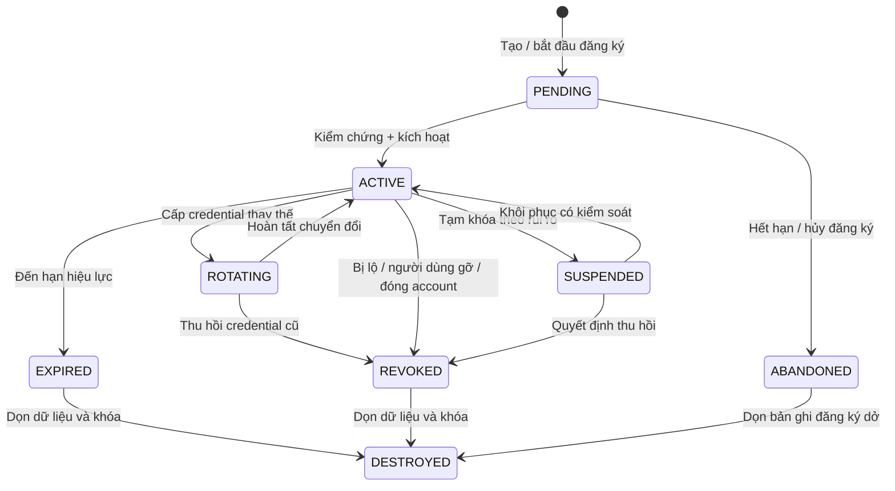

# Chu kỳ credential

Một credential không an toàn chỉ vì nó đã được tạo bằng thuật toán mạnh. Bí mật có thể được cấp cho sai chủ thể, bị lộ khi triển khai, tiếp tục có hiệu lực sau khi người dùng mất thiết bị hoặc bị chấp nhận trong khoảng thời gian quá dài sau khi thu hồi. **Chu kỳ credential (credential lifecycle)** bao trùm toàn bộ việc **đăng ký/cấp phát → kích hoạt → sử dụng → bảo trì, gia hạn hoặc xoay vòng → vô hiệu hóa/thu hồi → hết hạn và tiêu hủy**; mỗi chặng đều phải bảo vệ danh tính và quyền truy cập.

Ví dụ, một dịch vụ dùng API key để gọi cổng thanh toán. Key được tạo đúng chuẩn mật mã nhưng bị chép vào log CI, sau đó chỉ được “đổi” bằng cách thêm key mới mà không thu hồi key cũ. Kẻ tấn công vẫn có thể sử dụng key bị lộ. Tương tự, một người dùng xóa passkey khỏi giao diện nhưng máy chủ vẫn giữ đăng ký credential đó; thiết bị cũ có thể tiếp tục xác thực nếu các kiểm tra khác cho phép.

Trong nền tảng `SECURITY_AUTHENTICATION_FUNDAMENTALS`, hiểu chu kỳ credential giúp thiết kế xác thực cho mật khẩu, MFA, passkey, chứng chỉ, token và phiên; bảo vệ luồng liên kết danh tính và khôi phục tài khoản; đồng thời mô hình hóa ranh giới tin cậy, chống phishing, replay và lạm dụng đăng nhập.

## 1. Phân biệt credential, authenticator, danh tính và phiên

| Thành phần | Vai trò | Ví dụ | Quan hệ với vòng đời |
| --- | --- | --- | --- |
| **Subject/identity** | Chủ thể được công nhận trong một phạm vi tin cậy | `user_42`, service account `checkout` | Có thể tồn tại sau khi thay toàn bộ credential |
| **Credential** | Dữ liệu mật mã hoặc bí mật gắn với subject, dùng trong xác thực | Password verifier, public key đã đăng ký của passkey, API key, chứng chỉ | Có trạng thái, hiệu lực và cơ chế thu hồi riêng |
| **Authenticator** | Thành phần/thiết bị tạo bằng chứng xác thực | Security key, app TOTP, phần cứng giữ private key | Có thể bị mất, thay hoặc bị chiếm quyền |
| **Authentication event** | Kết quả kiểm tra bằng chứng ở một thời điểm | Xác minh passkey thành công lúc đăng nhập | Có thời điểm và mức đảm bảo; không có hiệu lực mãi mãi |
| **Session/token** | Cách mang kết quả xác thực hoặc quyền đã cấp sang yêu cầu tiếp theo | Session cookie, access token, refresh token | Có vòng đời riêng; cần xử lý khi credential bị thu hồi |

**Không đồng nhất credential với tài khoản.** Một tài khoản có thể đồng thời có mật khẩu, hai passkey, TOTP và recovery codes. Thu hồi một passkey không nhất thiết đóng tài khoản, nhưng phải ngăn passkey đó được dùng tiếp. Ngược lại, khi vô hiệu hóa tài khoản, các đường xác thực còn lại cũng phải bị chặn theo chính sách.

Đối với mật khẩu, hệ thống thường **không lưu mật khẩu gốc** mà lưu giá trị kiểm chứng được tạo bằng hàm băm mật khẩu thích hợp. Với passkey/WebAuthn, server lưu **public key và metadata credential**; private key nằm ở authenticator. Với chứng chỉ client, server kiểm tra chuỗi chứng chỉ và bằng chứng sở hữu private key. Với bearer token, **ai nắm token hợp lệ có thể sử dụng token trong phạm vi hiệu lực**, nên bảo vệ và thu hồi token quan trọng không kém bước tạo token.

## 2. Mô hình trạng thái vòng đời

Các trạng thái dưới đây là mô hình khái niệm; không phải hệ thống nào cũng cần đúng tên hoặc đầy đủ các trạng thái này. Chúng giúp làm rõ **thời điểm một credential còn được chấp nhận**.



Mô hình minh họa việc **thay credential đang hoạt động bằng một credential khác**; trên thực tế thao tác rotation thường tạo bản ghi credential mới có ID riêng, rồi đổi trạng thái bản ghi cũ. Không nên lấy credential đã `REVOKED` quay lại `ACTIVE`. Nếu cần cấp lại, dùng credential mới để có lịch sử audit rõ ràng.

| Giai đoạn | Hành động chính | Điều kiện cần bảo đảm |
| --- | --- | --- |
| **Đăng ký/cấp phát (enrollment/issuance)** | Tạo hoặc liên kết credential với subject | Đúng chủ thể, đúng tenant, nguồn cấp được tin cậy, quyền đăng ký hợp lệ |
| **Kích hoạt (activation)** | Xác nhận proof of possession hoặc hoàn tất bước xác minh | Credential chưa bị giả mạo; giao dịch/challenge còn hạn và dùng một lần |
| **Sử dụng (usage)** | Verifier kiểm tra bằng chứng trong từng lần yêu cầu | Đúng issuer, subject, audience/origin, thời gian và chính sách |
| **Gia hạn/xoay vòng (renewal/rotation)** | Thay khóa, secret hoặc cập nhật thời hạn | Credential mới hợp lệ; đường dùng credential cũ được cắt theo kế hoạch |
| **Tạm khóa (suspension)** | Ngăn sử dụng khi có rủi ro chưa được xử lý | Áp dụng thống nhất tại tất cả verifier liên quan |
| **Thu hồi (revocation)** | Tuyên bố credential không còn được chấp nhận | Không tiếp tục chấp nhận do cache hoặc phiên liên quan bị bỏ quên |
| **Hết hạn (expiration)** | Tự mất hiệu lực theo thời gian | Kiểm tra thời gian ở nơi xác minh; không “gia hạn” bằng cách bỏ kiểm tra |
| **Hủy (destruction)** | Xóa secret, khóa và bản ghi không còn cần thiết | Không để lại bản sao còn dùng được; giữ metadata audit tối thiểu theo chính sách |

### Các bất biến phải giữ qua mọi trạng thái

1. **Đúng chủ thể:** `credential_id` chỉ thuộc về một subject hợp lệ trong một phạm vi danh tính xác định; không tự liên kết bằng email hay dữ liệu client khai báo.
2. **Đúng giao dịch:** challenge, code hoặc token xác nhận phải được ràng buộc với hành động, đối tượng, ngữ cảnh và thời hạn phù hợp; token một lần phải được tiêu thụ nguyên tử.
3. **Chỉ credential đang được phép mới qua xác thực:** không chỉ kiểm tra chữ ký/hash, mà còn trạng thái, hạn và mục đích dùng.
4. **Không vượt quyền:** credential chứng minh chủ thể; quyền gọi API hay truy cập dữ liệu vẫn phải được xác định theo chính sách.
5. **Thu hồi có hiệu lực đo được:** phải biết từ lúc đánh dấu `REVOKED` đến lúc các dịch vụ thực sự từ chối credential mất bao lâu.
6. **Không tái sử dụng danh tính credential đã hủy:** credential mới cần ID/version mới; tránh để token hoặc liên kết cũ vô tình được công nhận lại.

## 3. Cấp phát và đăng ký: chặng đầu tiên của ranh giới tin cậy

Khi phát hành credential, hệ thống phải trả lời: **Ai yêu cầu? Credential sẽ thuộc về ai? Ai có quyền cấp? Bằng chứng nào cho thấy credential đã đến đúng nơi?** Đây là điểm tấn công phổ biến, vì kẻ tấn công có thể tìm cách đăng ký một yếu tố xác thực của mình vào tài khoản nạn nhân.

### 3.1. Với người dùng

Ví dụ người dùng đã có mật khẩu muốn thêm passkey:

1. Máy chủ xác thực phiên đang hoạt động và yêu cầu **xác thực lại (step-up)** nếu thao tác có rủi ro cao hoặc phiên đã cũ.
2. Server sinh challenge ngẫu nhiên, ràng buộc nó với account, tenant, phiên, loại hành động `REGISTER_PASSKEY` và thời hạn.
3. Authenticator tạo cặp khóa và trả kết quả đăng ký WebAuthn. Server dùng thư viện kiểm chứng đáng tin để kiểm tra challenge, origin, RP ID, thông tin authenticator theo chính sách và tính duy nhất của credential ID.
4. Server lưu public key/credential ID dưới **subject ID lấy từ phiên được xác minh**, không từ trường `userId` do client gửi.
5. Ghi audit và thông báo sự kiện thêm phương thức xác thực cho chủ tài khoản; cân nhắc thông báo qua kênh tin cậy đã tồn tại để phát hiện chiếm đoạt.

Không nên tự động gắn passkey vào tài khoản chỉ vì thiết bị khai báo một email. Với đăng nhập liên kết, dùng định danh từ IdP đã kiểm chứng (chẳng hạn `(iss, sub)` với OIDC) và quy trình liên kết tài khoản phù hợp; email là thuộc tính liên hệ, có thể thay đổi hoặc trùng nhau.

**Đăng ký TOTP/MFA** có thêm bước chứng minh authenticator đã nhận secret: sau khi hiển thị secret qua kênh bảo vệ, yêu cầu người dùng nhập một mã đúng trước khi đánh dấu MFA là `ACTIVE`. Secret TOTP phải được bảo vệ bằng mã hóa khi lưu trữ vì verifier cần khả năng tính mã tương ứng; không lưu plaintext trong log. **Recovery codes** nên được tạo ngẫu nhiên, hiển thị cho người dùng một lần và lưu dưới dạng giá trị kiểm chứng được bảo vệ thích hợp; mỗi mã chỉ dùng một lần.

### 3.2. Với workload và dịch vụ

API key hoặc chứng chỉ cấp cho service phải ràng buộc với **service identity**, môi trường, tenant/project và phạm vi quyền. Issuer cần dựa trên dữ liệu đáng tin từ nền tảng triển khai hoặc yêu cầu được ủy quyền, không chỉ dựa vào `serviceName` tự khai. Trong hệ thống tự động, ưu tiên credential ngắn hạn lấy qua workload identity, mTLS hoặc federation thay vì bí mật dùng chung lâu dài.

Ví dụ, `checkout` production không được xin chứng chỉ đại diện cho `billing` chỉ bằng cách truyền tham số `subject=billing`. Chính sách cấp phát phải xác minh workload đang chạy có quyền nhận subject đó.

### 3.3. Truyền credential tới nơi sử dụng

Credential cần được bàn giao qua kênh bảo vệ, giảm tối đa cơ hội xuất hiện trong **URL, shell history, file cấu hình được commit, log, CI artifact hay thông báo lỗi**. API key tĩnh thường chỉ nên hiển thị secret đầy đủ **một lần** khi tạo; server có thể lưu giá trị kiểm chứng một chiều và một prefix/ID để tra cứu. Private key dùng cho mTLS nên được tạo/lưu trong kho khóa hoặc cơ chế bảo vệ thích hợp; với passkey, private key thông thường không rời authenticator.

## 4. Sử dụng credential: xác thực không chỉ là so khớp bí mật

Trong mỗi lần sử dụng, verifier phải kiểm tra không chỉ bằng chứng mật mã mà cả **ràng buộc ngữ cảnh** và trạng thái hiện tại.

```mermaid
sequenceDiagram
    participant C as Client / workload
    participant V as Verifier
    participant R as Kho credential + trạng thái
    participant P as Policy / account state
    C->>V: Trình bằng chứng xác thực
    V->>R: Tra credential ID / subject theo thông tin tin cậy
    R-->>V: Verifier key/hash, subject, trạng thái, thời hạn
    V->>V: Kiểm tra chữ ký / secret / challenge / audience
    V->>P: Kiểm tra subject, tenant, policy, tình trạng account
    alt Credential ACTIVE, đúng ngữ cảnh và được phép
        V-->>C: Xác thực thành công; có thể cấp phiên/token phù hợp
    else Credential đã thu hồi, sai đích hoặc không hợp lệ
        V-->>C: Từ chối; không tạo phiên mới
    end
```

| Loại credential | Bằng chứng và kiểm tra chính | Rủi ro cần chú ý |
| --- | --- | --- |
| **Mật khẩu** | So khớp password verifier với KDF dành cho mật khẩu, hạn chế thử đoán | Credential stuffing, phishing, lộ password database |
| **TOTP** | Kiểm tra mã trong cửa sổ thời gian nhỏ, gắn với tài khoản/phiên xác thực đang xử lý | Phishing thời gian thực, replay mã trong cùng bước thời gian, brute force |
| **Passkey/WebAuthn** | Kiểm tra challenge, chữ ký, public key đã đăng ký, origin, RP ID và cờ UP/UV theo policy | Đăng ký nhầm tài khoản, chấp nhận challenge cũ, thiếu kiểm tra RP/origin |
| **API key** | Tra theo ID/prefix, kiểm tra secret bằng giá trị verifier, status, scope, expiry | Lộ trong log, sử dụng lại từ môi trường khác, quyền quá rộng |
| **Chứng chỉ X.509 client** | Xác minh mTLS, chuỗi CA, thời hạn, mục đích dùng, danh tính SAN và chính sách tin cậy/thu hồi | Tin nhầm CA, dùng sai trust domain, private key bị đánh cắp |
| **Access token/JWT** | Kiểm tra chữ ký hoặc introspection, issuer, audience, `exp`/`nbf`, subject, quyền phù hợp | Token đúng chữ ký nhưng sai audience; bearer token bị phát lại |

**Chống phishing:** mật khẩu và TOTP có thể bị người dùng nhập vào trang giả. WebAuthn/passkey ràng buộc xác thực với RP/origin nên có khả năng chống phishing tốt hơn khi triển khai đúng. **Chống replay:** mã OTP, token bearer hoặc bằng chứng lấy được có thể bị sử dụng lại trong khoảng hiệu lực nếu không có ràng buộc bổ sung. Dùng challenge mới theo giao dịch, token một lần, hạn ngắn, giới hạn số lần thử và cơ chế proof-of-possession/kênh khi phù hợp.

**Phân biệt xác thực với phân quyền:** credential hợp lệ của `checkout` không cấp quyền `billing.admin`. API phải kiểm tra principal và scope/role theo chính sách hiện tại; không tin quyền chỉ do client tự khai.

## 5. Chính sách thời hạn và xoay vòng theo từng loại

Không có một thời hạn hoặc nhịp rotation phù hợp với mọi credential. Cần dựa vào mô hình đe dọa, khả năng thu hồi, mức thiệt hại khi lộ, độ sẵn sàng và thiết bị lưu trữ.

| Loại | Cách quản lý thời hạn và thay thế | Điểm không nên làm |
| --- | --- | --- |
| **Mật khẩu người dùng** | Khuyến khích mật khẩu mạnh/duy nhất và trình quản lý mật khẩu; buộc đổi khi có bằng chứng bị lộ hoặc yêu cầu hợp lệ, lưu hash mới bằng KDF hiện đại | Ép đổi định kỳ một cách máy móc mà không có lý do; tái sử dụng mật khẩu cũ hoặc lưu plaintext |
| **TOTP và recovery codes** | Thay secret khi thiết bị mất/bị lộ; cấp lại recovery codes khi khôi phục và vô hiệu hóa bộ cũ | Cho phép mã khôi phục dùng nhiều lần hoặc giữ đồng thời quá nhiều secret cũ |
| **Passkey** | Có thể đăng ký nhiều credential; thêm credential mới bằng phiên được xác minh, gỡ credential mất/không tin cậy | Cho rằng đổi mật khẩu sẽ tự thu hồi mọi passkey; cho tài khoản không có phương thức recovery kiểm soát được |
| **API key/client secret** | Có ngày hết hạn và scope; hỗ trợ thay key theo từng service, chồng lấn ngắn có kiểm soát khi triển khai | Dùng một secret vĩnh viễn cho nhiều hệ thống, không theo dõi nơi sử dụng |
| **Chứng chỉ client** | Chứng chỉ có `notBefore`/`notAfter`; gia hạn tự động và phân phối khóa tin cậy; cân nhắc CRL/OCSP hoặc chứng chỉ sống ngắn theo kiến trúc | Chỉ kiểm tra CA, bỏ qua hạn và SAN; giữ khóa riêng cũ vô thời hạn |
| **Access token** | Thời hạn tương đối ngắn, kiểm tra issuer/audience; thiết kế cơ chế xử lý thu hồi cần thiết | Cho token sống quá lâu hoặc cho phép token dùng ở mọi API |
| **Refresh token** | Bảo vệ như credential nhạy cảm; rotation và phát hiện reuse khi phù hợp, thu hồi theo account/device/session | Coi nó chỉ là dữ liệu lưu trong client không cần bảo vệ |
| **Session cookie/ID** | Sinh ngẫu nhiên khó đoán, thay khi đăng nhập/nâng đặc quyền, hết hạn và thu hồi server-side | Kéo dài phiên vô hạn hoặc giữ session ID cũ khi đổi trạng thái xác thực |

### 5.1. Rotation không làm mất dịch vụ

Đối với các hệ thống cần hoạt động liên tục, thay API key hoặc chứng chỉ thường cần một khoảng **chuyển tiếp có kiểm soát**:

1. **Inventory:** biết ứng dụng, môi trường, owner, scope và nơi nào đang dùng credential cũ.
2. **Cấp credential mới:** tạo secret/khóa mới với ID hoặc version riêng, thời hạn rõ ràng; lưu vào secret manager và giới hạn người đọc.
3. **Phân phối và xác minh:** cập nhật workload, kiểm tra nó gọi được hệ thống đích bằng credential mới; giám sát lỗi xác thực và metric sử dụng credential cũ.
4. **Thu hồi credential cũ:** đặt deadline ngắn theo chính sách, từ chối key cũ sau khi hoàn tất chuyển đổi; không để hai credential cùng hiệu lực vô hạn.
5. **Dọn và ghi nhận:** xóa secret cũ khỏi nơi lưu trữ không còn cần, cập nhật inventory và audit; cân nhắc các bản sao trong deployment history, cache, backup.

**Ví dụ:** `reporting` dùng API key `K1`; tạo `K2`, triển khai `K2` tới toàn bộ replicas, kiểm tra traffic đang dùng `K2`, sau đó thu hồi `K1`. Nếu `K1` **được xác định đã lộ**, không ưu tiên sự thuận tiện bằng cách giữ overlap dài: phải giới hạn hoặc cắt quyền ngay, chấp nhận xử lý gián đoạn theo kế hoạch ứng cứu.

Với **chứng chỉ**, cần phân biệt xoay **chứng chỉ** (cấp chứng chỉ mới, có thể cùng khóa tùy chính sách) và xoay **khóa riêng** (tạo cặp khóa mới). Khi nghi private key lộ, chỉ cấp lại chứng chỉ cho cùng private key **không loại bỏ nguy cơ**; phải thay khóa, cắt hiệu lực khóa cũ và kiểm tra những nơi đã từng tin nó.

### 5.2. Không nhầm "refresh" và "rotation"

Gia hạn access token bằng refresh token là một **luồng cấp token mới**, không nhất thiết thay credential gốc như passkey hoặc password. **Refresh token rotation** có nghĩa refresh token vừa dùng sẽ được thay bằng một refresh token mới; nếu token cũ bị sử dụng lại, hệ thống có thể xem đó là dấu hiệu bị đánh cắp và thu hồi token family theo chính sách. Cần xử lý cạnh tranh giữa các request làm mới hợp lệ, mất kết nối và retry để không tự khóa người dùng không cần thiết.

## 6. Thu hồi và hết hạn: khi nào còn hiệu lực thực sự?

**Hết hạn** là thời điểm được quy định trước; **thu hồi** là quyết định làm credential mất hiệu lực trước khi hết hạn. Tạm khóa có thể phục hồi theo chính sách, còn credential đã thu hồi nên được thay bằng credential mới. Hệ thống phải xét cả hai tại nơi ra quyết định xác thực.

Các sự kiện thường kích hoạt thu hồi hoặc thay thế:

- Người dùng báo mất thiết bị, lộ mật khẩu, bị phishing hoặc không nhận ra một lần đăng nhập.
- Quản trị viên vô hiệu hóa tài khoản, thu hồi quyền, chấm dứt thành viên tenant hoặc nhân sự nghỉ việc.
- Khóa riêng của service bị lộ, API key xuất hiện trong source repository hoặc log.
- Phát hiện refresh token reuse, dấu hiệu session hijack hoặc đăng ký MFA/passkey trái phép.
- Thay nhà cung cấp danh tính, đóng tài khoản hoặc kết thúc hợp đồng với service tích hợp.

### 6.1. Thu hồi cần lan tới đâu?

Một credential bị thu hồi có thể đã tạo ra **hậu quả xác thực đang tồn tại**: session người dùng, refresh token, access token hoặc token ủy quyền service. Vì thế cần chính sách lan truyền rõ:

| Sự kiện | Tối thiểu cần xem xét |
| --- | --- |
| Thu hồi passkey mất thiết bị | Từ chối credential ID đó; đánh giá các phiên trên thiết bị và phiên có rủi ro |
| Đổi mật khẩu sau nghi chiếm tài khoản | Thay password verifier; cân nhắc thu hồi tất cả session/refresh token và yêu cầu xác thực lại |
| Gỡ TOTP hoặc thay recovery codes | Ngừng chấp nhận seed/mã cũ; kiểm tra yêu cầu xác thực lại ở các luồng nhạy cảm |
| Lộ API key | Thu hồi key, xoay secret, giảm quyền, điều tra log đã sử dụng, kiểm tra tác động |
| Lộ private key của chứng chỉ | Thay cặp khóa, xử lý thu hồi/giảm TTL, cập nhật trust và các phiên liên quan khi cần |
| Xóa hoặc khóa account | Từ chối credential còn lại; thu hồi session/refresh token; chặn access token theo mô hình kiểm soát quyền |

Đối với token JWT **tự chứa** đã phát hành, thay trạng thái credential nguồn không tự làm chữ ký của token sai. Nếu API chỉ xác minh chữ ký và `exp`, token cũ vẫn có thể được chấp nhận. Để thu hồi sớm, lựa chọn có thể gồm token sống ngắn kết hợp kiểm tra trạng thái account/session, introspection, denylist theo `jti`, hoặc phiên bản xác thực (`auth_version`) được kiểm tra bằng nguồn đáng tin. Mỗi lựa chọn có chi phí độ trễ, cache và tính sẵn sàng; phải xác định **độ trễ thu hồi tối đa** chấp nhận được.

Đối với chứng chỉ X.509, cần quyết định cách sử dụng **CRL/OCSP**, chứng chỉ ngắn hạn hoặc một chính sách cấp chứng chỉ khác theo môi trường triển khai. Một số hệ thống mTLS dựa nhiều vào chứng chỉ sống ngắn và chính sách trust bundle thay vì tra thu hồi trên mỗi kết nối. Không thể chỉ đánh dấu chứng chỉ `REVOKED` trong một database nội bộ rồi cho rằng mọi peer sẽ ngừng tin nó ngay lập tức.

### 6.2. Cạnh tranh và cache ở ranh giới thu hồi

Giả sử API request được kiểm tra credential ở thời điểm T1, quản trị viên thu hồi ở T2, và request thực thi nghiệp vụ ở T3. Đối với thao tác nhạy cảm, phải xác định rõ **điểm kiểm tra quyền cuối cùng** và xử lý race condition theo chính sách. Việc cập nhật trạng thái credential và xuất sự kiện nên có cơ chế nhất quán như transaction/outbox, các consumer idempotent, và cache có giới hạn thời gian. Mục tiêu không phải hứa mọi request đang chạy sẽ biến mất tức thời, mà là thiết kế một **cam kết cắt quyền có thể kiểm chứng**.

## 7. Lưu trữ, bảo vệ và tiêu hủy credential

Quy trình an toàn phải xét mọi nơi credential có thể xuất hiện, không chỉ database chính.

| Nhóm dữ liệu | Cách bảo vệ phù hợp | Lưu ý khi dọn bỏ |
| --- | --- | --- |
| Password verifier | Dùng Argon2id hoặc KDF mật khẩu hiện đại được cấu hình đúng, salt riêng; có thể dùng pepper được bảo vệ tách biệt theo kiến trúc | Không lưu password plaintext; xóa hash cũ khi thay nếu không còn nhu cầu hợp lệ |
| TOTP seed | Mã hóa khi lưu, hạn chế truy cập/giải mã; bảo vệ đường enrollment | Thu hồi seed và mọi bản sao trong hệ thống; không đưa vào log |
| Recovery codes | Secret ngẫu nhiên đủ mạnh, lưu dạng giá trị kiểm chứng phù hợp, tiêu thụ một lần | Dùng lại hoặc giữ bộ code cũ tạo đường truy cập phụ |
| API key ngẫu nhiên | Hiển thị secret một lần, lưu hash/HMAC kiểm chứng, ID/prefix để tra cứu và giới hạn scope | Thu hồi key trước khi xóa bản ghi metadata cần cho audit |
| Private key server/workload | Dùng kho khóa, secret manager, HSM hoặc cơ chế workload identity; tối thiểu hóa người/tiến trình có quyền đọc | Xoay/cắt quyền; việc xóa file không bảo đảm xóa mọi backup hoặc snapshot |
| Public key, chứng chỉ | Không phải secret, nhưng phải bảo vệ **tính toàn vẹn** và ánh xạ đúng subject | Gỡ đăng ký/trust theo trạng thái, giữ audit tối thiểu nếu cần |
| Session/refresh token | Lưu an toàn, token phía server dùng giá trị kiểm chứng phù hợp; cookie `Secure`, `HttpOnly`, `SameSite` theo bối cảnh | Thu hồi khi logout, rủi ro hoặc đóng tài khoản; không ghi token nguyên vẹn vào log |

**Xóa vật lý không luôn tức thời** với dữ liệu được sao lưu hoặc ghi theo cơ chế bất biến. Nên hạn chế vòng đời backup, bảo vệ truy cập, và có quy trình xử lý bản phục hồi để trạng thái credential đã thu hồi **không bị hồi sinh**. Nếu có cơ chế hủy khóa mã hóa để làm dữ liệu không thể giải mã, phải xác minh phạm vi và các bản sao của khóa trước khi coi đó là tiêu hủy hiệu quả.

**Không log bí mật:** audit nên ghi `credential_id`/loại, subject, actor thực hiện, nguồn, trạng thái trước/sau, thời điểm và correlation ID; không log raw password, TOTP seed, recovery code, private key, session cookie, bearer token hoặc toàn bộ API key.

## 8. Mẫu triển khai: quản lý API key có version và trạng thái

API key minh họa rõ một lifecycle vì vừa cần cấp phát, lưu secret an toàn, xác minh, xoay vòng vừa cần thu hồi. Ví dụ sau là **pseudocode Java**, mô tả trách nhiệm nghiệp vụ; các chi tiết xác thực request, xử lý mật mã, transaction và storage cần thực hiện bằng thư viện/nền tảng tin cậy trong hệ thống thật.

```java
enum CredentialState { PENDING, ACTIVE, SUSPENDED, REVOKED, EXPIRED }

record ApiCredential(
    String id,
    String subjectId,
    String tenantId,
    byte[] secretVerifier,     // Ví dụ HMAC có khóa do server quản lý.
    CredentialState state,
    Instant expiresAt,
    Set<String> scopes,
    long version
) {}

// Khi cấp key: sinh bí mật ngẫu nhiên đủ entropy bằng CSPRNG,
// gắn với subject từ principal đã xác thực; trả secret cho caller một lần.
IssuedKey createKey(Principal actor, Subject target, Set<String> scopes) {
    requireCanManageCredential(actor, target, scopes);
    requireRecentStrongAuth(actor, "CREATE_API_KEY");

    byte[] secret = secureRandomBytes(32);
    String id = newRandomCredentialId();
    byte[] verifier = serverKeyedHmac(secret); // Khóa HMAC lưu tách biệt.
    repository.insert(id, target.id(), target.tenantId(), verifier,
                      ACTIVE, policy.expiryFor(scopes), scopes);
    audit.recordWithoutSecret("API_KEY_CREATED", actor.id(), target.id(), id);
    return new IssuedKey(id, encodeForOneTimeDisplay(secret));
}

// Mọi request: trích principal từ credential đã kiểm chứng,
// không lấy subject từ header do client tự khai.
AuthenticatedPrincipal authenticateApiKey(String id, String presentedSecret) {
    ApiCredential credential = repository.findById(id);
    if (credential == null || credential.state() != ACTIVE) return DENY;
    if (!now().isBefore(credential.expiresAt())) return DENY;
    if (!subjectStore.isActive(credential.tenantId(), credential.subjectId())) {
        return DENY;
    }
    byte[] candidate = serverKeyedHmac(decodeSecret(presentedSecret));
    if (!constantTimeEquals(candidate, credential.secretVerifier())) return DENY;
    return new AuthenticatedPrincipal(credential.subjectId(),
                                      credential.tenantId(), credential.scopes());
}

// Khi thu hồi: kiểm tra quyền quản lý của actor, chuyển trạng thái
// bằng cập nhật có điều kiện để tránh hai lệnh đồng thời ghi đè nhau.
void revokeKey(Principal actor, String credentialId) {
    repository.transaction(() -> {
        ApiCredential current = repository.lockById(credentialId);
        requireCanManageCredential(actor, current);
        if (current.state() == REVOKED) return; // Idempotent.
        repository.updateStateIfVersion(credentialId, current.version(), REVOKED);
        outbox.append("CredentialRevoked", credentialId);
        audit.recordWithoutSecret("API_KEY_REVOKED", actor.id(),
                                  current.subjectId(), credentialId);
    });
}
```

**Các lưu ý quan trọng về mẫu:**

- Secret phải đủ entropy, không tự sinh từ email, timestamp hoặc UUID thiếu bảo đảm về độ ngẫu nhiên. Với API key ngẫu nhiên mạnh, giá trị kiểm chứng HMAC một chiều có khóa server là một phương án; **mật khẩu do người dùng chọn cần KDF dành cho mật khẩu**, không thay bằng HMAC nhanh thông thường.
- `decodeSecret`, `constantTimeEquals`, cấp scope, kiểm tra quota/rate limit và xử lý lỗi phải có triển khai đầy đủ. Đừng để thông báo lỗi tiết lộ key ID hoặc chủ thể nào tồn tại nếu không cần thiết.
- Việc cập nhật state/version phải thực sự **nguyên tử** và kiểm tra kết quả cập nhật có điều kiện; nếu cập nhật thất bại vì version thay đổi, xử lý retry/xung đột có kiểm soát.
- Nếu verifier cache trạng thái key, cần cơ chế invalidation hoặc TTL đáp ứng cam kết thu hồi. Chỉ gửi sự kiện `CredentialRevoked` mà không kiểm soát cache không bảo đảm thu hồi ngay.
- Đối với rotation, tạo **credential ID mới**, xác minh workload đã chuyển sang key mới, rồi thu hồi key cũ theo deadline. Nếu nghi lộ key, thu hồi ngay theo quy trình ứng cứu.
- Kiểm tra scope ở từng API/operation sau khi xác thực; `AuthenticatedPrincipal` không đồng nghĩa được phép truy cập mọi tài nguyên.

## 9. Xử lý mất credential, bị lộ và recovery

### 9.1. Bị lộ khác với hết hạn tự nhiên

Nếu nghi password bị lộ, thay mật khẩu chỉ là một phần: nên xem xét phiên hiện có, refresh token, MFA vừa bị thay đổi và các dấu hiệu lạm dụng. Nếu private key của service bị lộ, cần tạo **khóa mới** và kiểm tra mọi nơi chấp nhận chứng chỉ cũ; việc gia hạn chứng chỉ dùng lại khóa bị lộ không giải quyết nguyên nhân.

### 9.2. Recovery cũng tạo ra đường xác thực mới

Người dùng mất authenticator có thể cần recovery, nhưng recovery yếu sẽ trở thành con đường vượt qua MFA/passkey mạnh. Một luồng recovery cần:

1. Xác định tài khoản mục tiêu mà không làm lộ thông tin nhạy cảm không cần thiết.
2. Kiểm tra bằng chứng recovery phù hợp mức rủi ro; nếu dùng token xác nhận, token phải ngẫu nhiên, ngắn hạn, **một lần** và gắn với đúng subject/hành động.
3. Giới hạn số lần thử, theo dõi bất thường và áp dụng thời gian chờ hoặc kiểm soát hỗ trợ khi cần.
4. Đăng ký credential mới cho đúng subject; **thu hồi credential mất** và đánh giá phiên còn hoạt động.
5. Thông báo tới kênh đã xác minh trước đó khi có thể; cung cấp đường xử lý nếu người dùng không nhận ra thay đổi.

Một email khôi phục không tự động chứng minh danh tính ngoài đời hoặc quyền kiểm soát mọi credential của tài khoản; mức đảm bảo của recovery phải được chọn từ mô hình rủi ro. Đặc biệt, yêu cầu thay MFA hoặc thêm passkey mới thường cần xác thực lại bằng một yếu tố còn tin cậy hoặc quy trình recovery đủ mạnh.

### 9.3. Phishing và replay qua giai đoạn đổi credential

Kẻ tấn công có thể gửi trang giả “credential sắp hết hạn” để lấy mật khẩu/OTP, hoặc đánh cắp link đổi mật khẩu rồi sử dụng lại. Dịch vụ cần dùng thông báo có thể kiểm chứng, không yêu cầu gửi bí mật qua email/chat, kiểm tra origin/RP với WebAuthn và tiêu thụ token một lần. Hành động đổi credential phải ràng buộc với **account và phiên/giao dịch đã được kiểm chứng**, không chỉ dựa vào một giá trị `userId` trong request.

## 10. Vận hành và giám sát lifecycle

Hệ thống quản lý credential tốt cần biết **ai sở hữu credential, nó dùng ở đâu, sắp hết hạn khi nào, có đang bị sử dụng bất thường không, và ai có quyền thu hồi**.

Một inventory tối thiểu cho credential service có thể gồm: `credential_id`, `subject_id`, `tenant`, `issuer`, `type`, `environment`, `created_at`, `activated_at`, `expires_at`, `last_used_at`, `state`, `rotation_due_at`, `owner`, `scopes` và thông tin audit. Không cần lưu raw secret để tạo inventory.

Nên có cảnh báo về credential sắp hết hạn, rotation thất bại, quá nhiều lần xác thực sai, key cũ vẫn được sử dụng sau cutover, token reuse và thao tác thay MFA/passkey bất thường. **`last_used_at`** hữu ích để biết key không còn dùng, nhưng không đủ để kết luận key an toàn: log hoặc cache có thể trễ hoặc thiếu sự kiện.

Đối với hệ thống nhiều service, xác định rõ **nơi chịu trách nhiệm cuối cùng về trạng thái credential**. Nếu gateway xác thực token nhưng service đích có cache quyền, cần mô hình hóa sự lan truyền thu hồi và kiểm thử thời gian thực tế. Nếu một credential dùng chung nhiều service, việc thu hồi có thể gây gián đoạn diện rộng; tốt hơn nên cấp riêng theo service, môi trường và phạm vi quyền.

## 11. Kiểm thử vòng đời credential

Kiểm thử phải bao quát trạng thái và ranh giới tin cậy, không chỉ trường hợp đăng nhập thành công.

| Tình huống kiểm thử | Kết quả mong đợi |
| --- | --- |
| Client gửi `subjectId` khác với account đã xác thực khi thêm passkey | Không đăng ký credential cho subject khác |
| Dùng lại challenge đăng ký hoặc token reset đã tiêu thụ | Bị từ chối, không sinh credential mới |
| TOTP đúng nhưng thuộc tài khoản khác hoặc phiên MFA khác | Không hoàn tất xác thực cho tài khoản hiện tại |
| Credential `SUSPENDED` / `REVOKED` / `EXPIRED` có chữ ký hoặc secret đúng | Không được chấp nhận |
| JWT đúng chữ ký nhưng sai `aud` hoặc `iss` | API từ chối |
| API key cũ còn đang dùng sau ngày thu hồi | Bị từ chối, có tín hiệu giám sát thích hợp |
| Hai yêu cầu thu hồi và gia hạn chạy đồng thời | Trạng thái cuối nhất quán; không hồi sinh credential đã thu hồi |
| Mất private key rồi cấp chứng chỉ mới nhưng giữ nguyên khóa | Kiểm tra phát hiện kế hoạch rotation chưa loại bỏ rủi ro |
| Khóa account trong lúc access token còn hạn | Các API áp dụng chính sách chặn account và giới hạn độ trễ thu hồi |
| Khôi phục database từ backup cũ | Credential đã thu hồi không được kích hoạt lại ngoài ý muốn |
| Người dùng mất toàn bộ MFA/passkey | Recovery được kiểm soát, không cho phép attacker thêm yếu tố mới chỉ bằng thông tin tự khai |
| Log của ứng dụng, gateway và CI | Không chứa secret/token hoặc recovery code nguyên vẹn |
| Đăng ký lại tài khoản bằng email cũ | Credential của subject cũ không tự động được liên kết sang subject mới |

### Bài tập tình huống

Ứng dụng có hai service `order-service` và `invoice-service` cùng dùng một API key `K-legacy` không hết hạn. Tất cả replica đọc key từ biến môi trường, key có quyền vừa đọc đơn hàng vừa ghi hóa đơn. Sau một đợt triển khai, một bản log lộ key. Đội vận hành tạo `K-new`, nhưng hai tuần sau vẫn thấy request dùng `K-legacy` thành công.

**Yêu cầu:** Chỉ ra những lỗi thuộc chu kỳ credential và đề xuất phương án thay thế.

**Hướng giải:**

1. **Kiểm kê phạm vi lộ:** xác định nơi lưu key, đường gọi API, các replica, quyền hiện có và khả năng đã bị dùng trái phép; coi `K-legacy` là credential bị lộ.
2. **Thu hồi và ứng cứu:** ưu tiên cắt hoặc giới hạn quyền `K-legacy` ngay theo mức độ rủi ro; theo dõi truy cập và xử lý gián đoạn có kiểm soát. Chỉ tạo `K-new` là chưa hoàn tất rotation.
3. **Tách danh tính và quyền:** cấp credential riêng cho `order-service` và `invoice-service`, scope tối thiểu theo nhiệm vụ, có owner, hạn và chính sách thu hồi riêng.
4. **Đổi cơ chế cấp phát:** ưu tiên secret manager hoặc workload identity/federation cho credential ngắn hạn khi hạ tầng hỗ trợ; chặn việc in secret vào log và artifact CI.
5. **Xác minh cutover:** kiểm tra traffic, từ chối credential cũ trên verifier, test bằng chính key cũ, theo dõi cache và audit để chứng minh thu hồi đã có hiệu lực.

## 12. Câu hỏi tự kiểm tra

1. **Vì sao credential vẫn có thể không an toàn dù thuật toán mật mã mạnh?** Vì nó có thể được cấp sai subject, lưu lộ bí mật, dùng sai ngữ cảnh, bị phát lại hoặc không được thu hồi sau khi lộ.
2. **Đổi mật khẩu có tự động đăng xuất mọi phiên và thu hồi passkey không?** Không. Password verifier, passkey, session và token có vòng đời riêng; phải có chính sách thu hồi và xác thực lại rõ ràng.
3. **Tại sao API key đã lộ cần được thu hồi, thay vì chỉ cấp thêm key mới?** Vì key cũ vẫn có thể xác thực tới khi bị từ chối ở nơi kiểm chứng.
4. **Sự khác nhau giữa expiration và revocation?** Expiration xảy ra tại thời hạn định trước; revocation là quyết định làm credential mất hiệu lực sớm hơn.
5. **Vì sao cần giới hạn audience, subject và thời hạn của token?** Để không dùng được token cấp cho dịch vụ/tài khoản/giao dịch khác và giảm khoảng thời gian có thể replay.
6. **Khi nào rotation được coi là hoàn tất?** Khi credential mới vận hành đúng, credential cũ không còn được chấp nhận theo chính sách, các bản sao không cần thiết được xử lý và audit/giám sát xác nhận kết quả.

**Ghi nhớ:** Một credential chỉ đáng tin khi được **cấp cho đúng chủ thể, giữ bí mật hoặc bảo vệ khóa đúng cách, xác minh trong đúng ngữ cảnh, thay thế đúng thời điểm và ngừng được chấp nhận khi hết hạn hoặc thu hồi**. Quản lý vòng đời xuyên suốt credential, phiên/token và các hệ thống nhận danh tính là điều kiện thiết yếu để xác thực an toàn trong thực tế.
