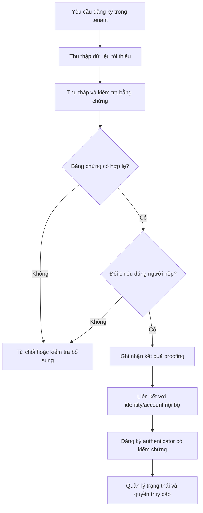

# Identity assurance

**Identity assurance** (*mức độ bảo đảm danh tính*) là mức tin cậy rằng danh tính số được thiết lập đúng cho người hoặc thực thể mà nó tuyên bố đại diện. Câu hỏi trung tâm là: **“Danh tính được gắn với ai, dựa vào bằng chứng và quy trình kiểm tra nào?”** Khái niệm này khác với câu hỏi **“Người đang đăng nhập có kiểm soát authenticator của danh tính ấy không?”**.

Đây là chủ đề thuộc chương **Mức độ tin cậy** trong module **SECURITY_AUTHENTICATION_FUNDAMENTALS**. Hiểu identity assurance giúp xây dựng luồng đăng ký, mật khẩu, MFA, passkey, chứng chỉ, token, phiên, liên kết IdP và khôi phục account an toàn. Người học sẽ biết đánh giá identity proofing theo rủi ro, mô hình hóa ranh giới tin cậy, phòng mạo danh và không đánh đồng xác thực chống phishing với xác minh danh tính thực.

## 1. Danh tính số có thể đúng hoặc bị gán nhầm

Một ứng dụng học tập cho phép người dùng tự nhập tên, xác minh email và đăng ký passkey. Passkey có thể xác thực rất tốt việc người đăng nhập kiểm soát khóa đã đăng ký, nhưng **không chứng minh rằng tên họ tự nhập là tên thật**. Nếu ứng dụng cấp chứng chỉ nghề nghiệp mang tên đó mà không có quy trình identity proofing phù hợp, kẻ gian có thể đạt chứng chỉ dưới tên người khác.

Ngược lại, công ty có thể kiểm tra hồ sơ nhân sự rất kỹ để biết chính xác một nhân viên là ai, nhưng nếu nhân viên chỉ đăng nhập bằng mật khẩu dễ bị phishing thì kẻ tấn công vẫn có thể chiếm phiên của họ. Cần bảo đảm **cả việc xác lập danh tính và việc sử dụng danh tính sau đó**.

| Khái niệm | Câu hỏi | Ví dụ |
| --- | --- | --- |
| **User identity** | Hệ thống biểu diễn chủ thể nào? | Định danh nội bộ `usr-91a` trong tenant `org-7`. |
| **Identity proofing** | Quy trình nào kiểm tra mối liên hệ giữa danh tính số và người thực? | Đối chiếu hồ sơ đăng ký với bằng chứng và nguồn đáng tin cậy. |
| **Identity assurance** | Có thể tin kết quả thiết lập danh tính đến mức nào? | Chính sách proofing được đánh giá theo yêu cầu bảo đảm đã chọn. |
| **Authentication** | Người hiện tại chứng minh quyền kiểm soát credential như thế nào? | Passkey ký challenge, TOTP, mật khẩu. |
| **Authorization** | Sau khi xác thực, người này được làm gì? | Được cấp chứng chỉ hoặc duyệt hồ sơ học viên. |
| **Account** | Dịch vụ quản lý trạng thái, dữ liệu và liên kết quyền qua bản ghi nào? | Account hoạt động, bị đình chỉ hoặc đã đóng. |

**Danh tính thực**, **danh tính số**, **account**, **credential** và **principal trong phiên** có liên quan nhưng không đồng nhất. Mối liên hệ giữa chúng phải được xác lập đúng và duy trì an toàn.

### 1.1. Xác minh email chưa phải xác minh danh tính pháp lý

Nếu ứng dụng gửi một mã đến email và người dùng nhập đúng, nó có cơ sở rằng người dùng đang kiểm soát hộp thư hoặc có thể nhận mã ở thời điểm ấy. Điều đó không tự động chứng minh:

- Họ và tên, tuổi hoặc tư cách nhân viên đã khai báo là đúng.
- Hộp thư vẫn thuộc cùng một người trong tương lai.
- Người kiểm soát hộp thư được phép tiếp quản một account cũ có email tương tự.
- Chủ thể đã đạt một mức identity assurance cao theo tiêu chuẩn.

Email và số điện thoại có thể đổi chủ, tái cấp hoặc bị chiếm. Khi ứng dụng cần xác minh người thật, phải có bằng chứng và quy trình tương ứng với mục đích.

## 2. Ba trục bảo đảm IAL, AAL và FAL

Các hướng dẫn danh tính số như **NIST SP 800-63** phân biệt những trục bảo đảm có mục đích khác nhau:

- **IAL (Identity Assurance Level):** mức bảo đảm của việc **xác lập và chứng minh danh tính** thông qua identity proofing.
- **AAL (Authentication Assurance Level):** mức bảo đảm rằng người đang đăng nhập kiểm soát authenticator gắn với danh tính ấy.
- **FAL (Federation Assurance Level):** mức bảo đảm của việc **truyền và tiếp nhận kết quả xác thực** giữa nhà cung cấp danh tính (IdP) và ứng dụng sử dụng danh tính (relying party, RP).

Các điều kiện chính thức phụ thuộc **phiên bản tiêu chuẩn, bối cảnh và yêu cầu tuân thủ**. Bài này cung cấp mô hình khái niệm để học thiết kế; không thể chỉ nhìn một thao tác rồi tự tuyên bố đã đạt mức NIST cụ thể.

| Trục | Vấn đề phải giải quyết | Sai lầm thường gặp |
| --- | --- | --- |
| IAL | Ai đã được cấp identity và căn cứ nào xác minh người đó? | Nghĩ rằng dùng passkey sẽ nâng mức xác minh danh tính thật. |
| AAL | Có phải đúng người kiểm soát authenticator đang sử dụng hay không? | Cho rằng có giấy tờ danh tính là đủ để chống chiếm tài khoản. |
| FAL | RP có thể tin assertion/claims từ IdP ra sao? | Tin ID token chỉ vì giải mã thấy email hoặc một trường `verified`. |

### 2.1. Trực giác về các mức IAL

Các mức **IAL1, IAL2, IAL3** thường được dùng để tổ chức yêu cầu identity proofing. Hiểu khái quát:

| Mức | Ý nghĩa học thuật | Ví dụ bối cảnh |
| --- | --- | --- |
| **IAL1** | Yêu cầu kiểm chứng danh tính ngoài đời hạn chế; có thể dùng thuộc tính do chủ thể tự khai. | Cộng đồng trao đổi hoặc lớp học không cấp quyền dựa trên danh tính pháp lý. |
| **IAL2** | Cần quy trình kiểm chứng bằng chứng và liên hệ với chủ thể ở mức đáng tin hơn để giảm rủi ro mạo danh. | Dịch vụ có hậu quả đáng kể nếu gắn dữ liệu hoặc quyền cho sai người. |
| **IAL3** | Mức bảo đảm cao hơn, với yêu cầu nghiêm ngặt hơn đối với quy trình xác minh, sự hiện diện/giám sát và chống giả mạo theo chuẩn áp dụng. | Nghiệp vụ rất nhạy cảm, sai danh tính có hậu quả nghiêm trọng. |

**Không thể suy IAL từ một yếu tố đơn lẻ:** “đã chụp căn cước”, “đã quét khuôn mặt”, “đã gọi video” hoặc “đã được nhân viên hỗ trợ đánh dấu verified” không tự đủ điều kiện. Cần kiểm tra **toàn bộ quy trình**: nguồn bằng chứng, tính hợp lệ, đối chiếu người trình bày, bảo vệ dữ liệu, kiểm soát gian lận, xử lý ngoại lệ và việc liên kết kết quả với account.

### 2.2. Các trục không bù trừ tùy tiện

Không nên tính `assurance = IAL + AAL + FAL` rồi cấp quyền chỉ theo tổng điểm. Một dịch vụ có thể bắt buộc **IAL phù hợp để cấp chứng chỉ thật**, **AAL phù hợp để đăng nhập**, **FAL phù hợp khi nhận kết quả từ IdP**. AAL cao không bù được cho identity được cấp nhầm; IAL cao cũng không bù được cho credential bị lừa qua phishing.

Điểm rủi ro đăng nhập như “thiết bị lạ, IP lạ” cũng khác với IAL: đó là tín hiệu của một **sự kiện xác thực**, không đánh giá trực tiếp nguồn gốc danh tính số.

## 3. Quy trình identity proofing

Có thể hình dung proofing qua những hoạt động liên tiếp hoặc phối hợp:

1. **Identity resolution (phân giải):** Xác định đủ thông tin để phân biệt người yêu cầu với người khác trong phạm vi hệ thống, ví dụ hồ sơ nhân viên nào được nói đến.
2. **Evidence collection (thu thập):** Tiếp nhận bằng chứng phù hợp, có thể là tài liệu, dữ liệu từ hệ thống đáng tin hoặc chứng cứ do chương trình proofing chấp nhận.
3. **Evidence validation (kiểm tra bằng chứng):** Xem chứng cứ có thật, hợp lệ, còn hiệu lực, không bị sửa và đến từ nguồn đáng tin không.
4. **Identity verification (đối chiếu chủ thể):** Kiểm tra người đang đăng ký có phải người mà bằng chứng mô tả không.
5. **Binding/enrollment (liên kết và ghi danh):** Gắn kết quả proofing với định danh nội bộ ổn định và account/credential được kiểm soát.
6. **Lifecycle (duy trì):** Xử lý thay đổi thuộc tính, nghi vấn gian lận, đình chỉ, khôi phục và tái kiểm chứng khi rủi ro thay đổi.

Ví dụ, kiểm tra một căn cước là thật mới đáp ứng **validation**. Một người khác vẫn có thể cầm căn cước thật của chủ sở hữu. Bước **verification** phải giải quyết việc người xuất trình có đúng là người mà bằng chứng nói đến không.

### 3.1. Resolution: phân biệt hai người trùng thông tin

Hai nhân viên có thể trùng họ tên; một email công ty có thể được cấp lại cho người mới. Bước phân giải cần xác định các thuộc tính đủ để tránh gắn nhầm hồ sơ. Không dùng tên hoặc email làm khóa chính liên kết identity nếu chúng có thể thay đổi hoặc trùng trong phạm vi cần quản lý.

Khóa nội bộ như `user_identity_id` nên ổn định; liên kết bên ngoài cần đúng nguồn, ví dụ cặp `(issuer, subject)` của IdP, và kèm `tenant_id` trong hệ thống đa tổ chức theo chính sách dữ liệu.

### 3.2. Validation: chứng cứ có hợp lệ không?

Khi kiểm tra tài liệu hoặc dữ liệu tổ chức, cần xác định:

- Nguồn nào phát hành? Nguồn có thẩm quyền với loại thông tin đó không?
- Bằng chứng còn hiệu lực, toàn vẹn, không có dấu hiệu giả mạo hoặc sửa đổi không?
- Nếu dữ liệu nhận qua API/webhook, thông điệp có được xác minh nguồn, chữ ký/kênh và đúng mục đích không?
- Hồ sơ có được cập nhật kịp thời? Một thuộc tính “đang là nhân viên” có thể hết đúng sau khi người đó nghỉ việc.

Ảnh scan hoặc màn hình hiển thị kết quả `verified=true` không tự đáng tin nếu nguồn và quy trình đã bị bỏ qua.

### 3.3. Verification: người nộp là ai?

Cơ chế đối chiếu phụ thuộc mức bảo đảm và điều kiện tiếp cận: trực tiếp, từ xa có giám sát, so sánh với nguồn đáng tin cậy hoặc các hình thức proofing mà chính sách chấp nhận. Kiểm tra từ xa phải cân nhắc **ảnh/video phát lại, deepfake, camera ảo, injection và trình diễn giả**.

Kiểm tra “liveness” có thể giảm một số kiểu giả mạo nhưng không tự chứng minh danh tính thật, không phải hàng rào tuyệt đối chống deepfake và có thể từ chối nhầm người thật. Quy trình cần đánh giá độ chính xác và phương án xử lý trường hợp không thể hoàn tất kiểm tra chính.

### 3.4. Binding: kết quả phải gắn với đúng identity

Ngay cả khi proofing đúng, kết quả vẫn có thể bị gắn nhầm với account nếu ứng dụng tìm người bằng email trùng hoặc nhận `user_id` tự khai từ client.



**Đăng ký authenticator sau proofing là một bước riêng.** Thiết lập đúng identity nhưng cho người lạ gắn khóa vào account có thể làm hỏng toàn bộ lợi ích của proofing trước đó.

## 4. Chọn yêu cầu assurance dựa trên rủi ro

Không phải ứng dụng nào cũng cần thu thập giấy tờ hoặc sinh trắc. **Thu thập quá nhiều** tăng chi phí, ảnh hưởng quyền riêng tư và có thể loại trừ người dùng hợp lệ. **Thu thập quá ít** có thể khiến người dùng mạo danh để nhận quyền, chứng chỉ hoặc lợi ích.

Hãy xuất phát từ **hậu quả của việc xác lập danh tính sai**:

| Tình huống | Hậu quả nếu nhận sai người | Hướng thiết kế |
| --- | --- | --- |
| Học nội dung công khai bằng biệt danh | Thấp nếu không cấp quyền hoặc chứng chỉ theo tên thật. | Có thể chấp nhận tên tự khai; giảm thu thập dữ liệu. |
| Vào khóa đào tạo riêng cho nhân viên | Người ngoài có thể đọc tài liệu nội bộ. | Kiểm tra membership từ nguồn doanh nghiệp đáng tin, ràng buộc tenant. |
| Cấp chứng chỉ nghề nghiệp chính thức | Chứng chỉ mang tên người khác, gian lận thành tích. | Proofing phù hợp trước khi phát hành chứng chỉ. |
| Thay đổi người hưởng quyền lợi, nhận thanh toán | Thiệt hại tài chính, tranh chấp. | Kiểm tra danh tính mạnh hơn, xác minh lại thay đổi nhạy cảm. |
| Cấp account quản trị hệ thống | Mạo danh gây ảnh hưởng hàng loạt tài khoản. | Proofing, phê duyệt, AAL, phân quyền và giám sát đều phải đủ mạnh. |

Quy trình lựa chọn có thể gồm:

1. Phân tích tài nguyên, hậu quả gian lận, yêu cầu pháp lý/nghiệp vụ, ảnh hưởng quyền riêng tư.
2. Xác định **thao tác nào** cần biết danh tính thật; không buộc toàn bộ người dùng công khai làm proofing cao.
3. Chọn mục tiêu bảo đảm theo chuẩn hoặc chính sách nội bộ có thể kiểm tra, kèm yêu cầu AAL/FAL độc lập.
4. Xác định loại bằng chứng và nguồn chấp nhận, cách xử lý sai lệch hoặc thiếu tài liệu.
5. Xác định ai phê duyệt, ai kiểm toán, ai được cập nhật và khi nào phải tái kiểm tra.
6. Đo tỷ lệ gian lận, tỷ lệ từ chối nhầm, khả năng hỗ trợ và rủi ro rò rỉ dữ liệu.

Một trường `identity_verified: true` không chứa đủ thông tin về tiêu chí, thời điểm và nguồn proofing, nên không thích hợp làm căn cứ duy nhất cho mọi quyết định nhạy cảm.

## 5. Ranh giới tin cậy trong hệ thống proofing

### 5.1. Client → máy chủ

Tên, email, tài liệu, ảnh, video và mã nhân viên do client gửi **chưa đáng tin**. Máy chủ phải kiểm tra các nguồn và quy trình cần thiết; không cho client đặt `verified=true` hoặc `assurance_level=high` rồi tự cấp quyền.

### 5.2. Nhà cung cấp proofing → ứng dụng

Nếu sử dụng dịch vụ xác minh bên ngoài, callback phải được xác thực nguồn, đúng tenant, đúng giao dịch, đúng account đích và còn hiệu lực. Kết quả một lần không được dùng lại cho nhiều yêu cầu khác nhau. Bên nhận cần **chống replay** với transaction ID/challenge và trạng thái tiêu thụ nguyên tử theo giao thức triển khai.

### 5.3. IdP → relying party

Một IdP có thể phát hành ID token OIDC hoặc assertion chứa thuộc tính. RP phải xác minh giao thức và quan hệ tin cậy: chữ ký/khóa đáng tin, `iss`, `aud`, thời hạn, `nonce` hoặc kiểm tra khác tùy luồng. Sau đó mới dùng cặp `(issuer, subject)` ánh xạ identity.

**Một claim kiểu `ial=2` do bên không đáng tin gửi không đủ chứng minh IAL2.** Cần hiểu bên phát hành, chính sách proofing của họ, ngữ cảnh và hiệu lực. Trường `email_verified=true` hoặc phương thức MFA trong `amr` không tự xác minh danh tính pháp lý.

### 5.4. Proofed identity → account

Kết quả proofing phải liên kết tới **đúng** `user_identity_id` hoặc account nội bộ. Trong hệ thống đa tenant, cùng một người thực có thể giữ hai account ở hai tổ chức; kết quả một nơi không tự động cấp membership hoặc quyền nơi khác.

### 5.5. Account → recovery và session

Mất passkey hay MFA thường dẫn đến quy trình khôi phục. Nếu bộ phận hỗ trợ có thể thêm authenticator mới chỉ nhờ email, kẻ tấn công có thể chiếm account đã proofing rất kỹ. **Khôi phục và liên kết credential là phần quan trọng của việc duy trì sự tin cậy**.

Sau đăng nhập, cookie/token phiên cũng phải được bảo vệ, giới hạn thời hạn, hỗ trợ thu hồi và kiểm tra authorization trên từng tài nguyên. IAL không thay thế các biện pháp này.

## 6. Threat model cho identity assurance

| Mối đe dọa | Mô tả | Biện pháp trọng tâm |
| --- | --- | --- |
| **Synthetic identity** | Tạo hồ sơ tổng hợp từ dữ liệu thật và giả. | Đối chiếu tính nhất quán của các nguồn bằng chứng và kiểm soát đăng ký. |
| **Impersonation** | Đăng ký dưới danh tính của người khác. | Kiểm tra bằng chứng và đối chiếu người yêu cầu với danh tính trong bằng chứng. |
| **Forged evidence** | Tài liệu giả, tài liệu đã sửa, hệ thống nguồn bị mạo danh. | Validation, nguồn tin cậy, kiểm tra toàn vẹn, nhận biết gian lận. |
| **Deepfake / presentation / injection** | Đưa hình hoặc video giả vào kiểm tra từ xa. | Kiểm soát nguồn thu nhận, kiểm tra chống giả mạo, giám sát phù hợp và quy trình ngoại lệ. |
| **Account linking takeover** | Tự gộp hai account vì email trùng hoặc số điện thoại tái cấp. | Liên kết bằng subject đã xác minh, chứng minh quyền kiểm soát account đích. |
| **Callback replay** | Dùng lại kết quả proofing hợp lệ cho account khác. | Transaction ID dùng một lần, xác thực nguồn, ràng buộc subject/tenant. |
| **Helpdesk abuse** | Nhân viên hỗ trợ bỏ qua proofing hoặc đổi chủ tài khoản tùy tiện. | Phân quyền tối thiểu, tách trách nhiệm, nhật ký và rà soát. |
| **Stale attributes** | Tư cách nhân viên, địa chỉ hoặc giấy tờ không còn đúng. | Nguồn cập nhật, chính sách tái kiểm chứng và thu hồi quyền. |
| **Privacy breach** | Lộ ảnh giấy tờ, sinh trắc, tài liệu kiểm tra. | Giảm thu thập, mã hóa, giới hạn quyền truy cập và thời hạn lưu dữ liệu. |

Đặc biệt, **chống phishing và replay ở bước authentication** vẫn cần thực hiện riêng: passkey có khả năng chống phishing khi WebAuthn được kiểm tra đúng; OTP có thể bị chuyển tiếp; phiên bị đánh cắp có thể bị lạm dụng sau khi đăng nhập. Identity assurance cao không tự ngăn các tấn công đó.

## 7. Ghi nhận kết quả proofing một cách truy vết được

Để ứng dụng kiểm tra quyết định theo đúng mục đích, có thể lưu một sự kiện proofing có chính sách, nguồn, thời gian và trạng thái. Ví dụ minh họa, không phải lược đồ chuẩn:

```json
{
  "proofing_event_id": "evt-2849",
  "tenant_id": "org-7",
  "user_identity_id": "usr-91a",
  "policy_id": "employee-proofing-v2",
  "target_assurance": "IAL2",
  "outcome": "approved",
  "provider_id": "trusted-hr-proofing",
  "completed_at": "2026-11-10T09:00:00Z",
  "evidence_ref": "restricted-record-29",
  "review_state": "valid"
}
```

Những điều quan trọng:

- `target_assurance` biểu thị **mục tiêu/chính sách**, không tự chứng minh hệ thống đã đạt chuẩn IAL; cần đánh giá thực tế theo phiên bản chuẩn.
- `policy_id` cho phép biết quyết định dựa trên phiên bản quy trình nào, kể cả khi chính sách đã thay đổi.
- `evidence_ref` dẫn đến dữ liệu có phân quyền và thời hạn lưu riêng; không đưa toàn bộ ảnh giấy tờ, token hoặc sinh trắc vào JWT/phiên.
- `user_identity_id` giữ ổn định, còn email hoặc số điện thoại chỉ là thuộc tính có thể thay đổi.
- `review_state` cho phép tạm đình chỉ/thu hồi kết quả khi xuất hiện gian lận hoặc yêu cầu tái kiểm chứng.

Ví dụ giả mã xử lý callback từ nhà cung cấp:

```text
handleProofingCallback(message):
    result = verifyTrustedProviderMessage(message)
    # Xác minh nguồn, chữ ký/kênh và ngữ cảnh giao dịch.

    with transaction:
        request = loadPendingProofingRequest(result.transactionId)
        require request.status == "pending"
        require request.tenantId == result.tenantId
        require request.userIdentityId == result.userIdentityId
        require notPreviouslyConsumed(result.transactionId)

        if result.outcome == "approved":
            require providerMeetsPolicy(request.policyId)
            recordProofingResult(request, result)
        else:
            recordRejectionOrManualReview(request, result)

        markTransactionConsumed(result.transactionId)
```

Các bước kiểm tra cụ thể tùy hợp đồng API và giao thức. Mã trên nhằm chỉ ra điều bắt buộc về mặt kiến trúc: **kết quả có nguồn đáng tin, không phát lại, đúng giao dịch, đúng người và đúng tenant**. Callback đến muộn không được tự ghi đè trạng thái đình chỉ mới hơn.

## 8. Vòng đời assurance và yêu cầu kiểm tra lại

**Kết quả proofing không nên được xem là có hiệu lực vĩnh viễn cho mọi mục đích.** Một identity có thể giữ nguyên mã nội bộ trong khi thuộc tính hoặc tư cách của chủ thể thay đổi.

Ví dụ:

- Nhân viên đổi email: identity vẫn là cùng người; email mới cần quy trình cập nhật/kiểm chứng phù hợp.
- Nhân viên nghỉ việc: lịch sử xác lập danh tính có thể vẫn đúng nhưng quyền nhân viên, account và phiên phải bị xử lý theo chính sách.
- Dữ liệu proofing phát hiện giả: hệ thống có thể đình chỉ kết quả, mở điều tra và hạn chế quyền.
- Người dùng thêm passkey mới: cần xác thực lại hoặc chứng cứ phù hợp để bảo đảm credential mới được gắn vào đúng identity.
- Người dùng yêu cầu sửa tên trên chứng chỉ: cần xác định đó chỉ là sửa lỗi hiển thị hay thay đổi thuộc tính danh tính đã được chứng minh.

Phân biệt:

- **Re-authentication:** Yêu cầu người dùng chứng minh lại quyền kiểm soát authenticator để thực hiện hành động quan trọng.
- **Re-proofing:** Kiểm tra lại sự liên hệ giữa danh tính số và con người ngoài đời khi có rủi ro hoặc yêu cầu mới.

Hệ thống cần xác định **sự kiện kích hoạt** tái kiểm chứng, thời điểm rà soát và thẩm quyền phê duyệt. Không cần tự động yêu cầu giấy tờ mỗi lần đăng nhập nếu mục đích không đòi hỏi.

### Quyền riêng tư và khả năng tiếp cận

Proofing có thể xử lý ảnh giấy tờ, thông tin công dân, ảnh khuôn mặt hoặc dữ liệu khó thay thế khi bị lộ. Vì thế:

1. Chỉ thu thập những thuộc tính và bằng chứng cần cho mục đích đã xác định.
2. Mã hóa, giới hạn quyền xem/sửa, ghi audit và quản lý thời hạn lưu.
3. Không đưa dữ liệu proofing nhạy cảm vào URL, log thông thường hoặc token phân phối rộng.
4. Có lối xử lý ngoại lệ cho người không có tài liệu phù hợp hoặc gặp khó khăn với thiết bị/công nghệ.
5. Theo dõi tỷ lệ sai lệch và từ chối nhầm; không để người dùng hợp lệ mất quyền vô thời hạn vì một bước tự động.

## 9. Tình huống thực hành: cấp chứng chỉ bằng tên tự khai

**Bối cảnh:** Một hệ thống cấp chứng chỉ hoàn thành khóa học. Người đăng ký nhập email và họ tên, xác minh email, sau đó đăng nhập bằng passkey có user verification. Khi hoàn thành bài thi, server in chứng chỉ theo tên tự khai.

**Phân tích:**

1. **Identity assurance:** Chưa có bằng chứng tên trên chứng chỉ thuộc đúng người thật, dù email đã được xác minh.
2. **Authentication assurance:** Passkey có thể giúp bảo vệ lần đăng nhập và giảm phishing, nhưng không làm họ tên đúng hơn.
3. **Authorization:** Server mới xác định account đủ điều kiện hoàn thành khóa học, chưa kiểm tra điều kiện **được phát hành chứng chỉ mang tên thật**.
4. **Recovery:** Nếu support cho đổi tên hoặc đổi passkey mà không kiểm tra quyền kiểm soát, người khác có thể chiếm quyền hoặc thay tên trên chứng chỉ.

**Thiết kế cải tiến:** Phân biệt chứng nhận tham gia dùng tên tự khai với chứng chỉ chính thức cần proofing. Trước khi phát hành chứng chỉ chính thức, thực hiện xác minh danh tính tương xứng, gắn kết quả với `user_identity_id`, ghi nguồn/thời điểm/chính sách, và kiểm tra điều kiện này trong giao dịch cấp chứng chỉ. Vẫn duy trì passkey, bảo vệ phiên, liên kết authenticator và khôi phục tài khoản.

**Tình huống mở rộng:** Một nhân viên dùng cùng IdP để truy cập hai tenant. Kết quả proofing về danh tính ngoài đời có thể được xem xét dùng lại theo quan hệ tin cậy và chính sách, nhưng **tư cách nhân viên, membership và quyền** ở tenant này không tự động áp dụng ở tenant kia.

## 10. Checklist đánh giá identity assurance

- [ ] Nêu rõ **người thật/thuộc tính nào** cần được xác minh và hậu quả nếu bị gán sai.
- [ ] Phân biệt IAL, AAL, FAL, proofing, authentication và authorization.
- [ ] Có tiêu chí mức assurance theo chính sách/chuẩn và phiên bản cụ thể.
- [ ] Phân giải định danh, kiểm bằng chứng và đối chiếu chủ thể thành những bước rõ ràng.
- [ ] Xác minh nguồn và tính toàn vẹn dữ liệu; kiểm soát bằng chứng giả, deepfake và injection.
- [ ] Gắn kết quả proofing với định danh nội bộ ổn định, account và tenant **đúng**.
- [ ] Không tự hợp nhất danh tính bằng email hoặc số điện thoại có thể tái cấp.
- [ ] Xác thực IdP/callback, kiểm tra đúng transaction ID và chống replay.
- [ ] Xây chính sách bảo vệ khi thêm/xóa credential, khôi phục, đổi thuộc tính và đình chỉ account.
- [ ] Giảm thu thập dữ liệu, phân quyền chứng cứ, quản lý thời hạn lưu và khả năng khiếu nại.
- [ ] Kiểm tra kết quả proofing tại **điểm hành động nhạy cảm** khi chính sách yêu cầu.
- [ ] Có audit, giám sát gian lận, tái kiểm chứng và xử lý nhân viên nghỉ việc.

## 11. Câu hỏi tự kiểm tra

**1. Một account đăng nhập bằng passkey chống phishing có tự đạt mức IAL cao không?**  
Không. Passkey tăng bảo đảm xác thực, còn IAL phụ thuộc quy trình thiết lập danh tính ngoài đời.

**2. Đã xác minh email thì có thể dùng email làm khóa chứng minh chủ tài khoản không?**  
Không. Email có thể đổi hoặc tái cấp, và quyền kiểm soát hộp thư không tự xác minh danh tính pháp lý.

**3. Vì sao kiểm tài liệu thật chưa đủ?**  
Vì người khác có thể xuất trình tài liệu thật không thuộc về họ. Cần bước đối chiếu người yêu cầu với bằng chứng.

**4. IAL và AAL xử lý hai nguy cơ khác nhau như thế nào?**  
IAL giảm nguy cơ **cấp danh tính số cho sai người**; AAL giảm nguy cơ **người không kiểm soát authenticator hợp lệ lại đăng nhập được**.

**5. Vì sao không chấp nhận một callback proofing chỉ vì có `outcome=approved`?**  
Vì callback có thể giả mạo, phát lại hoặc thuộc về giao dịch/account/tenant khác. Cần xác thực nguồn và ngữ cảnh.

**6. Nhân viên nghỉ việc có làm danh tính lịch sử của họ sai không?**  
Không nhất thiết. Tư cách nhân viên và quyền truy cập phải bị cập nhật/thu hồi; hồ sơ proofing được quản lý theo chính sách lưu giữ.

**7. Khi nào cần re-proofing thay vì chỉ re-authentication?**  
Khi cần xác minh lại mối liên hệ giữa identity và người thật, chẳng hạn nghi vấn giả mạo danh tính, thay đổi thuộc tính cốt lõi hoặc yêu cầu nghiệp vụ mới. Nếu chỉ cần chứng minh lại quyền kiểm soát credential thì dùng re-authentication phù hợp.

**Ghi nhớ:** Identity assurance trả lời **“hệ thống biết danh tính này là của ai, dựa trên chứng cứ và quy trình nào?”**. Xây dựng xác thực an toàn đòi hỏi xác lập danh tính đúng, liên kết đúng account, dùng authenticator chống phishing/replay phù hợp, bảo vệ phiên và duy trì ranh giới tin cậy trong cả đăng ký lẫn khôi phục.
