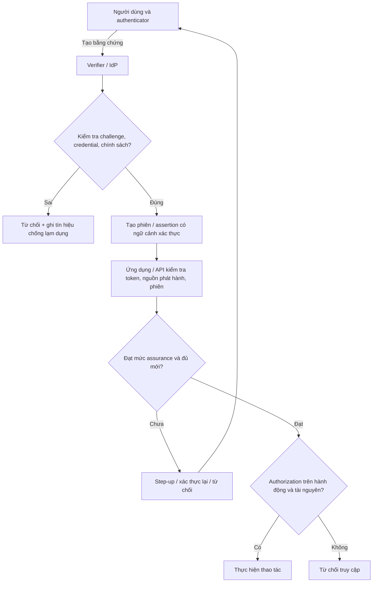
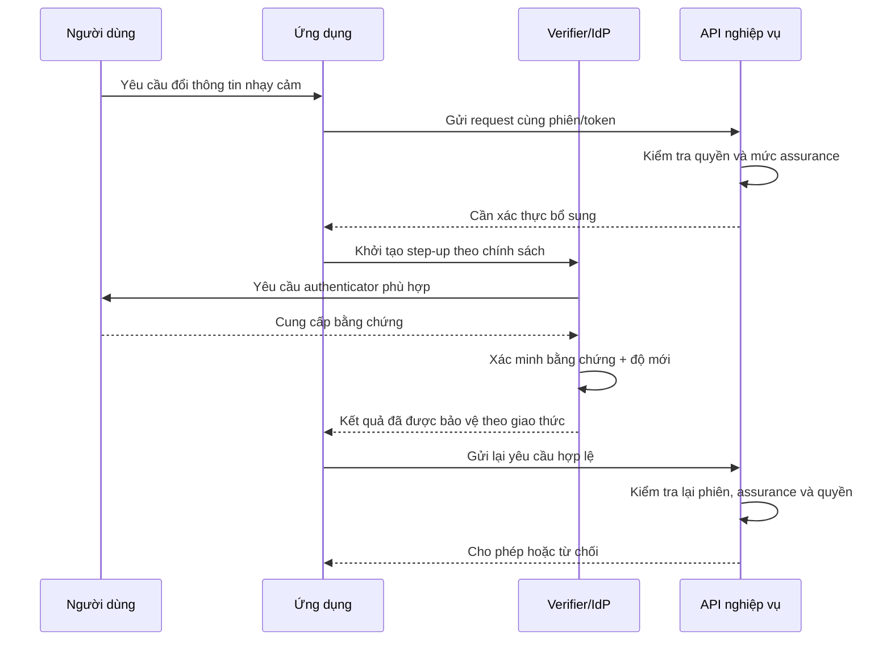

# Low và high assurance trong xác thực danh tính

## 1. Từ “đăng nhập thành công” đến “tin cậy đến mức nào?”

Trong bảo mật, **assurance** là mức độ tin cậy có cơ sở rằng một khẳng định về danh tính hoặc một kết quả xác thực đáp ứng các yêu cầu đã xác định. Cùng thông báo “đăng nhập thành công”, nhưng hai phiên đăng nhập có thể cung cấp **mức bảo đảm khác nhau** tùy cách tài khoản được thiết lập, credential được bảo vệ, phương thức xác thực, khả năng chống phishing, thời điểm xác thực gần nhất và cách hệ thống bảo vệ kết quả xác thực qua token/phiên.

**Low assurance** (mức bảo đảm thấp) và **high assurance** (mức bảo đảm cao) là cách nói tương đối về độ tin cậy cần có trong một **ngữ cảnh và mô hình rủi ro cụ thể**. Chúng không phải hai nhãn kỹ thuật có định nghĩa tuyệt đối, áp dụng giống nhau cho tất cả hệ thống.

Trong mô-đun **SECURITY_AUTHENTICATION_FUNDAMENTALS**, việc hiểu các mức assurance giúp chọn đúng cơ chế từ credential, mật khẩu, MFA, passkey và chứng chỉ đến token, phiên, liên kết danh tính và khôi phục tài khoản. Đồng thời, người học có thể mô hình hóa ranh giới tin cậy và phòng chống phishing, replay hoặc lạm dụng đăng nhập khi thiết kế các luồng xác thực an toàn.

**Ví dụ:** Đọc lịch sử bài học của một ứng dụng phổ thông và thay đổi tài khoản ngân hàng nhận tiền đều có thể yêu cầu đăng nhập, nhưng hậu quả nếu kẻ tấn công chiếm quyền khác nhau rõ rệt. Với thao tác chuyển tiền, hệ thống có thể yêu cầu phương thức chống phishing, xác thực lại gần đây và kiểm tra giao dịch/ủy quyền bổ sung. Bảo đảm cao không thể được suy ra chỉ từ việc phiên đăng nhập vẫn còn hiệu lực.

### Sau bài này, bạn có thể

- Diễn giải low/high assurance theo rủi ro, không nhầm với vai trò hay quyền truy cập.
- Phân biệt **identity assurance**, **authentication assurance** và **federation assurance** khi chúng được áp dụng.
- So sánh password, OTP, MFA, passkey và chứng chỉ theo cơ chế tạo bằng chứng, khả năng chống phishing và chống replay.
- Giải thích vì sao thời điểm xác thực, token/phiên và quy trình khôi phục có thể làm giảm bảo đảm thực tế.
- Thiết kế luồng **step-up authentication** phù hợp với thao tác nhạy cảm và kiểm tra quyền độc lập.
- Phác thảo các kịch bản kiểm thử để xác minh rằng hệ thống thực sự thực thi chính sách assurance.

## 2. Low assurance và high assurance không chỉ là hai loại đăng nhập

Hãy đặt **hành động** và **hậu quả bị chiếm quyền** làm điểm xuất phát:

| Khía cạnh | Low assurance trong một tình huống ít rủi ro | High assurance trong một tình huống nhạy cảm |
|---|---|---|
| Mục tiêu | Đủ cơ sở để đáp ứng một thao tác có tác động hạn chế | Giảm mạnh xác suất giả mạo, chiếm đoạt hoặc dùng sai phiên khi hậu quả lớn |
| Credential | Có thể chấp nhận mật khẩu kèm các kiểm soát cần thiết, tùy chính sách | Thường ưu tiên MFA chống phishing, chẳng hạn WebAuthn/passkey đáp ứng chính sách |
| Bằng chứng | Có thể chấp nhận bằng chứng bị ảnh hưởng bởi phishing ở mức rủi ro được cho phép | Cần đặc tính chống phishing, chống replay và kiểm tra ràng buộc giao thức chặt chẽ hơn |
| Thiết bị/khóa | Có thể không yêu cầu khóa nằm trong phần cứng được quản lý | Trong một số môi trường còn yêu cầu khóa gắn phần cứng, quản lý thiết bị và kiểm soát cấp phát |
| Độ mới | Một phiên còn hạn có thể đủ cho thao tác thông thường | Có thể phải xác thực lại hoặc step-up trước thao tác nhạy cảm |
| Phiên/token | Hạn dùng và kiểm tra token theo chính sách | Có thể cần TTL ngắn, scope tối thiểu, thu hồi nhanh, ràng buộc bên gửi khi khả thi |
| Vòng đời tài khoản | Khôi phục đủ an toàn theo mức rủi ro mục tiêu | Đăng ký, thêm/gỡ credential, liên kết IdP và khôi phục cần mức bảo vệ tương xứng |
| Ví dụ | Đăng nhập để đọc danh sách công việc cá nhân không nhạy cảm | Phê duyệt khoản thanh toán lớn, thay tài khoản nhận tiền, cấp quyền quản trị tối cao |

Các ví dụ ở cột trái **không có nghĩa** hệ thống được phép lưu mật khẩu rõ, bỏ xác minh token hay thiếu chống lạm dụng. Dù yêu cầu assurance thấp, các kiểm soát bảo mật nền tảng vẫn phải được triển khai đúng.

“High” cũng **không đồng nghĩa với tuyệt đối an toàn**. Thiết bị bị xâm nhập, quy trình khôi phục yếu, hành vi nhân viên nội bộ hoặc logic authorization sai vẫn có thể làm thất thoát dữ liệu khi cơ chế đăng nhập được thiết kế tốt.

### Tình huống minh họa

Một nhân viên vừa đăng nhập bằng mật khẩu để xem lịch làm việc. Sau đó họ mở màn hình thay đổi tài khoản ngân hàng nhận lương. Nếu chính sách của tổ chức yêu cầu mức tin cậy cao hơn, ứng dụng cần yêu cầu một bằng chứng xác thực đáp ứng chính sách và đủ mới. **Không thể** chỉ đánh dấu phiên hiện tại là “high” vì người dùng đã nhấp vào nút xác nhận.

Ngược lại, người dùng đăng nhập bằng passkey chống phishing **không tự động có quyền** sửa bảng lương của người khác. Assurance hỗ trợ quyết định truy cập; authorization vẫn phải kiểm tra vai trò, tenant, quyền sở hữu và tài nguyên.

## 3. Ba chiều assurance cần phân biệt

Các hướng dẫn bảo đảm danh tính số, tiêu biểu là bộ tài liệu **NIST SP 800-63**, phân biệt các khía cạnh khác nhau của việc tin cậy danh tính. Khi đọc tài liệu hoặc thiết kế hệ thống, cần xem khía cạnh nào thực sự được yêu cầu.

### 3.1. Identity Assurance Level — IAL

**IAL** tập trung vào mức tin cậy rằng danh tính ngoài đời hoặc danh tính được tuyên bố đã được **xác minh/đối chiếu** bằng một quy trình phù hợp. Tùy hệ thống, quy trình này có thể chỉ cần tài khoản bút danh hoặc phải kiểm tra thông tin, tài liệu và các nguồn bằng chứng bổ sung.

Ví dụ, một website diễn đàn cho người dùng đăng ký biệt danh không tự xác lập danh tính pháp lý, kể cả khi người dùng đăng nhập bằng passkey. Một hệ thống tài chính có thể cần quy trình định danh khách hàng riêng trước khi kích hoạt một số nghiệp vụ.

**Kết luận:** xác thực bằng yếu tố mạnh không tự nâng mức độ chắc chắn của quá trình xác minh danh tính ban đầu.

### 3.2. Authentication Assurance Level — AAL

**AAL** tập trung vào độ tin cậy của quá trình **chứng minh người yêu cầu đang kiểm soát một hoặc nhiều authenticator gắn với tài khoản**. Các yếu tố quan trọng gồm loại authenticator, khả năng chống tấn công, cách verifier kiểm tra bằng chứng và yêu cầu về vòng đời phiên.

Ở mức khái quát, có thể hiểu ba cấp trong hệ thống hướng dẫn AAL:

| Cấp tham chiếu | Đặc trưng khái niệm | Hiểu đúng |
|---|---|---|
| **AAL1** | Cho phép xác thực với một yếu tố phù hợp yêu cầu cấp này | Không đồng nghĩa không cần TLS hoặc được bỏ qua bảo vệ verifier |
| **AAL2** | Yêu cầu MFA cùng các kiểm soát kỹ thuật áp dụng | “Có OTP” không đồng nghĩa tự động đáp ứng mọi yêu cầu chống phishing hay replay |
| **AAL3** | Đòi hỏi bảo đảm cao hơn, với authenticator mật mã gắn phần cứng và các thuộc tính bảo vệ nghiêm ngặt theo tiêu chuẩn áp dụng | Không thể suy ra AAL3 chỉ vì có passkey, sinh trắc học hoặc hai yếu tố bất kỳ |

Đây là **mô tả định hướng**; việc khẳng định một giải pháp tuân thủ cấp AAL cụ thể cần đánh giá đầy đủ theo **phiên bản tiêu chuẩn áp dụng** và toàn bộ các yêu cầu kèm theo, bao gồm quản lý authenticator, bảo vệ verifier, xác thực lại và phiên. Các yếu tố phần cứng, chống phishing và chống giả mạo verifier cần được xem đúng theo định nghĩa của phiên bản chuẩn đó.

### 3.3. Federation Assurance Level — FAL

**FAL** liên quan đến bảo đảm trong việc **truyền và sử dụng kết quả xác thực/khẳng định danh tính giữa các bên**, chẳng hạn ứng dụng (Relying Party) dựa vào IdP. Một luồng SSO có MFA mạnh vẫn có thể rủi ro nếu ứng dụng không xác minh issuer, audience, chữ ký, thời hạn, nonce/state hay cơ chế ràng buộc cần thiết của assertion/token.

Ví dụ:

- IdP đã xác thực người dùng bằng phương thức mạnh.
- Ứng dụng nhận một ID token nhưng không kiểm tra `aud`, hoặc chấp nhận token từ nhà phát hành không được cấu hình.
- Kẻ tấn công có thể đưa một token không dành cho ứng dụng đó vào luồng đăng nhập.

Ở đây, **điểm yếu tại ranh giới liên kết** có thể phá hủy kết quả của bước xác thực mạnh phía IdP.

### Phân biệt nhanh

```text
IAL: Chúng ta có cơ sở nào để tin tài khoản thuộc về
     danh tính được tuyên bố?

AAL: Người yêu cầu vừa chứng minh quyền kiểm soát
     authenticator gắn với tài khoản đáng tin cậy đến đâu?

FAL: Ứng dụng có thể tin kết quả/khẳng định danh tính
     được truyền từ IdP đến mức nào theo giao thức?

Authorization: Chủ thể đó có được làm thao tác cụ thể
               trên tài nguyên cụ thể hay không?
```

Những chiều này **không thay thế nhau**. Một danh tính đã đối chiếu giấy tờ không có nghĩa phiên mật khẩu của người dùng miễn nhiễm phishing; một phiên AAL cao không tự chứng minh người dùng thuộc đúng công ty nếu bước cấp tài khoản sai.

## 4. Điều gì làm thay đổi authentication assurance?

### 4.1. Credential và cách verifier kiểm tra

| Phương thức | Bằng chứng xác thực | Phishing | Replay và giới hạn |
|---|---|---|---|
| Mật khẩu | Chứng minh biết một bí mật; verifier kiểm tra mật khẩu | Dễ bị thu thập trên trang giả | Mật khẩu bị lộ có thể dùng lại cho đến khi thay/khóa; cần chống credential stuffing |
| Password + TOTP | Kết hợp điều người dùng biết và quyền kiểm soát nguồn tạo OTP | TOTP có thể bị phishing/chuyển tiếp theo thời gian thực | Mã có cửa sổ thời gian; cần giới hạn thử và chống dùng lại |
| SMS OTP | Chứng minh quyền nhận mã qua kênh viễn thông trong thời điểm kiểm tra | Có thể bị phishing | Rủi ro SIM swap, chuyển tiếp và lạm dụng kênh khôi phục |
| Passkey/WebAuthn | Authenticator ký thử thách bằng khóa riêng; server kiểm tra public key và ngữ cảnh | Chống phishing nhờ ràng buộc RP ID/origin khi triển khai đúng | Challenge mới, giới hạn hiệu lực, kiểm tra chữ ký; cần xử lý an toàn đồng bộ khóa và thiết bị |
| Chứng chỉ khách/mTLS | Client chứng minh sở hữu khóa riêng tương ứng với chứng chỉ được chấp nhận | Bảo đảm tùy cách cấp phát, kiểm tra danh tính và kênh | Cần kiểm tra chuỗi tin cậy, định danh, mục đích sử dụng, hạn/thu hồi và quản lý khóa |
| Bearer token | Bên gửi sở hữu token hợp lệ trong phạm vi chấp nhận | Có thể bị đánh cắp qua phishing, XSS hoặc thiết bị bị xâm nhập | Ai cầm token có thể dùng lại tới khi hết hạn/thu hồi, trừ khi có cơ chế ràng buộc phù hợp |

MFA cải thiện bảo mật khi các yếu tố thực sự bổ trợ nhau và hệ thống xác minh đúng. **Hai mật khẩu** không trở thành MFA; thêm mã OTP bị phishing được không mặc nhiên đạt tiêu chí chống phishing. Passkey có thể cung cấp bảo đảm mạnh, nhưng loại passkey, yêu cầu user verification, cách lưu/bảo vệ khóa và chính sách khôi phục vẫn rất quan trọng.

### 4.2. Replay resistance và phishing resistance

Hai thuộc tính này liên quan nhưng khác nhau:

- **Replay resistance**: bằng chứng được tạo cho một lần xác thực không thể bị ghi lại rồi phát lại nguyên trạng để đăng nhập ở lần khác. Challenge ngẫu nhiên, mới, ràng buộc đúng luồng và kiểm tra tính duy nhất là biện pháp điển hình.
- **Phishing resistance**: kẻ gian dựng một trang/đầu nhận giả không thể dễ dàng lấy bằng chứng và sử dụng nó để xác thực với verifier thật. WebAuthn dùng ràng buộc với nguồn gốc trang và RP ID để giảm kiểu tấn công này.

Một mã OTP có hạn dùng ngắn vẫn có thể bị **real-time phishing**. Một JWT ký đúng chữ ký có thể vẫn bị **replay** nếu là bearer token bị lộ. Vì vậy “có chữ ký” và “có TTL” không tự bảo đảm cả hai thuộc tính.

### 4.3. Phương tiện giữ khóa và thiết bị

Khóa mật mã nằm trong phần cứng an toàn và được bảo vệ khỏi xuất khóa có thể cung cấp bảo đảm khác với khóa có thể sao chép từ phần mềm. Tuy vậy, không thể kết luận thiết bị luôn an toàn chỉ từ nhãn “hardware backed”: còn phải xét chính sách đăng ký, ai quản lý thiết bị, cài đặt hệ điều hành, khả năng chống malware, bảo vệ PIN/sinh trắc và cách xác minh các thuộc tính.

Khi chính sách yêu cầu mức rất cao, hệ thống có thể cần **authenticator mật mã không xuất khóa**, quy trình cấp phát qua đơn vị có thẩm quyền và cơ chế quản lý thiết bị. Khả năng đáp ứng một cấp chuẩn cụ thể vẫn phải được kiểm tra bằng đặc tính thực tế của sản phẩm và phiên bản tiêu chuẩn đang dùng.

### 4.4. Thời điểm và ngữ cảnh xác thực

Phiên đăng nhập xác thực mạnh vào hôm qua không nhất thiết đủ tin cậy để đổi credential hoặc phê duyệt thanh toán hôm nay. Chính sách có thể yêu cầu:

- Phương thức hiện tại đạt mức assurance tối thiểu.
- **Thời điểm xác thực** đủ mới (`auth_time` trong một số ngữ cảnh OIDC), chứ không chỉ thời điểm cấp/refresh token.
- Không có thay đổi rủi ro đáng kể: tài khoản vừa bị khôi phục, credential mới được thêm, môi trường có dấu hiệu bất thường.
- Phiên và token chưa hết hạn, chưa bị vô hiệu hóa, đúng issuer/audience và đủ quyền theo ngữ cảnh.

Ví dụ, refresh token tạo access token mới không chứng minh người dùng vừa thực hiện lại MFA. Nếu hệ thống yêu cầu “MFA trong vòng 10 phút”, phải kiểm tra **sự kiện xác thực thực tế** đáng tin cậy và ràng buộc nó với phiên thích hợp.

## 5. Mô hình hóa ranh giới tin cậy của một luồng high assurance



Ba ranh giới cần kiểm tra độc lập:

1. **Client → verifier:** không tin client tự khai đã dùng MFA hoặc passkey. Verifier phải kiểm tra bằng chứng theo giao thức, chống replay và xác lập chủ thể được xác thực.
2. **Verifier/IdP → ứng dụng/API:** token hoặc phiên phải được kiểm tra nguồn phát hành, chữ ký/introspection theo loại token, audience, thời hạn, ràng buộc và claim cần thiết. Không tin thông tin trong JWT chỉ vì decode được payload.
3. **API → tài nguyên:** sau khi biết ai đã xác thực, API vẫn phải xác định họ **có quyền** thực hiện hành động hiện tại hay không; cùng tenant, vai trò, quan hệ sở hữu và điều kiện ngữ cảnh là các đầu vào riêng.

Ngay cả khi mục tiêu là high assurance, không được bỏ qua kiểm tra authorization vì một tài khoản “đáng tin cậy” hoặc “đã MFA”.

## 6. Step-up authentication: nâng mức bảo đảm tại thời điểm cần thiết

**Step-up authentication** là yêu cầu bổ sung bằng chứng xác thực để một phiên đạt điều kiện bảo đảm của một thao tác cụ thể. Nó thường được dùng khi người dùng đang có phiên hợp lệ nhưng thao tác mới đòi hỏi bằng chứng mạnh hơn hoặc mới hơn.

### Ví dụ nghiệp vụ

Ứng dụng quản trị lương có các hành động:

| Hành động | Điều kiện xác thực minh họa | Điều kiện phân quyền riêng |
|---|---|---|
| Xem lịch làm việc cá nhân | Phiên đã xác thực hợp lệ theo chính sách thông thường | Chủ thể được đọc lịch của mình |
| Xem bảng lương phòng ban | Phiên hợp lệ; có thể yêu cầu mức mạnh hơn tùy phân loại dữ liệu | Vai trò quản lý được cấp quyền trên phòng ban |
| Thay tài khoản nhận lương | Phương thức chống phishing được hệ thống chấp nhận và xác thực trong 10 phút gần đây | Nhân viên được thay thông tin của tài khoản mình hoặc nhân sự có quyền đặc biệt |
| Cấp quyền quản trị payroll | Xác thực mạnh, mới, có thể cần thiết bị quản lý và phê duyệt bổ sung | Quyền cấp quyền quản trị; kiểm soát phân tách nhiệm vụ |

Những điều kiện này chỉ để minh họa cách thiết kế chính sách; chúng **không phải ngưỡng thời gian hay phương thức bắt buộc của mọi tiêu chuẩn**. Hệ thống cần tự đặt ngưỡng theo rủi ro và yêu cầu áp dụng.

### Luồng step-up an toàn



**Các lưu ý quan trọng:**

- Bên xác thực phải tạo kết quả cho đúng **tài khoản và phiên/ngữ cảnh**; không chấp nhận một cờ `mfa=true` do client sửa.
- Nếu dùng OIDC, có thể yêu cầu mức xác thực qua các tham số được IdP hỗ trợ và kiểm tra các claim như `acr`, `amr`, `auth_time` sau khi **đã xác minh token**, nhưng ý nghĩa cụ thể của các claim phải được hai bên thống nhất. Các claim không bảo đảm tự động một AAL nếu chưa biết chính sách IdP.
- Sau step-up, API phải **đánh giá lại** trạng thái tài khoản, quyền và các điều kiện giao dịch; không tin rằng quyết định cũ còn hiệu lực mãi.
- Với thao tác có rủi ro giao dịch cao, chỉ xác thực lại người dùng có thể chưa đủ: có thể cần xác nhận **chi tiết giao dịch** (người nhận, số tiền) theo cơ chế bảo vệ khỏi thay đổi nội dung.
- Cần bảo vệ chuyển hướng, state/nonce khi giao thức yêu cầu, CSRF, việc gắn phiên và chống lặp/chuyển tiếp chứng cứ.

## 7. Ví dụ thiết kế chính sách assurance bằng Java

Ví dụ sau mô tả **điều kiện assurance** cho hai thao tác. Giả sử middleware đã xác minh phiên/token và tạo `AuthContext` từ dữ liệu phía máy chủ hoặc IdP tin cậy. `phishingResistant` và `strongMethod` là các **thuộc tính được hệ thống tính từ kết quả xác thực**, không phải tham số do trình duyệt khai báo:

```java
import java.time.Clock;
import java.time.Duration;
import java.time.Instant;

enum Action {
    VIEW_PROFILE, CHANGE_PAYOUT_ACCOUNT
}

record AuthContext(
    String accountId,
    Instant authenticatedAt,
    boolean strongMethod,
    boolean phishingResistant,
    boolean sessionActive
) {}

final class AssurancePolicy {
    private final Clock clock;

    AssurancePolicy(Clock clock) {
        this.clock = clock;
    }

    boolean satisfies(AuthContext context, Action action) {
        if (context == null || action == null
                || context.accountId() == null || !context.sessionActive()) {
            return false;
        }
        if (action == Action.VIEW_PROFILE) {
            // Điều kiện minh họa cho endpoint rủi ro thấp.
            return true;
        }

        // Tác vụ nhạy cảm: yêu cầu xác thực mạnh, chống phishing
        // và được thực hiện trong 10 phút gần đây.
        Instant authTime = context.authenticatedAt();
        if (!context.strongMethod() || !context.phishingResistant()
                || authTime == null) {
            return false;
        }
        Instant now = clock.instant();
        return !authTime.isAfter(now)
                && !authTime.isBefore(now.minus(Duration.ofMinutes(10)));
    }
}
```

**Giới hạn của ví dụ:** Phương thức trên chỉ đánh giá **một phần chính sách assurance** và không thay thế việc xác minh token, kiểm tra quyền, chống CSRF, xác thực lại giao dịch hoặc bảo vệ cập nhật đồng thời. Thực tế cần liên kết ngữ cảnh với phiên đã xác thực; xử lý thu hồi; hỗ trợ step-up khi thiếu điều kiện; và kiểm tra authorization tại API ngay trước khi sửa tài nguyên.

Một cách dùng đúng:

```text
authenticatedContext = sessionOrTokenVerifier.verify(request)

if (!assurancePolicy.satisfies(authenticatedContext, action)) {
    requireStepUpOrDeny()
}

resource = repository.load(resourceId)
if (!authorizationPolicy.allows(authenticatedContext.accountId, action, resource)) {
    deny()
}

performChangeAtomically(resource)
```

Mã giả cho thấy assurance và authorization là **hai phép kiểm tra khác nhau**. Tránh chỉ kiểm tra một lần ở giao diện rồi để API thay đổi dữ liệu bằng request trực tiếp không kiểm tra lại.

## 8. Token và session có thể làm mất bảo đảm như thế nào?

Xác thực mạnh ở bước đầu chưa đủ nếu phiên duy trì kết quả ấy không được bảo vệ:

### Bearer token bị đánh cắp

API chấp nhận bearer access token hợp lệ mà không cần người dùng chứng minh lại credential. Nếu token bị sao chép từ log, trình duyệt bị tấn công hoặc môi trường máy khách, kẻ tấn công có thể tái sử dụng đến khi token hết hạn hay bị thu hồi. Kiểm tra chữ ký JWT giúp phát hiện token giả/sửa nội dung, **không ngăn token thật bị dùng lại**.

Biện pháp theo mức rủi ro gồm bảo vệ lưu trữ và truyền tải token, TTL phù hợp, token có audience/scope giới hạn, cơ chế thu hồi/introspection khi cần, giám sát bất thường và cơ chế **sender-constrained token** nếu hệ thống hỗ trợ.

### Phiên còn hợp lệ nhưng quá cũ

Phiên có thể hoạt động lâu hơn khoảng thời gian mà chính sách chấp nhận để làm thao tác nhạy cảm. Một lần refresh access token không đồng nghĩa người dùng vừa hoàn tất MFA. Chính sách phải phân biệt:

- **Thời điểm phát hành token** — token vừa được cấp.
- **Thời điểm chứng minh danh tính** — người dùng vừa thực hiện xác thực.
- **Thời hạn phiên tổng thể và thời gian không hoạt động** — phiên còn được phép tồn tại.
- **Thời điểm step-up gần nhất** — bằng chứng mạnh/mới dành cho các thao tác yêu cầu.

Nếu thiếu thông tin đáng tin cậy về độ mới, hệ thống nên **yêu cầu xác thực lại** thay vì suy đoán.

### Chấp nhận sai token trong liên kết danh tính

Với OAuth/OIDC, ID token thường được cấp cho client để xác nhận sự kiện đăng nhập; access token phục vụ truy cập API. Nhận ID token vào API như bearer access token hoặc chấp nhận token có sai `aud`/`iss` có thể phá vỡ ranh giới tin cậy. Cần xác minh đúng loại token theo hợp đồng, chữ ký hoặc introspection, issuer, audience, thời hạn và các ràng buộc giao thức liên quan.

### Cập nhật quyền trong phiên

Nếu người dùng bị gỡ quyền quản trị nhưng token cũ còn nhúng role, API chỉ dựa trên role lỗi thời có thể tiếp tục cho phép thao tác. Đây là vấn đề **độ mới của thông tin phân quyền**, tách biệt với assurance. Kiểm tra quyền hiện hành hoặc cơ chế thu hồi/đồng bộ theo chính sách vẫn cần thiết ngay cả khi tài khoản đã xác thực bằng phương thức mạnh.

## 9. Điểm yếu thường bị bỏ quên: đăng ký, liên kết và khôi phục tài khoản

Để bảo đảm cao được duy trì qua vòng đời, cần đánh giá cả các đường **được phép tạo hoặc thay credential**:

1. **Thêm authenticator mới:** nếu một phiên cũ chỉ cần mở trang Settings để thêm passkey, kẻ chiếm cookie có thể biến quyền truy cập tạm thời thành quyền kiểm soát lâu dài. Cần kiểm tra phiên và xác thực lại/step-up theo chính sách.
2. **Gỡ MFA hoặc passkey:** phải ngăn việc xóa phương thức bảo vệ cuối cùng mà không có đường truy cập/khôi phục hợp lệ, đồng thời bảo vệ thao tác gỡ khỏi kẻ tấn công.
3. **Đổi email/số điện thoại:** email và số điện thoại có thể bị mất quyền kiểm soát, đổi chủ hoặc SIM swap. Quy trình thay đổi cần xác minh kênh mới, kiểm tra quyền kiểm soát tài khoản hiện tại, thông báo và audit phù hợp.
4. **Liên kết social login/IdP:** không tự gộp hai tài khoản chỉ vì email trùng. Với OIDC, dùng cặp `iss + sub` để định danh chủ thể theo nhà phát hành và quy trình liên kết yêu cầu bằng chứng kiểm soát tài khoản hiện hữu.
5. **Khôi phục:** một đường reset chỉ bằng SMS hoặc email có thể thấp assurance hơn xác thực chính. Khôi phục là **cơ chế cấp lại quyền kiểm soát**; cần yêu cầu bằng chứng phù hợp rủi ro, kiểm soát lạm dụng và xử lý phiên/credential cũ.
6. **Nhân viên hỗ trợ/quản trị:** quy trình can thiệp thủ công có thể bị social engineering. Cần giới hạn quyền, phân tách nhiệm vụ khi thích hợp, ghi audit và kiểm tra bổ sung cho thay đổi nhạy cảm.

### Ví dụ: bảo đảm cao bị vô hiệu qua khôi phục

Một doanh nghiệp bắt buộc nhân viên dùng khóa bảo mật FIDO2 để truy cập hệ thống thanh toán. Nhưng chức năng “Mất khóa bảo mật” cho phép tổng đài xóa yếu tố bằng cách hỏi ngày sinh và số điện thoại, không kiểm tra thêm. Kẻ tấn công biết thông tin cá nhân có thể xin gỡ yếu tố rồi tạo credential mới.

**Điểm yếu ở quy trình khôi phục**, không nằm ở thuật toán FIDO2. Đánh giá high assurance phải bao quát cả cách cấp phát và khôi phục credential, quyền của nhân viên hỗ trợ và xử lý phiên sau sự kiện.

## 10. Risk-based authentication và những giới hạn

Một số hệ thống điều chỉnh yêu cầu xác thực dựa trên rủi ro: thiết bị mới, quốc gia/địa chỉ mạng bất thường, hành vi đăng nhập đáng ngờ, số lần thử thất bại, thay đổi credential gần đây hoặc tác động của hành động nghiệp vụ.

Ví dụ:

- Người dùng xem hồ sơ từ phiên thông thường: chính sách chấp nhận mức assurance cơ bản.
- Người dùng cùng phiên chuyển sang thay đổi recovery factor: yêu cầu phương thức mạnh hơn và xác thực mới.
- Hệ thống phát hiện vừa có nhiều lần thử mật khẩu sai và đăng nhập từ thiết bị lạ: có thể yêu cầu bước kiểm tra bổ sung hoặc giới hạn thao tác nhạy cảm.

Tuy nhiên, **đánh giá rủi ro không thay thế giao thức xác thực đúng**. Các tín hiệu như địa chỉ IP hoặc vị trí có thể nhiễu, giả mạo hoặc thay đổi bình thường do mạng di động/VPN. Không tự động coi “đúng vị trí quen thuộc” là bằng chứng chống phishing hoặc tính sở hữu tài khoản. Thiết kế cũng cần cân nhắc quyền riêng tư, giải thích được quyết định, xử lý nhầm lẫn và hỗ trợ người dùng hợp lệ bị khóa.

**Adaptive authentication** có thể chọn *khi nào* yêu cầu thêm bằng chứng; nó không làm một bằng chứng yếu trở thành mạnh chỉ nhờ điểm rủi ro thấp.

## 11. Ma trận kiểm thử low/high assurance

Một endpoint `POST /payments/{id}/approve` yêu cầu: tài khoản hoạt động, có quyền duyệt khoản thanh toán, xác thực chống phishing trong vòng 10 phút và phiên hợp lệ. Các trường hợp nên kiểm tra:

| Trường hợp | Kỳ vọng |
|---|---|
| Không có phiên/token hợp lệ | Từ chối, không dùng claim do client tự đưa |
| Có phiên hợp lệ chỉ xác thực bằng mật khẩu | Yêu cầu step-up hoặc từ chối |
| Có password + TOTP trong 2 phút gần nhất, nhưng chính sách yêu cầu chống phishing | Không tự cho phép chỉ vì đã MFA |
| Có WebAuthn hợp lệ và xác thực gần đây, nhưng thiếu quyền duyệt khoản thanh toán | Từ chối theo authorization |
| Có quyền và xác thực mạnh nhưng sự kiện xác thực cách đây 24 giờ | Yêu cầu xác thực lại |
| Access token mới do refresh nhưng `auth_time` cũ | Không coi refresh là step-up |
| JWT sai audience, issuer, hết hạn hoặc chữ ký sai | Từ chối trước khi đánh giá assurance |
| Cookie/token bị thu hồi sau khi nghi chiếm đoạt | Từ chối |
| Vừa reset MFA bằng cơ chế khôi phục | Áp chính sách giới hạn/kiểm tra bổ sung nếu hệ thống quy định |
| Người dùng thay người nhận hoặc số tiền sau bước xác nhận | Đảm bảo điều kiện bảo vệ giao dịch vẫn gắn với nội dung cuối |
| Client tự gửi `assurance=high` hoặc `mfa=true` | Bỏ qua tín hiệu không được kiểm chứng |
| Một yêu cầu khác cùng lúc vừa thu hồi role duyệt | Kiểm tra quyền hiện hành tại điểm thực thi; không dùng quyết định cũ đã lỗi thời |

Ghi audit nên lưu **account ID, cách xác thực ở mức metadata cần thiết, thời điểm, thao tác, kết quả và lý do chính sách**, nhưng không lưu mật khẩu, OTP, private key, cookie phiên hoặc access token. Log giúp phát hiện truy cập bất thường và điều tra mà không tạo thêm nguồn rò rỉ credential.

## 12. Bài tập vận dụng

Hệ thống nội bộ có ba nhân viên:

- **An** đăng nhập bằng mật khẩu và TOTP, có quyền xem thông tin nhân sự.
- **Bình** đăng nhập bằng passkey chống phishing được máy chủ xác minh đúng, nhưng không có quyền duyệt thanh toán.
- **Chi** có quyền duyệt thanh toán, đã đăng nhập bằng khóa bảo mật phù hợp từ hôm trước; phiên còn hiệu lực.

Chính sách của hệ thống yêu cầu: xem thông tin nhân sự phải có phiên hợp lệ và quyền phù hợp; duyệt thanh toán phải có quyền, xác thực chống phishing đủ mới và kiểm tra phiên; thay đổi yếu tố khôi phục cần step-up.

Hãy phân tích:

1. An có được xem dữ liệu nhân sự không? Phải kiểm tra quyền trên **tài nguyên cụ thể**; TOTP đủ cho hành động này hay không còn theo chính sách.
2. Bình có được duyệt thanh toán chỉ nhờ passkey không? **Không**, vì Bình thiếu quyền duyệt.
3. Chi có được duyệt ngay vì đã dùng khóa bảo mật hôm trước không? **Chưa chắc**: phải kiểm tra điều kiện **độ mới** theo chính sách.
4. Nếu Chi bị chiếm cookie phiên, kẻ tấn công có thể vượt được những bước nào? Phiên bị đánh cắp có thể qua kiểm tra phiên thông thường; yêu cầu step-up, ràng buộc phiên và cơ chế bảo vệ giao dịch giúp hạn chế thiệt hại.
5. Nếu nhân viên hỗ trợ có thể gỡ khóa bảo mật chỉ bằng cuộc gọi điện thoại, high assurance còn đáng tin không? Cần đánh giá **quy trình khôi phục** và quyền nhân viên hỗ trợ, vì đó là đường có thể chuyển quyền kiểm soát tài khoản.

## 13. Checklist thiết kế bảo đảm xác thực

- [ ] Nêu rõ **thao tác**, **rủi ro** và **mức assurance yêu cầu** trước khi chọn cơ chế.
- [ ] Phân biệt identity proofing (IAL), authentication (AAL), liên kết danh tính (FAL) và authorization.
- [ ] Đánh giá các thuộc tính thực tế của credential: phishing resistance, replay resistance, bảo vệ khóa và xác minh người dùng.
- [ ] Không suy ra AAL cao chỉ từ “có MFA”, “có sinh trắc học” hoặc “có passkey”.
- [ ] Verifier kiểm tra đầy đủ challenge, chữ ký, origin/RP ID hoặc điều kiện riêng của giao thức được dùng.
- [ ] Ứng dụng/API chỉ tin phiên/token và claim đã được kiểm chứng từ bên phát hành phù hợp.
- [ ] Kiểm tra độ mới xác thực bằng dữ liệu đáng tin cậy; không lấy thời điểm refresh token thay cho `auth_time`.
- [ ] Có step-up hoặc xác thực lại cho thao tác nhạy cảm, và đánh giá lại quyền sau bước đó.
- [ ] Phiên/token được bảo vệ khỏi rò rỉ, replay và có cơ chế giới hạn/thu hồi theo rủi ro.
- [ ] Quy trình đăng ký, liên kết IdP, thêm/gỡ credential và recovery đạt yêu cầu bảo vệ tương xứng.
- [ ] Kiểm tra authorization theo hành động/tài nguyên tại server ngay trước khi thực thi.
- [ ] Có kiểm thử đường tấn công, kiểm toán sự kiện và phương án xử lý khi người dùng bị từ chối nhầm.

## 14. Tổng kết

**Low assurance** và **high assurance** mô tả mức độ tin cậy cần thiết trong một **ngữ cảnh rủi ro**, không phải nhãn cố định của người dùng hay chiếc chìa khóa mở mọi quyền. Đánh giá assurance phải nhìn qua nhiều lớp: danh tính được xác lập ra sao, authenticator chứng minh quyền kiểm soát như thế nào, token/phiên truyền kết quả tới ứng dụng có đáng tin không, và quy trình khôi phục có cho phép bỏ qua các lớp bảo vệ hay không.

Để áp dụng đúng, hãy đặt chính sách dựa trên hậu quả của thao tác; chọn bằng chứng chống các tấn công liên quan; kiểm tra độ mới và ranh giới tin cậy; dùng step-up khi cần; và **luôn tách riêng quyết định authentication assurance khỏi authorization**. Đó là cơ sở để thiết kế luồng xác thực an toàn từ mật khẩu, MFA, passkey, chứng chỉ đến token, phiên và toàn bộ vòng đời tài khoản.
