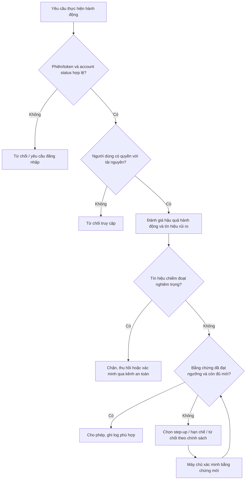

# Đánh đổi trải nghiệm và assurance trong xác thực

## Mục tiêu học tập

Một ứng dụng có thể yêu cầu nhập mật khẩu, mã OTP và xác minh giấy tờ ở mọi lượt đăng nhập để tăng kiểm soát. Tuy nhiên, những bước không cần thiết khiến người dùng bỏ dở, tìm cách đi đường vòng, mất khả năng tiếp cận hoặc liên tục phải khôi phục tài khoản. Ở chiều ngược lại, một nút “Đăng nhập ngay” đơn giản nhưng chỉ dựa vào mật khẩu tái sử dụng có thể mở đường cho credential stuffing và phishing. **Thiết kế tốt phải đạt mức bảo đảm cần thiết với mức gián đoạn phù hợp**, xét trên toàn bộ vòng đời tài khoản.

Sau bài học, bạn có thể:

- Giải thích **assurance (mức bảo đảm)** khác với cảm giác tin tưởng, độ tiện lợi và việc có bao nhiêu màn hình xác thực.
- Phân biệt **IAL, AAL và FAL**; tránh tự suy ra mức bảo đảm từ tên phương thức đăng nhập.
- Xây dựng chính sách xác thực tương xứng với **rủi ro của hành động**, thay vì bắt mọi người dùng thực hiện cùng một luồng.
- Đánh giá đánh đổi giữa mật khẩu, OTP, MFA, passkey, khóa bảo mật, chứng chỉ và xác thực lại theo bối cảnh.
- Thiết kế **step-up, ghi nhớ phiên, khôi phục và fallback** không tạo đường vòng cho kẻ tấn công.
- Đề xuất chỉ số kiểm chứng đồng thời trải nghiệm, khả năng tiếp cận và an toàn trước phishing, replay, chiếm phiên và lạm dụng đăng nhập.

Bài học thuộc chương **Mức độ tin cậy** của mô-đun **SECURITY_AUTHENTICATION_FUNDAMENTALS**. Phạm vi mô-đun bao gồm credential, mật khẩu, MFA, passkey, chứng chỉ, token, phiên, liên kết danh tính và khôi phục tài khoản. Chủ đề “đánh đổi” chỉ có ý nghĩa khi xem toàn bộ những mắt xích này cùng nhau.

## 1. Assurance thực sự là gì?

**Assurance** là mức độ bảo đảm dựa trên **quy trình, bằng chứng và kiểm soát được xác minh** rằng một khẳng định danh tính hoặc xác thực là đáng tin trong ngữ cảnh đã nêu. Nó không phải một điểm số cảm tính và cũng không đồng nghĩa với việc người dùng “cảm thấy hệ thống an toàn”.

Trong họ hướng dẫn NIST SP 800-63, thường tách ba chiều:

| Chiều | Câu hỏi được trả lời | Ví dụ |
| --- | --- | --- |
| **IAL** — Identity Assurance Level | Đã kiểm chứng danh tính người đăng ký ở mức nào? | Một dịch vụ tài chính có thể cần chứng thực danh tính thực; diễn đàn biệt danh có thể không cần |
| **AAL** — Authentication Assurance Level | Người đăng nhập đã chứng minh quyền kiểm soát authenticator mạnh đến đâu? | Mật khẩu, MFA và xác thực mật mã chống phishing có các đặc tính bảo đảm khác nhau |
| **FAL** — Federation Assurance Level | Assertion/thông tin xác thực từ nhà cung cấp danh tính được bảo vệ và ràng buộc với bên nhận như thế nào? | Ứng dụng kiểm tra token từ IdP theo hợp đồng và giao thức phù hợp |

Ba chiều **không cộng thành một điểm chung**. Một người có danh tính đã kiểm chứng chặt chẽ vẫn có thể đăng nhập bằng credential yếu. Một passkey có thể cung cấp xác thực mật mã mạnh cho tài khoản biệt danh mà không chứng minh tên thật, tuổi hay địa chỉ người dùng.

**AAL1, AAL2, AAL3** là các mức bảo đảm xác thực trong bộ tiêu chuẩn, với yêu cầu cụ thể đối với authenticator, giao thức, vòng đời và chính sách triển khai. Nói “có hai màn hình” hoặc “dùng sinh trắc học” **không đủ** để kết luận đạt AAL2/AAL3. Khi cần tuyên bố tuân thủ, phải đánh giá đúng **phiên bản tiêu chuẩn** đang áp dụng, toàn bộ yêu cầu và bằng chứng triển khai; những mức nội bộ như `BASIC`, `STRONG` dưới đây chỉ là **nhãn chính sách minh họa**, không tự tương ứng một-một với AAL chính thức.

### Assurance khác các thuộc tính liên quan

| Thuộc tính | Điều nó nói lên | Không tự chứng minh |
| --- | --- | --- |
| **Đã đăng nhập** | Một luồng xác thực đã hoàn tất tại thời điểm nào đó | Chủ thể hiện tại vẫn đang kiểm soát authenticator |
| **MFA được bật** | Tài khoản đã đăng ký hơn một phương thức hoặc hệ thống có chính sách MFA | Lần đăng nhập hiện tại thực sự dùng những yếu tố nào |
| **Phiên/token còn hạn** | Bằng chứng phiên chưa vượt thời gian hết hạn theo kiểm tra đã thực hiện | Tài khoản chưa bị đình chỉ, token chưa bị đánh cắp hoặc chưa bị thu hồi |
| **Thiết bị quen thuộc** | Có tín hiệu máy khách tương tự lịch sử | Đây chính là chủ tài khoản; IP/thiết bị là yếu tố xác thực độc lập |
| **Assurance đã đạt trong lần xác thực** | Verifier có bằng chứng về phương thức, thời điểm và ngữ cảnh | Chủ thể có quyền đối với mọi tài nguyên |
| **Trạng thái tài khoản** | Tài khoản có được phép hoạt động theo chính sách vòng đời không? | Người yêu cầu có credential hợp lệ hoặc quyền thao tác |

Đối với một hành động cụ thể, hệ thống còn cần **authorization** (phân quyền), trạng thái tài khoản, chống lạm dụng và kiểm tra phiên. Kết quả “AAL đủ cao” không thay thế các bước đó.

## 2. Vì sao đây là một bài toán đánh đổi?

Người dùng quan tâm đến việc hoàn tất một việc: xem bảng điểm, gửi báo cáo, chuyển tiền, đổi thiết bị hoặc lấy lại tài khoản. Mỗi yêu cầu xác thực mới có thể tạo chi phí:

- **Thời gian và thao tác:** nhập mã, chuyển ứng dụng, tìm khóa bảo mật, chờ tin nhắn hoặc liên hệ hỗ trợ.
- **Tỷ lệ thành công:** thiết bị hết pin, mất sóng, lỗi đồng hồ OTP, khóa bị thất lạc hoặc người dùng không có thiết bị phù hợp.
- **Khả năng tiếp cận:** hạn chế thị giác, vận động, nhận thức; người dùng phải chia sẻ thiết bị; môi trường không thể dùng sinh trắc.
- **Quyền riêng tư:** yêu cầu thêm dữ liệu định danh hoặc tín hiệu thiết bị không thật sự cần thiết.
- **Chi phí vận hành:** hỗ trợ khôi phục, xử lý false positive, duy trì nhiều authenticator và kiểm toán.
- **Rủi ro bảo mật mới:** MFA fatigue, người dùng tái sử dụng mật khẩu vì chính sách phiền phức, hoặc chọn fallback yếu để bỏ qua bước mạnh.

Nhưng giảm mọi bước cũng gây chi phí khi tài khoản bị chiếm: mất dữ liệu, gián đoạn nghiệp vụ, gian lận, mất uy tín và gánh nặng khôi phục.

**Mục tiêu không phải “tăng assurance tối đa cho mọi hành động” hay “giảm số lần xác thực xuống 0”.** Mục tiêu là **đạt ngưỡng bảo đảm phù hợp với tác hại tiềm tàng**, đồng thời tránh yêu cầu bằng chứng không cải thiện kiểm soát rủi ro đáng kể.

### Một ví dụ về đánh đổi sai

Ứng dụng học tập yêu cầu mật khẩu + SMS OTP **mỗi lần mở lại trang**, kể cả khi vừa xác thực một phút trước. Điều này làm tăng số thao tác và có thể khiến người dùng chuyển sang lưu mã/nhờ người khác nhận SMS; trong khi ứng dụng vẫn cho phép **đặt lại mật khẩu và xóa MFA chỉ bằng email**. Mọi ma sát ở luồng bình thường chưa chắc cải thiện assurance nếu đường khôi phục là điểm yếu nhất.

### Một ví dụ cải thiện đồng thời trải nghiệm và bảo mật

Ứng dụng hỗ trợ passkey/WebAuthn đúng cách, dùng phiên được bảo vệ và chỉ yêu cầu xác thực lại khi người dùng định đổi phương thức khôi phục hoặc cấp quyền quản trị. Với thiết bị và trình duyệt phù hợp, người dùng có thể đăng nhập nhanh hơn so với mật khẩu + OTP, trong khi giảm nguy cơ phishing thời gian thực. **Trải nghiệm tốt và assurance tốt không phải lúc nào cũng đối nghịch**.

## 3. Xác định ngưỡng cần thiết từ rủi ro của hành động

Thay vì bắt đầu bằng “Có nên bật MFA cho tất cả?”, hãy bắt đầu bằng câu hỏi **“Người dùng sắp làm gì, và điều tồi tệ nhất nếu nhầm chủ thể là gì?”**.

Một phương pháp thực tế:

1. **Liệt kê hành động và tài sản:** xem nội dung công khai, xem dữ liệu cá nhân, xuất dữ liệu, đổi mật khẩu, thêm passkey, thay email khôi phục, cấp quyền, ký giao dịch.
2. **Đánh giá tác hại:** mất riêng tư, thay đổi quyền lâu dài, mất tiền, lộ bí mật, khó khôi phục.
3. **Xác định đối thủ và đường tấn công:** mật khẩu rò rỉ, phishing, malware, đánh cắp cookie, chiếm email, SIM swap, lạm dụng hỗ trợ.
4. **Chọn bằng chứng cần có:** phiên hợp lệ, MFA, chống phishing, xác thực lại đủ mới, xác nhận nội dung giao dịch hoặc xét duyệt độc lập.
5. **Định nghĩa hành vi khi thiếu bằng chứng:** step-up, chỉ cho phép tính năng hạn chế, tạm chặn, yêu cầu hỗ trợ xác minh hoặc từ chối.
6. **Kiểm tra luồng khôi phục và phương thức dự phòng:** chúng có đáp ứng ngưỡng tương xứng hay vô tình cho phép đi vòng qua chính sách?

### Ma trận chính sách minh họa

| Hành động | Tác hại nếu chiếm quyền | Bằng chứng/kiểm soát gợi ý | Trải nghiệm nên ưu tiên |
| --- | --- | --- | --- |
| Đọc nội dung công khai | Thấp | Không yêu cầu danh tính người dùng | Truy cập ngay |
| Xem hồ sơ riêng | Mất riêng tư có giới hạn | Phiên còn hiệu lực, account status và quyền được kiểm tra | Giữ phiên hợp lý trên thiết bị tin cậy |
| Xem thông tin nhạy cảm hoặc tải dữ liệu cá nhân | Lộ thông tin đáng kể | Phiên hợp lệ; tùy rủi ro, MFA hoặc xác thực lại gần đây | Step-up đúng thời điểm; giải thích lý do |
| Đổi tên hiển thị | Thường có thể đảo ngược | Phiên hợp lệ và phân quyền; tăng kiểm soát khi có bất thường | Không hỏi lại mật khẩu vô cớ |
| Thêm passkey, gỡ MFA, đổi kênh khôi phục | Dẫn đến chiếm quyền bền vững | Xác thực lại mạnh, ưu tiên chống phishing; cảnh báo kênh cũ và kiểm soát thay đổi | Cung cấp luồng rõ, có khả năng phục hồi |
| Chuyển tiền hoặc cấp quyền quản trị | Thiệt hại lớn hoặc khó đảo ngược | Xác thực mạnh, đủ mới, kiểm soát rủi ro; khi thích hợp ràng buộc giao dịch và phê duyệt bổ sung | Tăng bước có chủ đích, thể hiện chính xác nội dung phê duyệt |
| Khôi phục khi mất mọi authenticator | Có thể vượt qua toàn bộ MFA | Quy trình khôi phục riêng, nhiều lớp bằng chứng/kiểm soát theo rủi ro, hạn chế sau khôi phục | Có đường hỗ trợ thực tế nhưng không tự động cấp toàn quyền |

**Đây là ví dụ thiết kế, không phải bảng ánh xạ chuẩn AAL.** Hai dịch vụ đều cho “xem hồ sơ” nhưng hậu quả có thể khác rất xa nếu một bên chứa hồ sơ y tế, bên kia chỉ có biệt danh. Ngưỡng cuối cùng phải xuất phát từ yêu cầu nghiệp vụ, pháp lý và mô hình đe dọa của hệ thống.

### Phân biệt rủi ro hành động và rủi ro phiên

Một thao tác ít nhạy cảm có thể xảy ra trong phiên nguy cơ cao, chẳng hạn cookie bị đánh cắp từ thiết bị lạ. Một hành động rủi ro cao có thể đến từ phiên bình thường, nhưng vẫn cần step-up. Vì vậy quyết định nên phụ thuộc vào **cả hai chiều**, không chỉ phân loại hành động hoặc chấm điểm thiết bị.

## 4. Đặt ma sát ở đúng thời điểm trong hành trình người dùng

Người dùng ít khó chịu hơn khi một bước xác thực bổ sung có lý do cụ thể và xuất hiện **ngay trước hành động nhạy cảm**.

### 4.1. Đăng ký tài khoản

Đặt điều kiện đúng với sản phẩm:

- Dịch vụ công khai có thể cho phép bắt đầu với tài khoản biệt danh; không yêu cầu giấy tờ nếu không có nhu cầu IAL.
- Dịch vụ cần danh tính pháp lý nên tách rõ bước chứng minh danh tính và bước bảo vệ authenticator. **Email đã xác minh không tự bằng danh tính đã chứng thực**.
- Gợi ý đăng ký passkey hoặc yếu tố dự phòng ở thời điểm thuận tiện, giải thích cách sử dụng và khôi phục.
- Bảo vệ thao tác **thêm authenticator**: không để phiên đăng ký chưa đủ tin cậy gắn credential cho tài khoản khác.

Giảm bước thừa trong đăng ký giúp tăng hoàn tất, nhưng phải giữ những ràng buộc cần thiết để tránh người khác chiếm tài khoản vừa tạo hoặc liên kết sai danh tính.

### 4.2. Đăng nhập thường ngày

Với thiết bị hỗ trợ, passkey/WebAuthn có thể thay trải nghiệm gõ mật khẩu rồi nhập OTP bằng một thao tác cục bộ được bảo vệ, đồng thời tăng khả năng chống phishing. Mật khẩu + TOTP vẫn có thể là lựa chọn thực tế, nhưng OTP dễ bị phishing thời gian thực; SMS chịu thêm rủi ro SIM swap và chuyển hướng.

Khi có phiên hợp lệ, không nhất thiết bắt nhập lại mỗi lần tải trang. Hệ thống cần giới hạn thời gian phiên, bảo vệ cookie, phát hiện lạm dụng và quyết định khi nào xác thực lại. “Nhớ thiết bị này” chỉ hữu ích nếu gắn với **phiên và kiểm soát máy chủ**; cookie dài hạn không có cơ chế thu hồi không phải một cải tiến an toàn.

### 4.3. Thao tác nhạy cảm: step-up có mục đích

**Step-up authentication** là yêu cầu thêm hoặc làm mới bằng chứng ngay trước hành động có rủi ro vượt mức đã đạt của phiên. Ví dụ, người dùng xem hồ sơ sau khi đăng nhập bằng mật khẩu, nhưng khi muốn thêm passkey thì phải xác thực lại bằng phương thức phù hợp.

Step-up tốt cần:

- Nêu rõ **hành động** đang được bảo vệ, tránh hộp thoại “xác minh lại” không có ngữ cảnh.
- Chọn phương thức đủ mạnh cho rủi ro, không chỉ “một mã nào đó”.
- Chỉ ghi nhận mức nâng khi máy chủ đã xác minh thành công bằng chứng mới, ràng buộc cùng tài khoản và phiên.
- Giới hạn **độ mới** của xác thực; ví dụ ngưỡng 10 phút chỉ là tham số minh họa của sản phẩm.
- Với giao dịch quan trọng, hiển thị và khi phù hợp **ràng buộc nội dung** như người nhận, số tiền, quyền sẽ cấp để tránh chấp thuận nhầm.
- Cho phép quay lại thao tác ban đầu sau khi step-up thành công mà không tạo phiên hoặc hành động trùng.

**Yêu cầu bước bổ sung không có nghĩa là chặn ngay mọi người dùng.** Khi thiết bị thiếu phương thức phù hợp, sản phẩm cần một đường xử lý thay thế được kiểm soát, có thể chậm hơn và quyền hạn thấp hơn.

### 4.4. Khôi phục là phần của trải nghiệm, nhưng cũng là đường tấn công

Nếu người dùng đánh mất thiết bị, một thiết kế chỉ hỗ trợ duy nhất khóa cứng có thể khiến họ mất tài khoản vĩnh viễn. Tuy nhiên, nếu hỗ trợ “mất khóa thì nhận mã qua email/SMS rồi được cấp toàn quyền” thì kẻ tấn công sẽ chủ động đi vào đường này.

Các lựa chọn có thể phối hợp: nhiều authenticator đã đăng ký từ trước, mã khôi phục được cấp và cất giữ an toàn, hỗ trợ theo bằng chứng phù hợp, kiểm soát chống lạm dụng, thông báo qua kênh cũ, thời gian hạn chế sau khôi phục và đánh giá lại mức bảo đảm. **Không giữ nhãn phiên “đã xác thực mạnh” sau khi người dùng chỉ vượt qua một luồng khôi phục yếu hơn.**

## 5. So sánh các cơ chế từ góc nhìn bảo đảm và trải nghiệm

| Cơ chế | Trải nghiệm thường gặp | Điểm mạnh bảo mật | Giới hạn cần đánh giá |
| --- | --- | --- | --- |
| Mật khẩu | Quen thuộc, chạy trên nhiều thiết bị; có chi phí ghi nhớ/nhập | Dễ triển khai rộng, có thể dùng password manager | Tái sử dụng, rò rỉ, credential stuffing, phishing |
| Mật khẩu + TOTP | Cần mở app hoặc trình tạo mã | Giảm rủi ro lộ mật khẩu đơn lẻ; yếu tố khác loại nếu triển khai đúng | Có thể bị phishing thời gian thực; lỗi đồng hồ, mất thiết bị, seed bị lộ |
| Mật khẩu + SMS OTP | Dễ tiếp cận với số điện thoại | Thêm rào cản với đối thủ chỉ có mật khẩu | SIM swap, chuyển hướng, chậm nhận mã, phụ thuộc nhà mạng |
| Push MFA | Phê duyệt nhanh trên thiết bị | Có thể giảm thao tác nhập mã | MFA fatigue, chấp thuận nhầm, không tự chống phishing nếu không ràng buộc đúng |
| Passkey/WebAuthn với UV | Thường một tương tác cục bộ | Khóa riêng và chữ ký ràng buộc với RP/origin; chống phishing kiểu nhập mã; có thể là authenticator đa yếu tố | Khác biệt hỗ trợ thiết bị, khóa đồng bộ, chuyển thiết bị, UV và chính sách phục hồi |
| Khóa bảo mật phần cứng | Cần có khóa khi xác thực | Bảo vệ khóa và xác thực mật mã; phù hợp tác vụ rủi ro cao nếu cấu hình đúng | Có thể bị quên/mất, chi phí cấp phát, hỗ trợ trên nền tảng |
| Chứng chỉ client/mTLS | Có thể ít thao tác ở phiên kết nối; cần quản lý chứng chỉ | Xác thực mật mã máy/khách bằng khóa riêng | Cấp phát, gia hạn, thu hồi, ánh xạ danh tính; không tự chứng minh người dùng đang hiện diện |
| Đăng nhập liên kết (SSO/OIDC) | Một lần đăng nhập cho nhiều ứng dụng | Tập trung quản lý chính sách và credential | Rủi ro IdP, claim thiếu/sai, assertion/token sai bên nhận và phiên ứng dụng cũ |

Không có một dòng duy nhất “tốt nhất” cho mọi trường hợp. **Passkey với user verification** có thể đồng thời mạnh và tiện, nhưng không tự bảo đảm mọi yêu cầu AAL hay danh tính pháp lý. Phải kiểm tra chữ ký, challenge, RP ID, origin, cờ user verification và đặc tính authenticator cần thiết; không coi việc UI hiển thị vân tay/khuôn mặt là đủ.

Đối với OTP hoặc mã khôi phục, đặt thời hạn, hạn chế thử, chống replay, bảo vệ bí mật và ràng buộc tài khoản/ngữ cảnh. Với passkey, dùng challenge mới, kiểm tra nguồn và ràng buộc đúng RP. Đây là các thuộc tính **mà người dùng không nhìn thấy**, nhưng không được giản lược chỉ để giảm ma sát.

## 6. Assurance dựa trên rủi ro: linh hoạt nhưng không tùy tiện

**Risk-based authentication** dùng tín hiệu của yêu cầu hiện tại để điều chỉnh kiểm soát: đăng nhập từ thiết bị mới, mẫu truy cập bất thường, số lần thất bại, thay đổi kênh khôi phục, rủi ro tài khoản hoặc thao tác có giá trị cao.

Tuy nhiên, địa chỉ IP, vị trí, thiết bị đã thấy trước đây và đặc điểm hành vi **không phải yếu tố xác thực độc lập**. Các tín hiệu này thường nhiễu: người dùng đi du lịch, đổi mạng, dùng thiết bị hỗ trợ hoặc mạng dùng chung.

Một chính sách có thể nêu:

| Rủi ro hành động | Rủi ro phiên | Quyết định minh họa |
| --- | --- | --- |
| Thấp | Bình thường | Cho phép với phiên hợp lệ và quyền phù hợp |
| Thấp | Bất thường vừa phải | Yêu cầu step-up hoặc kiểm tra bổ sung có kiểm soát |
| Cao | Bình thường | Yêu cầu xác thực mạnh và đủ mới cho chính hành động |
| Cao | Bất thường | Yêu cầu kiểm soát tăng cường hoặc từ chối cho đến khi xác minh an toàn |
| Bất kỳ | Có tín hiệu chiếm phiên nghiêm trọng | Thu hồi/chặn phiên, điều tra và khôi phục an toàn; không tự động cho phép chỉ vì nhập một OTP |

Các mức “thấp”, “cao”, “bất thường” là **đầu ra của chính sách và mô hình rủi ro ứng dụng**, không phải điểm AAL chuẩn hóa. Không cho người dùng hoặc trình duyệt tự gửi `risk=low` để bỏ qua xác thực.

### Sơ đồ quyết định



Ở bước `G`, hệ thống chỉ sử dụng **bằng chứng đã được verifier đáng tin cậy xác minh**. Thuộc tính “người dùng đã đăng ký MFA” không đồng nghĩa “lần xác thực hiện tại đã dùng MFA”.

### Không biến quyết định rủi ro thành hộp đen không giải thích được

Đối với người dùng, hiển thị thông báo đủ rõ như “Để thay đổi phương thức khôi phục, vui lòng xác minh lại” mà không tiết lộ quy tắc chống gian lận chi tiết. Với đội vận hành, lưu **mã lý do nội bộ**, phiên bản chính sách, tín hiệu tổng quát và kết quả, đồng thời giảm việc lưu dữ liệu cá nhân không cần thiết.

Cần có cơ chế hỗ trợ xử lý false positive. Nếu người dùng hợp lệ liên tục bị chặn do vị trí mạng, chính sách không đạt mục tiêu trải nghiệm và có thể gây rủi ro khi họ chuyển sang phương thức kém an toàn.

## 7. Thiết kế UX bảo mật không làm suy yếu assurance

Có thể giảm nhiều ma sát bằng **thiết kế tương tác tốt**, không phải bằng việc bỏ kiểm soát cần thiết.

### 7.1. Giải thích “vì sao” đúng lúc

Một thông báo “Vui lòng xác minh lại để đổi email khôi phục” tốt hơn thông báo chung “Sai bảo mật”. Với hành động khó đảo ngược, mô tả rõ hậu quả: thêm passkey mới có thể tạo đường đăng nhập mới; gỡ MFA có thể làm giảm bảo vệ tài khoản; chấp thuận giao dịch cần hiển thị người nhận/số tiền.

Không tiết lộ cho người lạ rằng một địa chỉ email có tài khoản hay trạng thái nào. Ở trang đăng nhập/khôi phục, phản hồi cần hạn chế user enumeration; sau khi người dùng xác thực an toàn có thể cung cấp hướng dẫn cụ thể hơn.

### 7.2. Hỗ trợ đa dạng người dùng

- Tránh buộc mọi người phải có **một loại điện thoại**, một số thuê bao di động hay một sinh trắc học duy nhất.
- Cho phép phương thức bảo mật dự phòng đáp ứng chính sách, chẳng hạn passkey trên thiết bị khác hoặc khóa bảo mật.
- Thiết kế thông báo dễ hiểu, hỗ trợ trình đọc màn hình, bàn phím và thời gian thao tác đủ hợp lý.
- OTP nên hỗ trợ dán mã hoặc tự động điền an toàn khi nền tảng hỗ trợ; không buộc người dùng ghi nhớ trong thời gian quá ngắn nếu không cần.
- Không coi thiết bị chia sẻ, thay đổi vị trí hoặc nhu cầu hỗ trợ tiếp cận là bằng chứng gian lận một cách máy móc.
- Hướng dẫn người dùng chuẩn bị phương thức dự phòng **trước khi mất thiết bị**, nhưng bảo vệ bước thêm authenticator bằng xác thực phù hợp.

### 7.3. Cân bằng thời hạn phiên và xác thực lại

Nếu thời hạn phiên quá ngắn, người dùng bị đăng xuất thường xuyên và có thể tìm cách chia sẻ credential. Nếu quá dài và không kiểm soát thu hồi, cookie/token bị đánh cắp có thể có giá trị lâu.

Chọn thời hạn bằng cách xem tác hại của chiếm phiên, khả năng thu hồi, môi trường thiết bị và độ nhạy thao tác. Dùng thời hạn tối đa/không hoạt động, cookie bảo vệ phù hợp, xoay phiên sau xác thực nâng mức và step-up cho hành động quan trọng.

**Độ mới của xác thực** là một thuộc tính riêng với thời hạn phiên. Phiên được tạo hôm qua vẫn hợp lệ để xem dữ liệu theo chính sách, nhưng có thể phải xác thực lại ngay trước khi đổi authenticator hôm nay.

### 7.4. Không hạ cấp im lặng

Giả sử ứng dụng yêu cầu WebAuthn chống phishing để thay thông tin khôi phục. Khi WebAuthn lỗi, hệ thống cho phép tiếp tục bằng SMS OTP và ghi lại cùng nhãn `phishing_resistant=true`. Đây là **hạ cấp im lặng**.

Fallback có thể cần thiết để hỗ trợ người thật, nhưng phải có **chính sách và hệ quả riêng**: ví dụ hạn chế tạm thời thao tác, rà soát bổ sung hoặc chỉ cho phép phục hồi khả năng đăng nhập ở mức thấp hơn. Không được khẳng định assurance cao hơn bằng chứng thực sự.

## 8. Chọn mức assurance theo toàn bộ vòng đời tài khoản

Một luồng đăng nhập chính có thể an toàn, nhưng các đường phụ quyết định bảo vệ thực tế.

| Giai đoạn | Câu hỏi về assurance | Rủi ro nếu tối ưu UX sai cách |
| --- | --- | --- |
| Đăng ký | Cần chứng minh quyền kiểm soát tài khoản/email hoặc danh tính ngoài đời ở mức nào? | Kích hoạt tài khoản sai người; liên kết định danh bị chiếm |
| Đăng ký credential | Ai được thêm passkey/MFA/chứng chỉ mới? Có bước xác thực lại không? | Kẻ cầm cookie bị đánh cắp gắn authenticator của mình |
| Đăng nhập | Bằng chứng được xác minh theo giao thức nào? Có chống phishing không? | Mật khẩu, OTP bị chuyển tiếp hoặc phát lại |
| Phiên/refresh token | Phiên còn hợp lệ, đúng chủ thể, có thể thu hồi khi rủi ro tăng không? | Token cũ vẫn hoạt động sau đình chỉ/đổi mật khẩu |
| Liên kết SSO | Ứng dụng xác minh issuer/audience/nonce và hiểu `acr`, `amr`, `auth_time` thế nào? | Tin nhầm danh tính hoặc tự nâng assurance từ claim không có hợp đồng |
| Step-up | Xác thực lại phục vụ hành động gì, có đủ mạnh và mới không? | Xác thực được một lần lâu trước đó vẫn dùng để cấp quyền nhạy cảm |
| Fallback/khôi phục | Có thể vượt qua phương thức mạnh qua email/SMS hoặc hỗ trợ không? | Chiếm tài khoản qua mắt xích yếu nhất |
| Khóa/đình chỉ/xóa | Có chặn phiên/token đã cấp và callback đến muộn không? | Tài khoản bị chặn vẫn tiếp tục hoạt động |

**Ví dụ liên kết danh tính:** Đăng nhập SSO tại IdP đã thực hiện MFA không tự cho phép ứng dụng bỏ qua trạng thái tài khoản nội bộ. Ứng dụng phải xác minh token/assertion đúng bên nhận, dùng định danh ổn định như cặp `iss` và `sub` thay vì tự liên kết chỉ theo email, rồi mới đánh giá chính sách truy cập.

## 9. Thiết kế chính sách rõ ràng trong mã nguồn

Ví dụ sau dùng ba quyết định: **ALLOW**, **STEP_UP** và **DENY**. Đây là **mô hình minh họa** của ứng dụng Java, không phải triển khai đầy đủ NIST AAL, WebAuthn, IdP hay cơ chế bảo vệ phiên.

Giả sử middleware đã kiểm tra phiên/token (chữ ký, `iss`, `aud`, `exp`, trạng thái thu hồi), trạng thái tài khoản và quyền tài nguyên. Dịch vụ xác thực đã tạo `VerifiedAuthContext` **ở phía máy chủ** sau khi kiểm tra bằng chứng, không lấy các cờ `mfaVerified` hay `phishingResistantVerified` từ trình duyệt.

```java
import java.time.Duration;
import java.time.Instant;

enum Action {
    VIEW_PROFILE,
    DOWNLOAD_SENSITIVE_DATA,
    CHANGE_RECOVERY_METHOD,
    GRANT_ADMIN_ROLE
}

enum Decision {
    ALLOW,
    STEP_UP,
    DENY
}

record VerifiedAuthContext(
        boolean validSession,
        boolean activeAccount,
        boolean authorizedForResource,
        boolean takeoverSuspected,
        boolean postRecoveryRestricted,
        boolean mfaVerified,
        boolean phishingResistantVerified,
        Instant strongAuthAt) {}

class AssurancePolicy {
    // Ví dụ chính sách nội bộ, không phải giới hạn AAL chuẩn hóa.
    private static final Duration RECENT = Duration.ofMinutes(10);

    static Decision decide(
            Action action,
            VerifiedAuthContext ctx,
            Instant now) {

        if (ctx == null || now == null
                || !ctx.validSession()
                || !ctx.activeAccount()
                || !ctx.authorizedForResource()
                || ctx.takeoverSuspected()) {
            return Decision.DENY;
        }

        if (action == Action.VIEW_PROFILE) {
            return Decision.ALLOW;
        }

        if (ctx.postRecoveryRestricted()
                && (action == Action.CHANGE_RECOVERY_METHOD
                    || action == Action.GRANT_ADMIN_ROLE)) {
            return Decision.DENY;
        }

        if (!ctx.mfaVerified()
                || !isRecent(ctx.strongAuthAt(), now)) {
            return Decision.STEP_UP;
        }

        if ((action == Action.CHANGE_RECOVERY_METHOD
                || action == Action.GRANT_ADMIN_ROLE)
                && !ctx.phishingResistantVerified()) {
            return Decision.STEP_UP;
        }

        return Decision.ALLOW;
    }

    private static boolean isRecent(Instant at, Instant now) {
        return at != null
                && !at.isAfter(now)
                && Duration.between(at, now).compareTo(RECENT) <= 0;
    }
}
```

Trong ví dụ, xem hồ sơ chỉ cần phiên hợp lệ và quyền; tải dữ liệu nhạy cảm đòi MFA đủ mới; đổi kênh khôi phục hoặc cấp quyền quản trị còn đòi bằng chứng chống phishing và không đang ở chế độ hạn chế sau khôi phục.

**Giới hạn và điều kiện bắt buộc của mẫu:**

1. `mfaVerified`, `phishingResistantVerified` và `strongAuthAt` phải phản ánh **cùng sự kiện hoặc ngữ cảnh xác thực đã được verifier kiểm tra**, không được ghép tùy tiện các cờ từ nhiều phiên, nhiều tài khoản hoặc nhiều thời điểm.
2. Chỉ công nhận chống phishing khi giao thức và triển khai đáp ứng: ví dụ WebAuthn phải kiểm tra chữ ký, challenge, origin, RP ID và thuộc tính authenticator/UV mà chính sách yêu cầu.
3. Nếu API nhận kết quả `STEP_UP`, máy chủ tạo một **giao dịch xác thực lại** ràng buộc tài khoản, phiên, mục đích và thời hạn; sau khi thành công phải đánh giá lại yêu cầu. Một nút “đã xác minh” từ client không đủ.
4. `authorizedForResource` phải được xác định phía máy chủ cho **tài nguyên cụ thể**, không phải quyền do client gửi. Account status và phiên/token phải đủ mới để phát hiện thu hồi.
5. Ngưỡng 10 phút là ví dụ chính sách; thời hạn thực tế phụ thuộc rủi ro, loại hành động và yêu cầu tổ chức.
6. `takeoverSuspected` đại diện tín hiệu nghiêm trọng, vì vậy ví dụ trả `DENY`. Hệ thống thật cần luồng xử lý, cảnh báo hoặc khôi phục có kiểm soát để tránh khóa vĩnh viễn do sai sót.
7. Một hành động chuyển tiền thực tế có thể đòi **xác nhận đúng chi tiết giao dịch** và kiểm soát chống gian lận bên cạnh MFA; code này chưa xử lý các yêu cầu đó.

Mục đích của code là phân tách **chính sách bảo đảm theo hành động** khỏi màn hình đăng nhập, giúp kiểm tra được cả an toàn và sự cần thiết của mỗi bước UX.

### Bảng kiểm thử chính sách ví dụ

| Bối cảnh | Hành động | Kết quả mong đợi |
| --- | --- | --- |
| Phiên hợp lệ, account hoạt động, đủ quyền | Xem hồ sơ | `ALLOW` |
| Phiên hết hạn, dù vừa dùng passkey | Xem hồ sơ | `DENY` |
| Phiên hợp lệ nhưng account bị đình chỉ | Xem hồ sơ | `DENY` |
| Phiên hợp lệ, vừa đăng nhập chỉ bằng mật khẩu | Tải dữ liệu nhạy cảm | `STEP_UP` |
| Đã MFA trong 3 phút, phiên hợp lệ | Tải dữ liệu nhạy cảm | `ALLOW` |
| MFA từ hơn 10 phút trước | Tải dữ liệu nhạy cảm | `STEP_UP` |
| Mật khẩu + TOTP mới, chưa chống phishing | Đổi kênh khôi phục | `STEP_UP` |
| MFA chống phishing mới, không hạn chế khôi phục | Đổi kênh khôi phục | `ALLOW` |
| Vừa khôi phục bằng bằng chứng yếu, còn hạn chế | Đổi kênh khôi phục | `DENY` |
| Có tín hiệu chiếm đoạt nghiêm trọng | Bất kỳ hành động yêu cầu đăng nhập | `DENY` |
| Xác thực mạnh nhưng không có quyền cấp admin | Cấp quyền admin | `DENY` |
| Client tự sửa `phishingResistantVerified=true` | Đổi kênh khôi phục | Không đổi kết quả phía máy chủ |
| Access token bị thu hồi nhưng chưa hết `exp` | Xem hồ sơ | `DENY` ở bước xác minh phiên trước chính sách |

## 10. Đo lường đánh đổi: đừng chỉ xem tỷ lệ đăng nhập thành công

Một thay đổi làm **tỷ lệ đăng nhập thành công tăng** chưa chắc tốt nếu nó cũng tăng số vụ chiếm tài khoản. Một thay đổi làm **số lần yêu cầu MFA giảm** chưa chắc an toàn nếu lý do là bỏ xác thực lại cho mọi hành động quan trọng.

Nên đo các nhóm chỉ số:

| Nhóm | Chỉ số có thể dùng | Cách diễn giải đúng |
| --- | --- | --- |
| Hoàn tất trải nghiệm | Tỷ lệ hoàn tất đăng nhập, thời gian đến tác vụ đầu tiên, tỷ lệ bỏ dở tại step-up | Phân nhóm theo thiết bị, trình duyệt và nhu cầu tiếp cận; không chỉ nhìn giá trị trung bình |
| Chất lượng xác thực | Tỷ lệ dùng passkey/MFA phù hợp, thất bại do challenge, thời gian xác thực lại | Phân biệt lỗi thao tác với lỗi bảo mật và sự cố hệ thống |
| Khôi phục | Tỷ lệ khôi phục thành công hợp lệ, thời gian hỗ trợ, số lần mất authenticator | Theo dõi cả gian lận/phê duyệt nhầm, không thưởng cho “khôi phục càng dễ càng tốt” |
| Chống lạm dụng | Credential stuffing, thử OTP, MFA fatigue, replay bị từ chối, phishing được báo cáo | Chỉ số tấn công bị chặn không phải số vụ chiếm tài khoản thực tế |
| Hậu quả | Chiếm tài khoản được xác nhận, thay đổi credential trái phép, gian lận, phiên bị thu hồi | Cần phân tích sự kiện/độ trễ phát hiện; có thể hiếm và khó đo |
| Khả năng tiếp cận | Tỷ lệ không thể hoàn tất vì thiết bị/phương thức, phản hồi hỗ trợ, false positive | Không để chính sách loại trừ nhóm người dùng hợp lệ |
| Vận hành | Khối lượng ticket hỗ trợ, chi phí tin nhắn, sự cố IdP, độ trễ thu hồi token | Dùng để đánh giá tính bền vững, không tự thay thế yêu cầu bảo mật |

**Chỉ số bảo vệ quan trọng:** Sau khi tối ưu luồng, các thao tác nhạy cảm vẫn phải được chặn nếu chưa có bằng chứng đủ mạnh; tỷ lệ khôi phục gian lận và chiếm tài khoản không được tăng ngoài ngưỡng chấp nhận của tổ chức.

### Thử nghiệm có kiểm soát

Giả sử nhóm sản phẩm muốn thay **mật khẩu + SMS OTP** bằng **passkey** cho người dùng thiết bị tương thích.

1. Định nghĩa giả thuyết: passkey có thể rút ngắn thao tác và giảm bề mặt phishing.
2. Xác định đối tượng đủ điều kiện, các trường hợp chưa hỗ trợ và đường khôi phục an toàn.
3. Giữ nguyên các **bất biến bảo mật**: chống phát lại, xác minh origin/challenge, kiểm tra phiên và step-up nhạy cảm.
4. Đo thời gian đăng nhập, tỷ lệ hoàn tất, lỗi trên các nền tảng và ticket khôi phục.
5. Theo dõi dấu hiệu gian lận, thêm credential bất thường và các sự kiện khôi phục bằng cơ chế bảo vệ.
6. Có điều kiện ngừng triển khai hoặc quay về **phương án bảo mật được kiểm soát** nếu lỗi/phát hiện gian lận vượt ngưỡng.

Không thử nghiệm bằng cách **ngẫu nhiên bỏ hẳn yêu cầu xác thực bắt buộc** cho nhóm người dùng nếu điều đó làm họ không còn đạt ngưỡng bảo vệ tối thiểu của nghiệp vụ. Có thể so sánh nhiều phương án đều đáp ứng ngưỡng bắt buộc.

### Không để phép đo xâm phạm quyền riêng tư

Thu thập đủ dữ liệu để biết bước nào gây thất bại và kiểm tra tính an toàn, nhưng không ghi mật khẩu, OTP còn hiệu lực, secret TOTP, khóa riêng hay token phiên vào log. Với nhận diện thiết bị và điểm rủi ro, minh bạch mục đích và giới hạn lưu giữ/truy cập dữ liệu theo yêu cầu áp dụng.

## 11. Các lỗi thiết kế thường gặp

| Quyết định tưởng như tiện | Vì sao giảm assurance hoặc gây hại | Hướng xử lý |
| --- | --- | --- |
| Hỏi MFA mỗi lần tải trang | Ma sát cao, có thể làm người dùng chấp thuận vô thức | Quản lý phiên hợp lệ, step-up đúng hành động và thời điểm |
| Đặt yêu cầu mật khẩu rất phức tạp rồi buộc đổi thường xuyên không có lý do | Tăng gánh nặng và hành vi đối phó | Ưu tiên mật khẩu đủ dài, kiểm tra mật khẩu bị lộ, rate limit và MFA phù hợp |
| Coi SMS/email OTP luôn ngang passkey chống phishing | Dễ bị phishing/SIM swap hoặc phụ thuộc hộp thư | Phân loại đúng bằng chứng và yêu cầu theo rủi ro |
| Ghi `mfa=true` sau khi người dùng chỉ bật MFA trong cài đặt | Tuyên bố assurance không phản ánh lần xác thực hiện tại | Lưu phương thức và thời điểm được verifier xác minh |
| Tin cookie/token đến hết hạn mà bỏ qua trạng thái account | Phiên có thể sống sau khi tài khoản bị đình chỉ | Kiểm tra thu hồi/trạng thái đủ kịp thời |
| Dựa vào IP quen thuộc để bỏ qua mọi xác thực mạnh | IP có thể bị chia sẻ, chiếm hoặc thay đổi; không phải yếu tố xác thực | Dùng IP làm tín hiệu rủi ro, không phải bằng chứng thay authenticator |
| Đổi mật khẩu/khôi phục qua kênh yếu nhưng giữ quyền cao | Recovery trở thành đường vòng MFA | Chính sách recovery riêng, hạ bảo đảm, hạn chế sau khôi phục |
| Bắt mọi người dùng xác minh giấy tờ khi chỉ cần biệt danh | Thu thập dữ liệu không cần thiết, tăng loại trừ người dùng | Chọn IAL theo nhu cầu nghiệp vụ, không nhầm với AAL |
| Cho phép client tự báo mức assurance | Kẻ tấn công sửa request là vượt chính sách | Chỉ tin kết quả xác minh từ server/IdP đã được kiểm chứng |
| Hiển thị “Approve” MFA không ngữ cảnh | Dễ MFA fatigue hoặc bấm nhầm giao dịch | Ràng buộc challenge, hiện đủ chi tiết, giới hạn yêu cầu và chống lạm dụng |

## 12. Checklist áp dụng cho một luồng xác thực mới

Trước khi phát hành hoặc sửa một luồng, xác nhận:

1. **Tài sản và hậu quả:** Hành động nào cần bảo vệ? Nếu bị giả mạo, hậu quả và khả năng đảo ngược là gì?
2. **Ba chiều bảo đảm:** Có đang vô tình nhầm IAL, AAL, FAL hay không?
3. **Bằng chứng:** Máy chủ/IdP đã thực sự kiểm tra credential, chữ ký, challenge, origin, thời điểm, phiên và bên nhận?
4. **Ngưỡng:** Bằng chứng đã đạt yêu cầu của hành động và **đủ mới** chưa?
5. **Độc lập và phishing:** Các yếu tố có điểm lỗi chung không? OTP/push có thể bị chuyển tiếp không?
6. **Vị trí ma sát:** Bước bổ sung có xuất hiện đúng thời điểm người dùng làm thao tác nhạy cảm, thay vì lặp vô cớ?
7. **Khả năng tiếp cận:** Người dùng không có điện thoại, sinh trắc hay thiết bị thường dùng có đường hợp lệ để tiếp tục?
8. **Fallback/recovery:** Đường dễ nhất có làm suy yếu chính sách chính không? Có hạ mức, hạn chế và thông báo phù hợp?
9. **Phiên/token:** Có quản lý tuổi phiên, tái xác thực, thay credential, thu hồi và account status không?
10. **Phân quyền:** Xác thực thành công có còn được kiểm tra quyền đối với tài nguyên cụ thể không?
11. **Giải thích:** Người dùng có hiểu lý do yêu cầu step-up? Log có hỗ trợ vận hành mà không lộ bí mật?
12. **Đo lường:** Có tiêu chí thành công cho UX cùng các chỉ số bảo vệ chống gian lận và false positive?

## 13. Bài tập vận dụng

Một nền tảng cộng tác có ba nhóm hành động:

- Xem lịch họp và đọc tài liệu công khai trong tổ chức.
- Xem tài liệu nhân sự hạn chế và tải báo cáo dữ liệu cá nhân.
- Thêm passkey mới, gỡ MFA, thay email khôi phục hoặc cấp quyền quản trị.

Hiện tại người dùng đăng nhập bằng mật khẩu + SMS OTP ở **mọi lượt mở ứng dụng**, phiên hết hạn sau 15 phút. Để tránh gián đoạn, nhóm sản phẩm dự định “ghi nhớ thiết bị 90 ngày”, bỏ hoàn toàn MFA trên thiết bị đã gặp. Khi mất điện thoại, người dùng có thể nhờ hỗ trợ gỡ MFA bằng cách xác nhận email. Ứng dụng cũng bắt buộc tất cả nhân viên tải ảnh giấy tờ trước khi được đọc lịch họp.

**Yêu cầu:**

1. Chỉ ra ít nhất **ba ma sát không tương xứng** với rủi ro và **ba đường tấn công** vẫn tồn tại dù có nhiều bước xác thực.
2. Xây dựng ma trận hành động → ngưỡng bảo đảm → hành vi khi chưa đạt ngưỡng; phân biệt IAL với AAL.
3. Đề xuất phương án sử dụng passkey/WebAuthn hoặc MFA phù hợp, thời hạn phiên hợp lý và step-up cho hành động nhạy cảm.
4. Thiết kế fallback và khôi phục để người dùng không bị mất tài khoản nhưng kẻ tấn công cũng không thể chỉ dùng email để chiếm quyền.
5. Đề xuất **hai chỉ số UX** và **hai chỉ số bảo vệ**, cùng cách kiểm thử một phiên vừa bị thu hồi hoặc một tài khoản bị đình chỉ.
6. Giải thích vì sao “thiết bị quen thuộc” không thể thay cho bằng chứng xác thực ở mọi hoàn cảnh.

**Gợi ý tự đối chiếu:** Có thể giảm số lần xác thực không cần thiết bằng session hợp lệ và passkey; dành step-up đủ mạnh cho thay đổi credential, dữ liệu nhạy cảm và quyền quản trị; giảm thu thập giấy tờ khi không cần định danh thực. Đồng thời phải giữ cơ chế thu hồi, chống phishing/replay, bảo vệ phiên và kiểm soát khôi phục.

---

**Điểm ghi nhớ:** Assurance là **bằng chứng được xác minh theo mục tiêu bảo vệ**, không phải số lượng màn hình hay độ khó cảm nhận. Trải nghiệm tốt thường đến từ **chọn mức phù hợp, đặt step-up đúng lúc, hỗ trợ phương thức mạnh và dễ dùng, cùng thiết kế phiên/khôi phục đáng tin cậy**. Chỉ coi tối ưu UX là thành công khi các ranh giới chống chiếm tài khoản, phishing, replay, thu hồi và phân quyền vẫn được đáp ứng.
