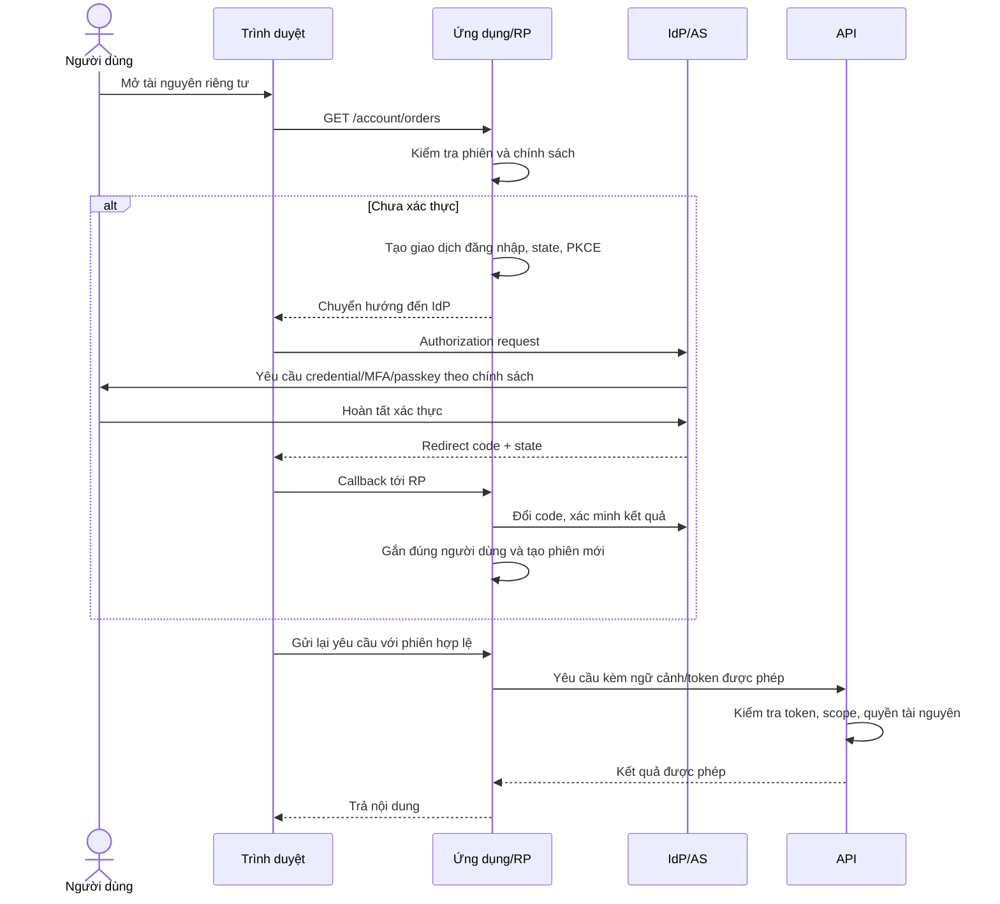

# Request authentication — Khởi tạo yêu cầu xác thực

Một khách hàng mở trang lịch sử thanh toán nhưng chưa đăng nhập. Ứng dụng cần biết **có nên yêu cầu xác thực, yêu cầu ở đâu, cần mức bảo đảm nào và gắn kết quả xác thực với yêu cầu ban đầu ra sao**. Những quyết định này diễn ra trước khi hệ thống có thể tin rằng người dùng hiện tại là chủ tài khoản. Nếu khởi tạo sai, ứng dụng có thể bị login CSRF, chuyển hướng độc hại, tráo kết quả đăng nhập, phát lại yêu cầu hoặc cho qua một thao tác nhạy cảm chỉ vì đã có phiên cũ.

Bài học thuộc chương **Authentication flow** của học phần **SECURITY_AUTHENTICATION_FUNDAMENTALS**. Trọng tâm là bước **request authentication** (yêu cầu xác thực): từ nhận biết một yêu cầu cần đăng nhập, phát sinh thử thách hoặc chuyển tới nhà cung cấp danh tính, đến bảo vệ giao dịch xác thực và tiếp nhận kết quả. Nội dung liên hệ với credential, mật khẩu, MFA, passkey, chứng chỉ, token, phiên, liên kết danh tính và khôi phục tài khoản; người học cần nắm ranh giới tin cậy và cách chống phishing, replay, lạm dụng đăng nhập.

## 1. Kết quả học tập

Sau bài này, người học có thể:

- Phân biệt **yêu cầu tài nguyên** (resource request), **yêu cầu bắt đầu xác thực** (authentication request), **thử thách xác thực** (authentication challenge) và **phản hồi xác thực**.
- Xác định khi nào dịch vụ phải bắt đầu đăng nhập, khi nào có thể dùng phiên hiện tại, khi nào phải yêu cầu xác thực lại hoặc tăng cường (step-up).
- Mô tả luồng đăng nhập cục bộ và luồng chuyển hướng qua OpenID Connect (OIDC), bao gồm vai trò của `state`, PKCE và `nonce` khi áp dụng.
- Liên kết kết quả xác thực với đúng phiên, ứng dụng, nhà phát hành, hành động và yêu cầu đã khởi tạo; tránh lẫn định danh với phân quyền.
- Xử lý đúng trường hợp thiếu credential, hết hạn phiên, sai token, từ chối xác thực, callback bất hợp lệ và đăng nhập nhiều tab.
- Thiết kế tiêu chí kiểm thử cho login CSRF, replay, open redirect, phishing, account enumeration, credential stuffing và hạ cấp mức bảo đảm xác thực.

## 2. “Request authentication” xuất hiện ở đâu?

Trong thực tế, cụm **request authentication** có hai cách dùng liên quan nhưng khác vai trò:

1. **Yêu cầu tài nguyên phải được xác thực:** trình duyệt hoặc client gọi một tài nguyên được bảo vệ, và dịch vụ quyết định yêu cầu này cần chủ thể đã đăng nhập. Ví dụ `GET /me/orders` khi chưa có phiên hợp lệ.
2. **Yêu cầu khởi tạo một lần xác thực:** ứng dụng bắt đầu một giao dịch xác thực cụ thể với bộ phận đăng nhập nội bộ hoặc nhà cung cấp danh tính (Identity Provider, IdP). Ví dụ điều hướng tới endpoint `/authorize` của OIDC.

Hai bước thường nối tiếp nhau, nhưng có thể tồn tại độc lập: người dùng chủ động bấm “Đăng nhập” trước khi truy cập tài nguyên; hoặc API từ chối một yêu cầu không có token mà không tự mở màn hình đăng nhập.

| Thành phần / dữ liệu | Vai trò trong luồng |
| --- | --- |
| **User agent / client** | Trình duyệt, ứng dụng di động hoặc hệ thống gọi API; là nơi bắt đầu yêu cầu, nhưng không tự được tin về danh tính hay quyền. |
| **Relying Party (RP) / ứng dụng** | Quyết định có cần xác thực, lưu giao dịch đăng nhập, kiểm tra kết quả và tạo phiên ứng dụng. |
| **Identity Provider (IdP) / Authorization Server (AS)** | Xác thực người dùng theo chính sách và phát hành kết quả/token được giao thức quy định. |
| **Resource Server (API)** | Xác minh bằng chứng truy cập, kiểm tra scope và quyền trên tài nguyên trước khi phục vụ yêu cầu. |
| **Authentication request** | Mô tả phiên giao dịch: client nào, callback nào, yêu cầu độ mới/mức bảo đảm gì và thông tin chống tráo/phát lại. |
| **Authentication response** | Kết quả thành công, từ chối hoặc lỗi; phải được đối chiếu với giao dịch khởi tạo trước khi tạo phiên. |

**Điểm quan trọng:** một yêu cầu gửi tới IdP chưa chứng minh người dùng đã xác thực. Tương tự, việc nhận được một `code` hoặc chuỗi token tại callback chưa đủ để tin nó; bên nhận phải kiểm tra giao thức, nguồn phát hành, ràng buộc với yêu cầu ban đầu và thời hạn.

## 3. Xác định khi nào cần xác thực

Từ một yêu cầu tài nguyên, máy chủ cần quyết định theo tài sản và rủi ro nghiệp vụ, không dựa vào việc giao diện có hiển thị tên người dùng hay không.

| Tình huống | Hành vi điển hình | Câu hỏi phải trả lời |
| --- | --- | --- |
| Xem trang công khai | Cho truy cập không cần đăng nhập nếu sản phẩm cho phép | Có lý do nghiệp vụ nào thực sự cần định danh không? |
| Xem hồ sơ cá nhân | Yêu cầu phiên hoặc access token hợp lệ | Phiên của ai, dành cho ứng dụng/API nào, còn hiệu lực không? |
| Gửi yêu cầu API với token hợp lệ | Kiểm tra danh tính/khả năng gọi và quyền tài nguyên | Token có đúng issuer, audience, loại và scope không? Người gọi có quyền trên đối tượng này không? |
| Phiên hết hạn hoặc bị thu hồi | Yêu cầu xác thực mới; không âm thầm dùng trạng thái giao diện cũ | Có thể lưu tiếp ngữ cảnh an toàn để người dùng hoàn thành việc đang làm không? |
| Đổi mật khẩu, thêm passkey, đổi email khôi phục | Yêu cầu xác thực lại đủ mới hoặc step-up, kiểm tra quyền | Phương thức hiện tại có đủ mức bảo đảm? Có rủi ro bị chiếm phiên không? |
| Giao dịch tài chính hoặc quản trị nhạy cảm | Áp dụng chính sách step-up và có thể xác nhận đúng nội dung giao dịch | Yêu cầu bảo đảm gì để giảm chiếm đoạt, lạm dụng và thao tác nhầm? |
| Máy với máy | Xác thực client/workload và kiểm tra quyền | Chủ thể là ứng dụng hay người dùng? Khóa/chứng chỉ/token thuộc workload nào? |

Một ứng dụng tốt phân biệt:

- **Authentication required:** chưa có bằng chứng xác thực phù hợp → bắt đầu đăng nhập hoặc trả challenge.
- **Reauthentication required:** đã có phiên nhưng kết quả xác thực quá cũ hoặc không còn đủ tin cậy → yêu cầu xác thực lại.
- **Step-up required:** thao tác cần mức bảo đảm cao hơn (ví dụ xác thực chống phishing hoặc thêm yếu tố), dù phiên thông thường vẫn hợp lệ.
- **Authorization denied:** đã xác thực nhưng **không có quyền**; không được tự suy rằng đăng nhập lại sẽ cấp thêm quyền.

Hệ thống không nên quyết định step-up bằng một tín hiệu đơn lẻ dễ giả mạo như User-Agent, địa chỉ IP hay một cờ `mfa=true` do trình duyệt gửi. Mức bảo đảm và thời điểm xác thực phải được rút ra từ kết quả đáng tin của cơ chế xác thực cùng chính sách máy chủ.

## 4. Luồng tổng quan: từ tài nguyên được bảo vệ đến phiên hợp lệ



Sơ đồ minh họa kiểu **backend/BFF** và OIDC Authorization Code Flow. Không phải mọi hệ thống đều có IdP bên ngoài: một ứng dụng có thể tự kiểm tra mật khẩu/passkey tại backend của mình rồi tạo phiên cục bộ. Ứng dụng di động hoặc SPA có cách lưu kết quả đăng nhập và trao đổi code khác, nhưng nguyên tắc **gắn từng phản hồi với giao dịch đã khởi tạo và kiểm tra phía đáng tin cậy** vẫn giữ nguyên.

Diễn giải các bước:

1. Tài nguyên được yêu cầu; dịch vụ xác định yêu cầu xác thực dựa trên chính sách.
2. Ứng dụng tạo một **giao dịch đăng nhập** có thời hạn, ngẫu nhiên, chỉ sử dụng được trong ngữ cảnh đã lưu.
3. Client được hướng tới phương thức đăng nhập đã định. Với OIDC, request chứa tham số giao thức phù hợp.
4. IdP hoặc dịch vụ xác thực tương tác với người dùng để thu thập bằng chứng, có thể gồm MFA hoặc passkey.
5. RP tiếp nhận callback/kết quả, đối chiếu giao dịch và kiểm tra mọi điều kiện trước khi xác định danh tính.
6. RP tạo/luân chuyển định danh phiên theo chính sách; API tiếp tục **kiểm tra quyền ở từng yêu cầu**, chứ không coi một lần đăng nhập là cấp toàn quyền.

Trường hợp người dùng không hoàn tất đăng nhập (đóng tab, từ chối MFA, hết hạn hoặc bị lỗi), ứng dụng phải kết thúc giao dịch phù hợp và giữ tài nguyên được bảo vệ ở trạng thái chưa truy cập.

## 5. Khởi tạo yêu cầu xác thực OIDC an toàn

Với OIDC Authorization Code Flow, RP thường gửi yêu cầu tới **authorization endpoint** của IdP đã cấu hình. Ví dụ dưới đây chỉ là minh họa dạng HTTP đã rút gọn; các giá trị ngẫu nhiên và URL giả định không phải credential hoạt động:

```http
GET /authorize?response_type=code&client_id=web-client
    &redirect_uri=https%3A%2F%2Fapp.example.test%2Fauth%2Fcallback
    &scope=openid%20profile
    &state=<random_state>
    &code_challenge=<pkce_challenge>
    &code_challenge_method=S256
    &nonce=<random_nonce> HTTP/1.1
Host: login.example.test
```

Khi gửi thật, URL là một dòng đã mã hóa tham số đúng cách. Phần `<...>` chỉ là placeholder; trạng thái và khóa PKCE phải được sinh từ bộ tạo số ngẫu nhiên an toàn, lưu/ràng buộc phù hợp và không dùng những chuỗi cố định có thể đoán được.

| Thành phần | Công dụng | Quy tắc thực hành |
| --- | --- | --- |
| `response_type=code` | Yêu cầu authorization code để đổi lấy token qua bước tiếp theo | Dùng luồng được IdP và client đăng ký hỗ trợ; không coi code là token truy cập. |
| `client_id` | Xác định ứng dụng yêu cầu | Lấy từ cấu hình tin cậy; **client ID không phải bí mật**. |
| `redirect_uri` | Nơi nhận kết quả của luồng | Đăng ký và khớp theo quy tắc của nhà cung cấp; không lấy URL callback tùy ý từ người dùng. |
| `scope=openid ...` | Báo hiệu yêu cầu xác thực OIDC và các claim/scope cần thiết | Xin đúng phạm vi; không xin quá nhiều dữ liệu chỉ để “tiện”. |
| `state` | Tương quan phản hồi với giao dịch khởi tạo, giúp chống login CSRF/tráo luồng | Ngẫu nhiên, có hạn, dùng một lần, ràng buộc phiên/ngữ cảnh thích hợp. |
| PKCE: `code_challenge`, `S256` | Ràng buộc code với lần yêu cầu có `code_verifier` bí mật tương ứng | Dùng PKCE đúng giao thức; bảo vệ `code_verifier`, không đưa verifier vào URL authorize. |
| `nonce` (khi sử dụng) | Ràng buộc ID token với lần yêu cầu xác thực OIDC | Kiểm tra chính xác `nonce` của ID token theo luồng/profile áp dụng. |
| `max_age`, `acr_values`, `prompt` (nếu cần) | Diễn đạt yêu cầu độ mới, mức bảo đảm hoặc cách tương tác | Chỉ là phần **yêu cầu**; RP phải kiểm chứng kết quả `auth_time`, `acr` và điều kiện thực tế theo thỏa thuận với IdP. |

**Không đặt** mật khẩu, OTP, access token, refresh token, bí mật của client hoặc thông tin nhạy cảm của người dùng vào URL authorize. Những giá trị trong URL có thể bị lưu ở browser history, nhật ký proxy, công cụ phân tích hoặc rò qua referrer nếu thiết kế không phù hợp.

### Lưu trạng thái giao dịch phía máy chủ

Một giao dịch khởi tạo có thể lưu các trường sau:

```text
transaction_id:        định danh nội bộ
intent:                LOGIN hoặc STEP_UP
bound_browser_session: phiên tiền đăng nhập / phiên hiện có
selected_idp:          cấu hình IdP đã xác minh
expected_issuer:       issuer được chấp nhận
redirect_uri:          callback đã đăng ký
state:                 giá trị tương quan ngẫu nhiên
nonce:                 giá trị nonce nếu dùng OIDC
pkce_verifier:         chỉ lưu ở thành phần cần đổi code
created_at/expires_at: giới hạn thời gian
return_path:           đường dẫn nội bộ đã chuẩn hóa, nếu cần
required_assurance:    mức/độ mới xác thực được chính sách yêu cầu
consumed:              chống callback lặp
```

Có thể lưu state qua kho server-side, cookie giao dịch được bảo vệ hoặc cơ chế tương đương tùy kiến trúc, nhưng phải đảm bảo **tính toàn vẹn, chống phát lại và ràng buộc đúng phiên/ý định**. Đối với callback từ IdP, thiết kế cookie `SameSite` cần phù hợp kiểu chuyển hướng và phương thức HTTP của callback; không nên sửa cookie thành chế độ quá rộng chỉ để che một lỗi thiết kế.

Một người dùng có thể mở nhiều tab cùng lúc. Nếu chỉ lưu duy nhất một `state` và ghi đè mỗi lần bắt đầu, callback hợp lệ từ tab trước có thể thất bại. Có thể hỗ trợ nhiều giao dịch độc lập có TTL và giới hạn số lượng, đồng thời xử lý callback theo đúng `state` và ngữ cảnh đã lưu. **Không nới lỏng xác minh state** để sửa lỗi nhiều tab.

## 6. Callback phải chứng minh điều gì?

Một phản hồi OIDC authorization code thành công thường quay về với `code` và `state`. Trước khi tạo phiên, RP phải:

1. Đối chiếu `state` với **giao dịch đang chờ** và phiên/ngữ cảnh liên quan; từ chối nếu sai, hết hạn hoặc đã tiêu thụ.
2. Xác nhận giao dịch đang dùng đúng IdP/authorization server đã chọn, tránh **issuer mix-up** khi tích hợp nhiều nhà cung cấp.
3. Trao đổi `code` với token endpoint tin cậy bằng đúng client và redirect URI đã cấu hình, kèm `code_verifier` PKCE; bảo vệ thông tin xác thực client nếu client dạng confidential.
4. Kiểm chứng ID token theo OIDC: chữ ký, thuật toán/khóa được phép, `iss`, `aud`, `exp`, các claim bắt buộc và `nonce` nếu đã yêu cầu; kiểm tra `azp`, `auth_time`, `acr` khi liên quan.
5. Ánh xạ danh tính từ cặp định danh **issuer + subject** đã kiểm chứng với tài khoản nội bộ theo chính sách. **Không tự ghép tài khoản chỉ vì email trùng nhau.**
6. Kiểm tra tài khoản có còn được phép đăng nhập và mức bảo đảm có đáp ứng yêu cầu ban đầu không; nếu chưa, giữ tác vụ nhạy cảm ở trạng thái chờ và xử lý step-up an toàn.
7. Tạo hoặc xoay phiên ứng dụng để chống session fixation, đặt thuộc tính cookie phù hợp, đóng giao dịch một lần và chuyển tới đường dẫn nội bộ an toàn.

Khi callback trả lỗi như `access_denied`, `login_required` hoặc thông tin phản hồi bị thiếu, RP cần kiểm tra tương quan giao dịch, chấm dứt/đánh dấu kết quả phù hợp và hiển thị lỗi có kiểm soát. Không được tự tạo phiên “tạm” để tiếp tục thao tác đã bị từ chối.

**Ranh giới tin cậy:** IdP chứng minh điều gì đó về **danh tính** theo chính sách của họ. RP vẫn chịu trách nhiệm chọn đúng tài khoản ứng dụng, quản lý phiên, kiểm tra tenant, trạng thái người dùng và phân quyền. API chịu trách nhiệm kiểm tra token và quyền truy cập từng tài nguyên. Một ID token không phải access token chung để gọi API.

## 7. Khi dùng đăng nhập cục bộ: yêu cầu và thử thách xác thực

Không phải mọi ứng dụng đều dùng OIDC. Nếu backend tự xác thực credential:

1. Client yêu cầu mở luồng đăng nhập; máy chủ phát hành giao dịch có TTL và bảo vệ CSRF phù hợp.
2. Dịch vụ tiếp nhận bằng chứng theo phương thức đang hỗ trợ: mật khẩu, passkey/WebAuthn, mã MFA hoặc chứng chỉ trong môi trường phù hợp.
3. Dịch vụ kiểm chứng **ở phía tin cậy**, áp dụng chống lạm dụng đăng nhập, giới hạn thử và chính sách rủi ro. Không dựa vào việc frontend báo `authenticated=true`.
4. Nếu cần nhiều yếu tố, chỉ đánh dấu hoàn tất sau khi **toàn bộ** yêu cầu xác thực đạt; một bước thành công chưa đủ để cấp phiên đầy đủ.
5. Khi thành công, xoay phiên/định danh phiên, đặt thời hạn, ghi sự kiện an ninh và chuyển người dùng về tài nguyên an toàn đã yêu cầu.

Với passkey, phía máy chủ phải tạo **challenge ngẫu nhiên**, có thời hạn và gắn với giao dịch; WebAuthn assertion cần được xác minh đúng challenge, RP ID, origin, chữ ký, credential, cờ user presence/user verification theo chính sách và các kiểm tra khác của giao thức. Không chấp nhận một assertion hợp lệ nhưng thuộc **challenge cũ** hoặc RP khác. Passkey cung cấp khả năng chống phishing dựa trên origin tốt hơn so với OTP nhập tay, nhưng phiên/token được cấp sau đó vẫn có thể bị đánh cắp nếu ứng dụng quản lý phiên kém.

Với mật khẩu, dịch vụ cần xử lý kết quả kiểm chứng an toàn, giới hạn lạm dụng, tránh lộ tồn tại tài khoản qua thông báo lỗi hoặc khác biệt hành vi quá rõ. Với MFA, phân biệt các phương thức: OTP/SMS có thể bị phishing thời gian thực, còn phương thức có ràng buộc origin/khóa có tính chống phishing mạnh hơn. Phương thức khôi phục không được trở thành đường vòng vô điều kiện khi người dùng thất bại MFA.

### Authentication challenge khác authorization challenge

**Authentication challenge** yêu cầu chủ thể chứng minh danh tính hoặc quyền sở hữu credential; **authorization** quyết định chủ thể có quyền làm hành động hay không. Ví dụ, yêu cầu xuất trình passkey khi đổi email khôi phục là bước tăng bảo đảm xác thực. Việc cho phép đổi email sau đó vẫn phụ thuộc vào quyền tài khoản, chính sách thời gian chờ, phát hiện rủi ro và kiểm soát tác vụ.

## 8. HTTP: trả gì khi yêu cầu chưa được xác thực?

Ứng dụng web tương tác và API thường xử lý khác nhau. **API không nên tự chuyển hướng sang trang đăng nhập HTML** nếu hợp đồng API mong chờ phản hồi JSON và challenge theo chuẩn.

| Trường hợp | Cách phản hồi thường dùng | Lưu ý |
| --- | --- | --- |
| API thiếu hoặc có credential không hợp lệ | `401 Unauthorized`, có `WWW-Authenticate` cho cơ chế HTTP auth tương ứng | 401 về bản chất là thiếu/chưa đạt xác thực; không rò chi tiết bí mật hoặc định danh tài khoản. |
| API đã xác thực nhưng thiếu scope cần thiết | `403 Forbidden` trong trường hợp phù hợp; với Bearer có thể kèm challenge nêu `insufficient_scope` theo giao thức | Phân biệt 403 với 401; kiểm tra quyền đối tượng tại API. |
| Tài nguyên không nên bị lộ tồn tại | Có thể dùng `404 Not Found` theo chính sách | Không dựa vào cách này để thay kiểm tra quyền. |
| Trang web bảo vệ cần tương tác | Điều hướng có kiểm soát tới luồng login, thường qua redirect | `return_path` phải là đường dẫn nội bộ an toàn, không thành open redirect. |
| Phiên hợp lệ nhưng cần step-up | Trả trạng thái yêu cầu tăng cường rõ ràng theo hợp đồng ứng dụng | Không thực thi thao tác nhạy cảm trước khi hoàn thành xác thực bổ sung. |

Ví dụ API dùng Bearer:

```http
GET /api/me/orders HTTP/1.1
Host: api.example.test

HTTP/1.1 401 Unauthorized
WWW-Authenticate: Bearer realm="orders-api"
Content-Type: application/json

{"error":"authentication_required"}
```

Sau khi token hợp lệ được trình ra, API còn phải kiểm tra quyền và trạng thái tài khoản. Đừng hiểu “401 Unauthorized” theo tên tiếng Anh như quyết định **phân quyền** cuối cùng; trong HTTP, 401 là challenge/yêu cầu xác thực, còn 403 thường biểu thị không được phép xử lý yêu cầu khi đã có ngữ cảnh thích hợp.

## 9. Xác thực theo rủi ro và xác thực tăng cường

Yêu cầu xác thực có thể cần một **mức bảo đảm** hoặc **độ mới** nhất định. Ví dụ:

| Hoạt động | Điều kiện gợi ý |
| --- | --- |
| Đọc thông tin cá nhân thông thường | Phiên đã xác thực, chưa hết hạn, đúng tenant và không có dấu hiệu bị thu hồi. |
| Đổi thông tin khôi phục | Xác thực lại đủ mới bằng credential được chấp nhận; thông báo thay đổi và kiểm tra chống chiếm tài khoản. |
| Thêm passkey hoặc liên kết IdP | Chứng minh quyền kiểm soát tài khoản hiện tại và credential mới/IdP bên ngoài; chống liên kết tài khoản của kẻ tấn công. |
| Duyệt khoản thanh toán lớn | Step-up theo rủi ro; nếu nghiệp vụ yêu cầu, gắn xác nhận với đúng giao dịch và kiểm tra quyền người phê duyệt. |
| Truy cập quản trị nhạy cảm | Ưu tiên phương thức chống phishing, phiên/thiết bị phù hợp và nhật ký kiểm toán. |

Trong OIDC, RP có thể yêu cầu `max_age` để đòi độ mới, hoặc sử dụng `acr_values` theo hợp đồng với IdP để diễn đạt lớp xác thực mong muốn. Tuy vậy, **yêu cầu gửi đi không bảo đảm IdP đã đáp ứng**: RP cần kiểm tra kết quả thực tế (`auth_time`, `acr`, `amr` khi phù hợp và được định nghĩa tin cậy). Không tự kết luận “MFA vừa hoàn tất” chỉ vì đã có access token hay cookie phiên.

Khi yêu cầu step-up thất bại, ứng dụng phải giữ nguyên trạng thái chưa thực hiện thao tác. Đối với yêu cầu thay đổi dữ liệu, bảo vệ chống thao tác trùng/đua sau khi người dùng quay về từ luồng xác thực: kiểm tra lại dữ liệu, quyền và điều kiện nghiệp vụ **ngay tại thời điểm thực thi**, dùng idempotency hoặc bảo vệ đồng thời khi cần.

## 10. Mối đe dọa ở giai đoạn request authentication

| Rủi ro | Cách phát sinh | Kiểm soát thiết kế |
| --- | --- | --- |
| **Login CSRF / session swapping** | Kẻ tấn công làm trình duyệt nạn nhân nhận callback của một phiên đăng nhập khác | `state` ngẫu nhiên, dùng một lần, gắn phiên và giao dịch; xoay phiên sau đăng nhập. |
| **OAuth authorization code injection** | Kẻ tấn công tráo hoặc chèn code từ giao dịch khác | PKCE, xác minh `state`, redirect URI và IdP đã ghim. |
| **Issuer mix-up / token substitution** | Ứng dụng nhiều IdP chấp nhận kết quả từ sai issuer/client | Ghi IdP đã chọn trong giao dịch, kiểm tra issuer, audience và loại token. |
| **Open redirect** | Giá trị `returnUrl` hoặc redirect URI do client cung cấp chuyển người dùng tới miền lừa đảo | Callback cố định/đăng ký; chỉ cho return path nội bộ hoặc danh sách cho phép. |
| **Replay** | Gửi lại state, code, nonce, challenge hoặc kết quả xác thực cũ | Giao dịch một lần, TTL, kiểm tra nonce/challenge, từ chối sau khi đã tiêu thụ. |
| **Credential stuffing / password spraying** | Bot khởi tạo và thử mật khẩu hàng loạt | Chống tự động hóa theo tín hiệu đa chiều, giới hạn tốc độ theo ngữ cảnh, giám sát và MFA/passkey. |
| **Account enumeration** | Thông báo đăng nhập hoặc khôi phục tiết lộ email nào đã đăng ký | Thông báo lỗi hợp lý, bảo vệ khác biệt thời gian/luồng ở nơi cần thiết, giới hạn thử. |
| **Phishing / MFA phishing** | Người dùng bị dụ nhập mật khẩu/OTP ở trang giả | Phương thức chống phishing như passkey, nhận biết đúng origin, quản lý redirect và truyền thông an toàn. |
| **Session fixation / hijacking** | Phiên trước đăng nhập tiếp tục có đặc quyền, cookie bị lấy cắp | Xoay ID phiên sau xác thực, cookie an toàn, hết hạn/thu hồi, step-up khi nhạy cảm. |
| **Assurance downgrade** | Yêu cầu xác thực mạnh nhưng RP chấp nhận kết quả yếu hơn | Kiểm tra độ mới và mức bảo đảm từ nguồn tin cậy, từ chối nếu không đáp ứng. |
| **CSRF trong hành động nhạy cảm** | Trình duyệt tự gửi cookie cùng yêu cầu sửa dữ liệu | CSRF protection, `SameSite` phù hợp, kiểm tra quyền và step-up theo ngữ cảnh. |

Không có một biện pháp duy nhất giải quyết tất cả. Chẳng hạn, HTTPS bảo vệ kết nối nhưng không tự chống phishing, code injection hoặc một bearer token đã bị đánh cắp. Giới hạn số lần thử chống đoán mật khẩu nhưng khóa tài khoản quá dễ có thể trở thành công cụ từ chối dịch vụ của kẻ tấn công.

### Ghi nhật ký mà không làm lộ credential

Nên ghi sự kiện bắt đầu đăng nhập, IdP được dùng, kết quả thành công/thất bại, loại nguyên nhân, yêu cầu step-up, thời gian và mã tương quan **không mang bí mật**. Không ghi mật khẩu, OTP, authorization code, ID/access/refresh token, `code_verifier`, private key hay URL chứa bí mật. Giảm lộ danh tính trong log; giới hạn quyền xem và thời gian lưu theo chính sách.

## 11. Pseudocode: khởi tạo và hoàn tất một giao dịch đăng nhập

Ví dụ dưới đây minh họa ứng dụng backend/BFF, sử dụng các thư viện OIDC và session có kiểm chứng. Hàm chỉ thể hiện **bất biến an ninh**; không phải bộ thư viện có thể sao chép chạy trực tiếp.

```ts
async function startAuthentication(req) {
  const safeReturnPath = validateLocalPath(req.query.returnTo) ?? "/home";
  const idp = trustedProviderFor(req.tenantContext);
  const tx = {
    id: secureRandomId(),
    intent: "LOGIN",
    browserBinding: req.session.binding,
    providerId: idp.id,
    expectedIssuer: idp.issuer,
    state: secureRandomValue(),
    nonce: secureRandomValue(),
    pkceVerifier: createSecurePkceVerifier(),
    returnPath: safeReturnPath,
    expiresAt: nowPlusShortTTL()
  };

  await pendingLoginStore.save(tx); // TTL, giới hạn số giao dịch
  return redirectToTrustedAuthorizationEndpoint({
    provider: idp,
    clientId: idp.clientId,
    redirectUri: idp.registeredRedirectUri,
    responseType: "code",
    scope: ["openid"],
    state: tx.state,
    nonce: tx.nonce,
    codeChallenge: pkceS256Challenge(tx.pkceVerifier)
  });
}

async function completeAuthentication(req) {
  const tx = await pendingLoginStore.consumeOnce(req.query.state);
  if (!tx || tx.intent !== "LOGIN") return rejectLogin();
  if (tx.browserBinding !== req.session.binding) return rejectLogin();
  if (isExpired(tx.expiresAt)) return rejectLogin();

  const idp = trustedProviderById(tx.providerId);
  if (idp.issuer !== tx.expectedIssuer) return rejectLogin();

  const tokens = await trustedOidcClient.exchangeCodeAndValidate({
    provider: idp,
    authorizationCode: req.query.code,
    redirectUri: idp.registeredRedirectUri,
    pkceVerifier: tx.pkceVerifier,
    expectedNonce: tx.nonce,
    expectedIssuer: tx.expectedIssuer,
    expectedAudience: idp.clientId
  });
  if (!tokens?.verifiedIdToken) return rejectLogin();

  const identity = {
    issuer: tokens.verifiedIdToken.iss,
    subject: tokens.verifiedIdToken.sub
  };
  const user = await findLinkedActiveUser(identity);
  if (!user) return handleUnlinkedIdentityAccordingToPolicy();

  await rotateAndEstablishSession(req, user.id);
  return redirect(tx.returnPath); // Chỉ đường dẫn nội bộ đã kiểm tra
}
```

Một triển khai hoàn chỉnh cần xử lý callback lỗi, đảm bảo `consumeOnce` nguyên tử, kiểm tra số phiên/giao dịch cho nhiều tab, hỗ trợ ràng buộc trạng thái khi phiên tiền đăng nhập đổi ID, và kiểm tra `auth_time`/`acr` theo yêu cầu nếu là step-up. Không dùng `user_id` lấy từ callback không tin cậy để quyết định tài khoản đích; với giao dịch **liên kết danh tính**, phải dùng luồng LINK và xác thực tài khoản đang đăng nhập riêng.

Ở tầng API, cơ chế yêu cầu xác thực có thể tối giản hơn:

```ts
async function protectedEndpoint(req) {
  const credential = readConfiguredCredential(req);
  const principal = await verifyCredentialForThisApi(credential);
  if (!principal) return challenge401();

  const resource = await loadRequestedResource(req.params.id);
  if (!mayAccess(principal, resource)) return forbidden403();
  return success(resource);
}
```

Hàm `verifyCredentialForThisApi` phải kiểm tra đúng định dạng/token type, issuer, audience, chữ ký hoặc introspection, thời hạn, sender constraint nếu có và trạng thái cần thiết. Đây là khác biệt giữa **yêu cầu mỗi request phải được xác thực** và **khởi tạo một phiên đăng nhập mới**.

## 12. Tình huống thực tế: thay đổi tài khoản nhận tiền

Một dịch vụ thương mại điện tử có người dùng đã đăng nhập bằng phiên web. Họ muốn đổi tài khoản ngân hàng nhận tiền. Chính sách bảo mật yêu cầu một lần xác thực đủ mới và phương thức bảo đảm cao trước khi lưu thay đổi.

**Luồng an toàn:**

1. Người dùng gửi yêu cầu đổi thông tin. Backend nhận diện tài khoản, quyền, tenant và kiểm tra độ mới/mức bảo đảm của phiên.
2. Nếu chưa đủ, backend **không ghi dữ liệu**, tạo giao dịch step-up ràng buộc phiên và ý định “đổi tài khoản nhận tiền”; giữ thông tin dự kiến thay đổi theo cách có toàn vẹn và thời hạn.
3. Người dùng hoàn tất passkey hoặc phương thức step-up theo chính sách, trực tiếp hoặc qua IdP được tin cậy.
4. Backend kiểm tra kết quả đúng giao dịch, đúng chủ thể và mức bảo đảm; sau đó hiển thị/kiểm tra lại thông tin cần xác nhận.
5. Ngay trước khi ghi, backend kiểm tra lại quyền, trạng thái tài khoản và tính hợp lệ của dữ liệu; lưu kết quả theo cơ chế chống ghi lặp và ghi nhận sự kiện bảo mật.

**Các lỗi thường thấy:**

- Frontend gửi `mfaPassed: true` và backend chấp nhận giá trị này.
- Callback step-up thuộc người dùng B được dùng để hoàn tất hành động của người dùng A.
- Sau khi step-up, backend thực thi một yêu cầu thay đổi **khác** với nội dung mà người dùng đã xác nhận.
- Một callback đã tiêu thụ vẫn được xử lý lần thứ hai để ghi giao dịch trùng.
- Backend coi ID token hay access token còn hạn là bằng chứng cho **độ mới** của MFA mà không kiểm chứng thông tin xác thực thực tế.

Yêu cầu tăng cường là một phần của điều kiện kinh doanh. Nếu không xác thực được, thao tác nhạy cảm phải thất bại an toàn và người dùng cần có đường trở lại ứng dụng rõ ràng.

## 13. Tiêu chí chấp nhận và kiểm thử

| Tình huống | Kết quả mong đợi |
| --- | --- |
| Người dùng chưa đăng nhập mở trang riêng tư | Ứng dụng tạo luồng xác thực hoặc challenge phù hợp; không tiết lộ dữ liệu. |
| Phiên hợp lệ mở tài nguyên nhưng không có quyền | API từ chối theo quyền; đăng nhập lại không tự sinh thêm quyền. |
| Authorization request hợp lệ, IdP trả code và state tương ứng | RP kiểm tra giao dịch, đổi code bằng PKCE, kiểm chứng token và tạo đúng phiên. |
| `state` bị sửa, hết hạn, thiếu hoặc đã dùng | Callback bị từ chối, không tạo phiên. |
| Code bị tráo hoặc `code_verifier` không tương ứng | Trao đổi code thất bại, không tạo phiên. |
| ID token sai issuer, audience, chữ ký, nonce (nếu dùng) hoặc đã hết hạn | Không chấp nhận kết quả đăng nhập. |
| Hai tab khởi tạo hai giao dịch khác nhau | Mỗi callback khớp giao dịch riêng; không bỏ qua kiểm tra `state`. |
| `returnTo` chứa URL ngoại miền | Không redirect tới miền lạ; dùng đường dẫn mặc định an toàn. |
| Người dùng từ chối MFA hoặc đóng tab | Không tạo phiên với mức bảo đảm bị thiếu, tài nguyên vẫn được bảo vệ. |
| Một WebAuthn challenge cũ được gửi lại | Từ chối; challenge mới phải đúng RP và giao dịch. |
| API thiếu Bearer token | Trả challenge 401 đúng cơ chế, không redirect HTML tùy tiện. |
| API nhận access token đúng chữ ký nhưng sai audience | Từ chối xác thực cho API này. |
| Phiên đủ để đọc hồ sơ nhưng chưa đủ mới để đổi email khôi phục | Yêu cầu step-up; chưa thực thi thay đổi. |
| Callback step-up thành công nhưng thuộc người dùng khác | Từ chối, không thực hiện hành động nhạy cảm. |
| Tài khoản đã bị vô hiệu hóa sau khi bắt đầu đăng nhập | Không cho tạo phiên hợp lệ khi xử lý kết quả. |
| Đăng nhập thất bại hàng loạt từ bot | Có giới hạn thử, giám sát phù hợp và không tiết lộ tài khoản qua thông báo lỗi. |

Theo dõi tỷ lệ bắt đầu và hoàn thành xác thực, tỷ lệ abandon theo IdP/phương thức, độ trễ p50/p95, lỗi callback theo nguyên nhân, lần thử lại khi hết hạn giao dịch, tỷ lệ step-up thành công, đăng nhập bị từ chối nhầm và dấu hiệu tấn công. Đo theo nhóm thiết bị/khả năng tiếp cận nhưng bảo vệ riêng tư; không lưu credential hoặc token thô để lấy số liệu.

## 14. Bài tập tự kiểm tra

Một SaaS quản lý hóa đơn có hai cách đăng nhập: tài khoản nội bộ với passkey và SSO của khách hàng doanh nghiệp. Trang danh sách hóa đơn yêu cầu phiên hợp lệ; thao tác “đổi người nhận thanh toán” yêu cầu xác thực đủ mới.

Hãy thiết kế:

1. Chuỗi bước từ `GET /invoices` khi chưa có phiên tới lúc người dùng xem được hóa đơn sau đăng nhập SSO. Bước nào tạo `state` và PKCE? Bước nào xác minh `iss`, `aud`, `sub` và `nonce`?
2. Cách xử lý khi cùng một người mở hai tab đăng nhập, tab đầu thành công còn tab thứ hai trả callback muộn.
3. Cách phân biệt phản hồi `401`, `403` và yêu cầu step-up khi gọi API `POST /payout-account`.
4. Ba trường hợp replay/tráo callback hoặc open redirect mà hệ thống phải từ chối.
5. Cách bảo đảm kết quả step-up chỉ mở khóa **đúng thao tác của đúng người**, không cấp quyền thay đổi dữ liệu của tenant khác.

**Gợi ý tự đánh giá:** câu trả lời tốt phải gọi tên rõ **bên khởi tạo, bên phát challenge, bên xác minh, giao dịch đang chờ, bằng chứng xác thực, phiên/token, ranh giới tin cậy và quyền trên tài nguyên**. Hãy trình bày điều kiện thất bại cho từng bước, không chỉ sơ đồ “login → success”.

---

**Ghi nhớ:** request authentication là bước đưa một yêu cầu từ trạng thái **chưa đủ bằng chứng danh tính** sang một giao dịch xác thực có kiểm soát. Tính an toàn phụ thuộc vào **chọn đúng lúc cần xác thực, ghim đúng nhà cung cấp và tài khoản, sinh giao dịch ngẫu nhiên dùng một lần, xác minh đầy đủ kết quả, gắn đúng phiên/ngữ cảnh và kiểm tra quyền sau đăng nhập**. Các thao tác rủi ro cao còn cần kiểm tra độ mới và mức bảo đảm trước khi thực thi.
