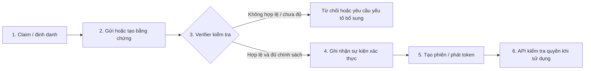
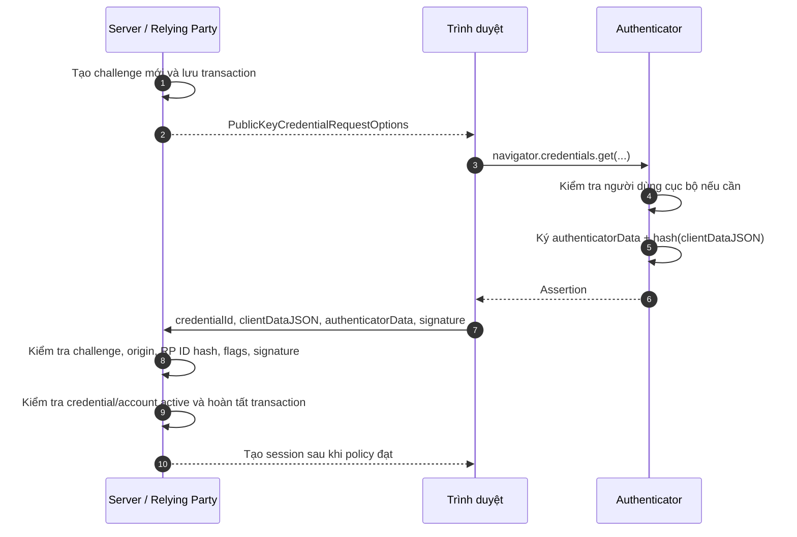
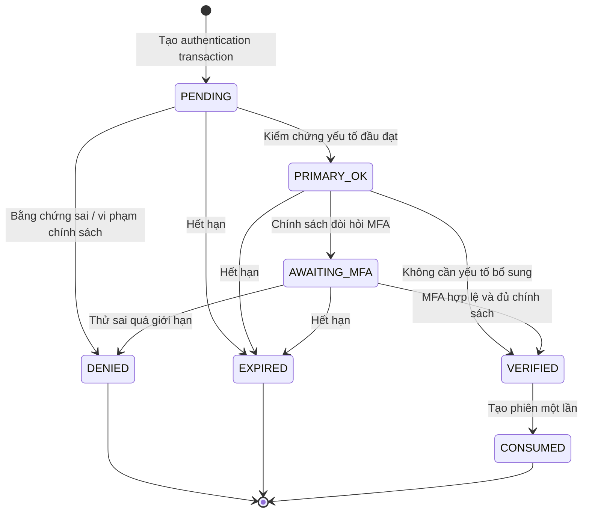
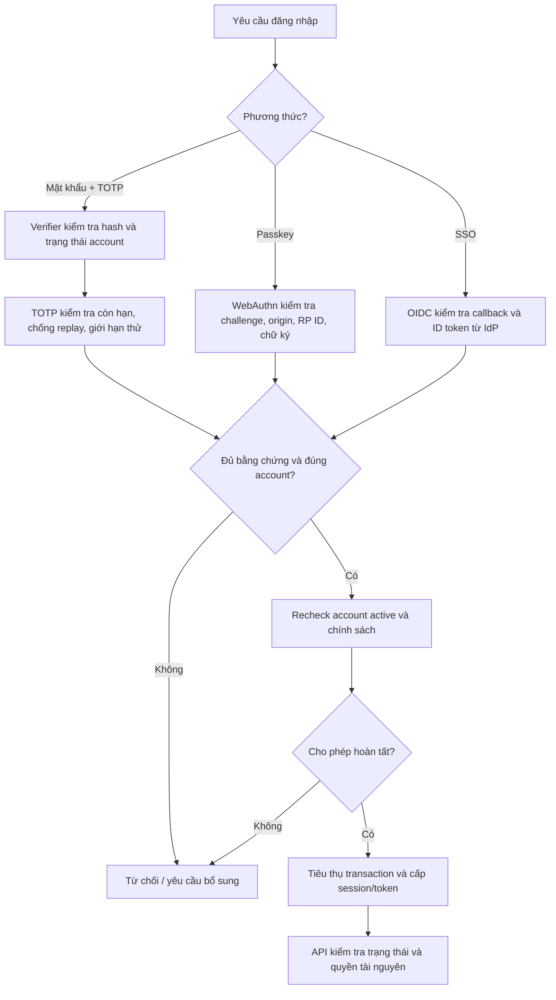

# Verification trong authentication flow — Kiểm chứng bằng chứng xác thực

> **Chương:** Authentication flow  
> **Chủ đề:** Verification (bước kiểm chứng)  
> **Phạm vi:** Security Authentication Fundamentals — kiểm tra credential, mật khẩu, MFA, passkey, chứng chỉ, kết quả đăng nhập liên kết trước khi thiết lập phiên hoặc token.

## Mục tiêu học tập

Sau bài này, bạn có thể:

1. Giải thích **verification** là bước nào trong authentication flow, thành phần nào đưa ra bằng chứng và thành phần nào quyết định bằng chứng hợp lệ.
2. Tách bạch **kiểm chứng bằng chứng xác thực**, **xác minh danh tính khi đăng ký**, **kiểm tra phiên/token** và **phân quyền tài nguyên**.
3. Thiết kế điều kiện kiểm chứng cho mật khẩu, OTP, passkey/WebAuthn, chứng chỉ số và kết quả từ nhà cung cấp danh tính (IdP).
4. Chỉ ra cơ chế chống **phishing, replay, brute force, credential stuffing, MFA fatigue, session hijacking** và xử lý khi trạng thái tài khoản thay đổi trong lúc xác thực.
5. Xây dựng luồng verification có chính sách rõ ràng, kết quả có thể kiểm toán, thông báo lỗi an toàn và kiểm thử các trường hợp thành công, thất bại, cạnh tranh và ngoại lệ.

## 1. Verification nằm ở đâu trong authentication flow?

**Verification** là bước bên xác thực (**verifier**) kiểm tra bằng chứng mà chủ thể đưa ra có thỏa điều kiện đã thiết lập cho một danh tính và **một giao dịch đăng nhập cụ thể** hay không. Nếu các điều kiện đạt, hệ thống có thể ghi nhận rằng sự kiện xác thực đã thành công; nếu thiếu hoặc sai, hệ thống phải từ chối hoặc yêu cầu bước xác thực bổ sung phù hợp.

Ví dụ, với tài khoản `lan@example.com`, trình duyệt gửi mật khẩu. Máy chủ không được tin thông báo “passwordValid: true” từ client; nó phải truy xuất bản ghi xác minh mật khẩu thuộc tài khoản Lan, kiểm tra bằng thuật toán hash mật khẩu và áp dụng các chính sách liên quan. Nếu hệ thống yêu cầu MFA, mật khẩu đúng **mới chỉ hoàn thành một phần** verification.

Một luồng đơn giản:



Bước 3 là trọng tâm bài này. Bước 4–6 phụ thuộc vào kết quả verification, nhưng **không nên trộn các quyết định**.

| Khái niệm | Điều cần kiểm tra | Ví dụ |
| --- | --- | --- |
| **Identity proofing** | Định danh/tài khoản có gắn với người hoặc tổ chức khai báo không? | Đối chiếu giấy tờ lúc mở tài khoản |
| **Authentication verification** | Bằng chứng hiện tại có chứng minh quyền kiểm soát authenticator gắn với tài khoản không? | Kiểm tra hash mật khẩu, chữ ký WebAuthn |
| **Session/token validation** | Ngữ cảnh xác thực trước đó có còn hợp lệ với yêu cầu hiện tại không? | Kiểm tra cookie, chữ ký token, hạn dùng, thu hồi |
| **Authorization** | Chủ thể sau xác thực có quyền thao tác trên tài nguyên cụ thể không? | Nhân viên chỉ xem đơn hàng thuộc tổ chức của mình |
| **Transaction confirmation** | Người dùng có xác nhận ý định thực hiện giao dịch cụ thể không? | Xác nhận khoản chuyển tiền và người nhận |

Kết quả verification thành công **không chứng minh người ngoài đời thực đang thao tác** nếu credential đã bị đánh cắp. Nó cũng không cấp quyền truy cập mọi tài nguyên và không tự xác nhận ý định thực hiện một giao dịch giá trị lớn.

## 2. Những thành phần và ranh giới tin cậy

| Thành phần | Vai trò trong verification | Ranh giới cần bảo vệ |
| --- | --- | --- |
| **Claimant** — chủ thể yêu cầu | Khai báo danh tính và kiểm soát authenticator | Người hoặc máy có thể bị tấn công, dụ dỗ hoặc thay thế |
| **Client / user agent** | Chuyển yêu cầu, hiển thị thử thách và nhận phản hồi | Dữ liệu, JavaScript và UI phía client có thể bị sửa |
| **Authenticator** | Tạo bằng chứng: mật khẩu, OTP, chữ ký hoặc xác nhận cục bộ | Bí mật/khóa riêng, tính toàn vẹn thiết bị và chính sách sử dụng |
| **Verifier** | So khớp bằng chứng với bản ghi tin cậy, challenge và chính sách | Quyết định xác thực phải diễn ra trong miền tin cậy |
| **Credential store** | Lưu bản ghi kiểm tra: password hash, khóa công khai, khóa TOTP được bảo vệ | Phân quyền đọc/ghi, bảo vệ secret, quản lý vòng đời |
| **Identity provider (IdP)** | Có thể thực hiện verification rồi phát bằng chứng liên kết | Relying party cần xác minh đúng issuer, audience và giao thức |
| **Session/token issuer** | Chỉ phát ngữ cảnh truy cập sau quyết định xác thực hợp lệ | Không cấp phiên trước khi đủ mọi bước bắt buộc |
| **Resource API** | Kiểm tra phiên/token và quyền ở thời điểm truy cập | Không tin client tự khai đã xác thực; kiểm tra trạng thái tài khoản |

Trong kiến trúc liên kết, **IdP có thể là verifier của người dùng**, còn ứng dụng chỉ kiểm tra assertion/token do IdP phát hành. Đây là **hai lớp kiểm chứng khác nhau**: IdP xác thực người dùng; ứng dụng xác thực **nguồn và tính hợp lệ** của kết quả liên kết.

### Các câu hỏi nền tảng

- Ai là nguồn sự thật cho **trạng thái tài khoản, credential và chính sách MFA**?
- Ai tạo challenge, challenge được gắn vào giao dịch nào, sống bao lâu và bị hủy khi nào?
- Verifier kiểm tra bằng chứng **phía máy chủ hoặc môi trường đáng tin** hay chỉ tin cờ do client gửi?
- Một bằng chứng vừa được kiểm chứng có thể bị phát lại, dùng cho website khác hoặc bị áp sang tài khoản khác không?
- Những sự kiện nào giữa lúc bắt đầu và lúc hoàn tất buộc hệ thống **kiểm tra lại**: khóa tài khoản, vô hiệu hóa authenticator, thay chính sách, đổi quyền?

## 3. Hợp đồng verification: đầu vào, quyết định và đầu ra

Một verification transaction nên có ID riêng để tránh trộn dữ liệu của các luồng đăng nhập đồng thời. Hình dung một bản ghi phía máy chủ:

```text
VerificationTransaction {
    transaction_id: random_unpredictable_id
    account_id: resolved_account_or_pending_identification
    purpose: LOGIN | STEP_UP | REGISTER_AUTHENTICATOR | RECOVERY
    challenge_digest_or_reference: optional_by_method
    created_at: server_time
    expires_at: server_time
    attempts_remaining: policy_bound
    required_methods: policy_decision
    verified_methods: server_verified_evidence_only
    state: PENDING | REQUIRE_MORE | VERIFIED | DENIED | EXPIRED | CONSUMED
}
```

Đây là **mô hình tư duy**, không phải một chuẩn giao thức hay schema cố định. Phần triển khai cần ràng buộc ID giao dịch với tài khoản, phương thức, mục đích và ngữ cảnh phù hợp; một thử thách dành cho đăng nhập không được tùy tiện tái sử dụng như bằng chứng thay đổi email khôi phục.

**Điều kiện cơ bản trước khi cho phép tạo phiên:**

1. Tài khoản và credential thuộc đúng quan hệ đã đăng ký, **đang được phép sử dụng**, và trạng thái tài khoản không bị disable/chặn theo chính sách.
2. Bằng chứng thực sự được verifier **kiểm tra**, không phải chỉ decode hoặc nhận kết quả do client khai.
3. Bằng chứng còn hạn, đúng thử thách/ngữ cảnh, đúng đối tác và không bị sử dụng lại trái quy định.
4. Mọi yếu tố được chính sách yêu cầu đều đã đạt; bằng chứng từ những yếu tố độc lập không bị tính trùng thành MFA.
5. Chính sách rủi ro hiện hành không yêu cầu step-up, chặn hoặc điều tra bổ sung.
6. Giao dịch được hoàn tất **một lần**, không tồn tại đường đua cho phép phát nhiều phiên ngoài ý định.

Các kết quả nên **có ngữ nghĩa rõ ràng**: `VERIFIED`, `REQUIRE_ADDITIONAL_FACTOR`, `DENIED`, `EXPIRED`, `RATE_LIMITED` hoặc `INTERNAL_ERROR`. Đừng gộp lỗi hệ thống thành “mật khẩu sai” trong telemetry vì sẽ làm sai phân tích; tuy nhiên, **thông báo ra người dùng** có thể cố ý đồng nhất để tránh lộ danh tính tài khoản.

## 4. Kiểm chứng mật khẩu

Mật khẩu thuộc nhóm yếu tố **knowledge**. Verifier cần so sánh mật khẩu được trình bày với bản ghi xác minh đã đăng ký, thường qua hàm **password hashing** chuyên dụng có salt, tham số chi phí và cấu hình hiện hành.

### Quy trình

1. Nhận identifier và mật khẩu qua kết nối HTTPS đã được bảo vệ.
2. Áp dụng chính sách giới hạn thử, theo dõi abuse phù hợp với tài khoản và bối cảnh yêu cầu.
3. Tìm bản ghi tài khoản; với tài khoản không tồn tại, thực hiện đường xử lý giả tương ứng khi cần để giảm lộ thông tin qua thời gian phản hồi.
4. Kiểm tra mật khẩu bằng hàm hash chuyên dụng như **Argon2id** với salt/tham số được lưu; các môi trường có yêu cầu tương thích có thể sử dụng scrypt hoặc PBKDF2 khi phù hợp.
5. Kiểm tra tài khoản, credential và chính sách rủi ro; nếu cần MFA, đánh dấu **chỉ yếu tố mật khẩu đã qua**, chưa tạo phiên đã xác thực đầy đủ.
6. Ghi nhận thành công/thất bại **không chứa mật khẩu** và kết thúc hoặc chuyển tới challenge MFA.

```text
verifyPassword(identifier, password, requestContext):
    if loginAttemptIsThrottled(identifier, requestContext):
        return RATE_LIMITED

    account = findAccount(identifier)
    password_ok = verifyStoredHashOrDummyHash(account, password)

    if not password_ok or account is null or account.status != ACTIVE:
        recordGenericLoginFailure(requestContext)
        return DENIED

    if credentialRevokedOrPolicyBlocks(account, requestContext):
        return DENIED

    return PASSWORD_FACTOR_VERIFIED
```

**Mã giả không phải triển khai hoàn chỉnh.** Một hệ thống thực phải cân nhắc giới hạn độ dài input hợp lý, kiểm soát việc tiêu thụ CPU/memory của thuật toán hash, xử lý Unicode theo chính sách nhất quán, bảo vệ kho hash và cơ chế nâng tham số hash khi người dùng đăng nhập hợp lệ. Không dùng SHA-256 đơn lẻ, MD5 hoặc lưu mật khẩu dạng rõ để xác minh.

### Những sai lầm cần tránh

- So khớp mật khẩu **ở browser rồi gửi `valid=true`**; client là vùng không tin cậy.
- Tạo phiên sau mật khẩu đúng khi chính sách còn yêu cầu MFA.
- Thông báo “email không tồn tại” khác biệt rõ ràng với “mật khẩu sai” nếu làm tăng rủi ro **account enumeration**.
- Chặn tài khoản vô thời hạn chỉ dựa trên vài lần sai, khiến kẻ tấn công có thể tạo **denial of service** cho người hợp lệ.
- Ghi mật khẩu, body chứa secret hoặc token vào log, APM, analytics hoặc exception trace.

## 5. Kiểm chứng mã OTP và yếu tố sở hữu

OTP là bằng chứng hữu ích nhưng cách kiểm tra thay đổi theo loại:

| Loại | Verifier kiểm tra gì? | Lưu ý bảo mật |
| --- | --- | --- |
| **TOTP** | Mã từ secret đã đăng ký trong cửa sổ thời gian cho phép | Đồng hồ lệch, giới hạn thử và tránh chấp nhận cùng mã nhiều lần |
| **HOTP** | Mã từ secret và bộ đếm đồng bộ | Cần giới hạn vùng resynchronization và chống replay |
| **SMS OTP** | Mã ngẫu nhiên do server phát, gắn với một mục đích/phiên và thời hạn | Chịu rủi ro chiếm số, chuyển SIM, chặn tin nhắn, phishing |
| **Email code / magic link** | Mã hoặc token một lần gắn ngữ cảnh, chưa dùng, còn hạn | Bảo mật phụ thuộc hộp thư và đường dẫn/kênh nhận |
| **Push confirmation** | Kết quả từ thiết bị đã đăng ký, gắn thử thách/ngữ cảnh xác thực | MFA fatigue và phê duyệt nhầm nếu thiếu number matching/chi tiết |

### Ví dụ TOTP

Theo cơ chế TOTP, authenticator và verifier cùng chia sẻ một secret được bảo vệ. Mã phụ thuộc vào secret và một **bước thời gian**; hệ thống kiểm tra mã với khoảng sai lệch được chính sách cho phép.

```text
verifyTotp(account, submittedCode, loginTxn):
    assert loginTxn.state == PENDING
    assert loginTxn.accountId == account.id
    assert not expired(loginTxn)
    assert account.status == ACTIVE

    enforceAttemptLimits(account, loginTxn)
    secret = loadProtectedTotpSecret(account)
    matchedStep = findMatchingAllowedTimeStep(secret, submittedCode)
    if matchedStep is null:
        recordFailedAttempt(loginTxn)
        return DENIED

    if alreadyAcceptedForThisAuthenticator(account, matchedStep):
        return REPLAY_DENIED

    markTimeStepAcceptedAtomically(account, matchedStep)
    recordFactorVerified(loginTxn, "totp")
    return FACTOR_VERIFIED
```

Một triển khai thực tế cần cân nhắc concurrency giữa các request, đồng bộ nhiều máy chủ, định nghĩa cửa sổ chấp nhận và độ trễ truyền. Đánh dấu “đã sử dụng” phải đủ **nguyên tử**, nếu không hai request cạnh tranh có thể cùng dùng một mã trong thời gian ngắn.

**Mã OTP ngắn không trở nên mạnh chỉ vì hết hạn nhanh.** Cần giới hạn số lần đoán trong từng giao dịch/tài khoản và kiểm soát sử dụng lại. Mã OTP nhập vào trang giả vẫn có thể bị kẻ tấn công chuyển tiếp tức thời tới website thật; vì vậy OTP thông thường **không có khả năng chống phishing tương đương WebAuthn**.

### Push MFA

Push MFA nên ràng buộc phản hồi với **challenge cụ thể**, thiết bị đã đăng ký, dịch vụ yêu cầu và, khi phù hợp, chi tiết thao tác hoặc **number matching**. Verifier không nên cho phép một lời “Approve” chung được dùng để hoàn tất yêu cầu khác. Thử thách phải hết hạn, giới hạn tần suất và có cách báo “không phải tôi” an toàn.

## 6. Kiểm chứng passkey/WebAuthn

Passkey/WebAuthn sử dụng **mật mã khóa công khai**. Khi đăng ký, bên ứng dụng lưu **credential ID và khóa công khai** liên kết với tài khoản. Khi đăng nhập, authenticator chứng minh khả năng sử dụng khóa riêng bằng cách ký một **challenge mới** trong ngữ cảnh của relying party (RP).

Sinh trắc học hoặc PIN có thể mở khóa authenticator ở thiết bị; máy chủ kiểm tra **assertion chữ ký và cờ giao thức**, không cần nhận ảnh vân tay/khuôn mặt. Cờ `UV` biểu thị user verification đã được authenticator đáp ứng, **không chứng minh riêng đã dùng vân tay thay vì PIN**.



### Checklist verifier cho WebAuthn assertion

1. **Giao dịch:** Challenge do server sinh, đủ ngẫu nhiên, còn hạn, đúng lần đăng nhập và chưa được tiêu thụ; ràng buộc vào giao dịch/ngữ cảnh.
2. **Client data:** Đúng loại thao tác xác thực (ví dụ `webauthn.get`), challenge khớp và **origin** nằm trong tập tin cậy của ứng dụng.
3. **RP ID:** `rpIdHash` trong authenticator data khớp với RP ID mà máy chủ chấp nhận cho giao dịch.
4. **Credential:** Credential ID được đăng ký, thuộc tài khoản được xác định đúng cách và chưa bị thu hồi.
5. **Chữ ký:** Dùng khóa công khai đã lưu để kiểm tra chữ ký trên cấu trúc dữ liệu đúng định nghĩa giao thức; không tin dữ liệu do client tự khai.
6. **Cờ và chính sách:** Kiểm tra **user presence (UP)**; yêu cầu **user verification (UV)** khi chính sách đòi hỏi. Đánh giá những cờ/metadata khác theo chính sách đã chọn.
7. **Counter và cảnh báo:** Xử lý signature counter theo đặc tính authenticator; counter có thể không tăng với passkey đồng bộ, nên không dùng nó làm dấu hiệu duy nhất để xác định khóa bị sao chép.
8. **Vòng đời:** Kiểm tra trạng thái tài khoản tại thời điểm hoàn tất, chính sách rủi ro và quyền sử dụng credential trước khi phát phiên.

**Lưu ý về attestation:** Attestation chủ yếu liên quan quá trình **đăng ký credential** và chính sách tin cậy thiết bị; không phải cứ một lần đăng nhập WebAuthn thành công là phải yêu cầu attestation mới. Đối với passkey thông thường, nên dùng thư viện WebAuthn uy tín thay vì tự triển khai kiểm tra dữ liệu nhị phân và chữ ký.

Khả năng **chống phishing** đến từ việc bằng chứng được ràng buộc với **RP ID/origin** và challenge của bên nhận hợp lệ. Một website giả thường không thể yêu cầu authenticator tạo assertion dùng được cho website thật. Điều này không ngăn mọi kiểu chiếm phiên, khai thác XSS hoặc thao túng luồng recovery; verification mạnh chỉ là một lớp bảo vệ.

## 7. Kiểm chứng chứng chỉ và danh tính máy

Trong hệ thống backend, microservice hoặc thiết bị quản lý, authentication có thể dựa trên **chứng chỉ số, mTLS và khóa riêng** thay vì mật khẩu của người dùng.

Ví dụ, dịch vụ A gọi API của dịch vụ B bằng mTLS:

1. B xác minh **chuỗi chứng chỉ** của A dựa trên trust anchor được phép và chính sách CA.
2. Kiểm tra thời hạn, chính sách sử dụng khóa/chứng chỉ, tên định danh trong SAN hoặc thuộc tính thích hợp và thông tin thu hồi khi triển khai yêu cầu.
3. Giao thức TLS xác minh bên A thực sự **kiểm soát khóa riêng** tương ứng, không chỉ gửi một tệp chứng chỉ công khai.
4. B ánh xạ định danh chứng chỉ đã tin cậy với **service principal** nội bộ.
5. B vẫn phải **phân quyền**: dịch vụ A chỉ được gọi endpoint, tài nguyên và phạm vi đã cấp.

**Một chứng chỉ có chữ ký hợp lệ chưa chắc là chứng chỉ được hệ thống chấp nhận.** Nó phải được cấp bởi một nguồn tin cậy, trong thời hạn, phù hợp mục đích/định danh và chính sách hiện hành. Một chứng chỉ dành cho kết nối máy chủ không mặc nhiên chứng minh được danh tính của một nhân viên.

### Sai lầm thường gặp

- Chấp nhận mọi chứng chỉ do một CA tin cậy rộng rãi cấp mà **không kiểm tra định danh dịch vụ**.
- Coi giá trị `X-Client-Cert` trong header HTTP từ Internet là chứng chỉ đã được TLS kiểm chứng; nếu reverse proxy chuyển thông tin chứng chỉ, phải có **ranh giới proxy tin cậy**.
- Không xử lý xoay vòng khóa, hết hạn hoặc thu hồi; không biết dịch vụ nào sử dụng credential nào.
- Xác thực được một dịch vụ rồi cấp quyền truy cập mọi tài nguyên mà không áp dụng nguyên tắc quyền tối thiểu.

## 8. Verification trong đăng nhập liên kết SSO/OIDC

Khi ứng dụng dùng **Identity Provider (IdP)**, verifier của người dùng có thể nằm ở IdP. Ứng dụng (*relying party/client*) kiểm tra bằng chứng mà IdP cung cấp và ánh xạ người dùng tới tài khoản nội bộ.

Phải phân biệt:

- **OAuth 2.0:** Khung cấp quyền truy cập tài nguyên; **không tự nó chứng minh người dùng đã đăng nhập vào ứng dụng**.
- **OpenID Connect (OIDC):** Bổ sung lớp xác thực người dùng, với **ID token** và các quy tắc kiểm chứng cụ thể.
- **Access token:** Bằng chứng truy cập một API trong phạm vi được cấp; không tùy ý sử dụng access token của API làm ID token.

Với luồng web phổ biến **Authorization Code + PKCE**, cần xác nhận rằng:

1. Response quay về **đúng giao dịch** đã khởi tạo; kiểm tra `state` hoặc cơ chế chống CSRF tương đương theo cấu hình giao thức.
2. Mã authorization được trao đổi an toàn, **PKCE** được sử dụng theo thiết kế client, redirect URI đúng đăng ký; không tin dữ liệu do trình duyệt tự tạo như kết quả đăng nhập.
3. ID token được kiểm tra **chữ ký và thuật toán được phép**, khóa của đúng issuer, `iss`, `aud`, `exp` và các điều kiện bắt buộc tương ứng; xử lý các claim như `azp`, `nonce` theo ngữ cảnh giao thức.
4. Nếu ứng dụng yêu cầu mức độ hoặc độ mới xác thực, diễn giải `acr`, `amr`, `auth_time` theo **hợp đồng với IdP** và sau khi đã xác thực nguồn token. Các claim này không thể tự đặt bằng client.
5. Dùng cặp định danh ổn định **(issuer, subject)** để liên kết tài khoản; email trùng nhau không đủ cơ sở tự gộp hai danh tính.
6. Sau tất cả kiểm tra, ứng dụng **vẫn xét trạng thái account cục bộ**. IdP báo người dùng đăng nhập thành công không cho phép tự vượt qua tài khoản đã `DISABLED`.

**Ví dụ sai:** Client nhận access token từ nhà cung cấp X, decode payload ra email và yêu cầu máy chủ tạo session cho user có email đó. Thiếu kiểm tra issuer/audience/chữ ký và cơ chế liên kết danh tính, luồng này có nguy cơ **token substitution, account confusion hoặc account takeover**.

## 9. Verification phải chống replay và nhầm ngữ cảnh

**Replay** xảy ra khi bằng chứng từng hợp lệ được sử dụng lại ngoài lần/đích mà nó được cấp. Với luồng nhiều bước, kẻ tấn công cũng có thể cố **đổi tài khoản**, **đổi mục đích** hoặc **đổi yếu tố** giữa các yêu cầu.

| Rủi ro | Ví dụ | Biện pháp bảo vệ |
| --- | --- | --- |
| **Dùng lại challenge** | Gửi lại WebAuthn assertion của lần đăng nhập trước | Challenge mới, ngẫu nhiên, hạn ngắn, tiêu thụ một lần và ràng buộc transaction |
| **Dùng lại OTP** | Hai request song song cùng nộp một TOTP đã chấp nhận | Kiểm tra dùng lại và ghi nhận nguyên tử theo authenticator/bước thời gian |
| **Đổi tài khoản** | Xác minh OTP của A nhưng cấp phiên cho B | Ràng buộc transaction với account, credential, phương thức và issuer |
| **Đổi mục đích** | OTP dành cho login được tái sử dụng để đổi email khôi phục | Scope challenge/mã theo hành động; xác thực tăng cường khi cần |
| **Đổi đối tượng nhận** | Dùng JWT dành cho API X tại API Y | Kiểm tra `aud`, issuer, scope và chính sách resource server |
| **Bỏ qua MFA** | Gọi thẳng endpoint hoàn tất bằng `password_ok=true` | Trạng thái factor được quản lý phía server, không lấy từ client |
| **Phishing / AiTM** | Trang giả chuyển tiếp mật khẩu, OTP và đánh cắp session | Ưu tiên WebAuthn chống phishing, bảo vệ phiên, giám sát bất thường |
| **MFA fatigue** | Kẻ xấu liên tục đẩy yêu cầu xác nhận | Hạn chế challenge, number matching, thông tin ngữ cảnh, báo gian lận |

**Thời hạn ngắn không đủ chống replay.** Một OTP tồn tại 30 giây vẫn có thể bị sử dụng lại trong 30 giây nếu không có kiểm soát; một JWT còn hạn vẫn có thể bị kẻ khác sử dụng nếu bị đánh cắp và là bearer token. Cần thiết kế riêng ràng buộc theo **challenge, chủ thể, mục đích, người nhận và trạng thái đã tiêu thụ**.

## 10. Verification nhiều bước: state machine và điểm commit

Với mật khẩu + MFA, tránh mô hình “check mỗi yếu tố riêng rồi tin các cờ từ client”. Verifier cần **giao dịch đăng nhập phía server** và một thời điểm duy nhất ghi nhận toàn bộ yêu cầu đã đạt.



Sơ đồ mang tính minh họa: đăng nhập bằng passkey có thể đi thẳng tới `VERIFIED`; luồng risk-based có thể chặn dù các yếu tố kỹ thuật đúng. Quan trọng là **không cấp session trước khi giao dịch chuyển sang trạng thái đủ điều kiện**.

### Mã giả cho verifier tổng thể

```text
finishAuthentication(txnId, evidence, requestContext):
    txn = loadTransactionFromTrustedStore(txnId)
    if txn is null or txn.isExpired or txn.isConsumed:
        return DENIED

    if retryLimitExceeded(txn, requestContext):
        return RATE_LIMITED

    # Tách riêng việc kiểm chứng bằng chứng theo phương thức.
    verification = verifyEvidenceForBoundTransaction(txn, evidence)
    if not verification.valid:
        recordFailureWithoutSecrets(txn, verification.reasonCode)
        return DENIED

    # Ghi yếu tố đã đạt phía server; không tin cờ do client gửi.
    recordVerifiedFactorAtomically(txn, verification.factor, verification.context)

    if not requiredFactorsSatisfied(txn):
        return REQUIRE_ADDITIONAL_FACTOR

    # Recheck tại điểm hoàn tất: account/credential có thể đã bị disable.
    account = loadAccountCurrentState(txn.accountId)
    if account.status != ACTIVE or requiredCredentialRevoked(txn):
        denyAndInvalidateTransaction(txn)
        return DENIED

    if riskPolicyRequiresMoreEvidence(txn, requestContext):
        return REQUIRE_STEP_UP_OR_DENY

    # Điểm commit phải ngăn hai request cùng tiêu thụ một txn.
    if not atomicallyConsumeVerifiedTransaction(txn):
        return DENIED

    session = issueFreshSessionWithBoundSubject(account.id)
    recordAuthSuccess(txn, session.reference)
    return session
```

**Lưu ý race condition:** Nếu account có thể bị disable giữa bước kiểm tra trạng thái và phát phiên, cần chính sách nhất quán cho điểm commit (transaction, version/fencing, kiểm tra trạng thái tại nơi sử dụng, thu hồi phiên). Việc `atomicallyConsumeVerifiedTransaction` chỉ bảo đảm **một lần tiêu thụ transaction**, không tự giải quyết mọi cạnh tranh với luồng vô hiệu hóa tài khoản. Những API nhạy cảm vẫn phải kiểm tra **trạng thái account và quyền truy cập** tại điểm xử lý.

## 11. Xử lý lỗi, giới hạn thử và trải nghiệm

Một verifier tốt phải vừa từ chối bằng chứng không hợp lệ vừa giúp người dùng hợp lệ hoàn tất đăng nhập. Không nên đánh đồng “bảo mật” với khóa vô thời hạn sau mọi lần thử sai.

### Phản hồi cho client

| Trường hợp nội bộ | Thông báo ra ngoài có thể dùng | Log/telemetry cần có |
| --- | --- | --- |
| Tài khoản không tồn tại hoặc mật khẩu sai | “Thông tin đăng nhập không hợp lệ” | Mã nguyên nhân nội bộ, không ghi mật khẩu |
| OTP sai/hết hạn | “Mã không hợp lệ hoặc đã hết hạn” | Số lần thử, loại challenge, sự kiện replay nếu xác định được |
| Challenge WebAuthn đã dùng/hết hạn | “Yêu cầu xác thực đã hết hạn, vui lòng thử lại” | Transaction ID, reason code, loại thiết bị nếu cần |
| Cần thêm một yếu tố | “Vui lòng hoàn tất xác minh bổ sung” | Yếu tố nào đã kiểm chứng, yếu tố nào còn thiếu |
| Bị giới hạn thử | “Bạn đã thử quá nhiều lần, vui lòng thử lại sau” | Rate-limit bucket/rule, thời điểm, nguồn và account đã được bảo vệ |
| Tài khoản đang bị disable | Thông báo phù hợp chính sách và quyền riêng tư | Trạng thái nội bộ, reason code, hỗ trợ được phép |
| Dịch vụ verifier tạm lỗi | “Không thể đăng nhập lúc này, vui lòng thử lại” | Lỗi hạ tầng, correlation ID, cơ chế cảnh báo |

**Chống account enumeration:** Cần cân nhắc thông điệp, thời gian phản hồi và mã lỗi cho yêu cầu login/reset để không cho phép đối phương đoán hàng loạt tài khoản có tồn tại. Nội dung thông báo có thể chi tiết hơn **sau khi đã có bằng chứng truy cập đáng tin**, tùy chính sách.

**Giới hạn tốc độ:** Áp dụng theo nhiều chiều — account, IP/nguồn, thiết bị, challenge, yếu tố và tín hiệu rủi ro — tránh một giới hạn duy nhất dễ bị phân tán để vượt qua. Có thể sử dụng backoff, chặn theo thời gian hoặc xác thực tăng cường. Theo dõi mức độ false rejection và hỗ trợ người dùng thật trong các đợt credential stuffing.

**Lưu bí mật:** Không log mật khẩu, OTP, mã reset, TOTP seed, khóa riêng, session cookie, refresh/access token thô. Hạn chế việc đưa bí mật vào URL; quản lý exception, access log, tracing và analytics như những đường rò rỉ tiềm tàng.

## 12. Verification không kết thúc khi token đã được phát

Sau khi verification thành công, session ID hoặc access token thường mang theo kết quả xác thực trong một khoảng thời gian. Tuy vậy:

- **Session còn hạn** không có nghĩa tài khoản vẫn hoạt động; tài khoản có thể bị disable hoặc quyền có thể bị thu hồi.
- **JWT có chữ ký hợp lệ** không có nghĩa token dành cho API hiện tại; phải kiểm tra `iss`, `aud`, `exp`, scope, thuật toán và trạng thái thu hồi khi áp dụng.
- **Mức xác thực lúc login** không đảm bảo đủ cho mọi hành động; thay email khôi phục hoặc duyệt giao dịch lớn có thể cần `step-up` và bằng chứng **đủ mới**.
- **Password reset hoặc account recovery** không được tự khôi phục quyền truy cập một tài khoản đã bị vô hiệu hóa nếu chưa có quyết định kích hoạt lại có thẩm quyền.
- **Liên kết IdP mới** phải có ràng buộc danh tính đã được xác minh; không tự ghép tài khoản bằng email trùng nhau.
- **Phân quyền tại resource API** vẫn bắt buộc. Một người dùng được xác thực hợp lệ không thể thay thế kiểm tra xem họ có quyền đọc hồ sơ người khác hay không.

Ví dụ, khi một người nhập đúng passkey lúc 08:00 nhưng tài khoản bị disable lúc 08:03, API nhận JWT lúc 08:04 phải áp dụng cơ chế chặn truy cập theo chính sách đã thiết kế; không thể lập luận “verification từng thành công” để cho qua quyết định disable.

## 13. Tình huống thực tế: cổng hoàn tiền của doanh nghiệp

Một hệ thống quản lý đơn hàng cho phép nhân viên đăng nhập bằng mật khẩu + TOTP; quản lý có thể duyệt hoàn tiền lớn với passkey. Công ty tích hợp SSO từ IdP và chạy API trên nhiều máy chủ.

Trong quá trình kiểm thử, nhóm bảo mật phát hiện:

1. API `/login/complete` tin cờ `mfaPassed=true` gửi từ client.
2. TOTP chưa ghi dấu mã đã sử dụng; hai request đồng thời có thể vượt qua bằng cùng mã.
3. SSO chỉ decode ID token để lấy email mà chưa xác minh đúng issuer/audience/chữ ký.
4. Sau khi disable tài khoản, JWT cũ vẫn được API hoàn tiền chấp nhận cho tới khi hết hạn.
5. Frontend ẩn nút hoàn tiền với nhân viên thường, nhưng API chỉ kiểm tra đăng nhập.

### Phân loại lỗi

| Phát hiện | Lỗi ở đâu? | Cách sửa trọng tâm |
| --- | --- | --- |
| Tin `mfaPassed` từ client | **Verification trust boundary** | Quản lý factor state ở verifier tin cậy; cấp phiên chỉ khi chính sách đủ |
| TOTP dùng lại giữa request | **Replay/concurrency** | Kiểm tra và ghi nhận OTP đã chấp nhận bằng thao tác nguyên tử |
| Decode ID token không verify | **Federation verification** | Xác minh token/luồng OIDC theo giao thức và định danh ổn định |
| JWT cũ truy cập sau disable | **Session/token lifecycle** | Cơ chế thu hồi/kiểm tra trạng thái tại resource server theo SLA |
| API hoàn tiền thiếu kiểm tra vai trò | **Authorization** | Kiểm tra quyền theo chủ thể, hành động và tài nguyên tại server |

### Sửa luồng xác thực



**Điểm thiết kế quan trọng:** Không có một kiểm tra duy nhất đủ cho toàn bộ sơ đồ. Password verifier, WebAuthn verifier, IdP callback, token validator và resource authorization phải **mỗi nơi kiểm tra đúng bằng chứng của mình** rồi nối kết kết quả qua các đối tượng đã được máy chủ xác minh.

## 14. Bộ kiểm thử chấp nhận cho verification

| Trường hợp | Đầu vào / hoàn cảnh | Kết quả kỳ vọng |
| --- | --- | --- |
| **Mật khẩu hợp lệ, MFA bắt buộc** | Đúng password nhưng chưa hoàn tất TOTP | Chưa phát phiên hoàn chỉnh; yêu cầu yếu tố còn thiếu |
| **Mật khẩu sai** | Sai credential | Từ chối, áp dụng chính sách chống thử sai; không rò rỉ thông tin tài khoản |
| **Không tồn tại account** | Identifier không được đăng ký | Từ chối nhất quán; không hỗ trợ enumeration hàng loạt |
| **OTP sai hoặc hết hạn** | Mã không hợp lệ với transaction | Từ chối, ghi nhận số lần thử, không tạo phiên |
| **OTP bị dùng lại** | Nộp mã đã được chấp nhận trong cửa sổ liên quan | Từ chối replay theo chính sách |
| **Hai request đồng thời** | Cùng một transaction được hoàn tất song song | Không tạo hai quyết định hoàn tất trái phép hoặc dùng lại OTP |
| **WebAuthn challenge cũ** | Assertion ký trên challenge đã tiêu thụ | Từ chối, không tạo phiên |
| **WebAuthn sai origin/RP ID** | Assertion xuất phát từ miền khác hoặc RP ID không hợp lệ | Từ chối |
| **WebAuthn UV thiếu** | Chính sách yêu cầu UV nhưng flag không đạt | Từ chối hoặc yêu cầu phương thức đáp ứng chính sách |
| **OIDC sai issuer/audience** | ID token có chữ ký nhưng dành cho client khác | Từ chối |
| **OIDC sai state/nonce** | Callback không gắn với giao dịch hợp lệ | Từ chối |
| **Account disabled giữa chừng** | Đã kiểm tra mật khẩu nhưng account bị disable trước khi cấp phiên | Không tạo ngữ cảnh truy cập hợp lệ |
| **Credential bị thu hồi** | Passkey/TOTP bị hủy trong lúc transaction chờ | Từ chối theo chính sách vòng đời |
| **API sau disable** | JWT cũ còn hạn | Resource API chặn theo chính sách thu hồi/trạng thái |
| **Client tự gửi `verified=true`** | Sửa request từ trình duyệt | Không có giá trị chứng minh |
| **Hạ tầng verifier lỗi** | Không xác minh được bằng chứng | Không phát phiên dựa trên kết quả chưa biết; ghi lỗi vận hành |
| **Tài khoản không có quyền** | Xác thực đúng, gọi hoàn tiền của tenant khác | Từ chối bởi authorization |

Để kiểm tra đúng, cần **thử ở resource API**, không chỉ quan sát giao diện login. Các kiểm thử replay, race và thay trạng thái account cần thực hiện trong môi trường được phép, với tài khoản và credential thử nghiệm.

## 15. Ghi nhận kết quả verification và đo assurance

Ghi nhận sự kiện từ verifier **đáng tin** giúp phân biệt chất lượng xác thực với biến động lưu lượng tấn công và lỗi trải nghiệm.

| Trường/sự kiện | Tác dụng | Lưu ý |
| --- | --- | --- |
| `transaction_id`, `event_id`, `occurred_at` | Liên kết và chống đếm trùng | ID ngẫu nhiên hoặc ít lộ thông tin |
| `account_ref` hoặc `subject_ref` | Phân tích theo tài khoản/nhóm khi cần | Không công khai email/ID nhạy cảm |
| `auth_method`, `factor_type` | Phương thức đã được **kiểm chứng** | Không lấy nhãn `method` từ client mà không xác minh |
| `verification_result`, `reason_code` | Biết bằng chứng hợp lệ, từ chối, timeout, replay, rate limit | Tách lỗi kỹ thuật với credential sai |
| `policy_id`, `assurance_context` | Đối chiếu kết quả với chính sách đã chạy | Không tự gán AAL chỉ vì dùng một sản phẩm MFA |
| `account_status_at_decision` | Phát hiện phiên được cấp sau khi account disabled | Gắn với thời điểm và phiên bản dữ liệu nếu có |
| `session_issued`, `step_up_required` | Đo trường hợp chỉ hoàn tất một phần và luồng xác thực tăng cường | Không đếm refresh token như login mới |

Ví dụ chỉ số cần diễn giải đúng:

- **Verification success rate:** Giao dịch verification thành công / tổng giao dịch hợp lệ đã bắt đầu trong phạm vi đo. Định nghĩa rõ có bao gồm bot, timeout hay retry không.
- **Replay rejection count:** Số yêu cầu bị từ chối vì bằng chứng tái sử dụng đã xác định, có thể phân tách theo TOTP/WebAuthn/token.
- **MFA completion rate:** Số challenge MFA hoàn tất / số challenge MFA đã khởi tạo theo chính sách và đơn vị đếm nhất quán.
- **Post-disable authentication issuance:** Số phiên/token bị phát không đúng sau mốc disable có hiệu lực; đây là chỉ số an toàn cần ưu tiên điều tra.
- **Phishing-resistant authentication usage:** Số phiên có bằng chứng phương thức chống phishing đã được verifier xác nhận / số phiên đăng nhập trong phạm vi. Không coi `UV=true` một mình là bằng chứng passkey đã dùng biometric.

Không thể kết luận “hệ thống an toàn” chỉ từ tỷ lệ login thành công cao; một verifier lỏng có thể làm tỷ lệ thành công tăng. Phải đối chiếu **kiểm thử tấn công, chính sách, tổn thất thực tế, false rejection và dữ liệu theo từng nhánh xác thực**.

## 16. Checklist thiết kế verification

Trước khi coi một authentication flow đã an toàn, hãy hỏi:

- **Bằng chứng:** Credential nào được kiểm tra, thuộc tài khoản/thiết bị nào, có bị thu hồi không? Có phân biệt chứng minh yếu tố với chứng minh danh tính pháp lý không?
- **Verifier:** Thành phần quyết định có đáng tin không? Có phụ thuộc cờ `valid`, `verified` hay `mfaPassed` từ client không?
- **Challenge:** Ai tạo, gắn với giao dịch/mục đích/đối tác nào, còn hạn và đã dùng chưa? Có chống replay và request đồng thời không?
- **Mật khẩu:** Có hash chuyên dụng, salt, rate limit và phản hồi không làm lộ tài khoản không?
- **MFA/OTP:** Các yếu tố có độc lập, mã có chống dùng lại và challenge có chống MFA fatigue không?
- **Passkey:** Có kiểm tra chữ ký, origin, RP ID, challenge, credential ownership, UP/UV và trạng thái tài khoản không?
- **Chứng chỉ:** Có kiểm tra trust anchor, identity, thời hạn, proof-of-possession, thu hồi và phân quyền dịch vụ không?
- **SSO:** Có kiểm tra nguồn token, issuer/audience, callback, ràng buộc transaction, ổn định định danh và tình trạng account cục bộ không?
- **Phát hành phiên:** Có chờ **tất cả** bằng chứng bắt buộc đạt rồi mới cấp token/session? Có điểm hoàn tất một lần và kiểm tra trạng thái mới nhất không?
- **Rủi ro:** Có chống brute force, stuffing, phishing, replay, token theft và recovery abuse tương xứng với nghiệp vụ không?
- **Sau login:** API kiểm tra phiên/token, trạng thái account, quyền trên tài nguyên và yêu cầu step-up khi cần không?
- **Vận hành:** Có ghi log đúng điểm, bảo vệ bí mật, theo dõi tỷ lệ thất bại/replay và kiểm thử race/fail-closed không?

### Câu hỏi tự kiểm tra

1. Vì sao một API trả về `passwordValid=true` từ JavaScript không đủ làm kết quả verification đáng tin?
2. Khi mật khẩu đúng nhưng chính sách yêu cầu TOTP, hệ thống được cấp phiên hoàn chỉnh chưa? Vì sao?
3. Cần kiểm tra những điều kiện nào ngoài chữ ký của WebAuthn assertion?
4. TOTP đã hết hạn ngắn có luôn chống replay không? Làm sao xử lý hai request cùng gửi một mã?
5. SSO callback có ID token chứa email đúng nhưng `aud` sai. Có được tạo phiên không?
6. Tại sao xác thực danh tính dịch vụ bằng mTLS không thay thế authorization ở API?
7. Nếu account bị disable sau bước password verification nhưng trước khi phát phiên, hệ thống phải bảo vệ điểm chuyển trạng thái nào?
8. Nếu verification thành công mà token bị đánh cắp, những cơ chế ở session/resource layer cần bảo vệ tiếp là gì?

## Kết luận

**Verification là điểm quyết định độ tin cậy của bằng chứng xác thực trong một giao dịch cụ thể.** Máy chủ không chỉ hỏi “mật khẩu, OTP hay chữ ký có vẻ đúng không”, mà còn phải kiểm tra **bằng chứng thuộc chủ thể nào, được tạo cho challenge/website/mục đích nào, còn mới, chưa bị sử dụng lại, đáp ứng chính sách và còn phù hợp với trạng thái tài khoản không**. Mật khẩu, MFA, passkey, chứng chỉ và SSO có cách kiểm tra khác nhau nhưng cùng yêu cầu một **ranh giới tin cậy rõ ràng**. Chỉ sau khi hoàn tất mọi bước bắt buộc mới được phát phiên/token; các API sau đó vẫn cần xác minh ngữ cảnh và phân quyền. Đó là nền tảng để phòng phishing, replay, lạm dụng đăng nhập và thiết kế luồng xác thực an toàn, có thể kiểm thử và kiểm toán.
