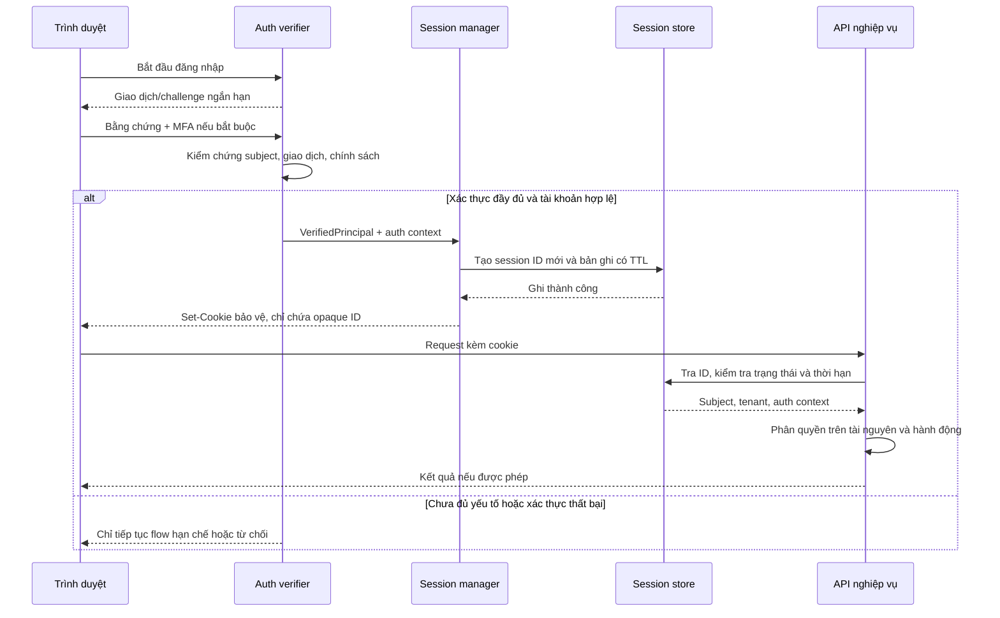
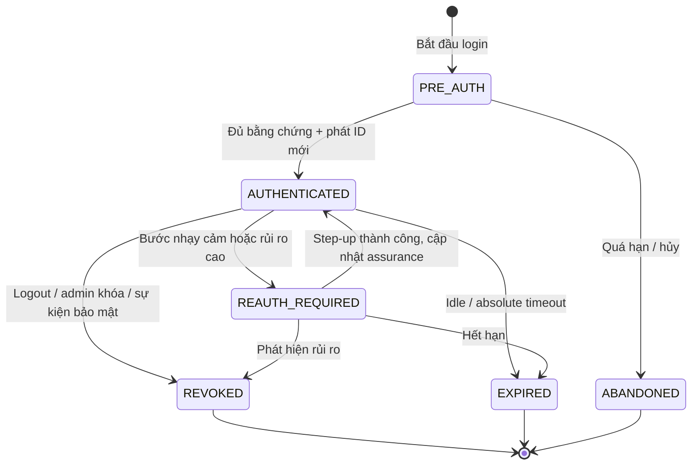

# Session establishment — Thiết lập phiên xác thực

Người dùng nhập mật khẩu đúng, hoàn thành MFA hoặc dùng passkey thành công. Điều gì xảy ra **ngay sau đó** để các yêu cầu HTTP tiếp theo được nhận là của cùng người dùng? Máy chủ cần **thiết lập phiên (session establishment)**: chuyển một sự kiện xác thực đã được kiểm chứng thành trạng thái đăng nhập có thể sử dụng an toàn, gắn với đúng chủ thể và được kiểm soát trong suốt thời gian hiệu lực.

Đây là bước rất dễ tạo lỗi dù kiểm tra mật khẩu hoặc chữ ký mật mã đã đúng. Ví dụ, nếu ứng dụng vẫn sử dụng session ID do kẻ tấn công biết từ trước khi đăng nhập, kẻ tấn công có thể chiếm phiên (*session fixation*). Nếu máy chủ phát cookie đăng nhập trước khi xác minh MFA, người chưa hoàn thành xác thực có thể sử dụng API yêu cầu mức đảm bảo cao. Nếu kết quả xác thực thuộc tài khoản A nhưng phiên được gán `userId` do client gửi là B, ứng dụng sẽ công nhận sai chủ thể.

Trong module `SECURITY_AUTHENTICATION_FUNDAMENTALS`, bài học này đặt **Session establishment** vào luồng xác thực rộng hơn: credential, mật khẩu, MFA, passkey, chứng chỉ, OIDC, token, phiên và khôi phục tài khoản. Mục tiêu là mô hình hóa ranh giới tin cậy, chống phishing, replay, lạm dụng đăng nhập và thiết kế luồng xác thực an toàn từ thời điểm kiểm chứng bằng chứng đến khi một phiên có thể được sử dụng.

## 1. Phiên xác thực là gì và được thiết lập khi nào?

**Phiên xác thực (authenticated session)** là mối liên kết có thời hạn giữa một chuỗi yêu cầu và **principal** (chủ thể) đã được xác thực. Một phiên thường có ID khó đoán hoặc một cơ chế mang bằng chứng phiên; ở phía máy chủ, nó gắn với tài khoản, tenant, thời điểm xác thực, mức đảm bảo và trạng thái thu hồi.

Phân biệt các thành phần dễ nhầm:

| Thành phần | Vai trò | Điểm cần nhớ |
| --- | --- | --- |
| **Credential** | Bằng chứng hoặc phương tiện để kiểm chứng chủ thể | Mật khẩu, passkey, chứng chỉ, OTP không phải session ID |
| **Authentication transaction** | Giao dịch đăng nhập đang diễn ra | Có challenge, trạng thái MFA, CSRF/state/nonce; có thể chưa tạo phiên xác thực |
| **Authentication event** | Kết quả xác thực tại thời điểm cụ thể | Phải kiểm tra đúng subject, giao dịch, RP/issuer và mức đảm bảo |
| **Authenticated session** | Trạng thái đăng nhập tiếp tục qua nhiều request | Chỉ tạo sau khi đủ điều kiện xác thực, gắn subject đáng tin cậy |
| **Session cookie** | Phương tiện đưa session ID giữa trình duyệt và server | Cookie mang ID bí mật; nó không tự chứng minh rằng phiên còn hiệu lực |
| **Access token** | Credential để gọi API với quyền/phạm vi/hạn cụ thể | Có thể là bearer token, không đồng nghĩa phiên web truyền thống |
| **ID token OIDC** | Thông điệp cho client biết kết quả xác thực từ IdP | Không dùng ID token thay access token để gọi API |

**Thiết lập phiên khác với xác thực credential.** Verifier trả lời “bằng chứng này có đúng cho chủ thể đang được xét không?”. Thành phần quản lý phiên trả lời “từ bây giờ, request nào được nhận là của chủ thể ấy, trong bao lâu và có thể ngừng công nhận bằng cách nào?”. Hai quyết định phải được nối với nhau mà không để client tự thay danh tính.

### Những bất biến bảo mật phải giữ

1. **Đúng chủ thể:** `subjectId`/`tenantId` của phiên lấy từ kết quả xác thực được kiểm chứng phía server, không từ form, query, header hay JWT chưa xác minh.
2. **Đủ mức xác thực:** phiên chỉ nhận quyền tương ứng với bước đã hoàn thành; phiên chờ MFA không được coi là phiên đăng nhập đầy đủ.
3. **ID mới và khó đoán:** session ID được cấp mới bằng CSPRNG khi chuyển từ chưa xác thực sang đã xác thực, có entropy đủ lớn, không kế thừa ID mà bên khác có thể biết.
4. **Ràng buộc thời hạn và trạng thái:** mọi lần sử dụng phải xét hiệu lực, thời gian nhàn rỗi, thời gian sống tối đa, trạng thái tài khoản và thu hồi theo chính sách.
5. **Bảo vệ đường truyền và nơi lưu:** session ID không xuất hiện trong URL, log hoặc kênh không được bảo vệ; cookie và kho phiên có kiểm soát tương ứng.
6. **Phân quyền độc lập:** đã đăng nhập không có nghĩa được xem mọi tài nguyên hoặc thực hiện mọi thao tác.

## 2. Ranh giới tin cậy và tác nhân tham gia

Xét ứng dụng web với máy chủ xử lý đăng nhập và kho phiên dùng chung:

| Thành phần | Được tin điều gì? | Không được tin điều gì? |
| --- | --- | --- |
| Trình duyệt hoặc mobile client | Có thể gửi yêu cầu, lưu và trình credential hoặc cookie | `userId`, `role`, `mfaPassed`, session ID hoặc header do client tự đặt không phải kết luận xác thực |
| Authenticator / IdP | Có thể tạo bằng chứng theo giao thức | Phải kiểm tra đúng issuer, RP, challenge, audience và chính sách trước khi tin kết quả |
| Authentication verifier | Kiểm tra bằng chứng và kết thúc giao dịch | Không được tự gán user dựa trên email hoặc tham số chưa được ràng buộc |
| Session manager | Cấp ID, gắn principal, giữ trạng thái và thu hồi | Không cấp phiên có quyền cao trước khi auth verifier báo thành công |
| Session store | Lưu liên kết session ID → thông tin phiên | Cần kiểm soát truy cập, tính nhất quán, TTL, mã hóa và bảo vệ trước sửa đổi trái phép |
| API/gateway | Đọc và xác minh phiên/token, áp dụng quyền | Không được tin header principal do client trực tiếp gửi |

Luồng tin cậy đi qua các ranh giới: **client → verifier → session manager → session store → API**. Khi có proxy hoặc gateway, phải xác định rõ thành phần nào xác minh cookie/token và thành phần nào chỉ nhận danh tính từ kết nối nội bộ đã được xác thực. Nếu ứng dụng dùng `X-Authenticated-User` từ proxy, proxy cần xóa header cùng tên do client cung cấp, và chỉ service tin cậy mới được phép truyền thông tin đó vào backend.

## 3. Quy trình thiết lập phiên phía server

Một quy trình phổ biến gồm sáu chặng:

1. **Bắt đầu giao dịch đăng nhập.** Máy chủ tạo trạng thái giao dịch ngắn hạn (challenge, chống CSRF, `state`/`nonce` hoặc thông tin tài khoản dự kiến nếu cần), ràng buộc với client hoặc luồng xác thực thích hợp. Trạng thái này không đồng nghĩa phiên đã xác thực.
2. **Nhận và xác minh bằng chứng.** Mật khẩu được kiểm chứng bằng verifier, passkey bằng WebAuthn, hoặc kết quả liên kết bằng giao thức OIDC/SAML. Máy chủ kiểm tra dữ liệu mật mã, thời hạn, tính mới, đúng ngữ cảnh và chính sách chống lạm dụng.
3. **Hoàn tất các yếu tố bắt buộc.** Nếu cần MFA, phải xác minh đủ yếu tố và bảo đảm kết quả thuộc **cùng tài khoản và cùng giao dịch**. Chỉ sau đó mới được cấp phiên đầy đủ; nếu còn bước chờ, chỉ cho phép quyền tối thiểu phục vụ hoàn tất đăng nhập.
4. **Kiểm tra trạng thái subject.** Tài khoản tồn tại và còn hoạt động, đúng tenant, không bị khóa/xóa và đáp ứng điều kiện được cấp phiên. Nếu có liên kết IdP, ánh xạ danh tính đã xác minh vào account nội bộ ổn định.
5. **Phát hành phiên mới.** Tạo session ID khó đoán, lưu bản ghi trên server, vô hiệu hóa session ID tiền xác thực theo chính sách, đặt thời hạn và mức đảm bảo. Gửi cookie bằng HTTPS với các thuộc tính bảo vệ thích hợp.
6. **Tiếp tục request.** Mỗi request sau phải tra hoặc xác minh phiên, kiểm tra hạn/trạng thái, dựng principal đã xác thực rồi mới phân quyền cho API.



Sơ đồ minh họa phiên server-side với cookie. Trong kiến trúc sử dụng token tự chứa, bước tra session store có thể được thay hoặc bổ sung bằng xác minh token và kiểm tra trạng thái theo chính sách; mục tiêu ràng buộc subject và quyền vẫn giống nhau.

## 4. Session ID và cookie: chỗ phổ biến nhất của lỗi bảo mật

### 4.1. Session ID cần như thế nào?

Session ID nên là chuỗi **opaque** không chứa email, số thứ tự người dùng, vai trò hay thời gian có thể suy đoán. Tạo ID từ CSPRNG với entropy lớn, chẳng hạn 256 bit ngẫu nhiên; không tự sinh từ timestamp hoặc hash của `userId`. Không có lợi ích bảo mật khi client nhìn thấy cấu trúc nội bộ trong ID.

`session_id` là **bearer credential**: ai sở hữu ID hợp lệ thường có thể sử dụng phiên trong phạm vi hiệu lực. Vì vậy phải bảo vệ ID như bí mật, tránh đưa vào log, analytics, URL, thông báo lỗi hoặc tham số query; lưu khóa phiên trong kho có kiểm soát, và cân nhắc lưu hash của ID để giảm tác động khi rò rỉ database theo kiến trúc.

### 4.2. Cấu hình cookie phía trình duyệt

Ví dụ header thiết lập phiên (giá trị chỉ minh họa):

```http
Set-Cookie: __Host-sid=<opaque-random-value>; Path=/; Secure; HttpOnly; SameSite=Lax
Cache-Control: no-store
```

| Thuộc tính | Ý nghĩa | Hướng áp dụng |
| --- | --- | --- |
| `Secure` | Trình duyệt chỉ gửi cookie qua HTTPS (trong điều kiện áp dụng) | Bắt buộc với cookie đăng nhập trên môi trường production HTTPS |
| `HttpOnly` | Chặn JavaScript thông thường đọc cookie | Giảm khả năng lấy cookie trực tiếp qua XSS; **không chặn mọi hậu quả XSS** |
| `SameSite=Lax` | Hạn chế một số trường hợp gửi cookie trong yêu cầu cross-site | Có ích chống CSRF nhưng không thay thế mọi kiểm soát CSRF |
| `SameSite=Strict` | Hạn chế cross-site mạnh hơn | Phù hợp một số sản phẩm, cần xét điều hướng từ bên ngoài |
| `SameSite=None; Secure` | Cho phép cross-site khi mô hình ứng dụng đòi hỏi | Tăng nhu cầu kiểm soát CSRF và các ràng buộc trình duyệt; phải có `Secure` |
| `Path=/` | Cookie có phạm vi đường dẫn tại host | Bắt buộc cho prefix `__Host-` |
| Không đặt `Domain` với `__Host-` | Chỉ giới hạn cookie theo host đang thiết lập | Giảm nguy cơ từ subdomain; prefix `__Host-` yêu cầu `Secure`, `Path=/`, không có `Domain` |
| `Max-Age`/`Expires` | Điều khiển thời gian tồn tại của cookie trên trình duyệt | **Không thay thế** TTL và chính sách thu hồi ở server |

Cookie có thể tồn tại lâu hơn hoặc ngắn hơn phiên phía server. Máy chủ luôn là nơi quyết định phiên còn hoạt động. Khi logout, gửi cookie xóa với cùng tên, `Path` và phạm vi tương ứng; đồng thời **vô hiệu hóa phiên ở server**. Chỉ xóa cookie tại client không đủ.

**CSRF:** vì trình duyệt tự động đính kèm cookie, API thay đổi trạng thái phải có phòng vệ CSRF thích hợp, chẳng hạn CSRF token và kiểm tra `Origin`/`Referer` theo kiến trúc. `SameSite` là lớp bổ sung; không nên dùng request `GET` để gây thao tác nhạy cảm. Luồng đăng nhập cũng cần phòng **login CSRF**, tránh làm nạn nhân đăng nhập vào tài khoản do kẻ tấn công lựa chọn.

**TLS:** cookie `Secure` không thay thế việc áp dụng HTTPS nhất quán, cấu hình proxy tin cậy, HSTS thích hợp và bảo vệ kết nối backend. Tránh vô tình ghi session ID vào access log ở gateway hoặc tracing.

### 4.3. Chống session fixation bằng cấp lại ID

Giả sử một kẻ tấn công khiến trình duyệt nạn nhân có session ID `S0` trước khi đăng nhập. Nếu sau khi nạn nhân xác thực, server chỉ thay `authenticated=true` trong bản ghi `S0`, kẻ tấn công đã biết `S0` có thể sử dụng phiên của nạn nhân.

Giải pháp: **đổi session ID khi chuyển ranh giới xác thực**. Nếu ứng dụng có session tiền đăng nhập phục vụ giỏ hàng hay CSRF, chỉ chuyển những dữ liệu được cho phép sang phiên mới, không mang theo các giá trị principal/role tự khai. Hủy hoặc làm mất hiệu lực `S0`, tạo ID `S1` mới, gắn subject đã xác thực. Cũng nên đánh giá cấp lại ID khi nâng mức đặc quyền hoặc hoàn tất step-up.

```text
Trước đăng nhập:  S0 → anonymous; không có quyền truy cập cá nhân
Đăng nhập thành công: xác minh credential (+ MFA) → tạo S1
Sau đăng nhập:    S1 → subject=user_42; tenant=org_a; auth_time=t
                   S0 → vô hiệu / không thể trở thành phiên đã xác thực
```

Không nên tin session ID do client tự chọn. API hoặc framework phải kiểm soát việc phát hành và thay ID; với cookie cũ không tồn tại trong store, ứng dụng cần xử lý như phiên không hợp lệ, không tự tạo principal có quyền.

## 5. Ví dụ dữ liệu phiên và pseudocode Java

Một session store có thể lưu cấu trúc tối thiểu như sau:

| Trường | Mục đích |
| --- | --- |
| `sessionIdHash` hoặc khóa tra ID | Nhận diện phiên từ ID ngẫu nhiên, hạn chế lộ bí mật khi dữ liệu rò rỉ |
| `subjectId`, `tenantId` | Chủ thể nội bộ đúng phạm vi đã được xác minh |
| `createdAt`, `authenticatedAt` | Phục vụ vòng đời phiên và quyết định cần reauthentication |
| `lastActivityAt`, `idleExpiresAt`, `absoluteExpiresAt` | Kiểm soát idle timeout và hạn tối đa |
| `amr`/`acr` hoặc mức đảm bảo nội bộ | Biết phương pháp/mức xác thực mà verifier đã xác nhận |
| `authVersion`/`revokedAt` | Hỗ trợ vô hiệu hóa khi account hoặc yếu tố xác thực thay đổi |
| `deviceLabel`, metadata rủi ro nếu cần | Hỗ trợ người dùng quản lý phiên và phát hiện đăng nhập bất thường; hạn chế thu thập dữ liệu |

Mô hình dữ liệu còn tùy ứng dụng. Session store phải được bảo vệ khỏi thay đổi trái phép; nếu dùng cache phân tán, các bản sao cần tuân thủ chính sách TTL và thu hồi.

Pseudocode dưới đây mô tả thứ tự kiểm soát, **không phải đoạn mã Spring Security có thể dán vào production**. Các bước xác minh mật khẩu, MFA, OIDC hoặc WebAuthn do thành phần chuyên dụng thực hiện.

```java
SessionIssueResult completeLogin(
    String loginTransactionId,
    AuthenticationEvidence evidence,
    AnonymousSession previousSession
) {
    // Verifier kiểm tra bằng chứng, challenge, chống replay, đúng subject,
    // đúng tenant/issuer và tiêu thụ transaction một lần khi hợp lệ.
    VerifiedAuth result = authVerifier.verifyAndConsume(
        loginTransactionId, evidence
    );
    if (result == null) throw new AuthenticationFailed();

    if (result.requiresMoreFactors()) {
        // Chỉ cho phép các endpoint tiếp tục MFA với trạng thái hạn chế.
        return continueRestrictedAuthenticationFlow(result);
    }

    Account account = accounts.findActive(
        result.tenantId(), result.subjectId()
    );
    if (account == null || !policy.canEstablishSession(account, result)) {
        throw new AuthenticationFailed();
    }

    String newId = secureRandomOpaqueSessionId(); // CSPRNG, entropy cao.
    SessionRecord session = SessionRecord.create(
        newId,
        account.subjectId(),
        account.tenantId(),
        result.authenticatedAt(),
        result.authenticationMethods(),
        policy.idleTimeout(),
        policy.absoluteLifetime(),
        account.authVersion()
    );

    // Lưu thành công trước khi phát cookie; thất bại thì không tạo phiên.
    sessionStore.insertWithTtl(session);
    if (previousSession != null) {
        sessionStore.invalidate(previousSession.id());
    }
    audit.recordWithoutSecrets("SESSION_ESTABLISHED", session.metadata());

    return issueSecureHttpOnlyHostCookie(newId); // HTTPS, Path=/, SameSite.
}

AuthenticatedPrincipal authenticateRequest(String presentedSessionId) {
    SessionRecord session = sessionStore.lookup(presentedSessionId);
    if (session == null || session.revoked() || session.isExpired(now())) {
        throw new Unauthorized();
    }
    Account account = accounts.findActive(
        session.tenantId(), session.subjectId()
    );
    if (account == null || account.authVersion() != session.authVersion()) {
        throw new Unauthorized();
    }
    return new AuthenticatedPrincipal(session.subjectId(), session.tenantId());
}
```

**Lưu ý triển khai:** `sessionStore.insertWithTtl`, `invalidate` và việc phát cookie phải xử lý lỗi/race và đảm bảo phiên cũ không được nâng quyền trong lúc chuyển đổi. `authenticatedAt` phải lấy từ kết quả xác minh đáng tin cậy. Nếu cần xác thực lại cho thao tác nhạy cảm, chính sách phải đánh giá thời gian và mức xác thực hiện tại, thay vì chỉ thấy có phiên là đủ. Mọi API vẫn phải phân quyền tài nguyên sau khi tạo principal.

Với **Spring Security**, nên dùng session management, session fixation protection, security context persistence và CSRF protection của framework theo đúng cấu hình triển khai. Không tự gán `SecurityContext` từ một tham số form rồi coi như xác thực đã hoàn thành; cũng không tắt phòng vệ mặc định chỉ để làm luồng đăng nhập chạy được.

## 6. Phiên khi có MFA, passkey và đăng nhập liên kết

### 6.1. Đăng nhập nhiều bước: trạng thái chờ không phải phiên hoàn chỉnh

Trong luồng mật khẩu + TOTP, password có thể đúng nhưng MFA chưa hoàn tất. Máy chủ nên giữ **giao dịch chờ MFA** với TTL ngắn và tập endpoint cực hẹp như `POST /mfa/verify`. Tốt hơn là không cấp phiên xác thực đầy đủ cho tới khi MFA đạt. Nếu dùng một cookie tạm, nó chỉ đại diện cho **trạng thái tiền xác thực**, không được có quyền dùng API dữ liệu cá nhân hay đổi cài đặt bảo mật.

Mã TOTP phải được kiểm tra đúng subject và transaction, giới hạn số lần thử; tùy chính sách có thể ghi nhận timestep đã sử dụng để chống replay. Sau khi thành công, phải **thay ID tiền xác thực** bằng phiên mới đủ mức đảm bảo, không chỉ sửa một cờ do client điều khiển.

Passkey/WebAuthn có thể cung cấp xác thực mạnh khi verifier kiểm tra challenge, chữ ký với public key đã đăng ký, origin, RP ID và cờ UP/UV theo chính sách. Việc passkey được coi là đáp ứng một mức assurance cụ thể cần dựa vào chính sách và kết quả thực tế, không chỉ nhãn “đăng nhập bằng passkey”. Dù phương thức nào, kết quả xác thực phải ánh xạ tới subject nội bộ trước khi phát phiên.

### 6.2. OIDC: từ callback đến phiên nội bộ

Một ứng dụng web đăng nhập qua nhà cung cấp danh tính thường dùng **Authorization Code Flow** với PKCE khi phù hợp:

1. Ứng dụng khởi tạo giao dịch với `state` chống CSRF/callback injection và PKCE; tạo `nonce` nếu dùng OpenID Connect theo luồng yêu cầu.
2. Người dùng xác thực tại IdP rồi trình duyệt quay về callback; ứng dụng kiểm tra `state` và ràng buộc giao dịch trước khi trao đổi authorization code qua kênh bảo vệ.
3. Ứng dụng kiểm chứng ID token hoặc kết quả xác thực tương ứng: chữ ký, `iss`, `aud`, thời hạn, `nonce` khi áp dụng và các điều kiện bổ sung cần thiết. Không lấy `email` chưa kiểm chứng làm khóa duy nhất để liên kết tài khoản; sử dụng `(iss, sub)` làm nền tảng định danh phía IdP.
4. Ánh xạ đến subject nội bộ trong đúng tenant, xác minh account còn hoạt động, đánh giá `auth_time`/`acr`/`amr` nếu chính sách yêu cầu mức hoặc thời điểm xác thực.
5. **Tạo phiên ứng dụng mới** và cookie bảo vệ; không coi redirect hoặc thông tin trong URL là bằng chứng đủ để tạo phiên. Không dùng ID token làm access token để gọi API.

Mỗi lần ứng dụng tạo phiên phải bảo đảm callback thực sự thuộc giao dịch đăng nhập **do chính client đó khởi tạo**; nếu không, kẻ tấn công có thể lợi dụng lỗi login CSRF hoặc nhầm IdP/account (*account mix-up*). Với nhiều IdP, cần kiểm chứng rõ issuer dự kiến và điểm cuối nhận callback tương ứng.

### 6.3. Xác thực lại (step-up) trong phiên đang hoạt động

Một phiên hợp lệ để xem hồ sơ không nhất thiết đủ để thêm passkey, thay email khôi phục hoặc xóa tài khoản. Ứng dụng có thể yêu cầu bước xác thực mạnh hơn gần thời điểm thực hiện hành động. Sau step-up, cập nhật mức đảm bảo và `authenticatedAt` **từ sự kiện xác thực mới đã kiểm chứng**, có thể cấp lại ID để bảo vệ ranh giới đặc quyền, rồi kiểm tra quyền của thao tác nhạy cảm.

Không chấp nhận `mfaPassed=true` từ client và không cho phép kết quả step-up của phiên A được gắn vào phiên B. Giao dịch step-up phải ràng buộc với subject, phiên, hành động nếu cần và hạn sử dụng.

## 7. Session cookie và token trong các kiến trúc khác nhau

| Kiến trúc | Bằng chứng ở mỗi request | Điểm mạnh | Điều cần đặc biệt chú ý |
| --- | --- | --- | --- |
| **Server-side session** | Cookie chứa opaque session ID; server tra store | Thu hồi/đổi trạng thái phiên trực tiếp được | Store, tính sẵn sàng, cache/replica, CSRF với cookie |
| **Access token tự chứa** | Bearer JWT hoặc token ký; API xác minh claim | Phù hợp gọi API phân tán, giảm tra cứu phiên ở một số trường hợp | Thu hồi trước `exp` cần cơ chế bổ sung; kiểm tra `iss`, `aud`, `exp`, signature |
| **Opaque access token** | Bearer token được introspect hoặc tra ở authorization server | Hỗ trợ kiểm soát tập trung hiệu lực token | Độ trễ, cache và tính sẵn sàng của introspection |
| **Backend for Frontend (BFF)** | Trình duyệt giữ cookie phiên với BFF; BFF quản lý token gọi API | Giảm việc lộ access token trực tiếp trong JavaScript phía client | Bảo vệ cookie/CSRF, BFF và kho token nội bộ |

**Access token không tự động là phiên web.** JWT còn hạn có thể tiếp tục được API chấp nhận sau khi người dùng logout nếu API chỉ xác minh chữ ký và `exp`. Muốn cắt quyền sớm, cần xác định cơ chế thu hồi phù hợp: token ngắn hạn, kiểm tra trạng thái account/session, `jti` denylist, introspection hoặc phiên bản xác thực có kiểm tra đáng tin cậy. Đối với refresh token, cần lưu trữ an toàn, thời hạn, thu hồi và rotation/reuse detection theo chính sách.

**Không đặt access token dài hạn vào `localStorage` chỉ vì dễ đọc bằng JavaScript.** Lựa chọn lưu token phải xét mô hình XSS/CSRF, loại client, khả năng làm mới và độ tin cậy của nơi lưu. Với web app, cookie `HttpOnly`/BFF là các phương án thường được cân nhắc; với mobile, dùng kho khóa bảo mật do hệ điều hành hỗ trợ khi phù hợp.

## 8. Vòng đời phiên sau thời điểm thiết lập

Phiên cần được quản lý từ khi tạo đến khi hết hiệu lực. Thiết lập an toàn mà không có kết thúc an toàn vẫn khiến tài khoản dễ bị chiếm quyền.



### Chính sách hết hạn

- **Idle timeout:** phiên hết hiệu lực sau một khoảng không có hoạt động được tính hợp lệ. Không nên kéo dài hạn chỉ nhờ request nền không thể hiện người dùng thực sự hoạt động nếu điều đó trái chính sách.
- **Absolute timeout:** giới hạn tổng thời gian tồn tại dù người dùng vẫn hoạt động, buộc xác thực lại khi hết hạn.
- **Reauthentication timeout:** thao tác nhạy cảm yêu cầu bằng chứng xác thực đủ mới; có thể ngắn hơn thời hạn phiên tổng.
- **Remember me / thiết bị tin cậy:** là chính sách riêng; cần cơ chế thu hồi, giới hạn quyền và rủi ro nếu thiết bị bị mất hoặc trình duyệt dùng chung.

Không có cặp thời hạn tối ưu cho mọi ứng dụng. Ngân hàng, trang quản trị và diễn đàn có mức rủi ro khác nhau. Quy định cụ thể cần dựa vào loại dữ liệu, vai trò, thiết bị, khả năng phát hiện rủi ro và tác động khi phiên bị chiếm.

### Đăng xuất và thu hồi

Đăng xuất phải làm mất hiệu lực phiên phía server (và refresh token liên quan nếu chính sách yêu cầu), sau đó mới dựa thêm vào việc xóa cookie trên trình duyệt. Xem xét tính năng **đăng xuất khỏi tất cả thiết bị**, thu hồi theo thiết bị/phiên, và thu hồi khi tài khoản bị xóa, bị khóa hoặc phát hiện thay credential quan trọng.

Không giả định xóa cookie khiến access token đã cấp cho API biến mất. Cần thiết kế riêng độ trễ thu hồi token và cách bảo vệ các request nhạy cảm sau sự kiện đăng xuất. Nếu session store hoặc cơ chế kiểm tra trạng thái mất kết nối, API nhạy cảm nên có chính sách **fail closed** phù hợp thay vì mặc nhiên chấp nhận phiên không thể kiểm chứng.

### Nhiều phiên và thay đổi quyền

Một người dùng có thể đăng nhập đồng thời trên nhiều trình duyệt. Chính sách phải xác định cho phép bao nhiêu phiên, có hiển thị danh sách thiết bị hay không, khi đổi mật khẩu/role/tenant thì phiên nào cần xác thực lại hoặc thu hồi. Nếu quyền được cache trong phiên, tránh cho dữ liệu role cũ tiếp tục cấp quyền sau khi quản trị viên thu hồi. Nên đánh giá quyền hiện hành ở nơi thực thi hoặc có cơ chế cập nhật/invalidation có độ trễ đã được chấp nhận.

## 9. Các lỗi thường gặp khi thiết lập phiên

| Lỗi thiết kế | Kịch bản bị khai thác | Biện pháp chính |
| --- | --- | --- |
| **Session fixation** | Attacker biết ID trước login và tiếp tục dùng ID khi nạn nhân đăng nhập | Cấp ID mới khi chuyển trạng thái xác thực; vô hiệu ID cũ |
| **Authentication bypass ở MFA** | Có phiên đầy đủ sau khi password đúng dù OTP chưa xong | Tách transaction chờ MFA và session đầy đủ; giới hạn endpoint tiền xác thực |
| **Sai ánh xạ subject/tenant** | Credential của A dùng để phát phiên cho `userId` B do request gửi | Lấy subject và tenant từ kết quả verifier đáng tin, kiểm tra account |
| **Session ID bị lộ** | ID xuất hiện trong URL, log hoặc JavaScript bị XSS đọc | Opaque ID, cookie `Secure`/`HttpOnly`, không log bí mật, phòng XSS |
| **Login CSRF/account mix-up** | Nạn nhân bị đưa vào phiên của tài khoản do attacker chọn | Bảo vệ giao dịch login, `state`/`nonce`/PKCE, kiểm tra issuer và subject |
| **Replay callback/challenge** | Một kết quả xác thực bị phát lại để mở phiên thứ hai | Challenge/giao dịch ngắn hạn, dùng một lần, kiểm chứng binding và thời hạn |
| **Cookie CSRF** | Trang khác buộc trình duyệt đã đăng nhập thực hiện lệnh nhạy cảm | CSRF token, kiểm tra `Origin`, `SameSite` hợp lý, không đổi trạng thái qua GET |
| **Token còn hiệu lực sau logout** | API tiếp tục nhận JWT còn hạn | Chính sách TTL/thu hồi, introspection hoặc kiểm tra trạng thái phù hợp |
| **Trust header không đúng** | Client tự gửi `X-User-ID` qua reverse proxy | Loại header client, xác thực kênh proxy → backend và kiểm chứng principal |
| **Rò rỉ qua hệ thống phân tán** | Một replica đã thu hồi, replica khác dùng cache cũ | Shared store/invalidation, giới hạn TTL cache, kiểm thử race và độ trễ thu hồi |

**Phishing** ở bước trước khi thiết lập phiên vẫn có thể đưa attacker tới một sự kiện xác thực hợp lệ nếu người dùng trao mật khẩu/OTP cho trang giả. Passkey/WebAuthn giúp giảm phishing bằng ràng buộc RP/origin. Nhưng dù phương thức nào, thiết lập phiên phải kiểm tra ngữ cảnh và cấp phiên cho đúng principal; không có cơ chế cookie nào tự sửa được lỗi xác thực ở các bước trước.

## 10. Kiểm thử thiết kế session establishment

Các ca kiểm thử nên kiểm tra cả đường thành công và những trường hợp chuyển trạng thái không hợp lệ.

| Tình huống | Kết quả mong đợi |
| --- | --- |
| Đăng nhập bằng credential hợp lệ, MFA hoàn tất | Cấp **ID mới**, gắn đúng subject/tenant, cookie được bảo vệ |
| Có session ẩn danh `S0` trước khi login | Sau login chỉ `S1` mới có quyền; `S0` không được nâng thành phiên xác thực |
| Password đúng nhưng MFA sai hoặc chưa nhập | Không có phiên đầy đủ; chỉ còn trạng thái xác thực hạn chế |
| Dùng lại OTP/challenge/callback đã tiêu thụ | Từ chối replay theo giao thức và chính sách |
| Credential của A kèm `userId=B` trong body | Không tạo phiên cho B |
| Callback OIDC có `state` sai, issuer không đúng hoặc ID token sai audience | Không phát phiên |
| Dùng token OIDC hợp lệ của tenant khác | Không ánh xạ thành tài khoản đang đăng nhập nếu không có liên kết hợp lệ |
| Cookie thiếu `Secure`/`HttpOnly`, scope rộng ngoài nhu cầu | Kiểm thử cấu hình phát hiện sai phạm |
| Truy cập API sau idle/absolute timeout | Không còn được xác thực; phải đăng nhập lại |
| Session bị thu hồi nhưng cookie vẫn được trình | API từ chối, không tự khôi phục phiên |
| Account bị khóa/xóa sau khi tạo phiên | API tuân thủ trạng thái tài khoản và chính sách cắt quyền |
| Step-up cho phiên A được gửi với phiên B | Không nâng assurance cho B |
| Session store không ghi được khi login | Không phát cookie phiên đã xác thực |
| Đồng thời login/logout/thu hồi ở nhiều replica | Không có phiên cũ bất ngờ được công nhận lại |
| Có XSS hoặc CSRF trong luồng test an ninh | Cookie `HttpOnly` không đọc được bằng JS thông thường; thao tác nhạy cảm có phòng vệ CSRF và XSS thích hợp |

### Tình huống thực hành

Một ứng dụng Java nhận `POST /login` rồi ghi:

```java
// Ví dụ cố ý sai, KHÔNG dùng trong production.
HttpSession session = request.getSession();
if (passwordVerifier.matches(username, password)) {
    session.setAttribute("userId", request.getParameter("userId"));
    session.setAttribute("loggedIn", true);
}
// Giao diện sau đó mới hỏi OTP, nhưng các API chỉ kiểm tra loggedIn.
```

Ứng dụng dùng cookie phiên không có `Secure`, cho phép một session tồn tại suốt 30 ngày không giới hạn idle timeout. Logout chỉ xóa cookie ở client. Hãy tìm ít nhất năm vấn đề và sửa luồng.

**Hướng giải:**

1. Không tạo phiên có quyền ngay sau password nếu MFA là yêu cầu bắt buộc; chỉ duy trì giao dịch chờ OTP có TTL, đúng account và giới hạn số lần thử.
2. Không dùng `userId` từ form; lấy subject từ verifier và đối chiếu tenant/account sau khi hoàn thành toàn bộ yếu tố.
3. Cấp lại session ID sau xác thực (và khi nâng đặc quyền phù hợp), vô hiệu ID tiền xác thực để chống session fixation.
4. Gửi cookie qua HTTPS với `Secure`, `HttpOnly`, phạm vi host/đường dẫn thích hợp, `SameSite` hợp lý và CSRF protection.
5. Áp dụng idle/absolute timeout, kiểm tra trạng thái account và session tại API; phân quyền từng thao tác.
6. Logout phải thu hồi session phía server và có chính sách cho refresh/access token đã cấp, rồi xóa cookie phía client.
7. Kiểm thử race, replay MFA, login CSRF, request từ session cũ và tình huống kho phiên không khả dụng.

## 11. Câu hỏi tự kiểm tra

1. **Vì sao xác thực mật khẩu đúng chưa đủ để coi session đã thiết lập an toàn?** Vì còn phải kiểm tra các yếu tố bắt buộc, đúng subject, trạng thái tài khoản và cấp ID phiên mới được bảo vệ.
2. **Session fixation xảy ra khi nào?** Khi session ID mà attacker biết từ trước tiếp tục trở thành ID của phiên có quyền sau khi nạn nhân xác thực. Cách chính là cấp lại ID và vô hiệu ID cũ khi thay đổi ranh giới xác thực.
3. **Cookie `HttpOnly` và `SameSite` có đủ để ngăn mọi tấn công không?** Không. `HttpOnly` không chặn mọi hậu quả XSS; `SameSite` không thay thế toàn bộ phòng vệ CSRF, xác thực và phân quyền.
4. **Tại sao callback OIDC phải được ràng buộc với giao dịch do ứng dụng khởi tạo?** Để tránh chèn kết quả đăng nhập của người khác, login CSRF, replay và nhầm nhà cung cấp hoặc tài khoản.
5. **Đăng xuất có làm JWT access token đã phát hành lập tức hết hiệu lực không?** Không mặc nhiên; cần chính sách thời hạn và thu hồi riêng.
6. **Có thể dùng session của account A để hoàn thành step-up cho account B không?** Không. Kết quả step-up phải được ràng buộc với đúng principal, phiên và hành động phù hợp.

**Ghi nhớ:** **Session establishment** là điểm nối giữa một kết quả xác thực đáng tin cậy và các request tiếp theo. Một thiết kế đúng phải **đợi đủ bằng chứng, gắn đúng subject/tenant, cấp session ID mới khó đoán, bảo vệ cookie/kênh, ràng buộc thời gian và bảo đảm mọi API kiểm tra trạng thái phiên cùng quyền truy cập**. Phòng vệ phishing, replay, session fixation, CSRF và thu hồi phiên phải được xét như một chuỗi thống nhất từ đăng nhập đến đăng xuất.
