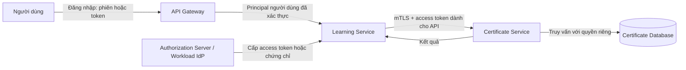
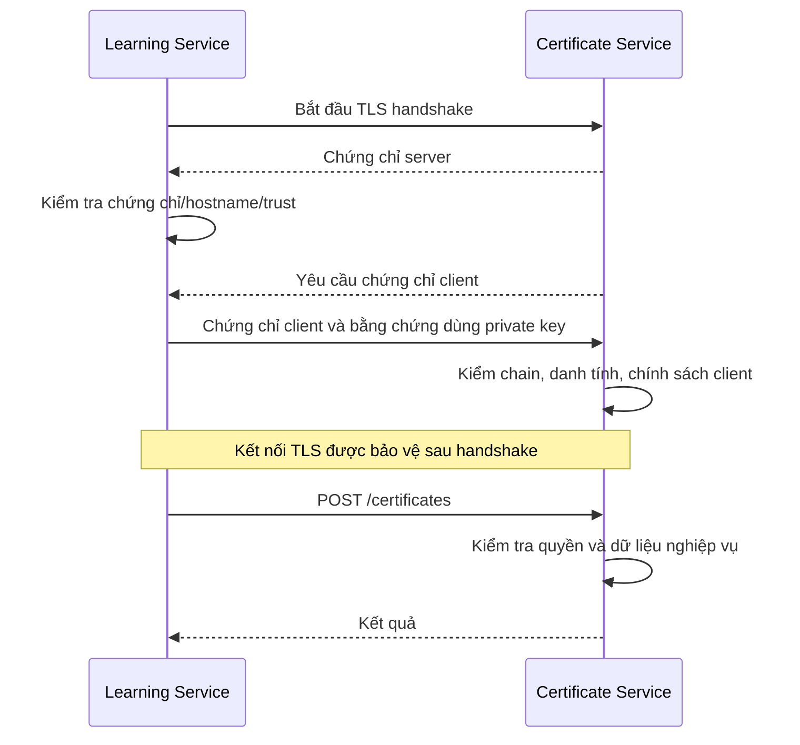
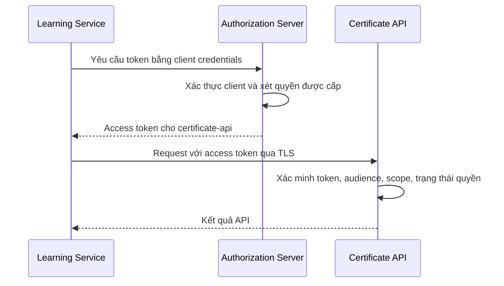
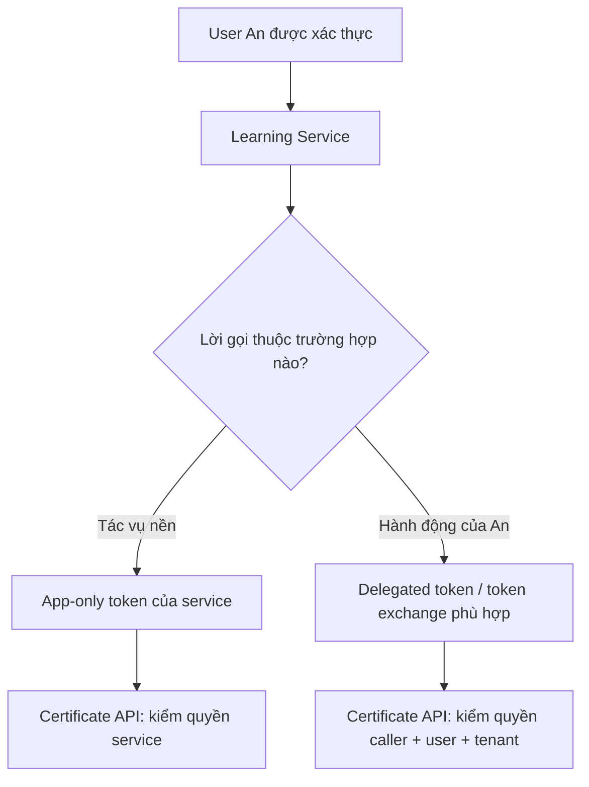

# Service và service

Trong kiến trúc nhiều dịch vụ, **service-to-service authentication** là quá trình dịch vụ nhận yêu cầu kiểm chứng danh tính của dịch vụ hoặc workload đang gọi nó. Dù cả hai cùng chạy trong một trung tâm dữ liệu, một cụm Kubernetes hay một mạng nội bộ, **lời gọi giữa hai service vẫn đi qua ranh giới tin cậy** (*trust boundary*). Dịch vụ nhận phải xác định bên gọi là ai, chứng cứ có đáng tin không và bên gọi được phép thực hiện hành động nào.

Bài này thuộc chương **Trust boundary** của module **SECURITY_AUTHENTICATION_FUNDAMENTALS**. Kiến thức về credential, chứng chỉ, token, phiên và liên kết danh tính được dùng để bảo vệ lời gọi giữa các service; đồng thời cần phòng chống giả mạo danh tính, phishing vào điểm cuối, replay, lạm dụng credential và truy cập vượt quyền. Sau bài học, người học có thể mô hình hóa các ranh giới tin cậy, phân biệt danh tính workload với danh tính người dùng, lựa chọn cơ chế xác thực giữa dịch vụ và thiết kế luồng cấp quyền phù hợp.

## 1. Ranh giới tin cậy giữa hai service là gì?

Giả sử hệ thống học tập có `learning-service` và `certificate-service`. Khi người dùng hoàn thành khóa học, `learning-service` gọi `certificate-service` để phát hành chứng chỉ.

- **Service gọi** (*caller/client*) gửi HTTP/gRPC request và khai rằng nó là `learning-service`.
- **Service nhận** (*callee/resource server*) phải kiểm chứng lời khai bằng chứng cứ có thể xác minh, chẳng hạn token dành cho API hoặc chứng chỉ client mTLS.
- **Chính sách phân quyền** xác định `learning-service` chỉ được yêu cầu các hành động cho phép, ví dụ phát hành chứng chỉ cho hồ sơ hợp lệ trong tenant được cấp.
- **Dữ liệu nghiệp vụ** như `learner_id`, `tenant_id` hay `course_id` trong body không tự đáng tin chỉ vì request đến từ một service có tên quen thuộc.

Nếu không kiểm tra, kẻ chiếm được một container, nhầm cấu hình mạng hoặc service bị xâm nhập có thể gửi lời gọi như thể nó có quyền của service khác.

### 1.1. Ba câu hỏi ở mỗi lời gọi

| Câu hỏi | Lớp kiểm tra | Ví dụ |
| --- | --- | --- |
| **Ai đang gọi?** | Authentication (xác thực danh tính service/workload). | Chứng minh bên gọi có private key của identity `learning-service`, hoặc có access token hợp lệ được cấp cho client đó. |
| **Bên gọi được làm gì?** | Authorization (phân quyền theo hành động, tài nguyên, tenant). | Cho phép phát hành chứng chỉ; không cho xem dữ liệu thanh toán. |
| **Yêu cầu có đáng tin trong ngữ cảnh hiện tại không?** | Kiểm tra nghiệp vụ, đối tượng, tính mới và chống lạm dụng. | Học viên đã hoàn thành khóa học và yêu cầu chưa bị xử lý lặp. |

**Mạng nội bộ, VPN, IP nguồn hoặc DNS không phải bằng chứng xác thực danh tính workload.** Chúng có thể là lớp kiểm soát bổ sung, nhưng không thay cho credential và việc xác minh phía nhận.

### 1.2. Danh tính service khác danh tính người dùng

**User identity** biểu diễn một người đang sử dụng hệ thống. **Workload identity/service identity** biểu diễn tiến trình, service hoặc tác vụ tự động. Ví dụ:

| Thực thể | Danh tính | Cách biểu diễn có thể gặp |
| --- | --- | --- |
| Học viên đang đăng nhập | User identity | `user_id=usr-57`, account trong tenant `t-8`. |
| API đào tạo | Workload identity | `spiffe://example.org/ns/learning/sa/learning` hoặc client `learning-svc`. |
| API chứng chỉ | Workload identity | `spiffe://example.org/ns/cert/sa/issuer` hoặc resource `certificate-api`. |
| Tác vụ phát chứng chỉ định kỳ | Workload identity | `certificate-batch` với quyền riêng. |

Một service có thể thực hiện yêu cầu **nhân danh người dùng** hoặc chạy **bằng quyền riêng của service**. Hai trường hợp này phải được phân biệt khi truyền danh tính và kiểm tra quyền.

## 2. Bản đồ luồng tin cậy



Trong luồng này có nhiều ranh giới, không chỉ một:

1. **Client → gateway:** Phải xác thực phiên hoặc token của người dùng và chống giả mạo thông tin do client gửi.
2. **Gateway → learning-service:** Learning-service phải xác minh thông tin định danh do gateway chuyển đến theo cơ chế nội bộ đáng tin; không nhận `X-User-Id` tùy ý từ Internet.
3. **Learning-service → certificate-service:** Certificate-service kiểm chứng **danh tính service gọi**, token/chứng chỉ, phạm vi quyền, tenant và yêu cầu nghiệp vụ.
4. **Certificate-service → database:** Database dùng tài khoản/credential riêng, với quyền tối thiểu; kết nối này cũng có ranh giới tin cậy.
5. **IdP/authorization server → dịch vụ:** Dịch vụ chỉ tin khóa và issuer đã cấu hình, kiểm tra ngữ cảnh token hoặc vòng đời chứng chỉ.

Các tên service chỉ là nhãn để minh họa. Việc “đã xác thực ở gateway” không cho phép mọi thành phần phía sau mặc nhiên bỏ qua các kiểm tra cần thiết.

## 3. Xác lập danh tính service đáng tin

### 3.1. Mỗi workload cần identity và credential riêng

Một identity service nên có:

- **Định danh ổn định trong phạm vi tin cậy:** Ví dụ client ID, service account identity hoặc SPIFFE ID; tránh đồng nhất với IP, hostname có thể đổi khi triển khai.
- **Credential do nguồn đáng tin cấp:** Khóa riêng, chứng chỉ ngắn hạn, JWT service account đã được ký hoặc thông tin xác thực client được bảo vệ.
- **Phạm vi sử dụng:** Service nào được chấp nhận là caller, environment và tenant nào; không tái sử dụng credential của production cho development.
- **Vòng đời:** Cấp phát, gia hạn, xoay vòng, thu hồi và vô hiệu hóa khi service bị gỡ hoặc bị xâm nhập.

**Identity không đồng nghĩa với hostname.** Một service có thể chạy nhiều instance/IP, còn tên DNS có thể trỏ đến proxy, load balancer hoặc một dịch vụ bị cấu hình sai. Máy nhận cần cơ sở mật mã hoặc quan hệ xác thực đáng tin để biết bên gọi là ai.

### 3.2. Một số cách cấp identity trong thực tế

| Cơ chế | Service chứng minh điều gì? | Điều phải kiểm tra |
| --- | --- | --- |
| **mTLS với chứng chỉ client** | Kiểm soát khóa riêng tương ứng chứng chỉ client được chấp nhận. | Chuỗi tin cậy, danh tính trong chứng chỉ, thời hạn, chính sách cấp phát, ánh xạ quyền và cách thu hồi/phát lại chứng chỉ mới. |
| **OAuth 2.0 client credentials** | Client được authorization server xác thực và cấp access token với quyền phù hợp. | Client authentication khi xin token; token đúng issuer, audience, thời hạn và quyền tại API. |
| **JWT workload/service account** | Đang sử dụng token do một hệ thống danh tính workload đáng tin phát hành cho subject/audience xác định. | Chữ ký, `iss`, `sub`, `aud`, thời hạn, issuer/trust domain và ràng buộc với workload cần thiết. |
| **SPIFFE/SPIRE hoặc danh tính từ service mesh** | Workload sở hữu chứng chỉ hoặc tài liệu danh tính được hạ tầng cấp theo danh tính workload. | Trust bundle đúng, SPIFFE ID/SAN hợp lệ, chính sách cho phép caller và giới hạn trust domain. |
| **API key** | Bên gọi trình bày được một bí mật dùng chung. | Mức entropy, bảo vệ secret, thời hạn, phân quyền, rotation và chống lạm dụng. Không tự coi đó là xác thực mật mã chống phishing/replay. |

Tên kỹ thuật không tự bảo đảm an toàn. Ví dụ một JWT dùng chữ ký mạnh vẫn nguy hiểm nếu máy nhận chấp nhận mọi issuer, bỏ qua `aud` hoặc không kiểm tra quyền.

### 3.3. Không truyền username/password của con người cho workload

Một tiến trình tự động không nên đăng nhập bằng tài khoản cá nhân của nhân viên để gọi API. Cách đó khó thu hồi khi nhân viên nghỉ việc, khó truy vết trách nhiệm và tạo quyền quá rộng.

Service cần **workload identity riêng**, giới hạn quyền theo nhiệm vụ. Nếu hệ thống cần xác định người khởi tạo một hành động, phải truyền thêm **ngữ cảnh ủy quyền người dùng** theo cơ chế bảo vệ phù hợp, chứ không mượn credential của người dùng để service dùng vô thời hạn.

## 4. Cơ chế thứ nhất: mutual TLS (mTLS)

TLS thông thường cho phép client kiểm tra danh tính máy chủ qua chứng chỉ server. **Mutual TLS** yêu cầu cả hai phía xác thực chứng chỉ của nhau, nhờ vậy máy nhận có thể xác thực danh tính phía client ở **kết nối truyền tải**.



### 4.1. Những kiểm tra mTLS quan trọng

- Client cần xác minh **server certificate**, hostname/SAN phù hợp và trust anchor đã cấu hình. Không tắt kiểm chứng chứng chỉ để “chạy được trong staging”.
- Server kiểm tra **client certificate** được cấp từ nguồn đáng tin cậy, còn hợp lệ, đúng chính sách sử dụng và gắn với identity được phép.
- Ánh xạ chứng chỉ sang workload identity bằng trường được quy ước, ví dụ SPIFFE URI SAN; không tự tin trường `Common Name` hay email trong chứng chỉ tùy ý.
- Thiết lập trust domain/CA được phép. Nếu chấp nhận một CA có thể cấp chứng chỉ cho nhiều workload, vẫn phải kiểm tra **danh tính cụ thể** và quyền, không cho mọi chứng chỉ của CA quyền giống nhau.
- Quản lý cấp phát, khóa riêng, thời hạn ngắn và rotation. Việc thu hồi chứng chỉ có nhiều mô hình: CRL/OCSP nếu áp dụng, hoặc chứng chỉ ngắn hạn cùng kiểm soát phát hành/gia hạn.
- mTLS định danh **kết nối/workload peer**, không tự quyết định mọi quyền đối với endpoint hay bản ghi.

Nếu TLS **kết thúc ở gateway/proxy**, service phía sau có thể chỉ thấy gateway là peer TLS. Muốn dùng danh tính client gốc, cần một cơ chế **chuyển tiếp và bảo vệ danh tính** do proxy đáng tin thiết lập; không tin header chứa certificate hoặc caller ID mà client bên ngoài có thể tự thêm.

### 4.2. Khi nào mTLS là đủ?

mTLS có thể đủ cho **xác thực workload ở tầng truyền tải** khi receiver có chính sách authorization rõ ràng trên danh tính được chứng minh. Tuy nhiên, nhiều hệ thống còn yêu cầu **access token** để biểu diễn scope, resource audience, ngữ cảnh người dùng hoặc giao dịch. Dùng đồng thời mTLS và access token có thể bổ sung kiểm soát, nhưng phải xác định mỗi cơ chế được dùng cho quyết định nào.

## 5. Cơ chế thứ hai: OAuth 2.0 client credentials

Với OAuth 2.0 **client credentials grant**, một client bảo mật có thể dùng identity/credential của chính nó để yêu cầu authorization server cấp **access token** nhằm gọi resource server. Đây là một lựa chọn thường gặp cho service chạy **không có người dùng trực tiếp tham gia**.



Ví dụ mang tính minh họa về yêu cầu token (các tham số và phương thức xác thực client tùy authorization server):

```http
POST /oauth2/token HTTP/1.1
Host: auth.example.org
Content-Type: application/x-www-form-urlencoded

grant_type=client_credentials&scope=certificate.issue
```

**Client authentication** phải được thực hiện bằng cơ chế đã thỏa thuận và được bảo vệ, ví dụ mTLS hoặc private key JWT; đoạn HTTP trên lược bỏ credential có chủ đích. Không đặt `client_secret` thực trong code, query string hoặc log.

Giả sử authorization server cấp JWT access token có claims:

```json
{
  "iss": "https://auth.example.org",
  "sub": "learning-svc",
  "aud": "certificate-api",
  "scope": "certificate.issue",
  "iat": 1795000000,
  "exp": 1795000300
}
```

Các giá trị minh họa, không phải token thật. Một access token **không tự tạo quyền tuyệt đối**: Certificate API phải kiểm tra token đúng nguồn/mục đích và quyết định quyền theo tài nguyên thực tế.

### 5.1. Kiểm tra access token ở resource server

Đối với JWT access token mà resource server được cấu hình chấp nhận, các bước nền tảng gồm:

1. Chỉ chấp nhận format và thuật toán ký được cho phép; sử dụng thư viện xác minh đáng tin và khóa đã lấy từ **issuer được cấu hình**.
2. Xác minh chữ ký, khóa phù hợp, `iss` chính xác và `aud` có chứa resource identifier của **chính API nhận**.
3. Kiểm tra `exp`, `nbf` nếu có, độ lệch đồng hồ được cho phép và những claim bắt buộc khác theo hợp đồng token.
4. Kiểm tra danh tính client/subject cùng scopes hoặc quyền cần thiết; không suy từ chuỗi `sub` đơn lẻ rằng caller được phép thao tác mọi dữ liệu.
5. Nếu là token bị ràng buộc với bên sở hữu (*sender-constrained*), xác minh chứng cứ ràng buộc (mTLS hoặc DPoP) tương ứng.
6. Kiểm tra tenant, quyền trên từng đối tượng và điều kiện nghiệp vụ; cân nhắc yêu cầu dữ liệu authorization mới nhất khi quyền thay đổi.

Nếu access token là **opaque token**, API nên dùng cơ chế introspection/validation được ủy quyền thay vì cố giải mã như JWT. **ID token OIDC phục vụ xác thực cho client** không được tự động dùng như access token để gọi API khác.

Giả mã:

```text
authorizeServiceRequest(request):
    token = extractBearerAccessToken(request)
    claims = verifyAccessTokenForThisApi(
        token,
        trustedIssuer = "https://auth.example.org",
        expectedAudience = "certificate-api",
        acceptedAlgorithms = configuredAllowlist
    )

    require claims.subject is an allowed workload identity
    require hasScope(claims, "certificate.issue")
    require callerWorkloadIsActive(claims.subject)
    require request.tenantId is permitted for this workload
    require canIssueCertificateFor(request.learnerId, request.courseId)

    return performIssuanceIdempotently(request)
```

Hàm giả mã chưa thể thay cho phần xác minh bearer token, token binding hoặc chính sách quyền của ứng dụng. Dùng thư viện có kiểm thử và cấu hình chính xác issuer, audience, key rotation và yêu cầu claim.

### 5.2. Scope và audience giải quyết hai bài toán khác nhau

- **Audience (`aud`)**: token dành để dùng tại **API/resource nào**. Token cấp cho `learning-api` không nên được `certificate-api` chấp nhận.
- **Scope/quyền**: bên được ủy quyền có thể yêu cầu **nhóm hành động nào** tại resource đó, ví dụ `certificate.issue`, không phải mọi quyền của hệ thống.
- **Kiểm tra đối tượng**: một scope như `certificate.issue` không tự cho phép phát hành chứng chỉ cho bất kỳ learner/tenant nào. Điều kiện này do API và chính sách nghiệp vụ kiểm tra.

Vì access token bearer có thể được **sử dụng lại bởi bất kỳ bên nào giữ được nó**, phải bảo vệ token và cân nhắc token có ràng buộc bên sở hữu trong môi trường rủi ro cao.

## 6. Service hành động nhân danh người dùng: đừng nhầm principal

Có hai trường hợp khác nhau:

1. **App-only / machine-to-machine:** Tác vụ đồng bộ chạy theo lịch. Caller chứng minh `learning-svc` và API chỉ cho các quyền dịch vụ được cấp.
2. **On-behalf-of / delegated access:** Người dùng An bấm “Cấp chứng chỉ”. Learning-service gọi Certificate API nhân danh An. API có thể cần biết **người khởi tạo**, **service đang gọi**, **quyền được ủy quyền** và **tenant**.

Nếu service chuyển nguyên `user_id=An` trong JSON mà không có chứng cứ được bảo vệ, Certificate API không thể biết đó là hành động thực sự được người dùng cho phép hay lời tự khai của service.



Các phương án thiết kế có thể gồm:

- **Token delegation/token exchange** theo cơ chế IdP hỗ trợ: token dành cho Certificate API, thể hiện subject và/hoặc actor được ủy quyền đúng phạm vi.
- **Một lớp dịch vụ tin cậy thực hiện authorization tập trung** và phát hành assertion nội bộ ngắn hạn, ký và ràng buộc với caller/resource/giao dịch.
- **Quy trình nghiệp vụ app-only có kiểm chứng** nếu yêu cầu thực tế không đòi hỏi quyền user tại Certificate API; khi đó vẫn cần xác minh các điều kiện cấp chứng chỉ và ghi nhận người khởi tạo qua nguồn đáng tin.

Không forward **mọi** bearer token nhận từ người dùng sang bất kỳ service nào. Token của frontend thường có audience riêng; forwarding sai audience có thể làm lộ token, tạo **confused deputy** (dịch vụ bị lợi dụng để thực hiện việc mà caller không có quyền) hoặc biến service trung gian thành bên có đặc quyền vượt quá dự định.

### 6.1. Confused deputy trong service-to-service

Giả sử `report-service` có quyền đọc báo cáo mọi tenant. Một service ít quyền gọi:

```http
GET /internal/reports?tenant_id=tenant-other HTTP/1.1
Host: report.internal.example.org
```

Nếu report-service chỉ kiểm chứng caller là “service đã được cấp token nội bộ” mà không kiểm tra **caller được phép lấy dữ liệu của tenant nào**, nó sẽ dùng đặc quyền lớn của mình phục vụ yêu cầu trái phép.

Cần ràng buộc authorization bằng **caller identity, scope, tenant, đối tượng và lý do nghiệp vụ**. Không mặc nhiên tin `tenant_id` do upstream gửi, không cấp cho tất cả service cùng một superuser identity.

## 7. Replay, token theft và tấn công vào ranh giới service

### 7.1. Replay của bearer token

Bearer access token thông thường được phép sử dụng **nhiều lần trong thời hạn tồn tại**. Vì vậy, không thể coi mọi lần dùng lại cùng token là replay độc hại hay bắt buộc từ chối lần thứ hai theo `jti`.

Để hạn chế việc **token bị đánh cắp và phát lại từ bên khác**, kết hợp:

- TLS khi truyền; không truyền token qua URL, log, tracing, crash dump hay kênh công khai.
- Thời hạn ngắn, audience/scope tối thiểu, rotation và cơ chế xử lý thu hồi khi cần.
- Token **sender-constrained** như mTLS-bound access token hoặc DPoP nếu kiến trúc và authorization server hỗ trợ; API phải kiểm tra bằng chứng bên giữ khóa.
- Nonce/challenge, idempotency key hoặc mã giao dịch **dùng một lần cho thao tác nhạy cảm**, theo ngữ cảnh nghiệp vụ.
- Rate limit, phát hiện bất thường, ngăn request trùng gây phát hành chứng chỉ hai lần.

**DPoP** dùng proof được ký cho từng request với thông tin phương thức, URL, thời điểm, định danh proof và ràng buộc access token phù hợp. API phải thực sự xác minh proof, khóa được liên kết với token và chống dùng lại proof. Chỉ thấy header `DPoP` là chưa đủ.

### 7.2. Giả mạo điểm cuối hoặc chuyển nhầm credential

Kẻ tấn công có thể làm một service gọi đến host giả, endpoint không đáng tin hoặc URL do client điều khiển rồi khiến service chuyển token đi. Các biện pháp cần có:

- Service phải xác minh chứng chỉ máy chủ, hostname và trust anchor; không tắt TLS verification.
- Chỉ gửi credential đến **điểm cuối được cấu hình/cho phép**, kiểm soát redirect và proxy.
- Bảo vệ lời gọi outbound khỏi **SSRF** và không gắn Authorization header cho URL tùy ý.
- Dùng token có **audience riêng** để credential bị lộ cho service A không có giá trị tại service B.
- Giới hạn egress và quyền của workload để giảm hậu quả khi bị xâm nhập.

### 7.3. Caller bị chiếm hoặc giả mạo

Ngay cả mTLS hay JWT hợp lệ cũng không chứng minh code của caller đang thực hiện hành vi đúng. Container bị chiếm vẫn có thể dùng credential thật để gửi request độc hại. Vì thế resource server phải giữ quyền kiểm soát nghiệp vụ, xác thực dữ liệu, hạn mức và audit. **Authentication xác định bên gọi, không thay thế authorization và kiểm soát lạm dụng.**

## 8. Reverse proxy, gateway và service mesh

Một yêu cầu có thể đi qua ingress, gateway, sidecar và proxy trước khi tới application code. Để không mất ranh giới tin cậy, cần xác định **ai thực hiện kiểm tra nào và ai có quyền truyền identity đã kiểm chứng**.

| Mô hình | Điểm thường xác thực | Rủi ro nếu hiểu sai |
| --- | --- | --- |
| Gateway xác thực token rồi chuyển tiếp identity | Gateway kiểm token ở biên; backend nhận assertion/header được bảo vệ theo quan hệ tin cậy nội bộ. | Client tự đặt `X-User-Id` nếu gateway không loại bỏ header hoặc backend có đường truy cập trực tiếp. |
| mTLS giữa sidecars của service mesh | Sidecar xác thực workload peer; chính sách mesh có thể quyết định caller được gọi dịch vụ nào. | App tin rằng “mTLS bật rồi” nghĩa là mọi endpoint hoặc object đều được phép. |
| mTLS kết thúc ở ingress | Ingress kiểm chứng client cert; backend thấy ingress là kết nối tiếp theo. | Backend tin client certificate được nhét trong header do client kiểm soát. |
| API tự xác minh JWT | API kiểm issuer, audience, signature, scope, account và tenant. | Mỗi service cấu hình khác nhau; có thể chấp nhận token sai audience hoặc issuer. |

Nếu tin header nội bộ như `X-Authenticated-Service` hay `X-User-Id`, chỉ chấp nhận qua tuyến mạng đã xác thực, xóa mọi giá trị client tự gửi trước khi gateway thiết lập giá trị mới, bảo vệ kênh proxy → backend và chặn đường truy cập tắt. Khi cần chứng cứ mạnh ở application layer, dùng assertion có chữ ký/ngữ cảnh thay vì header không bảo vệ.

**Service mesh có thể hỗ trợ workload identity và mTLS**, nhưng **không tự giải quyết** quyền trên từng dòng dữ liệu, kiểm tra vai trò người dùng hay quyền nghiệp vụ trong request body.

## 9. Vòng đời credential, trạng thái và vận hành

Bảo mật service-to-service phụ thuộc khả năng **duy trì sự tin cậy sau khi triển khai**, không chỉ handshake thành công ngày đầu.

### 9.1. Cấp phát và quản lý secret/khóa

- Gắn identity với workload thực bằng cơ chế cấp phát đáng tin (orchestrator, workload IdP, hệ thống PKI, service mesh).
- Ưu tiên credential ngắn hạn và gia hạn tự động có kiểm soát; với khóa riêng, dùng kho bí mật/thiết bị bảo vệ phù hợp.
- Không hardcode private key, token hoặc client secret vào repository, image, log, biến môi trường công khai hoặc dashboard.
- Phân quyền tối thiểu cho từng môi trường và service; không dùng chung một credential cho tất cả ứng dụng.
- Xoay vòng khóa/chứng chỉ, xử lý thời gian chồng lấp khi rotation để tránh gián đoạn, và có quy trình thu hồi khi bị lộ.

### 9.2. Thay đổi quyền hoặc vô hiệu hóa workload

Với access token tự chứa, việc bỏ quyền client ở authorization server **không nhất thiết làm mọi token đã cấp mất hiệu lực ngay**. Có thể cần hạn ngắn, introspection, danh sách thu hồi hoặc kiểm tra quyền cập nhật tại resource server khi hành động nhạy cảm.

Với chứng chỉ ngắn hạn, phải tính tới credential đã cấp còn hiệu lực cho đến khi hết hạn, bị thu hồi qua cơ chế khả dụng hoặc trust bị thay đổi. Không hứa “vô hiệu hóa tức thì” nếu hệ thống chưa có cơ chế kỹ thuật hỗ trợ.

### 9.3. Quan sát và kiểm toán

Log nên chứa **caller identity đã xác minh**, resource server, phương thức, kết quả 401/403, tenant liên quan, request ID/correlation ID và quyết định authorization khi cần. Không ghi access token, private key, full Authorization header, OTP hoặc dữ liệu cá nhân không cần thiết.

Các tín hiệu đáng quan tâm gồm request từ workload lạ, token sai `aud`, chứng chỉ hết hạn, tăng mạnh 401/403, số lần gọi vượt thông lệ, attempt truy cập tenant khác và hoạt động bất thường sau deployment.

## 10. Thiết kế mẫu: learning-service gọi certificate-service

### 10.1. Yêu cầu chức năng và bảo mật

Một nền tảng học tập muốn `learning-service` gọi `certificate-service` để phát hành chứng chỉ khi học viên hoàn thành khóa học.

| Mục tiêu | Thiết kế tham khảo |
| --- | --- |
| Danh tính caller | `learning-service` có workload identity riêng, được cấp bởi nguồn được tin. |
| Bảo vệ kênh | TLS; có thể mTLS nếu yêu cầu xác thực peer và hạ tầng hỗ trợ. |
| Quyền API | Token `aud=certificate-api`, scope `certificate.issue`, hoặc chính sách tương ứng gắn với identity mTLS. |
| Phạm vi tenant | Xác định tenant từ ngữ cảnh đáng tin và kiểm tra quyền của caller với tenant đó. |
| Điều kiện nghiệp vụ | Xác thực người học thực sự đạt điều kiện nhận chứng chỉ; kiểm tra loại chứng chỉ và khóa học. |
| Chống thực thi lặp | Sử dụng idempotency key gắn với giao dịch phát hành, hoặc ràng buộc duy nhất theo chính sách. |
| Nhật ký | Lưu service caller đã xác thực, người khởi tạo nếu có, resource, tenant và quyết định; không lưu token. |
| Thu hồi | Có cơ chế tắt quyền cấp token hoặc policy tại API và quản lý credential hiện có. |

### 10.2. Phân tích từng request

Giả sử caller gửi:

```http
POST /v1/certificates HTTP/1.1
Host: certificate-api.internal.example.org
Authorization: Bearer <access-token-for-certificate-api>
Content-Type: application/json
Idempotency-Key: issue-t8-usr57-course9

{
  "tenant_id": "t-8",
  "learner_id": "usr-57",
  "course_id": "course-9"
}
```

`<access-token-for-certificate-api>` là ký hiệu chỗ trống, không phải token thực.

Resource server cần:

1. **Xác thực transport và access token:** Xác minh token đúng issuer, audience, thời hạn, chữ ký/hoặc introspection; khi dùng mTLS, kiểm danh tính peer.
2. **Kiểm quyền caller:** Caller phải có quyền `certificate.issue`, còn hoạt động, được gọi endpoint này theo chính sách.
3. **Kiểm tra ngữ cảnh tenant:** Không chỉ tin `tenant_id` trong body; kiểm tra caller có quyền trong tenant và account/learner thuộc tenant đó.
4. **Kiểm chứng điều kiện cấp chứng chỉ:** Nguồn hoàn thành khóa học phải đáng tin; nếu cần xác minh danh tính thực để cấp chứng chỉ, phải có kết quả identity assurance phù hợp.
5. **Chống phát hành trùng:** Xử lý idempotency trong transaction, ngăn hai request đồng thời tạo hai chứng chỉ trái chính sách.
6. **Ghi audit:** Ghi caller, tenant, learner, kết quả và correlation ID. Không ghi bearer token, bí mật hoặc toàn bộ profile nhạy cảm.

Một phản hồi **401 Unauthorized** thường thể hiện thiếu hoặc không hợp lệ chứng cứ xác thực theo giao thức API; **403 Forbidden** thường thể hiện bên gọi đã xác thực nhưng không có quyền phù hợp. Tránh trả chi tiết nội bộ về token, khóa hay sự tồn tại của tài nguyên khi điều đó tạo nguy cơ liệt kê dữ liệu.

### 10.3. Kiểm thử lỗi ranh giới tin cậy

| Thử nghiệm | Kết quả mong đợi |
| --- | --- |
| Token từ issuer lạ hoặc sai chữ ký | Từ chối trước khi xử lý nghiệp vụ. |
| Token hợp lệ nhưng `aud=learning-api` | Certificate API từ chối vì sai audience. |
| Caller hợp lệ nhưng thiếu `certificate.issue` | Từ chối quyền cấp chứng chỉ. |
| Caller có scope nhưng dùng `tenant_id` của tổ chức khác | Từ chối do sai phạm vi tenant. |
| Token hết hạn | Từ chối, không tự bỏ qua thời hạn vì request đến từ nội bộ. |
| Caller gửi `X-User-Id: admin` tự khai | Không thay đổi principal đã được xác thực. |
| Cùng yêu cầu phát hành được gửi đồng thời hai lần | Tác vụ idempotent theo chính sách, không phát hành trùng ngoài ý muốn. |
| Khóa/chứng chỉ service bị thu hồi | Không chấp nhận theo cơ chế thu hồi/đổi trust và thời hạn thực tế của hạ tầng. |
| User bị đình chỉ nhưng service vẫn gửi yêu cầu thay họ | Kiểm tra trạng thái user và điều kiện cấp chứng chỉ, không chỉ kiểm caller. |

## 11. Checklist khi bảo vệ service-to-service

- [ ] Vẽ sơ đồ các tuyến service gọi nhau, nơi kết thúc TLS và nơi xác minh danh tính/ủy quyền.
- [ ] Định nghĩa **workload identity riêng** và nguồn cấp phát đáng tin cho từng service, môi trường.
- [ ] Không coi mạng nội bộ, IP, DNS, hostname, header tự khai là bằng chứng xác thực đầy đủ.
- [ ] Bảo vệ kênh TLS; với mTLS, kiểm certificate chain, peer identity, trust domain và chính sách truy cập.
- [ ] Với access token, kiểm **issuer, signature/introspection, audience, thời hạn, scope, subject** và token binding nếu có.
- [ ] Phân biệt **app-only caller** với **user-delegated caller**; không dùng ID token như access token hoặc forward token tùy tiện.
- [ ] Xét quyền theo endpoint, đối tượng, tenant, ngữ cảnh người dùng và điều kiện nghiệp vụ.
- [ ] Có chính sách chống token theft, replay với giao dịch thích hợp, rate limit và idempotency.
- [ ] Không cho caller ép service đặc quyền hành động với tenant hoặc tài nguyên tùy ý (*confused deputy*).
- [ ] Ràng buộc header identity từ gateway/mesh với đường truyền đã xác thực và bảo vệ tuyến backend.
- [ ] Quản lý secret, key/certificate rotation, hết hạn, mất credential và thu hồi quyền.
- [ ] Ghi audit quyết định xác thực/phân quyền nhưng không ghi token hoặc private key.
- [ ] Kiểm thử sai audience, sai issuer, tenant khác, token hết hạn, service bị vô hiệu hóa và request trùng.

## 12. Câu hỏi tự kiểm tra

**1. Vì sao hai service cùng chạy trong một private network vẫn phải xác thực?**  
Vì vị trí mạng không chứng minh danh tính workload. Một instance bị xâm nhập, nhầm định tuyến hoặc thiếu phân vùng mạng vẫn có thể gọi endpoint nội bộ.

**2. mTLS đã bật thì có thể bỏ kiểm tra authorization trong API không?**  
Không. mTLS giúp xác thực peer và bảo vệ kênh; API vẫn phải quyết định workload đó được thực hiện hành động gì, trên tenant và đối tượng nào.

**3. Token của Learning API có thể dùng gọi Certificate API nếu chữ ký đúng không?**  
Không nếu token được cấp cho audience khác. Certificate API phải kiểm `aud` để từ chối token dành cho resource không phải nó.

**4. Access token client credentials thể hiện danh tính của ai?**  
Thông thường là client/workload được cấp quyền app-only, không tự chứng minh một user đã chủ động ủy quyền giao dịch hiện tại.

**5. Vì sao `X-User-Id` do client gửi không đáng tin dù đi qua gateway?**  
Vì client có thể tự khai. Gateway cần loại bỏ header client, xác thực user rồi thiết lập assertion/header mới trên một tuyến đã được bảo vệ và backend tin đúng nguồn.

**6. Tại sao cùng bearer token gửi hai lần không nhất thiết là replay độc hại?**  
Bearer token thông thường được dùng nhiều lần trong hạn. Muốn hạn chế dùng lại token bị đánh cắp cần bảo vệ token, ràng buộc bên sở hữu hoặc kiểm soát giao dịch cụ thể.

**7. Một service đã được cấp scope `certificate.issue` có thể phát chứng chỉ cho mọi tenant không?**  
Không. Scope nêu nhóm hành động; API còn phải kiểm tra caller được phép thao tác tenant, learner, course và điều kiện nghiệp vụ cụ thể.

**8. Vì sao cần cơ chế thu hồi hoặc hạn dùng ngắn ngay cả khi credential được cấp đúng ban đầu?**  
Vì workload có thể bị xâm nhập, thay đổi nhiệm vụ hoặc ngừng hoạt động. Credential đã phát hành có thể vẫn hợp lệ cho đến khi hết hạn hoặc bị thu hồi bằng cơ chế triển khai thực tế.

**Ghi nhớ:** Ranh giới **service → service** yêu cầu kiểm chứng workload identity, giới hạn quyền theo audience/scope/tenant/tài nguyên và bảo vệ credential trong cả vòng đời. Xác thực bằng mTLS, token hoặc chứng chỉ chỉ là điểm khởi đầu; mỗi service phải giữ quyền kiểm soát về những hành động mà caller được phép thực hiện, kể cả khi caller đã đi qua gateway hoặc service mesh.
