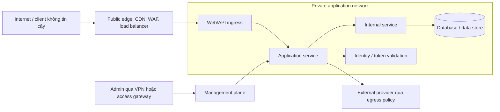
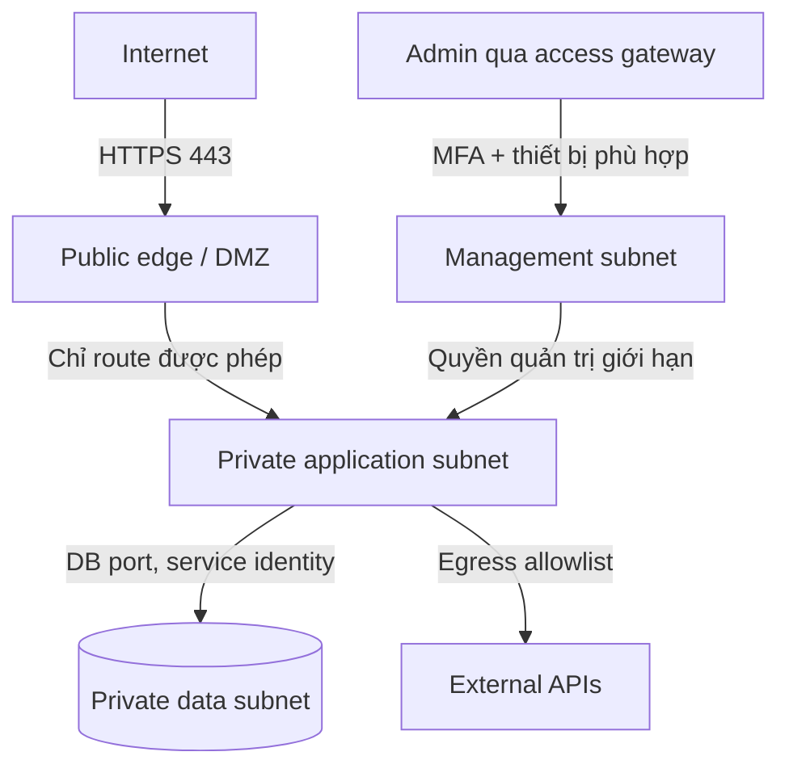
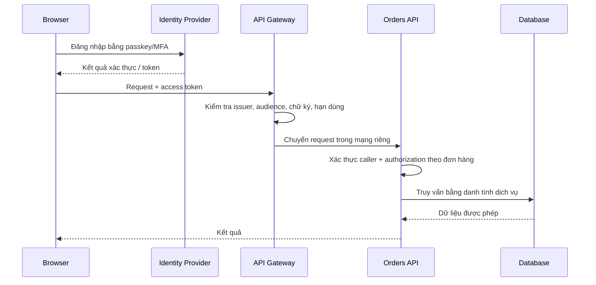

# Public và private network

## 1. Public network và private network là gì?

Trong kiến trúc hệ thống, **public network** thường chỉ mạng có khả năng kết nối rộng, điển hình là Internet; **private network** là không gian mạng được tổ chức dành riêng cho một tổ chức, môi trường hoặc nhóm workload, với phạm vi định tuyến và quyền truy cập được kiểm soát. Hai thuật ngữ này mô tả phạm vi kết nối và cách tổ chức mạng. Chúng **không tự chứng minh người dùng, thiết bị hay dịch vụ đang kết nối là đáng tin cậy**.

Trong mô-đun **SECURITY_AUTHENTICATION_FUNDAMENTALS**, hiểu đúng ranh giới public/private network giúp thiết kế luồng xác thực từ Internet tới ứng dụng, từ ứng dụng tới dịch vụ nội bộ và từ workload tới cơ sở dữ liệu. Credential, mật khẩu, MFA, passkey, chứng chỉ, token và phiên cần được kiểm tra ở đúng thành phần; vị trí mạng chỉ là một tín hiệu bổ sung trong mô hình bảo mật.

Ví dụ: người dùng từ Internet mở `https://app.example.com`. DNS có thể trả về địa chỉ của CDN hoặc load balancer công khai. Thành phần biên chuyển request vào web tier trong private subnet; web tier gọi application service; application service truy cập database qua subnet riêng. Người dùng không cần và không nên kết nối trực tiếp tới database.

Một nhân viên kết nối VPN và nhận địa chỉ IP thuộc mạng công ty. Điều đó chứng minh thiết bị có đường kết nối vào mạng riêng theo chính sách VPN, nhưng chưa chứng minh người đang dùng thiết bị là chủ tài khoản hợp lệ, thiết bị không bị nhiễm mã độc hoặc người dùng có quyền truy cập hệ thống trả lương. Ứng dụng vẫn cần xác thực danh tính và kiểm tra authorization.

### Hai cách dùng từ “public/private” cần phân biệt

1. **Phạm vi mạng:** public network là mạng kết nối rộng như Internet; private network là mạng nội bộ hoặc mạng riêng được quản trị.
2. **Địa chỉ IP:** public IP là địa chỉ có thể được định tuyến toàn cầu theo chính sách Internet; private IP là địa chỉ thuộc không gian dành riêng, không được định tuyến công khai trên Internet theo cách thông thường.

Một máy chủ có public IP vẫn có thể bị firewall giới hạn nghiêm ngặt. Một máy chủ có private IP vẫn có thể bị truy cập từ Internet qua VPN, peering, bastion, reverse proxy, NAT hoặc cấu hình định tuyến sai. Vì vậy, **địa chỉ IP và vị trí mạng không phải là danh tính**.

### Mục tiêu học tập

Sau bài này, người học có thể:

- Phân biệt public/private network với public/private IP address.
- Nhận diện các ranh giới tin cậy khi request đi từ Internet vào hệ thống và giữa các mạng nội bộ.
- Giải thích vì sao VPN, NAT, private subnet hoặc IP allowlist không thay thế xác thực và phân quyền.
- Thiết kế phân đoạn mạng cho web, application, identity service và database.
- Bảo vệ luồng xác thực và token khi đi qua reverse proxy, API gateway và service-to-service.
- Xác định rủi ro do cấu hình ingress/egress, DNS, IPv6, proxy header và quyền truy cập mạng quá rộng.

## 2. Public/private IP không phải danh tính hay quyền truy cập

Trong IPv4, các dải địa chỉ private phổ biến được dành riêng theo RFC 1918:

| Dải IPv4 | Kích thước | Ví dụ sử dụng |
|---|---:|---|
| `10.0.0.0/8` | Khoảng 16,7 triệu địa chỉ | Mạng riêng của tổ chức lớn |
| `172.16.0.0/12` | Khoảng 1,05 triệu địa chỉ | Các subnet trong môi trường doanh nghiệp/cloud |
| `192.168.0.0/16` | 65.536 địa chỉ | Mạng LAN gia đình hoặc văn phòng nhỏ |

IPv6 có không gian địa chỉ local riêng (ULA) trong dải `fc00::/7`. Các địa chỉ này dùng cho phạm vi nội bộ và không được định tuyến toàn cầu theo cách địa chỉ unicast công khai. Mạng IPv6 còn có các loại địa chỉ và cơ chế khác; đừng giả định chỉ cần cấu hình firewall IPv4 là đã bảo vệ toàn bộ hệ thống.

Một số hệ quả:

- Hai tổ chức có thể cùng sử dụng `10.0.0.0/8` trong mạng riêng của mình; khi kết nối hai mạng qua VPN hoặc peering, có thể xảy ra **overlapping CIDR** khiến định tuyến xung đột.
- Private IP không phải bí mật. Người dùng trong cùng LAN, VPN hoặc VPC có thể nhìn thấy hoặc kết nối tới địa chỉ đó nếu route và firewall cho phép.
- Public IP không đồng nghĩa mọi cổng đều mở. Firewall, security group và chính sách dịch vụ quyết định luồng nào được chấp nhận.
- NAT chủ yếu chuyển đổi địa chỉ/port. NAT không thay thế firewall, xác thực người gọi hoặc authorization.

Điều cần xác định không chỉ là “máy chủ nào có IP private?” mà còn là:

- Ai được phép mở kết nối tới từng dịch vụ?
- Thành phần nào xác thực người dùng?
- Thành phần nào xác minh token và danh tính workload?
- Dữ liệu danh tính có được truyền qua ranh giới đúng cách không?
- Dịch vụ đích có kiểm tra quyền trên hành động/tài nguyên không?

## 3. Ranh giới tin cậy nằm ở đâu?

**Trust boundary** là điểm mà dữ liệu, request hoặc quyền điều khiển đi qua giữa hai vùng có chính sách tin cậy khác nhau. Một subnet có thể là ranh giới triển khai hữu ích, nhưng ranh giới bảo mật thực tế còn phụ thuộc danh tính, cấu hình route, firewall, workload, quyền và dữ liệu được truyền.

Các ranh giới thường gặp:

1. **Internet → public edge:** request từ client không đáng tin cậy đi vào CDN, WAF, load balancer hoặc reverse proxy.
2. **Public edge → private application:** proxy chuyển request vào ứng dụng; phải xác định proxy được tin cậy, header nào được phép chuyển tiếp và request đã được bảo vệ ra sao.
3. **User-facing application → internal API:** ứng dụng gọi dịch vụ khác bằng danh tính workload và có thể chuyển ngữ cảnh người dùng theo cơ chế được thiết kế.
4. **Application → database/secrets:** dịch vụ truy cập dữ liệu hoặc bí mật với quyền tối thiểu, xác thực riêng và kết nối được giới hạn.
5. **Corporate/VPN → production:** thiết bị người dùng hoặc quản trị viên đi vào môi trường sản xuất; cần xác minh người dùng, thiết bị và hành động.
6. **Cloud network → external provider:** dữ liệu và token đi ra hệ thống bên ngoài; cần giới hạn egress và xác minh đối tác.



Sơ đồ minh họa các vùng; kiến trúc thực tế có thể dùng API gateway, service mesh, private endpoint hoặc nhiều VPC/VNet. Mỗi mũi tên là một luồng cần có chủ thể gọi, đích đến, giao thức, xác thực, authorization và chính sách mạng được xác định.

### Một ranh giới không nhất thiết trùng với một subnet

Hai dịch vụ nằm trong cùng subnet vẫn có thể có mức tin cậy khác nhau: một workload xử lý dữ liệu công khai và một workload quản lý khóa bí mật không nên mặc nhiên có quyền gọi nhau. Ngược lại, hai workload ở hai VPC khác nhau có thể giao tiếp an toàn qua private link nếu danh tính, chính sách mạng và kiểm tra ứng dụng được thiết kế đúng.

Vì vậy, hãy mô hình hóa trust boundary theo **luồng và quyền** thay vì chỉ tô màu các vùng IP.

## 4. Public network: bảo vệ cổng tiếp xúc với Internet

Một endpoint công khai có thể nhận request từ bất kỳ nguồn nào trên Internet. Điều này không có nghĩa endpoint được phép xử lý request vô điều kiện. Với các endpoint đăng nhập, đăng ký, reset mật khẩu, callback SSO và API công khai, cần bảo vệ ở nhiều lớp.

### 4.1. Bảo vệ kết nối và endpoint

- Dùng HTTPS/TLS cho toàn bộ luồng có thông tin xác thực, token, cookie hoặc dữ liệu cá nhân. Cấu hình chứng chỉ, phiên bản TLS và chuyển hướng HTTP phù hợp.
- Hạn chế cổng và giao thức công khai; chỉ expose dịch vụ thực sự cần truy cập từ bên ngoài.
- Đặt reverse proxy, load balancer hoặc WAF tại biên nếu kiến trúc cần; cấu hình chỉ chuyển tiếp tới backend được phép.
- Áp dụng rate limit, chống bot và kiểm soát lạm dụng cho đăng nhập, OTP, password reset, đăng ký và endpoint nhạy cảm.
- Tránh tiết lộ sự tồn tại của tài khoản qua thông báo hoặc thời gian phản hồi; không ghi mật khẩu, OTP, access token hay session cookie vào log.
- Quản lý CORS, redirect URI, callback URL và host validation theo allowlist rõ ràng; không dùng wildcard tùy tiện cho luồng xác thực.

### 4.2. Đăng nhập công khai vẫn cần xác thực mạnh phù hợp

Khi login endpoint được mở ra Internet, firewall không thể biết người gửi là chủ tài khoản. Ứng dụng phải kiểm tra credential bằng giao thức phù hợp:

- Mật khẩu phải được xác minh bằng password verifier an toàn; giới hạn thử và phát hiện credential stuffing.
- MFA cần ràng buộc đúng phiên và luồng; OTP có thể bị phishing thời gian thực.
- Passkey/WebAuthn cần xác minh challenge, origin và RP ID; TLS đơn thuần không thay thế các kiểm tra này.
- Các luồng reset hoặc recovery phải có mức bảo vệ tương xứng, không trở thành đường vòng yếu hơn đăng nhập chính.

### 4.3. Public edge không nên là nơi giữ toàn bộ bí mật ứng dụng

CDN, WAF hoặc reverse proxy có thể nhìn thấy header, cookie hoặc token nếu TLS kết thúc tại đó. Cần hiểu thành phần nào giải mã TLS, ai có quyền cấu hình/đọc log, cách bảo vệ secret và đường kết nối từ proxy tới backend. Nếu cần mã hóa end-to-end giữa các lớp, hãy thiết kế TLS/mTLS giữa proxy và backend theo yêu cầu kiến trúc.

Đừng đưa private key, client secret hoặc database credential vào cấu hình proxy không được bảo vệ. Quản lý bí mật qua secret manager hoặc cơ chế tương đương với quyền truy cập tối thiểu và khả năng xoay/thu hồi.

## 5. Private network: giảm bề mặt tấn công, không loại bỏ xác thực

Private network hữu ích để giới hạn khả năng định tuyến tới workload, tách môi trường và kiểm soát đường truy cập. Tuy nhiên, mạng nội bộ vẫn có thể chứa thiết bị bị xâm nhập, tài khoản bị chiếm đoạt, workload cấu hình sai và người dùng có quyền quá rộng.

### VPN không đồng nghĩa với “đã xác thực mọi thứ”

VPN tạo một đường hầm được xác thực/mã hóa theo cơ chế của VPN, giúp thiết bị kết nối tới một mạng riêng. Nhưng sau khi vào mạng:

- Máy tính có thể đã bị malware chiếm quyền.
- Phiên đăng nhập có thể bị đánh cắp.
- Người dùng có thể không có quyền trên hệ thống đang truy cập.
- Quyền truy cập mạng rộng có thể cho phép dò quét hoặc di chuyển ngang (lateral movement).

VPN nên được kết hợp với danh tính người dùng, MFA, kiểm tra tình trạng thiết bị khi cần, phân đoạn mạng, giới hạn route và authorization ở từng ứng dụng. Không nên xem một IP thuộc dải VPN là bằng chứng duy nhất để cấp quyền quản trị.

### Private service vẫn cần xác thực service-to-service

Giả sử `order-service` gọi `payment-service` trong cùng VPC. Nếu chỉ dựa vào việc request đến từ private IP, bất kỳ workload nào có đường kết nối phù hợp hoặc bị chiếm quyền trong vùng đó có thể giả làm caller.

Một thiết kế mạnh hơn:

- Cấp danh tính riêng cho mỗi workload/service.
- Xác thực service bằng mTLS, workload identity hoặc cơ chế token phù hợp.
- Giới hạn audience, scope và thời hạn của token.
- Kiểm tra danh tính caller và authorization ở dịch vụ đích.
- Không chia sẻ một API key tĩnh giữa nhiều dịch vụ.
- Xoay và thu hồi credential khi workload bị xâm nhập hoặc thay đổi.

### Zero Trust là cách tiếp cận, không phải sản phẩm VPN

Zero Trust khuyến khích không cấp niềm tin chỉ dựa trên vị trí mạng. Mỗi request được đánh giá theo danh tính, thiết bị, trạng thái, tài nguyên, hành động và ngữ cảnh chính sách. Điều đó không có nghĩa phải xác thực lại mật khẩu ở mọi request; có thể dùng token/phiên đã xác minh với thời hạn, audience và ràng buộc phù hợp.

Điểm chính là **mỗi lần truy cập phải có cơ sở tin cậy có thể kiểm chứng**, và quyền phải được giới hạn theo mục đích.

## 6. Phân đoạn mạng: public edge, application và data

Một mô hình triển khai phổ biến chia workload thành các vùng:

| Vùng | Ví dụ thành phần | Luồng vào nên cho phép | Luồng ra nên cho phép |
|---|---|---|---|
| Public edge / DMZ | CDN origin, reverse proxy, load balancer, WAF | Internet tới đúng cổng public cần thiết | Tới web/API ingress hoặc backend được chỉ định |
| Application | Web backend, API, business services | Chỉ từ edge, gateway hoặc service được phép | Tới service, identity provider, database và provider theo chính sách |
| Data | Database, cache, object storage nội bộ | Chỉ từ workload cần truy cập | Chỉ luồng replication/backup/monitoring đã chỉ định |
| Management | Bastion, admin gateway, CI/CD control plane | Admin/automation đã xác thực và được cấp quyền | Tới management endpoint cần thiết |
| Shared identity | IdP, token service, secret manager | Từ client hoặc workload được phép | Tới kho khóa, audit và dependency cần thiết |



Phân đoạn có thể được thực thi bằng subnet, route table, firewall, security group, network ACL, Kubernetes NetworkPolicy hoặc service mesh. Mỗi cơ chế có phạm vi và thứ tự áp dụng khác nhau; cần hiểu đúng cách nền tảng đánh giá luật cho phép/từ chối.

### Nguyên tắc mặc định

- Chỉ công khai những cổng thật sự cần thiết.
- Backend không nhận traffic trực tiếp từ Internet nếu không có yêu cầu rõ ràng.
- Database không có public endpoint nếu không cần; nếu buộc phải có, phải có kiểm soát mạnh và đánh giá riêng.
- App chỉ được truy cập đúng database, cache, secret và provider cần thiết.
- Tách management plane khỏi luồng người dùng thông thường.
- Giới hạn cả **ingress** (kết nối đi vào) và **egress** (kết nối đi ra); kiểm soát egress giúp giảm nguy cơ exfiltration và truy cập dịch vụ không mong muốn.
- Dùng default deny khi nền tảng và vận hành cho phép, sau đó mở các luồng cụ thể theo nhu cầu.

### Ví dụ chính sách Kubernetes minh họa

Đoạn dưới chỉ minh họa ý tưởng: workload `orders` chỉ nhận traffic từ gateway ở cổng 8080. Quy tắc egress tới database cần được mô tả bằng chính sách riêng. Label, namespace, port và plugin mạng phải được thay bằng giá trị đúng của cụm; NetworkPolicy chỉ có hiệu lực khi CNI hỗ trợ thực thi.

```yaml
apiVersion: networking.k8s.io/v1
kind: NetworkPolicy
metadata:
  name: orders-ingress
  namespace: production
spec:
  podSelector:
    matchLabels:
      app: orders
  policyTypes:
    - Ingress
  ingress:
    - from:
        - namespaceSelector:
            matchLabels:
              name: edge
          podSelector:
            matchLabels:
              app: gateway
      ports:
        - protocol: TCP
          port: 8080
```

NetworkPolicy kiểm soát luồng mạng ở mức workload; nó **không xác thực người dùng cuối**, không xác minh JWT và không quyết định ai được đọc một đơn hàng. Ứng dụng vẫn cần các lớp xác thực và authorization riêng.

## 7. Reverse proxy, load balancer và header chuyển tiếp

Trong triển khai phổ biến, TLS kết thúc ở load balancer hoặc reverse proxy. Backend nhận request đã được proxy chuyển tiếp, có thể kèm các header như:

- `X-Forwarded-For`: địa chỉ client theo chuỗi proxy.
- `X-Forwarded-Proto`: giao thức bên ngoài mà client sử dụng.
- `X-Forwarded-Host`: host mà client yêu cầu.
- `Forwarded`: header chuẩn hóa cho thông tin proxy theo RFC 7239.

Những header này **có thể bị client tự gửi giả mạo** nếu proxy không loại bỏ hoặc ghi đè chúng. Backend chỉ nên tin giá trị do proxy nằm trong danh sách tin cậy chuyển tiếp; phải xác định rõ số hop và cách phân tích chuỗi proxy. Không dùng `X-Forwarded-For` tùy tiện làm bằng chứng danh tính hoặc yếu tố authorization.

Ví dụ lỗi: backend cho phép endpoint quản trị nếu `X-Forwarded-For` thuộc `10.0.0.0/8`. Kẻ tấn công gửi request từ Internet với header giả `X-Forwarded-For: 10.1.2.3`. Nếu backend tin header từ mọi nguồn, kiểm tra IP nội bộ bị vượt qua.

Hướng xử lý:

1. Backend chỉ nhận traffic từ proxy/gateway được cho phép ở tầng mạng.
2. Proxy loại bỏ header chuyển tiếp do client cung cấp và tạo header mới theo cấu hình.
3. Backend cấu hình danh sách proxy tin cậy cụ thể, không tin tất cả proxy hoặc mọi IP private.
4. Quyết định truy cập quản trị dựa trên danh tính đã xác thực, MFA/assurance và authorization; IP chỉ là điều kiện bổ sung khi chính sách cần.

Ngoài ra, cần bảo vệ `Host`/`:authority`, redirect, cookie domain/path và URL callback để tránh host-header injection hoặc chuyển hướng token đến nơi không tin cậy.

## 8. DNS, NAT và private endpoint: các hiểu nhầm thường gặp

### DNS nội bộ không phải cơ chế xác thực

Split-horizon DNS có thể trả địa chỉ khác nhau tùy client ở mạng nội bộ hay bên ngoài. Private DNS giúp tìm dịch vụ nội bộ, nhưng kẻ tấn công có thể truy cập dịch vụ qua đường mạng khác nếu route/firewall cho phép. Tên miền nội bộ không chứng minh caller là workload hợp lệ.

Ứng dụng cần xác minh chứng chỉ TLS và danh tính dịch vụ đúng tên mong đợi. Tránh tắt kiểm tra certificate vì “đây là domain nội bộ”.

### NAT không thay thế firewall

NAT có thể giúp nhiều máy dùng chung địa chỉ public hoặc chuyển đổi địa chỉ giữa các vùng. Tuy nhiên, không nên suy ra “không có public IP trực tiếp thì không thể bị truy cập”. Port forwarding, load balancer, proxy, tunnel hoặc cấu hình route có thể tạo đường vào. Cần kiểm tra luật firewall/security group và các listener đang hoạt động.

### Private endpoint cần được kiểm tra hai phía

Private endpoint/private link có thể giúp kết nối dịch vụ cloud qua mạng riêng. Điều này giảm phơi bày công khai nhưng vẫn cần:

- Xác minh đúng hostname và certificate.
- Kiểm tra danh tính workload hoặc người dùng.
- Giới hạn resource, scope và quyền.
- Quản lý DNS, route, endpoint policy và quyền tạo endpoint.
- Theo dõi thay đổi cấu hình để tránh vô tình mở lại public access.

### Đừng quên IPv6

Một dịch vụ có thể bị mở công khai qua IPv6 dù firewall IPv4 đã chặn. Kiểm tra listener, DNS AAAA, security group, network ACL và policy cho cả hai họ địa chỉ. Đừng giả định mọi máy chỉ có IPv4.

## 9. Kết nối network boundary với authentication và authorization

Khi request đi qua nhiều vùng, cần giữ được ngữ cảnh tin cậy:

1. Người dùng xác thực với IdP hoặc ứng dụng bằng credential phù hợp.
2. IdP/verifier phát hành kết quả xác thực hoặc phiên theo giao thức.
3. API gateway/backend kiểm tra token/phiên: chữ ký hoặc introspection theo loại token, issuer, audience, hạn dùng và các claim được chính sách yêu cầu.
4. Nếu backend gọi service khác, nó xác thực **danh tính workload**; nếu cần đại diện người dùng, phải truyền ngữ cảnh qua cơ chế được thiết kế, với audience và scope thích hợp.
5. Dịch vụ đích kiểm tra quyền trên hành động và tài nguyên trước khi thực hiện.

Không nên chuyển nguyên một bearer token có quyền rộng qua mọi service. Token dành cho API A không mặc nhiên được API B chấp nhận. Dùng audience cụ thể, scope tối thiểu, token exchange hoặc cơ chế delegation phù hợp khi kiến trúc cần.

### Danh tính người dùng và danh tính workload khác nhau

Khi `web-app` gọi `orders-api`, có ít nhất hai câu hỏi:

- **Workload nào đang gọi?** Có thể được xác thực bằng mTLS hoặc workload identity.
- **Người dùng cuối nào được đại diện và họ có quyền gì?** Có thể được truyền qua token người dùng hoặc token delegation đã xác minh.

Không nhầm chứng chỉ mTLS của `web-app` với bằng chứng người dùng đã đăng nhập. Chứng chỉ workload chứng minh phía gọi trong kết nối theo chính sách PKI; quyền của người dùng cần được kiểm tra riêng.

### Ví dụ chuỗi tin cậy



Đây là sơ đồ khái niệm; token có thể được kiểm tra tại gateway, tại API hoặc ở cả hai lớp theo mô hình triển khai. Dù kiểm tra ở đâu, dịch vụ thực thi thao tác phải có đủ cơ sở tin cậy để áp dụng chính sách và không dựa trên header do client tự khai.

## 10. Các kiểu cấu hình sai thường gặp

| Cấu hình sai | Vì sao nguy hiểm | Hướng khắc phục |
|---|---|---|
| “Private IP thì tin cậy” | Workload bị chiếm quyền trong mạng nội bộ có thể giả caller | Xác thực workload, authorization, phân đoạn và giám sát |
| Toàn bộ VPN được truy cập mọi subnet | Một endpoint bị xâm nhập có thể di chuyển ngang | Chia nhóm, route tối thiểu, kiểm tra thiết bị và quyền ở ứng dụng |
| Database mở public để dễ quản trị | Tăng bề mặt dò quét và tấn công trực tiếp | Private endpoint, bastion/admin path, allowlist chặt và xác thực DB |
| NAT được xem là firewall | Cổng được forward hoặc proxy có thể mở đường vào | Kiểm tra firewall, security group, listener và route thực tế |
| Backend tin `X-Forwarded-For` từ mọi client | Có thể giả địa chỉ nội bộ để vượt kiểm tra | Chỉ tin proxy cụ thể; proxy ghi đè header; không dùng IP làm danh tính |
| Service nội bộ không cần token/mTLS | Một workload bị xâm nhập có thể gọi các dịch vụ khác | Workload identity, mTLS/token có audience và authorization |
| Public callback/redirect URI dùng wildcard | Token/code có thể bị chuyển tới nơi không mong muốn | Đăng ký redirect URI chính xác, kiểm tra state/nonce và cấu hình host |
| Chỉ cấu hình firewall IPv4 | Endpoint có thể còn mở qua IPv6 | Kiểm tra và áp policy cả IPv4 lẫn IPv6 |
| Egress cho phép mọi nơi | Workload có thể exfiltrate dữ liệu hoặc gọi C2/provider không mong muốn | Egress policy, DNS/HTTP controls phù hợp và giám sát |
| Tin DNS nội bộ là đủ | DNS có thể bị giả mạo hoặc tên nội bộ bị truy cập qua đường khác | TLS certificate validation, service identity và network policy |
| Mạng private dùng chung secret tĩnh | Rò rỉ một secret có thể mở nhiều service | Secret riêng, quyền tối thiểu, xoay/thu hồi và audit |

Một lỗi đáng chú ý khác là **SSRF (Server-Side Request Forgery)**: ứng dụng công khai bị dụ gửi request tới địa chỉ private hoặc metadata endpoint từ phía server. Network segmentation và egress filtering giúp giảm tác động; ứng dụng cũng phải xác thực/allowlist destination, chặn dải nội bộ và metadata theo kiến trúc, đồng thời tránh tin URL do người dùng cung cấp. Không thể dựa riêng vào firewall ingress để chống SSRF vì request phát sinh từ bên trong.

## 11. Quy trình thiết kế và rà soát public/private network

Khi thiết kế một hệ thống mới hoặc đánh giá hệ thống hiện có, thực hiện theo thứ tự:

1. **Liệt kê thành phần và dữ liệu:** browser, IdP, edge, API, worker, database, secret store, admin plane, external provider.
2. **Vẽ luồng request:** ai khởi tạo, đi qua proxy/gateway nào, giao thức và cổng gì, đích cuối là đâu.
3. **Đánh dấu trust boundary:** Internet, edge, private app, data, management, partner network; ghi rõ điểm kết thúc TLS và nơi token được xác minh.
4. **Định danh caller:** người dùng, workload, admin hay provider; credential/token nào chứng minh danh tính.
5. **Viết chính sách ingress/egress:** source, destination, port, protocol, lý do nghiệp vụ, chủ sở hữu và cách rà soát định kỳ.
6. **Xác định authorization:** caller được thực hiện hành động gì trên tài nguyên nào; IP không thay thế quyết định này.
7. **Kiểm tra đường khôi phục và quản trị:** VPN, bastion, CI/CD, secret rotation, reset MFA, break-glass và hỗ trợ vận hành.
8. **Kiểm thử từ nhiều vùng:** Internet, subnet public, subnet private, VPN, IPv6, workload khác và máy quản trị.
9. **Giám sát:** log kết nối bị từ chối, thay đổi firewall/route, token validation failure, truy cập bất thường và hành động admin.

### Ma trận luồng ví dụ

| Nguồn | Đích | Cho phép | Kiểm soát bổ sung |
|---|---|---|---|
| Internet | Public edge | HTTPS tới hostname/cổng được công bố | TLS, WAF/rate limit, kiểm tra request |
| Internet | Database | Từ chối | Không công khai DB listener |
| Public edge | Web/API ingress | Chỉ luồng và cổng cần thiết | Chỉ tin proxy; TLS nội bộ nếu yêu cầu |
| Web/API | Internal service | Chỉ endpoint cần thiết | Workload identity/mTLS/token, authorization |
| Application | Database | Chỉ port DB từ workload được phép | DB identity riêng, quyền/schema tối thiểu |
| Admin device | Management gateway | Qua đường quản trị xác thực | MFA chống phishing, thiết bị phù hợp, audit |
| Application | External provider | Chỉ domain/đích nghiệp vụ cần | Egress policy, TLS và xác minh đối tác |

Không sao chép nguyên ma trận này vào production mà không đối chiếu kiến trúc thực tế. Mỗi luồng cần owner, mục đích, cách xác thực và cách kiểm tra quyền cụ thể.

## 12. Bài tập tình huống

Một công ty triển khai ứng dụng quản lý nhân sự trên cloud:

- `hr.example.com` là endpoint public qua load balancer.
- Web backend và API nằm trong private subnet.
- Database nằm trong subnet riêng, chỉ được phép nhận kết nối từ backend.
- Nhân viên dùng VPN để truy cập dashboard quản trị.
- API backend gọi `payroll-service` qua private network.

Một kỹ sư đề xuất:

1. Cho phép mọi request từ CIDR VPN truy cập endpoint quản trị mà không cần MFA.
2. `payroll-service` chỉ cần kiểm tra source IP private vì chỉ backend nội bộ gọi nó.
3. Backend tin `X-Forwarded-For` để xác định người dùng nội bộ.
4. Database có thể mở public tạm thời vì đã có mật khẩu mạnh.

Hãy phân tích:

- Đề xuất 1 nhầm khả năng kết nối VPN với danh tính và quyền. Cần xác thực người dùng, MFA/assurance theo rủi ro, kiểm tra thiết bị nếu phù hợp và authorization cho từng thao tác quản trị.
- Đề xuất 2 bỏ qua danh tính workload. Nên xác thực backend bằng mTLS/workload identity hoặc token phù hợp, kiểm tra audience/scope và quyền ở payroll service.
- Đề xuất 3 tin dữ liệu header có thể bị giả. Chỉ tin proxy được xác định và cấu hình ghi đè header; dùng session/token đã xác minh để nhận diện người dùng.
- Đề xuất 4 tăng bề mặt tấn công và không được biện minh chỉ bằng mật khẩu mạnh. Nên giữ DB ở private network, mở đường quản trị giới hạn, xác thực DB riêng và audit.

Hãy vẽ lại sơ đồ luồng và ghi rõ mỗi ranh giới: nguồn nào được kết nối, ai xác thực, token/credential nào được dùng, ai quyết định quyền và log nào cần thu thập.

## 13. Checklist

- [ ] Phân biệt public/private network với public/private IP address.
- [ ] Không xem private IP, VPN, NAT hoặc DNS nội bộ là bằng chứng danh tính.
- [ ] Chỉ expose endpoint và port thật sự cần thiết.
- [ ] TLS bảo vệ mọi luồng có credential, token, cookie và dữ liệu nhạy cảm.
- [ ] Login, MFA, reset và recovery endpoint có chống lạm dụng phù hợp.
- [ ] Backend chỉ tin proxy đã cấu hình; header chuyển tiếp do proxy ghi đè.
- [ ] Tách public edge, application, data và management plane theo nhu cầu.
- [ ] Ingress và egress được giới hạn; có owner và lý do cho từng luồng.
- [ ] Service-to-service dùng workload identity/mTLS/token và authorization riêng.
- [ ] Token có issuer, audience, scope, hạn dùng và được xác minh đúng loại.
- [ ] Kiểm tra cả IPv4 và IPv6, route, NAT, DNS, private endpoint và listener.
- [ ] Có biện pháp giảm SSRF, lateral movement và exfiltration.
- [ ] Kiểm thử từ nhiều vùng mạng và giám sát thay đổi chính sách.

## 14. Tổng kết

Public network và private network mô tả **phạm vi kết nối**, còn trust boundary mô tả nơi một luồng đi qua giữa các vùng có chính sách tin cậy khác nhau. Private subnet, VPN, NAT hay IP allowlist có thể giảm bề mặt tấn công, nhưng không chứng minh người dùng là ai, workload nào đang gọi hoặc hành động có được phép hay không.

Một thiết kế xác thực an toàn cần kết hợp **network segmentation, TLS, danh tính người dùng, workload identity, token/phiên được xác minh, authorization tại dịch vụ và giám sát**. Khi request đi từ Internet vào public edge rồi tới private application và data, mỗi ranh giới phải có chính sách rõ ràng về kết nối, xác thực, quyền và dữ liệu được truyền. Đó là cách tránh biến “mạng nội bộ” thành vùng tin cậy mặc định.
