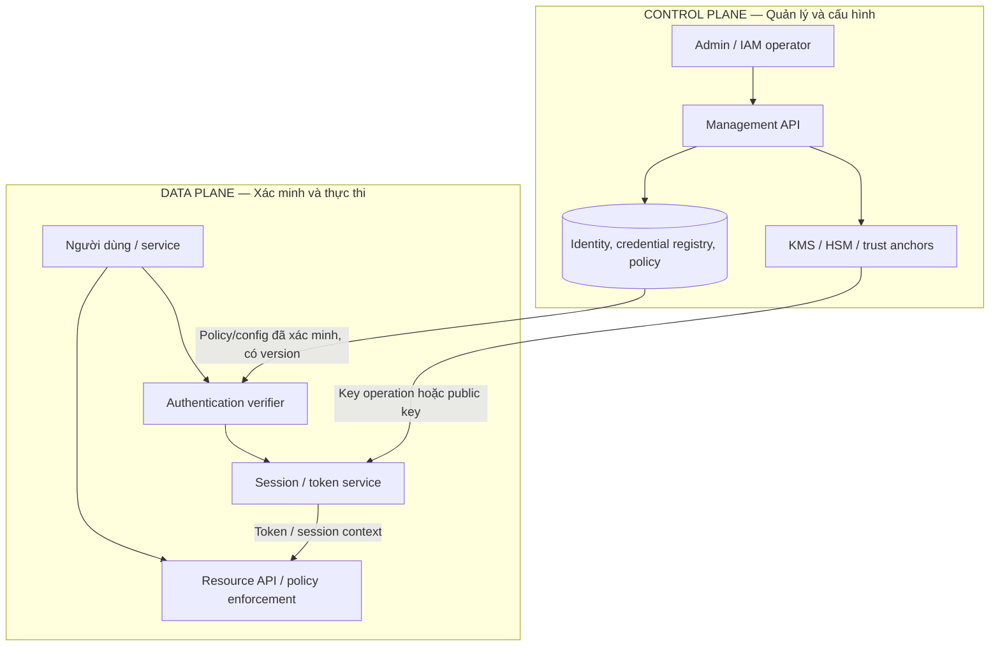
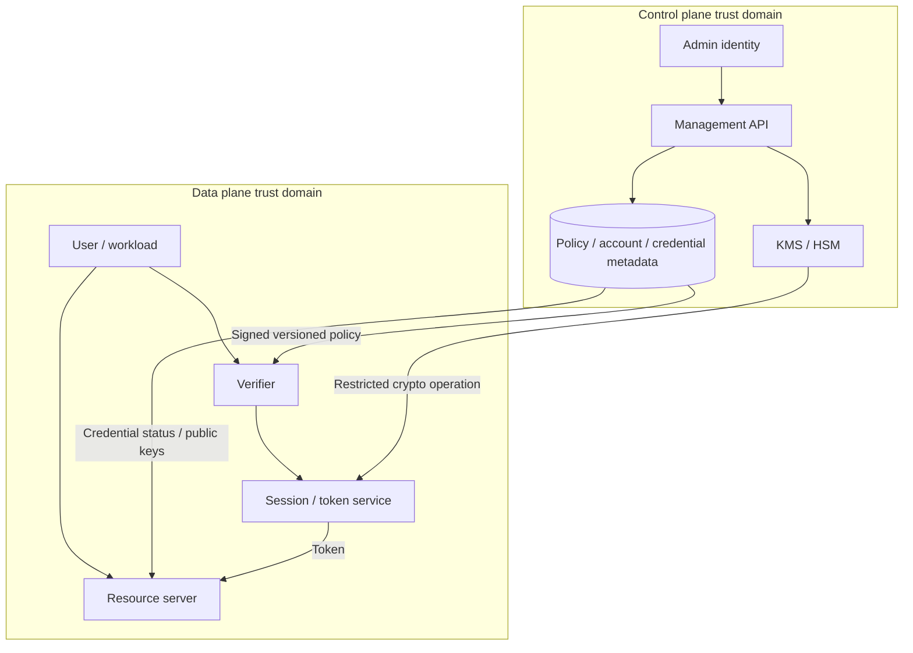
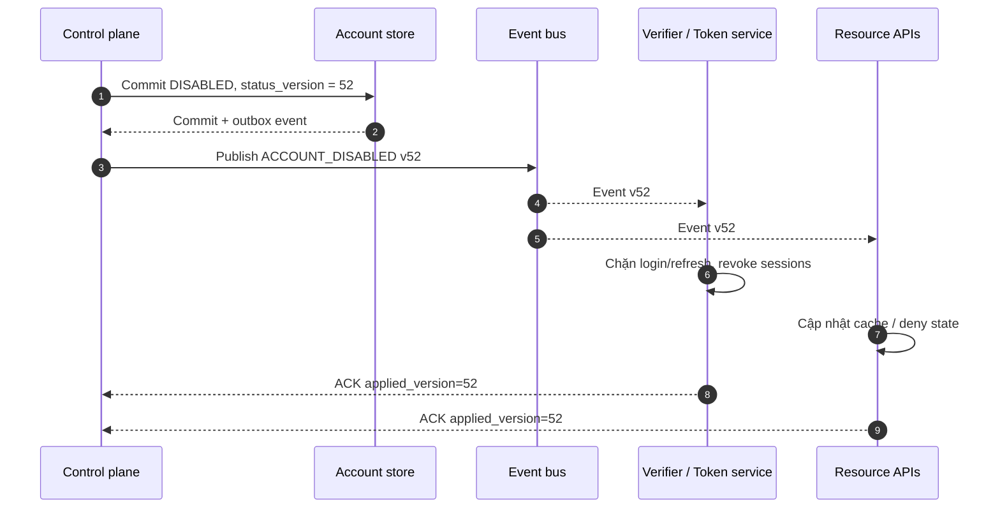
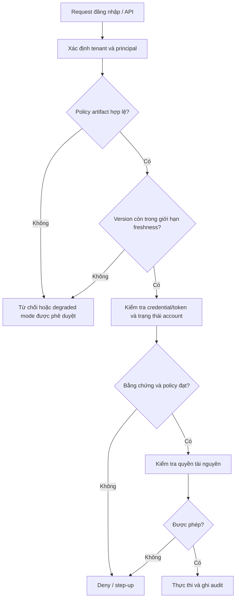

# Control plane và data plane trong hệ thống xác thực

> **Chương:** Trust boundary  
> **Chủ đề:** Control plane và data plane  
> **Phạm vi:** Security Authentication Fundamentals — phân tách nơi quản lý danh tính, credential, chính sách và khóa với nơi thực thi xác thực, phiên/token và quyết định truy cập trong thời gian chạy.

## Mục tiêu học tập

Sau bài này, bạn có thể:

1. Giải thích **control plane** và **data plane** trong kiến trúc xác thực, xác định trách nhiệm và ranh giới tin cậy của từng mặt phẳng.
2. Phân loại các thao tác như tạo tài khoản, đăng ký passkey, cập nhật chính sách, xác minh mật khẩu, phát token, thu hồi phiên và kiểm tra quyền.
3. Thiết kế cách phân phối cấu hình/chính sách/khóa từ control plane tới data plane có xác minh nguồn, phiên bản, tính toàn vẹn và giới hạn độ cũ.
4. Phân tích hậu quả khi control plane hoặc data plane bị xâm phạm, cũng như cách giảm phạm vi ảnh hưởng.
5. Xác định hành vi khi control plane mất kết nối, chính sách hoặc khóa bị thu hồi, cache cũ và sự kiện disable bị trễ.
6. Xây dựng kiểm thử và chỉ số vận hành để chứng minh data plane thực thi đúng chính sách xác thực tại mọi điểm truy cập.

## 1. Vì sao cần phân biệt hai mặt phẳng?

Một hệ thống xác thực có hai nhóm công việc khác nhau:

- **Control plane (mặt phẳng điều khiển):** quản lý cách hệ thống được cấu hình và thay đổi. Nó quyết định ai được đăng ký, credential nào được chấp nhận, chính sách MFA ra sao, khóa nào được tin cậy, tenant nào có cấu hình gì và quản trị viên nào được phép thay đổi các thiết lập ấy.
- **Data plane (mặt phẳng dữ liệu/thực thi):** xử lý các yêu cầu thực tế trong lúc hệ thống hoạt động. Nó xác minh credential, thực hiện challenge, tạo hoặc kiểm tra phiên/token, áp dụng chính sách tại API và trả lời cho các request của người dùng hoặc dịch vụ.

Ví dụ: Quản trị viên bật yêu cầu passkey cho nhóm nhân viên trong cổng quản lý. Thay đổi đó được tạo và phê duyệt ở **control plane**. Sau khi cấu hình được xác thực và phân phối, **data plane** áp dụng yêu cầu ấy khi nhân viên đăng nhập hoặc gọi API nhạy cảm.

Nếu không tách rõ hai mặt phẳng, một endpoint đăng nhập có thể vô tình được cấp quyền sửa chính sách, hoặc một API quản trị có thể xử lý trực tiếp request nghiệp vụ với đặc quyền quá rộng. Kẻ tấn công chiếm một luồng ít đặc quyền khi đó có thể tiến tới thay đổi cấu hình toàn hệ thống.

### Hình dung ngắn gọn



Sơ đồ chỉ ra hai mặt phẳng có thể dùng chung một số nền tảng lưu trữ hoặc dịch vụ hạ tầng, nhưng **quyền thao tác và trách nhiệm** cần tách biệt. Không bắt buộc mỗi mặt phẳng phải là một cụm máy chủ riêng; mức cách ly phụ thuộc rủi ro, quy mô và kiến trúc.

## 2. Trách nhiệm của control plane

Control plane thay đổi **trạng thái có thẩm quyền** và phân phối quy tắc mà data plane cần tuân theo. Trong một nền tảng xác thực, nó có thể đảm nhiệm:

| Nhóm chức năng | Ví dụ công việc | Rủi ro nếu bị chiếm |
| --- | --- | --- |
| **Identity lifecycle** | Tạo, disable, re-enable tài khoản; quản lý tenant và membership | Tạo tài khoản trái phép, chiếm hoặc khôi phục danh tính |
| **Credential lifecycle** | Đăng ký/thu hồi passkey, TOTP, chứng chỉ, API key | Thêm authenticator của kẻ tấn công hoặc giữ credential đã lộ |
| **Policy management** | Cấu hình mật khẩu, MFA, session TTL, step-up, risk rules | Hạ yêu cầu xác thực, mở đường bypass |
| **Trust configuration** | Quản lý IdP, issuer, redirect URI, RP ID, CA, JWKS và trust anchor | Chấp nhận nhầm token/chứng chỉ hoặc nguồn danh tính giả |
| **Key management** | Tạo, luân chuyển, thu hồi và phân quyền sử dụng khóa | Giả mạo token, phá vỡ niềm tin liên dịch vụ |
| **Administrative access** | Phân quyền admin, phê duyệt, break-glass và audit | Đặc quyền vượt phạm vi, thay đổi không được kiểm soát |
| **Provisioning / federation setup** | SCIM, SSO connection, mapping group/role | Đồng bộ nhầm quyền hoặc cấp quyền diện rộng |

Control plane thường có **ít request hơn data plane**, nhưng đặc quyền rất cao. Một lần sửa cấu hình issuer hoặc khóa ký sai có thể ảnh hưởng tới hàng triệu request sau đó. Vì vậy, không thể chỉ đánh giá bảo mật dựa trên số lượng request hay độ phức tạp của endpoint.

### Những thay đổi cần bảo vệ tăng cường

- Tạo hoặc thay đổi **trust anchor**, CA, issuer, JWKS hoặc khóa ký.
- Tắt MFA, hạ assurance, thay TTL hoặc mở rộng redirect URI.
- Thêm credential vào tài khoản quản trị, thay kênh recovery hoặc liên kết IdP mới.
- Thay mapping nhóm/role, phạm vi tenant, quyền của service account.
- Tạo API key hoặc service credential có quyền quản trị.
- Disable hàng loạt, re-enable tài khoản hoặc thay đổi chính sách khóa tài khoản.

Những thao tác này có thể cần xác thực tăng cường, phê duyệt nhiều người, thời hạn hiệu lực, thông báo độc lập và ghi nhận audit không thể bị người thực hiện tự xóa.

## 3. Trách nhiệm của data plane

Data plane tiếp nhận và xử lý **yêu cầu thực tế**. Tùy kiến trúc, nó gồm verifier, dịch vụ đăng nhập, token/session issuer, API gateway, resource server và policy enforcement point.

| Nhóm chức năng | Ví dụ công việc | Cần kiểm tra |
| --- | --- | --- |
| **Primary authentication** | Kiểm tra password hash, challenge WebAuthn, OTP hoặc chứng chỉ | Credential đúng tài khoản, còn hiệu lực, challenge hợp lệ |
| **MFA / step-up** | Kiểm tra yếu tố bổ sung, push approval, user verification | Đủ yếu tố theo policy, chống replay và giới hạn thử |
| **Session / token issuance** | Tạo cookie session, phát access token hoặc refresh token | Chỉ phát sau khi verification đủ; audience, scope, TTL phù hợp |
| **Session validation** | Kiểm tra cookie, trạng thái phiên và thu hồi | Phiên thuộc đúng subject, còn hạn và chưa bị revoke |
| **Token validation** | Kiểm tra JWT hoặc introspection response | Chữ ký, issuer, audience, thời hạn, scope và trạng thái |
| **Authorization enforcement** | Cho phép/từ chối request trên tài nguyên | Quyền trên đúng action/resource/tenant |
| **Abuse controls** | Rate limit, phát hiện credential stuffing, replay | Tín hiệu đáng tin, giới hạn thử và chính sách rủi ro |

Data plane thường phải phục vụ lưu lượng lớn, độ trễ thấp và tính sẵn sàng cao. Nhưng **hiệu năng không được biến thành lý do bỏ qua kiểm tra bảo mật bắt buộc**. Nếu cache hoặc policy engine lỗi, hệ thống phải có hành vi dự phòng đã định nghĩa theo mức độ nhạy cảm của hành động.

### Một request đăng nhập đi qua hai mặt phẳng

1. Control plane đã cấu hình tài khoản, phương thức xác thực được phép, khóa tin cậy và policy MFA.
2. Data plane nhận yêu cầu đăng nhập, tìm đúng credential và kiểm tra bằng chứng.
3. Nếu policy yêu cầu step-up, data plane tạo và xác minh challenge bổ sung.
4. Khi đủ điều kiện, data plane tạo session/token theo cấu hình.
5. API tiếp tục kiểm tra token/session và quyền trước khi truy cập tài nguyên.
6. Nếu admin disable tài khoản hoặc thu hồi credential, control plane ghi thay đổi có thẩm quyền và phát sự kiện để data plane ngừng chấp nhận ngữ cảnh liên quan.

## 4. Phân loại thao tác: control hay data?

Một số thao tác có thể nằm ở ranh giới hai mặt phẳng. Cần phân loại theo **mục đích và nơi quyết định có thẩm quyền**, không chỉ theo tên endpoint.

| Thao tác | Mặt phẳng chính | Giải thích |
| --- | --- | --- |
| Admin tạo tenant hoặc tài khoản | Control plane | Thay đổi cấu hình/danh tính có thẩm quyền |
| Admin đặt chính sách MFA bắt buộc | Control plane | Định nghĩa quy tắc data plane sẽ thực thi |
| Người dùng gửi mật khẩu để đăng nhập | Data plane | Request xác thực trong thời gian chạy |
| Verifier kiểm tra chữ ký WebAuthn | Data plane | Xử lý bằng chứng của giao dịch đăng nhập |
| Đăng ký passkey mới | **Có cả hai** | Data plane có thể chạy ceremony; control plane lưu và quản trị vòng đời credential |
| Người dùng tự đổi mật khẩu | **Có cả hai** | Data plane xác minh quyền và mật khẩu hiện tại; control plane cập nhật credential có thẩm quyền |
| Phát access token sau đăng nhập | Data plane | Kết quả runtime của verification |
| Tạo/luân chuyển khóa ký | Control plane / KMS | Quản lý vòng đời khóa; thao tác ký có thể được data plane gọi qua HSM |
| Kiểm tra chữ ký JWT tại API | Data plane | Xác minh token cho từng request |
| Admin thu hồi tất cả phiên của tài khoản | Control plane khởi tạo, data plane thực thi | Quyết định quản trị được truyền tới nơi giữ/kiểm tra phiên |
| API kiểm tra trạng thái account | Data plane | Thực thi chính sách truy cập tại thời điểm request |
| Thay đổi role/group mapping trong IdP | Control plane | Cấu hình nguồn quyền; request thực tế vẫn cần được kiểm tra |

**Ví dụ đăng ký passkey:** người dùng bắt đầu đăng ký trên giao diện; data plane xác minh phiên hiện tại và tạo challenge. Authenticator tạo credential. Data plane xác minh attestation/registration response theo policy và chuyển kết quả hợp lệ sang kho credential. Phần ghi nhận credential, audit, trạng thái và quản trị thu hồi thuộc vòng đời do control plane quản lý. Ranh giới cụ thể tùy triển khai, nhưng không được để client tự ghi khóa công khai vào tài khoản mà không có verification.

## 5. Cách phân phối policy và cấu hình an toàn

Data plane cần biết policy mới, nhưng không nên nhận một blob cấu hình bất kỳ rồi thực thi ngay. Một chu trình an toàn có thể gồm:

```mermaid
flowchart LR
    A["Admin thay đổi policy"] --> B["Kiểm tra quyền và phê duyệt"]
    B --> C["Validate schema và semantic rules"]
    C --> D["Tạo version / ký artifact"]
    D --> E["Publish qua channel tin cậy"]
    E --> F["Data plane xác minh nguồn và chữ ký"]
    F --> G["Kiểm tra version / rollback policy"]
    G --> H["Load atomic thành last-known-good"]
    H --> I["Enforce trên request"]
    I --> J["Telemetry / audit / drift detection"]
```



### Các thuộc tính cần có

**1. Schema validation:** Kiểm tra kiểu dữ liệu, trường bắt buộc, giới hạn giá trị, tenant scope và các tổ hợp cấu hình không hợp lệ. Ví dụ không chấp nhận policy yêu cầu MFA nhưng danh sách phương thức được phép rỗng.

**2. Semantic validation:** Đánh giá ý nghĩa thay đổi. Ví dụ redirect URI mới có thuộc đúng domain được phê duyệt không; policy TTL có vượt mức cho phép; thay issuer có đi kèm key set và mapping phù hợp không.

**3. Versioning:** Mỗi bản cấu hình có version tăng đơn điệu hoặc revision rõ ràng, thời điểm phát hành và phạm vi áp dụng. Data plane không nên tự động chấp nhận một bản cũ chỉ vì nó đến muộn.

**4. Integrity và authenticity:** Kênh truyền cần xác thực hai chiều phù hợp; artifact có thể được ký bởi nguồn phát hành tin cậy. Data plane kiểm tra chữ ký, signer, tenant/scope, version và thời hạn.

**5. Atomic activation:** Tải và kiểm tra cấu hình mới trước, rồi chuyển sang bản mới một cách nguyên tử. Không để request đọc nửa policy cũ, nửa policy mới.

**6. Last-known-good:** Giữ bản cấu hình hợp lệ cuối cùng đã xác minh, để có thể xử lý tình huống control plane tạm mất kết nối. Phải có giới hạn độ cũ và chính sách riêng cho các thay đổi khẩn cấp như thu hồi khóa.

**7. Rollback có kiểm soát:** Khôi phục phiên bản trước phải là hành động có thẩm quyền, có audit và không làm sống lại trust anchor/credential đã bị thu hồi vì sự cố.

### Ví dụ policy artifact

```yaml
policy_id: workforce-login
tenant: tenant-42
version: 108
issued_at: "2026-11-22T04:00:00Z"
expires_at: "2026-11-22T06:00:00Z"
login:
  allowed_methods:
    - passkey
    - password_totp
  require_phishing_resistant_for_admin: true
session:
  idle_timeout_seconds: 900
  absolute_timeout_seconds: 28800
  refresh_rotation: true
```

Đây là **ví dụ minh họa**, không phải schema chuẩn. Data plane cần xác minh artifact được phát hành bởi control plane đúng tenant và version, đồng thời kiểm tra policy có hợp lệ theo cấu hình ứng dụng hay không. Không nên tin tenant, version hoặc thời gian chỉ vì chúng xuất hiện trong YAML; cần ràng buộc chúng với nguồn phát hành đã xác minh.

## 6. Quản lý khóa: control plane sở hữu vòng đời, data plane dùng bằng chứng

Khóa ký token, khóa mã hóa, khóa TOTP và khóa riêng của passkey có vai trò khác nhau; không được gom thành một “secret” chung.

| Loại khóa/secret | Nơi quản lý chủ yếu | Data plane sử dụng |
| --- | --- | --- |
| Khóa ký JWT | KMS/HSM và control plane quản lý vòng đời | Yêu cầu ký qua API KMS/HSM hoặc cơ chế được cấp quyền |
| Public key của verifier/WebAuthn | Credential store được bảo vệ | Kiểm tra chữ ký assertion |
| TOTP shared secret | Kho secret được bảo vệ, truy cập hạn chế | Tính toán/kiểm tra OTP khi user xác thực |
| Password hash | Credential store | So khớp mật khẩu với thuật toán đã lưu |
| Private key của passkey | Authenticator của người dùng | Ký challenge tại thiết bị; không gửi lên server |
| Chứng chỉ và trust anchors | PKI/KMS/trust configuration | Xác minh chuỗi và danh tính kết nối |

### Phân tách quyền ký và quyền quản trị khóa

Một mẫu thiết kế tốt:

- Control plane có quyền **yêu cầu** tạo, rotate, disable hoặc revoke key theo quy trình phê duyệt.
- Data plane chỉ được cấp quyền sử dụng thao tác cụ thể (ví dụ ký bằng một key ID) và trong phạm vi ứng dụng/tenant cho phép.
- API quản trị khóa không được lộ ra Internet công khai như một phần của endpoint đăng nhập.
- Không xuất private key ra cấu hình hoặc file ứng dụng nếu có thể dùng HSM/KMS để giữ khóa.
- Quyền xem metadata public key và quyền sử dụng private key cần tách riêng.

Nếu data plane bị chiếm, kẻ tấn công có thể lợi dụng quyền ký mà nó được cấp. Vì vậy, cần giới hạn key theo mục đích, issuer, môi trường và thời hạn; giám sát tần suất ký; có khả năng thu hồi hoặc cô lập key.

### Xoay vòng và thu hồi khóa

1. Control plane tạo key mới trong KMS/HSM và xác minh metadata.
2. Công bố public key mới (ví dụ JWKS) với key ID duy nhất; data plane và resource server tải, kiểm tra và cập nhật cache.
3. Token mới được ký bằng key mới sau thời điểm chuyển đổi đã định.
4. Giữ key cũ trong khoảng cần thiết để xác minh token hợp lệ đã phát hành trước đó, theo TTL và chính sách.
5. Nếu key cũ bị lộ, kích hoạt quy trình khẩn cấp: ngừng ký, đánh dấu compromised, phân phối trạng thái thu hồi và quyết định từ chối token được ký bằng key đó.

**Thu hồi vì compromise khác xoay vòng định kỳ.** Không nên giữ public key bị xâm phạm chỉ vì muốn token cũ tiếp tục chạy. Khi có sự cố, chính sách khẩn cấp phải ưu tiên ngăn chấp nhận chữ ký giả; người dùng có thể cần xác thực lại.

## 7. Ranh giới tin cậy và mô hình đe dọa

Hai mặt phẳng tạo ra các loại tài sản và kiểu tấn công khác nhau.



### Nếu control plane bị xâm phạm

Kẻ tấn công có thể:

- Hạ yêu cầu MFA hoặc cho phép phương thức yếu.
- Thêm IdP giả, redirect URI độc hại, CA hoặc public key không tin cậy.
- Đăng ký passkey/credential mới cho tài khoản đặc quyền.
- Thay mapping group/role, mở rộng tenant scope hoặc tạo tài khoản admin.
- Yêu cầu ký token bằng key có quyền rộng, hoặc thay trust configuration.
- Xóa/giảm log hoặc tạo ngoại lệ che giấu hoạt động.

**Hậu quả:** dữ liệu được kiểm tra đúng theo policy nhưng policy đã bị thay đổi trái phép. Vì vậy, tính toàn vẹn của control plane là nền tảng cho mọi quyết định ở data plane.

### Nếu data plane bị xâm phạm

Kẻ tấn công có thể:

- Bỏ qua kiểm tra credential/MFA hoặc trả kết quả verification giả.
- Lấy password hash, TOTP secret, session cookie, refresh token hoặc access token trong phạm vi tiến trình.
- Phát session/token trái phép nếu có quyền issuer.
- Bỏ qua kiểm tra account disabled, audience hoặc authorization.
- Sử dụng quyền KMS mà data plane được cấp để ký hoặc giải mã vượt mục đích.
- Làm giả telemetry hoặc không ghi nhận request đáng ngờ.

**Hậu quả:** ngay cả policy đúng cũng không còn được thực thi. Cần bảo vệ runtime, cô lập secret, phân quyền service identity, kiểm tra độc lập tại resource server và giám sát hành vi.

### Một số mối đe dọa liên mặt phẳng

| Mối đe dọa | Mặt phẳng bị ảnh hưởng | Kiểm soát |
| --- | --- | --- |
| Admin phishing / session hijacking | Control plane | Phishing-resistant MFA, step-up, session binding, giới hạn quyền admin |
| Policy tampering | Control plane → data plane | Phê duyệt, ký artifact, version monotonic, audit độc lập |
| Config rollback | Control plane → data plane | Chống version cũ, quy trình rollback có phê duyệt |
| Credential stuffing | Data plane | Rate limit, MFA, phát hiện abuse và phản hồi an toàn |
| Token theft/replay | Data plane | TTL, audience, sender constraint khi phù hợp, revocation |
| KMS privilege escalation | Giao tiếp hai mặt phẳng | Quyền theo key/action, workload identity, audit thao tác ký |
| Event injection hoặc giả mạo disable | Control plane → data plane | Xác thực publisher, chữ ký/transport trust, schema và version |
| Cache poisoning | Data plane | Chỉ nhận dữ liệu từ nguồn xác minh, TTL và integrity check |
| Audit log deletion | Cả hai | Log append-only/immutable, quyền đọc ghi tách biệt, gửi ra hệ thống độc lập |

## 8. Bảo vệ kênh giao tiếp giữa control plane và data plane

Không nên giả định hai mặt phẳng “ở cùng mạng nội bộ” thì tự động đáng tin. Các kết nối giữa chúng là **ranh giới tin cậy** cần xác thực và phân quyền.

### Workload identity và mTLS

Mỗi service cần danh tính máy riêng, có thể xác minh qua chứng chỉ workload hoặc cơ chế workload identity. Khi data plane tải policy, nó phải chứng minh đúng service được phép nhận policy cho môi trường/tenant đó. Khi control plane gửi lệnh thu hồi, consumer phải xác minh nguồn và phạm vi.

Các nguyên tắc:

- Dùng **mTLS hoặc cơ chế tương đương** cho kết nối service-to-service khi phù hợp.
- Không dùng chung một API key tĩnh có quyền quản trị cho tất cả node.
- Ràng buộc quyền theo **service identity, environment, tenant, action và resource**.
- Chỉ cho data plane đọc đúng phần policy/credential metadata cần thiết; không cho phép ghi trực tiếp policy quản trị.
- Kiểm tra issuer/audience và quyền của service token; không chấp nhận token nội bộ chỉ vì chữ ký đúng.
- Giới hạn outbound network; không để verifier gọi tùy ý endpoint quản trị hoặc metadata service không cần thiết.

### Phân tách mạng và giao diện

Management API có thể nằm trong mạng quản trị riêng, yêu cầu thiết bị/identity quản trị được quản lý và không nhận request từ public ingress. Public login endpoint thuộc data plane. Cả hai vẫn cần authentication, authorization, rate limiting và logging riêng.

Một số tổ chức có thể dùng cùng API gateway hoặc cùng cluster, nhưng phải chứng minh được **policy route, service identity, network policy và quyền database** không cho public request đi vào chức năng quản trị.

## 9. Cache, độ mới và khi control plane không khả dụng

Data plane thường cache policy, public keys, account status hoặc credential metadata để giảm độ trễ. Cache tăng hiệu năng nhưng tạo câu hỏi: **nếu control plane thay đổi một quyết định, data plane cũ còn được phép thực thi đến bao lâu?**

### Phân loại dữ liệu theo tính nhạy cảm

| Dữ liệu | Có thể cache? | Điều cần kiểm soát |
| --- | --- | --- |
| Policy đăng nhập ít thay đổi | Có, với version và thời hạn | Max staleness, atomic reload, audit version đang chạy |
| Public key xác minh token | Có | JWKS refresh, key ID, xử lý key mới và key bị compromise |
| Trạng thái account ACTIVE/DISABLED | Tùy độ nhạy và SLA | Invalidation, TTL ngắn, version, kiểm tra tại điểm nhạy cảm |
| Trạng thái credential bị revoke | Tùy kiến trúc | Tốc độ lan truyền, denylist/introspection, fail behavior |
| Private key ký token | Không phân phối như cache cấu hình | KMS/HSM, không export, quyền ký tối thiểu |
| TOTP secret/password hash | Chỉ truy cập qua kho credential có bảo vệ | Không nhân bản tùy tiện; phân quyền và mã hóa |

### Ba tình huống mất kết nối

**A. Control plane tạm ngừng, data plane đang có policy hợp lệ**

- Có thể tiếp tục phục vụ trong giới hạn **last-known-good** và thời gian stale tối đa đã định.
- Không tự động chấp nhận cấu hình mới không xác minh được.
- Theo dõi tuổi policy, cảnh báo trước khi vượt ngưỡng và có kế hoạch xử lý khi hết thời hạn.

**B. Data plane không thể xác minh trạng thái account hoặc credential**

- Với hành động có hậu quả cao, thường nên **fail closed**: từ chối hoặc yêu cầu phương thức dự phòng được phê duyệt.
- Không biến lỗi backend thành “account active” mặc định.
- Với chức năng ít nhạy cảm, có thể có chính sách suy giảm có giới hạn, nhưng phải định nghĩa rõ tài nguyên nào và thời gian nào được phép.

**C. Khóa ký hoặc trust anchor bị nghi compromise**

- Không dựa vào cache cũ một cách vô thời hạn chỉ để duy trì sẵn sàng.
- Có kênh khẩn cấp để phân phối thông tin thu hồi, khóa data plane hoặc chặn issuer/key cụ thể.
- Khi không thể xác minh được trạng thái compromise, các hành động nhạy cảm cần chọn chính sách từ chối an toàn.

### Ma trận quyết định fail-open/fail-closed

| Tình huống | Hành động thường phù hợp | Lý do |
| --- | --- | --- |
| Không tải được policy mới, bản cũ còn hạn và đã xác minh | Dùng last-known-good theo giới hạn | Duy trì khả năng phục vụ có kiểm soát |
| Policy đã vượt max staleness | Từ chối thao tác nhạy cảm hoặc dùng quy trình dự phòng đã phê duyệt | Không thực thi policy quá cũ |
| Không tra được account status cho API chuyển tiền | Fail closed | Tránh chấp nhận tài khoản đã bị disable |
| Không tra được trạng thái revoke của key đang bị nghi lộ | Fail closed với issuer/key liên quan | Chữ ký giả có thể được chấp nhận nếu tin cache cũ |
| Telemetry collector tạm lỗi nhưng verifier vẫn hoạt động | Theo policy vận hành có buffer an toàn và cảnh báo | Không phải mọi lỗi logging đều giống lỗi verification; vẫn cần tránh mất audit bắt buộc |

Không có một câu trả lời fail-open/fail-closed cho mọi request. Phải phân loại theo **tài sản, hậu quả, độ nhạy, nguồn dữ liệu và SLA**, sau đó kiểm thử chính xác hành vi khi phụ thuộc bị lỗi.

## 10. Thu hồi và thay đổi trạng thái xuyên hai mặt phẳng

Khi admin disable tài khoản hoặc thu hồi credential, control plane ghi nhận quyết định. Data plane phải áp dụng nó lên những gì đang được sử dụng:

1. Tài khoản không được bắt đầu authentication mới.
2. Verifier không chấp nhận credential đã revoke hoặc credential thuộc tài khoản disabled.
3. Token issuer dừng phát hành/refresh token cho subject đó.
4. Session store và resource server thu hồi hoặc kiểm tra trạng thái của session/token hiện có.
5. Dịch vụ downstream xử lý job, delegated access và service credential được gắn với tài khoản theo policy.
6. Mỗi consumer xác nhận đã áp dụng version mới; backlog và lỗi xử lý được giám sát.

### Event-driven propagation



Event bus giúp lan truyền nhanh nhưng **không nên là nguồn chân lý duy nhất**. Consumer có thể offline, event có thể đến trùng hoặc sai thứ tự. Cần:

- Transactional outbox hoặc cơ chế đảm bảo sự kiện không mất sau commit.
- Consumer idempotent, so sánh status_version để bỏ qua event cũ.
- Retry/backoff, dead-letter queue, cảnh báo backlog và công cụ reconcile.
- Resource server kiểm tra nguồn trạng thái có thẩm quyền ở các điểm nhạy cảm theo SLA.
- Audit ghi rõ **thời điểm yêu cầu**, **thời điểm từng consumer áp dụng** và **thời điểm thực tế bắt đầu chặn**.

### Không khôi phục token cũ khi re-enable

Khi tài khoản được kích hoạt lại, không nên mặc định session/token đã thu hồi được sống lại. Re-enable là quyết định control plane; người dùng thường phải xác thực lại để tạo ngữ cảnh mới. Nếu credential bị nghi lộ, cần đăng ký lại hoặc xoay vòng theo quy trình an toàn.

## 11. Phân quyền control plane và data plane

Nguyên tắc **least privilege** phải áp dụng cả người dùng lẫn service:

| Principal | Quyền nên có | Quyền không nên có mặc định |
| --- | --- | --- |
| Public user | Gửi login request, sử dụng session của chính mình | Sửa policy, tạo admin, đọc credential người khác |
| Resource API | Xác minh token và gọi đúng policy decision | Thay trust anchor, thêm IdP hoặc reset MFA admin |
| Authentication verifier | Đọc credential metadata cần thiết, kiểm tra bằng chứng, yêu cầu KMS operation được phép | Tự sửa role, disable audit hoặc xuất private signing key |
| Policy publisher | Phát hành policy đã được phê duyệt | Đọc password/TOTP secret hoặc gọi API nghiệp vụ thay user |
| IAM operator | Quản lý identity/credential trong phạm vi được giao | Toàn quyền trên mọi tenant và mọi key |
| KMS administrator | Quản trị key lifecycle theo nhiệm vụ | Tùy tiện sử dụng key ký thay ứng dụng mà không có audit |
| Break-glass operator | Khôi phục dịch vụ trong điều kiện khẩn cấp, có giới hạn | Quyền thường trực không giám sát |

Tách vai trò (separation of duties) có thể yêu cầu người tạo thay đổi không phải người phê duyệt; người quản lý key không tự ý triển khai policy; người vận hành không xóa audit về chính hành động của mình.

Với hệ thống nhiều tenant, mọi thao tác quản trị phải ràng buộc **tenant context** phía server. Không tin tenantId trong body nếu principal không có quyền trên tenant đó. Data plane cũng phải kiểm tra tenant khi ánh xạ credential, session, issuer và resource.

## 12. Quan sát, audit và đo mức độ thực thi

Một policy tồn tại trong control plane chưa có nghĩa tất cả data plane node đang áp dụng đúng policy. Cần đo **độ lệch giữa điều đã cấu hình và điều thực sự được thực thi**.

### Sự kiện gợi ý

| Event / trường | Mục đích |
| --- | --- |
| policy_change_requested | Ai yêu cầu, phạm vi, lý do và change ID |
| policy_change_approved | Người phê duyệt, bước xác thực tăng cường, version |
| policy_published | Version, hash/artifact reference, issuer và thời điểm |
| policy_applied | Data plane node/service nào áp dụng version nào, thời điểm |
| policy_apply_failed | Lý do schema/signature/version/transport hoặc lỗi runtime |
| key_created/rotated/revoked | Audit vòng đời key, key ID và lý do |
| credential_enrolled/revoked | Thay đổi credential theo account reference |
| auth_verification_result | Phương thức, kết quả, reason code, transaction reference |
| token_issued/rejected | Issuer/key ID/audience/scope và kết quả theo policy |
| account_disable_propagation | Version và ACK của các consumer |

Không ghi mật khẩu, OTP, TOTP seed, private key, session cookie hoặc token thô vào audit. Sử dụng định danh tham chiếu có kiểm soát; giới hạn quyền đọc log, bảo vệ tính toàn vẹn và lưu trữ phù hợp.

### Chỉ số vận hành

- **Policy convergence time:** Thời gian từ lúc publish policy tới khi tất cả node/consumer trong phạm vi xác nhận đã áp dụng version mới.
- **Policy version drift:** Số node đang chạy version khác với version được phê duyệt hiện hành.
- **Stale policy exposure:** Số request nhạy cảm được xử lý bằng policy đã vượt ngưỡng stale tối đa.
- **Revocation propagation latency:** Thời gian từ commit revoke/disable tới khi verifier và resource API từ chối credential/phiên liên quan.
- **Unauthorized management attempts:** Số yêu cầu control plane bị từ chối do thiếu quyền hoặc sai tenant.
- **Key usage anomaly:** Tần suất hoặc nguồn sử dụng key lệch khỏi baseline.
- **Data-plane policy violation:** Số quyết định truy cập không đáp ứng policy đã phát hành nhưng vẫn được cho phép.
- **Control-plane availability / change failure rate:** Đánh giá khả năng quản lý thay đổi; phải theo dõi cùng độ mới policy để không che giấu rủi ro stale.

Ví dụ: nếu 100 node data plane nhận policy version 108 nhưng 4 node vẫn chạy version 106 sau thời hạn hội tụ đã cam kết, dashboard cần báo **4 node drift** và xác định request nhạy cảm nào còn đi qua chúng. Không thể báo “policy đã triển khai thành công” chỉ vì control plane trả HTTP 200 cho lệnh publish.

## 13. Tình huống thiết kế: thay đổi policy MFA toàn doanh nghiệp

Một doanh nghiệp có 3 thành phần:

- **IAM Admin Console:** nơi quản trị viên thay đổi policy MFA.
- **Authentication Cluster:** xử lý login, WebAuthn, TOTP và phát session.
- **Business APIs:** kiểm tra access token trước khi cho xem dữ liệu hoặc duyệt hoàn tiền.

Quản trị viên muốn yêu cầu **passkey hoặc MFA chống phishing** cho mọi tài khoản quản trị. Một bản cập nhật policy bị gửi nhầm tenant và một node Authentication Cluster chưa nhận version mới.

### Những lỗi có thể xảy ra

1. Node cũ tiếp tục cho phép password + SMS OTP, tạo ra một nhánh xác thực yếu.
2. Tenant khác bị áp policy ngoài ý định, gây lockout hoặc làm thay đổi assurance.
3. Admin thay đổi cấu hình mà không có step-up/approval, làm kẻ chiếm session quản trị có thể hạ policy.
4. Business API chỉ tin JWT chữ ký hợp lệ, không kiểm tra account status hoặc scope; một token cũ tiếp tục truy cập.
5. Không có telemetry theo node/version nên nhóm vận hành không phát hiện cấu hình drift.

### Cách thiết kế lại

1. Admin xác thực chống phishing và được kiểm tra quyền trên đúng tenant.
2. Thay đổi policy được validate, phê duyệt, tạo version và ký bằng cơ chế phát hành tin cậy.
3. Mỗi node xác minh chữ ký, tenant, version và schema trước khi áp dụng atomically.
4. Node chưa nhận policy mới được đánh dấu stale; nếu vượt ngưỡng, không xử lý login quản trị theo policy cũ.
5. Business APIs kiểm tra issuer, audience, scope, trạng thái tài khoản và các điều kiện truy cập cần thiết.
6. Dashboard đối chiếu version mong đợi với version từng node, cảnh báo drift và lưu audit độc lập.
7. Rollback nếu cần phải là thay đổi mới có phê duyệt; không đưa trở lại một policy yếu hoặc key đã bị compromise.

### Sơ đồ quyết định tại data plane



## 14. Bộ kiểm thử chấp nhận

| Trường hợp | Cách thử | Kết quả kỳ vọng |
| --- | --- | --- |
| **Public login gọi management API** | Gửi request tạo IdP/policy bằng session user thường | Bị từ chối; không thay đổi cấu hình |
| **Admin sai tenant** | Admin tenant A thay policy tenant B | Bị từ chối ở server |
| **Policy artifact sai chữ ký** | Sửa một trường sau khi ký | Data plane từ chối và ghi reason code |
| **Policy version cũ** | Gửi lại version đã bị supersede | Bị từ chối hoặc xử lý theo quy trình rollback có thẩm quyền |
| **Policy sai schema** | Đặt TTL âm hoặc danh sách phương thức rỗng trái policy | Không publish/không activate |
| **Node nhận event trùng** | Phát lại cùng version | Consumer idempotent, không gây tác dụng phụ |
| **Event sai thứ tự** | Gửi version 108 rồi 107 | Node không rollback ngoài ý muốn |
| **Control plane tạm mất kết nối** | Ngắt management channel | Data plane dùng last-known-good trong giới hạn hoặc degraded mode đã định |
| **Policy quá stale** | Giữ node ở version cũ quá max staleness | Chặn hành động nhạy cảm/cảnh báo theo policy |
| **KMS key bị revoke** | Đánh dấu key compromised | Ngừng ký bằng key; resource server xử lý token liên quan theo quy trình khẩn cấp |
| **Data plane bị thiếu quyền KMS** | Thu hồi quyền ký của service | Ký thất bại an toàn, không fallback sang private key hard-code |
| **Account disable propagation** | Disable tài khoản khi có session/JWT đang tồn tại | Login/refresh/API bị chặn theo SLA |
| **Cache invalidation thất bại** | Làm mất event hoặc giữ cache ACTIVE | Reconcile phát hiện drift; điểm nhạy cảm không tiếp tục tin dữ liệu cũ vô hạn |
| **Audit tampering** | Thử xóa log bởi operator thực hiện thay đổi | Bị ngăn hoặc có bản ghi độc lập phát hiện |
| **Policy enforcement drift** | Một node cố tình bỏ MFA | Kiểm thử/telemetry phát hiện node vi phạm |

Kiểm thử nên bao gồm **đường thành công và đường lỗi**, nhiều node, nhiều tenant, event lặp, event sai thứ tự và tình huống cạnh tranh. Chỉ kiểm tra API management trả thành công là chưa đủ để chứng minh data plane đã thực thi.

## 15. Checklist thiết kế control plane và data plane

- **Ranh giới:** Những thao tác nào thay đổi cấu hình có thẩm quyền? Những thao tác nào xử lý request runtime? Có API hoặc database nào bị dùng chung quyền quá rộng không?
- **Identity:** Admin, user và service có danh tính riêng, xác thực phù hợp và quyền tối thiểu không?
- **Policy:** Policy có schema, semantic validation, version, signer, tenant scope và quy trình phê duyệt không?
- **Phân phối:** Data plane có xác minh nguồn, chữ ký, version, thời hạn và áp dụng atomically không?
- **Credential/key:** Password hash, TOTP secret, public/private key, certificate và KMS operation có vòng đời và quyền riêng không?
- **Runtime:** Data plane có kiểm tra credential, challenge, token, trạng thái account và quyền tại đúng điểm không?
- **Revocation:** Disable/revoke có propagation, ACK, retry, reconcile và SLA rõ không?
- **Cache/failure:** Có max staleness, last-known-good, fail-open/fail-closed theo mức rủi ro và emergency kill switch không?
- **Isolation:** Management API có tách ingress/network/identity khỏi public login không? Service-to-service có mTLS/workload identity không?
- **Audit:** Có log bất biến/độc lập cho thay đổi policy, key, credential và quyết định truy cập không?
- **Monitoring:** Có policy drift, stale exposure, revocation latency và key usage anomaly không?
- **Testing:** Có kiểm thử cross-tenant, rollback, event injection, node stale, KMS failure và bypass policy không?

### Câu hỏi tự kiểm tra

1. Vì sao control plane có ít request hơn nhưng một lần bị chiếm có thể gây tác động rộng hơn data plane?
2. Đăng ký passkey thuộc control plane hay data plane? Hãy chỉ ra phần thực thi ceremony và phần quản lý vòng đời credential.
3. Nếu data plane đang chạy policy version 106 trong khi control plane đã phát hành version 108, cần kiểm tra những yếu tố nào trước khi cho phép request nhạy cảm?
4. Tại sao ký policy artifact và kiểm tra version không thay thế việc xác minh schema/ý nghĩa của policy?
5. Khi khóa ký JWT bị compromise, vì sao giữ public key cũ trong cache vô thời hạn là nguy hiểm?
6. Nếu control plane ngừng hoạt động, data plane có nên dừng mọi request không? Hãy phân tích theo last-known-good, max staleness và loại tài nguyên.
7. Làm sao chứng minh một lệnh disable đã có hiệu lực trên tất cả resource API chứ không chỉ được ghi vào database?
8. Vì sao workload identity và mTLS không tự thay thế authorization cho service gọi API?

## Kết luận

**Control plane quản lý danh tính, credential, policy, trust và vòng đời khóa; data plane kiểm chứng bằng chứng và thực thi các quyết định đó trong request thực tế.** Phân tách hai mặt phẳng giúp giới hạn quyền, giảm đường đi từ public login tới chức năng quản trị và làm rõ trách nhiệm khi cấu hình thay đổi. Nhưng ranh giới này chỉ có tác dụng khi policy được xác thực nguồn, version hóa, phân phối nguyên tử; data plane kiểm tra đúng credential, trạng thái account, token và quyền; còn revocation, cache, key rotation và lỗi kết nối đều có hành vi đã định nghĩa. Một hệ thống an toàn phải chứng minh được **cấu hình được phê duyệt đã đến đúng nơi, được thực thi đúng phiên bản và không có request nào được cho qua chỉ vì một thành phần khác đã tin nó**.
