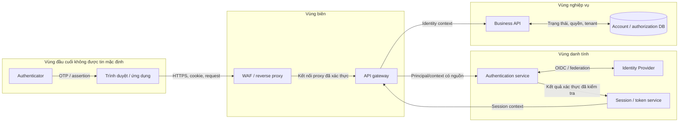
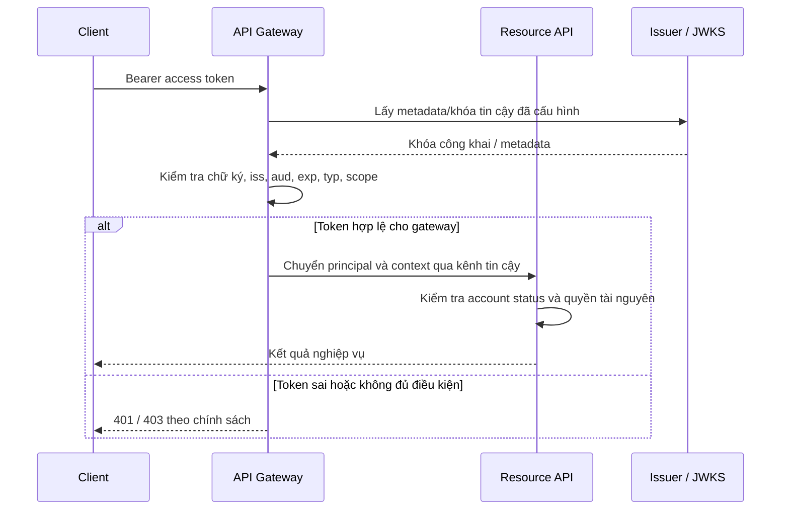
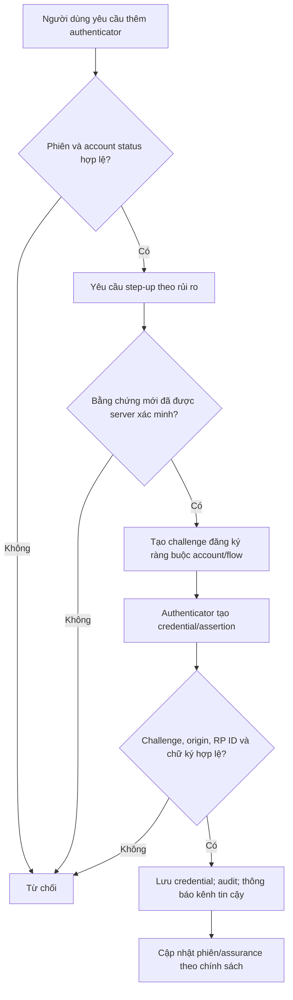

# Trust boundary bị phá vỡ trong hệ thống xác thực

## Mục tiêu học tập

Một hệ thống có thể dùng TLS, mật khẩu mạnh, MFA và JWT có chữ ký hợp lệ nhưng vẫn cho kẻ tấn công đăng nhập dưới danh tính người khác. Nguyên nhân thường nằm ở **ranh giới tin cậy (trust boundary)**: ứng dụng tin header do client tự gửi, chấp nhận claim chưa được xác minh, dùng nhầm token cho API khác, ghép bằng chứng từ hai phiên, hoặc để dịch vụ nội bộ mặc nhiên được quyền thay mặt người dùng.

**Trust boundary bị phá vỡ** khi dữ liệu, danh tính, quyền hạn hoặc trạng thái đi qua một ranh giới mà hệ thống không xác minh nguồn gốc, tính toàn vẹn, ngữ cảnh và quyền sử dụng. Một thông tin đúng về cú pháp vẫn có thể không đáng tin trong ngữ cảnh hiện tại.

Bài học thuộc chương **Trust boundary** của mô-đun **SECURITY_AUTHENTICATION_FUNDAMENTALS**. Mô-đun khảo sát credential, mật khẩu, MFA, passkey, chứng chỉ, token, phiên, liên kết danh tính và khôi phục tài khoản; tất cả đều đi qua một hoặc nhiều ranh giới tin cậy.

Sau bài học, bạn có thể:

- Xác định các vùng tin cậy và luồng dữ liệu trong kiến trúc xác thực.
- Phân biệt dữ liệu do client khai báo với danh tính và quyền đã được server xác minh.
- Nhận diện lỗi tin nhầm header proxy, JWT/claim, callback IdP, cookie, cache và thông tin tenant.
- Phân tích replay, session fixation, token substitution, confused deputy và account linking sai.
- Thiết kế kiểm tra nguồn phát hành, người nhận, chữ ký, thời hạn, nonce/challenge, trạng thái phiên và quyền truy cập tại đúng ranh giới.
- Xây dựng kiểm thử để chứng minh dữ liệu không đáng tin không thể trở thành danh tính hoặc quyền hạn.

## 1. Ranh giới tin cậy là gì?

**Trust boundary** là điểm mà tại đó dữ liệu hoặc yêu cầu đi từ một vùng có giả định bảo mật này sang vùng có giả định bảo mật khác. Ở mỗi ranh giới, hệ thống phải quyết định:

1. Ai tạo ra dữ liệu hoặc yêu cầu?
2. Dữ liệu có được bảo vệ khỏi sửa đổi và phát lại không?
3. Nó được gửi cho đúng dịch vụ, tài khoản, phiên và mục đích không?
4. Thành phần nhận có quyền tin và sử dụng dữ liệu đó không?
5. Nếu dữ liệu sai, thiếu, cũ hoặc không thể xác minh thì hệ thống xử lý thế nào?

Ranh giới có thể là mạng, tiến trình, tổ chức, tài khoản, thiết bị, giao thức hoặc quyền hạn. API gateway và service trong cùng VPC vẫn có thể là hai vùng tin cậy khác nhau nếu chúng có quyền, dữ liệu và vòng đời độc lập.

### Các ranh giới thường gặp trong xác thực

| Ranh giới | Dữ liệu đi qua | Giả định cần xác minh |
| --- | --- | --- |
| Trình duyệt/ứng dụng di động → backend | Mật khẩu, OTP, WebAuthn assertion, cookie, request body, header | Client có thể bị sửa, giả lập hoặc bị chiếm; mọi đầu vào đều cần kiểm tra |
| Internet → reverse proxy/load balancer | TLS, Host, Forwarded/X-Forwarded-* | Chỉ proxy được tin cậy mới được thiết lập thông tin nguồn và scheme cho backend |
| API gateway → dịch vụ nội bộ | Principal, token, tenant, scope, request context | Gateway xác minh token và truyền context toàn vẹn; service kiểm tra hợp đồng và quyền |
| Ứng dụng → Identity Provider (IdP) | Authorization request, redirect, code, state, nonce | OAuth/OIDC phải ràng buộc browser session, client, issuer và callback |
| IdP → relying party | ID token, access token, SAML assertion, claim | Chữ ký, issuer, audience, thời hạn, nonce và ý nghĩa claim phải được kiểm tra |
| Authenticator → verifier | OTP, chữ ký WebAuthn, chứng chỉ | Challenge/nonce mới, đúng tài khoản và giao thức, chống replay |
| Dịch vụ phiên → API | Session ID, access token, refresh token, trạng thái thu hồi | Token đúng mục đích, chưa hết hạn/thu hồi, gắn với principal và quyền |
| Dịch vụ tài khoản → dịch vụ khôi phục | Yêu cầu reset, mã khôi phục, thay authenticator | Người yêu cầu có đủ bằng chứng và không vượt qua đình chỉ |
| Service → database/cache/message queue | Account ID, role, tenant, trạng thái, sự kiện | Danh tính dịch vụ, quyền truy cập, tính nhất quán và thứ tự sự kiện |

**Không có vùng nào tự động đáng tin chỉ vì nó nằm bên trong mạng.** Dịch vụ nội bộ có thể bị cấu hình sai, bị chiếm quyền hoặc nhận dữ liệu do client điều khiển qua lớp trung gian.

### Bản đồ vùng tin cậy minh họa



Sơ đồ giúp đặt câu hỏi về nguồn gốc và quyền. Một mũi tên không có nghĩa dữ liệu trên đó được tin tự động; mỗi kết nối cần giao thức, xác thực hai đầu hoặc kiểm tra bằng chứng tương ứng.

## 2. Vì sao trust boundary bị phá vỡ?

Một ranh giới bị phá vỡ khi hệ thống **chấp nhận một khẳng định mà không kiểm tra điều kiện để tin khẳng định đó**. Các dạng lỗi phổ biến:

- **Nguồn gốc không được xác minh:** tin `X-User-Id` hoặc `X-Role` từ request do trình duyệt gửi.
- **Tính toàn vẹn không được xác minh:** decode payload JWT nhưng bỏ qua chữ ký.
- **Sai người nhận:** dùng ID token dành cho frontend như access token cho API; chấp nhận token có `aud` không phải dịch vụ hiện tại.
- **Sai mục đích:** dùng token reset mật khẩu để truy cập API nghiệp vụ hoặc dùng access token làm bằng chứng đăng nhập người dùng.
- **Sai thời điểm:** chấp nhận challenge/OTP cũ, token hết hạn hoặc phiên đã bị thu hồi.
- **Sai chủ thể:** ghép bằng chứng mật khẩu của tài khoản A với OTP của tài khoản B.
- **Sai quyền:** coi `role=admin` trong body là quyền quản trị hoặc tin rằng đăng nhập thành công đồng nghĩa được truy cập mọi tài nguyên.
- **Sai phạm vi:** xác thực một tenant nhưng dùng principal đó để đọc dữ liệu tenant khác.
- **Sai trạng thái:** dùng token cũ sau khi tài khoản bị đình chỉ, credential bị thu hồi hoặc phiên bị kết thúc.
- **Sai hợp đồng giữa dịch vụ:** gateway xác minh một điều kiện nhưng service hiểu claim khác hoặc bỏ qua kiểm tra quyền nghiệp vụ.

### Ví dụ: header giả mạo

Một endpoint nhận request có các trường:

```http
GET /api/admin/users
X-User-Id: 1007
X-Role: ADMIN
```

Nếu backend tin các header này chỉ vì request đến từ trình duyệt hoặc mạng nội bộ, người dùng có thể sửa request để tự nhận quyền quản trị. Header là dữ liệu đầu vào; **tên header không làm nó trở thành bằng chứng danh tính**.

Nếu kiến trúc dùng gateway để thêm header principal, gateway phải xóa header cùng tên do client gửi, xác thực kết nối tới backend, chỉ cho phép đường mạng từ gateway và truyền context có tính toàn vẹn. Dịch vụ đích phải biết chính xác thành phần nào được phép thiết lập header đó.

## 3. Tin nhầm client và các header proxy

### 3.1. Client không phải nguồn thẩm quyền về danh tính

Các giá trị sau không được dùng trực tiếp làm bằng chứng xác thực hoặc phân quyền:

- `userId`, `accountId`, `tenantId` trong query/body.
- `isAuthenticated`, `mfa=true`, `assuranceLevel=high` do client gửi.
- `role`, `isAdmin`, `permissions` trong local storage hoặc JSON.
- Địa chỉ email hiển thị, tên người dùng hoặc avatar.
- User-Agent, IP hay dấu vân tay thiết bị như một yếu tố xác thực.

Client có thể gửi **đối tượng mà nó muốn thao tác**; backend phải lấy chủ thể từ phiên/token đã xác minh, sau đó kiểm tra chủ thể đó có quyền trên đối tượng được yêu cầu hay không.

Ví dụ: request `GET /accounts/2002/profile` có thể được gửi bởi phiên của account 1001. Backend phải kiểm tra quyền truy cập account 2002. Không được thay `principal.accountId` bằng ID trong URL rồi coi đó là cùng người dùng.

### 3.2. Reverse proxy và forwarded headers

Sau khi TLS kết thúc tại reverse proxy, backend có thể nhận kết nối HTTP nội bộ. Một số hệ thống dùng `Forwarded`, `X-Forwarded-For`, `X-Forwarded-Host` hoặc `X-Forwarded-Proto` để biết IP/scheme/host ban đầu.

Rủi ro xuất hiện khi backend tin mọi giá trị do request cung cấp. Kẻ tấn công có thể tự đặt `X-Forwarded-Proto: https`, giả host hoặc giả IP để tác động vào redirect, cookie, allowlist, audit log và logic chống gian lận.

Thiết kế an toàn:

1. Chỉ chấp nhận forwarded header từ **proxy có danh tính/địa chỉ được cấu hình tin cậy**.
2. Proxy biên phải xóa hoặc ghi đè header forwarded do client tự gửi, không nối mù quáng.
3. Cấu hình đúng số hop tin cậy; không lấy phần tử đầu/cuối tùy tiện khi chuỗi có thể bị chèn.
4. Backend phải có đường kết nối chỉ từ proxy hoặc dùng xác thực service-to-service (ví dụ mTLS).
5. Không dùng IP/host forwarded như bằng chứng duy nhất để cấp quyền hoặc bỏ MFA.
6. Dùng host allowlist cho redirect/callback; không tạo redirect URL từ Host chưa xác minh.

**TLS tại proxy không làm backend tự động biết request ban đầu đáng tin.** Cần ràng buộc proxy–backend và chính sách dữ liệu được chuyển tiếp.

## 4. Xác minh token và assertion tại đúng ranh giới

JWT là định dạng đóng gói claim; **decode thành công không đồng nghĩa xác minh thành công**. Nếu backend chỉ base64-decode payload rồi đọc `sub` hoặc `role`, attacker có thể tự tạo token với nội dung tùy ý.

### Các kiểm tra cốt lõi với token

Với access token dạng JWT, resource server cần xác minh theo hợp đồng của issuer:

- **Chữ ký:** dùng khóa tin cậy lấy từ issuer/metadata đã cấu hình; không tin khóa hoặc `jku`/`x5u` tùy tiện từ token.
- **Thuật toán:** allowlist thuật toán phù hợp; không để header token tự chọn thuật toán yếu hoặc `none`.
- **Issuer (`iss`):** phải đúng nhà phát hành đã cấu hình.
- **Audience (`aud`):** phải bao gồm chính API/resource server đang xử lý.
- **Thời hạn (`exp`, `nbf`, có thể `iat`):** kiểm tra thời gian và clock skew có giới hạn.
- **Loại token và mục đích:** phân biệt access token, ID token, refresh token, token reset và token trao quyền khác.
- **Scope/authorization:** claim scope phải được ánh xạ đúng quyền; vẫn kiểm tra quyền trên tài nguyên cụ thể.
- **Trạng thái thu hồi/phiên/tài khoản:** JWT còn hạn có thể đã bị thu hồi hoặc tài khoản đã bị đình chỉ.
- **Ràng buộc phiên bản/nonce:** áp dụng khi giao thức và kiến trúc yêu cầu; ID token trong OIDC phải được kiểm tra nonce nếu request đã gửi nonce.

Không phải mọi claim đều xuất hiện trong mọi token. Chính sách phải dựa vào chuẩn và hợp đồng của issuer, không yêu cầu mù quáng một claim rồi tự giả định ý nghĩa của nó.

### ID token không phải access token

Trong OpenID Connect:

- **ID token** cho client biết kết quả xác thực người dùng theo hợp đồng OIDC.
- **Access token** cấp quyền truy cập resource server theo scope/audience được quy định.
- **Refresh token** được dùng với authorization server để lấy token mới, chịu ràng buộc client và chính sách vòng đời.

Dùng ID token để gọi API có thể gây nhầm mục đích và người nhận. Resource server chỉ chấp nhận token được phát hành cho API đó theo hợp đồng, không phải bất kỳ JWT có chữ ký hợp lệ nào.

### Quy trình xác minh ở ranh giới



Nếu gateway xác minh token thay service, cần thiết kế ranh giới gateway–service: backend chỉ nhận request từ gateway đã xác thực, header giả mạo bị xóa, principal được truyền có tính toàn vẹn và các service vẫn kiểm tra quyền nghiệp vụ cần thiết. Không nên để dịch vụ khác gọi trực tiếp backend bằng header principal tự tạo.

## 5. OAuth/OIDC và ranh giới giữa các bên

Luồng liên kết danh tính có nhiều bên: browser/client, authorization server/IdP và relying party (ứng dụng). Một callback hợp lệ về cú pháp chưa chắc thuộc phiên đăng nhập do chính người dùng khởi tạo.

### Những lỗi ranh giới hay gặp

- **Thiếu `state` hoặc không kiểm tra state:** có thể dẫn đến login CSRF hoặc ghép callback vào phiên khác.
- **Thiếu nonce hoặc không xác minh nonce trong ID token:** có thể chấp nhận ID token cũ hoặc không thuộc authentication request hiện tại.
- **Redirect URI quá rộng:** attacker điều khiển nơi authorization code/token được gửi.
- **Không kiểm tra issuer:** nhầm authorization server hoặc bị issuer mix-up trong môi trường nhiều IdP.
- **Không kiểm tra audience/client ID:** token được phát hành cho client khác nhưng bị chấp nhận.
- **Authorization code bị phát lại hoặc chặn:** không dùng PKCE đúng cách, code không được ràng buộc với client/redirect.
- **Tự liên kết tài khoản theo email:** hai issuer hoặc hai tài khoản có email trùng có thể bị gộp sai.

### Các kiểm soát thiết yếu

1. Dùng Authorization Code Flow với PKCE cho public clients và theo khuyến nghị hiện hành của giao thức.
2. Tạo `state` ngẫu nhiên, khó đoán, ràng buộc với browser session và kiểm tra một lần tại callback.
3. Tạo và xác minh `nonce` trong ID token theo luồng OIDC.
4. Đăng ký redirect URI chính xác; tránh wildcard rộng và tránh xây dựng redirect từ host do client cung cấp.
5. Xác minh issuer, audience, chữ ký, thời hạn và các claim bắt buộc theo hợp đồng.
6. Chỉ liên kết tài khoản sau khi người dùng đã xác thực với cả danh tính hiện tại và danh tính mới theo chính sách.
7. Dùng cặp định danh ổn định `(iss, sub)` để nhận diện principal liên kết; email là thuộc tính có thể thay đổi và có thể không duy nhất.
8. Khi có nhiều IdP, ràng buộc authorization response với issuer đã chọn và client configuration tương ứng.

### Ví dụ account linking sai

Ứng dụng có tài khoản nội bộ `user-17` với email `alex@example.test`. Một IdP ngoài trả về cùng email cho một tài khoản khác. Nếu ứng dụng tự động liên kết chỉ dựa trên email, người kiểm soát tài khoản ngoài có thể được nối vào tài khoản nội bộ vốn thuộc người khác.

Cách xử lý: xác minh token từ issuer đáng tin, kiểm tra `email_verified` theo hợp đồng của IdP nhưng không coi nó thay thế bước liên kết có chủ ý, xác thực người dùng đang sở hữu tài khoản nội bộ, rồi ghi liên kết theo `(issuer, subject)` và audit event. Khi email thay đổi, liên kết không tự chuyển sang chủ thể khác.

## 6. Ranh giới giữa authenticator và verifier: chống replay và ghép sai bằng chứng

MFA có thể bị phá vỡ nếu hệ thống chỉ kiểm tra “một mật khẩu đúng” và “một OTP đúng” mà không ràng buộc chúng vào **cùng tài khoản, cùng luồng, cùng mục đích và thời điểm hợp lệ**.

### Challenge–response phải gắn với ngữ cảnh

Với WebAuthn/passkey, server tạo challenge mới, khó đoán, giới hạn thời gian và gắn với flow đăng nhập. Khi nhận assertion, verifier kiểm tra chữ ký, challenge, origin, RP ID và cờ user presence/user verification theo chính sách. Không chấp nhận assertion cũ hoặc assertion cho RP khác.

Với OTP:

- TOTP được kiểm tra theo secret đã gắn với đúng tài khoản, cửa sổ thời gian được giới hạn và chống thử đoán.
- HOTP cần quản lý counter và chống chấp nhận lại counter đã dùng.
- OTP qua SMS/email cần gắn purpose, account, flow và thời hạn; giới hạn số lần thử và dùng một lần.
- Mã reset mật khẩu không được dùng làm OTP đăng nhập hoặc làm bằng chứng step-up cho mục đích khác.

### Ghép bằng chứng từ hai phiên là lỗi trust boundary

Ví dụ: attacker có mật khẩu của tài khoản A, còn mã OTP hợp lệ của tài khoản B. Nếu server lưu `passwordVerified=true` ở session chung rồi nhận OTP mà không gắn account/flow, hai kết quả có thể bị ghép thành một lần MFA giả.

Mỗi bằng chứng cần gắn tối thiểu với:

- `accountId` hoặc principal đã xác định ở phía server.
- `flowId`/transaction ID do server tạo.
- Mục đích: login, step-up, reset, enrollment hay giao dịch.
- Thời điểm xác minh và thời hạn hiệu lực.
- Verifier và phương thức đã kiểm tra.
- Trạng thái đã dùng/đã tiêu thụ nếu bằng chứng chỉ được dùng một lần.

### Replay không chỉ xảy ra với OTP

Replay có thể xuất hiện với authorization code, assertion, reset link, signed request, session cookie hoặc webhook. Mỗi loại cần cơ chế phù hợp: nonce/challenge, one-time code, idempotency key, counter, timestamp có giới hạn, token rotation hoặc replay detection. Một chữ ký hợp lệ trên thông điệp cũ không chứng minh thông điệp đó còn được phép sử dụng ở hiện tại.

## 7. Session và token: ranh giới giữa đăng nhập và truy cập tiếp diễn

Sau khi đăng nhập, hệ thống thường chuyển kết quả xác thực thành session cookie hoặc token. Đây là ranh giới quan trọng: **bằng chứng xác thực ban đầu được chuyển thành quyền sử dụng phiên**.

### Session cookie

Cookie session cần được bảo vệ bằng cấu hình phù hợp:

- `Secure` để chỉ gửi qua HTTPS.
- `HttpOnly` để JavaScript không đọc trực tiếp cookie.
- `SameSite` phù hợp luồng điều hướng/SSO và kiểm soát CSRF bổ sung khi cần.
- Session ID đủ ngẫu nhiên, xoay sau đăng nhập và khi nâng mức xác thực.
- Giới hạn idle timeout và absolute lifetime theo rủi ro.
- Thu hồi tại server khi logout, thay credential, nghi ngờ chiếm đoạt hoặc đình chỉ tài khoản.

Không đưa session ID vào URL hoặc log. Không giữ session ID do client tự chọn trước đăng nhập (session fixation). `SameSite` là một lớp bảo vệ, không thay thế mọi kiểm soát CSRF và kiểm tra quyền.

### Access token và refresh token

Access token phải có audience/scope phù hợp, thời hạn và khả năng thu hồi theo kiến trúc. Refresh token có quyền cấp token mới nên cần bảo vệ chặt hơn: lưu an toàn, ràng buộc client khi phù hợp, rotation và phát hiện reuse theo thiết kế. Khi refresh token cũ bị dùng lại sau rotation, hệ thống có thể phải thu hồi token family và yêu cầu xác thực lại.

### Token hợp lệ vẫn có thể không còn quyền

Một JWT có chữ ký đúng và chưa hết `exp` có thể vẫn phải bị từ chối nếu:

- Account đã `SUSPENDED` hoặc `DELETED`.
- Session bị logout/thu hồi.
- Authenticator bị báo mất hoặc bị thu hồi.
- Tenant membership đã bị gỡ.
- Quyền trên tài nguyên đã thay đổi.
- Có security hold hoặc tín hiệu takeover nghiêm trọng.

Có thể kiểm tra trạng thái server-side, dùng session version/auth epoch, denylist có thời hạn hoặc chiến lược thu hồi tương đương. Nếu cache trạng thái, cần xác định độ trễ tối đa và xử lý fail closed cho thao tác rủi ro cao. Giảm TTL token chỉ giới hạn cửa sổ, không thay thế yêu cầu thu hồi tức thời khi nghiệp vụ cần.

## 8. Trust boundary trong hệ thống nhiều dịch vụ và đa tenant

### 8.1. Confused deputy: dịch vụ có quyền bị dùng sai mục đích

Một service có quyền đọc dữ liệu nhạy cảm có thể bị biến thành “đại diện nhầm” nếu nhận yêu cầu từ service khác mà không kiểm tra **ai là người dùng cuối, service gọi là ai và quyền nào được ủy quyền**.

Ví dụ: `report-service` có quyền đọc báo cáo mọi phòng ban. `profile-service` gửi `userId` do client cung cấp và report-service tin nó. Kẻ tấn công có thể yêu cầu profile-service truy vấn dữ liệu thay cho mình, khiến một service hợp lệ dùng quyền rộng để phục vụ yêu cầu không hợp lệ.

Cần phân biệt:

- **Service identity:** dịch vụ gọi là thành phần nào (mTLS/workload identity).
- **End-user identity:** người dùng cuối là ai theo phiên/token đã xác minh.
- **Delegated authority:** service được phép làm gì thay mặt người dùng, trong phạm vi nào.
- **Resource authorization:** principal có quyền trên đối tượng cụ thể không.

Không suy ra “service nội bộ gọi” đồng nghĩa “người dùng có quyền”. Dùng token audience/scope hẹp, delegation rõ ràng và kiểm tra quyền ở dịch vụ sở hữu tài nguyên.

### 8.2. Tenant boundary

Trong SaaS đa tenant, `tenantId` là một phần của ranh giới bảo mật. Lỗi thường gặp là backend lấy tenant từ body/query hoặc chỉ kiểm tra người dùng có đăng nhập mà quên kiểm tra membership.

Một quyết định đúng cần xác định tenant từ context được xác minh, kiểm tra principal có membership còn hiệu lực, rồi kiểm tra quyền trên resource thuộc tenant đó. Query database cũng phải ràng buộc tenant, tránh chỉ truy vấn theo `resourceId` toàn cục nếu ID có thể bị đoán hoặc lộ.

Ví dụ, user A thuộc tenant 10 gửi `GET /tenants/20/invoices/900`. Backend không được coi token hợp lệ là đủ; phải kiểm tra membership tenant 20 và quyền trên invoice 900. Nếu không, đây là lỗi IDOR/BOLA và phá vỡ ranh giới tenant.

### 8.3. Cache và message queue cũng là ranh giới

Cache có thể trả dữ liệu đã xác thực cho sai người nếu key thiếu `tenantId`, `subject`, scope hoặc phiên bản quyền. Message queue có thể nhận event giả nếu publisher không được xác thực hoặc consumer không kiểm tra schema, nguồn và thứ tự sự kiện.

Kiểm soát:

- Key cache phải chứa các chiều phân vùng bảo mật cần thiết; không cache phản hồi nhạy cảm chỉ theo URL.
- Quyền truy cập queue/topic được cấp tối thiểu cho producer/consumer.
- Event nhạy cảm có schema/version, event ID, source identity và cơ chế idempotency.
- Consumer xác minh event đến từ publisher được phép; không nhận `accountStatus=ACTIVE` từ nguồn không có thẩm quyền.
- Event đến muộn hoặc lặp lại không được ghi đè trạng thái mới hơn; dùng version/sequence hoặc quy tắc đồng bộ.
- Khi quyền bị thu hồi, cache và downstream service phải được invalidation trong thời hạn chính sách.

## 9. Trust boundary trong enrollment và account recovery

Luồng thêm authenticator hoặc khôi phục tài khoản thường có quyền thay đổi những bằng chứng sẽ được tin cậy về sau. Nếu nó yếu hơn đăng nhập chính, kẻ tấn công sẽ chọn đường này.

### Thêm authenticator mới

Một phiên đăng nhập còn hiệu lực không tự đủ để thêm passkey hoặc thay số điện thoại khôi phục. Hệ thống nên:

1. Xác minh session và account status.
2. Yêu cầu xác thực lại gần thời điểm thao tác theo mức rủi ro; ưu tiên phương thức chống phishing khi cần.
3. Tạo challenge đăng ký mới, ràng buộc đúng account và flow.
4. Kiểm tra attestation/authenticator properties theo chính sách nếu hệ thống có yêu cầu; không thu thập hoặc tin metadata không cần thiết.
5. Chỉ lưu public key/credential metadata cần thiết; không lưu private key của passkey.
6. Thông báo qua kênh đã tin cậy và ghi audit event.
7. Khi gỡ yếu tố cuối cùng hoặc thay kênh recovery, áp dụng quy trình mạnh hơn và có thể trì hoãn/hạn chế hành động nhạy cảm.

### Khôi phục tài khoản

Email hoặc SMS có thể là kênh liên lạc hữu ích nhưng không mặc nhiên có cùng mức bảo đảm với passkey hoặc khóa bảo mật. Quy trình recovery cần:

- Mã/token ngẫu nhiên, hết hạn, một lần và gắn purpose/account.
- Giới hạn thử, chống enumeration và ghi nhận bất thường.
- Xác minh người yêu cầu bằng tín hiệu độc lập phù hợp; không dùng lại chính kênh đã bị nghi ngờ chiếm làm bằng chứng duy nhất.
- Thông báo tới kênh cũ khi thay đổi credential/khôi phục.
- Thu hồi phiên/token cũ và đánh giá authenticator đã mất an toàn.
- Áp dụng hạn chế sau khôi phục với thao tác có hậu quả cao nếu bằng chứng recovery yếu hơn.
- Không tự chuyển `SUSPENDED` về `ACTIVE` chỉ vì reset password thành công.

### Sơ đồ luồng enrollment an toàn



## 10. Ví dụ Java: không tin principal từ request

Ví dụ dưới đây minh họa **ranh giới giữa HTTP request và logic nghiệp vụ**. Thành phần xác thực phải tạo `VerifiedPrincipal` sau khi kiểm tra token/session. Controller không được lấy `userId`, `role` hay `tenantId` từ body để thay principal.

```java
import java.util.Set;
import java.util.UUID;

record VerifiedPrincipal(
        UUID subjectId,
        UUID tenantId,
        Set<String> authorities,
        boolean authenticated,
        boolean activeAccount
) {}

record ProfileRequest(UUID targetUserId) {}

record Profile(UUID userId, String displayName) {}

interface ProfileRepository {
    Profile findByTenantAndUser(UUID tenantId, UUID userId);
}

class ProfileService {
    private final ProfileRepository repository;

    ProfileService(ProfileRepository repository) {
        this.repository = repository;
    }

    Profile readProfile(
            VerifiedPrincipal principal,
            ProfileRequest request) {

        if (principal == null
                || !principal.authenticated()
                || !principal.activeAccount()) {
            throw new SecurityException("Authentication required");
        }

        boolean self = principal.subjectId().equals(request.targetUserId());
        boolean admin = principal.authorities().contains("PROFILE_READ_ANY");

        if (!self && !admin) {
            throw new SecurityException("Access denied");
        }

        // Tenant lấy từ principal đã xác minh, không lấy từ request.
        Profile profile = repository.findByTenantAndUser(
                principal.tenantId(),
                request.targetUserId()
        );

        if (profile == null) {
            throw new SecurityException("Resource unavailable");
        }

        return profile;
    }
}
```

Đây là ví dụ chính sách đơn giản; hệ thống thực tế còn cần kiểm tra membership tenant, quyền quản trị trong đúng tenant, trạng thái tài nguyên, kiểm soát lỗi và audit. `VerifiedPrincipal` phải được tạo bởi middleware/service xác minh token hoặc session, không được bind trực tiếp từ JSON. Repository cần ràng buộc tenant trong truy vấn; không dựa vào việc ID người dùng khó đoán.

### Ví dụ về xác minh JWT: dùng thư viện và cấu hình tin cậy

Không nên tự viết thuật toán xác minh chữ ký JWT. Dùng thư viện chuẩn, cấu hình issuer và khóa tin cậy từ nguồn được quản trị, rồi áp dụng validator theo hợp đồng API.

Pseudo-code Java:

```java
// PSEUDOCODE: API cụ thể tùy thư viện JWT/OIDC đang dùng.
VerifiedPrincipal authenticate(String bearerToken) {
    Jwt jwt = jwtVerifier
        .trustedIssuer("https://id.example.test")
        .trustedAudience("https://api.example.test")
        .allowedAlgorithms(Set.of("ES256"))
        .verifySignatureAndClaims(bearerToken);

    require(jwt.notExpired());
    require(jwt.notBeforeSatisfied());
    require(jwt.typeIs("at+jwt")); // Nếu profile token quy định typ này.
    require(jwt.hasRequiredScope("profile:read"));

    Account account = accountRepository.find(jwt.subject());
    require(account != null && account.status() == ACTIVE);

    return principalFactory.fromVerifiedJwt(jwt, account);
}
```

Đây là pseudo-code mô tả thứ tự và hợp đồng, **không phải API Java có thể biên dịch**. Tên phương thức, token type và thuật toán phải theo profile/issuer thật. Một số JWT access token không dùng `typ=at+jwt`; không áp đặt claim đó nếu hợp đồng không yêu cầu. Quan trọng là kiểm tra chữ ký, issuer, audience, thời hạn, mục đích, scope, trạng thái tài khoản và phiên theo đúng giao thức.

## 11. Kiểm thử ranh giới tin cậy

Một kiểm thử tốt phải chứng minh **đầu vào giả mạo hoặc ngữ cảnh sai không thể biến thành principal/quyền hợp lệ**. Không chỉ kiểm thử trường hợp token đúng.

| Ca kiểm thử | Đầu vào/thao tác | Kết quả mong đợi |
| --- | --- | --- |
| Header giả principal | Client gửi `X-User-Id` và `X-Role: ADMIN` | Bị bỏ qua/xóa; principal đến từ session/token đã xác minh |
| JWT payload bị sửa | Đổi `sub`/`role` nhưng giữ chữ ký cũ | Từ chối chữ ký |
| Token sai issuer | JWT có chữ ký từ issuer khác | Từ chối |
| Token sai audience | Access token dành cho API khác | Từ chối |
| ID token dùng gọi API | Gửi ID token thay access token | Từ chối sai mục đích/audience |
| Token hết hạn hoặc chưa đến `nbf` | Dùng token ngoài thời gian hiệu lực | Từ chối |
| Token đã thu hồi | JWT còn `exp` nhưng session/auth epoch bị thu hồi | Từ chối theo chính sách thu hồi |
| Header forwarded giả | Client tự đặt `X-Forwarded-Proto/For/Host` | Proxy xóa/ghi đè; backend chỉ tin proxy được cấu hình |
| OAuth callback sai state | Callback không khớp browser session | Từ chối |
| OIDC nonce sai | ID token nonce không khớp request | Từ chối |
| Redirect URI không đăng ký | Authorization response về host khác | Từ chối |
| Account linking theo email | Email giống nhưng `(iss, sub)` khác | Không tự liên kết |
| OTP sai account/flow | Mật khẩu của A, OTP của B hoặc flow khác | Không ghép thành MFA |
| Challenge WebAuthn cũ | Assertion dùng challenge đã tiêu thụ/hết hạn | Từ chối replay |
| Tenant ID do client sửa | User tenant 10 yêu cầu tenant 20 | Kiểm tra membership và quyền; từ chối nếu không có quyền |
| IDOR/BOLA | Principal A đọc resource B chỉ bằng cách đổi resource ID | Từ chối |
| Service confused deputy | Service nội bộ gọi thay người dùng nhưng không có delegation | Từ chối |
| Cache key thiếu tenant | Cùng URL nhưng tenant khác | Không trả dữ liệu cache chéo tenant |
| Recovery sau đình chỉ | Reset password thành công cho account `SUSPENDED` | Không tự kích hoạt; áp dụng chính sách recovery |
| Event đến muộn | Event `ACTIVE` cũ đến sau event `SUSPENDED` mới | Không ghi đè phiên bản mới hơn |

### Kiểm thử tích hợp và vận hành

- Dùng môi trường staging với issuer/keys riêng; không chép token hoặc secret thật vào test fixture.
- Kiểm tra cả đường trực tiếp đến service và đường qua gateway; service phải từ chối kết nối không đúng ranh giới.
- Kiểm thử rotation JWKS, key ID không tồn tại, cache khóa lỗi và issuer mất kết nối.
- Kiểm tra clock skew, thời điểm token/challenge, callback lặp và event bất đồng bộ.
- Kiểm tra race condition: hai thao tác cùng lúc thêm credential và đình chỉ tài khoản; cập nhật trạng thái cần version/transaction phù hợp.
- Kiểm tra log/audit không chứa mật khẩu, OTP, seed TOTP, private key, session ID hoặc bearer token.
- Theo dõi số lần token bị từ chối theo lý do, callback state/nonce sai, replay, thay đổi credential bất thường, cross-tenant denial và độ trễ thu hồi.

## 12. Checklist thiết kế trust boundary

Trước khi triển khai một luồng xác thực hoặc tích hợp dịch vụ mới, hãy trả lời:

1. **Sơ đồ:** Các vùng tin cậy, thành phần, luồng dữ liệu và điểm kết thúc TLS nằm ở đâu?
2. **Nguồn:** Ai có quyền tạo mỗi claim/header/event? Client có thể tự gửi cùng tên trường không?
3. **Toàn vẹn:** Dữ liệu được bảo vệ bằng TLS, chữ ký, MAC, mTLS hay cơ chế nào? Khóa được quản lý ra sao?
4. **Người nhận/mục đích:** Token, assertion, code, cookie và challenge được phát hành cho đúng client, API, account, flow và purpose chưa?
5. **Thời gian/replay:** Có hạn dùng, nonce/challenge, one-time use, rotation hoặc replay detection không?
6. **Principal:** Danh tính người dùng được lấy từ verifier/session nào? Có bị thay bằng ID trong URL/body/header không?
7. **Quyền:** Service identity và end-user identity có được tách? Delegation, tenant membership và quyền resource có kiểm tra không?
8. **Trạng thái:** Account, session, credential và tenant membership có thể bị thu hồi? Cache/downstream có nhận cập nhật đúng hạn không?
9. **Recovery/enrollment:** Đường thêm hoặc khôi phục yếu tố có thể vượt qua luồng xác thực mạnh không?
10. **Lỗi:** Khi issuer, JWKS, cache hoặc service xác minh không sẵn sàng, hệ thống có fail closed phù hợp với rủi ro không?
11. **Kiểm thử:** Có test token sai issuer/audience, header giả, replay, cross-tenant, callback sai state/nonce và event đến muộn không?
12. **Quan sát:** Audit log ghi được chủ thể, nguồn, lý do và correlation ID mà không làm lộ bí mật không?

## 13. Bài tập vận dụng

Một ứng dụng doanh nghiệp có kiến trúc:

- Trình duyệt gửi JWT đến API gateway.
- Gateway decode JWT, lấy `sub`, `role`, `tenantId`, rồi chuyển tiếp bằng ba header `X-User-Id`, `X-Role`, `X-Tenant`.
- Các microservice tin mọi request từ mạng nội bộ.
- Ứng dụng đăng nhập SSO qua hai IdP, tự động liên kết tài khoản theo email.
- Access token có thời hạn 60 phút; khi quản trị viên đình chỉ tài khoản, database đổi trạng thái nhưng các service không kiểm tra lại.
- Khi mất MFA, người dùng chỉ cần nhấn liên kết gửi qua email để gỡ yếu tố.

**Yêu cầu:**

1. Vẽ các trust boundary trong kiến trúc và chỉ ra ít nhất sáu giả định tin cậy sai.
2. Phân loại rủi ro của JWT decode không verify, header principal, issuer/audience, account linking theo email và token cũ.
3. Đề xuất giao thức gateway–service: xác thực service, bảo vệ context principal, kiểm tra quyền tài nguyên và tenant.
4. Thiết kế lại OIDC cho nhiều IdP, bao gồm state, nonce, PKCE, redirect URI, issuer và khóa định danh `(iss, sub)`.
5. Sửa luồng đình chỉ và khôi phục: thu hồi phiên/token, hạ mức assurance sau recovery, không tự gỡ trạng thái đình chỉ.
6. Viết ít nhất năm test âm tính để chứng minh header/token/callback/tenant giả không vượt qua ranh giới.

**Gợi ý tự đánh giá:** Không một dữ liệu client tự khai báo nào được trở thành principal có quyền; một token có chữ ký đúng vẫn phải đúng issuer, audience, purpose, thời hạn và trạng thái; một service nội bộ vẫn phải xác minh quyền được ủy quyền; một phiên còn hạn vẫn có thể bị thu hồi; và khôi phục không được tạo đường vòng yếu hơn chính sách chính.

---

**Điểm cần nhớ:** Trust boundary không được bảo vệ chỉ bằng cách đặt các service trong mạng nội bộ hoặc dùng JWT có chữ ký. Ở mỗi ranh giới, hệ thống phải xác minh **nguồn gốc, tính toàn vẹn, người nhận, mục đích, thời điểm, chủ thể và quyền**. Khi bất kỳ điều kiện nào không xác minh được, không được biến dữ liệu chưa tin cậy thành danh tính hoặc quyền truy cập.
