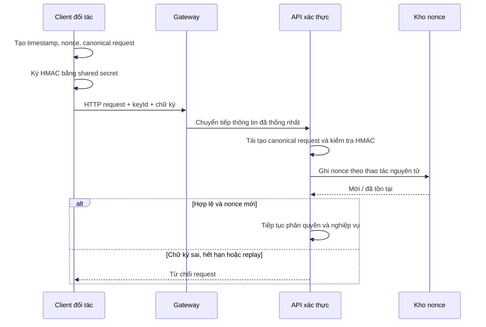

# Bài toán xác thực request

## 1. Vì sao API cần xác thực từng HTTP request?

Giả sử hệ thống thương mại điện tử cho phép một đối tác gửi yêu cầu tạo thanh toán qua `POST /v1/payments`. Đối tác gửi mã đơn hàng, số tiền và loại tiền; hệ thống nhận yêu cầu rồi tạo một giao dịch thật. Trước khi xử lý, máy chủ phải trả lời được những câu hỏi:

1. **Ai đang gửi request?** Có thực sự là ứng dụng đối tác đã đăng ký hay chỉ là người biết địa chỉ API?
2. **Nội dung có còn nguyên vẹn?** Phương thức HTTP, đường dẫn, tham số, header quan trọng và body có đúng những gì bên gửi đã ký hay không?
3. **Đây có phải request mới?** Một bản sao của request hợp lệ trước đó có đang được gửi lại để tạo thêm giao dịch không?
4. **Bên gửi có được phép thực hiện thao tác?** Một đối tác đã xác thực có quyền tạo thanh toán cho merchant này hay không?

Câu hỏi thứ nhất là **xác thực** (*authentication*). Câu hỏi thứ hai là **kiểm tra tính toàn vẹn** (*integrity*). Câu hỏi thứ ba liên quan đến **chống phát lại** (*anti-replay*). Câu hỏi thứ tư là **phân quyền** (*authorization*). Chúng có liên quan nhưng là những kiểm tra khác nhau.

Trong mô-đun **`SECURITY_AUTHENTICATION_HMAC_REQUEST_AUTHENTICATION`**, ta thiết kế xác thực HTTP request bằng **HMAC với shared secret**. Máy khách và máy chủ cùng biết một khóa bí mật; máy khách tạo chữ ký trên một biểu diễn thống nhất của request (*canonical request*), còn máy chủ tái tạo biểu diễn đó để kiểm tra chữ ký. Hợp đồng ký phải xác định chính xác những thành phần nào của HTTP request được bảo vệ, đồng thời có cách xử lý timestamp, nonce, xoay vòng khóa và các thay đổi do proxy/gateway gây ra.

## 2. Bối cảnh và mô hình đe dọa

### 2.1. Các bên tham gia

| Thành phần | Vai trò |
| --- | --- |
| Client hoặc dịch vụ đối tác | Tạo request và chữ ký từ khóa bí mật được cấp |
| Reverse proxy / API gateway | Nhận, chuyển tiếp hoặc xác thực request; có thể biến đổi đường dẫn, header hay cách biểu diễn body |
| Dịch vụ API | Tái tạo canonical request, xác minh chữ ký, kiểm tra replay và quyết định xử lý nghiệp vụ |
| Kho khóa | Ánh xạ danh tính client và `keyId` đến secret đang còn hiệu lực |
| Kho nonce | Ghi nhận nonce đã sử dụng để chặn request bị gửi lại trong khoảng thời gian cho phép |



Sơ đồ là luồng logic. Trên thực tế, API phải kiểm tra định dạng, timestamp và chữ ký hợp lệ **trước khi chấp nhận nonce** để tránh người chưa xác thực chiếm dụng nonce của client khác.

### 2.2. Kẻ tấn công có thể làm gì?

Xét các tình huống thực tế sau:

- Một người không có secret tự tạo `POST /v1/payments` hoặc thay đổi số tiền trong body của một request đã quan sát được.
- Một request hợp lệ bị lộ qua log, thiết bị trung gian bị xâm nhập hoặc thiết lập vận hành sai, sau đó bị gửi lại nhiều lần.
- Kẻ tấn công đổi `POST` thành `DELETE`, thay đổi query `merchantId`, hoặc thay một header có ảnh hưởng đến cách máy chủ xử lý.
- Một thành phần trung gian chuẩn hóa URL, sắp xếp lại query, giải nén body hoặc sửa `Host`; client và server có thể tính chữ ký trên những dữ liệu khác nhau.
- Một secret cũ bị lộ, hoặc client tiếp tục dùng khóa đã bị thu hồi.

**TLS/HTTPS vẫn là bắt buộc.** TLS bảo vệ kênh truyền, nhưng chỉ riêng TLS không chứng minh request đến từ *ứng dụng đối tác cụ thể* khi nhiều ứng dụng cùng có thể kết nối đến endpoint công khai. HMAC cung cấp cơ chế xác thực ở tầng ứng dụng dựa trên việc nắm giữ shared secret; nó cũng không thay thế TLS hay biện pháp bảo mật secret.

## 3. HMAC giải quyết phần nào của bài toán?

**HMAC** (*Hash-based Message Authentication Code*) là mã xác thực thông điệp sử dụng một khóa bí mật và hàm băm mật mã, thường là HMAC-SHA-256. Với cùng khóa và cùng thông điệp, hai phía tính ra cùng một giá trị:

```text
signature = Base64(HMAC-SHA256(secret, UTF8(canonicalRequest)))
```

Đây là **ví dụ về hợp đồng ký**, không phải quy tắc áp dụng cho mọi API: cách mã hóa chữ ký có thể là Base64 hoặc hexadecimal; đối tác và máy chủ phải thống nhất trước. Chữ ký chỉ có ý nghĩa khi cả hai bên tạo ra **chính xác cùng dãy byte của canonical request**.

Máy khách gửi chữ ký kèm request và `keyId` để máy chủ tìm khóa phù hợp. Máy chủ tính lại HMAC từ nội dung request nhận được, sau đó so sánh hai giá trị theo cách giảm rò rỉ thời gian (*constant-time comparison*). **Secret không xuất hiện trong HTTP request**; chỉ các bằng chứng tính từ secret mới được truyền đi.

| Nhu cầu | HMAC có đáp ứng không? | Điều kiện / giới hạn |
| --- | --- | --- |
| Chứng minh bên gửi biết shared secret | Có | Secret phải được giữ an toàn và ánh xạ đúng với client |
| Phát hiện sửa đổi dữ liệu | Có | Chỉ với những phần thực sự được đưa vào dữ liệu ký |
| Ngăn phát lại request hợp lệ | Không, nếu chỉ dùng chữ ký | Phải bổ sung timestamp, nonce và lưu vết chống replay |
| Che giấu body, query hoặc header | Không | Dùng TLS để bảo vệ dữ liệu khi truyền |
| Phân quyền thao tác theo client, merchant, tài nguyên | Không | API phải kiểm tra quyền sau xác thực |
| Chứng minh không thể chối bỏ trước bên thứ ba | Không | Cả client và server cùng biết secret nên đều có thể tạo HMAC |
| Chống client hợp lệ cố ý gửi nghiệp vụ sai | Không | Cần xác thực dữ liệu, quy tắc nghiệp vụ và kiểm soát rủi ro riêng |

Điểm khác biệt cơ bản so với API key truyền dưới dạng bearer token: với một thiết kế HMAC, **khóa bí mật không cần gửi trên từng request**, và chữ ký ràng buộc với dữ liệu đã chọn để ký. Tuy vậy, nếu secret đã lộ, kẻ tấn công vẫn có thể ký request mới; HMAC không tự giải quyết việc quản lý khóa.

## 4. Vấn đề cốt lõi: phải ký chính xác cái gì?

Nếu client chỉ ký body nhưng server xử lý dựa trên cả method, path, query và header, kẻ tấn công có thể sửa thành phần **không được ký** mà không làm thay đổi chữ ký. Ví dụ, hai request có cùng JSON body nhưng khác `merchantId` trên query có thể mang ý nghĩa nghiệp vụ khác nhau.

Vì thế, hai phía cần thỏa thuận một **canonicalization contract**: quy tắc xây dựng một chuỗi hoặc dãy byte duy nhất đại diện cho các phần quan trọng của request.

### 4.1. Các thành phần nên cân nhắc đưa vào hợp đồng ký

| Thành phần | Vì sao quan trọng? | Quy tắc phải được thống nhất |
| --- | --- | --- |
| HTTP method | `GET`, `POST`, `DELETE` mang ý nghĩa khác nhau | Viết hoa và lấy method ở lớp nào |
| URI path | Xác định endpoint/tài nguyên | Đường dẫn công khai hay nội bộ, percent-encoding, dấu `/` cuối |
| Query string | Có thể chứa ID, bộ lọc, số tiền, hành động | Thứ tự cặp khóa–giá trị, khóa lặp, ký tự `+`, `%20`, ký tự Unicode |
| Header được chọn | Một số header làm thay đổi cách diễn giải request | Tên header chữ thường, khoảng trắng, header trùng, thứ tự header |
| Body hoặc hash của body | Bảo vệ nội dung payload | Ký byte gốc, hay hash SHA-256 của những byte được xác định rõ |
| Client ID và key ID | Ràng buộc chữ ký với danh tính và phiên bản khóa | Cách mã hóa và thứ tự trong canonical request |
| Timestamp và nonce | Ràng buộc chữ ký với một thời điểm và lần gửi | Định dạng thời gian, đơn vị, độ dài và charset của nonce |

Không nhất thiết phải ký *mọi* HTTP header. Chỉ ký những thành phần mà hợp đồng và mô hình đe dọa cần bảo vệ; các header dễ bị hạ tầng sửa đổi phải có quy tắc ổn định. Nhưng **mọi đầu vào có thể làm thay đổi hành động được thực thi đều phải được bảo vệ hoặc được ràng buộc bằng cách khác**.

### 4.2. Ví dụ hợp đồng ký minh họa

Giả sử API quy ước phiên bản `HMAC-SHA256-V1` với các quy tắc:

1. Tạo `bodyHash = hex_lowercase(SHA-256(bodyBytes))`, trong đó `bodyBytes` là byte của payload HTTP ở điểm tiếp nhận đã thống nhất, sau giải mã *transfer coding* nếu có nhưng **trước** mọi thao tác parse/serialize JSON.
2. Method viết hoa; path dùng dạng đường dẫn công khai được chuẩn hóa theo hợp đồng; query được mã hóa theo bộ quy tắc duy nhất và sắp xếp bằng thuật toán đã định nghĩa trong hợp đồng.
3. `Content-Type` được chuẩn hóa theo quy tắc công bố; `clientId`, `keyId`, timestamp Unix **tính bằng giây** và nonce dùng nguyên giá trị đã được xác thực định dạng.
4. Ghép mười dòng theo đúng thứ tự bên dưới bằng dấu xuống dòng `\n` (LF), dùng UTF-8, **không thêm LF cuối cùng**.

Một HTTP request minh họa:

```http
POST /v1/payments?orderId=O-42&currency=VND HTTP/1.1
Host: api.example.test
Content-Type: application/json
X-Client-Id: client-42
X-Key-Id: key-2026-01
X-Timestamp: 1795856400
X-Nonce: n-91fa7c
X-Content-SHA256: <lowercase-hex-sha256-of-body>
X-Signature: <base64-hmac-sha256>

{"orderId":"O-42","amount":250000,"currency":"VND"}
```

Canonical request tương ứng là:

```text
HMAC-SHA256-V1
POST
/v1/payments
currency=VND&orderId=O-42
client-42
key-2026-01
application/json
1795856400
n-91fa7c
<lowercase-hex-sha256-of-body>
```

**Lưu ý:** Canonical request gồm **mười dòng** (phiên bản, method, path, query, client ID, key ID, content type, timestamp, nonce, body hash). Các chuỗi trong dấu `<...>` là chỗ giữ chỗ, chưa phải chữ ký/hash thật. Giá trị timestamp chỉ có tác dụng minh họa, không phải một request đang còn hiệu lực. Trước khi triển khai, phải định nghĩa đầy đủ cách mã hóa path/query và chuẩn hóa header; cụm từ “chuẩn hóa” tự nó chưa đủ để hai implementation tương thích.

Trong ví dụ này, client tính HMAC trên canonical request bằng secret được cấp và gửi chữ ký trong `X-Signature`. Server không tin ngay `X-Content-SHA256` do client khai báo: server **tự tính** hash từ body thực nhận, đối chiếu giá trị header và dùng hash tự tính để xác minh chữ ký. Việc đưa `clientId`, `keyId` vào canonical request còn ràng buộc danh tính và phiên bản khóa với dữ liệu được ký.

### 4.3. Vì sao không thể ký một JSON object rồi serialize tùy ý?

Hai JSON dưới đây thường được parser hiểu là cùng một đối tượng, nhưng byte gốc không giống nhau:

```json
{"amount":250000,"currency":"VND"}
```

```json
{
  "currency": "VND",
  "amount": 250000
}
```

Nếu client ký byte của bản thứ nhất nhưng gateway hoặc server serialize lại thành bản thứ hai rồi mới kiểm tra, HMAC sẽ khác. Một số khác biệt nhỏ cũng có thể gây sai lệch: chữ hoa/chữ thường ở header name, dạng `é` của Unicode, `%2F` với `/`, các query key trùng nhau, số thực `1.0` với `1`, hoặc ký tự xuống dòng.

Cách dễ kiểm soát là **bảo toàn byte body tại ranh giới xác thực** và ký hash của chính các byte đó. Nếu bài toán buộc phải ký nội dung mang tính ngữ nghĩa (chẳng hạn nhiều hệ thống có serializer khác nhau), phải chọn và đặc tả một **chuẩn canonical JSON rõ ràng**, triển khai thống nhất ở cả client lẫn server; tuyệt đối không giả định các serializer tự sinh cùng byte.

## 5. Bài toán replay: chữ ký đúng vẫn có thể là request nguy hiểm

Giả sử đối tác gửi yêu cầu tạo thanh toán hợp lệ lúc 10:00. Nếu kẻ tấn công sao chép toàn bộ request, bao gồm chữ ký, rồi gửi lại lúc 10:01, máy chủ vẫn tính được HMAC khớp. Chữ ký chứng minh rằng *request từng được ký bằng secret*, chứ chưa chứng minh request chưa từng được xử lý.

Hai biện pháp phổ biến cần dùng **cùng nhau**:

**Timestamp** tạo cửa sổ thời gian. Chẳng hạn máy chủ chỉ chấp nhận request nếu `abs(serverNow - requestTimestamp) <= 300 giây`. Quy tắc phải dùng thời gian UTC và đơn vị thống nhất, kiểm tra trường hợp quá cũ **lẫn tương lai quá xa**; cần vận hành đồng bộ đồng hồ giữa các máy.

**Nonce** là giá trị khó đoán và có xác suất trùng cực thấp, được tạo mới cho **mỗi lần ký request**. Máy chủ lưu nonce theo client (và phạm vi khóa nếu hợp đồng yêu cầu) trong một kho chia sẻ có TTL đủ bao trùm toàn bộ cửa sổ chấp nhận, sai lệch đồng hồ và độ trễ xử lý. Việc kiểm tra rồi ghi nonce phải **nguyên tử** (chẳng hạn thao tác `SET ... NX` với TTL), nếu không hai request đồng thời có thể đều lọt qua.

Luồng xác minh an toàn thường là:

1. Giới hạn kích thước request, kiểm tra sự hiện diện/định dạng của các header và nhận diện client, `keyId` đã được cấp phép.
2. Kiểm tra timestamp trong cửa sổ đã cấu hình; xác minh độ dài và định dạng nonce.
3. Dựng canonical request từ dữ liệu nhận được, tự tính body hash và HMAC bằng secret tương ứng.
4. So sánh chữ ký an toàn; nếu sai, từ chối mà không chiếm nonce trong kho.
5. Nếu chữ ký đúng, **ghi nonce theo kiểu chỉ tạo khi chưa tồn tại**; nếu nonce đã tồn tại, từ chối replay.
6. Khi request đã qua xác thực và chống replay, tiếp tục phân quyền, kiểm tra dữ liệu và xử lý nghiệp vụ.

**Nonce không đồng nghĩa với idempotency key.** Nonce chỉ giúp nhận ra một request đã ký bị gửi lại. Với API thanh toán, việc retry sau timeout có thể cần tạo **request mới với nonce mới** nhưng giữ **idempotency key nghiệp vụ** để tránh tạo hai giao dịch cho cùng một ý định thanh toán. Thiết kế đúng phải có cả cơ chế chống replay và cơ chế idempotency phù hợp.

Nếu kho nonce gặp lỗi, hệ thống cần chính sách thất bại an toàn cho các thao tác nhạy cảm; không nên tự động bỏ qua kiểm tra replay chỉ để request tiếp tục thành công.

## 6. Khóa bí mật, danh tính và vòng đời khóa

Shared secret là yếu tố quyết định mức độ tin cậy của cơ chế. Dù thuật toán HMAC đúng, bất kỳ ai lấy được secret đều có thể ký request giả mạo. Vì vậy cần:

- Cấp **secret đủ entropy**, riêng cho từng client hoặc ranh giới tin cậy; tránh dùng mật khẩu ngắn làm khóa.
- Truyền secret qua kênh quản trị an toàn, lưu tại secret manager/KMS hoặc cơ chế bảo vệ tương ứng; không hard-code trong mã nguồn, image, cấu hình public hay log.
- Dùng `clientId` để nhận diện ứng dụng và `keyId` để chỉ rõ **phiên bản secret** được dùng khi ký. Chỉ chấp nhận `keyId` thuộc client đó và còn hiệu lực.
- Quy định thời điểm kích hoạt, giai đoạn hai khóa cùng hoạt động, thời điểm thu hồi và quy trình xử lý khi lộ khóa.

Ví dụ khi xoay khóa `key-v1` sang `key-v2`:

```text
Thời điểm A: Client ký bằng key-v1; server chấp nhận key-v1.
Thời điểm B: Server cấp key-v2; tạm chấp nhận key-v1 và key-v2.
Thời điểm C: Client chuyển sang ký bằng key-v2.
Thời điểm D: Sau thời hạn chuyển đổi, server thu hồi key-v1.
```

Việc hỗ trợ đồng thời hai key **không có nghĩa** máy chủ thử bừa mọi secret đến khi thấy khớp. Máy chủ nên chọn khóa đúng theo danh tính client, `keyId` và chính sách hiệu lực; từ chối key không tồn tại hoặc đã thu hồi. Khi cần thu hồi khẩn cấp vì lộ secret, có thể phải hủy hiệu lực ngay dù gây gián đoạn cho client chưa cập nhật.

## 7. Khi request đi qua proxy và API gateway

Xác minh chữ ký trên dữ liệu khác với dữ liệu đã ký có thể tạo ra hai loại lỗi: request hợp lệ bị từ chối hoặc, nguy hiểm hơn, các trường mang ý nghĩa nghiệp vụ không được bảo vệ đúng mức.

Ví dụ:

```text
Client ký:     POST /api/v1/payments?x=1&y=2
Gateway route: POST /internal/payments?y=2&x=1
Service thấy: POST /internal/payments?y=2&x=1
```

Nếu service lấy đường dẫn nội bộ để dựng canonical request còn client ký đường dẫn public, HMAC sẽ sai. Nếu gateway tự sửa nội dung request sau khi xác thực, dịch vụ phía sau phải có cơ chế đảm bảo request đã xác thực không bị thay đổi ngoài hợp đồng.

Hai hướng triển khai phổ biến:

1. **Xác thực ở gateway:** gateway còn nhìn thấy biểu diễn request thống nhất với client; sau xác thực, gateway truyền danh tính đã được xác thực đến service qua kênh nội bộ tin cậy, không tin một header nhận trực tiếp từ Internet.
2. **Xác thực ở service:** gateway bảo toàn các byte và thành phần liên quan đến chữ ký hoặc truyền dữ liệu public-original qua cơ chế đáng tin cậy. Service chỉ tin metadata do gateway đã xác thực và được bảo vệ khỏi giả mạo.

Cần kiểm tra trực tiếp các trường hợp: rewrite path, normalize `%2F`/`/`, dấu `/` cuối, sắp xếp hoặc lặp query parameter, chuyển header name, `Content-Type` kèm `charset`, nén/giải nén body, chuyển mã ký tự, JSON parsing, chunked transfer và môi trường có nhiều gateway nối tiếp. Định nghĩa **điểm quan sát byte body** nhất quán giúp tránh việc client ký dữ liệu trước khi nén nhưng server lại kiểm tra sau khi giải nén mà không có thỏa thuận.

## 8. Một ví dụ tối thiểu với Java

Lõi mật mã ở cả client và server có thể dùng `javax.crypto.Mac`. Ví dụ sau chỉ minh họa bước tính HMAC sau khi các phía đã tạo cùng một canonical request; nó **chưa bao gồm** HTTP parsing, canonicalization, quản lý khóa, timestamp hay nonce.

```java
import java.nio.charset.StandardCharsets;
import java.security.GeneralSecurityException;
import java.security.MessageDigest;
import java.util.Base64;
import javax.crypto.Mac;
import javax.crypto.spec.SecretKeySpec;

public final class HmacRequestSigner {
    private HmacRequestSigner() {}

    public static byte[] mac(byte[] secret, String canonicalRequest)
            throws GeneralSecurityException {
        Mac hmac = Mac.getInstance("HmacSHA256");
        hmac.init(new SecretKeySpec(secret, "HmacSHA256"));
        return hmac.doFinal(canonicalRequest.getBytes(StandardCharsets.UTF_8));
    }

    public static String sign(byte[] secret, String canonicalRequest)
            throws GeneralSecurityException {
        return Base64.getEncoder().encodeToString(mac(secret, canonicalRequest));
    }

    public static boolean verify(byte[] secret, String canonicalRequest,
                                 String receivedSignature)
            throws GeneralSecurityException {
        final byte[] supplied;
        try {
            supplied = Base64.getDecoder().decode(receivedSignature);
        } catch (IllegalArgumentException e) {
            return false;
        }
        byte[] expected = mac(secret, canonicalRequest);
        return MessageDigest.isEqual(expected, supplied);
    }
}
```

Trong ứng dụng thật, `secret` nên là byte được giải mã từ secret manager (không phải chuỗi mật khẩu tùy tiện). Trước khi gọi `verify`, phải giới hạn kích thước chuỗi chữ ký và kiểm tra mọi dữ liệu đầu vào. **Tuyệt đối không dùng `String.equals` để so sánh chữ ký mật mã** nếu có sẵn API so sánh byte tránh phụ thuộc thời gian theo dữ liệu.

Ví dụ này không chấp nhận một tên thuật toán do client tự khai báo. Server nên cố định danh sách thuật toán được hỗ trợ theo từng phiên bản hợp đồng ký, tránh các lỗi hạ cấp thuật toán hoặc bỏ qua kiểm tra chữ ký.

## 9. Tách bạch xác thực, chống replay và phân quyền

Xét request tạo thanh toán có chữ ký hợp lệ từ `partner-A`. Hệ thống biết `partner-A` sở hữu một secret hợp lệ, request chưa bị sửa đổi ở những phần được ký và nonce chưa được dùng. Nhưng `partner-A` vẫn có thể cố tạo thanh toán thay cho `merchant-B`, nơi chỉ `partner-B` mới có quyền thao tác.

```text
HTTP request
    |
    v
Kiểm tra cấu trúc, giới hạn đầu vào
    |
    v
Xác thực HMAC + timestamp + nonce
    |
    v
Xác định principal (client đã xác thực)
    |
    v
Phân quyền theo scope / merchant / tài nguyên
    |
    v
Kiểm tra nghiệp vụ và idempotency
    |
    v
Thực thi hành động
```

Xác thực HMAC hợp lệ **không được tự động suy ra quyền truy cập**. Các scope, role, mapping client–merchant và hạn mức vẫn cần kiểm tra. Có thể trả `401 Unauthorized` khi thiếu hoặc sai thông tin xác thực và `403 Forbidden` khi client đã xác thực nhưng thiếu quyền; phản hồi lỗi không nên lộ secret, canonical string nhạy cảm hay chi tiết giúp dò khóa. Hãy kết hợp TLS, giới hạn tốc độ, giám sát bất thường, kiểm tra body và log có che dữ liệu nhạy cảm.

## 10. Các tình huống cần kiểm thử

Việc một request mẫu chạy thành công chưa chứng minh hợp đồng ký đúng. Cần kiểm thử cả trường hợp bị sửa đổi và cách gateway biến đổi request.

| Kịch bản | Kết quả kỳ vọng |
| --- | --- |
| Request hợp lệ, timestamp trong cửa sổ, nonce mới, key đang hoạt động | Xác thực thành công; tiếp tục bước phân quyền |
| Đổi method `POST` thành `DELETE` sau khi ký | Chữ ký không khớp; từ chối |
| Đổi path, query hoặc header ảnh hưởng nghiệp vụ đã được ký | Chữ ký không khớp; từ chối |
| Đổi một byte body sau khi ký | Body hash/HMAC khác; từ chối |
| Gửi lại nguyên request hợp lệ hai lần | Lần thứ hai bị chặn bởi nonce |
| Gửi hai bản sao đồng thời tới hai API instance | Chỉ một lần được chấp nhận nhờ kho nonce dùng chung và thao tác nguyên tử |
| Timestamp quá cũ hoặc quá xa tương lai | Từ chối trước khi thực thi nghiệp vụ |
| `keyId` không thuộc client, hết hạn hoặc đã thu hồi | Từ chối |
| Xoay khóa trong giai đoạn chuyển đổi được cho phép | Khóa cũ/mới chỉ được chấp nhận đúng khung hiệu lực |
| Proxy rewrite path hoặc chuẩn hóa query/header | Cùng kết quả ở hai phía theo hợp đồng; nếu không tương thích, phát hiện và sửa cấu hình |
| Body JSON cùng nghĩa nhưng byte khác | Chữ ký phản ánh byte thực tế nếu hợp đồng ký raw body |
| Chữ ký đúng nhưng client thiếu quyền với merchant | Xác thực qua; phân quyền từ chối |
| Kho nonce mất kết nối đối với thao tác nhạy cảm | Không bỏ qua chống replay; trả lỗi an toàn theo chính sách |

Nên bổ sung kiểm thử đối kháng cho giá trị query trùng, URI encoding bất thường, header lặp, Unicode, body rỗng, chữ ký sai định dạng, request quá lớn và thử nhiều phiên bản client/server. Bộ **test vector** chứa request gốc, canonical request, hash, key thử nghiệm và chữ ký kỳ vọng giúp đảm bảo các ngôn ngữ lập trình triển khai tương thích; không đưa secret thật vào test vector.

## 11. Khi nào dùng HMAC request authentication?

HMAC phù hợp cho các tích hợp **server-to-server**, webhook hoặc API đối tác khi hai bên quản lý được shared secret và muốn ràng buộc chữ ký với từng HTTP request. Phương án này tương đối gọn, hỗ trợ kiểm tra tính toàn vẹn ở tầng ứng dụng và không cần gửi secret trên mỗi request.

Tuy nhiên, nó đòi hỏi hợp đồng canonicalization nghiêm ngặt, bảo vệ và xoay khóa an toàn, lưu nonce khi chống replay và phối hợp chặt chẽ với gateway. Với hệ thống cần ủy quyền thay mặt người dùng hoặc cấp quyền theo scope được chuẩn hóa, **OAuth 2.0** thường giải quyết nhóm yêu cầu khác. Với nhu cầu xác thực danh tính hai chiều ngay ở lớp TLS, **mTLS** có thể phù hợp. Các cơ chế này có thể kết hợp tùy kiến trúc; lựa chọn dựa trên mô hình đe dọa, ranh giới tin cậy và cách vận hành thực tế.

### Câu hỏi tự kiểm tra

1. Vì sao một request có HMAC đúng vẫn có thể bị replay và gây tạo giao dịch trùng?
2. Nếu `merchantId` nằm trong query nhưng không được ký, điều gì có thể xảy ra?
3. Client ký `/api/v1/payments`, service lại nhìn thấy `/internal/payments`: hai phía nên thống nhất và kiểm tra ở đâu?
4. Khi nhận request từ một client đã xác thực, vì sao API vẫn cần kiểm tra quyền với từng merchant?
5. Trong đợt key rotation, `keyId`, thời hạn hiệu lực và kho nonce có vai trò gì?

**Điều cần nắm:** HMAC là bằng chứng về việc **nắm giữ shared secret** và về **tính toàn vẹn của đúng những byte được ký**. Một cơ chế xác thực HTTP request hoàn chỉnh còn cần quy tắc canonical request rõ ràng, chống replay bằng timestamp/nonce, vận hành khóa, kiểm thử proxy/gateway và một tầng phân quyền độc lập.
