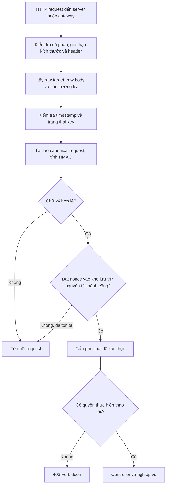

# Server xác minh request bằng HMAC

## 1. Server thực sự cần xác minh điều gì?

Trong cơ chế **HTTP request authentication bằng HMAC (Hash-based Message Authentication Code)**, client và server được cấp một **shared secret**. Client tính chữ ký từ các thành phần HTTP request đã thỏa thuận; server tự tính lại chữ ký bằng secret tương ứng rồi so sánh. Bài này tập trung vào phía **server xác minh request**: lấy đúng dữ liệu đã được ký, kiểm tra chữ ký, giới hạn thời gian hiệu lực và ngăn request bị phát lại.

Sau bài học, bạn cần có thể:

- Thiết kế hợp đồng ký rõ ràng và dựng lại **canonical request** ở server mà không phụ thuộc vào cách JSON được parse hay thứ tự xử lý của framework.
- Kiểm tra `keyId`, `timestamp`, `nonce`, chữ ký và nội dung request theo thứ tự an toàn; từ chối khi dữ liệu không hợp lệ.
- Giải thích vì sao phải dùng phép so sánh chữ ký hạn chế rò rỉ thời gian, lưu nonce **nguyên tử**, quản lý secret khi xoay khóa và kiểm thử qua proxy/API gateway.
- Phân biệt **xác thực** (request đến từ bên giữ secret) với **phân quyền** (bên đó được phép làm gì), đồng thời nhận ra giới hạn của HMAC.

> Phạm vi: HMAC xác nhận tính toàn vẹn của **những trường được đưa vào hợp đồng ký** và chứng minh bên gửi biết secret. HMAC không mã hóa body, không tự ngăn replay, không thay thế TLS và không cấp quyền truy cập.

## 2. Bắt đầu từ hợp đồng ký giữa client và server

Giả sử đối tác gửi request tạo giao dịch:

```http
POST /v1/payments?expand=detail HTTP/1.1
Host: api.example.test
Content-Type: application/json
X-HMAC-Key-Id: merchant-42:v3
X-HMAC-Timestamp: 1795838400
X-HMAC-Nonce: f4c390ac128d4f1b9af23496e67b0d2c
X-HMAC-Signature: <base64-cua-32-byte-hmac>

{"amount":125000,"currency":"VND"}
```

Các số và chuỗi trong request chỉ minh họa; timestamp này không mặc nhiên hợp lệ tại thời điểm chạy thử. Client và server phải thống nhất **đúng từng byte** của dữ liệu dùng để ký. Ví dụ sử dụng phiên bản hợp đồng `HMAC-SHA256` với các quy tắc sau:

| Thành phần | Quy tắc trong ví dụ |
| --- | --- |
| Thuật toán | `HmacSHA256`; chữ ký truyền ở `X-HMAC-Signature` dưới dạng Base64 chuẩn (không phải Base64URL). |
| Method | Tên phương thức HTTP viết hoa do server nhận, ví dụ `POST`. |
| Request target | Raw path kèm raw query nếu có, đúng thứ tự và cách percent-encode mà thành phần xác minh nhận được: `/v1/payments?expand=detail`. Không tự sắp xếp query. |
| `Content-Type` | Ví dụ chỉ áp dụng cho request có `Content-Type: application/json`; server loại bỏ khoảng trắng ASCII ở hai đầu giá trị header trước khi ký. Không tự đổi nội dung giá trị. |
| `X-HMAC-Key-Id` | Định danh khóa dùng để tìm secret. Key ID **không phải secret**, nhưng là một phần của chuỗi được ký. |
| `X-HMAC-Timestamp` | Unix time tính bằng **giây**, ghi bằng chữ số thập phân, không có dấu hoặc dấu cách. |
| `X-HMAC-Nonce` | Chuỗi ngẫu nhiên duy nhất cho mỗi request, ví dụ 128 bit sinh bằng nguồn ngẫu nhiên mật mã rồi mã hóa dạng hex. |
| Body | SHA-256 của **byte body thực tế nhận được**, trước parse JSON; kết quả là chuỗi hex chữ thường 64 ký tự. Body rỗng vẫn có SHA-256 riêng. |
| Encoding | Canonical string mã hóa UTF-8; các dòng cách nhau bằng `LF` (`\n`), **không có LF cuối**. |

Canonical request của ví dụ có **đúng tám dòng**, theo thứ tự:

```text
HMAC-SHA256
POST
/v1/payments?expand=detail
content-type:application/json
x-hmac-key-id:merchant-42:v3
x-hmac-timestamp:1795838400
x-hmac-nonce:f4c390ac128d4f1b9af23496e67b0d2c
body-sha256:<hex-sha256-cua-raw-body>
```

Dòng cuối ở trên là ký hiệu mô tả; khi tính chữ ký phải thay bằng **giá trị hash hex thực tế**, không giữ dấu `<...>`. Không thêm dòng trống hoặc khoảng trắng. Công thức:

```text
bodyHash    = lowercase_hex(SHA256(rawBodyBytes))
canonical   = join_with_LF(8_lines_without_final_LF)
expectedMac = HMAC_SHA256(sharedSecretBytes, UTF8(canonical))
signature   = Base64(expectedMac)
```

Trong hệ thống thực tế, hợp đồng có thể ký thêm `Host`/authority, `Content-Encoding`, một tập header xác định, hoặc sử dụng quy tắc sắp xếp query. **Không thể tự ý đổi hợp đồng ở riêng server**: thêm/bớt trường hoặc normalize khác client đều gây lỗi chữ ký, hoặc khiến thành phần quan trọng không được bảo vệ. Nếu cùng secret dùng với nhiều dịch vụ hoặc tenant, nên ràng buộc audience/host hoặc tách khóa theo phạm vi sử dụng để tránh request hợp lệ bị chấp nhận nhầm tại đích khác.

## 3. Luồng xác minh trên server



### Bước 1 — Kiểm tra dữ liệu đầu vào trước khi tính HMAC

Server chỉ nhận request trong giới hạn đã công bố (ví dụ giới hạn body, header và thời gian đọc body). Với ví dụ này, yêu cầu đủ các header `Content-Type`, `X-HMAC-Key-Id`, `X-HMAC-Timestamp`, `X-HMAC-Nonce`, `X-HMAC-Signature` và **mỗi header chỉ xuất hiện một lần**. Không chấp nhận hai giá trị cùng tên, header bị gộp bằng dấu phẩy, ký tự xuống dòng trong giá trị, hoặc nhiều cách biểu diễn chữ ký gây nhập nhằng.

Lấy `method`, raw path/query và raw body ở cùng lớp mạng đã chọn để xác minh. Không sử dụng URL đã decode rồi encode lại; không serialize JSON từ object để tính hash. Hai body sau có cùng ý nghĩa JSON nhưng **khác byte**, vì vậy khác chữ ký:

```json
{"amount":125000,"currency":"VND"}
```

```json
{ "currency": "VND", "amount": 125000 }
```

Việc đọc body trong filter cần cho phép tầng controller đọc lại body sau đó (ví dụ request wrapper có khả năng phát lại byte). Với framework xử lý stream, phải giới hạn buffer và chọn điểm xác minh sao cho không vô tình tiêu thụ stream rồi để controller nhận body rỗng.

### Bước 2 — Kiểm tra timestamp và định danh khóa

Server đọc timestamp theo **giây** và so với đồng hồ máy chủ. Ví dụ chấp nhận sai lệch tối đa `±300` giây:

```text
abs(serverEpochSeconds - requestEpochSeconds) <= 300
```

Timestamp thiếu, sai định dạng, nằm ngoài cửa sổ hoặc quá xa tương lai đều bị từ chối. Các máy chủ cần đồng bộ giờ (ví dụ NTP), nhưng không mở rộng cửa sổ quá mức để che sai lệch đồng hồ.

`keyId` dùng để lấy secret từ kho khóa theo đối tác/tenant và kiểm tra trạng thái khóa: đang được phép xác minh, đang trong giai đoạn chuyển đổi, đã hết hiệu lực hay đã bị thu hồi. **Không tin keyId như danh tính đã xác thực** trước khi chữ ký đúng. Không lấy secret từ request, URL hay giá trị do client tự cung cấp. Mỗi secret phải có phạm vi sử dụng và chính sách vòng đời rõ ràng.

### Bước 3 — Tái tạo chuỗi và xác minh chữ ký

Server tính SHA-256 trên body bytes, ghép canonical string đúng hợp đồng rồi tính HMAC với secret tìm được. Decode chữ ký Base64 nghiêm ngặt, yêu cầu kết quả dài **32 byte** với HMAC-SHA256 và so sánh theo cách hạn chế rò rỉ thời gian, ví dụ `MessageDigest.isEqual(expected, received)` trong Java.

Không so sánh `String.equals(...)` với chuỗi chữ ký Base64 và không tự tạo vòng lặp so sánh dừng tại byte khác đầu tiên. Không ghi log secret, chữ ký đầy đủ hoặc body nhạy cảm để điều tra lỗi. Server có thể ghi request ID, key ID đã được kiểm soát, lý do lỗi ở mức nội bộ và số liệu tổng hợp; phản hồi cho client nên thống nhất để hạn chế dò khóa hoặc đoán trạng thái.

### Bước 4 — Chặn replay bằng nonce

**Chữ ký hợp lệ không có nghĩa request là mới.** Kẻ quan sát được một request đã ký có thể gửi lại chính request đó trong cửa sổ timestamp. Sau khi kiểm tra chữ ký thành công, server phải **đặt nonce vào kho dùng chung bằng thao tác nguyên tử chỉ-ghi-nếu-chưa-có**; nếu khóa nonce đã tồn tại, từ chối.

Ví dụ với Redis (mô tả thao tác):

```redis
SET hmac:nonce:merchant-42:v3:f4c390ac128d4f1b9af23496e67b0d2c 1 NX EX 630
```

Trong đó `NX` bảo đảm chỉ request đầu tiên giữ được nonce, `EX 630` đặt hạn dùng. Với cửa sổ `±300` giây, một timestamp có thể được chấp nhận trong khoảng dài tới **600 giây**; TTL `630` giây tính từ lần đầu chấp nhận có thêm 30 giây dự phòng. Chọn TTL theo **toàn bộ khoảng còn lại mà timestamp có thể hợp lệ**, cộng độ trễ và sai lệch thực tế, không chỉ chọn bằng một nửa cửa sổ. Khóa nonce phải được tách theo key ID/principal có phạm vi phù hợp và tất cả replica phải dùng chung kho kiểm tra.

Nếu Redis hay dịch vụ nonce bị lỗi, không được tiếp tục xử lý nghiệp vụ như thể nonce đã được xác nhận; trả lỗi phụ thuộc tạm thời (chẳng hạn `503`) hoặc thực hiện chiến lược fail-closed đã thiết kế. HMAC cùng nonce chỉ bảo vệ khỏi **gửi lại request giống nonce**; hai request có chữ ký hợp lệ và nonce khác nhau vẫn có thể thực hiện cùng nghiệp vụ. Với giao dịch thanh toán hay tạo đơn, cần thêm **idempotency key** và lưu kết quả nghiệp vụ để ngăn xử lý trùng.

### Bước 5 — Phân quyền sau khi đã xác thực

Chỉ sau khi HMAC và nonce hợp lệ mới tạo principal nội bộ đại diện cho đối tác/ứng dụng, gắn quyền/phạm vi từ cấu hình server. Sau đó mới kiểm tra principal đó có quyền gọi endpoint, tenant hoặc tài nguyên cụ thể không. Ví dụ, `merchant-42` có chữ ký đúng **vẫn không được** hoàn tiền của `merchant-99` nếu không có quyền. Chữ ký HMAC chứng minh người gửi giữ secret; không chứng minh quyền sở hữu mọi resource ID trong body.

## 4. Ví dụ Java: bộ xác minh cốt lõi

Đoạn sau minh họa **phần xác minh của một hợp đồng request JSON đã nêu**, tách khỏi HTTP framework. Lớp tiếp nhận HTTP chịu trách nhiệm kiểm tra header trùng lặp, giới hạn kích thước, lấy chính xác raw target/raw body và chuyển sang `SignedRequest`. `KeyProvider` và `NonceStore` là interface để tích hợp secret manager/KMS và Redis hoặc dịch vụ tương đương; **không** dùng `HashMap` nội bộ làm nonce store trong môi trường nhiều server.

```java
import java.nio.charset.StandardCharsets;
import java.security.GeneralSecurityException;
import java.security.MessageDigest;
import java.time.Duration;
import java.time.Instant;
import java.util.Base64;
import java.util.HexFormat;
import java.util.Optional;
import javax.crypto.Mac;
import javax.crypto.spec.SecretKeySpec;

record SignedRequest(
        String method, String rawTarget, String contentType,
        String keyId, String timestamp, String nonce,
        String signatureBase64, byte[] rawBody) {}

interface KeyProvider {
    // Chỉ trả secret nếu key đang được phép VERIFY ở thời điểm now.
    Optional<byte[]> findVerificationSecret(String keyId, Instant now);
}

interface NonceStore {
    // Phải là thao tác atomic put-if-absent + TTL dùng chung toàn hệ thống.
    // false: nonce đã tồn tại. Lỗi hạ tầng: ném exception để fail-closed.
    boolean reserve(String keyId, String nonce, Duration ttl);
}

final class HmacRequestVerifier {
    private static final long ALLOWED_SKEW_SECONDS = 300;
    private static final Duration NONCE_TTL = Duration.ofSeconds(630);

    private final KeyProvider keys;
    private final NonceStore nonces;

    HmacRequestVerifier(KeyProvider keys, NonceStore nonces) {
        this.keys = keys;
        this.nonces = nonces;
    }

    boolean verify(SignedRequest r, Instant now) {
        if (!validSyntax(r)) return false;

        final long sentAt;
        try {
            sentAt = Long.parseLong(r.timestamp());
        } catch (NumberFormatException e) {
            return false;
        }

        long deltaSeconds = now.getEpochSecond() - sentAt;
        if (deltaSeconds < -ALLOWED_SKEW_SECONDS
                || deltaSeconds > ALLOWED_SKEW_SECONDS) return false;

        Optional<byte[]> secret = keys.findVerificationSecret(r.keyId(), now);
        if (secret.isEmpty()) return false;

        byte[] receivedMac;
        try {
            receivedMac = Base64.getDecoder().decode(r.signatureBase64());
        } catch (IllegalArgumentException e) {
            return false;
        }
        if (receivedMac.length != 32) return false;

        byte[] expectedMac = calculateMac(secret.get(), canonical(r));
        if (!MessageDigest.isEqual(expectedMac, receivedMac)) return false;

        // Chỉ reserve SAU KHI chữ ký hợp lệ; cùng nonce chỉ được nhận 1 lần.
        // Lỗi kết nối từ NonceStore phải làm request thất bại (fail-closed).
        return nonces.reserve(r.keyId(), r.nonce(), NONCE_TTL);
    }

    private static boolean validSyntax(SignedRequest r) {
        return r != null
                && r.method() != null && r.method().matches("[A-Z]{3,10}")
                && r.rawTarget() != null && r.rawTarget().startsWith("/")
                && !containsLineBreak(r.rawTarget())
                && "application/json".equals(r.contentType())
                && r.keyId() != null
                && r.keyId().matches("[A-Za-z0-9._:-]{1,80}")
                && r.timestamp() != null
                && r.timestamp().matches("[0-9]{10,11}")
                && r.nonce() != null
                && r.nonce().matches("[A-Za-z0-9_-]{22,128}")
                && r.signatureBase64() != null
                && r.signatureBase64().length() <= 128
                && r.rawBody() != null;
    }

    private static boolean containsLineBreak(String s) {
        return s.indexOf('\r') >= 0 || s.indexOf('\n') >= 0;
    }

    private static String canonical(SignedRequest r) {
        byte[] sha256;
        try {
            sha256 = MessageDigest.getInstance("SHA-256").digest(r.rawBody());
        } catch (GeneralSecurityException e) {
            throw new IllegalStateException("SHA-256 unavailable", e);
        }
        return String.join("\n",
                "HMAC-SHA256",
                r.method(),
                r.rawTarget(),
                "content-type:" + r.contentType(),
                "x-hmac-key-id:" + r.keyId(),
                "x-hmac-timestamp:" + r.timestamp(),
                "x-hmac-nonce:" + r.nonce(),
                "body-sha256:" + HexFormat.of().formatHex(sha256));
    }

    private static byte[] calculateMac(byte[] secret, String canonical) {
        try {
            Mac mac = Mac.getInstance("HmacSHA256");
            mac.init(new SecretKeySpec(secret, "HmacSHA256"));
            return mac.doFinal(canonical.getBytes(StandardCharsets.UTF_8));
        } catch (GeneralSecurityException e) {
            throw new IllegalStateException("HMAC-SHA256 unavailable", e);
        }
    }
}
```

Ở lớp HTTP adapter, cần trim hai đầu `Content-Type` theo đúng hợp đồng **trước** khi tạo `SignedRequest`, và chỉ chấp nhận một giá trị header. Trong ví dụ này, sau trim giá trị phải đúng `application/json`. Adapter cũng phải giới hạn kích thước request và kiểm tra raw target trước khi gọi verifier; regex trong ví dụ chỉ thể hiện một tập kiểm tra tối thiểu. Lớp gọi `verify` xử lý lỗi từ `NonceStore` theo chính sách fail-closed và **chỉ** tạo principal khi `verify(...)` trả `true`.

Điểm cần lưu ý khi chuyển sang production: tra khóa phải kiểm tra **tenant, trạng thái và phiên bản khóa**; secret nên là byte ngẫu nhiên đủ mạnh (ví dụ 256 bit) lưu ở hệ thống quản lý secret; không hardcode vào source. Ngoài ra cần giới hạn tốc độ yêu cầu, dữ liệu đầu vào, độ dài URL và số request đồng thời trước bước tính hash/HMAC nhằm tránh bị lạm dụng tài nguyên.

## 5. Proxy, gateway và canonicalization: nơi lỗi khó nhận ra nhất

Giả sử client ký `/v1/items/%2F?tag=a&tag=b`, nhưng proxy giải mã `%2F` thành `/`, gộp dấu gạch chéo hoặc sắp xếp query. Chữ ký sẽ không còn khớp dù nội dung nghiệp vụ có vẻ giống nhau. Tùy thiết kế, có hai cách thường dùng:

1. **Xác minh tại API gateway** trước bước rewrite/decode; sau đó truyền danh tính đã xác thực về backend qua kênh nội bộ đáng tin cậy, đồng thời xóa mọi header nhận dạng nội bộ do client tự gửi.
2. **Xác minh tại backend** nhưng gateway phải giữ nguyên hoặc truyền có kiểm soát request target nguyên gốc theo hợp đồng. Backend chỉ tin metadata original-target do gateway được xác thực đặt ra; gateway phải loại bỏ header cùng tên do client gửi vào.

Đừng mặc nhiên tin `X-Forwarded-*`, `X-Original-URI` hay `Host` từ Internet. Header name không phân biệt hoa/thường, nhưng **giá trị** header, cách nối nhiều giá trị và việc trim phải do hợp đồng quy định. Với HTTP/2, chuyển đổi `:path` sang HTTP/1.1, việc normalize percent-encoding và query lặp cũng cần test thực tế. Nếu proxy giải nén body, biến đổi JSON hoặc đổi `Content-Encoding`, hãy xác định rõ thành phần nào ký **byte trước hay sau biến đổi**; tốt nhất tránh biến đổi body đã ký trên đường đi.

Trong Java servlet, `getRequestURI()` và `getQueryString()` có thể là điểm bắt đầu để lấy target, nhưng phải xác nhận hành vi thực tế của server và gateway đang dùng; không dựng target từ `getParameterMap()` hoặc URL đã decode. Nếu chọn ký thêm `Host`, cần xét các alias và reverse proxy; nếu không ký `Host`, phải ràng buộc secret hoặc quyền truy cập với đích đến một cách khác.

## 6. Xoay khóa, xử lý lỗi và quan sát

Mỗi khóa có `keyId`/version và trạng thái riêng. Quy trình xoay khóa điển hình: tạo key mới, phát hành cho client qua kênh an toàn, cho server tạm thời **verify bằng key cũ và mới** trong cửa sổ chuyển đổi, yêu cầu client chuyển sang ký bằng key mới, rồi ngừng xác minh bằng key cũ và thu hồi nó. Hạn dùng của key cũ phải giới hạn rõ ràng; không chọn thuật toán yếu hơn chỉ vì chữ ký mới không khớp. Khi key bị lộ, thu hồi ngay, kiểm tra log và thay secret; replay cache không thể chữa được trường hợp kẻ tấn công đã giữ được secret.

| Tình huống | Kết quả và ý nghĩa |
| --- | --- |
| Header thiếu/trùng, chữ ký không decode được | Từ chối trước nghiệp vụ; ghi log đủ để chẩn đoán nhưng không lộ dữ liệu bí mật. |
| Không tìm thấy key, key bị thu hồi, chữ ký sai | Không xác thực được (`401` là lựa chọn thường gặp); phản hồi ngoài có thể dùng cùng thông điệp chung. |
| Timestamp quá cũ/quá xa tương lai, nonce đã dùng | Từ chối xác thực; không gọi controller. |
| Kho nonce không truy cập được | Dừng xử lý bảo vệ replay (ví dụ `503`), cảnh báo vận hành; không chấp nhận mặc định. |
| Đã xác thực nhưng thiếu quyền truy cập tài nguyên | Trả `403` theo chính sách phân quyền; không xem HMAC là quyền vô hạn. |
| Body vượt giới hạn hoặc request sai định dạng HTTP | Chặn sớm theo policy, ví dụ `413` cho body quá lớn. |

Metrics nên theo dõi tỷ lệ `invalid_signature`, `timestamp_out_of_window`, `replayed_nonce`, `unknown_or_inactive_key`, lỗi kết nối nonce store, độ trễ xác minh và sự cố khác biệt giữa các gateway/replica. Tránh trả thông điệp quá cụ thể cho client nếu có thể giúp kẻ tấn công thử key ID hoặc đoán chữ ký. Đừng đưa shared secret hay raw Authorization/chữ ký vào log, traces, metrics labels.

## 7. Ma trận kiểm thử cần có

| Thử nghiệm | Kỳ vọng |
| --- | --- |
| Chữ ký đúng, key hợp lệ, timestamp trong cửa sổ, nonce mới | Xác thực thành công, principal đúng, nonce được ghi một lần. |
| Sửa method, path, thứ tự query hoặc một byte của body sau khi ký | Chữ ký sai; request bị chặn. |
| JSON giữ cùng ý nghĩa nhưng thay thứ tự key/khoảng trắng | Nếu byte body thay đổi thì chữ ký sai. |
| Sửa `Content-Type`, `keyId`, timestamp hoặc nonce mà không ký lại | Chữ ký sai, hoặc dữ liệu bị từ chối khi kiểm tra cú pháp. |
| Timestamp ở biên `-300`, `+300`, ngoài biên `±301` giây | Theo hợp đồng, hai biên đầu được chấp nhận; ngoài cửa sổ bị loại. |
| Gửi đồng thời cùng nonce lên hai replica | Chỉ tối đa một request lấy được nonce; request còn lại bị chặn. |
| Gửi lại request hợp lệ trong cửa sổ timestamp | Bị chặn do nonce đã tồn tại. |
| Secret không đúng, key cũ đã thu hồi, Base64 sai hoặc header bị nhân đôi | Bị từ chối; không chạy nghiệp vụ. |
| Kho nonce lỗi hoặc mất kết nối | Không chấp nhận request; có cảnh báo và trạng thái lỗi phụ thuộc rõ ràng. |
| Request qua gateway với `%2F`, `%20`, query lặp, HTTP/2 và body gzip | Chữ ký ổn định **chỉ khi** lớp xác minh nhận đúng byte/target theo hợp đồng; ghi nhận mọi rewrite. |
| HMAC đúng nhưng principal không được truy cập tenant khác | Được xác thực, sau đó bị từ chối bởi phân quyền (`403`). |

Để viết kiểm thử tương thích client/server, hãy dùng chung **test vector** gồm `secretBytes` thử nghiệm, raw HTTP method/target/headers/body bytes, chuỗi canonical chính xác và chữ ký Base64 mong đợi. So sánh từng byte canonical trước khi kết luận thuật toán HMAC sai. Test vector phải có cả body rỗng, Unicode UTF-8, query trùng key, percent-encoding và ký tự đặc biệt. Khi kiểm thử replay, cần xác minh tính nguyên tử của nonce store trong môi trường nhiều instance, không chỉ kiểm tra với một map trong unit test.

## 8. Những sai lầm thường gặp

- **Ký object JSON** sau deserialize: serializer ở hai đầu có thể đổi thứ tự trường, whitespace hoặc biểu diễn số. Hãy ký hash của raw body bytes theo hợp đồng.
- **Chỉ kiểm tra HMAC**: request hợp lệ vẫn bị replay trong thời gian chữ ký còn hiệu lực. Bắt buộc có timestamp và nonce store chung nếu cần chống replay.
- **Dùng Redis `GET` rồi `SET`**: hai request đồng thời có thể đều vượt qua. Dùng `SET ... NX EX ...` hoặc primitive tương đương với TTL nguyên tử.
- **Lấy path từ URL đã normalize**: proxy và framework có thể đổi `%2F`, dấu `+`, query trùng. Chọn rõ nơi xác minh và ổn định canonicalization từ client đến nơi đó.
- **Xem key ID là toàn quyền**: chữ ký chỉ chứng minh quyền sử dụng secret. Vẫn phải ánh xạ principal, scope, tenant và kiểm tra quyền với tài nguyên cụ thể.
- **Đưa secret vào web/mobile client công khai**: ứng dụng người dùng có thể bị dịch ngược và lấy secret. HMAC shared secret phù hợp nhất với server-to-server hoặc môi trường giữ được secret; client công khai cần thiết kế xác thực khác.

### Câu hỏi tự kiểm tra

1. Vì sao server phải hash `rawBodyBytes` thay vì một JSON object đã parse?
2. Với cửa sổ timestamp `±5` phút, vì sao TTL của nonce có thể cần hơn 5 phút?
3. Nếu HMAC hợp lệ nhưng Redis không ghi được nonce, server nên xử lý như thế nào?
4. Khi gateway rewrite path, nên xác minh HMAC ở lớp nào, và backend được tin metadata nào?
5. Vì sao một request đã xác thực vẫn có thể phải nhận `403 Forbidden`?

**Ghi nhớ:** Một server xác minh HMAC đúng phải xác định *chính xác các byte được ký*, xác thực secret/chữ ký, kiểm tra độ mới bằng timestamp và nonce nguyên tử, rồi mới áp dụng chính sách phân quyền. Hợp đồng canonicalization, vị trí xác minh qua proxy và vòng đời khóa quyết định mức độ an toàn của toàn bộ cơ chế.
