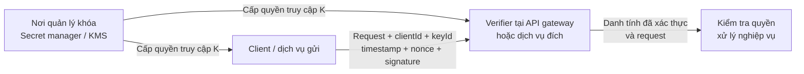
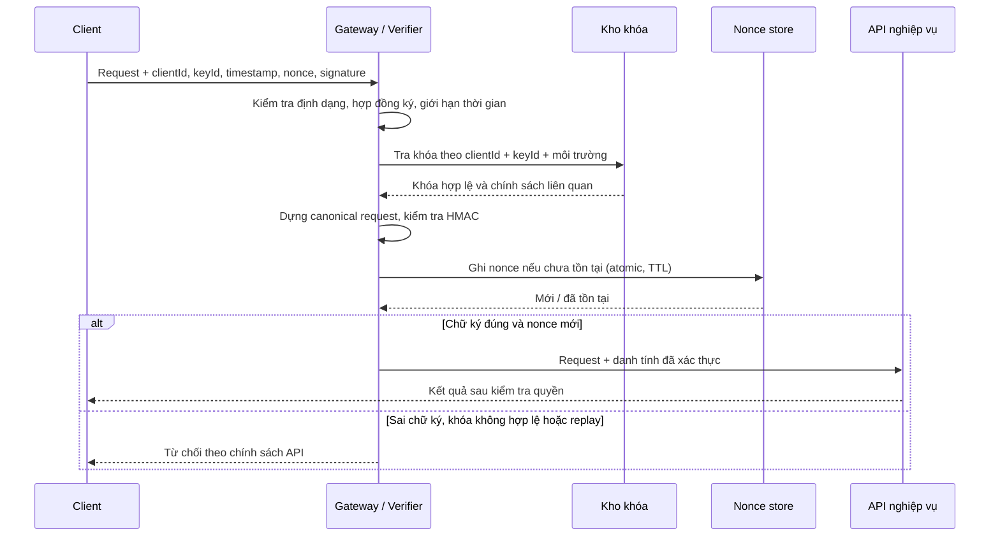

# Mô hình khóa dùng chung trong HMAC Request Authentication

## Mục tiêu học tập

Sau bài này, bạn có thể:

- Giải thích vì sao cả bên gửi và bên xác minh HTTP request phải có cùng **khóa bí mật** (shared secret) trong cơ chế HMAC.
- Phân biệt `client ID`, `key ID`, secret và chữ ký; xác định ranh giới tin cậy giữa client, API gateway, dịch vụ đích và nơi lưu khóa.
- Mô tả quy trình cấp phát, sử dụng, xoay vòng và thu hồi khóa; đánh giá tác động nếu một trong hai bên làm lộ secret.
- Phác thảo hợp đồng ký một HTTP request và nêu cách ngăn sửa đổi nội dung, phát lại yêu cầu (replay) và lỗi do proxy.
- Phân biệt kết quả **xác thực người nắm khóa** với quyết định **phân quyền** cho một thao tác nghiệp vụ.

## 1. Shared secret là gì?

Trong hệ thống xác thực HTTP request bằng **HMAC (Hash-based Message Authentication Code)**, client và thành phần kiểm tra chữ ký cùng được cấp một giá trị ngẫu nhiên bí mật `K`. Client dùng `K` để tính mã xác thực trên một thông điệp biểu diễn request theo quy tắc thống nhất. Server dùng **cùng `K`** để tính lại mã và so sánh với chữ ký nhận được.

Với thuật toán được ấn định là HMAC-SHA256:

```text
signature = Base64URL-NoPadding(HMAC-SHA256(K, UTF8(canonicalRequest)))
```

- `K`: bytes của khóa bí mật, chỉ những thành phần được tin cậy mới được tiếp cận.
- `canonicalRequest`: biểu diễn ổn định của những phần HTTP request mà hai bên thỏa thuận ký (ví dụ method, URI, header, băm body).
- `signature`: kết quả gửi kèm request; **không phải secret** và không thể dùng để suy ra `K` nếu khóa đủ mạnh.
- `Base64URL-NoPadding`: một quy ước mã hóa bytes của HMAC thành chuỗi truyền qua HTTP; hai bên phải dùng cùng quy ước.

HMAC dựa trên hàm băm có khóa; nó **không mã hóa** request. Chữ ký đúng cho thấy người tạo chữ ký đã biết khóa phù hợp, và những phần request nằm trong hợp đồng ký không bị thay đổi kể từ khi ký. Vì bên gửi **và** bên xác minh đều biết khóa, HMAC không cung cấp tính chống chối bỏ như chữ ký số với private/public key.

### Sơ đồ các vai trò



Đây là **mô hình tin cậy logic**: không nhất thiết client và server đều tải khóa thô từ một KMS. Thực tế có thể dùng secret manager, khóa được mã hóa khi lưu (wrapped key), hoặc dịch vụ KMS thực hiện MAC. Điểm cốt lõi là hai phía có khả năng tạo/kiểm tra HMAC với cùng **vật liệu khóa logic**.

| Thành phần | Vai trò | Có bí mật không? |
|---|---|---|
| `clientId` | Chỉ ra ứng dụng/đối tác gửi request để tra cứu thông tin định danh | Không; chưa được tin trước khi chữ ký hợp lệ |
| `keyId` (ví dụ `k2`) | Chỉ ra **phiên bản khóa** cần dùng, thuận tiện cho key rotation | Không; phải kiểm tra khóa có thuộc đúng client |
| `K` (shared secret) | Bytes ngẫu nhiên chỉ được cấp cho các bên được phép ký/xác minh | **Có; tuyệt đối không gửi trong request** |
| `timestamp` và `nonce` | Ràng buộc thời gian và tính duy nhất của request để chống replay | Không; phải được bao phủ bởi chữ ký |
| `signature` | Mã xác thực tính từ khóa và canonical request | Không; tuy công khai nhưng phải kiểm tra chính xác |

**Ví dụ:** dịch vụ `billing-service` gọi API tạo đơn hàng của `order-service`. Hệ thống cấp một khóa HMAC cho danh tính `merchant-17`. Mỗi request ký bằng khóa đó. Bộ kiểm tra chữ ký ánh xạ khóa về danh tính `merchant-17`; tầng phân quyền tiếp tục quyết định danh tính này có được phép tạo đơn hàng thuộc merchant tương ứng hay không.

## 2. Ai giữ khóa và tin cậy ai?

HMAC là cơ chế **khóa đối xứng**. Khi có một khóa `K` được dùng chung cho nhiều bên, tất cả bên biết `K` đều có thể tạo chữ ký hợp lệ. Vì vậy phạm vi chia sẻ khóa quyết định chính phạm vi tin cậy.

Một cách thiết kế phù hợp cho giao tiếp dịch vụ đến dịch vụ hoặc tích hợp đối tác:

1. **Mỗi client có khóa riêng**; lý tưởng hơn, tách khóa theo môi trường (dev, staging, production), tenant hoặc mục đích sử dụng. Không dùng một “global secret” cho mọi client.
2. **Verifier giữ bảng ánh xạ có kiểm soát** từ `(clientId, keyId, environment)` sang khóa, trạng thái khóa và danh tính/thuộc tính được phép sử dụng. Các trường từ request chỉ dùng làm *gợi ý tra cứu chưa tin cậy* cho tới khi xác minh thành công.
3. **Client lưu secret trong secret manager hoặc cơ chế bảo vệ phù hợp**, chỉ tiến trình cần ký request được quyền đọc/dùng. Phía server cũng hạn chế quyền dùng khóa cho thành phần verifier.
4. **Khóa không rời ranh giới tin cậy** dưới dạng tham số URL, log, HTTP header, mã nguồn, repository hay thông điệp lỗi. Chữ ký được truyền đi; secret thì không.
5. **Giao tiếp qua HTTPS/TLS** để bảo vệ nội dung, header và các thông tin nhạy cảm khác trong quá trình truyền, đồng thời xác thực endpoint truyền tải. HMAC tự nó không mang lại tính bảo mật nội dung hoặc ngăn nghe lén.

Có thể dùng chung một secret cho hai dịch vụ chỉ khi cả hai thực sự thuộc cùng miền tin cậy và chấp nhận rằng bên nào lộ khóa cũng khiến danh tính đó bị giả mạo. Khi cần phân định trách nhiệm giữa những tổ chức không hoàn toàn tin cậy nhau, hoặc cần chứng minh riêng ai đã ký, cân nhắc chữ ký bất đối xứng như HTTP Message Signatures, mTLS hoặc các mô hình xác thực thích hợp khác.

### Nếu secret bị lộ thì sao?

Người có `K` có thể ký request mới hợp lệ, kể cả body và timestamp/nonce mới; cơ chế chống replay **không** ngăn được việc giả mạo bằng khóa đã lộ. Vì vậy phải thu hồi/luân chuyển khóa, kiểm tra audit và phạm vi quyền của danh tính bị ảnh hưởng. Khóa yếu hoặc tái sử dụng rộng làm sự cố lan sang nhiều client/môi trường.

## 3. Vòng đời của một shared secret

| Giai đoạn | Việc cần làm | Lỗi thường gặp |
|---|---|---|
| Sinh khóa | Dùng CSPRNG để tạo khóa ngẫu nhiên; ví dụ 32 bytes (256 bit) cho HMAC-SHA256 | Dùng mật khẩu dễ đoán hoặc hash của tên dịch vụ |
| Cấp phát | Gắn khóa với `clientId`, `keyId`, môi trường và quyền; chuyển qua kênh bảo mật | Copy secret qua chat, ticket hoặc commit vào Git |
| Lưu trữ | Secret manager/KMS, cấu hình được bảo vệ, quyền tối thiểu và audit truy cập | Hard-code secret hoặc in ra startup log |
| Sử dụng | Ký và xác minh với thuật toán, phiên bản hợp đồng ký cố định | Cho client tự chọn thuật toán yếu hoặc thử mọi khóa |
| Rotation | Cấp khóa mới, cho verifier tạm chấp nhận khóa cũ và mới; chuyển client sang khóa mới | Đổi khóa đột ngột khiến request hợp lệ đồng loạt thất bại |
| Thu hồi | Vô hiệu hóa khóa cũ/hỏng, xóa bản sao không còn cần thiết, theo dõi bất thường | Để khóa cũ được xác minh vô thời hạn |

**Lưu ý:** 32 bytes là một lựa chọn khuyến nghị dễ triển khai cho khóa HMAC-SHA256; độ dài khóa không thay thế yêu cầu entropy từ nguồn ngẫu nhiên an toàn. `keyId` có thể được công khai để tra khóa chính xác, nhưng không được trở thành “mật khẩu” dùng để xác thực.

## 4. Một HTTP request được ký như thế nào?

Hai bên phải có **hợp đồng canonical request** rõ ràng, có version và được kiểm thử cùng nhau. Chỉ nói “ký body” hoặc “ký toàn bộ request” là chưa đủ: HTTP cho phép thay đổi biểu diễn header, thứ tự query parameter, encoding và JSON mà vẫn có thể giữ nguyên ý nghĩa nghiệp vụ.

Ví dụ hợp đồng phiên bản 1 dưới đây là **minh họa**, không phải tiêu chuẩn HMAC chung:

- Thuật toán: `HMAC-SHA256`; đầu ra `Base64URL` không có padding.
- Chuỗi canonical gồm các dòng theo đúng thứ tự trong ví dụ, ngăn bằng LF (`\n`), **không thêm LF cuối chuỗi**, mã hóa UTF-8.
- Method được viết hoa; path + query là biểu diễn request-target đã thống nhất giữa client và điểm xác minh; không tự sắp xếp query.
- `host` lấy từ host công khai đã kiểm soát tại ingress và đưa về chữ thường; `content-type` được trim khoảng trắng ở hai đầu rồi đưa về chữ thường theo hợp đồng này.
- `x-client-id`, `x-key-id`, `x-timestamp` và `x-nonce` được lấy nguyên giá trị sau khi trim khoảng trắng biên; tất cả trường này bắt buộc xuất hiện **đúng một lần**. Reject nếu thiếu, trùng hoặc có ký tự xuống dòng bất hợp lệ.
- Dòng cuối là `Base64URL-NoPadding(SHA-256(rawBodyBytes))`; body trống cũng phải băm chuỗi bytes trống. Không parse rồi serialize lại JSON trước khi băm.

Request giả định:

```http
POST /v1/orders?currency=VND HTTP/1.1
Host: api.example.test
Content-Type: application/json
X-Client-Id: merchant-17
X-Key-Id: k2
X-Timestamp: 1700000000
X-Nonce: 0a78dd46c425eb2fe3415b329d684caa
X-Signature: <base64url-hmac-sha256>
 
{"orderId":"O-42","amount":120000}
```

Với body bytes chính xác là `{"orderId":"O-42","amount":120000}` (UTF-8, không có newline cuối), chuỗi để ký có dạng:

```text
POST
/v1/orders?currency=VND
host:api.example.test
content-type:application/json
x-client-id:merchant-17
x-key-id:k2
x-timestamp:1700000000
x-nonce:0a78dd46c425eb2fe3415b329d684caa
<BASE64URL_SHA256_OF_EXACT_BODY_BYTES>
```

Dòng trong dấu `<...>` là **placeholder** cho giá trị hash thật; `X-Signature` cũng là placeholder. Timestamp trên chỉ phục vụ giải thích cách ký; nếu đưa request mẫu đó vào hệ thống hiện tại có kiểm tra thời gian, request sẽ bị từ chối vì quá cũ.

Khi ký, client tính `HMAC-SHA256(K, UTF8(canonicalRequest))`; server dựng lại cùng chuỗi từ request nhận được và tính lại HMAC. Đổi `amount` từ `120000` thành `900000`, thay `merchant-17`, URI, hay một header đã ký đều phải khiến chữ ký không còn khớp.

**Phạm vi bảo vệ chính xác bằng phạm vi đã ký.** Nếu business logic sử dụng header hoặc query parameter có ý nghĩa an ninh nhưng hợp đồng bỏ qua trường đó, người trung gian có thể thay trường ấy mà chữ ký vẫn hợp lệ. Không ký chính header `X-Signature`; hãy ký danh sách các trường được phép và xác định cứng quy tắc canonicalization.

## 5. Quy trình xác minh tại server



Các bước triển khai:

1. Giới hạn kích thước request, chữ ký và các header liên quan; xác thực đúng format, không chấp nhận header lặp mơ hồ; dùng phiên bản hợp đồng ký cố định.
2. Kiểm tra `timestamp` ở dạng Unix seconds và trong cửa sổ thời gian cho phép, ví dụ ±300 giây so với đồng hồ đã đồng bộ. Giá trị phải nằm **trong dữ liệu được ký**.
3. Tra chính xác `(clientId, keyId, environment)`, bảo đảm khóa còn hiệu lực để xác minh. Không chấp nhận khóa thuộc một client/tenant khác và không cho client tùy ý thay thuật toán.
4. Tính lại hash của **raw bytes** body, dựng canonical request, giải mã chữ ký theo encoding đã quy định và so sánh bytes HMAC bằng hàm so sánh chống rò rỉ thời gian như `MessageDigest.isEqual`.
5. **Chỉ sau khi xác minh chữ ký thành công**, ghi nonce vào kho chia sẻ theo khóa ví dụ `(clientId, nonce)` bằng thao tác *insert-if-absent* nguyên tử. Nonce đã tồn tại phải bị từ chối. Dùng kho chia sẻ giữa các replica, không chỉ bộ nhớ riêng của từng server.
6. Gắn danh tính đã xác thực vào ngữ cảnh nội bộ được tin cậy; tiếp đó mới thực hiện **phân quyền** theo endpoint, tenant, tài nguyên và nghiệp vụ.

Nếu chọn cửa sổ `±Δ`, nonce phải còn được ghi nhớ tới khi request mang timestamp đó không còn được phép chấp nhận; trường hợp tệ nhất cần gần `2Δ` kể từ lần nhận sớm nhất, cộng dự phòng lệch đồng hồ. Có thể tính expiry theo `timestamp + Δ + margin` thay vì một TTL ngắn cố định. Nonce nên là giá trị khó đoán (ví dụ 128 bit ngẫu nhiên); việc cache phải chống race giữa các yêu cầu đến đồng thời.

### Phần lõi HMAC trong Java

Ví dụ sau dùng Java standard library, cho thấy thao tác ký và kiểm tra trên **chuỗi canonical đã được tạo đúng hợp đồng**:

```java
import java.nio.charset.StandardCharsets;
import java.security.GeneralSecurityException;
import java.security.MessageDigest;
import java.util.Base64;
import javax.crypto.Mac;
import javax.crypto.spec.SecretKeySpec;

public final class HmacSignature {
    private HmacSignature() {}

    public static String sign(String canonical, byte[] secret)
            throws GeneralSecurityException {
        return Base64.getUrlEncoder()
                .withoutPadding()
                .encodeToString(mac(canonical, secret));
    }

    public static boolean verify(
            String canonical, byte[] secret, String receivedSignature)
            throws GeneralSecurityException {

        // 32 bytes HMAC-SHA256 => 43 ký tự Base64URL không padding.
        if (receivedSignature == null || receivedSignature.length() != 43) {
            return false;
        }

        final byte[] received;
        try {
            received = Base64.getUrlDecoder().decode(receivedSignature);
        } catch (IllegalArgumentException invalidEncoding) {
            return false;
        }

        if (received.length != 32) {
            return false;
        }

        byte[] expected = mac(canonical, secret);
        return MessageDigest.isEqual(expected, received);
    }

    private static byte[] mac(String canonical, byte[] secret)
            throws GeneralSecurityException {
        Mac hmac = Mac.getInstance("HmacSHA256");
        hmac.init(new SecretKeySpec(secret, "HmacSHA256"));
        return hmac.doFinal(canonical.getBytes(StandardCharsets.UTF_8));
    }
}
```

Đây **chưa phải một HTTP authentication filter hoàn chỉnh**: mã cố ý chỉ minh họa phép HMAC. Trong ứng dụng thật phải có thêm parser/canonicalizer nhất quán, xác thực timestamp và nonce, tra khóa theo đúng scope, giới hạn kích thước, quản lý exception, phân quyền và kiểm thử qua gateway. Không bao giờ tạo khóa mới trong mỗi request: khóa phải được cấp phát và giữ nhất quán theo vòng đời đã thiết kế.

## 6. Rotation: cùng lúc có nhiều phiên bản khóa

Không thể chỉ thay một secret tại server và mong mọi client đổi chính xác cùng thời điểm. Mô hình thực tế hỗ trợ **nhiều phiên bản khóa cho mỗi client**, có thời gian hiệu lực và trạng thái riêng:

```text
k1: verify-only  ──────┐
                       ├─ Server chấp nhận chữ ký trong khoảng chuyển đổi
k2: active       ──────┘
                ↓
k1: disabled      k2: active
```

Một quy trình rotation có kiểm soát:

1. Sinh `k2` riêng cho cùng client, lưu trong kho khóa và cấp qua kênh bảo mật; giữ `k1` đang hoạt động.
2. Verifier chấp nhận `k1` và `k2` trong thời gian chuyển tiếp, nhưng client mới chuyển sang **ký với `k2`**.
3. Theo dõi việc sử dụng `keyId` qua metric/audit (không ghi secret), xác nhận client đã chuyển và request đang bay đã hết hạn.
4. Chuyển `k1` sang disabled và xóa/thu hồi các bản sao theo chính sách. Nếu có sự cố lộ khóa, **thu hồi ngay**, không chờ hết thời gian chuyển tiếp.

Mỗi request mang `keyId` tương ứng và `keyId` được ký trong canonical request để tránh nhập nhằng phiên bản. Server không âm thầm thử toàn bộ khóa của mọi client. Chính sách cấp quyền vẫn gắn với **danh tính client đã xác minh**, không tự mở rộng chỉ vì có khóa mới.

## 7. Replay, idempotency và an ninh vận hành

**Vấn đề replay:** attacker có thể ghi lại một request hợp lệ và gửi lại nguyên chữ ký khi nó vẫn nằm trong cửa sổ timestamp. HMAC vẫn đúng vì bytes không đổi. Timestamp riêng lẻ chỉ giới hạn *thời gian* có thể phát lại; nonce được ghi nhớ và kiểm tra nguyên tử mới giúp phát hiện **sử dụng lại trong cửa sổ đó**.

**Vấn đề retry:** client hợp lệ đôi khi phải gửi lại do timeout mạng. Nếu gửi y nguyên timestamp/nonce thì verifier sẽ coi là replay. Nếu tạo timestamp/nonce và chữ ký mới, một thao tác có thể chạy hai lần. Với các lệnh như tạo thanh toán, nên có thêm `Idempotency-Key` và xử lý nghiệp vụ idempotent; nếu request sử dụng trường này thì nó cũng cần nằm trong phần đã ký. **Replay protection** và **idempotency** giải quyết hai vấn đề khác nhau.

**Vấn đề logging/quan sát:** ghi sự kiện xác thực (client/key ID, kết quả, loại lỗi tổng quát, trace ID, tỷ lệ replay/clock skew) nhưng không ghi secret, toàn bộ Authorization header, chữ ký hoặc body nhạy cảm. Thông báo lỗi cho client nên hạn chế lộ chi tiết tra khóa; hệ thống nội bộ vẫn cần metric đủ để phát hiện lệch giờ, replay bất thường và lỗi rotation.

**Vấn đề hiệu năng/tấn công tài nguyên:** giới hạn size body và header trước khi hash, rate limit theo nguồn/candidate client, kiểm soát số lần tra cứu khóa và dung lượng nonce store. Không coi HMAC là cơ chế thay thế bảo vệ DDoS, TLS hay phân quyền.

## 8. API gateway, reverse proxy và canonicalization

Khi request đi qua load balancer, reverse proxy hoặc API gateway, một số thành phần có thể thay đổi `Host`, scheme, path prefix, percent-encoding, query, header, body (ví dụ giải nén hoặc chuyển mã). Khi đó client và verifier có thể tính HMAC từ **hai biểu diễn khác nhau** và từ chối request dù không có attacker.

Để tránh sai khác:

- **Chọn vị trí xác minh rõ ràng**, tốt nhất tại điểm đã được kiểm soát trước khi có rewrite làm mất dữ liệu cần ký. Nếu xác minh sau rewrite, phải định nghĩa và bảo toàn một biểu diễn request-target đáng tin cậy mà client đã ký.
- **Đặc tả rõ path/query:** thứ tự tham số, tham số trùng, dấu `%2F`, `+`, slash cuối, chữ hoa/chữ thường trong percent-encoding. Hoặc ký chính xác biểu diễn truyền đi, hoặc canonicalize giống hệt nhau trên cả hai phía; không để mỗi thư viện tự quyết.
- **Đặc tả header:** whitespace, đa giá trị, header trùng, tên header không phân biệt hoa thường; chỉ chấp nhận một dạng không nhập nhằng. Nếu dùng `Forwarded` / `X-Forwarded-*`, chỉ tin dữ liệu do proxy tin cậy tạo hoặc ghi đè.
- **Kiểm tra body trên bytes thật tại điểm xác minh.** Việc proxy tự chuyển gzip, chuẩn hóa JSON, thay newline hoặc charset có thể làm hash khác; cấu hình truyền tải cần khớp hợp đồng.
- **Không để client tự đưa identity vào header nội bộ sau verifier.** Gateway phải xóa/ghi đè các header danh tính do người ngoài tự gửi, rồi chỉ chuyển danh tính đã xác thực qua kênh tin cậy đến backend.

Hệ thống có nhiều proxy nên có bài kiểm thử end-to-end từ **client thật → ingress → verifier → backend**; unit test tính HMAC đơn thuần sẽ không phát hiện lỗi path/header đã bị biến đổi trên đường đi.

## 9. Bảng tình huống kiểm thử

| Tình huống | Kết quả mong đợi | Điều cần xác nhận |
|---|---|---|
| Khóa, canonical request, timestamp và nonce hợp lệ | Xác thực thành công | Danh tính là chủ sở hữu khóa tương ứng |
| Sửa một byte trong body hoặc URI sau khi ký | Từ chối | Phần thay đổi nằm trong hợp đồng ký |
| Sửa `clientId` hoặc `keyId` | Từ chối | Không chấp nhận key scope sai |
| Secret đúng nhưng timestamp hết hạn/vượt tương lai cho phép | Từ chối | Chính sách thời gian chạy ở server |
| Gửi lại nguyên request đã được chấp nhận | Từ chối lần sau | Nonce store dùng insert-if-absent nguyên tử giữa các replica |
| Hai request hợp lệ đến đồng thời có cùng `(clientId, nonce)` | Chỉ một request đi tiếp | Không có race trong replay protection |
| Khóa `k1` và `k2` cùng trong giai đoạn chuyển tiếp | Cả hai xác minh theo đúng `keyId` | Không vô tình dùng khóa của client khác |
| `k1` đã bị thu hồi | Chữ ký với `k1` bị từ chối | Cache khóa có cơ chế thu hồi/TTL thích hợp |
| Header ký bị lặp hoặc có newline bất hợp lệ | Từ chối trước khi xác minh | Parser không chọn giá trị khác nhau giữa client/proxy/server |
| Proxy rewrite path, host, query hoặc body | Kết quả theo hợp đồng công khai | Client và verifier dùng cùng canonical form |
| Chữ ký hợp lệ nhưng client không có quyền tạo đơn cho tenant khác | Từ chối ở tầng phân quyền | Authentication không tự cấp authorization |

## 10. Những giới hạn cần ghi nhớ

1. **HMAC xác thực khả năng nắm secret**, không tự xác minh danh tính con người và không chứng minh duy nhất bên nào đã tạo request khi nhiều bên biết cùng khóa.
2. **HMAC bảo vệ các trường đã ký**; một trường không nằm trong canonical request có thể bị sửa mà không ảnh hưởng chữ ký.
3. **Timestamp/nonce chống replay trong phạm vi chính sách và trạng thái lưu trữ**; không cứu được secret đã lộ và không giải quyết retry nghiệp vụ.
4. **Một chữ ký hợp lệ không đồng nghĩa có quyền truy cập.** Sau khi gắn principal, dịch vụ vẫn phải kiểm tra quyền theo hành động, tài nguyên và tenant.
5. **Một hợp đồng canonical hóa có thể kiểm thử mới thực sự triển khai được.** Hai hệ thống cùng dùng HMAC-SHA256 nhưng khác một byte trong canonical request vẫn không tương thích.

### Bài tập tự kiểm tra

Thiết kế tích hợp giữa `inventory-client` và `order-api` với hai tenant độc lập. Hãy đề xuất `clientId`, hai `keyId` cho quy trình rotation, scope lưu khóa, những trường bắt buộc phải ký khi gửi `POST /v1/orders`, chính sách replay khi chạy ba replica verifier, và cách xử lý retry của request tạo đơn.

Một đáp án đạt yêu cầu cần giải thích được: (a) khóa của tenant A không dùng để ký thay tenant B; (b) cả ba replica chia sẻ cùng nonce store có thao tác ghi nguyên tử; (c) verifier lấy đúng biểu diễn request qua proxy; (d) `Idempotency-Key` được bảo vệ bởi chữ ký và backend có cơ chế ngăn tạo đơn trùng; (e) sau khi xác thực, quyền tạo đơn vẫn được kiểm tra riêng.

---

**Ghi nhớ:** Trong module `SECURITY_AUTHENTICATION_HMAC_REQUEST_AUTHENTICATION`, *mô hình khóa dùng chung* là nền tảng của việc ký và xác minh HTTP request. Thiết kế an toàn bắt đầu từ **phân phối và cô lập secret**, tiếp đến là **hợp đồng canonical request thống nhất**, **chống replay**, **rotation** và **ranh giới rõ giữa xác thực với phân quyền**.
