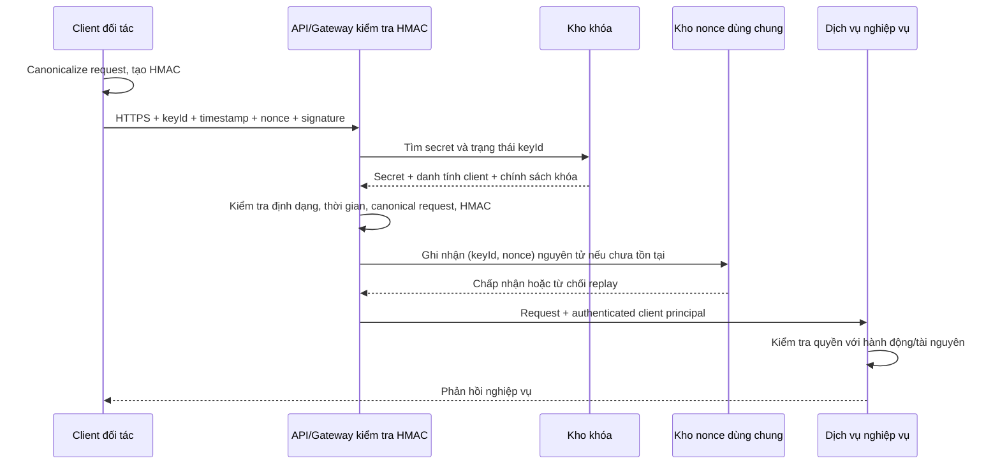

# Client authenticity — Xác thực ứng dụng khách bằng HMAC

Trong chương **Tổng quan HMAC request auth**, *client authenticity* là khả năng máy chủ kiểm tra xem một HTTP request có được tạo bởi thực thể đang sở hữu **shared secret** đã đăng ký cho một ứng dụng khách (client) hay không. Với HMAC, client và server dùng cùng khóa bí mật để tính và kiểm tra mã xác thực dựa trên một biểu diễn thống nhất của request (*canonical request*).

Đây là xác thực **ứng dụng/hệ thống gọi API** (machine-to-machine), không tự động xác thực người dùng cuối. Bài học đi từ ý nghĩa của danh tính client, hợp đồng ký, cách xác minh đến chống replay, xoay vòng khóa, giao tiếp qua proxy/gateway và ranh giới với phân quyền.

## 1. Mục tiêu học tập

Sau bài này, người học có thể:

1. Giải thích chính xác HMAC chứng minh điều gì về client, và điều gì HMAC **không** chứng minh.
2. Thiết kế hợp đồng ký thống nhất cho HTTP method, URI, một số header và body; giải thích vì sao mọi phía phải tạo cùng canonical request.
3. Mô tả quy trình xác minh chữ ký bằng HMAC-SHA256, so sánh an toàn và ánh xạ `keyId` sang danh tính ứng dụng.
4. Kết hợp timestamp và nonce để chống phát lại request, kể cả khi nhiều server cùng xử lý.
5. Nêu được cách xoay vòng/thu hồi khóa, kiểm thử qua proxy hoặc gateway và tách xác thực khỏi phân quyền.

## 2. “Authenticity” trong HMAC thực sự là gì?

Giả sử hệ thống đặt hàng cấp riêng cho đối tác A một `keyId` và một shared secret. Khi A gửi request, A tạo chữ ký:

\[
\text{signature} = \operatorname{HMAC}_{\mathrm{SHA256}}(\text{secret},\ \text{UTF8}(\text{canonicalRequest}))
\]

Máy chủ tìm secret theo `keyId`, dựng lại **chính xác** canonical request từ request nhận được, tự tính HMAC rồi so sánh với chữ ký do client gửi. Nếu kết quả trùng nhau và các điều kiện kiểm tra khác đều hợp lệ, máy chủ có căn cứ để gắn request với danh tính ứng dụng đã được cấp khóa đó.

Ví dụ: một đối tác gọi `POST /v1/orders`, máy chủ xác minh thành công với `keyId=partner-a:2026-11`. Danh tính xác thực được là **ứng dụng của đối tác A sở hữu khóa này**, không phải mặc nhiên là “người dùng Nguyễn Văn B đã đặt hàng”. Muốn biết người dùng cuối, hệ thống cần cơ chế xác thực và ủy quyền tương ứng, có thể gắn thêm ngữ cảnh người dùng được xác minh độc lập.

| HMAC có thể hỗ trợ xác nhận | HMAC không tự bảo đảm |
| --- | --- |
| Bên gửi biết secret tương ứng với `keyId` đang hoạt động. | Ai là người thực sự sử dụng secret nếu secret bị chia sẻ hoặc đánh cắp. |
| Các phần **được đưa vào dữ liệu ký** không bị sửa mà vẫn giữ nguyên chữ ký hợp lệ. | Các header, tham số hoặc dữ liệu không được ký vẫn toàn vẹn. |
| Request được ràng buộc với client đã đăng ký, nếu mỗi client có khóa riêng và máy chủ tra cứu đúng. | Client có quyền thực hiện mọi nghiệp vụ hay truy cập mọi tài nguyên. |
| Chữ ký có thể được kiểm tra mà không gửi secret qua mạng. | Bí mật nội dung, chống nghe lén, xác thực máy chủ, chống replay nếu chưa thiết kế bổ sung. |

HMAC là **MAC đối xứng**: server cũng biết secret và có khả năng tạo chữ ký giống client. Vì thế HMAC **không cung cấp tính không thể chối bỏ (non-repudiation)** như chữ ký số dùng khóa bất đối xứng. Ngay cả chữ ký hợp lệ cũng không phân biệt được client hợp pháp với kẻ đã lấy được secret.

**HTTPS/TLS vẫn bắt buộc** để mã hóa đường truyền và xác thực máy chủ. HMAC ở tầng ứng dụng bổ sung việc xác thực client cùng tính toàn vẹn của dữ liệu được ký; nó không thay thế TLS.

## 3. Luồng xác thực một HTTP request



Điểm cốt lõi là **chữ ký hợp lệ chỉ là một điều kiện**. Request còn phải đến trong khoảng thời gian cho phép, có nonce chưa dùng, dùng khóa còn hiệu lực, đúng đối tượng API và thỏa điều kiện phân quyền trước khi thực hiện nghiệp vụ.

Nếu gateway xác thực thay backend, backend chỉ được tin danh tính do gateway truyền khi kênh gateway → backend đã được bảo vệ và backend không thể bị gọi trực tiếp để giả mạo header danh tính. Gateway phải loại bỏ các header danh tính do client tự gửi trước khi thêm ngữ cảnh đã xác minh.

## 4. Thiết kế hợp đồng ký: tất cả bên tham gia phải thống nhất

Không có một cách canonicalize HTTP request duy nhất áp dụng cho mọi hệ thống HMAC. Phía client và phía server **phải cùng công bố, triển khai và kiểm thử một phiên bản hợp đồng**. Ví dụ hợp đồng `HMAC-SHA256-V1` bên dưới dành cho API JSON của dịch vụ đặt hàng; đây là một thiết kế minh họa, không phải chuẩn bắt buộc cho mọi API.

| Thành phần | Quy ước minh họa của V1 | Vì sao cần |
| --- | --- | --- |
| Thuật toán | HMAC-SHA256; chữ ký mã hóa Base64 chuẩn; không cắt ngắn MAC. | Tránh mơ hồ thuật toán và dạng byte kết quả. |
| `X-Key-Id` | ID khóa công khai, ví dụ `partner-a:2026-11`; tra cứu đúng một khóa và một client. | Xác định secret và principal; bản thân ID không phải bí mật. |
| `X-Timestamp` | Chuỗi UTC theo ISO-8601, ví dụ `2026-11-28T02:00:00Z`. | Giới hạn thời gian request có thể được nhận. |
| `X-Nonce` | Chuỗi Base64URL ngẫu nhiên, không padding, từ ít nhất 128 bit ngẫu nhiên. | Phát hiện request gửi lại trong cửa sổ thời gian. |
| `X-Signature` | `v1=<Base64(HMAC-SHA256)>`. | Chữ ký truyền trong request; không tự đưa header này vào dữ liệu ký. |
| Method | Chữ hoa như `POST`, `PUT`; máy chủ từ chối method ngoài hợp đồng. | Không cho phép đổi hành động khi tái sử dụng chữ ký. |
| Request target | `raw path` + `?raw query` nếu có, đúng thứ tự và cách mã hóa đã gửi; không chứa scheme, host hay fragment. | Ràng buộc đường dẫn và các tham số truy vấn. |
| `Content-Type` | Với ví dụ này chấp nhận chính xác `application/json`. | Ràng buộc cách diễn giải body. |
| Body | SHA-256 của **byte body thực tế**, viết hex chữ thường. Body rỗng vẫn có SHA-256 riêng. | Phát hiện thay đổi payload, không phụ thuộc cách parse JSON. |
| Audience | Giá trị cấu hình cố định `orders-api-prod` được đưa vào canonical request. | Ngăn dùng chữ ký ở dịch vụ/môi trường khác nếu khóa bị tái sử dụng. |
| Ký tự nối | UTF-8; các dòng nối bằng LF (`\n`); **không** thêm LF cuối. | Client và server tính trên cùng mảng byte. |

Ví dụ client gửi:

```http
POST /v1/orders?currency=VND&sort=asc HTTP/1.1
Host: api.example.test
Content-Type: application/json
X-Key-Id: partner-a:2026-11
X-Timestamp: 2026-11-28T02:00:00Z
X-Nonce: F4tbYLaDqKcm2-Cv37XBHg
X-Signature: v1=<BASE64_HMAC_SHA256>

{"sku":"BK-42","quantity":2}
```

Với body đúng như ví dụ (không có ký tự xuống dòng cuối), nội dung canonical của V1 là:

```text
HMAC-SHA256-V1
orders-api-prod
POST
/v1/orders?currency=VND&sort=asc
content-type:application/json
x-key-id:partner-a:2026-11
x-timestamp:2026-11-28T02:00:00Z
x-nonce:F4tbYLaDqKcm2-Cv37XBHg
sha256:<LOWERCASE_HEX_SHA256_OF_RAW_BODY>
```

Hai chuỗi trong dấu `<...>` là **placeholder minh họa**, không phải hash/chữ ký có thể sử dụng. Client thay dòng cuối bằng `sha256:` ghép với mã hex của SHA-256 trên body byte; sau đó tính HMAC từ **toàn bộ** chuỗi canonical và mã hóa kết quả thành Base64 trong `X-Signature`.

Không ký mỗi body hoặc mỗi URI: nếu method, tenant, đường dẫn hay tham số truy vấn ảnh hưởng đến hành động nhưng không được ràng buộc trong chữ ký, kẻ tấn công có thể thay trường đó mà chữ ký vẫn trùng. Ngược lại, nếu header được ký nhưng proxy sửa giá trị, request hợp lệ có thể thất bại. Do đó chỉ ký những thành phần cần bảo vệ và có quy tắc truyền ổn định; với các trường định tuyến nhạy cảm như host, tenant, audience phải ràng buộc bằng chính sách hoặc đưa trực tiếp vào hợp đồng ký.

### Vì sao canonicalization dễ sai?

- `/v1/items?a=1&b=2` khác byte với `/v1/items?b=2&a=1` trong hợp đồng giữ nguyên raw query; không tự sắp xếp query ở phía server nếu client không làm tương tự.
- `%2F`, `%2f` và `/` có thể được framework hoặc proxy xử lý khác nhau; không tự decode rồi encode lại request target. Định nghĩa duy nhất nơi lấy **request target gốc**.
- JSON `{"a":1,"b":2}` và `{"b":2,"a":1}` có thể tương đương về mặt dữ liệu nhưng **khác byte**; không parse rồi serialize lại trước khi hash.
- Hai header trùng tên, khoảng trắng, xuống dòng bất hợp lệ, nhiều giá trị `Content-Type` hoặc tên header không phân biệt hoa/thường cần quy định rõ. Với V1 minh họa, từ chối request có header ký bị lặp hoặc giá trị không đúng định dạng, thay vì đoán cách nối.
- Không dùng mã hóa mặc định của máy khi tính HMAC trên chuỗi: phải xác định UTF-8, LF, thứ tự dòng và có/không có LF cuối.

## 5. Xác minh và gắn danh tính client trong Java

Đoạn Java 17 sau thể hiện lõi kiểm tra của hợp đồng V1 dành cho API nhận JSON body. Nó nhận `rawTarget` và `body` đã được lớp HTTP adapter lưu **nguyên bản**, giả định adapter bảo đảm mỗi header ký chỉ xuất hiện một lần. Kho khóa và kho nonce là các interface để ứng dụng cài đặt theo hạ tầng thực tế.

```java
import java.nio.charset.StandardCharsets;
import java.security.GeneralSecurityException;
import java.security.MessageDigest;
import java.time.Duration;
import java.time.Instant;
import java.time.format.DateTimeParseException;
import java.util.Base64;
import java.util.HexFormat;
import javax.crypto.Mac;
import javax.crypto.spec.SecretKeySpec;

public final class HmacRequestVerifier {
    private static final Duration WINDOW = Duration.ofMinutes(5);
    private static final String AUDIENCE = "orders-api-prod";

    public record SignedRequest(
            String method, String rawTarget, String contentType,
            String keyId, String timestamp, String nonce,
            String signature, byte[] rawBody) {}

    // Một keyId chỉ ánh xạ tới một client, một secret và trạng thái hiệu lực.
    public record Credential(String clientId, byte[] secret) {}
    public record AuthenticatedClient(String clientId, String keyId) {}

    public interface KeyRegistry {
        Credential findActive(String keyId);
    }

    public interface NonceStore {
        // Atomic insert-if-absent; tất cả instance phải chia sẻ cùng store.
        boolean claim(String keyId, String nonce, Instant expiresAt);
    }

    public static AuthenticatedClient verify(
            SignedRequest req, Instant now,
            KeyRegistry keys, NonceStore nonces)
            throws GeneralSecurityException {

        if (req == null || req.rawBody() == null
                || req.method() == null || req.rawTarget() == null
                || req.contentType() == null || req.keyId() == null
                || req.timestamp() == null || req.nonce() == null
                || req.signature() == null) {
            throw denied();
        }
        if (!req.method().matches("POST|PUT|PATCH")
                || !"application/json".equals(req.contentType())
                || !req.rawTarget().startsWith("/")
                || req.rawTarget().contains("#")
                || req.rawTarget().contains("\r")
                || req.rawTarget().contains("\n")
                || !req.keyId().matches("[A-Za-z0-9:_-]{1,80}")
                || !req.nonce().matches("[A-Za-z0-9_-]{22,128}")) {
            throw denied();
        }

        Instant sentAt;
        try {
            sentAt = Instant.parse(req.timestamp());
        } catch (DateTimeParseException ex) {
            throw denied();
        }
        if (Duration.between(sentAt, now).abs().compareTo(WINDOW) > 0) {
            throw denied();
        }

        Credential credential = keys.findActive(req.keyId());
        if (credential == null) {
            throw denied();
        }

        String bodyHash = HexFormat.of().formatHex(
                MessageDigest.getInstance("SHA-256").digest(req.rawBody()));
        String canonical = String.join("\n",
                "HMAC-SHA256-V1",
                AUDIENCE,
                req.method(),
                req.rawTarget(),
                "content-type:" + req.contentType(),
                "x-key-id:" + req.keyId(),
                "x-timestamp:" + req.timestamp(),
                "x-nonce:" + req.nonce(),
                "sha256:" + bodyHash);

        Mac mac = Mac.getInstance("HmacSHA256");
        mac.init(new SecretKeySpec(credential.secret(), "HmacSHA256"));
        byte[] expected = mac.doFinal(
                canonical.getBytes(StandardCharsets.UTF_8));

        if (!req.signature().startsWith("v1=")) {
            throw denied();
        }
        byte[] supplied;
        String encoded = req.signature().substring(3);
        try {
            supplied = Base64.getDecoder().decode(encoded);
        } catch (IllegalArgumentException ex) {
            throw denied();
        }
        if (supplied.length != 32
                || !Base64.getEncoder().encodeToString(supplied).equals(encoded)
                || !MessageDigest.isEqual(expected, supplied)) {
            throw denied();
        }

        // Chỉ giữ nonce sau khi chữ ký hợp lệ, trước khi tạo side effect.
        // Chừa biên an toàn để nonce không hết hạn ngay sát mép cửa sổ.
        if (!nonces.claim(req.keyId(), req.nonce(),
                sentAt.plus(WINDOW).plusSeconds(30))) {
            throw denied();
        }
        return new AuthenticatedClient(
                credential.clientId(), req.keyId());
    }

    private static SecurityException denied() {
        return new SecurityException("Invalid HMAC request");
    }
}
```

Lưu ý khi tích hợp đoạn lõi này:

1. `rawTarget` phải được lấy ở điểm HTTP đáng tin cậy, trước bất kỳ thao tác rewrite làm thay đổi dữ liệu ký; `rawBody` là byte body thực nhận. Nếu đọc body trong filter, phải lưu/bọc lại để handler vẫn đọc được; đồng thời giới hạn kích thước body để chống lạm dụng tài nguyên.
2. Adapter cần kiểm tra header bắt buộc, header trùng lặp, các giá trị có ký tự điều khiển và request target không hợp lệ trước khi tạo `SignedRequest`. Nếu hỗ trợ GET hoặc body rỗng, hãy mô tả và kiểm thử hợp đồng tương ứng một cách tường minh.
3. `KeyRegistry.findActive` còn phải xét key có thuộc môi trường, audience, tenant và phạm vi API này hay không; secret phải đến từ hệ thống quản lý bí mật, không hardcode. Ứng dụng thực tế nên giới hạn cả số lượng request, độ dài header/query và số lần xác minh thất bại.
4. `NonceStore.claim` phải là thao tác **nguyên tử** (ví dụ Redis `SET key value NX EX` với thời hạn tương ứng), dùng chung giữa các instance/vùng xử lý. Không thay bằng `contains` rồi `put` tách biệt vì hai request đồng thời có thể cùng vượt qua.
5. `MessageDigest.isEqual` dùng so sánh byte có khả năng chống rò rỉ thông qua thời gian tốt hơn so sánh chuỗi thông thường. Sau xác minh, truyền `AuthenticatedClient` vào security context để backend quyết định phân quyền.

Đây là ví dụ lõi xác thực, chưa phải HTTP middleware hoàn chỉnh. Khi đưa vào sản xuất cần xử lý các trường hợp lỗi của kho nonce, thống nhất phản hồi lỗi, theo dõi audit, chuẩn hóa HTTP adapter và kiểm thử xuyên suốt đường đi của request.

## 6. Chống replay: timestamp và nonce giải quyết hai vấn đề khác nhau

Một chữ ký hợp lệ có thể bị sao chép nguyên request và gửi lại. Nếu server chỉ so HMAC, request đã ký hôm qua vẫn có thể được chấp nhận. Hai cơ chế phối hợp:

- **Timestamp:** chỉ chấp nhận request có thời điểm ký trong cửa sổ, ví dụ độ lệch tối đa ±5 phút so với đồng hồ server. Các node cần đồng bộ thời gian; client cũng phải sử dụng nguồn giờ đáng tin cậy.
- **Nonce:** một giá trị ngẫu nhiên khó đoán, mỗi request dùng một lần. Server lưu khóa kết hợp `(keyId, nonce)` rồi từ chối mọi lần sử dụng tiếp theo trong thời gian còn hiệu lực.

Thứ tự khuyến nghị: kiểm tra định dạng và timestamp → tìm khóa còn hiệu lực → tính lại HMAC, so sánh an toàn → **claim nonce nguyên tử** → thực thi nghiệp vụ. Không chiếm nonce trước khi xác minh HMAC, nếu không kẻ tấn công có thể làm đầy bộ nhớ hoặc chiếm nonce của request hợp lệ bằng các request giả.

Giả sử cửa sổ là ±300 giây. Một request với timestamp **ở tương lai 300 giây** vẫn có thể được chấp nhận ngay; về lý thuyết timestamp đó còn hợp lệ thêm tối đa **600 giây** tính từ thời điểm đầu tiên server nhận. Vì vậy TTL nonce phải kéo dài đến sau khi timestamp hết hạn (`timestamp + 300 giây`, cộng biên an toàn theo hạ tầng), hoặc dùng TTL ít nhất `2 × window` tính từ lúc claim. TTL chỉ 300 giây từ lần nhận đầu **có thể** cho phép phát lại với timestamp tương lai.

Nếu kho nonce không sẵn sàng, API có yêu cầu chống replay phải **fail closed** (từ chối hoặc tạm ngừng nhận request), không bỏ qua kiểm tra. Mọi vùng/instance tiếp nhận request cho cùng tập key phải có cơ chế chống replay nhất quán; bộ nhớ cục bộ theo từng pod không đáp ứng yêu cầu này.

**Replay khác retry và idempotency:** Sau lỗi mạng, client cần ký request retry bằng nonce/timestamp mới. Dù retry đã hợp lệ HMAC và nonce, cùng một đơn hàng vẫn có thể được tạo hai lần. Dùng thêm `Idempotency-Key` ở tầng nghiệp vụ, ràng buộc key với client và nội dung request, để xử lý retry an toàn; HMAC không thay thế tính idempotent.

## 7. Vòng đời danh tính client và key rotation

Danh tính xác thực nên được quản lý riêng cho **mỗi ứng dụng tích hợp và mỗi môi trường**. Không dùng một secret chung cho toàn bộ đối tác: khi secret bị lộ sẽ không thể xác định client nào bị ảnh hưởng, cũng khó thu hồi có chọn lọc.

Quy trình quản lý khóa điển hình:

1. **Provision:** tạo secret ngẫu nhiên đủ mạnh (ví dụ ít nhất 256 bit), gán `keyId` duy nhất, `clientId`, audience/môi trường, trạng thái và phạm vi được phép; chuyển secret tới client qua kênh bảo mật. Không đặt secret trong Git, log, URL hoặc thông báo lỗi.
2. **Activate:** client dùng `keyId` mới để ký. Server tìm secret qua registry được bảo vệ, phân quyền truy cập secret theo nhu cầu tối thiểu.
3. **Overlap có kiểm soát:** trong giai đoạn đổi khóa, server cho phép đồng thời key cũ và key mới **với keyId khác nhau**, mỗi request chỉ được xác minh bằng khóa tương ứng với keyId mà nó khai báo; tuyệt đối tránh “thử mọi khóa đến khi trùng”.
4. **Retire/revoke:** sau khi client chuyển hết và vượt khoảng thời gian chấp nhận request cũ, vô hiệu hóa key cũ; nếu nghi lộ khóa, thu hồi ngay, đồng thời theo dõi, điều tra và xử lý các hệ quả liên quan.

Ví dụ `partner-a:2026-11` đang hoạt động, `partner-a:2027-02` được cấp trước. Client chuyển sang ký bằng khóa mới, máy chủ vẫn tạm chấp nhận khóa cũ trong cửa sổ chuyển đổi. Cả hai khóa đều ánh xạ về cùng `clientId=partner-a` nhưng có thể được thu hồi độc lập. Cần thống nhất thời gian hiệu lực, thời gian cache registry và cơ chế lan truyền lệnh thu hồi; cache quá lâu có thể khiến server tiếp tục chấp nhận khóa đã bị khóa.

Không ghi secret, canonical request chứa dữ liệu nhạy cảm hoặc signature đầy đủ vào log. Khi cần audit, lưu `clientId`, `keyId`, thời điểm, request ID, kết quả và lý do thất bại đã được làm sạch; hạn chế PII và bảo vệ hệ thống quan sát.

## 8. Proxy, API gateway và lỗi canonical request

Đường đi thực tế thường là client → CDN/WAF → reverse proxy → gateway → backend. Những thành phần trung gian có thể:

- Thay đổi `Host`, scheme HTTP/HTTPS nội bộ hoặc URL prefix; chuẩn hóa đường dẫn, phần trăm mã hóa (`%2F`), thứ tự hoặc dạng query.
- Thêm/xóa/sắp xếp header, gộp header trùng hoặc chỉnh `Content-Type`.
- Giải nén, mã hóa lại, chuyển đổi hoặc buffer body khiến byte body phía xác minh khác với byte client đã ký.

Nếu client ký dữ liệu ở mép mạng nhưng backend tính trên request đã bị rewrite, HMAC sẽ sai dù cả hai giữ đúng secret. Cách giải quyết phổ biến là **xác minh ngay tại gateway trước khi rewrite**, rồi truyền principal đã xác thực đến backend qua kênh tin cậy. Nếu bắt buộc xác minh ở backend, cần hợp đồng bảo toàn dữ liệu gốc an toàn và kiểm thử thật qua từng tầng trung gian.

Không lấy `X-Forwarded-Host`, `X-Original-URI` hoặc các header “original request” do bên ngoài tự gửi làm nguồn dữ liệu ký đáng tin. Chỉ sử dụng thông tin mà **proxy tin cậy** đã ghi và đã ngăn client giả mạo. Nếu host/tenant quyết định nơi request được thực thi, phải kiểm tra host/tenant theo cấu hình tin cậy và ràng buộc đúng audience, không để một chữ ký hợp lệ ở dịch vụ này dùng lại cho dịch vụ khác.

## 9. Xác thực khác phân quyền

Sau khi HMAC được xác minh, API có thể biết **client nào** gửi request. Bước tiếp theo là quyết định client đó **được làm gì**.

| Bước | Câu hỏi | Ví dụ |
| --- | --- | --- |
| Authentication | “Request có được ký đúng bằng secret đang cấp cho client A không?” | `keyId=partner-a:2026-11` → principal `partner-a`. |
| Authorization | “Client A có được hủy đơn hàng số 42 không?” | Chỉ có quyền `orders:create`, không có `orders:cancel` → từ chối. |
| Business validation | “Đơn hàng số 42 hiện có thể hủy không?” | Đơn đã giao → từ chối dù client có quyền hủy. |

Thông thường, header thiếu/chữ ký sai/timestamp hết hạn/nonce trùng là **lỗi xác thực** (thường trả `401 Unauthorized` với thông điệp chung). Request đã xác thực nhưng thiếu quyền là **`403 Forbidden`**. Dữ liệu request sai cấu trúc có thể là `400 Bad Request`. Không phản hồi cho client thông tin như “khóa này có tồn tại nhưng secret sai”, tránh giúp dò credential; server vẫn có thể log mã lỗi nội bộ an toàn.

Không dùng trực tiếp giá trị `X-Key-Id` trước xác minh làm principal hoặc tenant; đó chỉ là **lời khai danh tính** cho đến khi chứng minh sở hữu secret.

## 10. Tình huống kiểm thử bắt buộc

| Tình huống | Kỳ vọng |
| --- | --- |
| Request chuẩn với khóa hoạt động, đúng audience, body và thời gian | Xác thực thành công, gắn đúng principal. |
| Thay một byte body, method, raw path, query hoặc header đã ký | Chữ ký sai, từ chối. |
| Hai cách viết JSON cùng ý nghĩa nhưng khác thứ tự/space | Không dùng chung chữ ký nếu body byte khác. |
| Timestamp quá cũ hoặc quá xa tương lai | Từ chối, kể cả chữ ký hợp lệ. |
| Phát lại cùng `keyId + nonce` trong cửa sổ | Chỉ một request được claim thành công, kể cả gửi đồng thời đến hai instance. |
| Ký lại cùng nghiệp vụ bằng nonce mới | HMAC có thể hợp lệ; idempotency nghiệp vụ phải xử lý trùng lặp. |
| Sai `keyId`, key bị revoke, dùng khóa của môi trường khác | Từ chối dù định dạng hợp lệ. |
| Giai đoạn rotation có cả khóa cũ và mới | Chấp nhận từng key còn hiệu lực, loại bỏ key đã hết hiệu lực. |
| Header ký bị trùng, ký tự điều khiển, Base64 không hợp lệ | Từ chối an toàn, không ghép/đoán dữ liệu. |
| Request đi qua CDN/gateway với rewrite path, query, header, body | Chỉ chấp nhận nếu nơi xác minh thấy dữ liệu đúng hợp đồng; kiểm tra cả cấu hình proxy. |
| Header giả mạo principal từ client ngoài | Gateway loại bỏ; backend chỉ tin principal từ đường đi nội bộ bảo vệ. |
| Request hợp lệ nhưng client thiếu quyền trên resource | Xác thực thành công; phân quyền trả `403`. |
| Kho nonce không sẵn sàng | Không bỏ qua chống replay; xử lý lỗi theo chính sách fail closed. |

Nên có **test vector chung** cho nhiều ngôn ngữ (method, URI raw, từng header, byte body, hash, canonical string, Base64 signature mong đợi) để phát hiện sai khác newline, Unicode, query encoding và cách xây chuỗi. Ngoài unit test trên hàm HMAC, cần integration test đi qua đúng gateway/proxy mà hệ thống sử dụng.

## 11. Những ngộ nhận cần tránh

- **“Có keyId là đủ để tin client.”** Không: keyId là định danh công khai để tìm secret, chưa chứng minh sở hữu secret.
- **“Chữ ký đúng thì người dùng/đối tác được phép làm tất cả.”** Không: phải kiểm tra scope, tenant, resource và quy tắc nghiệp vụ.
- **“HMAC tự chống replay.”** Không: cùng request có cùng chữ ký; cần timestamp, nonce và kho dùng chung, và idempotency nếu nghiệp vụ cần.
- **“Cùng JSON thì cùng chữ ký.”** Không nếu hợp đồng hash body raw bytes.
- **“HTTPS hoặc HMAC có thể thay thế nhau.”** Không: TLS bảo vệ kênh và danh tính máy chủ; HMAC xác thực client ở lớp ứng dụng dựa trên shared secret.
- **“Xoay khóa chỉ là đổi secret ở một nơi.”** Không: phải có keyId/version, kế hoạch chuyển đổi, thu hồi, giám sát và đồng bộ giữa client với các server.

**Tự kiểm tra:** Nếu nhận một request có chữ ký hợp lệ, timestamp nằm trong 5 phút nhưng nonce đã được ghi nhận, có nên cho qua? **Không**; đó là replay theo hợp đồng. Nếu request dùng nonce mới và chữ ký hợp lệ nhưng client không có quyền `orders:cancel`, có nên thực hiện hủy? **Không**; xác thực thành công không đồng nghĩa được phân quyền.

Điểm cần ghi nhớ: **client authenticity** trong HMAC là kết luận có giới hạn và có điều kiện về **thực thể sở hữu secret gắn với client**. Chỉ có ý nghĩa an toàn khi canonical request ràng buộc đúng những gì sẽ được thực thi, secret được quản lý đúng vòng đời, replay được chặn và quyền nghiệp vụ được kiểm tra riêng.
