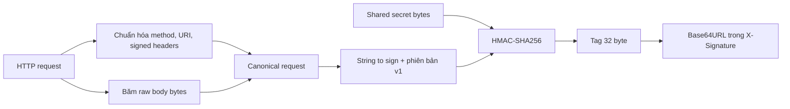

# Thuật ngữ cốt lõi trong xác thực HTTP request bằng HMAC

> **Phạm vi:** Bài học thuộc chương *Tổng quan HMAC request auth*, giới thiệu các thuật ngữ cần dùng khi thiết kế xác thực HTTP request bằng HMAC với **shared secret**. Trọng tâm là hợp đồng ký (method, URI, header, body), xác minh chữ ký, chống replay bằng timestamp/nonce, luân chuyển khóa và các ranh giới tin cậy qua proxy/gateway.

## 1. HMAC request authentication là gì?

**HMAC request authentication** là cơ chế để bên nhận kiểm tra một HTTP request có được tạo bởi bên đang nắm **khóa bí mật dùng chung** và các **thành phần đã ký** có bị thay đổi trong quá trình truyền hay không. Bên gửi tính một giá trị HMAC từ thông điệp theo hợp đồng đã thỏa thuận; bên nhận dùng cùng khóa để tính lại và so sánh.

Ví dụ: một đối tác gọi `POST /v1/payments` đến API của hệ thống. Thay vì gửi shared secret trong từng request, họ gửi **key ID**, **timestamp**, **nonce** và **signature**. Máy chủ tìm khóa tương ứng, dựng lại nội dung cần ký và kiểm tra signature trước khi xử lý nghiệp vụ.

HMAC không tự động mã hóa nội dung, không ngăn nghe lén và không chứng minh danh tính của một người dùng cụ thể. Cơ chế này thường dùng **HTTPS/TLS** để bảo vệ kênh truyền, và vẫn cần bước **authorization (phân quyền)** sau khi xác thực.

## 2. Thuật ngữ mật mã và danh tính

| Thuật ngữ | Ý nghĩa trong HMAC request auth | Điểm cần nhớ |
| --- | --- | --- |
| **HTTP request** | Yêu cầu gồm method, request target (đường dẫn/query), headers và có thể có body. | Chỉ các thành phần được đưa vào hợp đồng ký mới được bảo vệ bằng HMAC. |
| **Client / Caller** | Dịch vụ, ứng dụng hoặc đối tác gửi request. | Cần biết client nào đang sở hữu khóa; không tự đồng nhất client với người dùng cuối. |
| **Principal** | Danh tính đã xác thực mà máy chủ gắn vào request, chẳng hạn `partner:merchant_42`. | Principal là đầu vào cho kiểm tra quyền. |
| **Shared secret (khóa bí mật dùng chung)** | Chuỗi **byte bí mật** do bên gửi và bên nhận cùng giữ để tính HMAC. | Không đưa secret vào HTTP request, URL, log hay mã nguồn; lưu bằng kho bí mật thích hợp. |
| **Key ID / Credential ID** | Định danh công khai để tra cứu khóa phù hợp, ví dụ `merchant_42_k2`. | Key ID **không phải secret**, và chỉ có ý nghĩa khi được gắn với một client/principal ở phía máy chủ. |
| **Hash / Digest** | Giá trị băm một chiều của dữ liệu, ví dụ `SHA-256(bodyBytes)`. | Hash thường không dùng khóa; biết digest không chứng minh ai đã gửi dữ liệu. |
| **HMAC** | *Hash-based Message Authentication Code*: mã xác thực thông điệp dùng khóa và hàm băm, ví dụ `HMAC-SHA256`. | Cần cả **key** lẫn **message bytes**; không phải “SHA-256 nối secret”. |
| **MAC / Authentication tag** | Kết quả byte thô do thuật toán HMAC sinh ra. | Với HMAC-SHA256, tag dài **32 byte**. |
| **Signature (chữ ký yêu cầu)** | Tên thường dùng trong HTTP cho tag HMAC đã mã hóa để gửi qua header. | Đây là **chữ ký đối xứng** theo cách gọi API, khác chữ ký số bất đối xứng. |
| **Algorithm** | Thuật toán và tham số xác minh; ví dụ `HMAC-SHA256`. | Client và server phải dùng cùng thuật toán, cách mã hóa và phiên bản hợp đồng. |
| **Encoding** | Cách biểu diễn byte bằng text, thường là hex, Base64 hoặc Base64URL. | Kết quả HMAC là byte; Base64URL chỉ **mã hóa biểu diễn**, không mã hóa bí mật. |
| **Constant-time comparison** | So sánh các tag theo cách hạn chế rò rỉ thông tin qua thời gian chạy. | Không dùng so sánh chuỗi thông thường làm phép kiểm tra bảo mật cuối cùng. |

### Phân biệt hash, HMAC và chữ ký số

| Cơ chế | Cần khóa? | Dùng để làm gì? | Ai có thể kiểm chứng? |
| --- | --- | --- | --- |
| `SHA-256(message)` | Không | Phát hiện khác biệt của dữ liệu khi có digest đáng tin cậy. | Bất kỳ ai có message. |
| `HMAC-SHA256(secret, message)` | Có, **khóa đối xứng** | Kiểm tra tính toàn vẹn và việc bên tạo tag biết shared secret. | Bên nào biết cùng shared secret. |
| Chữ ký số, ví dụ Ed25519 | Có **private key** để ký | Kiểm chứng chữ ký dựa trên khóa công khai. | Bên giữ public key, không cần biết private key. |

Vì hai phía đều giữ shared secret, **HMAC không cung cấp tính không thể chối bỏ** như một mô hình chữ ký bất đối xứng có quản trị khóa phù hợp: bên xác minh cũng có khả năng tạo tag hợp lệ.

## 3. Thuật ngữ về hợp đồng ký và canonicalization

Trên HTTP, cùng một ý nghĩa nghiệp vụ có thể được biểu diễn thành nhiều chuỗi byte khác nhau: thứ tự query parameter, chữ hoa/thường của tên header, dấu cách, cách mã hóa URI hoặc serialization JSON. HMAC hoạt động trên **byte cụ thể**, vì vậy hai phía cần một quy tắc chung để chọn và chuẩn hóa dữ liệu.

| Thuật ngữ | Định nghĩa thực hành |
| --- | --- |
| **Signing contract / Hợp đồng ký** | Thỏa thuận chính xác về trường nào phải ký, thứ tự ghép, ký tự phân tách, chuẩn mã hóa, cách chuẩn hóa, thuật toán, phiên bản và định dạng signature. |
| **Canonicalization / Chuẩn hóa** | Chuyển các thành phần được chọn thành một biểu diễn duy nhất theo hợp đồng, ví dụ sắp xếp query và đưa tên header về chữ thường. |
| **Canonical request** | Biểu diễn chuẩn hóa của request được dùng làm đầu vào để xây dựng dữ liệu ký. Nó có thể chứa method, path, query, signed headers và body digest. |
| **String to sign / Signing input** | **Chuỗi byte cuối cùng** đưa vào HMAC. Tùy giao thức, đây có thể chính là canonical request hoặc có thêm version, timestamp, algorithm, scope. |
| **Request target / URI** | Đường dẫn và query của request; không nhất thiết là toàn bộ URL có scheme/host. |
| **Canonical query** | Query được chuẩn hóa về mã hóa ký tự, thứ tự cặp key/value và chính sách trùng tên parameter. |
| **Signed headers** | Những header mà hợp đồng quy định phải xuất hiện trong canonical request; thường có tên header dạng chữ thường và danh sách thứ tự xác định. |
| **Payload / Body** | Dữ liệu thô của phần thân HTTP request. Body có thể rỗng. |
| **Payload hash / Body digest** | Giá trị băm từ **byte body thực tế**, đưa vào canonical request để ràng buộc nội dung mà không phải đưa toàn bộ body vào chuỗi ký. |
| **Signature header** | Header mang version và tag được biểu diễn dưới dạng text, ví dụ `X-Signature: v1=...`. Chính header này thường **không tự nằm trong phần được ký**. |
| **Canonicalization mismatch** | Bên gửi và bên nhận tạo chuỗi ký khác nhau từ cùng request logic, dẫn đến xác minh thất bại hoặc nguy hiểm hơn là hiểu khác nhau về nội dung đã được xác thực. |

**Ví dụ phân biệt:** `POST /v1/items?a=1&b=2` và `POST /v1/items?b=2&a=1` có thể tương đương đối với một ứng dụng, nhưng không có cùng chuỗi byte. Nếu hợp đồng chuẩn hóa query bằng cách sắp xếp, chúng có thể có cùng canonical query. Nếu hợp đồng ký raw query, chúng cho ra tag khác nhau. Không có quy tắc “đương nhiên đúng” cho mọi API: **cả hai phía phải thống nhất hợp đồng**.

Các chi tiết rất dễ gây sai lệch gồm:

- **URI:** percent-encoding (`%2F`, `%20`), dấu `+`, Unicode, phân biệt chữ hoa/thường, dấu `/` cuối, đường dẫn có `.`/`..`, query rỗng và query có khóa lặp.
- **Headers:** tên header không phân biệt chữ hoa/thường theo HTTP, nhưng giá trị có thể nhạy với khoảng trắng; cần quy định xử lý OWS (optional whitespace), header trùng tên và các header hop-by-hop.
- **Body:** `{"a":1,"b":2}` và `{"b":2,"a":1}` có thể mô tả cùng object JSON nhưng **khác byte**. Dùng raw body bytes, hoặc dùng một giao thức canonical JSON được định nghĩa tường minh; không tự parse rồi serialize lại trước khi băm.
- **Charset và dấu xuống dòng:** phải quy định UTF-8, LF (`\n`), trường rỗng và có/không có LF cuối cùng. `UTF-8` chỉ dùng cho chuỗi ký; body digest tính trên byte body gốc.

Nếu request sử dụng host/authority để quyết định tenant hoặc route, cần xem xét **ký cả host/authority** trong một hợp đồng nhất quán với gateway. Một trường quan trọng đối với xử lý nghiệp vụ nhưng nằm ngoài hợp đồng ký có thể bị thay đổi mà HMAC không phát hiện.

## 4. Ví dụ một hợp đồng ký `v1`

Đây là **hợp đồng minh họa**, không phải định dạng HMAC chuẩn áp dụng chung cho mọi API. Giả sử một request thanh toán được gửi như sau (body không có LF ở cuối):

```http
POST /v1/payments?orderId=42&currency=VND HTTP/1.1
Host: api.example.test
Content-Type: application/json
X-Key-Id: merchant_42_k2
X-Timestamp: 1795800000
X-Nonce: 4f0b1c2d3e4f5061728394a5b6c7d8e9
X-Signature: v1=<BASE64URL_TAG>

{"amount":100000}
```

Trong ví dụ này, hợp đồng quy định:

1. Method đưa về chữ hoa; canonical path là `/v1/payments`. Với phiên bản minh họa, chỉ chấp nhận path đã mã hóa theo quy tắc URI đã thống nhất, không tự giải mã ký tự dành riêng.
2. Query parameter được mã hóa theo RFC 3986 và sắp xếp theo **key rồi value**; từ chối tên parameter trùng lặp nếu giao thức chưa định nghĩa cách xử lý. Query không có parameter biểu diễn bằng dòng rỗng.
3. Chỉ ký bốn header bắt buộc: `content-type`, `x-key-id`, `x-nonce`, `x-timestamp`. Tên header viết thường, sắp xếp theo thứ tự chữ cái, trim khoảng trắng đầu/cuối của giá trị; từ chối bản sao trùng tên và dấu xuống dòng trong giá trị. `X-Signature` không có trong dữ liệu ký.
4. Mỗi dòng được nối bằng **LF (U+000A)**, không có LF sau dòng cuối; dùng UTF-8 cho chuỗi ký. Dòng cuối là **SHA-256 dạng hex chữ thường** của raw body bytes.
5. `stringToSign = "HMAC-SHA256/v1\n" + canonicalRequest`. Tag được tính `HMAC-SHA256(secretBytes, UTF8(stringToSign))` rồi mã hóa **Base64URL không padding** dưới dạng `X-Signature: v1=<tag>`.

Với hợp đồng đó, `canonicalRequest` là:

```text
POST
/v1/payments
currency=VND&orderId=42
content-type:application/json
x-key-id:merchant_42_k2
x-nonce:4f0b1c2d3e4f5061728394a5b6c7d8e9
x-timestamp:1795800000
content-type;x-key-id;x-nonce;x-timestamp
<SHA256_HEX_CUA_17_BYTE_BODY>
```

Dòng `<SHA256_HEX_CUA_17_BYTE_BODY>` là **ký hiệu thay thế** để giải thích cấu trúc, không phải digest thật và không dùng làm đầu vào ký. Trong hiện thực, dòng đó phải được thay bằng **64 ký tự hex** của SHA-256 từ đúng chuỗi byte `{"amount":100000}`. Giá trị `<BASE64URL_TAG>` cũng là ký hiệu thay thế, không phải chữ ký hợp lệ. Timestamp và nonce trong mẫu chỉ để minh họa, không dùng lại cho request thực tế.

Để hiểu luồng dữ liệu, có thể hình dung:



Đoạn Java sau chỉ minh họa **phép tính và so sánh HMAC** sau khi đã có canonical request và đã tách signature `v1`. Nó chưa triển khai canonicalization, kiểm tra thời gian, nonce hay phân quyền:

```java
import java.nio.charset.StandardCharsets;
import java.security.GeneralSecurityException;
import java.security.MessageDigest;
import java.util.Base64;
import javax.crypto.Mac;
import javax.crypto.spec.SecretKeySpec;

static byte[] hmacSha256(byte[] secretBytes, byte[] messageBytes)
        throws GeneralSecurityException {
    Mac mac = Mac.getInstance("HmacSHA256");
    mac.init(new SecretKeySpec(secretBytes, "HmacSHA256"));
    return mac.doFinal(messageBytes);
}

static boolean verifyTag(byte[] secretBytes,
                         String canonicalRequest,
                         String signatureBase64Url)
        throws GeneralSecurityException {
    byte[] suppliedTag;
    try {
        suppliedTag = Base64.getUrlDecoder().decode(signatureBase64Url);
    } catch (IllegalArgumentException invalidBase64) {
        return false;
    }
    if (suppliedTag.length != 32) {
        return false;
    }

    String stringToSign = "HMAC-SHA256/v1\n" + canonicalRequest;
    byte[] expectedTag = hmacSha256(
        secretBytes,
        stringToSign.getBytes(StandardCharsets.UTF_8)
    );
    return MessageDigest.isEqual(expectedTag, suppliedTag);
}
```

Trong ứng dụng thật, mã xử lý bên ngoài hàm này còn phải: chọn khóa qua key ID đáng tin cậy, giới hạn định dạng/độ dài input, kiểm tra chính xác tiền tố version, tuân thủ nghiêm định dạng Base64URL đã chọn, chống replay và xử lý lỗi thống nhất. Secret là **byte khóa**, không mặc định là chuỗi ký tự hay chính giá trị key ID.

## 5. Timestamp, nonce và chống replay

**Một request hợp lệ về HMAC có thể vẫn là request cũ được phát lại.** Kẻ nghe lén hoặc lấy được một request đã ký có thể thử gửi lại nguyên request nếu máy chủ chỉ đối chiếu HMAC. Vì thế *freshness* và *replay prevention* là hai khái niệm riêng với tính toàn vẹn.

| Thuật ngữ | Ý nghĩa | Quy tắc thực hành |
| --- | --- | --- |
| **Replay attack** | Gửi lại request đã từng hợp lệ mà không cần biết secret. | HMAC đơn lẻ không chống replay. |
| **Timestamp** | Thời điểm tạo request, thường là Unix epoch seconds. | Timestamp phải thuộc **phần được ký**; nếu không, attacker có thể sửa nó. |
| **Clock skew** | Sai khác đồng hồ giữa client và server. | Chấp nhận sai số có giới hạn, ví dụ ±5 phút; có quy định rõ đơn vị và nguồn thời gian. |
| **Freshness window** | Khoảng thời gian request được phép tới muộn hoặc sớm so với timestamp đã ký. | Request ngoài cửa sổ bị từ chối dù signature đúng. |
| **Nonce** | Giá trị dùng một lần, khó đoán, thường tạo bằng CSPRNG. | Nonce phải nằm trong dữ liệu ký và đủ entropy; chẳng hạn 128 bit ngẫu nhiên. |
| **Replay cache / Nonce store** | Kho ghi nhận nonce đã sử dụng, ví dụ Redis. | Khóa thường gồm `(keyId, nonce)`; cần thao tác ghi **atomic** và TTL đủ lâu. |
| **TTL** | Thời gian giữ khóa nonce để ngăn phát lại trong cửa sổ chấp nhận. | Với cửa sổ ±5 phút, TTL 5 phút tính từ lần tiếp nhận đầu tiên có thể quá ngắn; cần bao phủ toàn bộ khoảng còn có thể phát lại, cộng dự phòng. |
| **Idempotency key** | Mã nghiệp vụ để nhiều lần thử hợp lệ có cùng kết quả, tránh xử lý giao dịch lặp. | **Không thay thế nonce**; một retry có thể dùng nonce mới nhưng cùng idempotency key. |

Ví dụ, nếu server cho phép `abs(now - timestamp) <= 300` giây, một request được nhận khi đồng hồ server sớm hơn timestamp 300 giây vẫn có thể được phát lại trong khoảng 600 giây sau lần nhận đó. Replay cache phải giữ nonce đủ để bao trùm tình huống biên này. Với hệ thống nhiều instance, kiểm tra “đã tồn tại?” rồi ghi sau bằng hai thao tác riêng có thể dẫn tới race condition; dùng thao tác nguyên tử như `SET key value NX EX ...` tại kho chung.

**Thứ tự quan trọng:** chỉ ghi nhận nonce là đã dùng **sau khi** xác minh tag HMAC hợp lệ; nếu ghi trước, người không biết secret có thể gửi nonce của người khác để chặn request thật. Đồng thời phải đảm bảo chỉ một request xác thực thành công có thể giành được nonce trước khi bước nghiệp vụ chạy. Hệ thống cần quy định hành vi khi nonce store lỗi, nhất là với API nhạy cảm.

## 6. Key rotation và ranh giới qua proxy/gateway

### Key lifecycle (vòng đời khóa)

| Thuật ngữ | Diễn giải |
| --- | --- |
| **Provisioning** | Cấp shared secret có entropy cao cho một client qua kênh bảo mật; gắn secret với key ID và phạm vi sử dụng. |
| **Active key** | Khóa được client dùng để ký request mới. |
| **Rotation** | Cấp khóa mới, chuyển bên ký sang key ID mới và thu hồi khóa cũ theo lịch. |
| **Overlap / Grace period** | Khoảng chuyển tiếp server có thể xác minh bằng cả key cũ và mới, **dựa trên key ID**, để tránh gián đoạn. |
| **Revocation** | Vô hiệu hóa khóa lộ, bị lạm dụng hoặc hết hạn; có thể cần tác dụng ngay, không chờ grace period. |
| **Secret store / KMS** | Nơi lưu/quản trị secret, giảm nguy cơ lộ qua cấu hình, mã nguồn và log. |

**Ví dụ rotation:** `merchant_42_k1` đang hoạt động. Server phát hành `merchant_42_k2`, tạm thời xác minh request dùng một trong hai key ID, sau đó client chuyển sang ký bằng `k2`. Kết thúc thời gian chuyển tiếp, `k1` bị từ chối. Không nên thử tất cả secret một cách tùy tiện khi key ID không hợp lệ; phải quản lý liên kết key ID với đúng client, trạng thái và quyền.

### Proxy, gateway và trust boundary (ranh giới tin cậy)

- **Reverse proxy / API gateway** có thể thay đổi `Host`, path prefix, query encoding, giá trị header, transfer encoding hoặc body khi nhận và chuyển request. Nếu client ký trước proxy nhưng server dựng canonical request từ dữ liệu *sau* rewrite, chữ ký có thể không khớp.
- **Trusted ingress** là thành phần được hệ thống tin để xác định dữ liệu HTTP nào là nguồn sự thật. Hợp đồng phải nói rõ ký/kiểm ở cổng nào và lấy URI/headers/body từ lớp nào.
- **Forwarded headers** như `X-Forwarded-Host` và `X-Forwarded-Proto` chỉ đáng tin khi gateway đã xác thực nguồn, xóa giá trị do client tự chèn và thiết lập lại chúng. Không lấy trực tiếp header client khai báo để “khôi phục” URL cần ký.
- **Gateway verification** là mô hình gateway xác minh HMAC trước rồi chuyển tiếp thông tin danh tính đáng tin cậy vào mạng nội bộ. Hệ thống downstream phải kiểm soát khả năng client bên ngoài giả mạo các header danh tính này.
- **End-to-end verification** là mô hình service đích trực tiếp kiểm HMAC của dữ liệu được ký. Cần đảm bảo các biến đổi của gateway không làm đổi biểu diễn đã ký hoặc có cơ chế chuyển tiếp dữ liệu gốc đáng tin cậy.

Các trường hợp cần kiểm thử ít nhất: proxy thêm/bớt prefix route; đổi `Host`/`:authority`; query có `%2F` hoặc khoảng trắng; header lặp hoặc bị trim; HTTP/1.1 chuyển HTTP/2; body bị nén/giải nén hoặc parse rồi serialize. Với mỗi trường hợp, xác minh **đúng byte đầu vào** mà hai bên thống nhất ký; không “sửa” lỗi chữ ký bằng cách âm thầm loại bớt trường cần bảo vệ.

## 7. Authentication khác authorization như thế nào?

- **Authentication (xác thực):** request chứng minh được bên gửi nắm secret của `merchant_42_k2`, và signature hợp lệ cho các thành phần đã ký. Server có thể gán principal `merchant_42`.
- **Authorization (phân quyền):** sau khi xác thực, server kiểm tra `merchant_42` có quyền tạo thanh toán cho đơn hàng `42`, truy cập tenant tương ứng, và được phép gọi endpoint này hay không.
- **Integrity (toàn vẹn):** các byte nằm trong hợp đồng ký chưa bị sửa, với giả định khóa không lộ và thuật toán an toàn.
- **Confidentiality (bí mật nội dung):** HMAC không cung cấp; dùng TLS và các cơ chế bảo vệ dữ liệu phù hợp.

Một request có **signature hợp lệ** vẫn phải bị từ chối nếu principal không có quyền đối với tài nguyên được yêu cầu. Cũng không nên dùng `X-Key-Id` do client gửi như một quyền tự khai báo; key ID chỉ là dữ liệu tra cứu khóa, còn quyền do phía server xác định.

## 8. Chuỗi xác minh và các lỗi thường gặp

Luồng xác minh tham khảo (chi tiết thứ tự kiểm tra rẻ tiền có thể thay đổi theo threat model):

1. **Đọc và giới hạn input:** kiểm tra method, trường bắt buộc, version, key ID, timestamp, nonce và signature; từ chối định dạng không hợp lệ, header mơ hồ hoặc request quá giới hạn.
2. **Tra cứu credential:** tìm shared secret theo key ID trong kho đáng tin cậy; kiểm tra khóa còn hiệu lực và gắn với client nào.
3. **Kiểm tra freshness:** timestamp có nằm trong cửa sổ cho phép không? Chưa cấp quyền chỉ vì timestamp hợp lệ.
4. **Tạo canonical request:** lấy đúng các giá trị theo hợp đồng, tính body hash từ raw bytes, tạo string to sign chính xác.
5. **Xác minh tag:** tính HMAC với đúng secret, giải mã signature và so sánh các byte bằng thao tác thích hợp; request sai trả lỗi xác thực.
6. **Chống replay:** với request đã xác minh, ghi nonce theo key ID bằng thao tác atomic và TTL phù hợp; từ chối nonce đã dùng.
7. **Phân quyền và xử lý nghiệp vụ:** gán principal, kiểm tra quyền, sau đó mới thực hiện hành động. Ghi audit mà không lộ secret, signature hay dữ liệu nhạy cảm.

| Tình huống | Kết quả kỳ vọng / bài học |
| --- | --- |
| Kẻ tấn công sửa `amount` trong body | **Signature sai** vì body digest thay đổi. |
| Kẻ tấn công sửa `X-Timestamp` hoặc `X-Nonce` | **Signature sai** nếu cả hai trường nằm trong danh sách signed headers. |
| Gửi lại nguyên request vừa thành công | **Replay bị từ chối** nhờ nonce store, dù tag vẫn hợp lệ. |
| Client và server serialize JSON với thứ tự field khác nhau | **Signature sai** nếu các byte body khác; tránh tự serialize lại. |
| Proxy rewrite path trước khi service xác minh | Có thể **signature sai**; thống nhất điểm ký, kiểm và dữ liệu gốc. |
| Signature đúng nhưng client truy cập tài nguyên không được cấp quyền | **Authorization từ chối**, thường là HTTP 403. |
| Signature không đúng hoặc key ID không tồn tại | **Authentication từ chối**, thường là HTTP 401; tránh thông báo làm lộ khóa hay chi tiết kiểm tra. |

### Những ngộ nhận cần loại bỏ

1. **“Có SHA-256 rồi thì không cần secret.”** SHA-256 là hash không khóa, bất kỳ ai cũng có thể tính lại; HMAC mới dùng shared secret để xác thực.
2. **“HMAC bảo vệ toàn bộ request.”** HMAC chỉ bảo vệ những byte được đưa vào string to sign; hợp đồng ký thiếu trường quan trọng sẽ tạo lỗ hổng.
3. **“Chữ ký hợp lệ thì request không thể phát lại.”** Cần timestamp và nonce được ký, kiểm tra cửa sổ thời gian và kho nonce dùng chung.
4. **“Key ID chính là danh tính và quyền truy cập.”** Key ID chỉ giúp tra khóa; principal và quyền phải được server xác lập.
5. **“Chỉ cần hai phía dùng HMAC-SHA256 là tương thích.”** Còn phải tương thích canonicalization, charset, ký tự xuống dòng, byte body, mã hóa tag, version và xử lý proxy.
6. **“HMAC thay HTTPS.”** HMAC không che nội dung HTTP và không bảo vệ toàn bộ kênh khỏi nghe lén, chuyển hướng hay lộ metadata.

## 9. Tự kiểm tra mức hiểu thuật ngữ

**Câu 1.** Vì sao header `X-Signature` thường không nằm trong danh sách signed headers?

*Gợi ý:* Signature được tính từ string to sign; nếu chính chữ ký là đầu vào tạo ra chữ ký, quá trình định nghĩa sẽ vòng lặp.

**Câu 2.** Hai request có cùng JSON object nhưng khác khoảng trắng trong body có bắt buộc cho cùng signature không?

*Đáp án:* Không. Với hợp đồng ký `SHA-256(rawBodyBytes)`, hai body khác byte sẽ có digest và signature khác nhau.

**Câu 3.** Một request vượt thời hạn ±5 phút nhưng HMAC đúng có được xử lý không?

*Đáp án:* Không, theo hợp đồng có freshness window ±5 phút. Chữ ký đúng chứng minh tính hợp lệ của dữ liệu đã ký nhưng không chứng minh request vẫn còn mới.

**Câu 4.** Tại sao một client cần cả key ID lẫn shared secret?

*Đáp án:* Key ID giúp server biết phải dùng credential nào và gắn nó với principal; shared secret mới là byte khóa dùng để tạo/kiểm tra HMAC. Key ID có thể công khai, shared secret phải được bảo vệ.

**Câu 5.** API xác thực được `merchant_42` nhưng request sửa đơn hàng thuộc `merchant_99`. Nên kiểm tra ở tầng nào?

*Đáp án:* Tầng authorization phải xác minh quyền sở hữu/quyền thao tác với đơn hàng. Xác thực HMAC thành công không tự cấp quyền trên mọi tài nguyên.

---

**Ghi nhớ:** Khi đọc một thiết kế HMAC request auth, hãy xác định lần lượt **ai giữ secret**, **dữ liệu nào được ký**, **hai phía tạo cùng byte như thế nào**, **request còn mới và chưa bị phát lại hay không**, **khóa được luân chuyển ra sao**, và **principal có quyền làm việc được yêu cầu không**. Trả lời đủ các câu hỏi này giúp phân biệt chính xác HMAC, canonical request, signature, replay protection, authentication và authorization.
