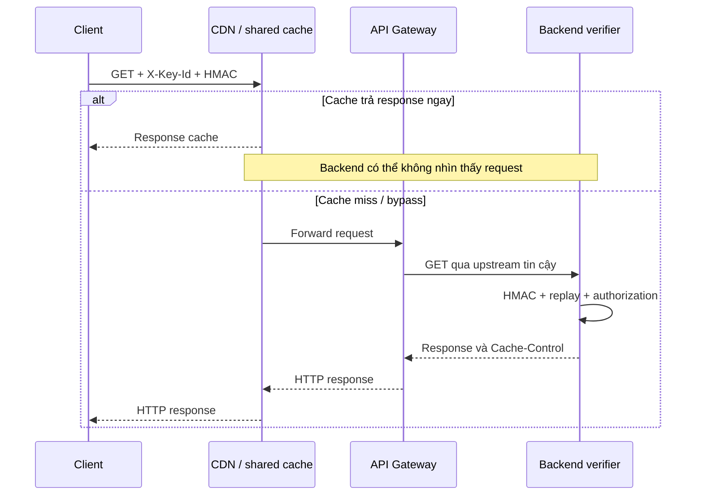

# GET request trong xác thực HTTP bằng HMAC

## 1. GET request là gì, và vì sao GET vẫn cần xác thực?

**GET** là HTTP method dùng để yêu cầu lấy biểu diễn hiện tại của một tài nguyên. Theo ngữ nghĩa HTTP, GET là **safe method**: client không yêu cầu thực hiện thay đổi trạng thái nghiệp vụ thông qua method này. GET cũng có tính **idempotent** ở mức tác động được yêu cầu: nhiều request GET giống nhau có cùng tác động dự kiến như một request. Tuy nhiên, server có thể tạo log, tính metrics hoặc thực hiện những tác động phụ nội bộ; “safe” **không** có nghĩa là “không có tác động phụ nào”, cũng không có nghĩa là “không cần bảo mật”.

Trong module `SECURITY_AUTHENTICATION_HMAC_REQUEST_AUTHENTICATION`, mục tiêu là thiết kế **xác thực HTTP request bằng HMAC với shared secret** và một **canonical request** gồm method, URI, header hoặc body theo hợp đồng ký. Người học cần biết cách xác minh chữ ký, chống replay bằng timestamp/nonce, quản lý key rotation, kiểm thử đường đi proxy/gateway và phân biệt **authentication** với **authorization**. Bài thuộc chương **HTTP method**, tập trung riêng vào **GET request** trong mô hình đó.

Ví dụ:

```http
GET /v1/accounts/A123/transactions?from=2026-11-01&limit=20 HTTP/1.1
Host: api.example.test
Accept: application/json
```

API có thể trả về lịch sử giao dịch, số dư, thông tin cá nhân hoặc tài liệu riêng tư. Một request GET không tạo lệnh chuyển tiền nhưng vẫn có thể **đọc dữ liệu nhạy cảm**. Server cần kiểm tra *ai đang yêu cầu* và *người đó được phép xem tài nguyên nào*. HMAC có thể xác thực credential và bảo vệ tính toàn vẹn của thành phần request đã ký; **authorization** tiếp tục quyết định quyền đọc tài nguyên `A123`.

Phân biệt các thuộc tính:

| Thuộc tính | GET có gì đặc biệt? | Tác động tới HMAC |
| --- | --- | --- |
| **Safe** | Được thiết kế cho thao tác đọc, không yêu cầu thay đổi trạng thái. | Không miễn trừ xác thực hoặc quyền đọc. |
| **Idempotent** | Lặp lại thao tác đọc không thay đổi tác động dự kiến của thao tác. | Không đồng nghĩa chữ ký cũ nên được replay vô hạn. |
| **Cacheable** | Response GET có thể được cache theo HTTP caching rules. | Cần tránh cache trả dữ liệu riêng của user khác hoặc bypass xác thực. |
| **Thường không có request body** | Nội dung trong GET request không có ngữ nghĩa chung được định nghĩa; nhiều thành phần trung gian không hỗ trợ hoặc xử lý khác nhau. | Hợp đồng ký nên chọn **GET không có body**, dùng SHA-256 của dãy byte rỗng nếu có dòng body digest. |
| **Có thể tự động retry/prefetch** | Browser, thư viện mạng, proxy có thể tự gửi lại, hoặc prefetch GET. | Nonce chống replay và hành vi retry phải được thiết kế cẩn thận. |

**Quy tắc quan trọng:** GET không phải “API công khai” mặc định. Một endpoint GET có thể cần cùng mức xác thực, bảo vệ transport và kiểm tra quyền như POST hoặc DELETE.

## 2. Chính xác những thành phần nào của GET phải được ký?

Một cách ký chỉ dựa vào query hoặc body digest là không đủ. Với GET, **path và query là phần nội dung nghiệp vụ đặc biệt quan trọng**: chúng thường xác định đối tượng, phạm vi, filter, phân trang và định dạng dữ liệu trả về.

Giả sử server nhận:

```text
GET /v1/accounts/A123/transactions?from=2026-11-01&limit=20
```

Nếu chữ ký không bảo vệ query, kẻ tấn công có thể thử đổi `limit=20` thành `limit=10000` hoặc `from=2026-11-01` thành `from=2010-01-01` mà MAC vẫn khớp. Nếu chữ ký bỏ path, họ có thể thử `A123` → `B999`. Kể cả khi authorization sau đó ngăn được yêu cầu trái phép, việc để request bị sửa mà không phát hiện vẫn là lỗ hổng trong **integrity contract**.

Đối với một API đọc tài khoản có xác thực HMAC, có thể chọn các field:

| Field | Có đưa vào canonical GET? | Ý nghĩa |
| --- | --- | --- |
| HTTP method `GET` | **Có**. | Chặn chữ ký dùng cho method khác nếu cùng path/query. |
| Raw path | **Có**. | Ràng buộc đúng route và tài nguyên, gồm account ID. |
| Raw query | **Có**. | Ràng buộc filter, pagination, sort, cursor và các tham số ảnh hưởng dữ liệu trả về. |
| Origin/audience | **Có**, hoặc ràng buộc tương đương bằng chính sách key/route. | Không tái sử dụng chữ ký cho service hoặc môi trường sai. |
| `Accept` | **Có trong ví dụ**. | Ràng buộc định dạng biểu diễn được yêu cầu nếu API phụ thuộc header này. |
| `X-Key-Id` | **Có**. | Cho server tra credential và giới hạn key scope. |
| `X-Signature-Version` | **Có**. | Cố định thuật toán và quy tắc canonical của profile. |
| `X-Timestamp` | **Có**. | Chống việc thay đổi thời điểm ký mà không có secret. |
| `X-Nonce` | **Có**. | Ràng buộc nonce vào chữ ký, phục vụ replay check. |
| Empty-body digest | **Có trong ví dụ**. | Duy trì canonical schema nhất quán: hash dãy byte rỗng. |
| `X-Signature` | **Không**. | MAC là **kết quả** của phép ký, được gửi ngoài message ký. |

Với những header tùy chọn như `If-None-Match`, `If-Modified-Since`, `Range` hoặc `Accept-Language`, phải quyết định chúng có ảnh hưởng đáng kể tới nội dung, chính sách hay phạm vi quyền không. Nếu endpoint hỗ trợ chúng, hợp đồng nên **ký chúng theo quy tắc rõ ràng** hoặc quy định cách kiểm soát tương đương. Để ví dụ tập trung, hợp đồng dưới đây **không hỗ trợ những header tùy chọn đó**; HTTP adapter sẽ từ chối chúng trước bước xác minh.

**Không nên ký mọi header một cách máy móc.** Các header như `Connection`, `Transfer-Encoding` hoặc `Content-Length` có thể bị HTTP stack/gateway thay đổi qua từng hop. Cần ký những field có giá trị đầu cuối ổn định và quan trọng; đồng thời đảm bảo phần không được ký **không làm thay đổi ý nghĩa request đã được xác minh**.

## 3. GET không có body: digest nào được dùng?

Trong một giao thức ký thống nhất giữa GET và POST, có thể giữ một dòng `bodyDigest` cho mọi method. Với **GET không có request body**:

```text
bodyBytes = byte[0]
SHA-256(bodyBytes)
= e3b0c44298fc1c149afbf4c8996fb92427ae41e4649b934ca495991b7852b855
```

Đây là digest chuẩn của dãy byte rỗng. Nó **không** bằng chuỗi rỗng, `null`, hash của `"{}"` hay hash của ký tự xuống dòng. Nếu một client ký bằng digest rỗng chuẩn, server lại bỏ hẳn dòng digest trong canonical GET thì hai phía tạo MAC khác nhau.

Các lựa chọn đều có thể tồn tại trong các giao thức khác nhau:

- **Luôn có dòng digest:** GET không body dùng SHA-256(empty); thuận tiện khi mọi method dùng chung canonical schema.
- **Bỏ dòng digest cho GET:** cũng khả thi nếu hợp đồng được version hóa và mô tả chính xác; hai phía không được tự suy đoán.
- **GET có body:** tránh trong API mới nếu không thực sự cần và không có contract xuyên client/proxy/server. Nội dung trong GET không có ngữ nghĩa chung theo HTTP; một số thành phần sẽ từ chối hoặc xử lý mâu thuẫn, làm tăng nguy cơ lệch request parsing.

Trong bài này, **GET bắt buộc không có body**, và canonical vẫn chứa dòng `SHA-256(empty)`. Không gửi `Content-Type` chỉ để ký một body rỗng: vì không có payload cần parse, hợp đồng minh họa **không có signed Content-Type**, nhưng có signed `Accept` để yêu cầu phản hồi JSON.

## 4. Hợp đồng ký minh họa: HMAC-GET-V1

Chọn request lấy 20 giao dịch của tài khoản `A123` từ đầu tháng 11:

```http
GET /v1/accounts/A123/transactions?from=2026-11-01&limit=20 HTTP/1.1
Host: api.example.test
Accept: application/json
X-Key-Id: client-a-2026-11
X-Signature-Version: hmac-get-v1
X-Timestamp: 2026-11-28T02:05:00Z
X-Nonce: Y0Qh5tWuN6oR3jXp8cz7KA
X-Signature: <64 lowercase hex characters>
```

**Đây là giao thức minh họa tự định nghĩa**, không phải chuẩn ký chung của mọi API. Giả sử client và server đã thỏa thuận:

1. `hmac-get-v1` ánh xạ cố định tới **HMAC-SHA256**, MAC đầy đủ 32 byte, truyền bằng 64 ký tự hex viết thường. Server chỉ cho phép phiên bản này nếu credential được cấp quyền.
2. Method phải là `GET`. Raw target chính xác là `/v1/accounts/A123/transactions?from=2026-11-01&limit=20`. Không tự sort query, decode/re-encode path hoặc chuyển `%2F` thành `/`.
3. Origin được ràng buộc là `https://api.example.test` từ **cấu hình đích đáng tin cậy**. Server phải đối chiếu audience với route và credential, không mù quáng tin `Host`/`X-Forwarded-Host` do caller tự nhập.
4. Header `Accept` được yêu cầu có **duy nhất** giá trị `application/json`. Các header ký `X-Key-Id`, `X-Signature-Version`, `X-Timestamp`, `X-Nonce` phải **đơn trị**, hợp lệ, không chứa CR/LF.
5. GET **không có body**. Dòng digest luôn là 64 ký tự hex thường của `SHA-256(empty)`. Nếu HTTP adapter thấy payload GET thì từ chối, không tự loại body rồi xác minh trên request khác.
6. Canonical message gồm những dòng dưới đây nối bằng **LF** (`0A`), mã hóa UTF-8 và **không có LF cuối cùng**:

```text
HMAC-GET-V1
GET
https://api.example.test
/v1/accounts/A123/transactions?from=2026-11-01&limit=20
accept:application/json
x-key-id:client-a-2026-11
x-signature-version:hmac-get-v1
x-timestamp:2026-11-28T02:05:00Z
x-nonce:Y0Qh5tWuN6oR3jXp8cz7KA
e3b0c44298fc1c149afbf4c8996fb92427ae41e4649b934ca495991b7852b855
```

Chữ ký cuối cùng:

```text
signatureHex = lowercaseHex(
    HMAC-SHA256(sharedSecretBytes, UTF8(canonicalMessage))
)
```

**Không ký `X-Signature`** vì nó là MAC đầu ra. Không đưa shared secret vào request hoặc query string. Server chọn secret bằng `X-Key-Id` từ kho bí mật tin cậy và tự tái tạo canonical bytes từ request **thực nhận**.

### Tránh nhập nhằng khi canonical hóa URI

Lỗi signature mismatch thường đến từ cách biểu diễn URI chứ không phải thuật toán HMAC:

| Hai request target | Có thể bị hiểu khác nhau thế nào? |
| --- | --- |
| `?a=1&b=2` và `?b=2&a=1` | Query có cùng cặp tham số nhưng **khác raw bytes**; một số app còn phụ thuộc thứ tự. |
| `?tag=a&tag=b` và `?tag=b&tag=a` | Tham số trùng có thể được framework diễn giải “lấy đầu”, “lấy cuối” hoặc lấy cả hai. |
| `/files/a%2Fb` và `/files/a/b` | Percent-encoded slash có thể bị proxy giải mã thành dấu `/` và thay đổi tài nguyên. |
| `?q=a+b` và `?q=a%20b` | Với parser kiểu form-encoded, `+` có thể thành space; raw query lại khác. |
| `/path%2fpart` và `/path%2Fpart` | Cách viết hex percent-encoding khác byte dù router có thể decode giống nhau. |
| URL có `#fragment` | Fragment là thành phần ở phía client, **không được gửi trong HTTP request target**; không đưa vào canonical của request gửi đi. |

Vì vậy phải quyết định dùng **raw target** hay một biểu diễn được chuẩn hóa theo chuẩn cụ thể; cả client, gateway, server và handler phải thống nhất. Hợp đồng minh họa chọn **raw target giữ nguyên**, đồng thời endpoint từ chối query trùng hoặc ký tự không được hỗ trợ khi cần. Không ký một target rồi cho router xử lý một target khác.

## 5. Java 17+: client tạo chữ ký HMAC cho GET

Ví dụ dưới đây dùng `HttpClient` chuẩn JDK, TLS verification mặc định, **không tự động redirect**, chỉ gửi GET **không có body**. URI đã được cố định ở môi trường demo để tránh biến một API ký thành bộ tạo chữ ký cho host bất kỳ.

```java
import java.net.URI;
import java.net.http.HttpClient;
import java.net.http.HttpRequest;
import java.net.http.HttpResponse;
import java.nio.charset.StandardCharsets;
import java.security.MessageDigest;
import java.security.SecureRandom;
import java.time.Duration;
import java.time.Instant;
import java.time.temporal.ChronoUnit;
import java.util.Base64;
import java.util.HexFormat;
import javax.crypto.Mac;
import javax.crypto.spec.SecretKeySpec;

public final class SignedGetClient {
    private static final URI ENDPOINT = URI.create(
            "https://api.example.test/v1/accounts/A123/transactions"
            + "?from=2026-11-01&limit=20");
    private static final String AUDIENCE = "https://api.example.test";
    private static final String KEY_ID = "client-a-2026-11";
    private static final String VERSION = "hmac-get-v1";
    private static final HexFormat HEX = HexFormat.of();

    public static HttpResponse<byte[]> getTransactions(byte[] secret)
            throws Exception {
        if (secret == null || secret.length < 32) {
            throw new IllegalArgumentException("Invalid demo key");
        }
        if (!"https".equalsIgnoreCase(ENDPOINT.getScheme())
                || !"api.example.test".equalsIgnoreCase(ENDPOINT.getHost())
                || (ENDPOINT.getPort() != -1 && ENDPOINT.getPort() != 443)
                || ENDPOINT.getUserInfo() != null
                || ENDPOINT.getFragment() != null) {
            throw new IllegalArgumentException("Untrusted origin");
        }

        String rawTarget = ENDPOINT.getRawPath()
                + (ENDPOINT.getRawQuery() == null
                    ? "" : "?" + ENDPOINT.getRawQuery());
        String timestamp = Instant.now().truncatedTo(ChronoUnit.SECONDS).toString();
        byte[] nonceBytes = new byte[24];
        new SecureRandom().nextBytes(nonceBytes);
        String nonce = Base64.getUrlEncoder().withoutPadding()
                .encodeToString(nonceBytes);

        byte[] emptyDigest = MessageDigest.getInstance("SHA-256")
                .digest(new byte[0]);
        String canonical = String.join("\n",
                "HMAC-GET-V1",
                "GET",
                AUDIENCE,
                rawTarget,
                "accept:application/json",
                "x-key-id:" + KEY_ID,
                "x-signature-version:" + VERSION,
                "x-timestamp:" + timestamp,
                "x-nonce:" + nonce,
                HEX.formatHex(emptyDigest));

        Mac mac = Mac.getInstance("HmacSHA256");
        mac.init(new SecretKeySpec(secret, "HmacSHA256"));
        String signatureHex = HEX.formatHex(
                mac.doFinal(canonical.getBytes(StandardCharsets.UTF_8)));

        HttpClient http = HttpClient.newBuilder()
                .connectTimeout(Duration.ofSeconds(5))
                .followRedirects(HttpClient.Redirect.NEVER)
                .build(); // Xác minh chứng chỉ TLS và hostname mặc định
        HttpRequest request = HttpRequest.newBuilder(ENDPOINT)
                .timeout(Duration.ofSeconds(15))
                .header("Accept", "application/json")
                .header("X-Key-Id", KEY_ID)
                .header("X-Signature-Version", VERSION)
                .header("X-Timestamp", timestamp)
                .header("X-Nonce", nonce)
                .header("X-Signature", signatureHex)
                .GET() // GET với body rỗng theo contract.
                .build();

        return http.send(request, HttpResponse.BodyHandlers.ofByteArray());
    }
}
```

`api.example.test` chỉ là hostname minh họa; muốn chạy tích hợp phải thay bằng endpoint thực có certificate TLS hợp lệ và backend tuân thủ hợp đồng. `secret` là dữ liệu được cung cấp cho hàm từ secret store an toàn, không hard-code vào source, log hoặc header. Trong ứng dụng thật, không nên tự dựng URL từ các mảnh người dùng không tin cậy mà không kiểm soát origin, query encoding và service scope.

**Nếu request timeout và phải retry**, client cần xác định đây là **lần gửi mới** và tạo timestamp/nonce mới, ký lại canonical message. Việc phát lại nguyên header `X-Nonce` có thể bị nonce store từ chối ngay cả khi GET chỉ đọc và idempotent. Không tự chuyển sang POST hoặc redirect sang hostname khác rồi dùng lại chữ ký cũ.

## 6. Java 17+: verifier kiểm tra GET trên server

Server không được nhận nguyên canonical string do client gửi rồi xác minh trên đó. Nó phải dựng canonical từ **method, raw target, signed header values và body snapshot** của request thực nhận; đồng thời so sánh route/audience và credential scope từ cấu hình đáng tin cậy. Ví dụ tiếp theo giả định HTTP adapter:

- Bắt buộc đúng **một** `Accept`, `X-Key-Id`, `X-Signature-Version`, `X-Timestamp`, `X-Nonce`, `X-Signature`; từ chối duplicate và CR/LF injection.
- Không cho request GET chứa body, `Content-Type`, `Content-Encoding`, `Range` hoặc conditional headers trong hợp đồng demo này; không tự bỏ chúng nếu một lớp downstream vẫn xử lý.
- Cung cấp method/raw target cùng những bytes mà router thực sự sử dụng; metadata `trustedAudience` phải được lấy từ tuyến ingress đáng tin cậy.

```java
import java.nio.charset.StandardCharsets;
import java.security.GeneralSecurityException;
import java.security.MessageDigest;
import java.time.Clock;
import java.time.Duration;
import java.time.Instant;
import java.time.format.DateTimeParseException;
import java.util.HexFormat;
import java.util.Set;
import javax.crypto.Mac;
import javax.crypto.spec.SecretKeySpec;

public final class SignedGetVerifier {
    private static final String AUDIENCE = "https://api.example.test";
    private static final String VERSION = "hmac-get-v1";
    private static final String RAW_TARGET =
            "/v1/accounts/A123/transactions?from=2026-11-01&limit=20";
    private static final Duration MAX_SKEW = Duration.ofMinutes(5);
    private static final Duration NONCE_TTL = Duration.ofMinutes(11);
    private static final HexFormat HEX = HexFormat.of();

    // Các header được HTTP adapter xác minh là đơn trị, không mơ hồ.
    public record Request(
            String method, String rawTarget, String trustedAudience,
            String accept, String keyId, String version,
            String timestamp, String nonce, byte[] body,
            String signatureHex) {}

    public record Credential(
            byte[] secret, boolean active, String allowedAudience,
            Set<String> allowedVersions) {}

    public interface CredentialStore {
        Credential find(String keyId);
    }

    public interface NonceStore {
        // Insert-if-absent nguyên tử trên kho dùng chung, có TTL.
        boolean claim(String keyId, String nonce, Duration ttl);
    }

    public static boolean verify(Request r, CredentialStore keys,
                                 NonceStore nonces, Clock clock)
            throws GeneralSecurityException {
        if (r == null || r.method() == null || r.rawTarget() == null
                || r.trustedAudience() == null || r.accept() == null
                || r.keyId() == null || r.version() == null
                || r.timestamp() == null || r.nonce() == null
                || r.body() == null || r.signatureHex() == null) return false;

        // Hợp đồng demo chỉ hỗ trợ một route GET, không có body.
        if (!"GET".equals(r.method())
                || !RAW_TARGET.equals(r.rawTarget())
                || !AUDIENCE.equals(r.trustedAudience())
                || !"application/json".equals(r.accept())
                || !VERSION.equals(r.version())
                || !r.keyId().matches("[A-Za-z0-9._-]{1,128}")
                || !r.nonce().matches("[A-Za-z0-9_-]{16,128}")
                || r.body().length != 0
                || !r.signatureHex().matches("[0-9a-f]{64}")) return false;

        Instant issued;
        try {
            issued = Instant.parse(r.timestamp());
        } catch (DateTimeParseException ex) {
            return false;
        }
        if (issued.getNano() != 0
                || !issued.toString().equals(r.timestamp())
                || Duration.between(clock.instant(), issued)
                        .abs().compareTo(MAX_SKEW) > 0) return false;

        Credential key = keys.find(r.keyId());
        if (key == null || !key.active()
                || key.secret() == null || key.secret().length == 0
                || !AUDIENCE.equals(key.allowedAudience())
                || key.allowedVersions() == null
                || !key.allowedVersions().contains(VERSION)) return false;

        String bodyHash = HEX.formatHex(
                MessageDigest.getInstance("SHA-256").digest(r.body()));
        String canonical = String.join("\n",
                "HMAC-GET-V1",
                r.method(),
                AUDIENCE,
                r.rawTarget(),
                "accept:" + r.accept(),
                "x-key-id:" + r.keyId(),
                "x-signature-version:" + r.version(),
                "x-timestamp:" + r.timestamp(),
                "x-nonce:" + r.nonce(),
                bodyHash);
        Mac mac = Mac.getInstance("HmacSHA256");
        mac.init(new SecretKeySpec(key.secret(), "HmacSHA256"));
        byte[] expected = mac.doFinal(
                canonical.getBytes(StandardCharsets.UTF_8));
        byte[] provided = HEX.parseHex(r.signatureHex());
        if (!MessageDigest.isEqual(expected, provided)) return false;

        // Chống replay phải dùng storage nguyên tử. Chỉ claim sau HMAC đúng.
        return nonces.claim(r.keyId(), r.nonce(), NONCE_TTL);
        // Sau kết quả true, HTTP handler VẪN phải kiểm tra authorization
        // của caller với account A123 và dữ liệu trả về.
    }
}
```

**Giới hạn của verifier minh họa:** nó chỉ hỗ trợ một `rawTarget` cố định để tránh đưa vào bài một parser URL/phân quyền tài khoản đầy đủ. Hệ thống thật cần lấy ID tài khoản từ route đã xác minh và kiểm tra caller có quyền đọc ID đó, kể cả khi MAC hợp lệ. Phần xác định body rỗng và việc cấm header tùy chọn phải được đảm bảo tại **HTTP adapter**. Các exception từ secret store hoặc nonce store cần được xử lý **fail closed** ở tầng gọi, không chuyển thành request thành công.

## 7. Replay, retry và GET idempotent: không phải một khái niệm

Một GET được ký không tự ngăn người khác lấy lại chính request rồi gửi lại. Khi các field không đổi, kết quả HMAC vẫn khớp:

```text
same method + target + signed headers + timestamp + nonce + body digest
                         |
                         v
                 same canonical bytes
                         |
                         v
                 same HMAC (with same key)
```

Với **replay protection** bằng timestamp/nonce:

1. Client tạo nonce mới ngẫu nhiên cho mỗi lần gửi và ký cả timestamp lẫn nonce.
2. Server kiểm tra đồng hồ (ví dụ ±5 phút) và dùng **atomic insert-if-absent** cho `(keyId, nonce)` trên storage dùng chung.
3. Request hợp lệ đầu tiên claim nonce thành công; request cùng nonce về sau bị từ chối, ngay cả khi HMAC vẫn đúng.
4. Nếu client tự retry một request đọc do timeout, nó nên **tạo nonce mới và ký lại**. Không nên mặc định retry bất kỳ GET nào nếu response có side effect hoặc giới hạn nghiệp vụ chưa được thiết kế đúng.

**Lưu ý:** nonce store thường không phân biệt được bản gốc và bản bị relay **đến trước**. Vì vậy chống replay không thay thế TLS, hostname verification và quản lý secret. Đồng thời, một GET có chi phí truy vấn lớn có thể bị lạm dụng bằng **nhiều request mới ký hợp lệ**; chống replay không thay thế rate limiting, quota và authorization.

### GET, idempotency và cache

`GET` là idempotent về ngữ nghĩa yêu cầu, nhưng:

- Chữ ký và nonce gắn với **mỗi lần gửi**, không phải khóa idempotency nghiệp vụ.
- Dữ liệu đọc có thể thay đổi theo thời gian; hai GET hợp lệ cùng target có thể trả response khác nhau.
- Conditional GET với `If-None-Match`/ETag và `304 Not Modified` cần một profile ký và cache policy phù hợp. Hợp đồng demo **không cho phép** signed request mang conditional headers tùy ý.
- Một số SDK/proxy tự động redirect GET hoặc retry request; nếu dùng HMAC một-lần-nonce, hành vi tự động đó phải được cấu hình để không âm thầm gửi lại chữ ký cũ hay gửi chữ ký đến origin mới.

## 8. Cache, CDN và proxy/gateway: điểm rủi ro đặc thù của GET

GET là method thường được cache. Điều này làm xuất hiện **một ranh giới tin cậy khác** ngoài HMAC verifier.



Nếu CDN lưu một response chứa giao dịch của account `A123` bằng khóa cache chỉ gồm URL, một user khác gọi cùng URL có thể nhận response **mà backend không kiểm tra lại chữ ký và quyền**. HMAC ở origin **không** bảo vệ một response được trả bởi cache trước origin.

Đối với GET chứa dữ liệu riêng tư, cách đơn giản là:

```http
Cache-Control: no-store
```

Đồng thời kiểm tra **cấu hình CDN/reverse proxy** để không cache endpoint này và không cho kết quả cache bypass xác thực. `private` chỉ giới hạn cache chia sẻ trong một số ngữ cảnh; `no-store` rõ ràng hơn khi không muốn giữ response nhạy cảm trong cache. Header là một phần của chính sách HTTP nhưng không nên là lớp phòng vệ duy nhất trước cache cấu hình sai.

Khi thật sự cần cache các GET đã xác thực, phải thiết kế riêng:

- Cache key và điều kiện cache phù hợp **caller identity/authorization scope**, representation và chính sách dữ liệu.
- Có một **trusted enforcement point trước cache hit** nếu yêu cầu mỗi request phải được xác thực/kiểm tra nonce; hoặc giới hạn đối tượng cache ở dữ liệu công khai không cần HMAC.
- Xử lý `Vary`, ETag, `If-None-Match`, `Range` và invalidation một cách nhất quán, không suy diễn rằng `Vary: X-Key-Id` tự đủ an toàn cho dữ liệu đa tenant.
- Không log shared secret hoặc dữ liệu nhạy cảm trong URL/cache key; xác định chính xác header nào có thể xuất hiện ở logs của edge/CDN.

### Các biến đổi qua gateway cần kiểm tra

| Biến đổi | Rủi ro | Phương án |
| --- | --- | --- |
| Gateway viết lại path prefix | Signature mismatch, hoặc route xử lý tài nguyên không được ký. | Xác minh ở ranh giới biết raw target đã ký; định nghĩa mapping tin cậy. |
| Proxy sort query hoặc decode `%2F` | Client và verifier tạo canonical bytes khác. | Giữ raw target hoặc quy định một canonicalizer chung, kiểm thử golden fixture. |
| Header `Host` / `X-Forwarded-Host` bị thêm/sửa | Audience bị giả hoặc sai service. | Không tin header forwarding do client cung cấp; đối chiếu route và key scope. |
| Proxy thêm conditional GET headers | Thay đổi response mà MAC không phản ánh. | Với contract demo, từ chối các header này; profile mở rộng phải ký/kiểm soát chúng. |
| CDN cache GET trước HMAC verification | Response nhạy cảm bị trả cho caller khác. | Bypass cache/no-store hoặc xác thực/ủy quyền ở edge bằng chính sách tương đương. |
| Redirect `301/302/307/308` | SDK có thể gửi lại request hoặc lộ header đến host khác. | Client tắt auto-redirect cho signed GET; xác minh đích và ký lại theo policy. |

**Không khắc phục signature mismatch bằng cách bỏ method/path/query khỏi canonical.** Hãy kiểm tra chính xác các byte trước và sau gateway, rồi sửa hợp đồng/routing. HTTPS giúp xác minh server endpoint công khai; nếu TLS kết thúc tại gateway, upstream tới backend cũng cần kênh tin cậy thích hợp.

## 9. Có nên truyền HMAC qua query string của GET?

Với API có client kiểm soát được HTTP headers, nên **gửi signature, key ID, timestamp và nonce trong header** như ví dụ trên. Tránh đặt shared secret trong query string, fragment hoặc response. Query URL dễ được lưu trong **access logs, analytics, browser history, referrer hoặc cache key** hơn một header chuyên biệt, trong khi HMAC không mã hóa dữ liệu được ký.

Một số hệ thống có **pre-signed URL** để tải file qua browser không tiện đặt header. Đó là **một thiết kế khác**, không phải tự chuyển `X-Signature` sang query rồi giữ nguyên contract:

- Chữ ký phải bảo vệ method, URL/đích, expiry, key scope và các tham số liên quan; phải có cách canonical hóa query loại bỏ **chính tham số signature**.
- Cần giới hạn TTL, audience, đối tượng được truy cập và quyền tải; cân nhắc one-time-use nếu rủi ro cho phép/đòi hỏi, nhưng điều đó phức tạp với cache và retry.
- URL đã ký thường mang tính **bearer capability** trong thời gian hiệu lực: ai có URL có thể sử dụng trong phạm vi được cấp, dù họ không biết secret.
- Cần chú ý logs và việc chia sẻ URL ngoài ý muốn; không coi pre-signed URL tự tương đương mô hình client authentication bằng shared secret.

Đối với endpoint đọc tài khoản của bài, **dùng HMAC headers và TLS**, không dùng query string chứa chữ ký.

## 10. Ma trận kiểm thử GET request có HMAC

Một bộ **golden fixture** tốt chứa secret test bytes, request target dạng raw, đầy đủ signed header values, canonical string (hoặc hex của canonical UTF-8 bytes), MAC dự kiến và kết quả xác minh. Hãy chạy fixture qua client, gateway và backend.

| Trường hợp | Kết quả kỳ vọng |
| --- | --- |
| GET hợp lệ, empty-body digest chuẩn, key active, timestamp mới, nonce chưa dùng. | HMAC đúng; tiếp tục authorization tài khoản. |
| Đổi `GET` thành `POST` nhưng giữ chữ ký. | Bị từ chối vì method không đúng contract hoặc MAC khác. |
| Đổi account `A123` thành `B999` trong path. | Từ chối MAC cũ; ngay cả khi ký lại hợp lệ cũng phải kiểm tra quyền của `B999`. |
| Đổi `limit=20` thành `limit=200` hoặc đổi `from` mà giữ MAC. | Không còn khớp canonical. |
| Đảo thứ tự query hoặc đổi percent-encoding. | Khác raw target; HMAC sai nếu contract ký raw bytes. |
| Thêm query trùng, query rỗng, path không hợp lệ. | HTTP adapter/route policy xử lý theo quy tắc công bố, không tự suy đoán. |
| Gửi body trong GET khi contract yêu cầu rỗng. | Từ chối, không âm thầm bỏ body. |
| Hash `"{}"` thay vì SHA-256(empty). | Signature mismatch. |
| Thiếu/trùng `Accept`, `X-Key-Id`, `X-Timestamp`, `X-Nonce`, `X-Signature-Version`. | Từ chối trước khi xây canonical từ dữ liệu mơ hồ. |
| MAC dạng Base64 hoặc hex không đúng 64 ký tự thường. | Từ chối vì sai encoding/độ dài theo contract. |
| Timestamp ngoài cửa sổ; gửi lại nguyên request cùng nonce. | HMAC có thể vẫn đúng nhưng replay layer từ chối. |
| Key đã revoke, version không được phép hoặc audience khác. | Từ chối theo credential policy. |
| MAC hợp lệ nhưng caller thiếu quyền đọc account `A123`. | Authorization từ chối. |
| Request GET có `Range` hoặc `If-None-Match` không được profile hỗ trợ. | Từ chối theo contract, không thay đổi semantics ngoài phần đã ký. |
| Gateway rewrite URL hoặc CDN trả cache hit trước verifier. | Kiểm thử phát hiện việc canonical mismatch hoặc bypass bảo mật; sửa cấu hình. |
| SDK tự follow redirect sang hostname khác. | Không tự chuyển chữ ký sang đích lạ; yêu cầu ký mới sau khi xác minh đích được phép. |
| Tất cả headers và MAC đúng nhưng storage nonce lỗi. | Fail closed; không xử lý như request thành công. |

### Bài tập thực hành

1. Với request mẫu, tính `SHA-256(empty)`, dựng `HMAC-GET-V1` theo đúng dấu LF, lấy MAC bằng JCA `Mac.doFinal`. In **hex của canonical bytes** để kiểm tra newline.
2. Đổi `limit=20` thành `limit=50`; chứng minh signature cũ bị từ chối dù method và key vẫn giữ nguyên.
3. Cho request tới qua gateway có rewrite `/v1/accounts/` thành `/accounts/`. Xác định phải verify ở đâu và route metadata nào cần bảo vệ.
4. Gửi cùng request HMAC hai lần với cùng nonce; phân biệt kết quả **signature verification** và **replay protection**. Sau đó gửi lại với nonce mới và chữ ký mới.
5. Mô phỏng hai caller có quyền truy cập tài khoản khác nhau nhưng cùng URL GET. Kiểm tra cache có thể trả nội dung chéo caller không; cấu hình response `no-store` và kiểm tra tại CDN.

## 11. Checklist thiết kế GET đã ký

- [ ] GET được dùng cho hành vi đọc; không dùng GET để tạo giao dịch, xóa tài nguyên hoặc thay đổi trạng thái nghiệp vụ do client yêu cầu.
- [ ] Hợp đồng ký bảo vệ **GET method, raw path, query, audience, signed headers và body digest** với encoding/order/delimiter rõ ràng.
- [ ] GET không body được quy định tường minh; nếu vẫn có body digest, dùng **SHA-256(empty)**, không bỏ dòng digest tùy tiện.
- [ ] Key ID, signature version, timestamp, nonce đều có giá trị hợp lệ, được ký và được server kiểm tra theo key scope và profile.
- [ ] Server tính lại canonical từ request thực nhận; so sánh MAC dạng byte bằng hàm phù hợp và không fallback sang thuật toán yếu.
- [ ] Nonce store dùng **atomic insert-if-absent** trên các instance; các lần retry phải có nonce/signature mới theo policy.
- [ ] Sau HMAC còn kiểm tra **authorization** với tài nguyên cụ thể, rate limit và bảo vệ chống truy vấn tốn kém.
- [ ] Kiểm soát cache/CDN: không cache response riêng tư trước xác thực; cân nhắc `Cache-Control: no-store` và kiểm thử edge thực tế.
- [ ] Không cho redirect lộ signed headers sang host mới; không đặt secret trong URL; phân biệt pre-signed URL với HMAC headers.
- [ ] Kiểm thử parser URI, query trùng, percent-encoding, optional headers, proxy rewrite, TLS và rolling key rotation.

**Điểm cần nhớ:** Với **GET request**, HMAC cần ràng buộc **đúng method và tài nguyên được đọc**, đặc biệt là **path/query**. Hợp đồng ký phải nói rõ GET không body được biểu diễn thế nào, signed headers và timestamp/nonce được kiểm tra ra sao, và server phải tiếp tục **authorization**. Vì GET có thể qua cache/CDN, redirect và retry, bảo vệ request ở backend **chưa đủ** nếu đường đi HTTP cho phép cache trả dữ liệu nhạy cảm hoặc làm thay đổi request trước khi xác minh.
