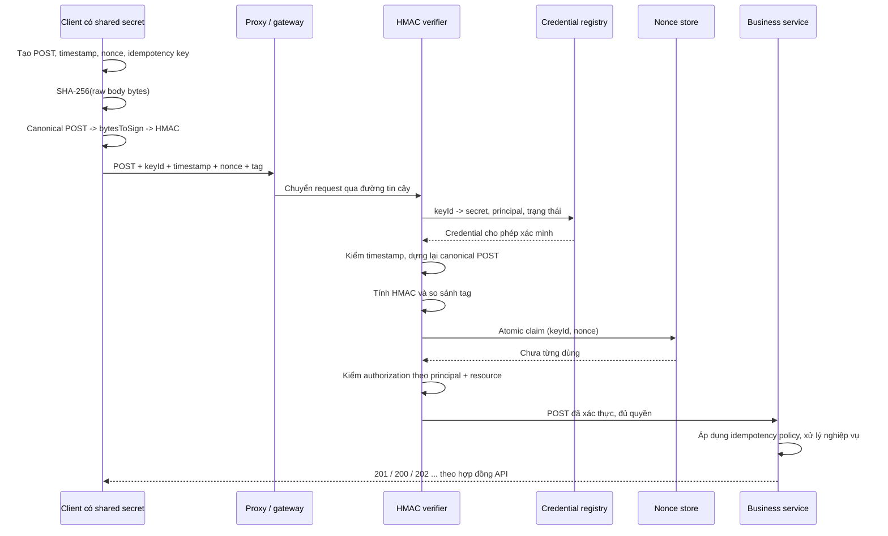
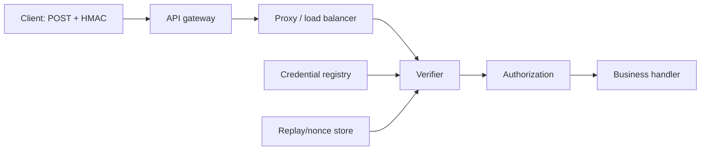

# POST request trong xác thực HMAC: ký đúng phương thức và nội dung ghi dữ liệu

> **Chương:** HTTP method  
> **Bài học:** POST request  
> **Ngữ cảnh:** Xây dựng cơ chế xác thực HTTP request bằng HMAC với shared secret. Client ký một **canonical request** bao gồm method, URI, các header và/hoặc body theo hợp đồng; server kiểm chữ ký, timestamp/nonce, trạng thái khóa và phân quyền trước khi thực hiện tác động nghiệp vụ. Bài này tập trung vào **POST**, phương thức thường gửi dữ liệu để tạo hoặc kích hoạt một thao tác có tác dụng phụ.

## 1. POST là gì và vì sao cần quan tâm khi ký HMAC?

Theo ngữ nghĩa HTTP, **POST** yêu cầu tài nguyên đích **xử lý nội dung đi kèm theo ngữ nghĩa do tài nguyên đó định nghĩa**. Một POST có thể tạo đơn hàng, phát hành giao dịch, gửi biểu mẫu, thực hiện tác vụ, hoặc đưa một yêu cầu vào hàng đợi. **POST không đồng nghĩa lúc nào cũng “create”**; kết quả phụ thuộc hợp đồng API.

Ví dụ nghiệp vụ:

```http
POST /v1/payments?currency=VND HTTP/1.1
Host: api.example.test
Content-Type: application/json

{"orderId":"ORD-42","amount":100000}
```

Nếu phía nhận chỉ kiểm rằng URL đúng và body là JSON hợp lệ, nó **chưa chứng minh được người gửi là client được cấp quyền**. Trong mô hình HMAC, client phải có khả năng sử dụng secret được cấp và ký các **byte được hợp đồng xác định**. Server nhận request sẽ tự dựng lại canonical request, tính HMAC bằng đúng secret trong credential registry và đối chiếu tag.

**Tại sao POST có mức độ rủi ro cao?**

- POST thường làm thay đổi trạng thái: tạo thanh toán, hoàn tiền, ghi dữ liệu, kích hoạt dịch vụ.
- POST **không được mặc định là idempotent** theo HTTP; hai request giống nhau có thể tạo **hai tác động nghiệp vụ**.
- Body thường chứa các tham số quyết định số tiền, người nhận, đơn hàng, quyền hoặc nội dung lưu trữ.
- Một POST **đã ký hợp lệ** có thể bị phát lại nguyên vẹn nếu thiếu timestamp/nonce và chính sách idempotency.
- Proxy, gateway hay framework có thể tác động tới cách URI, headers và body được biểu diễn trước bước xác minh.

Kết luận đầu tiên: **đưa method `POST` vào signing input và bảo vệ toàn bộ những dữ liệu quyết định tác động nghiệp vụ**. HMAC đúng trên một chuỗi byte thiếu method hoặc body không đủ để bảo vệ request POST.

## 2. POST khác GET, PUT, PATCH và DELETE như thế nào?

| Method | Ngữ nghĩa phổ biến | Safe theo HTTP? | Idempotent theo HTTP? | Lưu ý khi ký HMAC |
| --- | --- | --- | --- | --- |
| **GET** | Lấy biểu diễn của tài nguyên. | Có | Có | Ký method, URI/query, metadata; không được để GET dễ dàng biến thành POST. |
| **HEAD** | Như GET nhưng chỉ lấy metadata phản hồi, không gửi response content. | Có | Có | Ký `HEAD` riêng, không coi như `GET` chỉ vì có cùng path. |
| **POST** | Yêu cầu tài nguyên xử lý nội dung theo quy tắc riêng. | Không | **Không mặc định** | Ký chính xác `POST`, các trường định tuyến, header và body có tác động. |
| **PUT** | Tạo/thay thế trạng thái tài nguyên đích theo biểu diễn được gửi. | Không | Có | Vẫn cần HMAC và chống replay theo mô hình bảo mật; idempotent không đồng nghĩa không cần xác thực. |
| **DELETE** | Yêu cầu loại bỏ liên kết/khả năng truy cập tài nguyên đích. | Không | Có | Tác động nhạy cảm; method phải nằm trong chữ ký. |
| **PATCH** | Áp dụng tập thay đổi lên tài nguyên. | Không | Không mặc định | Có thể hoặc không idempotent tùy loại patch và cách thực hiện. |

**Safe** và **idempotent** là thuộc tính ngữ nghĩa HTTP, không phải chứng nhận bảo mật hay cam kết mọi triển khai nghiệp vụ tuân thủ hoàn hảo. Với POST, một API có thể **chủ động cung cấp idempotency** thông qua `Idempotency-Key`, nhưng đó là **hợp đồng bổ sung**, không thay đổi đặc tính mặc định của method.

### Ví dụ: thay method có thể đổi ý nghĩa

```text
GET  /v1/payments/42    -> đọc thông tin giao dịch
POST /v1/payments/42    -> có thể là kích hoạt xử lý, tùy API
```

Nếu chỉ ký path/query/body mà **không ký method**, cùng một tag có thể được thử dùng dưới một method khác. Việc route thực tế có chấp nhận hay không tùy API, nhưng **hợp đồng ký không được phụ thuộc vào may mắn đó**.

**Lưu ý chuẩn HTTP:** tên method là **case-sensitive**. Các method chuẩn như `POST` và `GET` có chữ hoa theo định nghĩa. Verifier nên **chỉ chấp nhận token đúng với allowlist đã quy định**, thay vì tự đổi mọi method bằng `toUpperCase()` rồi vô tình xem một extension method khác case là tương đương.

## 3. POST gồm những thành phần nào cần bảo vệ?

Một request POST minh họa:

```http
POST /v1/payments?currency=VND&orderId=42 HTTP/1.1
Host: api.example.test
Content-Type: application/json
Idempotency-Key: pay-ord-42-001
X-Key-Id: merchant-42-k2
X-Timestamp: 1795800000
X-Nonce: a31b470524474995acd30a021fd2f84e
X-Signature: v1=<BASE64URL_HMAC_SHA256_TAG>

{"amount":100000}
```

**Đây là định dạng tùy biến để học, không phải một chuẩn signature chung**. Header chứa tag và timestamp/nonce minh họa không dùng cho giao dịch thật. Với HMAC-SHA256, tag thô có **32 byte**, khi mã hóa Base64URL không padding dài **43 ký tự ASCII**.

| Thành phần | Ký vào HMAC? | Vì sao? |
| --- | --- | --- |
| `POST` | **Có** | Ràng buộc ngữ nghĩa phương thức; tránh hoán đổi với GET/PUT/DELETE. |
| Authority/host | **Có**, trong hợp đồng ví dụ | Có thể quyết định virtual host, dịch vụ hay tenant. |
| Path `/v1/payments` | **Có** | Ràng buộc endpoint xử lý. |
| Query `currency=VND&orderId=42` | **Có** | Ràng buộc đơn hàng, đơn vị tiền và tham số nghiệp vụ. |
| `Content-Type` | **Có** | Parser JSON hay parser khác có thể hiểu body khác nhau. |
| `Idempotency-Key` | **Có** | Chống thay đổi khóa định danh thao tác hoặc retry khi tag không đổi. |
| `X-Key-Id` | **Có** | Ràng buộc metadata credential với nội dung ký; server vẫn phải tra registry. |
| `X-Timestamp` | **Có** | Giới hạn thời gian hợp lệ, ngăn attacker đổi timestamp mà giữ tag. |
| `X-Nonce` | **Có** | Ràng buộc giá trị dùng một lần để chặn replay. |
| SHA-256 của **raw body bytes** | **Có** | Phát hiện thay đổi `amount` và các dữ liệu payload khác. |
| `X-Signature` | **Không**, trong hợp đồng ví dụ | Đây là **đầu ra** của HMAC; nếu ký chính nó sẽ tạo phụ thuộc vòng. |

**Không có bộ “header cần ký” đúng cho mọi API.** Nếu `Content-Encoding`, `Accept`, `Prefer` hay một header nghiệp vụ khác làm thay đổi cách backend xử lý, cần phân tích và ràng buộc chúng theo hợp đồng. Không nên ký các header hop-by-hop có thể bị chuyển đổi qua proxy mà không có quy tắc rõ ràng.

### Body hash không thay thế HMAC

```text
bodyHash       = SHA256(rawBodyBytes)          // Không khóa
stringToSign   = VERSION || canonicalRequest  // Đúng byte đã thỏa thuận
signatureBytes = HMAC_SHA256(secret, stringToSign)
```

Attacker có thể thay `{"amount":100000}` bằng `{"amount":900000}` và tự tính SHA-256 mới. Nhưng nếu **body hash nằm trong signing input được HMAC bảo vệ**, tag cũ sẽ không còn hợp lệ. Nếu body không được ký, HMAC trên method/path/header vẫn có thể đúng trong khi số tiền bị sửa.

## 4. Một hợp đồng canonical request cho POST

Để minh họa, đặt tên giao thức nội bộ là `HMAC-SHA256/v1` và thỏa thuận **trước** giữa client với server:

1. Chỉ các HTTP method chuẩn trong allowlist được nhận; trường hợp này ký token chính xác `POST`, **không thay đổi case**.
2. Authority canonical được cấu hình là `api.example.test`; quy tắc host/port phải được định nghĩa nếu môi trường thực tế cho nhiều authority.
3. Path canonical là `/v1/payments`; mọi cách biểu diễn percent-encoding, dấu `/` và dot segments phải tuân thủ contract hoặc bị từ chối.
4. Query trong ví dụ được sắp theo tên rồi theo giá trị đã encode thành `currency=VND&orderId=42`; **từ chối duplicate parameter** nếu backend không sử dụng chúng một cách nhất quán.
5. Signed headers bắt buộc là `content-type`, `idempotency-key`, `x-key-id`, `x-nonce` và `x-timestamp` theo thứ tự cố định. Tên header viết thường; kiểm tra/tránh header trùng tên, CR/LF và giá trị mơ hồ.
6. Body digest tính bằng `SHA-256` trên **đúng raw body bytes** mà verifier được phép quan sát tại điểm đã xác định; biểu diễn bằng **64 ký tự hex chữ thường**.
7. Các phần được nối bằng **LF (`\n`)**, không dùng CRLF và **không có LF cuối** của canonical request.
8. `stringToSign` có prefix `HMAC-SHA256/v1\n` để ràng buộc version/domain.
9. Tag là `HMAC-SHA256(secretBytes, UTF8(stringToSign))`, truyền dưới dạng `X-Signature: v1=<tag-Base64URL-no-padding>`.
10. Server chỉ cho phép version/algorithm đã gắn với credential và chính sách hệ thống; không chuyển sang thuật toán khác vì request khai như vậy.

Với request mẫu, **canonical request** có cấu trúc:

```text
POST
api.example.test
/v1/payments
currency=VND&orderId=42
content-type:application/json
idempotency-key:pay-ord-42-001
x-key-id:merchant-42-k2
x-nonce:a31b470524474995acd30a021fd2f84e
x-timestamp:1795800000
content-type;idempotency-key;x-key-id;x-nonce;x-timestamp
<SHA256_HEX_RAW_BODY_BYTES>
```

`<SHA256_HEX_RAW_BODY_BYTES>` **chỉ là placeholder**; phải thay bằng SHA-256 của đúng byte `{"amount":100000}`, không có newline cuối. Phần query trong request đầu vào khác thứ tự canonical; việc sắp xếp chỉ đúng khi verifier và nghiệp vụ đều hiểu cùng ý nghĩa.

Sau khi có canonical request:

```text
bytesToSign = UTF8("HMAC-SHA256/v1\n" + canonicalRequest)
tagBytes    = HMAC_SHA256(sharedSecretBytes, bytesToSign)
header      = "v1=" + Base64URLWithoutPadding(tagBytes)
```

**Không thể tự ý dùng hợp đồng trên cho mọi API production.** Cần đặc tả chính xác byte-level cho URI, header values, dấu phân tách, content encoding, body rỗng và trường hợp malformed HTTP. Ví dụ sau sử dụng **các trường đầu vào đã được xác thực cú pháp/canonicalize**, không triển khai một HTTP canonicalizer tổng quát.

## 5. Luồng client–server xác thực POST



**Phân tách trách nhiệm:**

- **Client** phải tạo chữ ký đúng trên POST và body thực sự sẽ được gửi; không thay body hoặc header đã ký sau khi tính tag.
- **Proxy/gateway** phải chuyển đúng dữ liệu ký tới verifier, hoặc tự xác minh ở điểm còn dữ liệu gốc đáng tin.
- **Verifier** kiểm key, HMAC, freshness, nonce; gán **principal từ credential đã xác minh**, không từ body/query tự khai.
- **Authorization** xác định principal có quyền thực hiện hành động trên tài nguyên/tenant đích hay không.
- **Business service** áp dụng idempotency và transaction semantics; HMAC không tự làm cho POST trở thành idempotent.

Một endpoint có thể trả **201 Created** khi tạo tài nguyên, **200 OK** khi trả kết quả, **202 Accepted** khi tiếp nhận xử lý bất đồng bộ hoặc mã khác tùy hợp đồng. **Mã HTTP không quyết định tính hợp lệ của HMAC**; việc xác thực xảy ra trước khi xử lý nghiệp vụ.

## 6. Java 17+: tạo và xác minh tag cho POST đã canonicalize

Đoạn mã minh họa dưới đây tạo request thử từ dữ liệu đã biết, sinh secret/nonce bằng `SecureRandom`, dựng canonical string và chứng minh **đổi method hoặc body làm HMAC không khớp**. Nó không phụ thuộc framework và **không được dùng nguyên xi làm middleware production**.

```java
import java.nio.charset.StandardCharsets;
import java.security.GeneralSecurityException;
import java.security.MessageDigest;
import java.security.SecureRandom;
import java.time.Instant;
import java.util.Base64;
import java.util.HexFormat;
import javax.crypto.Mac;
import javax.crypto.spec.SecretKeySpec;

public final class SignedPostDemo {
    private static final SecureRandom RANDOM = new SecureRandom();
    private static final HexFormat HEX = HexFormat.of();

    private SignedPostDemo() {}

    private static byte[] utf8(String s) {
        return s.getBytes(StandardCharsets.UTF_8);
    }

    private static String sha256Hex(byte[] rawBody)
            throws GeneralSecurityException {
        return HEX.formatHex(
                MessageDigest.getInstance("SHA-256").digest(rawBody));
    }

    // Demo: caller phải cung cấp giá trị đã được chuẩn hóa và kiểm tra.
    private static String canonicalPost(
            String method,
            String authority,
            String canonicalPath,
            String canonicalQuery,
            String keyId,
            String timestamp,
            String nonce,
            String idempotencyKey,
            byte[] rawBody) throws GeneralSecurityException {

        // Ví dụ dùng allowlist chính xác, không toUpperCase() tùy tiện.
        if (!"POST".equals(method)) {
            throw new IllegalArgumentException("Only POST is supported");
        }

        // Trong production phải validate từng trường, từ chối CR/LF,
        // URI/header trùng và đầu vào mơ hồ ở lớp HTTP.
        return String.join("\n",
                method,
                authority,
                canonicalPath,
                canonicalQuery,
                "content-type:application/json",
                "idempotency-key:" + idempotencyKey,
                "x-key-id:" + keyId,
                "x-nonce:" + nonce,
                "x-timestamp:" + timestamp,
                "content-type;idempotency-key;x-key-id;x-nonce;x-timestamp",
                sha256Hex(rawBody));
    }

    private static byte[] tag(
            byte[] secret, String canonicalRequest)
            throws GeneralSecurityException {
        String stringToSign = "HMAC-SHA256/v1\n" + canonicalRequest;
        Mac mac = Mac.getInstance("HmacSHA256");
        mac.init(new SecretKeySpec(secret, "HmacSHA256"));
        return mac.doFinal(utf8(stringToSign));
    }

    public static void main(String[] args) throws Exception {
        byte[] secret = new byte[32]; // Khóa ngẫu nhiên riêng cho test.
        RANDOM.nextBytes(secret);
        byte[] nonceBytes = new byte[16];
        RANDOM.nextBytes(nonceBytes);

        String timestamp = Long.toString(Instant.now().getEpochSecond());
        String nonce = HEX.formatHex(nonceBytes);
        String method = "POST";
        String authority = "api.example.test";
        String path = "/v1/payments";
        String query = "currency=VND&orderId=42";
        String keyId = "merchant-42-k2";
        String idempotencyKey = "pay-ord-42-001";
        byte[] body = utf8("{\"amount\":100000}");

        String canonical = canonicalPost(method, authority, path, query,
                keyId, timestamp, nonce, idempotencyKey, body);
        byte[] clientTag = tag(secret, canonical);

        // Server DEMO được cung cấp lại cùng secret (trên thực tế phải
        // tra secret theo keyId trong registry đáng tin).
        String serverCanonical = canonicalPost(method, authority, path,
                query, keyId, timestamp, nonce, idempotencyKey, body);
        byte[] expected = tag(secret, serverCanonical);
        if (!MessageDigest.isEqual(clientTag, expected)) {
            throw new AssertionError("Valid POST signature must match");
        }

        // Nếu thay body mà giữ signature cũ, server phải từ chối.
        String tampered = canonicalPost(method, authority, path, query,
                keyId, timestamp, nonce, idempotencyKey,
                utf8("{\"amount\":900000}"));
        if (MessageDigest.isEqual(clientTag, tag(secret, tampered))) {
            throw new AssertionError("Modified POST body must not match");
        }

        // Method khác POST không được phép map vào signing contract này.
        try {
            canonicalPost("GET", authority, path, query, keyId,
                    timestamp, nonce, idempotencyKey, body);
            throw new AssertionError("GET must not pass POST contract");
        } catch (IllegalArgumentException expectedError) {
            // Expected: reject wrong method.
        }

        String wireTag = "v1=" + Base64.getUrlEncoder()
                .withoutPadding().encodeToString(clientTag);
        System.out.println("POST HMAC demo: PASS");
        System.out.println("Signature encoded length: " + wireTag.length());
    }
}
```

**Các điểm cần hiểu trong mã:**

1. `canonicalPost(...)` ký **method POST chính xác** cùng authority, path, query, signed headers và body digest.
2. `SHA-256` tính trên **byte body**, không tính trên object Java hay JSON đã parse lại.
3. `Mac.getInstance("HmacSHA256")` và `SecretKeySpec` dùng cùng shared secret khi ký và xác minh.
4. `MessageDigest.isEqual(...)` so sánh tag bytes; trong HTTP thật phải **decode Base64URL nghiêm ngặt**, kiểm chiều dài tag và phiên bản từ header trước.
5. Demo sinh secret ngẫu nhiên để tránh dạy thói quen hard-code secret; **server thật không được tự tạo khóa mới khi xác minh** mà phải lấy đúng credential theo key ID.
6. Demo **không triển khai** xác thực metadata, claim nonce, idempotency store, kiểm quyền hoặc các quy tắc canonicalize URI/query phức tạp. Phải xây các lớp đó riêng trước khi sử dụng production.

Độ dài `wireTag` trong demo là **46 ký tự** (`v1=` dài 3 ký tự và Base64URL không padding của tag 32 byte dài 43 ký tự).

## 7. POST body: ký byte nào khi JSON, form và file upload?

Trong HTTP, body POST có thể là JSON, form, multipart hoặc binary. Để HMAC kiểm đúng nội dung, cần phân biệt **body ứng dụng** với các byte mô tả cách truyền.

| Kiểu POST | Ví dụ `Content-Type` | Những byte cần lưu ý |
| --- | --- | --- |
| JSON | `application/json` | Khoảng trắng, field order, số, escape Unicode, newline cuối có thể đổi raw bytes. |
| Form-urlencoded | `application/x-www-form-urlencoded` | Dấu `+`, `%20`, thứ tự, duplicate key và percent-encoding ảnh hưởng cách parse. |
| Multipart | `multipart/form-data; boundary=...` | Boundary, headers từng part, CRLF, file bytes; mỗi lần tạo multipart có thể dùng boundary khác. |
| Text | `text/plain; charset=UTF-8` | Charset và newline (`\n` / `\r\n`) ảnh hưởng bytes. |
| Binary | `application/octet-stream` | Phải đọc đúng byte stream, không ép chuyển sang chuỗi rồi mã hóa lại. |
| Body rỗng | Tùy endpoint | `SHA256(empty byte array)` khác với việc bỏ luôn dòng digest khỏi canonical request. |

**Ví dụ JSON:**

```json
{"amount":100000,"currency":"VND"}
```

và:

```json
{"currency":"VND","amount":100000}
```

Hai payload có thể đại diện cùng ý nghĩa nghiệp vụ nhưng **khác byte**, nên SHA-256 khác. Nếu contract yêu cầu băm `rawBodyBytes`, verifier không được parse rồi serialize lại JSON cho “đẹp” trước khi hash.

### Transfer-Encoding và Content-Encoding

- `Transfer-Encoding: chunked` trong HTTP/1.1 là cơ chế truyền theo các chunk; dấu phân tách chunk **không nên lẫn vào body bytes cần băm** khi hợp đồng nói ký HTTP content.
- `Content-Encoding: gzip` là biểu diễn nội dung đã mã hóa/nén: phải quy định hash **byte payload trước hay sau giải nén** và thống nhất cả hai phía. Nếu giá trị `Content-Encoding` thay đổi ý nghĩa cách diễn giải thì nên đưa header đó vào phần được bảo vệ.
- Reverse proxy/load balancer có thể chuyển HTTP/1.1 sang HTTP/2, thay transfer framing mà giữ **nội dung logic**. Ký theo biểu diễn đã thỏa thuận tại điểm xác minh, không ký tùy tiện raw network frames.
- Multipart có thể được proxy/framework parse thành object, bỏ mất boundary và thứ tự part; nếu ký raw bytes, cần có cách lấy lại **đúng bytes** trước khi parse và tránh giới hạn tài nguyên bị vượt.

**Hệ quả vận hành:** verifier cần giới hạn kích thước body, quota, timeout và chiến lược đọc/replay buffer khi framework chỉ cho đọc stream một lần. Không được bỏ kiểm body digest chỉ vì body lớn hoặc stream khó đọc.

## 8. POST, retry, idempotency và replay là ba bài toán khác nhau

Một request POST HMAC hợp lệ vẫn có thể được **gửi lại giống hệt**. Hash và HMAC là phép tính xác định: cùng key, cùng signing bytes luôn cho cùng tag.

Phân biệt:

| Cơ chế | Giải quyết | Không tự giải quyết |
| --- | --- | --- |
| **HMAC** | Xác thực quyền sử dụng secret đối với signing input. | Request cũ đã được dùng chưa. |
| **Signed timestamp** | Request còn trong cửa sổ thời gian đã quy định. | Nhiều lần gửi trong cùng cửa sổ. |
| **Signed nonce + replay store** | Chặn việc chấp nhận lại request có nonce đã dùng. | Một client có secret chủ động gửi **request mới** với nonce mới. |
| **Idempotency-Key + server policy** | Hạn chế lặp tác động nghiệp vụ khi client retry. | Giả danh client, tính toàn vẹn request hoặc kiểm quyền. |
| **Authorization** | Principal có quyền thực hiện POST lên tài nguyên được yêu cầu không. | Chữ ký có đúng hay không. |

### Kịch bản: timeout ngay sau khi tạo thanh toán

Client gửi POST với:

```text
Idempotency-Key: pay-ord-42-001
X-Nonce: nonce-A
X-Timestamp: t1
X-Signature: sig-A
```

Server thực hiện thanh toán thành công nhưng kết nối bị mất trước khi client nhận response. Client muốn retry:

- **Không phát lại nguyên nonce-A**: request cũ đã được server claim nonce; replay store phải từ chối.
- Client có thể tạo **timestamp mới, nonce-B, signature-B** để gửi lại **cùng thao tác nghiệp vụ**.
- **Giữ cùng `Idempotency-Key` đã ký** và body/đích xử lý tương thích với yêu cầu ban đầu.
- Business service kiểm idempotency key theo phạm vi đáng tin như `(principal, endpoint/operation, idempotencyKey)`, đối chiếu fingerprint của **các dữ liệu nghiệp vụ có ý nghĩa** và trả kết quả đã lưu hoặc xử lý trạng thái `in-progress` theo hợp đồng.
- Nếu cùng idempotency key nhưng request mang số tiền khác, server **không được coi đó là cùng thao tác hợp lệ**. Phải từ chối hoặc xử lý conflict theo chính sách.

**Tính nguyên tử là quan trọng:** hai request retry với nonce khác nhau nhưng cùng idempotency key có thể đến đồng thời. Nếu idempotency store chỉ “check rồi insert” bằng thao tác không nguyên tử, hệ thống vẫn có thể tạo hai thanh toán dù cả hai có HMAC và nonce hợp lệ.

### Độ dài TTL nonce

Với chính sách:

```text
abs(serverNowSeconds - signedTimestampSeconds) <= 300
```

một request có timestamp tương lai trong biên cho phép có thể hợp lệ **gần 600 giây** tính từ thời điểm nhận sớm nhất. TTL nonce chỉ 300 giây kể từ lần đầu claim có thể **hết trước khi request hết hợp lệ**; cần thiết kế TTL bao phủ toàn bộ khoảng chấp nhận và phần dự phòng. Các instance phải dùng replay store chung và thao tác claim nguyên tử. Với POST nhạy cảm, lỗi replay store nên **fail closed** theo chính sách.

## 9. POST và lỗi thay method qua proxy/gateway

Trong hệ thống thực tế, client có thể đi qua một hoặc nhiều hop:



**Những khác biệt cần kiểm tra:**

1. **Method override:** các cơ chế tùy biến như `X-HTTP-Method-Override` hoặc `_method` có thể khiến framework xử lý hành động khác với method trên wire. Nếu request được ký `POST` nhưng backend thực thi `DELETE` hoặc `PATCH` theo override **không được ký/kiểm**, đây là lỗi ranh giới tin cậy. Tốt nhất tắt method override trên API HMAC hoặc ràng buộc/kiểm soát nó bằng hợp đồng chính xác.
2. **Redirect 307/308:** một số client có thể gửi lại method và body tới URL mới; **không tự chuyển tiếp signature/credential sang host khác** nếu không có thiết kế trust hợp lệ. Mọi thay đổi authority/path đã ký phải dẫn tới ký lại theo chính sách.
3. **Rewrite path/host:** client ký `POST /public/v1/payments`, backend thấy `POST /v1/payments`. Dù method vẫn đúng, HMAC có thể sai vì URI/host khác. Xác định điểm xác minh và nguồn dữ liệu gốc tin cậy.
4. **Chuyển HTTP/1.1 sang HTTP/2:** method nằm trong `:method` thay vì HTTP/1.1 request line; verifier phải rút ra đúng semantic method đã được chuẩn hóa. Không tự lấy một giá trị do client đặt trong header khác.
5. **Chuyển đổi body:** giải nén, normalize encoding, parse rồi serialize JSON, xóa `Content-Type` hoặc thay query khiến canonical request thay đổi.
6. **Header injection/duplication:** nhiều `X-Key-Id`, `Content-Type` hoặc header nội bộ có thể khiến verifier và nghiệp vụ đọc hai giá trị khác nhau. Cần từ chối ambiguity trước khi xác minh.

### Đặt verifier ở đâu?

| Phương án | Điều cần bảo đảm |
| --- | --- |
| **Gateway xác minh HMAC trước rewrite** | Gateway có dữ liệu ký và secret/khả năng dùng key; xóa header principal do client khai; truyền danh tính đã xác thực qua kênh nội bộ được bảo vệ; chặn bypass backend. |
| **Service đích xác minh sau gateway** | Các giá trị method, URI, signed headers, body bytes được bảo toàn theo contract hoặc dữ liệu gốc được cung cấp qua kênh đáng tin; tuyệt đối không tin `X-Forwarded-*` do client tự chèn. |

Nếu gateway đã xác thực POST, backend vẫn phải **kiểm authorization** và không được tin header như `X-Authenticated-Client` lấy thẳng từ Internet. Giao thức HMAC chỉ bảo vệ phần dữ liệu được ký ở điểm đã định nghĩa.

## 10. Shared secret, key rotation và quyền đối với POST

Một request mang:

```http
X-Key-Id: merchant-42-k2
X-Signature: v1=<tag>
```

không tự chứng minh caller là merchant-42. Server cần:

1. Tra `keyId` trong registry phía server để chọn **credential duy nhất**, bao gồm secret reference, principal, trạng thái, thời hạn, môi trường và version.
2. Kiểm credential còn được phép xác minh; revoked/expired không được dùng dù tag về mặt toán học có thể đúng.
3. Dựng canonical POST từ request tại điểm xác minh và tính HMAC bằng **secret đúng**.
4. Kiểm freshness và nonce atomic; chỉ sau khi HMAC hợp lệ mới claim nonce.
5. Gán principal từ registry đáng tin và xét quyền tạo thanh toán/ghi tài nguyên theo tenant, endpoint, amount limit và các chính sách hiện hành.
6. Thực hiện nghiệp vụ qua lớp idempotency và transaction phù hợp.

**Rotation:** phát hành key ID mới `merchant-42-k3` và secret mới, cho phép overlap hạn chế khi cần, client chuyển sang ký bằng k3, sau đó thu hồi k2. Trong quá trình này, POST `v1` có thể giữ nguyên format canonical/signature nếu signing contract không thay đổi. **Không nhầm phiên bản credential với phiên bản hợp đồng ký**.

**Đổi key không phải `Mac.reset()`:** Java `Mac.reset()` chỉ đưa trạng thái MAC về sau lần `init` gần nhất; muốn dùng secret mới phải `init(newKey)` hoặc tạo `Mac` khác đúng credential.

### Authentication không thay authorization

Một client `merchant-42` có thể ký hợp lệ:

```http
POST /v1/merchants/merchant-99/payments HTTP/1.1
X-Key-Id: merchant-42-k2
...
```

HMAC đúng có thể cho biết request được ký bằng credential của merchant-42, **không cho phép** tự động ghi thanh toán cho merchant-99. Authorization phải so principal đã xác thực với tenant/tài nguyên và thao tác. Nếu không đủ quyền, từ chối (thường 403); nếu không xác thực được, từ chối (thường 401). Mã cụ thể còn tùy hợp đồng API và chính sách tránh tiết lộ thông tin.

## 11. Bộ kiểm thử trọng tâm cho POST có HMAC

Chuẩn bị hai client A/B có secret khác nhau, một POST tạo thanh toán hợp lệ, nonce store chia sẻ cho nhiều instance, idempotency store và đường đi thực tế qua gateway. Chỉ thử trong môi trường được phép.

| # | Ca kiểm thử | Kết quả mong đợi |
| --- | --- | --- |
| 1 | POST đúng method, URI, signed headers, body, timestamp, nonce, tag. | Authentication thành công, tiếp tục authorization và idempotency. |
| 2 | Giữ tag của POST nhưng đổi thành GET. | Bị từ chối: method không khớp signing contract. |
| 3 | Đổi POST sang PUT/DELETE hoặc method chữ thường `post`. | Không chấp nhận như POST đã ký; reject method không nằm trong allowlist. |
| 4 | Đổi path `/v1/payments` sang endpoint khác. | HMAC không khớp. |
| 5 | Đổi `orderId` hoặc `currency` trong query, giữ signature. | HMAC không khớp nếu query thuộc dữ liệu ký. |
| 6 | Đổi một byte `amount` trong raw JSON body. | SHA-256 body đổi; tag cũ không khớp. |
| 7 | Đổi `Content-Type` từ JSON sang form mà giữ signature. | HMAC không khớp nếu header đã ký. |
| 8 | Hai JSON cùng ý nghĩa nhưng khác whitespace/field order. | Body digest khác theo contract ký raw bytes. |
| 9 | Thêm query key trùng hoặc duplicate auth header. | Từ chối request mơ hồ theo contract. |
| 10 | Thay `X-Timestamp` hoặc `X-Nonce`, giữ signature. | HMAC không khớp. |
| 11 | Timestamp quá hạn nhưng tag vẫn đúng. | Từ chối freshness. |
| 12 | Gửi lại nguyên POST có nonce đã được xử lý. | Từ chối replay. |
| 13 | Hai POST đồng thời dùng cùng nonce trên hai instance. | Chỉ một request claim nonce thành công. |
| 14 | Retry POST với **nonce mới**, cùng idempotency key và cùng payload. | Không tạo tác động nghiệp vụ lần hai; trả kết quả hoặc trạng thái theo hợp đồng. |
| 15 | Hai POST đồng thời có nonce khác nhưng cùng idempotency key. | Idempotency guard nguyên tử; không tạo hai thanh toán. |
| 16 | Cùng idempotency key nhưng sửa `amount`. | Phát hiện fingerprint khác, không tái sử dụng kết quả sai. |
| 17 | Key ID của A nhưng HMAC bằng secret B. | Từ chối xác thực; không gán principal A. |
| 18 | Ký bằng key đã revoke hoặc dùng key test trên production. | Từ chối credential không hợp lệ. |
| 19 | Proxy rewrite path, host, query hoặc body. | Xác minh byte đã thỏa thuận; sai khác phải fail closed. |
| 20 | Gửi `X-HTTP-Method-Override: DELETE` kèm POST đã ký. | Không đổi hành động đã được ký; vô hiệu hóa hoặc kiểm soát override an toàn. |
| 21 | Client tự gửi `X-Authenticated-Client: merchant-A`. | Gateway xóa header giả, backend tin nguồn nội bộ đã xác thực. |
| 22 | Bypass gateway, truy cập thẳng backend. | Bị chặn qua mạng hoặc service-to-service authentication. |
| 23 | HMAC hợp lệ của A nhưng POST đến tài nguyên B. | Authorization từ chối, dù authentication có thể thành công. |
| 24 | Nonce store lỗi với POST nhạy cảm. | Fail closed theo chính sách, không bỏ qua replay control. |
| 25 | Body multipart thay boundary/byte, giữ signature. | Digest/signature không khớp nếu ký raw bytes. |
| 26 | Request có `Content-Encoding: gzip` nhưng proxy giải nén. | Contract và điểm xác minh rõ; không ngầm chấp nhận body không đúng bytes đã ký. |

### Khi POST bị báo “invalid signature”

Ưu tiên so sánh trên **fixture không chứa secret production**:

```text
1. Method thực tế trên wire và method được backend thực thi
2. Signing contract version
3. keyId -> selected secret bytes / key reference
4. Authority và host (trước/sau proxy)
5. Raw path, canonical path, query params và duplicate semantics
6. Signed header names/values, đặc biệt Content-Type và Idempotency-Key
7. Raw body bytes, content encoding và SHA-256 digest
8. Canonical request + string-to-sign bytes (UTF-8, LF, trailing LF)
9. HMAC-SHA256 tag bytes
10. Encoding/transport: X-Signature v1 + Base64URL
```

**Không tắt việc ký body hoặc method để chữa mismatch**. Nếu tag đúng nhưng POST bị xử lý hai lần, đó có thể là **replay/idempotency/transaction**; nếu POST chạm nhầm tenant, xem lại **authorization** và ánh xạ principal. Tránh ghi raw secret, full signature và nội dung thanh toán nhạy cảm vào log.

## 12. Câu hỏi tự kiểm tra

**Câu 1.** Vì sao POST cần có method trong canonical request?

*Đáp án:* Vì method quyết định ngữ nghĩa thao tác. Ký method ràng buộc chữ ký với đúng `POST`; tag cho method khác không được chấp nhận.

**Câu 2.** POST có tự động idempotent vì client dùng HMAC không?

*Đáp án:* Không. HMAC xác thực signing input; POST theo HTTP không mặc định idempotent. Cần chính sách idempotency của nghiệp vụ nếu muốn retry không gây tác động lặp.

**Câu 3.** Nếu ký `SHA256(rawBody)` nhưng không ký `Content-Type`, có rủi ro gì?

*Đáp án:* Có thể thay cách backend parse body mà vẫn giữ digest/tag, tùy API. Nếu `Content-Type` ảnh hưởng cách xử lý, cần đưa nó vào hợp đồng ký.

**Câu 4.** Một POST đã ký được phát lại nguyên vẹn có bị HMAC từ chối không?

*Đáp án:* HMAC tự nó vẫn đúng. Replay cần signed timestamp, nonce, replay store atomic và TTL đủ dài.

**Câu 5.** Khi client retry một thanh toán do timeout, có nên gửi lại nguyên nonce cũ để nhận cùng kết quả?

*Đáp án:* Không. Nonce cũ phải bị chặn. Client có thể dùng nonce/timestamp/chữ ký mới, **giữ idempotency key đã ký** để business service ngăn tác động lặp.

**Câu 6.** Hai JSON khác thứ tự field nhưng có cùng ý nghĩa có buộc cùng HMAC không?

*Đáp án:* Không, nếu hợp đồng hash raw body bytes. Serialization khác byte dẫn đến body digest và HMAC khác.

**Câu 7.** Client ký POST nhưng framework xử lý DELETE theo header method override chưa ký. Lỗi ở đâu?

*Đáp án:* Verifier và backend thực thi **không cùng method đã được bảo vệ**. Cần tắt method override hoặc ràng buộc và kiểm soát nó trong hợp đồng/tầng tin cậy.

**Câu 8.** Server đã xác minh HMAC của merchant A, liệu A được phép tạo thanh toán cho merchant B không?

*Đáp án:* Không mặc định. Server còn phải kiểm authorization của A đối với tenant, tài nguyên và hành động cụ thể.

**Câu 9.** Key rotation từ k2 sang k3 có bắt buộc đổi method/canonical contract `v1` không?

*Đáp án:* Không. Key version và signing-contract version khác nhau. Server phải tra đúng credential đang hoạt động và `Mac.init` bằng secret tương ứng.

**Câu 10.** Nếu hệ thống chỉ dùng HTTP 201 khi xử lý POST, liệu có chứng minh chữ ký HMAC đúng không?

*Đáp án:* Không. Status code là kết quả HTTP/nghiệp vụ. Xác thực được đảm bảo bởi bước kiểm HMAC, freshness, nonce và trạng thái credential theo contract, trước khi xử lý nghiệp vụ.

---

## Tài liệu tham khảo

- [RFC 9110 – HTTP Semantics](https://www.rfc-editor.org/rfc/rfc9110): POST, thuộc tính safe/idempotent và semantics của các HTTP methods.
- [RFC 9112 – HTTP/1.1](https://www.rfc-editor.org/rfc/rfc9112): request-line, message framing và transfer encoding.
- [RFC 3986 – URI Generic Syntax](https://www.rfc-editor.org/rfc/rfc3986): URI, percent-encoding và query.
- [RFC 9421 – HTTP Message Signatures](https://www.rfc-editor.org/rfc/rfc9421): ký các thành phần HTTP theo chuẩn.
- [RFC 9530 – Digest Fields](https://www.rfc-editor.org/rfc/rfc9530): representation digest như `Content-Digest`.
- [Oracle Java SE 17 – `Mac` API](https://docs.oracle.com/en/java/javase/17/docs/api/java.base/javax/crypto/Mac.html): HMAC-SHA256 qua JCA/JCE.

**Ghi nhớ:** Với **POST request**, phải ký **method đúng `POST`** và mọi dữ liệu có thể thay đổi tác động nghiệp vụ: authority/routing, path, query, signed headers và body digest theo hợp đồng canonical request. HMAC chứng minh quyền sử dụng shared secret đối với các byte đã ký; **timestamp và nonce** giảm replay, **idempotency key** hỗ trợ retry không nhân đôi tác động, **key rotation** quản lý credential, gateway phải bảo toàn ranh giới tin cậy và **authorization** vẫn quyết định client được phép thực hiện POST lên tài nguyên nào.
