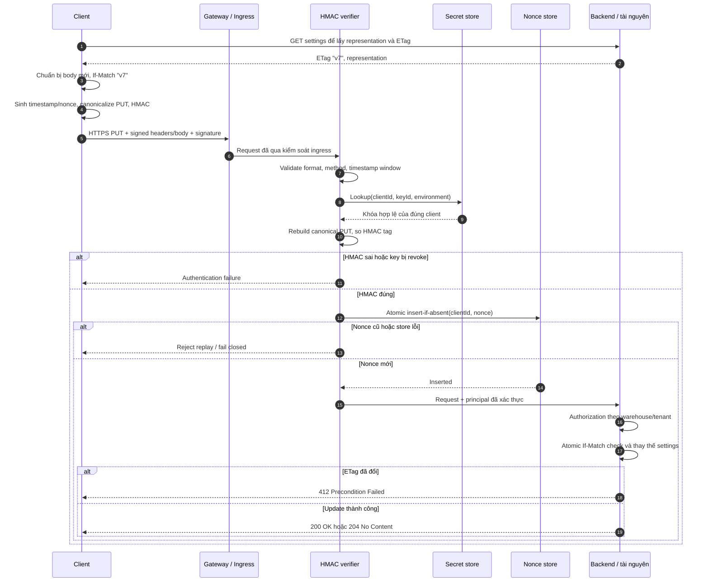

# PUT request trong xác thực HTTP bằng HMAC

## Mục tiêu học tập

Sau bài học này, bạn có thể:

- Giải thích ý nghĩa của HTTP `PUT`: client yêu cầu **tạo hoặc thay thế trạng thái tài nguyên tại URI đích** bằng representation gửi kèm, theo hợp đồng của API.
- Phân biệt `PUT` với `POST`, `PATCH` và `GET`; hiểu đúng tính **idempotent** và giới hạn của nó khi request bị gửi lại.
- Chỉ ra vì sao **HTTP method `PUT` phải nằm trong canonical request** khi dùng HMAC để xác thực từng request.
- Thiết kế hợp đồng ký cho một `PUT` gồm method, URI, header điều kiện `If-Match`, các header xác thực và digest của raw body.
- Xử lý an toàn cập nhật có điều kiện bằng `ETag`, chống lost update, chống replay bằng timestamp/nonce và hỗ trợ retry.
- Viết Java dùng `javax.crypto.Mac` để tạo và xác minh HMAC-SHA256 cho request `PUT`.
- Kiểm thử các biến đổi method, URI, body, header qua proxy/gateway và phân biệt authentication với authorization.

**Bối cảnh:** Bài thuộc chương **HTTP method** của module `SECURITY_AUTHENTICATION_HMAC_REQUEST_AUTHENTICATION`. Module thiết kế xác thực HTTP request bằng shared secret và canonical request chứa phương thức, URI, header/body theo hợp đồng ký. Riêng bài này tập trung vào **`PUT`** như một hành động nghiệp vụ cần ràng buộc bằng HMAC, đồng thời vẫn xét key rotation, replay, gateway và phân quyền ở những điểm liên quan trực tiếp.

## 1. HTTP `PUT` có ý nghĩa gì?

Theo ngữ nghĩa HTTP, `PUT` yêu cầu server **tạo hoặc thay thế trạng thái của tài nguyên đích** bằng trạng thái được mô tả trong representation của request. **URI đích xác định tài nguyên cần tác động**; client thường biết chính xác URI này.

Ví dụ một API quản lý cấu hình kho:

```http
PUT /v1/warehouses/WH-17/settings HTTP/1.1
Host: api.example.test
Content-Type: application/json

{"allowBackorder":false,"reorderThreshold":20}
```

Theo hợp đồng giả định của API, body trên là **representation đầy đủ của phần settings** tại `/v1/warehouses/WH-17/settings`. Nếu request hợp lệ và caller có quyền, server lưu trạng thái mới cho tài nguyên ấy.

Hãy phân biệt `PUT` với các method phổ biến:

| Method | Ý nghĩa khái quát | Đặc điểm cần nhớ khi ký HMAC |
|---|---|---|
| `GET` | Truy xuất representation của tài nguyên | Không được dùng tag của GET để thực thi PUT |
| **`PUT`** | Tạo/thay thế trạng thái tài nguyên đã xác định bởi URI | Method và URI là dữ liệu quan trọng phải ký |
| `POST` | Yêu cầu server xử lý representation theo quy tắc của tài nguyên đích, thường tạo tác vụ hoặc tài nguyên con | Không mặc nhiên idempotent |
| `PATCH` | Yêu cầu áp dụng tập thay đổi lên tài nguyên | Có thể idempotent hoặc không tùy patch semantics |
| `DELETE` | Yêu cầu xóa liên kết/trạng thái tài nguyên đích | Không được dùng tag của PUT để ủy quyền DELETE |

**Điểm dễ nhầm:** `PUT` không có nghĩa “luôn cập nhật một vài field”. Nếu API muốn thay đổi một phần, hãy định nghĩa `PATCH` hoặc một hợp đồng riêng rõ ràng. Với `PUT`, client nên gửi representation hoàn chỉnh **theo định nghĩa tài nguyên của API**; field không gửi có thể bị xem là thiếu, reset hoặc bị từ chối tùy hợp đồng. Không được ngầm đoán “server giữ nguyên các field vắng mặt”.

### Khi nào `PUT` tạo mới tài nguyên?

Nếu URI đích chưa có và API cho phép client lựa chọn URI, `PUT` có thể tạo tài nguyên. Trạng thái HTTP thường gặp:

- **`201 Created`**: tạo thành công tài nguyên tại URI đích;
- **`200 OK`** hoặc **`204 No Content`**: sửa hoặc thay thế trạng thái tài nguyên hiện có thành công, tùy có trả representation hay không.

API cũng có thể **không cho phép** client tạo mới bằng `PUT`; khi đó cần thể hiện rõ qua hợp đồng và phản hồi phù hợp. Không lấy việc method là `PUT` làm căn cứ để vượt qua các chính sách tạo/sửa tài nguyên.

## 2. Idempotency của `PUT` không đồng nghĩa chống replay

**Idempotent** nghĩa là hiệu ứng dự định lên server của việc thực hiện **nhiều lần cùng một request** giống với hiệu ứng của việc thực hiện một lần, xét theo ngữ nghĩa của method. Ví dụ:

```text
PUT /v1/warehouses/WH-17/settings
{"allowBackorder":false,"reorderThreshold":20}

Lần 1: settings trở thành (false, 20)
Lần 2: settings vẫn là (false, 20)
Lần 3: settings vẫn là (false, 20)
```

Tuy nhiên:

1. **Idempotent không có nghĩa request được xử lý đúng một lần.** Server vẫn có thể ghi log/audit nhiều lần, tính toán lại hoặc có side effect không phù hợp nếu triển khai sai.
2. **Idempotent không có nghĩa được phép gửi lại một request đã ký.** Attacker có thể replay request cũ tại thời điểm nguy hiểm, ví dụ ghi đè cấu hình mới bằng trạng thái cũ.
3. **Cùng URI nhưng body khác nhau là các request khác nhau.** Hai `PUT` đến gần nhau có thể ghi đè lẫn nhau nếu không có cơ chế concurrency control.
4. **Retry cùng operation với timestamp/nonce mới vẫn cần được xử lý theo hợp đồng.** Với một API có nhiều side effect, có thể cần idempotency key và transaction để không lặp các hiệu ứng ngoài việc thay thế tài nguyên.

**Ví dụ mất cập nhật (lost update):** client A đọc cấu hình phiên bản 7. Client B cập nhật lên phiên bản 8. Nếu A gửi `PUT` theo dữ liệu phiên bản 7 mà server chấp nhận vô điều kiện, nó có thể ghi đè thay đổi của B. Đây không phải lỗi HMAC; đây là lỗi **kiểm soát cạnh tranh**.

### Phân biệt ba mục tiêu

| Mục tiêu | Cơ chế chính | Chống được gì? |
|---|---|---|
| **Integrity và authentication** | HMAC trên canonical request | Sửa các trường đã ký hoặc giả mạo khi không biết secret |
| **Replay protection** | Timestamp được ký + nonce được ký + kho nonce nguyên tử | Sử dụng lại cùng request đã ký trong cửa sổ chấp nhận |
| **Concurrency control** | `ETag` + `If-Match`, kiểm tra phiên bản nguyên tử | Ghi đè trạng thái do client khác vừa cập nhật |

Ba cơ chế này **bổ sung cho nhau**, không thay thế nhau.

## 3. `PUT` có điều kiện: `ETag` và `If-Match`

Đối với cập nhật một tài nguyên hiện có, API thường dùng **precondition** để tránh lost update.

Một luồng ví dụ:

1. Client gọi `GET /v1/warehouses/WH-17/settings` và nhận representation cùng `ETag: "v7"`.
2. Client sửa representation thành trạng thái mong muốn.
3. Client gửi `PUT` kèm `If-Match: "v7"`, yêu cầu server chỉ thay thế nếu phiên bản hiện tại **vẫn khớp**.
4. Server kiểm tra precondition **trong cùng ranh giới nhất quán với thao tác cập nhật**; nếu resource đã đổi sang `"v8"` thì không áp dụng cập nhật.

```http
PUT /v1/warehouses/WH-17/settings HTTP/1.1
Host: api.example.test
Content-Type: application/json
If-Match: "v7"

{"allowBackorder":false,"reorderThreshold":20}
```

Nếu precondition `If-Match` không thỏa, phản hồi thường là **`412 Precondition Failed`**. Nếu API **bắt buộc** request cập nhật phải mang precondition mà client không gửi, API có thể trả **`428 Precondition Required`**.

Đối với tạo tài nguyên **chỉ khi chưa tồn tại**, API có thể dùng `If-None-Match: *` cùng `PUT`. Nếu tài nguyên đã tồn tại, yêu cầu không được tạo đè theo điều kiện này. Đây là hợp đồng **khác** với cập nhật bằng `If-Match`; không được vô tình áp dụng lẫn hai chế độ.

### Vì sao `If-Match` quan trọng với HMAC?

Nếu client ký `method + URI + body` nhưng **không ký `If-Match`**, một bên trung gian có thể xóa hoặc thay precondition mà không khiến chữ ký thay đổi. Server có thể thực hiện một thao tác có điều kiện như không có điều kiện, tạo nguy cơ lost update.

**Nguyên tắc:** nếu một HTTP header do client kiểm soát **thay đổi ngữ nghĩa nghiệp vụ hoặc an ninh của `PUT`**, header ấy cần nằm trong hợp đồng ký hoặc được xác lập bằng một ngữ cảnh đáng tin cậy tương đương. `If-Match` là ví dụ điển hình.

Lưu ý thêm: `ETag` là **opaque validator** từ server. Không tự đổi dấu nháy, lower-case hoặc thay đổi bytes của `If-Match` khi canonicalize. `If-Match` sử dụng so sánh mạnh (*strong comparison*) theo ngữ nghĩa HTTP; client nên dùng một strong ETag phù hợp. Nếu backend sử dụng tag yếu hoặc xử lý validator không đúng, hợp đồng cần được sửa trước khi triển khai.

## 4. Vì sao HTTP method phải nằm trong dữ liệu HMAC được ký?

Giả sử client chỉ ký body:

```text
HMAC(K, bodyBytes)
```

Khi đó cùng một body có thể được gửi tới `POST /v1/warehouses`, `PUT /v1/warehouses/WH-17/settings` hoặc một endpoint khác mà **tag vẫn khớp body**. Nếu hệ thống chỉ nhìn chữ ký mà không ràng buộc method và target URI, tag bị tái sử dụng sai ngữ cảnh.

Trong hợp đồng an toàn hơn:

```text
HMAC(K, canonical(method, targetUri, signedHeaders, bodyDigest, ...))
```

Đổi `PUT` thành `POST` hoặc `PATCH` sau khi ký sẽ đổi canonical bytes, nên HMAC server tính lại không còn khớp. Đây là **request binding**: chữ ký được gắn với **một hành động, một đích và một nội dung cụ thể**.

### Tránh method override không được kiểm soát

Một số hạ tầng có thể hỗ trợ `X-HTTP-Method-Override` hoặc tham số biểu thị method giả. Nếu verifier ký **method bên ngoài là `POST`** nhưng router/backend thực thi **`PUT`** theo header override, kiểm tra HMAC và hành động thực hiện không còn trùng nhau.

Biện pháp an toàn:

- Tắt method override tại endpoint được xác thực HMAC nếu không có nhu cầu rõ ràng.
- Nếu bắt buộc hỗ trợ, quy định **effective method** trong hợp đồng, ký dữ liệu quyết định override và bảo đảm verifier/backend cùng diễn giải nó.
- Không để gateway/proxy thực thi một method khác với method đã được xác minh.

**Không chỉ kiểm tra `request.getMethod().equals("PUT")` ở một hop rồi tin rằng các hop khác nhất định cùng nhìn thấy `PUT`.** Test phải chạy qua đường đi HTTP thật.

## 5. Hợp đồng canonical cho `PUT` cập nhật tài nguyên

Để có một ví dụ nhất quán, giả sử hệ thống quy định hợp đồng ký **`hmac-put-v1`** cho thao tác **thay thế settings hiện có**. Mỗi `PUT` loại này **bắt buộc có `If-Match`**.

| Thứ tự | Dòng canonical | Nguồn và quy tắc |
|---|---|---|
| 1 | `PUT` | HTTP method, viết hoa cố định; chỉ chấp nhận đúng `PUT` ở endpoint này |
| 2 | `/v1/warehouses/WH-17/settings` | Path + raw query theo biểu diễn đã quy định, không tự sort/decode |
| 3 | `host:api.example.test` | Host public do hạ tầng tin cậy xác định; quy tắc viết thường được chốt |
| 4 | `content-type:application/json` | Yêu cầu chính xác media type đã quy định |
| 5 | `if-match:"v7"` | Giữ nguyên opaque validator, **bao gồm dấu nháy** |
| 6 | `x-client-id:partner-17` | ID client tự khai; được ràng buộc bằng chữ ký |
| 7 | `x-key-id:k2` | Phiên bản secret thuộc client và môi trường |
| 8 | `x-timestamp:<unix-seconds>` | Unix timestamp, ký để không thể sửa tuổi request |
| 9 | `x-nonce:<random-nonce>` | Nonce ký để chống gửi lại |
| 10 | `body-sha256:<digest>` | Base64URL không padding của SHA-256 trên **raw body bytes** |

Quy tắc ghép:

- Tên dòng header viết chữ thường đúng như bảng; **thứ tự dòng cố định**.
- Mỗi dòng ngăn bằng byte LF (`\n`), **không thêm LF sau dòng cuối**.
- Encode toàn bộ canonical string bằng **UTF-8**.
- Body hash tính từ chính xác các byte mà client gửi theo hợp đồng, không từ JSON đã parse rồi serialize lại.
- HMAC = `HMAC-SHA256(secretK, canonicalBytes)`, trả về 32 byte; header `X-Signature` = Base64URL không padding của 32 byte đó.
- Mỗi header bắt buộc **xuất hiện đúng một lần**; từ chối format sai, header trùng, giá trị nhập nhằng.
- `X-Signature` **không được đưa vào chính dữ liệu cần ký** để tránh vòng lặp.

**Quan trọng:** đây là hợp đồng **minh họa có phạm vi hẹp**, không phải định dạng chuẩn HMAC chung. `PUT` tạo mới với `If-None-Match: *` cần một **biến thể được đặc tả và ký rõ** (hoặc phiên bản hợp đồng khác); không bỏ `If-Match` rồi tự ý chấp nhận.

### Request mẫu

```http
PUT /v1/warehouses/WH-17/settings HTTP/1.1
Host: api.example.test
Content-Type: application/json
If-Match: "v7"
X-Client-Id: partner-17
X-Key-Id: k2
X-Timestamp: <unix-seconds-hien-tai>
X-Nonce: <nonce-ngau-nhien>
X-Signature: <base64url-hmac-tag>

{"allowBackorder":false,"reorderThreshold":20}
```

Những mục trong dấu `<...>` là **placeholder**; trước khi gửi request thật, client phải thay bằng timestamp, nonce và tag đúng định dạng. Giả sử body gửi không có newline cuối. Canonical string tương ứng:

```text
PUT
/v1/warehouses/WH-17/settings
host:api.example.test
content-type:application/json
if-match:"v7"
x-client-id:partner-17
x-key-id:k2
x-timestamp:<unix-seconds-hien-tai>
x-nonce:<nonce-ngau-nhien>
body-sha256:<base64url-sha256-cua-exact-body-bytes>
```

Chỉ khi **tất cả các byte** phía client và verifier đồng nhất thì kết quả HMAC mới trùng nhau.

## 6. Luồng client → gateway → verifier → backend cho `PUT`



Sơ đồ tách **xác thực yêu cầu** ở verifier khỏi **phân quyền, precondition và nghiệp vụ** ở backend. Trong thực tế, bước `GET` có thể là một request độc lập, cũng cần xác thực/ủy quyền theo chính sách API; sơ đồ chỉ nhấn mạnh cách client lấy ETag trước khi cập nhật.

**Kết luận từ sơ đồ:** request có HMAC hợp lệ **không bảo đảm** client có quyền sửa warehouse `WH-17`, cũng không bảo đảm `If-Match` sẽ pass. Server cần kiểm tra từng điều kiện ở đúng tầng.

## 7. Java/JCA: ký và xác minh một `PUT` có điều kiện

Đoạn mã Java 17+ sau minh họa phần **mật mã và canonicalization cho hợp đồng `hmac-put-v1`**. Nó dùng `javax.crypto.Mac` và `MessageDigest`, không phụ thuộc web framework.

```java
import java.nio.charset.StandardCharsets;
import java.security.GeneralSecurityException;
import java.security.MessageDigest;
import java.util.Base64;
import java.util.Locale;
import javax.crypto.Mac;
import javax.crypto.spec.SecretKeySpec;

public final class SignedPutV1 {
    private static final String ALGORITHM = "HmacSHA256";
    private static final Base64.Encoder BASE64URL =
            Base64.getUrlEncoder().withoutPadding();

    private SignedPutV1() {}

    public record Parts(
            String method, String rawTarget, String publicHost,
            String contentType, String ifMatch, String clientId,
            String keyId, String timestamp, String nonce, byte[] rawBody) {}

    public static String canonical(Parts p)
            throws GeneralSecurityException {

        if (!"PUT".equals(p.method())) {
            throw new IllegalArgumentException("Only PUT is supported");
        }
        // Caller phải kiểm tra header cardinality, request-target,
        // host đáng tin, If-Match strong ETag và các giá trị hợp đồng.
        if (!"application/json".equals(p.contentType())) {
            throw new IllegalArgumentException("Invalid content type");
        }

        byte[] bodyHash = MessageDigest.getInstance("SHA-256")
                .digest(p.rawBody());
        String digestText = BASE64URL.encodeToString(bodyHash);

        return String.join("\n",
                "PUT",
                p.rawTarget(),
                "host:" + p.publicHost().toLowerCase(Locale.ROOT),
                "content-type:" + p.contentType(),
                "if-match:" + p.ifMatch(),
                "x-client-id:" + p.clientId(),
                "x-key-id:" + p.keyId(),
                "x-timestamp:" + p.timestamp(),
                "x-nonce:" + p.nonce(),
                "body-sha256:" + digestText);
    }

    private static byte[] hmac(byte[] secret, byte[] canonicalBytes)
            throws GeneralSecurityException {
        Mac mac = Mac.getInstance(ALGORITHM);
        mac.init(new SecretKeySpec(secret, ALGORITHM));
        return mac.doFinal(canonicalBytes);
    }

    public static String sign(byte[] secret, Parts p)
            throws GeneralSecurityException {
        byte[] message = canonical(p).getBytes(StandardCharsets.UTF_8);
        return BASE64URL.encodeToString(hmac(secret, message));
    }

    public static boolean verify(
            byte[] secret, Parts received, String encodedSignature)
            throws GeneralSecurityException {

        // HMAC-SHA256 32 byte => Base64URL không padding 43 ký tự.
        if (encodedSignature == null ||
                !encodedSignature.matches("[A-Za-z0-9_-]{43}")) {
            return false;
        }

        final byte[] tag;
        try {
            tag = Base64.getUrlDecoder().decode(encodedSignature);
        } catch (IllegalArgumentException invalidEncoding) {
            return false;
        }

        if (tag.length != 32 ||
                !BASE64URL.encodeToString(tag).equals(encodedSignature)) {
            return false;
        }

        byte[] message = canonical(received)
                .getBytes(StandardCharsets.UTF_8);
        byte[] expected = hmac(secret, message);
        return MessageDigest.isEqual(expected, tag);
    }
}
```

### Mẫu sử dụng phía client và server

**Client:** Serialize body thành bytes **một lần**, chọn URI và headers rồi tạo `Parts` với `method="PUT"`, `If-Match` đang có, timestamp/nonce mới. Gọi `SignedPutV1.sign(secret, parts)` và gửi **chính method, URI, headers, body** đã dùng để ký qua HTTPS.

**Verifier:** Không tin một chuỗi canonical do client gửi sẵn. Từ request thực nhận, lấy **effective method đúng như handler sẽ thực thi**, raw target, host public đáng tin, header có số lượng hợp lệ và raw body; dựng lại `Parts`. Tra key theo `(environment, clientId, keyId)`, kiểm tra trạng thái, rồi gọi `verify`. Chỉ sau đó mới ghi nonce và tạo principal.

Đoạn mã **không phải một HTTP security filter hoàn chỉnh**: nó chưa kiểm tra timestamp, nonce, key rotation, quyền tenant, tính hợp lệ của ETag, giới hạn body size, các header bị trùng hay thay đổi qua proxy. Những trách nhiệm đó phải được hiện thực tại gateway/verifier/backend. Cách viết tách biệt giúp người học thấy **HMAC chỉ tính tag cho đúng chuỗi bytes đã chuẩn bị**.

### Vì sao dùng `MessageDigest.isEqual`?

Một phép so sánh chuỗi thông thường có thể kết thúc sớm khi gặp ký tự đầu tiên khác nhau. Với chữ ký HMAC, nên **giải mã tag theo format cố định → kiểm tra 32 byte → so bytes bằng `MessageDigest.isEqual`**. Đây là biện pháp xử lý tag thích hợp, nhưng không làm toàn bộ endpoint tự động “constant-time”; tra key, parser và mạng vẫn có nhánh xử lý khác nhau.

## 8. Canonical `PUT` qua proxy và API gateway

Chữ ký HMAC gắn với các **byte của hợp đồng ký**, không gắn với “ý nghĩa REST” một cách trừu tượng. Một proxy có thể làm client và verifier không còn ký giống nhau:

| Tình huống | Ảnh hưởng | Hướng xử lý |
|---|---|---|
| Gateway bỏ tiền tố `/api` khỏi URI | Client ký `/api/v1/...`, verifier thấy `/v1/...` | Xác minh trước rewrite hoặc chuyển target gốc qua cơ chế tin cậy |
| Proxy thay `Host` công khai bằng hostname nội bộ | Dòng `host:` trong canonical khác | Hợp đồng nguồn public host rõ ràng, chỉ tin proxy được ủy quyền |
| Proxy decode `%2F` hoặc thay đổi query | URI được ký khác URI dùng để route | Quy tắc percent-encoding/query cố định; reject input nhập nhằng |
| Body được giải nén/serialize lại JSON | `SHA-256(rawBody)` khác | Quy định chính xác representation bytes được ký và được handler dùng |
| Header `If-Match` bị xóa hoặc thay | Mất precondition chống lost update | Ký `If-Match` và từ chối nếu thiếu/không khớp |
| Header `If-Match` hoặc `X-Key-Id` trùng | Các tầng có thể đọc giá trị khác nhau | Reject duplicate header tại ingress/verifier |
| Proxy hoặc framework hỗ trợ method override | Verifier kiểm tra một method, backend chạy method khác | Tắt override hoặc ràng buộc effective method vào hợp đồng ký |

Các header `Forwarded`, `X-Forwarded-Host` hay `X-Original-URI` **không tự đáng tin** khi đến từ Internet: client có thể chủ động gửi chúng. Chỉ dùng giá trị do proxy **được ủy quyền** tạo hoặc ghi đè, trên hop nội bộ được bảo vệ.

**Điểm kiểm thử quan trọng:** chạy request thực xuyên suốt từ client tới ingress, proxy, verifier và backend. Unit test HMAC ở hai hàm Java có thể pass trong khi gateway production làm sai method, host, path hay body.

## 9. Replay, retry và concurrency với `PUT`

Ba tình huống có vẻ giống nhau nhưng cần quyết định khác nhau.

### 9.1. Phát lại request đã ký (*replay*)

Một attacker có thể ghi lại request `PUT` hợp lệ và gửi **nguyên method, URI, body, timestamp, nonce, signature** lần nữa. HMAC vẫn đúng vì dữ liệu không thay đổi.

Biện pháp:

- Timestamp và nonce **phải nằm trong canonical request được ký**.
- Verifier chỉ chấp nhận timestamp trong cửa sổ đã xác định (ví dụ ±300 giây với đồng hồ đã đồng bộ).
- Sau khi HMAC hợp lệ, lưu `(clientId, nonce)` bằng thao tác **insert-if-absent nguyên tử** trong kho dùng chung của mọi replica.
- TTL của nonce phải bao phủ tới thời điểm timestamp đó không thể còn hợp lệ, kể cả request đến sớm trong cửa sổ.
- Khi nonce store lỗi, endpoint cập nhật nhạy cảm nên **fail closed**: không thực thi `PUT` nếu không kiểm soát được replay.

### 9.2. Client retry sau timeout

Giả sử `PUT` đầu tiên **đã cập nhật** settings nhưng response bị mất:

- Gửi lại **cùng timestamp/nonce/signature**: verifier có thể trả lỗi replay. Client chưa biết thao tác trước có thành công hay không.
- Ký lại request bằng **nonce mới** và giữ `If-Match: "v7"`: nếu lần đầu đã cập nhật ETag thành `"v8"` thì lần tiếp theo có thể bị **`412`**. Đây là hành vi hợp lệ của optimistic concurrency, không tự chứng minh lần đầu thất bại.
- Cách phục hồi: client **GET trạng thái hiện tại** (đã xác thực), so sánh với trạng thái mong muốn, rồi chỉ tiếp tục cập nhật theo chính sách và ETag mới. Không tự bỏ `If-Match` để ép retry thành công.

### 9.3. Hai client cập nhật đồng thời

A và B đều đọc `ETag: "v7"`. Cả hai ký các request `PUT` khác nhau, nonce khác nhau và cùng `If-Match: "v7"`. Server phải kiểm tra precondition và thay thế state **một cách nguyên tử**: một thao tác có thể thành công, thao tác còn lại phải nhận `412` khi ETag đã đổi. Kiểm tra `If-Match` trước rồi thực hiện update ở bước tách rời, không có transaction/concurrency guard, vẫn có thể bị lost update.

**Ghi nhớ:** tính idempotent của method `PUT`, cơ chế nonce chống replay và điều kiện `If-Match` giải quyết **ba bài toán khác nhau**.

## 10. Key rotation và phân quyền đối với `PUT`

### Key rotation

Trong giai đoạn luân chuyển khóa, client có thể ký một `PUT` bằng `keyId=k1` (cũ) hoặc `keyId=k2` (mới), tùy cấu hình đang được phép. Verifier tra **đúng secret theo `(environment, clientId, keyId)`**, không thử toàn bộ khóa và không lấy key của tenant khác. Header `X-Key-Id` được **ký** trong canonical request.

Các bước vận hành:

1. Cấp secret mới `k2` qua kênh được bảo vệ; giữ tách biệt theo tenant/môi trường.
2. Cho phép verifier xác minh `k2` và tạm `k1` trong thời gian chuyển tiếp hữu hạn nếu chính sách cho phép.
3. Chuyển client sang ký `PUT` mới bằng `k2`.
4. Thu hồi `k1`, vô hiệu hóa cache cũ và giám sát request tiếp tục dùng key đã ngừng.

Nếu key bị lộ, attacker có thể ký **request mới** với timestamp/nonce mới; replay protection **không thay thế thu hồi khóa**.

### Authentication khác authorization

Ví dụ `partner-17` ký hoàn toàn hợp lệ:

```http
PUT /v1/warehouses/WH-99/settings HTTP/1.1
X-Client-Id: partner-17
X-Key-Id: k2
If-Match: "v4"
X-Signature: <tag-hop-le-cua-partner-17>
```

Nếu `WH-99` thuộc tenant khác, verifier có thể xác thực **partner-17** qua HMAC nhưng backend vẫn phải **từ chối quyền cập nhật kho WH-99**. Chữ ký hợp lệ không phải giấy phép cập nhật mọi resource. Backend chỉ tin principal do verifier tạo qua kênh nội bộ bảo vệ, không tin `X-Authenticated-Principal` do client tự gửi.

Một `PUT` “đã xác thực và đúng format” còn có thể bị từ chối vì body sai validation, precondition `If-Match` không thỏa hoặc chính sách nghiệp vụ. Trạng thái `401` và `403` nên được phân biệt về mặt khái niệm: **chưa xác thực hợp lệ** khác với **đã xác thực nhưng không có quyền**.

## 11. Các lỗi và trạng thái HTTP thường gặp

| Điều kiện | Kết quả phù hợp thường gặp | Ghi chú |
|---|---|---|
| `PUT` thành công khi tạo tài nguyên mới | `201 Created` | Chỉ khi API hỗ trợ tạo bằng `PUT` |
| `PUT` cập nhật thành công và có response representation | `200 OK` | Có thể trả representation mới |
| `PUT` cập nhật thành công và không có body response | `204 No Content` | Không có nghĩa client không cần kiểm tra hiệu quả nghiệp vụ |
| Body hoặc header sai cấu trúc | `400 Bad Request` | Hoặc lỗi phù hợp hợp đồng API |
| Signature/key không hợp lệ | `401 Unauthorized` | Không tiết lộ secret hay chi tiết dò key |
| Principal không có quyền với resource | `403 Forbidden` | Authorization tách biệt |
| ETag không khớp khi gửi `If-Match` | `412 Precondition Failed` | Không thay thế tài nguyên |
| API yêu cầu `If-Match` nhưng request thiếu | `428 Precondition Required` | Nếu hợp đồng áp dụng |
| Xung đột trạng thái nghiệp vụ khác | `409 Conflict` | Không đánh đồng với `412` |
| Request quá tải hoặc hạ tầng replay store lỗi | Theo chính sách API, thường lỗi tạm thời | Không bỏ kiểm tra replay để “cho qua” |

Bảng chỉ mô tả **hành vi thường dùng**; cách trả mã cụ thể thuộc hợp đồng dịch vụ. Dù trả lỗi gì, handler không được thực hiện thay đổi trạng thái khi authentication, replay hoặc authorization thất bại.

## 12. Ma trận kiểm thử tích hợp cho `PUT` đã ký

| Test | Cách thử | Kết quả kỳ vọng |
|---|---|---|
| Happy path | `PUT` có HMAC đúng, nonce mới, `If-Match` hiện tại, có quyền | Cập nhật một lần, trả thành công |
| Method bị thay | Ký `PUT`, gửi `POST`/`PATCH` cùng body và signature | Từ chối; không thực thi method khác |
| Method override | Gửi `POST` với `X-HTTP-Method-Override: PUT` không theo hợp đồng | Reject hoặc không được thực thi dưới danh tính ký khác method |
| URI thay sau ký | Đổi `WH-17` thành `WH-99`, hoặc sửa query | HMAC fail nếu URI được ký |
| Body thay sau ký | Sửa `reorderThreshold` hoặc thêm whitespace | HMAC fail khi digest raw body được ký |
| Bỏ hoặc sửa `If-Match` | Ký `"v7"` rồi xóa/đổi sang `"v8"` | HMAC fail hoặc reject vì thiếu header |
| Duplicate `If-Match` | Hai giá trị khác nhau, qua proxy thật | Reject, không chọn tùy tiện |
| Request stale | `If-Match: "v7"` nhưng ETag hiện tại `"v8"` | `412`; state không đổi |
| Hai client cạnh tranh | Hai `PUT` khác nhau cùng `If-Match: "v7"` | Tối đa một update thành công với cơ chế atomic |
| Timestamp sai | Timestamp quá hạn/tương lai | Không được vào handler |
| Replay tuần tự | Gửi lại nguyên request đã được nhận | Nonce trùng, không thực thi lần nữa |
| Replay giữa replica | Hai request trùng nonce gửi đồng thời | Tối đa một request vượt qua replay gate |
| Key đã thu hồi | Ký đúng bằng secret `k1` sau revoke | Từ chối |
| Khóa chéo tenant | `clientId` B nhưng ký bằng secret A | Không được xác thực thành B |
| Đúng HMAC, sai quyền | A ký `PUT` vào tài nguyên thuộc B | Authn pass, authz deny |
| Proxy rewrite | Thay `Host`, prefix path, query encoding, body | Canonical contract nhất quán hoặc reject |
| Retry sau timeout | Ký nonce mới với ETag cũ | Có thể `412`; client GET để hòa giải, không bỏ precondition |

Đặc biệt cần **kiểm thử qua gateway/proxy thật**: test thuần hàm HMAC không bắt được trường hợp method override, rewrite URI hoặc hai framework parse `If-Match` theo hai cách khác nhau.

### Kiểm thử Java tại tầng canonical

Với class `SignedPutV1` ở phần 7, có thể kiểm tra tính chất:

```java
// Pseudocode test, giả sử đã tạo Parts hợp lệ và secret key:
String tag = SignedPutV1.sign(secret, validPut);
assert SignedPutV1.verify(secret, validPut, tag);

// Tạo bản sao Parts nhưng thay body bytes:
assert !SignedPutV1.verify(secret, tamperedBodyPut, tag);

// Tạo bản sao Parts nhưng thay If-Match:
assert !SignedPutV1.verify(secret, tamperedIfMatchPut, tag);

// Nếu method không phải PUT, canonical() phải reject.
```

Đây là **pseudocode test**: `validPut`, `tamperedBodyPut` và `tamperedIfMatchPut` là các fixture do người học tự tạo. Các kiểm thử về replay, ETag, kho khóa và authorization phải chạy ngoài lớp `SignedPutV1`.

## 13. Bài tập thực hành: cập nhật cấu hình kho an toàn

Thiết kế API có phương thức `PUT /v1/warehouses/{warehouseId}/settings`. Mỗi client thuộc một tenant, có `clientId`, `keyId` và shared secret HMAC-SHA256. API chạy sau reverse proxy, có ba replica verifier, kho nonce dùng chung và resource được quản lý bằng ETag.

Hãy thực hiện:

1. Định nghĩa representation của `settings` và làm rõ việc `PUT` **thay thế** trạng thái nào; nêu khác biệt nếu dùng `PATCH`.
2. Định nghĩa hợp đồng canonical `hmac-put-v1` gồm `PUT`, raw request-target, host, `Content-Type`, `If-Match`, client/key ID, timestamp, nonce và body SHA-256.
3. Viết client Java serialize body một lần, lấy ETag, tạo nonce mới, tính HMAC bằng `javax.crypto.Mac`, gửi đúng request đã ký qua HTTPS.
4. Viết luồng verifier: reject header trùng và method override, tra key đúng scope, so tag an toàn, kiểm tra timestamp/nonce, tạo principal.
5. Thiết kế backend kiểm tra `principal` có quyền với `warehouseId` rồi kiểm tra `If-Match` **nguyên tử** trước khi ghi.
6. Mô phỏng một request thành công nhưng response bị mất; mô tả vì sao lần gửi lại cùng nonce bị chặn, còn gửi nonce mới với ETag cũ có thể nhận `412`.
7. Thử proxy rewrite path/host, thay method `PUT → POST`, đổi `If-Match`, đổi body bytes và gửi trùng nonce qua hai verifier.
8. Mô tả chuyển từ `k1` sang `k2`, thu hồi khóa cũ và kiểm thử không truy cập được warehouse của tenant khác.

**Tiêu chí hoàn thành:** Người học phải giải thích được vì sao **`PUT` là idempotent nhưng vẫn cần HMAC, replay protection và concurrency control**; các trường định hình hành động `PUT` phải được ký; backend không thực thi request đã sửa hoặc không có quyền; retry phải tôn trọng ETag.

---

## Ghi nhớ

Với `SECURITY_AUTHENTICATION_HMAC_REQUEST_AUTHENTICATION`, **`PUT` là một HTTP method mang ngữ nghĩa thay thế trạng thái tài nguyên**, vì vậy **method `PUT` và URI đích phải được ràng buộc trong canonical request được HMAC ký**. Đối với cập nhật an toàn, cần ký cả các header có ý nghĩa như `If-Match` và digest của raw body, kết hợp **timestamp/nonce chống replay**, **key rotation**, **kiểm thử gateway** và **authorization** tách biệt. **Idempotency của `PUT` không thay thế bất kỳ cơ chế bảo mật hay kiểm soát cạnh tranh nào trong số đó.**
