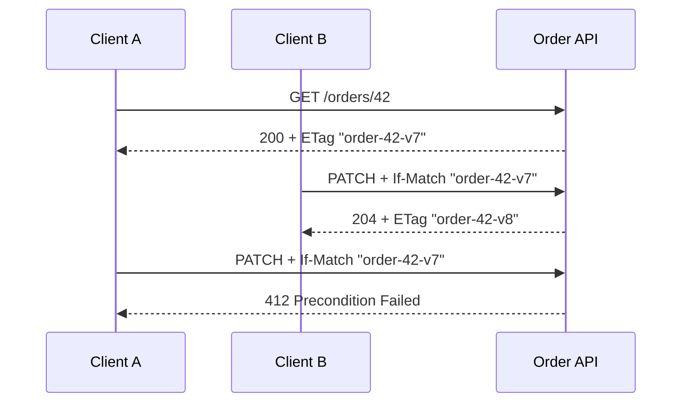
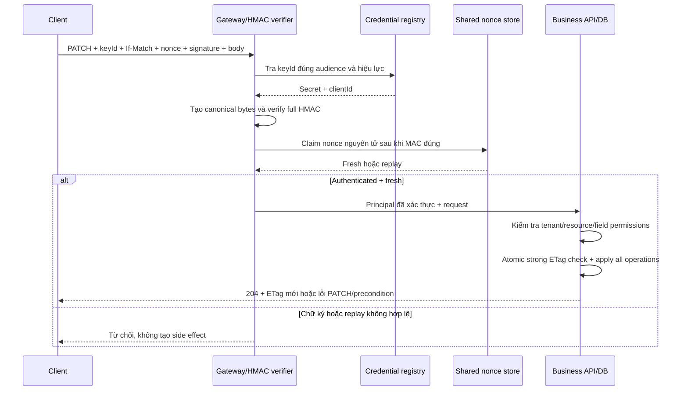

# PATCH request: Cập nhật một phần tài nguyên và xác thực đúng hành động bằng HMAC

Trong chương **HTTP method**, `PATCH` là phương thức yêu cầu máy chủ áp dụng một **patch document** lên tài nguyên đích. Ví dụ, client gửi `PATCH /v1/orders/42` để sửa hướng dẫn giao hàng mà không phải gửi lại toàn bộ đơn hàng. `PATCH` không chỉ mang ý nghĩa “sửa vài trường JSON”; **media type của body** quyết định cách các thay đổi được áp dụng, còn quyền thao tác và điều kiện phiên bản do API kiểm soát.

Đây là bài **PATCH request** thuộc module `SECURITY_AUTHENTICATION_HMAC_REQUEST_AUTHENTICATION`. Mục tiêu của module là xác thực HTTP request bằng **HMAC với shared secret** và **canonical request** bao gồm method, URI, header hoặc body theo hợp đồng ký; xác minh chữ ký, chống replay bằng timestamp/nonce, quản lý key rotation, kiểm thử proxy/gateway và phân biệt xác thực với phân quyền. Vì thế bài học sẽ đi sâu vào cả **ngữ nghĩa PATCH** lẫn **các byte phải được ký** để yêu cầu cập nhật không bị chuyển thành hành động khác.

## 1. Mục tiêu học tập

Sau khi học, bạn có thể:

1. Phân biệt `PATCH` với `PUT`, `POST`; giải thích vì sao PATCH **không mặc định idempotent** và cần xử lý cập nhật **nguyên tử**.
2. Đọc được JSON Patch và JSON Merge Patch, phân tích `Content-Type`, JSON Pointer, các operation và rủi ro sửa nhầm trường.
3. Thiết kế hợp đồng HMAC ký chính xác `PATCH`, raw path/query, media type, `If-Match`, body digest, timestamp, nonce và audience.
4. Kết hợp `If-Match`/strong ETag để tránh lost update; phân biệt **precondition**, **replay prevention** và **idempotency**.
5. Viết lõi tạo/xác minh HMAC-SHA256 trong Java 17; tổ chức kiểm thử proxy, gateway, JSON Patch engine và phân quyền mức trường.

## 2. Ngữ nghĩa HTTP PATCH

Theo RFC 5789, phần thân của PATCH chứa tập chỉ dẫn thay đổi tài nguyên. Server cần hiểu định dạng patch document do API công bố:

```http
PATCH /v1/orders/42 HTTP/1.1
Host: api.example.test
Content-Type: application/json-patch+json
If-Match: "order-42-v7"

[{"op":"replace","path":"/deliveryInstructions","value":"Leave at reception"}]
```

Ý định: chỉ cập nhật `deliveryInstructions` của đơn 42, **với điều kiện** resource hiện tại vẫn khớp strong ETag `"order-42-v7"`.

| Phương thức | Hành vi thông thường | Đặc điểm cần lưu ý |
| --- | --- | --- |
| `GET` | Lấy biểu diễn của resource. | Safe; việc đọc vẫn có thể cần HMAC và phân quyền. |
| `PUT` | Tạo/thay thế trạng thái resource đích theo biểu diễn gửi lên. | Idempotent theo ngữ nghĩa HTTP. |
| **`PATCH`** | Áp dụng các lệnh thay đổi từ patch document. | **Không mặc định idempotent**; phụ thuộc các lệnh cụ thể. |
| `POST` | Xử lý biểu diễn theo ngữ nghĩa của tài nguyên nhận. | Thường tạo mới hoặc thực hiện hành động; không đồng nghĩa PATCH. |
| `DELETE` | Yêu cầu loại bỏ liên kết resource đích. | Idempotent về mặt ngữ nghĩa HTTP; vẫn cần quyền xóa. |

Một PATCH `replace /status` với cùng giá trị có thể tạo cùng trạng thái khi gọi nhiều lần. Ngược lại, `add /tags/-` chèn thêm phần tử cuối mảng sẽ tạo trùng nếu áp dụng lại. Vì vậy không xem mọi PATCH là idempotent chỉ vì “cập nhật một phần”.

**Tính nguyên tử:** PATCH phải được áp dụng **toàn bộ hoặc không áp dụng phần nào**; nếu operation thứ ba thất bại, kết quả của hai operation đầu phải được rollback. Không để request khác quan sát trạng thái cập nhật dở. Với database, nên đặt kiểm tra phiên bản và thay đổi trong cùng một transaction hoặc cơ chế cập nhật điều kiện tương đương.

Phản hồi thành công có thể là `204 No Content` hoặc `200 OK` khi trả biểu diễn cập nhật. Server có thể gửi ETag mới, ví dụ `ETag: "order-42-v8"`, để client làm điều kiện cho lần sửa tiếp theo.

## 3. JSON Patch và JSON Merge Patch không giống nhau

`PATCH` quy định phương thức, còn **`Content-Type`** quy định cách hiểu body. Hai định dạng phổ biến:

### 3.1. JSON Patch — `application/json-patch+json`

JSON Patch (RFC 6902) là **mảng operation có thứ tự**:

```json
[
  {"op":"test","path":"/status","value":"draft"},
  {"op":"replace","path":"/deliveryInstructions","value":"Leave at reception"},
  {"op":"add","path":"/tags/-","value":"priority"}
]
```

| Operation | Ý nghĩa | Rủi ro khi xử lý |
| --- | --- | --- |
| `add` | Thêm/đặt giá trị. | `/tags/-` có thể thêm trùng khi retry. |
| `remove` | Xóa giá trị tại path. | Phải kiểm tra sự tồn tại và quyền xóa. |
| `replace` | Thay giá trị tại path tồn tại. | Kiểm tra quyền sửa trường và ràng buộc giá trị. |
| `move` | Di chuyển từ `from` đến `path`. | Kiểm tra quyền đọc/xóa ở nguồn và ghi ở đích. |
| `copy` | Sao chép từ `from` đến `path`. | Tránh sao chép dữ liệu nhạy cảm sang nơi ít bảo vệ. |
| `test` | So sánh giá trị hiện tại và thất bại nếu không khớp. | Không được bỏ qua khi test thất bại; rollback toàn patch. |

`path` và `from` dùng **JSON Pointer** (RFC 6901), khác với URL path. Khóa tên `a/b` được biểu diễn thành `/a~1b`; dấu `~` được mã hóa `~0`. Backend phải kiểm tra đường dẫn **sau khi engine giải mã JSON Pointer**. Kiểm tra quyền với chuỗi raw rồi để engine diễn giải đường khác có thể tạo lỗ hổng vượt quyền.

Không được thực thi một phần các operation. Nếu `test` thất bại, hoặc operation sau cùng không hợp lệ, server phải từ chối toàn bộ patch mà không để lại thay đổi trung gian.

### 3.2. JSON Merge Patch — `application/merge-patch+json`

JSON Merge Patch (RFC 7396) dùng một đối tượng mô tả phần muốn trộn:

```json
{
  "deliveryInstructions": "Leave at reception",
  "secondaryPhone": null
}
```

Trong Merge Patch, member có giá trị `null` biểu thị **xóa member** ở object đích; nó không luôn biểu thị “ghi giá trị null”. Mảng thường bị **thay toàn bộ**, không có operation thêm ở vị trí `-` như JSON Patch. Merge Patch phù hợp một số thay đổi thuộc tính đơn giản, nhưng cần thận trọng với resource có nhiều giá trị null hợp lệ hoặc mảng lớn.

**Hợp đồng V1 xuyên suốt bài chọn JSON Patch.** Endpoint chỉ chấp nhận `application/json-patch+json`. Nếu API hỗ trợ Merge Patch, phải khai báo media type riêng và kiểm thử parser, validation và authorization tương ứng. Không được dùng cùng chữ ký khi kẻ trung gian đổi `Content-Type` làm body được diễn giải theo định dạng khác.

Có thể dùng header `Accept-Patch` trong phản hồi `OPTIONS` để công bố các patch media type API hỗ trợ. Chính sách xác thực cho `OPTIONS`/preflight là một vấn đề định tuyến riêng.

## 4. If-Match và ETag: bảo vệ trạng thái mà PATCH sẽ sửa

PATCH thường phụ thuộc vào **trạng thái hiện tại**. Nếu client A và B cùng đọc resource ở phiên bản `v7`, client B cập nhật trước, PATCH từ A có thể ghi đè thay đổi mới nếu không ràng buộc phiên bản.



`If-Match` dùng **strong comparison** với entity-tag của biểu diễn hiện hành. Weak ETag dạng `W/"..."` không thỏa strong comparison của `If-Match`. Nếu precondition không còn đúng, server thường trả **`412 Precondition Failed`**. Nếu API yêu cầu điều kiện mà client không gửi, nó có thể dùng **`428 Precondition Required`**.

ETag là **opaque token** do server phát hành. Chuỗi `"order-42-v7"` chỉ là ví dụ dễ hiểu; đừng xây logic nghiệp vụ dựa vào việc bóc ký tự “v7” từ ETag.

Kiểm tra ETag và áp dụng thay đổi phải là **một thao tác nguyên tử đối với trạng thái tài nguyên**. Đọc ETag ở một transaction rồi áp dụng patch ở transaction khác có thể tạo race condition.

**Trong hợp đồng HMAC của bài, `If-Match` là một header được ký.** Nếu chữ ký chỉ bảo vệ method/URI/body mà bỏ qua `If-Match`, một bên có thể thay điều kiện cập nhật trên đường truyền mà chữ ký vẫn hợp lệ. Khi client quyết định cập nhật theo phiên bản mới sau `412`, client phải tạo **request mới, timestamp/nonce mới và signature mới**.

## 5. Chọn những thành phần của PATCH cần ký

Không tồn tại một canonical request chung cho mọi hệ thống HMAC. Bên gửi và bên nhận phải tuân theo cùng hợp đồng, ở đây đặt tên **HMAC-SHA256-V1**:

| Phần dữ liệu | Quy tắc minh họa |
| --- | --- |
| Thuật toán | HMAC-SHA256, **đầy đủ 32 byte** tag. |
| Dạng chữ ký | `X-Signature: v1=<Base64 chuẩn có padding>`. |
| Key ID | Header `X-Key-Id` tham chiếu một credential ACTIVE và secret của client. |
| Method | Chính xác **`PATCH`**, không tự chuyển `patch` thành `PATCH`. |
| Request target | Raw origin-form path + raw query nếu có; giữ thứ tự và percent-encoding. |
| Audience | Giá trị cố định `orders-api-prod` được ký để ràng buộc môi trường/dịch vụ. |
| Content type | Giá trị header duy nhất, chính xác `application/json-patch+json`. |
| Điều kiện cập nhật | Strong ETag từ `If-Match`, được ký. |
| Timestamp/nonce | Các header `X-Timestamp` và `X-Nonce` đã ký, có kiểm tra freshness/replay. |
| Body | Hex chữ thường của SHA-256 trên **raw body bytes**. |
| Nối dòng | UTF-8, LF (`\n`) giữa các dòng; **không có LF cuối**. |

Request gửi đi:

```http
PATCH /v1/orders/42 HTTP/1.1
Host: api.example.test
Content-Type: application/json-patch+json
If-Match: "order-42-v7"
X-Key-Id: partner-a-202611
X-Timestamp: 2026-11-28T02:00:00Z
X-Nonce: Zq8DxKtUokcwPGNj3d_yvQ
X-Signature: v1=<BASE64_HMAC_SHA256>

[{"op":"replace","path":"/deliveryInstructions","value":"Leave at reception"}]
```

Canonical string tương ứng:

```text
HMAC-SHA256-V1
orders-api-prod
PATCH
/v1/orders/42
content-type:application/json-patch+json
if-match:"order-42-v7"
x-key-id:partner-a-202611
x-timestamp:2026-11-28T02:00:00Z
x-nonce:Zq8DxKtUokcwPGNj3d_yvQ
sha256:<LOWERCASE_HEX_OF_SHA256_RAW_BODY>
```

Các đoạn trong `<...>` là **placeholder**, không phải giá trị signature hoặc digest thực. Client tính SHA-256 trên **chính xác byte JSON Patch gửi đi**, điền digest vào dòng cuối, rồi tính:

\[
\text{signatureBytes} = \operatorname{HMAC}_{\mathrm{SHA256}}
  (\text{sharedSecret}, \operatorname{UTF8}(\text{canonicalRequest}))
\]

Chữ ký được Base64 rồi gắn prefix `v1=`. Server phải **tự dựng canonical request từ method/URI/header/body đã nhận**, tìm shared secret qua key ID và tính lại HMAC để so sánh. Header `X-Signature` không được đưa vào dữ liệu ký.

### Thay gì thì chữ ký phải khác?

| Thay đổi | Vì sao thay đổi MAC |
| --- | --- |
| `PATCH` → `PUT` hoặc `POST` | Method là một dòng có ký. |
| `/v1/orders/42` → `/v1/orders/43` | Raw request target được ký. |
| `If-Match: "order-42-v7"` → `"order-42-v8"` | Điều kiện phiên bản được ký. |
| JSON Patch → JSON Merge Patch | Media type được ký, và ngữ nghĩa parser cũng thay đổi. |
| Thêm whitespace, đổi thứ tự operation hoặc sửa giá trị body | Raw body digest khác, dù JSON đôi khi có thể tương đương về ngữ nghĩa. |
| Đổi timestamp/nonce | Dữ liệu ký khác và phải kiểm tra độ mới. |

Không băm một đối tượng JSON đã parse và serialize lại nếu hợp đồng yêu cầu **raw body**. Các SDK phải gửi đúng byte mà chúng đã ký.

## 6. Luồng xử lý PATCH: xác thực khác với cập nhật



Thứ tự áp dụng trong backend:

1. **Validate HTTP:** chỉ chấp nhận token `PATCH` đúng byte, raw target phù hợp, header ký không trùng, Content-Type đúng, body trong giới hạn kích thước.
2. **Tra credential:** key ID phải có trạng thái ACTIVE, đúng audience/môi trường, chưa bị thu hồi và ánh xạ tới **một** secret. Không dùng `X-Key-Id` chưa xác minh làm danh tính client.
3. **Verify HMAC:** tự băm raw body, dựng canonical request rồi tính HMAC-SHA256; so toàn bộ 32 byte bằng API so sánh an toàn.
4. **Check freshness:** timestamp nằm trong cửa sổ; claim `(keyId, nonce)` bằng thao tác nguyên tử trên kho dùng chung **sau khi chữ ký đúng và trước mutation**.
5. **Authorize:** kiểm tra quyền client trên resource và tất cả trường/JSON Pointer mà patch đọc, ghi, xóa hoặc di chuyển.
6. **Conditional atomic patch:** kiểm tra strong ETag hiện tại bằng `If-Match` trong transaction rồi áp dụng tất cả operation hoặc rollback. Trả status/ETag theo hợp đồng.

Nếu `If-Match` không khớp, nonce của request vừa xác minh có thể **đã được claim**. Client đọc lại trạng thái, quyết định patch mới, tạo timestamp/nonce mới và ký lại; không dùng lại signature/nonce cũ.

## 7. Java 17: tạo canonical PATCH và xác minh HMAC-SHA256

Ví dụ sau tập trung vào **phần lõi mật mã**. Nó chưa có JSON Patch engine, HTTP middleware, credential registry, nonce store hay transaction. `PatchRequest` phải do HTTP adapter tạo từ method, raw target, header và **raw body bytes thực nhận** ở ranh giới đáng tin.

```java
import java.nio.charset.StandardCharsets;
import java.security.GeneralSecurityException;
import java.security.MessageDigest;
import java.util.Arrays;
import java.util.Base64;
import java.util.HexFormat;
import javax.crypto.Mac;
import javax.crypto.spec.SecretKeySpec;

public final class SignedPatchV1 {
    private static final String ALGO = "HmacSHA256";
    private static final String PREFIX = "v1=";
    private static final String MEDIA_TYPE = "application/json-patch+json";

    private SignedPatchV1() {}

    public record PatchRequest(
            String method,
            String rawTarget,
            String contentType,
            String ifMatch,
            String keyId,
            String timestamp,
            String nonce,
            byte[] rawBody) {}

    private static void validate(PatchRequest r) {
        if (r == null || !"PATCH".equals(r.method())
                || !MEDIA_TYPE.equals(r.contentType())
                || r.rawTarget() == null
                || !r.rawTarget().startsWith("/")
                || r.rawTarget().startsWith("//")
                || r.rawTarget().length() > 4096
                || r.keyId() == null
                || !r.keyId().matches("[A-Za-z0-9:_-]{1,80}")
                || r.ifMatch() == null
                || !r.ifMatch().matches("\"[A-Za-z0-9._-]{1,128}\"")
                || r.timestamp() == null
                || !r.timestamp().matches(
                    "[0-9]{4}-[0-9]{2}-[0-9]{2}T"
                    + "[0-9]{2}:[0-9]{2}:[0-9]{2}Z")
                || r.nonce() == null
                || !r.nonce().matches("[A-Za-z0-9_-]{22,128}")
                || r.rawBody() == null
                || r.rawBody().length > 65536) {
            throw new IllegalArgumentException("Invalid PATCH signing fields");
        }
        // Chỉ là kiểm tra tối thiểu; adapter/gateway còn phải chống
        // path normalization, encoded delimiter và parser ambiguity.
        for (int i = 0; i < r.rawTarget().length(); i++) {
            char c = r.rawTarget().charAt(i);
            if (c < 0x21 || c > 0x7e || c == '#' || c == '\\') {
                throw new IllegalArgumentException("Unsafe raw target");
            }
            if (c == '%') {
                if (i + 2 >= r.rawTarget().length()
                        || Character.digit(r.rawTarget().charAt(i + 1), 16) < 0
                        || Character.digit(r.rawTarget().charAt(i + 2), 16) < 0) {
                    throw new IllegalArgumentException("Invalid percent escape");
                }
                i += 2;
            }
        }
    }

    public static byte[] canonicalBytes(PatchRequest r)
            throws GeneralSecurityException {
        validate(r);
        String bodyHash = HexFormat.of().formatHex(
                MessageDigest.getInstance("SHA-256").digest(r.rawBody()));
        String canonical = String.join("\n",
                "HMAC-SHA256-V1",
                "orders-api-prod",
                r.method(),
                r.rawTarget(),
                "content-type:" + r.contentType(),
                "if-match:" + r.ifMatch(),
                "x-key-id:" + r.keyId(),
                "x-timestamp:" + r.timestamp(),
                "x-nonce:" + r.nonce(),
                "sha256:" + bodyHash);
        return canonical.getBytes(StandardCharsets.UTF_8);
    }

    private static byte[] hmac(byte[] secret, byte[] data)
            throws GeneralSecurityException {
        // Chính sách credential production của ví dụ: >= 32 byte ngẫu nhiên.
        if (secret == null || secret.length < 32) {
            throw new IllegalStateException("Invalid HMAC credential");
        }
        Mac mac = Mac.getInstance(ALGO);
        mac.init(new SecretKeySpec(secret, ALGO));
        return mac.doFinal(data);
    }

    public static String sign(byte[] secret, PatchRequest request)
            throws GeneralSecurityException {
        return PREFIX + Base64.getEncoder().encodeToString(
                hmac(secret, canonicalBytes(request)));
    }

    public static boolean verify(
            byte[] activeSecret, PatchRequest received, String header)
            throws GeneralSecurityException {
        if (header == null || !header.startsWith(PREFIX)) {
            return false;
        }
        String encoded = header.substring(PREFIX.length());
        byte[] supplied;
        try {
            supplied = Base64.getDecoder().decode(encoded);
        } catch (IllegalArgumentException badBase64) {
            return false;
        }
        if (supplied.length != 32
                || !Base64.getEncoder().encodeToString(supplied).equals(encoded)) {
            return false;
        }
        byte[] expected = hmac(activeSecret, canonicalBytes(received));
        return MessageDigest.isEqual(expected, supplied);
    }

    public static void main(String[] args) throws Exception {
        byte[] testSecret = new byte[32]; // Chỉ dành cho test
        Arrays.fill(testSecret, (byte) 0x4b);
        byte[] body = ("[{\"op\":\"replace\",\"path\":\"/deliveryInstructions\","
                + "\"value\":\"Leave at reception\"}]")
                .getBytes(StandardCharsets.UTF_8);
        PatchRequest original = new PatchRequest(
                "PATCH", "/v1/orders/42", MEDIA_TYPE, "\"order-42-v7\"",
                "partner-a-202611", "2026-11-28T02:00:00Z",
                "Zq8DxKtUokcwPGNj3d_yvQ", body);

        String signature = sign(testSecret, original);
        if (!verify(testSecret, original, signature)) {
            throw new AssertionError("Valid PATCH rejected");
        }

        PatchRequest changedIfMatch = new PatchRequest(
                "PATCH", original.rawTarget(), MEDIA_TYPE, "\"order-42-v8\"",
                original.keyId(), original.timestamp(), original.nonce(), body);
        if (verify(testSecret, changedIfMatch, signature)) {
            throw new AssertionError("If-Match tampering accepted");
        }

        PatchRequest changedTarget = new PatchRequest(
                "PATCH", "/v1/orders/43", MEDIA_TYPE, original.ifMatch(),
                original.keyId(), original.timestamp(), original.nonce(), body);
        if (verify(testSecret, changedTarget, signature)) {
            throw new AssertionError("Target tampering accepted");
        }
        System.out.println("PATCH HMAC sample checks passed.");
    }
}
```

Trong ví dụ trên, Java `MessageDigest.isEqual` so sánh **MAC output dạng byte**, còn Base64 chỉ là cách gửi 32 byte qua header HTTP. Hợp đồng yêu cầu Base64 chuẩn có padding, nên code kiểm tra bằng cách encode lại và so với input để loại dạng không canonical. Trường hợp chữ ký không khớp trả `false`; lỗi secret/provider là lỗi cấu hình hạ tầng cần xử lý riêng.

**Giới hạn cần bổ sung khi tích hợp:**

- HTTP adapter phải loại bỏ header ký trùng, kiểm tra request target và method từ parser đáng tin, giới hạn body/header và bảo toàn byte gốc. Code này chưa tự giải quyết tất cả dạng path traversal, double decoding hoặc khác biệt router.
- Registry ánh xạ `keyId` đến **đúng một** secret ACTIVE, kèm audience/môi trường và client ID. Secret phải được cấp từ bộ sinh ngẫu nhiên mật mã và quản lý an toàn.
- Timestamp phải được parse bằng `Instant.parse` và so với đồng hồ server; nonce phải có entropy đủ mạnh (ví dụ 128 bit ngẫu nhiên), claim nguyên tử trong store dùng chung. Regex ở ví dụ **chỉ kiểm tra định dạng**, chưa thực thi replay prevention.
- JSON Patch engine parse đúng RFC 6902, kiểm tra đường dẫn và quyền theo field, áp dụng thay đổi nguyên tử với kiểm tra `If-Match`. Lõi mật mã không thực thi patch.
- Với `PatchRequest` chứa `byte[]`, tránh mutation body sau khi ký; ở lớp production có thể copy mảng khi nhận/đọc hoặc dùng immutable byte container.
- Nếu thêm `Idempotency-Key` vào header quyết định hành vi retry, phải đưa nó vào hợp đồng ký và ràng buộc key với client/target/fingerprint request.

### Java HttpClient gửi phương thức PATCH

Java 17 `java.net.http.HttpRequest.Builder` có thể gửi PATCH bằng `method("PATCH", BodyPublishers.ofByteArray(rawBody))`:

```java
// uri, rawBody, timestamp, nonce và signature đã được tạo từ cùng request.
java.net.http.HttpRequest request =
        java.net.http.HttpRequest.newBuilder(uri)
        .header("Content-Type", "application/json-patch+json")
        .header("If-Match", "\"order-42-v7\"")
        .header("X-Key-Id", "partner-a-202611")
        .header("X-Timestamp", timestamp)
        .header("X-Nonce", nonce)
        .header("X-Signature", signature)
        .method("PATCH",
                java.net.http.HttpRequest.BodyPublishers.ofByteArray(rawBody))
        .build();
```

Đây là **mảnh tích hợp**, không phải một class có thể chạy độc lập: `uri`, `rawBody` và các biến header phải được tạo cùng bộ dữ liệu mà client đã ký. Kiểm thử URI thực gửi (đặc biệt `:path` ở HTTP/2), body bytes và việc proxy biến đổi request để bảo đảm verifier dựng lại đúng canonical string.

## 8. Replay, retry, ETag và idempotency giải quyết các vấn đề khác nhau

| Cơ chế | Bảo vệ điều gì? | Ví dụ PATCH |
| --- | --- | --- |
| **HMAC** | Tính toàn vẹn những thành phần đã ký và possession của shared secret. | Sửa `PATCH` thành `POST` hoặc sửa body mà giữ signature cũ sẽ bị chặn. |
| **Timestamp + nonce** | Giới hạn tuổi và chặn gửi lại **cùng request đã ký**. | Copy nguyên request và nonce lần thứ hai bị từ chối. |
| **`If-Match`** | Cập nhật chỉ khi phiên bản resource vẫn khớp. | ETag đã từ `v7` thành `v8` thì trả `412`. |
| **Idempotency key** (nếu hỗ trợ) | Retry cùng ý định nghiệp vụ không bị thực thi nhiều lần. | `add /tags/-` được ký lại với nonce mới nhưng không được chèn trùng ngoài dự tính. |

Với cửa sổ timestamp **±300 giây**, một request có timestamp ở tương lai 300 giây có thể được nhận rất sớm và còn hợp lệ đến khoảng 600 giây sau lần nhận đầu. Nonce phải được giữ **đến sau `timestamp + window`, cộng biên an toàn**, hoặc có TTL đủ dài; giữ 300 giây từ lần nhận đầu có thể mở lại cửa sổ replay. Kho nonce dùng chung giữa các instance, thao tác claim nguyên tử (*insert-if-absent*), và **fail closed** nếu store hỏng.

Khi retry, client nên tạo timestamp/nonce mới và tính lại signature. Nếu PATCH không idempotent, cần idempotency nghiệp vụ hoặc xác định lại phiên bản qua ETag. `If-Match` giúp chặn cập nhật trên phiên bản cũ, nhưng không bảo đảm chống mọi dạng side effect lặp, ví dụ một operation không làm đổi ETag hoặc tạo sự kiện ngoài tài nguyên.

## 9. Key rotation không thay quyền trên PATCH

Trong khoảng rotation, một client có thể có hai phiên bản credential:

| Key ID | Secret | Client principal | Trạng thái |
| --- | --- | --- | --- |
| `partner-a-202611` | Secret A | `partner-a` | ACTIVE trong thời gian overlap. |
| `partner-a-202702` | Secret B | `partner-a` | ACTIVE mới. |
| `partner-a-202608` | Đã thu hồi | `partner-a` | REVOKED; không chấp nhận. |

Khi request khai key ID nào, verifier chỉ dùng **secret của chính key ID đó**. Không thử tất cả secret khi chữ ký sai. Sau khi thu hồi credential, cập nhật trạng thái nhanh trên gateway/cache; nếu secret lộ, phải thay secret thực, không chỉ đổi tên key ID.

**Xác thực không phải phân quyền:** HMAC đúng dưới principal `partner-a` không cấp quyền sửa mọi trường trong đơn hàng. Ví dụ client chỉ được sửa `/deliveryInstructions` nhưng gửi:

```json
[{"op":"replace","path":"/totalAmount","value":0}]
```

Server phải **từ chối vì thiếu quyền**, dù chữ ký, timestamp, nonce và ETag đều hợp lệ. Đối với `move` và `copy`, cần xét cả `from` lẫn `path`; tránh sao chép dữ liệu như `paymentToken` sang trường công khai. JSON Pointer phải được parse/giải mã theo chuẩn trước khi áp chính sách field. Sau authorization còn có business validation: trạng thái đơn, giá trị tiền, khả năng sửa khi đã giao hàng, v.v.

## 10. Kiểm thử PATCH qua proxy/gateway

| Biến đổi trung gian | Tác động đến xác thực và thực thi |
| --- | --- |
| `PATCH` bị chuyển thành `POST` hoặc middleware dùng `X-HTTP-Method-Override`. | Canonical method khác; không chấp nhận override ngoài hợp đồng ký. |
| Gateway rewrite `/public/v1/orders/42` thành `/v1/orders/42`. | Raw target khác; xác minh trước rewrite hoặc chuyển raw target gốc qua kênh tin cậy. |
| Proxy sửa `If-Match`. | Nếu header được ký đúng, HMAC phát hiện thay đổi. |
| `Content-Type` bị chỉnh hoặc header trùng bị gộp. | Có thể đổi media type parser hoặc canonical bytes, cần từ chối nhập nhằng. |
| JSON Patch được parse rồi serialize lại. | Raw body bytes/digest thay đổi, dẫn tới MAC mismatch. |
| HTTP/2 `:method`/`:path` chuyển sang HTTP/1.1. | Phải bảo toàn method và raw target theo hợp đồng; test cả percent-encoding/query. |
| Client ngoài gửi `X-Authenticated-Client` giả. | Gateway phải xóa header tự khai; backend chỉ tin principal từ kênh nội bộ bảo vệ. |

Nơi xác minh HMAC nên được chọn theo **ranh giới tin cậy trước các phép rewrite** khi có thể. Nếu backend xác minh sau rewrite, phải thiết kế rõ đường truyền dữ liệu gốc đáng tin và kiểm thử thực tế. Không lấy `X-Original-URI` hay `X-Forwarded-*` do client tự khai làm nguồn canonical request.

## 11. Mã lỗi và cách báo lỗi an toàn

| Tình huống | Mã HTTP thường phù hợp |
| --- | --- |
| Chữ ký thiếu/sai, credential không hợp lệ hoặc replay | `401 Unauthorized` hay mã lỗi xác thực tương ứng hợp đồng. |
| HMAC đúng nhưng thiếu quyền resource/trường | `403 Forbidden`. |
| JSON sai cú pháp hoặc JSON Patch sai cấu trúc | `400 Bad Request`. |
| Media type PATCH không được hỗ trợ | `415 Unsupported Media Type`. |
| Patch hợp lệ về cú pháp nhưng vi phạm ràng buộc nội dung/nghiệp vụ | `422 Unprocessable Content`. |
| Trạng thái resource xung đột mà không thuộc lỗi precondition cụ thể | `409 Conflict` khi thích hợp. |
| Strong ETag trong `If-Match` không khớp | `412 Precondition Failed`. |
| Endpoint yêu cầu `If-Match` nhưng request thiếu | `428 Precondition Required`, nếu API áp dụng. |
| Thành công không trả body / có trả body | `204 No Content` / `200 OK`. |

Tài nguyên không tồn tại thường là `404 Not Found`. Với sự cố secret manager/provider hoặc nonce store, cần **fail closed** và ghi nhận lỗi vận hành thích hợp (`5xx` khi cần), không tự biến lỗi hạ tầng thành lời khẳng định “client ký sai”. Thông điệp cho bên ngoài không chứa secret, canonical request có dữ liệu nhạy cảm, thông tin key registry hay MAC đầy đủ.

## 12. Ma trận kiểm thử PATCH request

| Test case | Kết quả mong đợi |
| --- | --- |
| PATCH hợp lệ, key ACTIVE, strong ETag đúng, nonce mới và đủ quyền. | Xác thực và cập nhật nguyên tử, trả ETag mới. |
| Giữ chữ ký PATCH nhưng đổi method `POST`/`PUT`. | Từ chối method/chữ ký theo V1. |
| Đổi `/v1/orders/42` thành `/v1/orders/43`. | MAC cũ không khớp. |
| Đổi `application/json-patch+json` thành `application/merge-patch+json`. | MAC khác và/hoặc từ chối media type. |
| Sửa `If-Match` nhưng giữ signature. | MAC cũ không khớp. |
| HMAC đúng nhưng strong ETag đã đổi từ v7 sang v8. | `412`; không sửa dữ liệu. |
| HMAC đúng nhưng `If-Match` không có trên endpoint bắt buộc. | Từ chối (`428` theo policy). |
| JSON Patch `test` thất bại trước operation sau. | Rollback toàn bộ patch, không cập nhật dở. |
| Operation thứ ba lỗi sau hai operation hợp lệ. | Không còn thay đổi nào trên DB. |
| `add /tags/-` được retry với nonce mới. | Idempotency hoặc logic nghiệp vụ chống chèn lặp ngoài ý muốn. |
| `copy` từ trường bị cấm tới trường được phép. | Từ chối vì thiếu quyền trên `from`. |
| Patch thay `totalAmount` ngoài scope. | Authentication có thể đúng; authorization từ chối. |
| Body cùng ý nghĩa nhưng khác thứ tự/whitespace. | Nếu raw bytes khác, digest và MAC khác. |
| Gửi lại cùng nonce tới hai gateway cùng lúc. | Kho nonce nguyên tử chỉ cho phép một claim. |
| Timestamp ngoài cửa sổ hoặc credential REVOKED. | Từ chối dù chữ ký có thể được tạo với secret cũ. |
| Gateway thay method, URI, header ký hoặc body. | Integration test phát hiện mismatch và kiểm tra router thực thi đúng target/method đã ký. |

Nên duy trì **test vector liên ngôn ngữ** với secret thử nghiệm, method, raw target, signed headers, timestamp, nonce, raw body bytes, body hash, canonical UTF-8 và HMAC output dạng hex/Base64. Đồng thời chạy integration test qua gateway, JSON Patch engine và DB transaction; unit test HMAC trên một chuỗi có sẵn không bắt được lỗi parser, concurrency hoặc phân quyền trường.

## 13. Bài tập tự kiểm tra

**Bài 1 — Retry PATCH có an toàn?** Body chứa `{"op":"add","path":"/tags/-","value":"rush"}`. Client gửi lại với nonce mới. Có chắc resource không đổi thêm không?

*Đáp án:* Không. Lệnh `add` vào cuối mảng có thể thêm phần tử thứ hai. HMAC và nonce chứng minh/chống replay request, không tự cung cấp idempotency nghiệp vụ.

**Bài 2 — If-Match có phải ký?** Một client ký method/path/body nhưng không ký `If-Match`. Proxy thay `"order-42-v7"` thành `"order-42-v8"`. HMAC có phát hiện không?

*Đáp án:* Không, vì HMAC chỉ bảo vệ trường nằm trong canonical request. Với V1, `If-Match` cần được ký để ràng buộc precondition và chính sách cập nhật.

**Bài 3 — JSON Pointer và phân quyền.** Client được sửa `/deliveryInstructions` nhưng gửi JSON Patch `{"op":"copy","from":"/paymentToken","path":"/deliveryInstructions"}`. Chữ ký đúng. Có chấp nhận không?

*Đáp án:* Không. Phải kiểm tra quyền đọc nguồn, ghi đích và bảo vệ dữ liệu nhạy cảm; authentication không trao quyền tự động.

**Bài 4 — Vì sao `412` vẫn tiêu thụ nonce?** Request đã xác minh HMAC và claim nonce, nhưng ETag không khớp. Client có được gửi lại cùng nonce không?

*Đáp án:* Không. Nonce đã được dùng cho request đó. Client đọc lại resource, quyết định điều chỉnh patch, phát hành timestamp/nonce mới và ký request mới.

**Bài 5 — Middleware đổi PATCH thành POST.** Verifier thấy PATCH, backend lại thực thi POST. Có thể “sửa” bằng cách tự uppercase/đổi method trong canonical string không?

*Đáp án:* Không. Phải bảo toàn method đã xác thực tới handler hoặc xây hợp đồng riêng ràng buộc method gốc và method thực thi; không tự thay đổi ngữ nghĩa sau khi chữ ký đã được kiểm tra.

## 14. Ghi nhớ

**PATCH yêu cầu áp dụng một patch document theo media type cụ thể, cập nhật nguyên tử và không mặc định idempotent.** JSON Patch và JSON Merge Patch khác ngữ nghĩa; backend phải thực thi đúng định dạng và kiểm tra quyền đối với toàn bộ đường dẫn sửa đổi.

Đối với HMAC HTTP authentication, cần ký **`PATCH` + raw request target + `Content-Type` + `If-Match` + digest raw body + timestamp/nonce + audience** theo hợp đồng cố định. Xác minh chữ ký chỉ là bước chứng minh credential và tính toàn vẹn các trường đã ký. Để PATCH an toàn còn cần freshness, key rotation, strong ETag trong transaction, phân quyền mức tài nguyên/trường, giới hạn payload và kiểm thử thực tế qua proxy/gateway.
