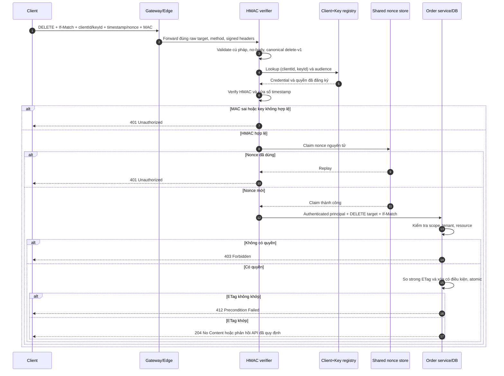

# DELETE request trong HMAC request authentication

## Mục tiêu học tập

Trong chương **HTTP method**, bài **DELETE request** tập trung vào việc gửi và xác minh yêu cầu xóa tài nguyên HTTP khi API sử dụng HMAC request authentication. DELETE là một phương thức có ngữ nghĩa riêng: **không safe nhưng idempotent theo HTTP semantics**. Điều đó không đồng nghĩa DELETE luôn an toàn để gửi lại, luôn trả cùng status hay có thể bỏ qua kiểm tra chữ ký và chống replay.

Bài thuộc module `SECURITY_AUTHENTICATION_HMAC_REQUEST_AUTHENTICATION`: thiết kế xác thực HTTP request bằng **shared secret** và **canonical request** có phương thức, URI, header hoặc body theo hợp đồng ký; thực hành xác minh HMAC, chống replay bằng timestamp/nonce, quản lý key rotation, kiểm thử proxy/gateway và phân biệt xác thực với phân quyền.

Sau bài học, bạn có thể:

- Phân biệt **DELETE**, **xóa logic**, **xóa vật lý**, **idempotency** và **replay protection**.
- Giải thích vì sao phương thức `DELETE` và URI đích **phải nằm trong dữ liệu được ký**.
- Thiết kế một hợp đồng HMAC cụ thể cho DELETE **không có request body**, trong đó header điều kiện `If-Match` cũng được bảo vệ bằng MAC.
- Viết Java 17 dùng `Mac`/`SecretKeySpec` để ký và xác minh DELETE, thử sửa method, URI hoặc ETag sau khi ký.
- Thiết kế xác minh tại server với timestamp/nonce, credential theo `(clientId, keyId)`, audience, kiểm tra quyền trên tài nguyên và chính sách rotation.
- Kiểm thử retry, gateway rewrite, method override, precondition, trạng thái phản hồi và các tình huống hai request xóa cạnh tranh.

## 1. DELETE thực sự có nghĩa gì trong HTTP?

Phương thức `DELETE` yêu cầu máy chủ **loại bỏ liên kết giữa tài nguyên đích và chức năng hiện tại của nó**. Cách API thực hiện điều đó tùy thiết kế: xóa record, đánh dấu soft delete, lên lịch xóa bất đồng bộ hoặc ngừng công bố một tài nguyên. HTTP không buộc server phải xóa dữ liệu vật lý khỏi mọi ổ đĩa/backup ngay tại thời điểm trả response.

Ví dụ:

```http
DELETE /v1/orders/ord-381 HTTP/1.1
Host: orders.example.test
Authorization: <placeholder-for-other-auth-if-present>
```

Đối với API dùng HMAC, cơ chế chứng minh bên gọi không phải một header bearer `Authorization` bất kỳ theo ví dụ trên; thay vào đó client có thể gửi `X-Client-Id`, `X-Key-Id` và MAC trên canonical request. Điều quan trọng là **xác minh đúng thao tác DELETE trên đúng tài nguyên** trước khi thực hiện.

### 1.1. DELETE không safe nhưng idempotent

| Thuộc tính | DELETE | Ý nghĩa trong thực hành |
| --- | --- | --- |
| **Safe** | Không | Request chủ đích làm thay đổi trạng thái tài nguyên. Không coi DELETE như GET chỉ đọc. |
| **Idempotent** | Có theo HTTP semantics | Nhiều yêu cầu DELETE giống nhau có cùng **tác động dự định** như một yêu cầu, xét trên tài nguyên đích. |
| **Response giống nhau khi lặp?** | Không được bảo đảm | Lần đầu có thể là `204`, lần sau `404`; tác động dự định vẫn idempotent. |
| **Không có side effect khác?** | Không được bảo đảm | Audit log, metrics, events, cache invalidation hoặc các tác động phụ có thể xảy ra. |
| **Không cần chống replay?** | **Sai** | HMAC còn hiệu lực vẫn có thể bị phát lại nếu không kiểm tra timestamp và nonce. |
| **Không cần phân quyền?** | **Sai** | Một client có quyền đọc không nhất thiết có quyền xóa. |

Idempotency của DELETE mô tả **semantics của phương thức**, không phải lời hứa toàn bộ pipeline xử lý chỉ ghi một audit event, gửi một email hoặc chạy một job. Nếu ứng dụng làm nghiệp vụ tính phí trên mỗi DELETE, cần thiết kế riêng cách tránh side effect lặp.

### 1.2. DELETE có request body được không?

HTTP không cấm mọi byte content trên DELETE ở cấp truyền tải, nhưng **content trong DELETE không có semantics được định nghĩa chung** và không được mặc định làm thay đổi ý nghĩa hoặc đích của request. Một số implementation/proxy có thể từ chối request DELETE có content vì rủi ro xử lý không nhất quán hoặc request smuggling. Không tự gửi body trong DELETE trừ khi API **quy định tường minh** và client/server có thỏa thuận phù hợp.

Trong **hợp đồng thực hành của bài này**, chúng ta chọn quy tắc đơn giản:

- DELETE **không có request body**.
- `Content-Type` **không có mặt**, vì không gửi representation.
- Hợp đồng vẫn đưa **SHA-256 của dãy byte body rỗng** vào canonical request để ràng buộc rõ việc “không có body”.
- Nếu client gửi payload hoặc header `Content-Type` không phù hợp, điểm tiếp nhận từ chối thay vì lặng lẽ bỏ qua hoặc thay đổi ý nghĩa.

Nếu một API thật quy định DELETE với body JSON, phải xuất bản **hợp đồng khác**: cách đọc exact body bytes, Content-Type, hash body, size limit, content encoding và semantics được ký. Không lấy quy tắc bài thực hành này áp dụng cho mọi dịch vụ khác.

## 2. Vì sao cần ký riêng phương thức DELETE?

Xem API:

```http
GET    /v1/orders/ord-381
PUT    /v1/orders/ord-381
DELETE /v1/orders/ord-381
```

Ba request có **cùng URI** nhưng yêu cầu ba hành động khác nhau. Nếu HMAC chỉ ký path, query, timestamp và nonce, một bên sửa request trên đường đi có thể đổi method mà **không thay bất cứ trường nào đã ký**. MAC hợp lệ khi đó không chứng minh client thực sự yêu cầu xóa.

Với method nằm trong canonical request:

```text
Client đã ký: DELETE
              /v1/orders/ord-381

Server nhận:  GET
              /v1/orders/ord-381
```

Chỉ một dòng method thay đổi cũng làm HMAC dự kiến khác đi với xác suất áp đảo nếu secret và thuật toán an toàn. Server phải tạo canonical request từ **method thực nhận** chứ không tin một chuỗi canonical do client tự khai.

### 2.1. Chính sách viết hoa và method override

HTTP method token phân biệt hoa và thường. Các phương thức tiêu chuẩn dùng `DELETE` chứ không phải `delete`. Vì thế hợp đồng mẫu chỉ chấp nhận chính xác `DELETE`, không tự động gọi `toUpperCase()` rồi ký/verify một giá trị đã bị sửa.

Một số framework hỗ trợ method override:

```http
POST /v1/orders/ord-381 HTTP/1.1
X-HTTP-Method-Override: DELETE
```

Nếu HMAC chỉ xác minh `POST` trước khi middleware đổi thành DELETE, handler có thể xóa tài nguyên dưới một request ban đầu **không được ràng buộc rõ với hành động xóa cuối cùng**. Với API HMAC M2M:

1. **Ưu tiên tắt method override** trên endpoint xác thực bằng chữ ký và từ chối `X-HTTP-Method-Override` hoặc tham số `_method`.
2. Nếu nghiệp vụ buộc dùng override, phải định nghĩa một hợp đồng bảo vệ **transport method** và **effective method** (hoặc thực hiện xác minh tại ranh giới bảo đảm effective method bất biến), đồng thời phân quyền theo **hành động thực thi**.
3. Chỉ tin header method gốc do **proxy đáng tin** tự thiết lập sau khi đã xóa header tương tự do client ngoài gửi.

**Bảo vệ method không có nghĩa được quyền xóa.** Sau khi xác thực chữ ký, server còn phải kiểm tra client có scope xóa trên đúng order, tenant và trạng thái nghiệp vụ hay không.

## 3. Đối tượng cần bảo vệ khi ký DELETE

Đối với yêu cầu xóa, các thành phần dưới đây có ý nghĩa bảo mật đáng kể:

| Thành phần | Ví dụ | Vì sao phải bảo vệ? |
| --- | --- | --- |
| Method | `DELETE` | Xác nhận client yêu cầu thao tác xóa, không phải đọc/sửa. |
| Raw request target | `/v1/orders/ord-381?tenant=merchant-42` | Chốt ID của tài nguyên và tenant được nhắm tới. |
| Audience | `orders-api-prod` | Ngăn sử dụng lại request đã ký ở API/môi trường khác. |
| Client ID | `partner-orders-prod` | Ràng buộc lời khai danh tính client vào MAC. |
| Key ID | `key-2026-11` | Ràng buộc phiên bản credential vào MAC, hỗ trợ rotation. |
| `If-Match` | `"rev-7"` | Chốt tiền điều kiện về phiên bản tài nguyên mà client muốn xóa. |
| Body hash | SHA-256 của body rỗng | Chốt hợp đồng DELETE này **không có payload**. |
| Timestamp | Epoch seconds | Giới hạn khoảng thời gian request được chấp nhận. |
| Nonce | 16 byte ngẫu nhiên, Base64URL | Giúp server phát hiện request đã được dùng. |
| Hợp đồng/thuật toán | `delete-v1`, `HMAC-SHA256` | Tránh nhầm cấu trúc ký hoặc thuật toán giữa các phiên bản. |

Trong hợp đồng này, `Host` không được ký. Thay vào đó, server dựa vào audience `orders-api-prod` **từ cấu hình đáng tin**, đã gắn với credential trong registry. Nếu deployment cần ràng buộc host/authority thực tế, hãy đưa ra quy tắc ký rõ ràng cho trường đó; không tin bừa `X-Forwarded-Host` từ internet.

### 3.1. `If-Match` giải quyết vấn đề gì?

Giả sử người dùng nhìn thấy order ở phiên bản `"rev-7"` và bấm xóa. Trước khi DELETE đến server, một tiến trình khác cập nhật order thành `"rev-8"`. Nếu xóa vô điều kiện, client có thể xóa một tài nguyên đã thay đổi sau khi người dùng quyết định.

Khi API dùng **conditional request**:

```http
DELETE /v1/orders/ord-381 HTTP/1.1
If-Match: "rev-7"
```

server kiểm tra precondition theo HTTP semantics bằng **strong comparison**. Nếu current ETag không còn khớp, server thường trả **`412 Precondition Failed`** thay vì xóa. Nếu API yêu cầu tiền điều kiện nhưng client bỏ `If-Match`, server có thể trả **`428 Precondition Required`**.

**HMAC phải ký `If-Match`** nếu endpoint dựa vào header này để tránh xóa nhầm phiên bản. Nếu không, attacker có thể thay `If-Match: "rev-7"` thành `If-Match: *` để làm lỏng tiền điều kiện mà chữ ký trên method/URI vẫn khớp.

Trong hợp đồng `delete-v1` minh họa, để đơn giản và giảm mơ hồ, `If-Match` là **bắt buộc**, chứa đúng **một strong ETag dạng quoted opaque-tag** có ký tự ASCII an toàn theo chính sách ví dụ; không hỗ trợ wildcard, weak ETag `W/"..."` hay danh sách nhiều ETag. Đây là ràng buộc của API mẫu, **không phải** giới hạn của HTTP `If-Match` nói chung.

### 3.2. Xóa có điều kiện vẫn cần phân quyền

Nếu `If-Match` khớp nhưng client không được phép xóa order của tenant `merchant-42`, server phải từ chối ở tầng **authorization**. ETag chỉ bảo vệ trạng thái mà client đã quan sát; nó **không phải credential**, cũng không chứng minh quyền sở hữu tài nguyên.

Trong luồng thực tế, thứ tự chi tiết giữa precondition và authorization phải tránh lộ thông tin về tài nguyên không được cấp quyền. Một thiết kế hợp lý là xác thực HMAC trước, xác định tài nguyên/tenant, kiểm tra quyền, rồi áp dụng precondition ngay sát thao tác thay đổi, tốt nhất có kiểm tra nguyên tử trong transaction.

## 4. Hợp đồng canonical request `delete-v1`

Không có canonical request HMAC phổ quát cho mọi API. Hợp đồng bên dưới là **ví dụ giáo dục cụ thể** dành cho DELETE không có body, yêu cầu `If-Match` và HMAC-SHA256.

### 4.1. HTTP request minh họa

```http
DELETE /v1/orders/ord-381?tenant=merchant-42 HTTP/1.1
Host: orders.example.test
If-Match: "rev-7"
X-Client-Id: partner-orders-prod
X-Key-Id: key-2026-11
X-Timestamp: 1795800000
X-Nonce: ZNtbmRw-5vR3NDGWFafXLg
X-Content-SHA256: 47DEQpj8HBSa-_TImW-5JCeuQeRkm5NMpJWZG3hSuFU
X-Signature: <base64url-hmac-sha256>

```

Request ở ví dụ **không có payload**; dòng trống sau header chỉ là ranh giới kết thúc header HTTP/1.1. `X-Signature` phải được client tính đúng, không gửi chuỗi placeholder. Timestamp trên là minh họa cố định, **không hợp lệ mãi**; request thực phải dùng thời gian hiện tại.

Hợp đồng ký có **11 dòng** UTF-8, ngăn cách bằng đúng một LF (`\n`) và **không có LF ở cuối**:

```text
HMAC-SHA256
delete-v1
orders-api-prod
partner-orders-prod
key-2026-11
DELETE
/v1/orders/ord-381?tenant=merchant-42
"rev-7"
47DEQpj8HBSa-_TImW-5JCeuQeRkm5NMpJWZG3hSuFU
1795800000
ZNtbmRw-5vR3NDGWFafXLg
```

| Dòng | Thành phần | Nguồn đáng tin/định dạng |
| --- | --- | --- |
| 1 | `HMAC-SHA256` | Nhãn thuật toán cố định của hợp đồng; JCA dùng `HmacSHA256`. |
| 2 | `delete-v1` | Phiên bản cố định, tránh nhập nhằng với hợp đồng cho method khác. |
| 3 | `orders-api-prod` | Audience do client/server cấu hình và server đối chiếu registry. |
| 4 | `partner-orders-prod` | `X-Client-Id` từ request, **chưa tin cậy** trước xác minh. |
| 5 | `key-2026-11` | `X-Key-Id`, tra cặp `(clientId, keyId)` từ registry. |
| 6 | `DELETE` | Method thực tế được nhận, không phải do header override quyết định. |
| 7 | Raw target | Path + query **nguyên dạng tại trust boundary** của verifier. |
| 8 | `"rev-7"` | Giá trị `If-Match` đã kiểm tra, chỉ bỏ OWS hai đầu theo hợp đồng. |
| 9 | Base64URL(SHA-256(empty body)) | Hằng 43 ký tự, xác nhận không có body. |
| 10 | Epoch seconds | Dạng số ASCII được ký. |
| 11 | Nonce | Base64URL không padding của 16 byte ngẫu nhiên được ký. |

**Body rỗng** có SHA-256 chuẩn:

```text
SHA256(empty bytes) in hex:
e3b0c44298fc1c149afbf4c8996fb92427ae41e4649b934ca495991b7852b855

Base64URL_no_padding(SHA256(empty bytes)):
47DEQpj8HBSa-_TImW-5JCeuQeRkm5NMpJWZG3hSuFU
```

Đây là hash công khai của dãy byte rỗng, **không phải secret hay chữ ký HMAC**. Bên nhận vẫn phải xác minh HMAC trên canonical request với shared secret đã đăng ký.

### 4.2. Quy tắc canonicalization phải công bố cụ thể

1. **Method:** chỉ nhận exact token `DELETE` ở endpoint này; không tự lowercase/uppercase hay override.
2. **Raw target:** bắt đầu bằng `/`, gồm path và query (kể cả dấu `?` nếu có), giữ nguyên percent-encoding, slash và thứ tự query. Hợp đồng mẫu không hỗ trợ URI fragment, absolute-form hay ký tự điều khiển trong target.
3. **`If-Match`:** đúng một header, sau khi bỏ ASCII space/tab ở hai đầu phải là một strong ETag dạng `"rev-7"` hoặc opaque-tag được cho phép. Không tự loại dấu ngoặc kép, unescape hoặc đổi nội dung ETag.
4. **Body:** chính xác zero bytes. Không gửi `Content-Type`. `Content-Encoding` chỉ được vắng mặt hoặc `identity` theo chính sách kiểm thử. Từ chối request có body; không “ký body rỗng nhưng sau đó vẫn parse payload”.
5. **Các ID:** `clientId`, `keyId` có cú pháp, giới hạn chiều dài và được đưa vào canonical request; key bắt buộc thuộc đúng client và audience.
6. **Timestamp:** Unix epoch seconds thập phân, không dấu `+`, không khoảng trắng. Kiểm tra cửa sổ chấp nhận, chẳng hạn ±300 giây với đồng hồ server.
7. **Nonce:** ít nhất 128 bit ngẫu nhiên; ví dụ dùng Base64URL không padding của đúng 16 byte, từ chối biểu diễn sai chuẩn hoặc trùng nonce.
8. **Dấu phân cách:** các trường không được chứa CR/LF; ghép bằng một ký tự LF duy nhất và không có LF cuối. Dùng UTF-8, không dùng `System.lineSeparator()`.
9. **Chữ ký:** tính `HMAC-SHA256(secretBytes, UTF8(canonical))`, mã hóa MAC thành Base64URL không padding (32 byte → 43 ký tự). `X-Signature` không nằm trong canonical request.
10. **Header trùng:** từ chối `If-Match`, `X-Client-Id`, `X-Key-Id`, `X-Timestamp`, `X-Nonce` hoặc `X-Signature` trùng hay mơ hồ ở điểm tiếp nhận, kể cả khi khác chữ hoa/thường.

Lưu ý: canonicalization không tự giải quyết các trường hợp gateway/backend **diễn giải query key trùng khác nhau**. Nếu không có nhu cầu hỗ trợ, API DELETE nhạy cảm nên từ chối tham số trùng thay vì cho mỗi tầng chọn một giá trị.

## 5. Java 17: ký và xác minh DELETE có `If-Match`

Ví dụ dưới đây dùng JDK 17+, tự chứa và không cần framework. Nó mô phỏng client/server có cùng secret để minh họa **dữ liệu được HMAC bảo vệ**; chưa triển khai HTTP parser, database, nonce store hay authorization production.

Lưu file ví dụ riêng trong môi trường học (không phải trong module dữ liệu bài này) với tên `DeleteRequestHmacDemo.java` nếu muốn chạy thử:

```java
import java.nio.charset.StandardCharsets;
import java.security.GeneralSecurityException;
import java.security.MessageDigest;
import java.security.SecureRandom;
import java.time.Instant;
import java.util.Arrays;
import java.util.Base64;
import java.util.Objects;
import javax.crypto.Mac;
import javax.crypto.spec.SecretKeySpec;

public final class DeleteRequestHmacDemo {
    private static final String AUDIENCE = "orders-api-prod";
    private static final String CONTRACT = "delete-v1";
    private static final Base64.Encoder ENCODER =
            Base64.getUrlEncoder().withoutPadding();
    private static final Base64.Decoder DECODER =
            Base64.getUrlDecoder();

    private DeleteRequestHmacDemo() {}

    record DeleteRequest(
            String method, String rawTarget, String ifMatch,
            byte[] body, String clientId, String keyId,
            String timestamp, String nonce) {
        DeleteRequest {
            body = Objects.requireNonNull(body, "body").clone();
        }

        @Override
        public byte[] body() {
            return body.clone();
        }
    }

    record SignedHeaders(String contentSha256, String signature) {}

    static String bodyHash(byte[] body) throws GeneralSecurityException {
        byte[] digest = MessageDigest.getInstance("SHA-256").digest(body);
        return ENCODER.encodeToString(digest);
    }

    static String trimOws(String text) {
        int begin = 0;
        int end = text.length();
        while (begin < end
                && (text.charAt(begin) == ' '
                    || text.charAt(begin) == '\t')) {
            begin++;
        }
        while (end > begin
                && (text.charAt(end - 1) == ' '
                    || text.charAt(end - 1) == '\t')) {
            end--;
        }
        return text.substring(begin, end);
    }

    static String canonical(DeleteRequest request, String hash) {
        if (!"DELETE".equals(request.method())) {
            throw new IllegalArgumentException("Only DELETE is supported");
        }
        if (request.body().length != 0) {
            throw new IllegalArgumentException("DELETE body must be empty");
        }

        String target = request.rawTarget();
        if (target == null || target.length() > 2048
                || !target.startsWith("/") || target.indexOf('#') >= 0
                || !target.chars().allMatch(c -> c >= 0x21 && c <= 0x7E)) {
            throw new IllegalArgumentException("Invalid raw target");
        }

        // Ví dụ chỉ cho phép một strong ETag đơn giản.
        String ifMatch = request.ifMatch() == null
                ? "" : trimOws(request.ifMatch());
        if (!ifMatch.matches("\"[A-Za-z0-9._-]{1,80}\"")) {
            throw new IllegalArgumentException("Invalid If-Match");
        }
        if (request.timestamp() == null
                || !request.timestamp().matches("[1-9][0-9]{0,18}")) {
            throw new IllegalArgumentException("Invalid timestamp");
        }
        String nonce = request.nonce();
        if (nonce == null || !nonce.matches("[A-Za-z0-9_-]{22}")) {
            throw new IllegalArgumentException("Invalid nonce syntax");
        }
        byte[] nonceBytes = DECODER.decode(nonce);
        if (nonceBytes.length != 16
                || !ENCODER.encodeToString(nonceBytes).equals(nonce)) {
            throw new IllegalArgumentException("Noncanonical nonce");
        }

        String[] fields = {
                "HMAC-SHA256", CONTRACT, AUDIENCE,
                request.clientId(), request.keyId(), request.method(),
                target, ifMatch, hash, request.timestamp(), nonce
        };
        for (String field : fields) {
            if (field == null || field.length() > 2048
                    || field.indexOf('\r') >= 0
                    || field.indexOf('\n') >= 0) {
                throw new IllegalArgumentException("Invalid canonical field");
            }
        }
        return String.join("\n", fields); // 11 dòng, không LF cuối.
    }

    static byte[] mac(byte[] secretBytes, String canonical)
            throws GeneralSecurityException {
        Mac mac = Mac.getInstance("HmacSHA256");
        mac.init(new SecretKeySpec(secretBytes, "HmacSHA256"));
        return mac.doFinal(canonical.getBytes(StandardCharsets.UTF_8));
    }

    static SignedHeaders sign(DeleteRequest request, byte[] secretBytes)
            throws GeneralSecurityException {
        String hash = bodyHash(request.body());
        String signature = ENCODER.encodeToString(
                mac(secretBytes, canonical(request, hash)));
        return new SignedHeaders(hash, signature);
    }

    static boolean verifyMac(
            DeleteRequest received, SignedHeaders receivedHeaders,
            byte[] serverSecretBytes) throws GeneralSecurityException {
        if (receivedHeaders == null || receivedHeaders.contentSha256() == null
                || receivedHeaders.signature() == null) {
            return false;
        }
        try {
            String actualHash = bodyHash(received.body());
            if (!actualHash.equals(receivedHeaders.contentSha256())) {
                return false;
            }
            String signature = receivedHeaders.signature();
            if (!signature.matches("[A-Za-z0-9_-]{43}")) {
                return false;
            }
            byte[] receivedMac = DECODER.decode(signature);
            if (receivedMac.length != 32
                    || !ENCODER.encodeToString(receivedMac)
                            .equals(signature)) {
                return false;
            }
            byte[] expected = mac(serverSecretBytes,
                    canonical(received, actualHash));
            return MessageDigest.isEqual(expected, receivedMac);
        } catch (IllegalArgumentException ex) {
            return false;
        }
    }

    public static void main(String[] args)
            throws GeneralSecurityException {
        byte[] sharedSecret = new byte[32];
        byte[] nonceBytes = new byte[16];
        SecureRandom random = new SecureRandom();
        random.nextBytes(sharedSecret);
        random.nextBytes(nonceBytes);

        DeleteRequest original = new DeleteRequest(
                "DELETE",
                "/v1/orders/ord-381?tenant=merchant-42",
                "\"rev-7\"",
                new byte[0],
                "partner-orders-prod",
                "key-2026-11",
                Long.toString(Instant.now().getEpochSecond()),
                ENCODER.encodeToString(nonceBytes)
        );

        SignedHeaders signed = sign(original, sharedSecret);
        System.out.println("Original DELETE valid: "
                + verifyMac(original, signed, sharedSecret));

        DeleteRequest otherResource = new DeleteRequest(
                original.method(),
                "/v1/orders/ord-999?tenant=merchant-42",
                original.ifMatch(), original.body(), original.clientId(),
                original.keyId(), original.timestamp(), original.nonce());
        System.out.println("Changed URI valid: "
                + verifyMac(otherResource, signed, sharedSecret));

        DeleteRequest weakerPrecondition = new DeleteRequest(
                original.method(), original.rawTarget(), "\"rev-8\"",
                original.body(), original.clientId(), original.keyId(),
                original.timestamp(), original.nonce());
        System.out.println("Changed If-Match valid: "
                + verifyMac(weakerPrecondition, signed, sharedSecret));

        DeleteRequest changedMethod = new DeleteRequest(
                "POST", original.rawTarget(), original.ifMatch(),
                original.body(), original.clientId(), original.keyId(),
                original.timestamp(), original.nonce());
        System.out.println("Changed method valid: "
                + verifyMac(changedMethod, signed, sharedSecret));

        Arrays.fill(sharedSecret, (byte) 0);
    }
}
```

Kết quả mong đợi:

```text
Original DELETE valid: true
Changed URI valid: false
Changed If-Match valid: false
Changed method valid: false
```

**Diễn giải:** code dùng `MessageDigest.getInstance("SHA-256")` để hash body rỗng, `Mac.getInstance("HmacSHA256")` cùng `SecretKeySpec` để tính HMAC. `canonical(...)` ký rõ method DELETE, raw target và `If-Match`. Nếu thay URI, thay ETag hoặc thay method sau khi ký, phía server tính MAC trên dữ liệu khác và trả false.

Đây **không phải bộ xác thực HTTP hoàn chỉnh**: `verifyMac(...)` không truy cập registry, không xác minh timestamp có mới, không claim nonce, không kiểm tra key bị thu hồi, không đọc header trực tiếp từ HTTP server và không kiểm tra authorization. Trong triển khai thật, server phải tự xây dựng dữ liệu từ **request thực nhận**, kiểm tra header trùng, body thực tế và các chính sách trước khi tạo principal.

### 5.1. Đọc request thật trong Java/Spring cần lưu ý gì?

Khi tích hợp với Servlet hoặc Spring:

- `HttpServletRequest.getMethod()` cung cấp method do container thấy; kiểm tra các filter override có chạy trước HMAC verifier hay không.
- Lấy **raw path/query** từ điểm tiếp nhận có khả năng bảo toàn byte theo hợp đồng. Không tự ghép lại từ path variables đã decode hoặc request URL đã bị gateway rewrite.
- Lấy `If-Match` với chính sách **chỉ một giá trị**, không âm thầm chấp nhận hai header mâu thuẫn. Header name không phân biệt hoa/thường, nhưng ETag value phải được xử lý theo semantics và hợp đồng.
- Ràng buộc `Content-Length`/`Transfer-Encoding` với parser HTTP an toàn; ngăn request smuggling. Đừng bỏ qua payload nếu hợp đồng DELETE cấm body.
- Không coi header `X-Client-Id` hoặc `X-Role` là principal thật trước khi verify. Sau khi xác minh, tạo `Authentication`/principal từ registry và đưa vào security context theo framework.
- Tránh gọi cùng một `Mac` mutable từ nhiều thread. Tạo `Mac` riêng cho mỗi phép tính hoặc quản lý instance an toàn.

## 6. Luồng xác minh DELETE ở server

Một endpoint xóa nhạy cảm nên đặt **authentication**, **replay protection**, **authorization**, **precondition** và **thao tác xóa nguyên tử** thành các lớp rõ ràng:



Các điểm kỹ thuật cần nhớ:

1. **Validate request:** method, body, Content-Type, URI, `If-Match`, cú pháp header, giới hạn kích thước; từ chối các biểu diễn trùng/mơ hồ. Chưa cấp danh tính cho request.
2. **Tra khóa:** lấy credential từ registry theo `(clientId, keyId)`, kiểm tra client/key còn hiệu lực, đúng audience/thuật toán. Secret không được lấy từ header người gọi.
3. **Xác minh MAC:** server tự dựng canonical 11 dòng; dùng HMAC-SHA256 và so sánh MAC theo byte bằng `MessageDigest.isEqual`. Không tự fallback sang key/algorithm khác để cố tìm chữ ký khớp.
4. **Chống replay:** timestamp ký kèm request và phải trong cửa sổ quy định; sau khi MAC đúng, dùng kho nonce chung với thao tác nguyên tử (`SET key value NX EX` hoặc tương đương). Nonce đã claim thì từ chối.
5. **Tạo principal:** chỉ sau bước xác thực đầy đủ, lấy scopes/tenants từ registry. Không tin `X-Scope` hoặc tên tenant vì chúng xuất hiện trong request.
6. **Authorization:** kiểm tra `orders:delete`, ownership/tenant, business state và đối tượng cụ thể. Không để thành công MAC là quyền xóa mặc định.
7. **Conditional delete:** kiểm tra `If-Match` theo strong ETag ở thời điểm thay đổi. Một cách thường dùng là update/delete **có điều kiện trong cùng transaction**, tránh race giữa đọc phiên bản và thao tác xóa.

### 6.1. Ví dụ về kiểm tra precondition nguyên tử

Trong cơ sở dữ liệu có soft delete, một cách triển khai đơn giản có thể kiểm tra phiên bản ngay trong lệnh cập nhật:

```sql
-- Minh họa: đã xác thực client và kiểm tra quyền trước khi chạy.
UPDATE orders
SET deleted_at = CURRENT_TIMESTAMP, version = version + 1
WHERE id = :order_id
  AND tenant_id = :authorized_tenant_id
  AND version = :etag_version
  AND deleted_at IS NULL;
```

Nếu số hàng bị ảnh hưởng bằng 0, server cần phân loại theo chính sách: tài nguyên không tồn tại/đã xóa, phiên bản không khớp hoặc không được phép truy cập. **Không trả chi tiết gây lộ sự tồn tại tài nguyên của tenant khác**. Đây chỉ là một mô hình cho ETag dựa trên version; hệ thống phải có mapping ETag ↔ version an toàn và kiểm tra theo HTTP precondition semantics.

Nếu handler chỉ đọc ETag rồi chạy DELETE vô điều kiện ở bước sau, cập nhật đồng thời có thể lọt vào khoảng trống **time-of-check/time-of-use**. Bảo vệ ở transaction/locking hoặc điều kiện UPDATE/DELETE để xử lý đúng cạnh tranh.

### 6.2. Timestamp, nonce và vòng đời khóa

Một chính sách ví dụ chấp nhận timestamp lệch **±300 giây** so với đồng hồ server đã đồng bộ. Nonce cần đủ entropy (chẳng hạn 128 bit), được ký cùng timestamp và lưu theo phạm vi `(audience, clientId, keyId, nonce)` với thao tác **claim một lần**.

Với cửa sổ ±300 giây, bản ghi nonce cần sống đủ lâu để che phủ thời gian request còn được chấp nhận, ví dụ khoảng **610 giây kể từ lúc claim**. Nếu có nhiều instance, không dùng cache nonce cục bộ; nếu kho nonce không khả dụng, không tự bỏ kiểm tra với API xóa nhạy cảm.

Khi **key rotation**, client ID có thể giữ nguyên còn key ID/secret đổi. Server chỉ xác minh bằng key ID đang khai, có trạng thái `ACTIVE`/`RETIRING` trong thời gian chuyển tiếp hữu hạn, và từ chối `REVOKED` dù toán học HMAC tính ra vẫn khớp. Đổi secret **không** sửa được vấn đề proxy rewrite URI hoặc body parsing.

## 7. DELETE idempotent nhưng replay vẫn nguy hiểm

Hãy phân biệt ba tình huống sau:

| Tình huống | HMAC | Chống replay | Hành vi nghiệp vụ |
| --- | --- | --- | --- |
| Gửi **nguyên request DELETE cũ** với cùng timestamp, nonce và MAC | MAC có thể còn khớp | **Từ chối nonce đã dùng** | Không thực thi DELETE lần nữa. |
| Client gửi **DELETE mới** cùng resource, nhưng timestamp/nonce/MAC mới | MAC hợp lệ | Nonce mới nên có thể vượt bước replay | API kiểm tra quyền, precondition, trạng thái tài nguyên; có thể trả 404/412/204 theo hợp đồng. |
| Client gửi **lệnh xóa khác** cho resource mới với nonce/MAC mới | MAC hợp lệ | Nonce mới | Authorization và business rule quyết định. |

Chống replay theo nonce không giải quyết việc **client cố ý gửi lại một yêu cầu nghiệp vụ mới**. Dù DELETE idempotent về tác động dự định trên tài nguyên, hệ thống có thể phát sự kiện xóa, chạy job, cập nhật audit hoặc tính chi phí theo số lần nhận. Nếu cần đảm bảo **một hành động nghiệp vụ duy nhất**, phải sử dụng thiết kế idempotency ở mức ứng dụng, ví dụ idempotency key được ký và lưu kết quả xử lý theo client/resource/operation, cùng transaction với dữ liệu cần thay đổi khi cần.

### 7.1. Retry khi client không nhận response

Giả sử DELETE đã hoàn tất, server trả `204` nhưng kết nối mất trước khi client đọc được. Client không thể biết chắc request đã thành công.

- **Không phát lại nguyên chữ ký và nonce** rồi đòi verifier bỏ qua replay; quy trình đó sẽ bị từ chối.
- Client có thể tạo nonce/timestamp mới và **ký một request mới**; kết quả có thể là 404 vì tài nguyên đã xóa, hoặc status khác theo hợp đồng.
- Nếu API dùng `If-Match`, version cũ có thể không còn khớp ⇒ 412 hoặc tài nguyên đã biến mất ⇒ 404/410 theo chính sách.
- Nếu ứng dụng cần xác nhận cuối cùng, có thể dùng API kiểm tra trạng thái (GET được phân quyền) hoặc idempotency key xử lý xuyên retry.
- Nếu DELETE xử lý bất đồng bộ và trả `202`, cần một cơ chế theo dõi job và quyết định bảo mật cho việc truy vấn tiến độ.

Đừng cho rằng DELETE idempotent đồng nghĩa có thể gửi request với nonce cũ vô hạn hoặc có thể bỏ quyền xác thực cho thao tác xóa.

### 7.2. Hai DELETE đến cùng lúc

Hai request **khác nonce** cùng nhắm vào một resource có thể đồng thời vượt qua lớp HMAC. Chống replay không phân xử đây là hai yêu cầu nghiệp vụ trùng nhau. Khi dùng `If-Match: "rev-7"` và cập nhật có điều kiện ở DB, thông thường chỉ một thao tác có thể chuyển resource khỏi version `rev-7`. Thao tác thứ hai sẽ được xử lý theo precondition/trạng thái thực tế, không tự ghi đè một thay đổi đã xảy ra.

Đây là lý do **If-Match + thao tác nguyên tử** xử lý cạnh tranh dữ liệu, còn **timestamp + nonce** xử lý phát lại của cùng request đã ký; hai cơ chế bổ sung nhưng không thay thế nhau.

## 8. HTTP status code thường gặp với DELETE

Không nên trả cùng một lỗi cho mọi tình huống, nhưng cũng cần tránh tiết lộ tài nguyên nhạy cảm cho caller chưa được phân quyền.

| Status | Ý nghĩa thường gặp với DELETE | Ví dụ |
| --- | --- | --- |
| `200 OK` | Xóa thành công, response có representation mô tả kết quả. | Trả JSON tình trạng sau xóa theo hợp đồng API. |
| `202 Accepted` | Đã nhận yêu cầu xóa nhưng công việc **chưa hoàn tất**. | Xóa dữ liệu lớn theo job; cung cấp đường theo dõi có phân quyền. |
| `204 No Content` | Xóa đã có hiệu lực, response không có body. | Thành công đồng bộ không cần trả representation. |
| `400 Bad Request` | Request sai cú pháp/hợp đồng. | Header ký trùng, body bị cấm, target không hợp lệ. |
| `401 Unauthorized` | Thiếu/chưa đạt xác thực. | MAC sai, key bị thu hồi, nonce replay hoặc timestamp không hợp lệ theo chính sách mẫu. |
| `403 Forbidden` | Caller xác thực được nhưng **không có quyền** xóa. | Thiếu `orders:delete` hoặc sai tenant. |
| `404 Not Found` | Không tìm thấy resource hoặc API dùng 404 để không tiết lộ resource ngoài quyền. | Order đã xóa hoặc ID không có. |
| `405 Method Not Allowed` | Endpoint không cho phép DELETE. | Route chỉ có GET; phản hồi nên có `Allow` theo HTTP semantics. |
| `409 Conflict` | Yêu cầu xóa xung đột với trạng thái/quy tắc nghiệp vụ. | Order đang được quyết toán nên không được xóa. |
| `410 Gone` | Tài nguyên đã không còn và server muốn thông báo trạng thái đó. | API có chính sách tombstone. |
| `412 Precondition Failed` | `If-Match` không khớp trạng thái hiện tại. | Client ký `"rev-7"` nhưng resource ở `"rev-8"`. |
| `428 Precondition Required` | API bắt buộc yêu cầu có precondition nhưng client không cung cấp. | Thiếu `If-Match` cho DELETE có điều kiện. |

HTTP status chỉ là **kết quả giao thức**; cách chuyển một điều kiện nghiệp vụ thành status cụ thể cần được định nghĩa trong API contract. Với tenant ngoài quyền, có thể chọn 404 để giảm khả năng dò tài nguyên theo chính sách, nhưng không được bỏ kiểm tra quyền.

Trong HTTP, DELETE **không safe** dù có thể trả 204. Không để URL xóa dữ liệu được kích hoạt bởi đường dẫn GET hoặc công cụ prefetch/crawler.

## 9. Proxy/gateway, redirect và nguy cơ chuyển nghĩa DELETE

### 9.1. Rewrite URI trước/sau khi xác minh

```text
Client ký:     DELETE /public/v1/orders/ord-381?tenant=merchant-42
Gateway gửi:   DELETE /internal/orders/ord-381?tenant=merchant-42
Backend nhận:  DELETE /internal/orders/ord-381?tenant=merchant-42
```

Nếu backend tính HMAC theo raw target **sau** rewrite, MAC không thể khớp với chữ ký client. Có hai mô hình hợp lệ khi thiết kế đầy đủ:

1. **Xác minh HMAC tại gateway trước rewrite** và tạo authenticated principal. Backend chỉ tin principal chuyển qua kênh nội bộ có tính toàn vẹn/danh tính được bảo vệ; gateway phải xóa header principal do internet gửi.
2. **Xác minh tại backend bằng raw target gốc** được gateway bảo toàn dưới dạng metadata nội bộ đáng tin và chống giả mạo, ràng buộc metadata đó với đúng request. Không tin `X-Original-URI` tự khai của client.

Dù chọn phương án nào, phải bảo đảm **operation được backend thực thi đúng với method, resource và precondition đã được xác minh**. Gateway không được kiểm tra chữ ký cho `ord-381` rồi âm thầm chuyển sang xóa `ord-999`.

### 9.2. Redirect với DELETE

Một HTTP client theo redirect có thể tự gửi request mới đến URI/host khác. `307` và `308` yêu cầu bảo toàn method theo semantics redirect, nhưng URI mới **vẫn khác** và vì thế cần **ký lại**. `303` có thể chuyển client sang GET; không được tái sử dụng chữ ký DELETE cho GET.

Với HMAC request authentication, nên tắt follow redirect tự động hoặc chỉ cho phép redirect đến đích đã đăng ký, rồi tạo canonical request, timestamp, nonce và chữ ký mới theo endpoint thực tế. Không tự chuyển credential/secret sang host hoặc audience không được cấp quyền.

### 9.3. CDN, cache và CORS

- DELETE thành công có thể làm vô hiệu những cache entry tương ứng theo HTTP caching rules. Không coi HMAC là cơ chế tự đồng bộ cache.
- DELETE thường có side effect nên **không được kích hoạt bởi GET** chỉ để vượt CORS/proxy.
- CORS preflight `OPTIONS` trên browser là một request **khác** với DELETE. API cần chính sách CORS riêng; một OPTIONS chưa ký không phải bằng chứng để thực hiện DELETE.
- Một shared secret HMAC không nên nhúng lâu dài trong JavaScript công khai/mobile client có thể bị trích xuất; tích hợp M2M nên giữ secret trong backend/trust boundary phù hợp.

## 10. Ma trận kiểm thử DELETE có HMAC

Các test nên kiểm tra cả **kết quả xác minh**, **sự thay đổi dữ liệu** và **event/side effect**. Chỉ kiểm tra HTTP status có thể bỏ sót việc xác minh đúng nhưng thực thi sai resource.

| Ca thử | Hành động | Kỳ vọng |
| --- | --- | --- |
| DELETE hợp lệ | Method/URI/If-Match/raw key đúng; nonce mới. | MAC hợp lệ, được phép và precondition khớp thì xóa thành công. |
| Tráo method | Ký DELETE, sửa thành POST/PUT/GET. | MAC sai hoặc method bị từ chối; không xóa. |
| Tráo resource | Đổi `ord-381` thành `ord-999` sau ký. | MAC sai; không tác động order khác. |
| Tráo tenant | Đổi `tenant=merchant-42` thành tenant khác sau ký. | MAC sai. |
| Tráo `If-Match` | Ký `"rev-7"`, đổi thành `"rev-8"` hoặc `*`. | MAC sai hoặc giá trị không thuộc hợp đồng. |
| Header `If-Match` trùng | Gửi hai giá trị khác nhau. | Từ chối vì mơ hồ, không chọn một giá trị tùy ý. |
| Body bị cấm | Gửi DELETE có payload JSON nhưng ký hash body rỗng. | Từ chối; không bỏ qua payload. |
| Raw query bị sắp lại | Ký `?tenant=m42&a=1`, server thấy `?a=1&tenant=m42`. | MAC sai theo hợp đồng raw target. |
| Ký đúng, key bị thu hồi | Dùng secret của `REVOKED` key. | Từ chối trước khi tạo principal. |
| Ký đúng, nonce đã dùng | Phát lại nguyên request. | Kho nonce chung từ chối replay. |
| Ký đúng, timestamp quá hạn | Lệch ngoài cửa sổ cho phép. | Từ chối. |
| Chữ ký đúng, thiếu quyền | Client chỉ có `orders:read`. | Authentication thành công, authorization trả 403; không xóa. |
| Chữ ký đúng, sai tenant | Client không được cấp tenant của order. | Từ chối theo chính sách phân quyền. |
| Chữ ký đúng, ETag cũ | Resource đã đổi `rev-7` → `rev-8`. | Precondition thất bại; không xóa. |
| Hai nonce mới, cùng ETag | Hai DELETE song song cùng resource. | Chỉ một có thể chuyển version/tác động dự định; precondition nguyên tử ngăn race. |
| Hai request trùng nonce trên hai node | Gửi đồng thời. | Chỉ tối đa một request claim nonce thành công. |
| Gateway rewrite URI | Đổi path trước backend. | Verifier dùng đúng trust boundary; không xác minh A rồi thực thi B. |
| Method override | `POST` + `X-HTTP-Method-Override: DELETE`. | Override bị chặn hoặc được xử lý theo hợp đồng ký hiệu lực rõ ràng; không âm thầm xóa. |
| Retry sau timeout | Ký DELETE mới với nonce mới sau request đầu đã xử lý. | Không lặp side effect nguy hiểm; response theo hợp đồng/idempotency. |
| Key rotation | Dùng key cũ và mới trong overlap rồi revoke key cũ. | Cùng client identity khi hợp lệ; key revoked bị từ chối. |

### 10.1. Những test vector cần trao đổi giữa các SDK

Để kiểm thử Java, Go hoặc Node.js client, bộ test vector phải ghi rõ:

- Raw secret **giả dùng cho test**, `clientId`, `keyId` và audience.
- HTTP method exact `DELETE`, raw URI/path/query, header `If-Match` bao gồm dấu ngoặc kép.
- Body = **zero bytes**, body hash hằng 43 ký tự, timestamp và nonce.
- Canonical string **11 dòng**, byte UTF-8, không LF cuối.
- HMAC-SHA256 raw bytes và signature Base64URL không padding mong đợi.
- Những biến thể thay URI, ETag, method, key ID hoặc nonce; mỗi biến thể phải có MAC khác khi được ký lại, và MAC cũ phải bị từ chối.

Không dùng secret production trong test vector hay đưa canonical request chứa dữ liệu nhạy cảm vào log chung.

## 11. Bài thực hành: DELETE một order có điều kiện

Thiết kế một API `DELETE /v1/orders/{orderId}` dùng shared secret HMAC-SHA256. Giả sử client `partner-orders-prod` được cấp scope `orders:delete` cho tenant `merchant-42`.

1. **Tạo credential:** sinh 32 byte ngẫu nhiên bằng `SecureRandom`, lưu trong secret manager hoặc cấu hình bảo mật của môi trường thực hành; đăng ký `clientId`, `keyId`, `audience`, scope và tenant.
2. **Tạo resource:** giả lập order `ord-381` với ETag strong `"rev-7"`; API GET đọc ETag cần xác thực/phân quyền riêng.
3. **Định nghĩa hợp đồng `delete-v1`:** ký 11 dòng gồm algorithm, version, audience, client ID, key ID, DELETE, raw target, `If-Match`, hash body rỗng, timestamp, nonce. Từ chối DELETE có body và method override.
4. **Viết signer:** Java dùng `MessageDigest` cho body hash, `Mac`/`SecretKeySpec` cho HMAC, Base64URL không padding cho signature.
5. **Viết verifier:** tự dựng canonical từ request thực nhận, tra đúng credential, xác minh MAC, timestamp và nonce theo kho dùng chung; chỉ sau đó tạo principal.
6. **Phân quyền và xóa có điều kiện:** kiểm tra scope, tenant, trạng thái order; áp dụng version precondition nguyên tử trong transaction. Khi `If-Match` không khớp, không xóa.
7. **Chạy kiểm thử tiêu cực:** sửa method, order ID, tenant, `If-Match`, thêm body, thử replay nonce và request key đã thu hồi.
8. **Thử gateway:** rewrite `/external/v1/orders/ord-381` thành `/v1/orders/ord-381`; xác định điểm xác minh và xem backend có thực thi đúng resource đã ký không.
9. **Thử retry:** cho server xóa thành công nhưng client mất response; tạo nonce/chữ ký mới và quan sát phản hồi theo API contract. Bổ sung idempotency key **được ký** nếu nghiệp vụ cần tránh side effect trùng.

**Câu hỏi tự đánh giá:** DELETE idempotent nghĩa là mọi lần gửi lặp đều trả 204 đúng không? Vì sao vẫn cần timestamp/nonce? Tại sao `If-Match` cần nằm trong canonical request nếu API dùng precondition? Một chữ ký DELETE hợp lệ có cho phép xóa order của tenant khác không? Nếu gateway xác minh trước rewrite rồi backend thực thi route khác, cần kiểm tra gì? Nếu body rỗng, tại sao vẫn có body hash? Khi key bị thu hồi, một MAC toán học đúng có đủ để chấp nhận request không?

## 12. Tài liệu tham khảo

- **RFC 9110 — HTTP Semantics:** định nghĩa DELETE, tính idempotent, conditional requests `If-Match`, strong comparison, response status và redirect.
- **RFC 6585 — Additional HTTP Status Codes:** ý nghĩa `428 Precondition Required`.
- **RFC 2104 — HMAC:** cơ chế MAC có shared secret.
- **RFC 4648 — Base Encodings:** Base64URL, cách biểu diễn digest/MAC.
- **Java SE API — `javax.crypto.Mac`, `javax.crypto.spec.SecretKeySpec`, `java.security.MessageDigest`:** tính HMAC-SHA256 và SHA-256 trong Java.

**Kết luận:** DELETE là một thao tác làm thay đổi trạng thái nên chữ ký HMAC phải ràng buộc **đúng method, đúng URI và các header tiền điều kiện ảnh hưởng đến việc xóa**. Tính idempotent của DELETE không thay thế timestamp/nonce, và MAC hợp lệ không cấp quyền xóa. Một API HMAC an toàn chỉ thực hiện DELETE khi đã xác minh credential và replay, kiểm tra phạm vi quyền, rồi áp dụng điều kiện tài nguyên theo cách chống race ở ranh giới thực thi.

