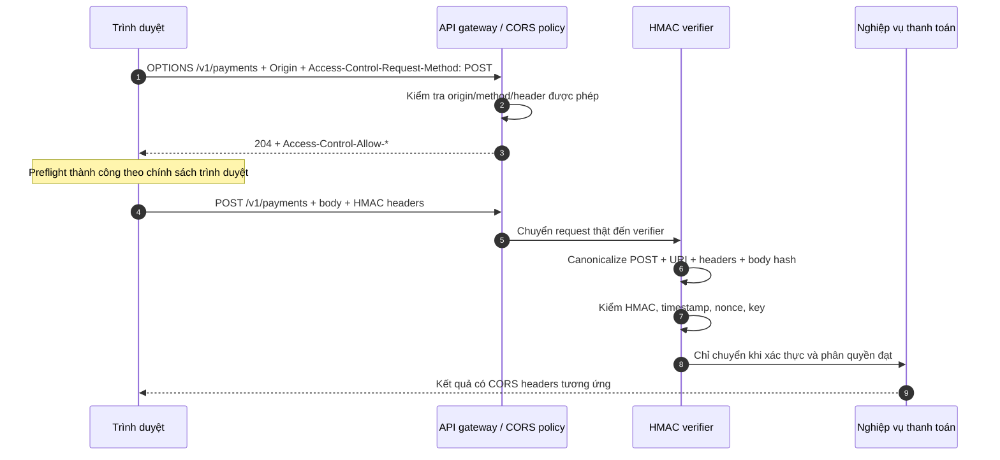
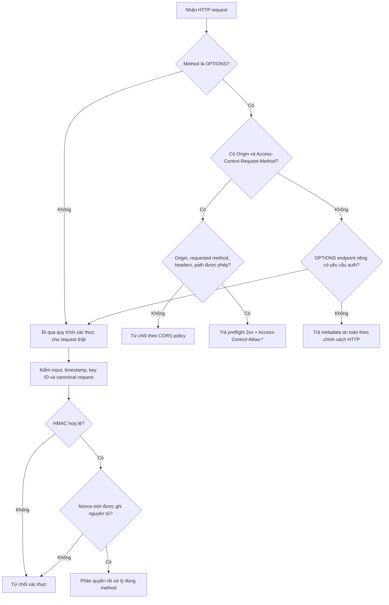

# OPTIONS request

## 1. OPTIONS là gì và tại sao cần hiểu nó trong HMAC request authentication?

**`OPTIONS`** là một HTTP method dùng để hỏi về những **khả năng hoặc tùy chọn giao tiếp** mà server hỗ trợ cho một tài nguyên, hoặc cho server nói chung. Khác với `POST` tạo thanh toán hay `DELETE` xóa tài nguyên, mục đích của `OPTIONS` là **khám phá khả năng giao tiếp**, không phải yêu cầu thực thi tác vụ nghiệp vụ.

Trong hệ thống **HMAC HTTP request authentication**, sự xuất hiện của `OPTIONS` đặc biệt đáng chú ý vì trình duyệt thường tự tạo **CORS preflight request** trước khi gửi request thật có những header như `X-Signature`, `X-Timestamp` hoặc `X-Nonce`. Preflight là một request `OPTIONS` *không mang chữ ký HMAC của thao tác nghiệp vụ*, trong khi request thật — chẳng hạn `POST /v1/payments` — mới cần chữ ký theo hợp đồng.

Bài học thuộc chương **HTTP method** của mô-đun **`SECURITY_AUTHENTICATION_HMAC_REQUEST_AUTHENTICATION`**. Mô-đun hướng tới thiết kế xác thực HTTP request bằng HMAC với shared secret và canonical request chứa method, URI, các header hoặc body theo hợp đồng ký; người học cần xác minh chữ ký, chống replay bằng timestamp/nonce, quản lý key rotation, kiểm thử proxy/gateway và phân biệt **authentication** với **authorization**.

Sau bài này, bạn có thể:

- Giải thích ngữ nghĩa `OPTIONS`, `Allow` và hai dạng request target `/path`, `*`.
- Phân biệt **OPTIONS khám phá API**, **OPTIONS có HMAC riêng**, và **CORS preflight của trình duyệt**.
- Quyết định khi nào **không yêu cầu HMAC trên preflight**, mà vẫn buộc request nghiệp vụ thật phải được ký và phân quyền.
- Định nghĩa cách ký **HTTP method `OPTIONS`** nếu có một endpoint OPTIONS yêu cầu xác thực.
- Thiết kế kiểm thử CORS, timestamp/nonce, key rotation, gateway và response đúng ngữ nghĩa.

## 2. Ngữ nghĩa HTTP của `OPTIONS`

Ví dụ client hỏi một tài nguyên cho phép những method nào:

```http
OPTIONS /v1/payments HTTP/1.1
Host: api.example.test
```

Server có thể trả:

```http
HTTP/1.1 204 No Content
Allow: GET, POST, OPTIONS
Content-Length: 0
```

Đây là **một response minh họa**, không phải tất cả server bắt buộc trả `204` hoặc luôn gửi `Allow` cho mọi `OPTIONS`. Theo HTTP, phản hồi thành công có thể mang thông tin về các tùy chọn giao tiếp; việc biểu diễn những tùy chọn ấy phụ thuộc server và ứng dụng.

Các điểm quan trọng:

| Thuộc tính | Ý nghĩa thực tế |
| --- | --- |
| **Safe method** | `OPTIONS` được định nghĩa có ngữ nghĩa an toàn: client không yêu cầu thay đổi trạng thái nghiệp vụ |
| **Idempotent method** | Gửi lại `OPTIONS` có cùng ý định không tạo thêm tác dụng nghiệp vụ như gửi lại một lệnh tạo thanh toán |
| **Request body** | Ngữ nghĩa thông dụng của nội dung trong `OPTIONS` không được định nghĩa chung; không nên mặc định dùng body để điều khiển nghiệp vụ |
| **`Allow` response header** | Liệt kê HTTP methods mà tài nguyên hiện cho phép; có ý nghĩa khác với CORS |
| **Phản hồi `405 Method Not Allowed`** | Khi method được nhận diện nhưng không được phép cho tài nguyên, server cần cung cấp `Allow` nêu tập method được hỗ trợ tại đó |
| **Phản hồi `501 Not Implemented`** | Dành cho method server không nhận diện/không hỗ trợ thực hiện theo ngữ nghĩa của nó, không phải mặc định dùng thay `405` |
| **`OPTIONS` không đồng nghĩa CORS** | Một request `OPTIONS` hoàn toàn có thể đến từ `curl`, backend Java hay công cụ giám sát, không có `Origin` |

**`Allow` không phải chính sách phân quyền.** Việc response công bố `POST` là method được hỗ trợ không có nghĩa mọi client đều có quyền gọi `POST` cho mọi merchant. Quyền thực tế vẫn phải được xác định sau xác thực.

### 2.1. `OPTIONS /resource` và `OPTIONS *` khác nhau

Với HTTP/1.1, request-target có thể là **origin-form** (đường dẫn tài nguyên) hoặc **asterisk-form** dùng với `OPTIONS`:

```http
OPTIONS /v1/payments HTTP/1.1
Host: api.example.test
```

Yêu cầu đầu tiên hỏi về tài nguyên `/v1/payments`. Còn:

```http
OPTIONS * HTTP/1.1
Host: api.example.test
```

Dạng thứ hai hỏi các tùy chọn áp dụng cho **server nói chung**, thay vì một tài nguyên cụ thể. Dạng `*` không phải đường dẫn `/*` và không nên bị router âm thầm chuyển thành `/` khi dựng canonical request.

Trong một API ký HMAC, nếu cho phép cả hai dạng, cần phân biệt chính xác **request-target thực tế** trước khi ký. Nhiều HTTP client/framework chỉ hỗ trợ thuận tiện OPTIONS theo một URI path; **không** giả định mọi framework đều phát được `OPTIONS *` hoặc giữ nguyên asterisk-form.

## 3. CORS preflight: trường hợp `OPTIONS` thường gặp nhất

**CORS** (*Cross-Origin Resource Sharing*) là cơ chế cho phép server đưa ra chính sách để **trình duyệt** quyết định một trang web ở origin này có được thực hiện/đọc kết quả request đến origin khác hay không. Với các request không thuộc nhóm đơn giản theo quy tắc CORS, trình duyệt thường **gửi preflight bằng `OPTIONS` trước**.

Giả sử trang quản trị được phục vụ tại:

```text
https://console.example.test
```

Trang muốn gọi API:

```http
POST https://api.example.test/v1/payments
Content-Type: application/json
X-Client-Id: client-42
X-Timestamp: <timestamp>
X-Nonce: <nonce>
X-Key-Id: key-demo-01
X-Signature: <hmac>
```

Vì `Content-Type: application/json` và các header tùy biến không đáp ứng điều kiện của một *simple CORS request*, trình duyệt có thể gửi preflight như sau:

```http
OPTIONS /v1/payments HTTP/1.1
Host: api.example.test
Origin: https://console.example.test
Access-Control-Request-Method: POST
Access-Control-Request-Headers: content-type,x-client-id,x-key-id,x-nonce,x-signature,x-timestamp
```

Server có thể cho phép:

```http
HTTP/1.1 204 No Content
Access-Control-Allow-Origin: https://console.example.test
Access-Control-Allow-Methods: GET, POST, OPTIONS
Access-Control-Allow-Headers: content-type,x-client-id,x-key-id,x-nonce,x-signature,x-timestamp
Access-Control-Max-Age: 600
Vary: Origin, Access-Control-Request-Method, Access-Control-Request-Headers
Content-Length: 0
```

Đây là ví dụ preflight thành công dành cho một origin được phép. Nếu cấu hình trả lời động theo origin, method hoặc tập header yêu cầu, việc đặt `Vary` phù hợp giúp cache không tái sử dụng nhầm quyết định CORS cho yêu cầu khác.

### 3.1. Preflight không phải request nghiệp vụ được ký

Hãy chú ý:

- Method thực tế của **preflight** là `OPTIONS`.
- `Access-Control-Request-Method: POST` chỉ thông báo **method mà trình duyệt dự định dùng sau đó**.
- `Access-Control-Request-Headers` chỉ liệt kê **tên header dự định gửi** trong request thật, không phải mang giá trị `X-Signature` hay secret.
- Preflight **không thực thi thanh toán**; nó chỉ hỏi policy của server.
- Chữ ký HMAC của request `POST` chưa được gửi ở preflight, nên không thể xác minh `POST` tại bước này.

Trình duyệt tự tạo preflight theo cơ chế CORS và không gửi bộ thông tin HMAC dành cho request nghiệp vụ như một phần của cơ chế ấy. Vì thế, **bắt buộc tất cả `OPTIONS` đều phải có `X-Signature` thường khiến preflight thất bại**, ngăn request `POST` được gửi.

### 3.2. Luồng gồm hai request riêng biệt



Lưu ý: response **của request thật** cũng cần CORS headers thích hợp để JavaScript đọc kết quả khi chính sách cho phép. Chỉ trả CORS headers cho preflight nhưng quên response `POST` có thể làm thao tác trên server đã xảy ra, trong khi trình duyệt không cung cấp được response cho JavaScript.

## 4. Phân biệt `Allow` với `Access-Control-Allow-Methods`

Hai header dễ bị nhầm:

| Header | Dùng ở đâu? | Trả lời câu hỏi nào? |
| --- | --- | --- |
| `Allow` | Thông tin HTTP về tài nguyên; bắt buộc trong response `405` | Tài nguyên này hiện hỗ trợ các HTTP method nào? |
| `Access-Control-Allow-Methods` | Response CORS preflight | Theo chính sách CORS, trình duyệt ở origin phù hợp có thể dùng những method nào? |

Ví dụ server có thể trả:

```http
Allow: GET, POST, OPTIONS
Access-Control-Allow-Methods: GET, POST
```

Ý nghĩa là API nói chung có thể xử lý `OPTIONS` trên tài nguyên, nhưng **CORS policy** chỉ cho phép trình duyệt gửi các request thật `GET` và `POST` từ những origin được phép. Trong danh sách `Access-Control-Allow-Methods`, `OPTIONS` không bắt buộc phải xuất hiện chỉ vì preflight đang dùng `OPTIONS`.

**Không dùng `Allow` để quyết định phân quyền:** một client có thể được xác thực hợp lệ nhưng không có quyền gọi `POST` trên tài nguyên của tenant khác. Tương tự, `Access-Control-Allow-Methods` **không thay thế HMAC, authorization hay rate limiting**.

## 5. Nên bắt buộc HMAC cho `OPTIONS` hay không?

Câu trả lời phụ thuộc vào loại `OPTIONS` và hợp đồng API. Có ba tình huống phải phân biệt:

| Loại request | Nguồn gọi | HMAC có bắt buộc? | Lý do |
| --- | --- | --- | --- |
| **CORS preflight hợp lệ** | Trình duyệt tự tạo, có `Origin` và `Access-Control-Request-Method` | **Thông thường không** | Trình duyệt cần hỏi chính sách trước khi gửi request thật có chữ ký |
| **OPTIONS khám phá khả năng công khai** | `curl`, monitoring, HTTP client | Theo chính sách API; thường có thể công khai ở mức không nhạy cảm | Tài nguyên cho biết thông tin giao tiếp cơ bản |
| **OPTIONS khám phá khả năng riêng tư** | Backend đối tác đã có secret | **Có thể yêu cầu HMAC riêng** | Nội dung phản hồi chứa thông tin chỉ client được phép xem |

Không có quy tắc “bỏ qua xác thực cho mọi `OPTIONS`” phù hợp với tất cả hệ thống. **Đặc biệt, một endpoint `OPTIONS` có dữ liệu nhạy cảm không tự động trở thành công khai** chỉ vì phương thức là OPTIONS.

### 5.1. Chính sách đề xuất cho API thanh toán

1. Định nghĩa **tài nguyên nào hỗ trợ CORS**, origin được phép, method thực tế được phép và header nào được chấp nhận.
2. Đặt bộ xử lý CORS **trước** bộ lọc HMAC theo thứ tự đã kiểm thử.
3. Chỉ bỏ qua HMAC cho **preflight được nhận diện đúng cấu trúc**, **qua kiểm tra CORS policy** và **không chứa thao tác nghiệp vụ**.
4. Request thật `POST /v1/payments` luôn phải vượt qua HMAC, kiểm tra thời gian, nonce và phân quyền.
5. Nếu có OPTIONS riêng cần xác thực, quy định **một signing contract rõ ràng** cho nó; không trộn với preflight của trình duyệt.

**Đừng áp dụng quy tắc “mọi OPTIONS đều `permitAll`” một cách máy móc** nếu ứng dụng có OPTIONS endpoint cung cấp nội dung cần phân quyền. Cũng không được chỉ kiểm tra method == `OPTIONS` rồi bỏ qua toàn bộ bộ lọc HMAC cho mọi path.

### 5.2. Nhận diện preflight đúng mục đích

Một dấu hiệu của CORS preflight là request có:

```text
method = OPTIONS
Origin: <origin>
Access-Control-Request-Method: <actual-method>
[Access-Control-Request-Headers: <requested-header-names>]
```

Việc nhận diện dấu hiệu **chưa phải cho phép**. Server còn phải so `Origin`, method được hỏi, tập header yêu cầu và path với **CORS allowlist**. Một client không phải trình duyệt có thể tự thêm những header này; do đó **CORS preflight không được sử dụng như bằng chứng danh tính hoặc phân quyền**, và nhánh trả lời preflight không được có hiệu ứng nghiệp vụ nhạy cảm.

## 6. Thiết kế CORS an toàn cho request có HMAC headers

Khi server hỗ trợ các request thật có những header `X-Client-Id`, `X-Key-Id`, `X-Timestamp`, `X-Nonce` và `X-Signature`, CORS policy phải cho phép tên header ấy đối với origin được ủy quyền gọi API qua trình duyệt. Nhưng **cho phép tên header không có nghĩa tin giá trị header**.

Ví dụ chính sách:

| Thuộc tính | Ví dụ cấu hình | Nguyên tắc bảo mật |
| --- | --- | --- |
| Allowed origins | `https://console.example.test` | Danh sách cụ thể; không phản chiếu mù quáng mọi `Origin` |
| Allowed actual methods | `GET`, `POST` | Chỉ cấp các method ứng dụng web thực sự cần |
| Allowed request headers | `Content-Type`, `X-Client-Id`, `X-Key-Id`, `X-Timestamp`, `X-Nonce`, `X-Signature`, `Idempotency-Key` | Danh sách khớp nhu cầu SDK, không cho phép header nhạy cảm không cần thiết |
| Preflight cache age | `Access-Control-Max-Age: 600` | Trình duyệt có thể áp dụng giới hạn riêng; không giả định mọi nơi cache đúng 600 giây |
| Credentials policy | Chỉ bật khi có yêu cầu rõ | Với request dùng credentials của trình duyệt, không kết hợp wildcard `*` cho `Access-Control-Allow-Origin` |
| Application auth | HMAC + timestamp/nonce + authorization | Luôn kiểm tra trên **request thật**, không dựa vào preflight |

### 6.1. Shared secret không nên nằm trong JavaScript ở browser

Có một vấn đề kiến trúc quan trọng: **trình duyệt không thể giữ bí mật dài hạn của một ứng dụng được phát hành cho người dùng cuối**. Nếu frontend JavaScript chứa shared secret HMAC của đối tác, người dùng hoặc mã độc chạy trong ngữ cảnh trang có thể trích xuất nó và ký request mới. CORS **không bảo vệ secret**, vì client ngoài trình duyệt không phải tuân thủ chính sách CORS.

Vì vậy, với API HMAC dùng shared secret:

- Ưu tiên **backend-to-backend**: server của đối tác giữ secret và ký request trực tiếp.
- Nếu giao diện web cần thao tác thanh toán, cân nhắc **Backend for Frontend (BFF)**: browser xác thực với backend của chính ứng dụng bằng cơ chế thích hợp; backend mới giữ secret và ký HMAC khi gọi dịch vụ thanh toán.
- Không đặt secret vào JavaScript bundle, localStorage, source map hoặc ứng dụng mobile phân phối công khai với kỳ vọng secret sẽ được giữ kín.
- CORS chỉ là một phần của chính sách tương tác qua browser; không thay thế xác thực, CSRF protection (khi dùng cookie), phân quyền hoặc bảo vệ khóa.

Với tích hợp backend-to-backend thuần túy, **không cần CORS preflight** vì `HttpClient` Java, `curl` và các ứng dụng server không tuân theo cơ chế preflight của trình duyệt.

## 7. Khi tự ký `OPTIONS`, method phải là `OPTIONS`

Một số API có endpoint OPTIONS **thực sự yêu cầu HMAC** để cung cấp thông tin dành riêng cho từng đối tác. Khi đó, request OPTIONS là **một request riêng**, phải được ký với **method thật `OPTIONS`**, chứ không phải method được nhắc đến trong `Access-Control-Request-Method`.

Ví dụ:

```http
OPTIONS /v1/payments HTTP/1.1
Host: api.example.test
X-Client-Id: client-42
X-Key-Id: key-demo-01
X-Timestamp: 1795856400
X-Nonce: AAAAAAAAAAAAAAAAAAAAAA
X-Signature: <base64-hmac-sha256>
```

Đây **không phải** preflight CORS của browser vì không chứa `Origin` hoặc `Access-Control-Request-Method`. Giả sử hợp đồng HMAC-SHA256-V1 cho endpoint này định nghĩa:

- HTTP method **`OPTIONS`**, không phải `GET` hoặc `POST`.
- Public path `/v1/payments`, **raw query rỗng**.
- Không có request body: `SHA-256(empty byte array)`.
- Ký `X-Client-Id`, `X-Key-Id`, `X-Timestamp` và `X-Nonce`; không đưa chính `X-Signature` vào chuỗi ký.
- Canonical string UTF-8 gồm **9 dòng**, nối bằng LF và **không có LF cuối**.
- Trường raw query rỗng được biểu diễn bằng **một dòng trống có chủ đích**.

Canonical request:

```text
HMAC-SHA256-V1
OPTIONS
/v1/payments

x-client-id:client-42
x-key-id:key-demo-01
x-timestamp:1795856400
x-nonce:AAAAAAAAAAAAAAAAAAAAAA
e3b0c44298fc1c149afbf4c8996fb92427ae41e4649b934ca495991b7852b855
```

Dòng trống giữa `/v1/payments` và `x-client-id` **là một phần của dữ liệu ký**. Giá trị cuối là SHA-256 của **0 byte**. Nếu server bỏ dòng trống, thêm LF cuối, đổi path hoặc dùng method `POST`, HMAC sẽ khác.

**Bảo đảm toàn vẹn method:** nếu method được đưa vào canonical request, chữ ký hợp lệ cho `OPTIONS` **không** tự hợp lệ cho `POST`. Nếu bỏ method khỏi chữ ký, có nguy cơ một bản ký được dùng trên endpoint/method khác nếu các trường còn lại không phân biệt được hành động.

### 7.1. `OPTIONS *` cần hợp đồng riêng

Với request-target dạng `*`, hợp đồng phải biểu diễn target là `*` (không phải path `/`). Nếu ứng dụng không thật sự cần hỗ trợ nó, nên **không mở endpoint có chữ ký cho asterisk-form** thay vì tự suy diễn cách chuẩn hóa. Hãy kiểm tra ở gateway, load balancer và HTTP framework vì có thành phần không chuyển tiếp nguyên vẹn dạng target đặc biệt.

## 8. Ví dụ Java 17: ký OPTIONS riêng bằng HMAC-SHA-256

Đoạn mã sau là ví dụ xây dựng **một OPTIONS có chữ ký** từ backend Java. Nó **không được dùng để thay thế CORS preflight**. Secret phải được lấy từ kho khóa theo đúng client và key ID; chỉ truyền secret bằng byte array trong backend tin cậy.

```java
import java.net.URI;
import java.net.http.HttpRequest;
import java.nio.charset.StandardCharsets;
import java.security.GeneralSecurityException;
import java.security.MessageDigest;
import java.security.SecureRandom;
import java.time.Instant;
import java.util.Base64;
import java.util.HexFormat;
import java.util.Objects;
import javax.crypto.Mac;
import javax.crypto.spec.SecretKeySpec;

public final class SignedOptionsRequest {
    private static final SecureRandom RANDOM = new SecureRandom();

    private SignedOptionsRequest() {}

    public static HttpRequest create(
            URI uri, String clientId, String keyId, byte[] sharedSecret)
            throws GeneralSecurityException {
        Objects.requireNonNull(uri, "uri");
        Objects.requireNonNull(sharedSecret, "sharedSecret");
        if (!"https".equalsIgnoreCase(uri.getScheme())) {
            throw new IllegalArgumentException("HTTPS required");
        }
        if (!isSafeIdentifier(clientId) || !isSafeIdentifier(keyId)) {
            throw new IllegalArgumentException("Invalid client/key ID");
        }
        if (sharedSecret.length == 0 || uri.getRawFragment() != null) {
            throw new IllegalArgumentException("Invalid secret or URI");
        }

        String rawPath = uri.getRawPath();
        if (rawPath == null || !rawPath.startsWith("/")) {
            throw new IllegalArgumentException("Expected a public path");
        }
        String rawQuery = uri.getRawQuery() == null
                ? "" : uri.getRawQuery();

        String timestamp = Long.toString(Instant.now().getEpochSecond());
        byte[] nonceBytes = new byte[16];
        RANDOM.nextBytes(nonceBytes);
        String nonce = Base64.getUrlEncoder().withoutPadding()
                .encodeToString(nonceBytes);

        String emptyBodySha256 = HexFormat.of().formatHex(
                MessageDigest.getInstance("SHA-256").digest(new byte[0]));

        String canonical = String.join("\n",
                "HMAC-SHA256-V1",
                "OPTIONS",
                rawPath,
                rawQuery, // Dòng trống nếu URI không có query.
                "x-client-id:" + clientId,
                "x-key-id:" + keyId,
                "x-timestamp:" + timestamp,
                "x-nonce:" + nonce,
                emptyBodySha256);

        Mac mac = Mac.getInstance("HmacSHA256");
        mac.init(new SecretKeySpec(sharedSecret, "HmacSHA256"));
        byte[] fullTag = mac.doFinal(
                canonical.getBytes(StandardCharsets.UTF_8));
        String signature = Base64.getEncoder().encodeToString(fullTag);

        return HttpRequest.newBuilder(uri)
                .header("X-Client-Id", clientId)
                .header("X-Key-Id", keyId)
                .header("X-Timestamp", timestamp)
                .header("X-Nonce", nonce)
                .header("X-Signature", signature)
                .method("OPTIONS", HttpRequest.BodyPublishers.noBody())
                .build();
    }

    private static boolean isSafeIdentifier(String value) {
        return value != null
                && value.matches("[A-Za-z0-9._-]{1,80}");
    }
}
```

Ví dụ gọi từ một Java backend:

```java
import java.net.URI;
import java.net.http.HttpClient;
import java.net.http.HttpRequest;
import java.net.http.HttpResponse;

// sharedSecretBytes do secret manager cung cấp.
HttpRequest options = SignedOptionsRequest.create(
        URI.create("https://api.example.test/v1/payments"),
        "client-42", "key-demo-01", sharedSecretBytes);

HttpResponse<String> response = HttpClient.newHttpClient()
        .send(options, HttpResponse.BodyHandlers.ofString());
```

**Giới hạn của ví dụ:**

- `key-demo-01` là tên minh họa; secret thật phải thuộc đúng client/key và đủ entropy. Không hard-code secret production.
- Dùng `Mac` **local cho mỗi phép tính** để tránh lỗi chia sẻ trạng thái giữa các request đồng thời.
- `URI.getRawPath()` và `getRawQuery()` chỉ an toàn khi hợp đồng đã thống nhất việc ký **raw public target** và gateway bảo toàn các thành phần này. URI tổng quát với encoding/query phức tạp cần test vector riêng.
- Mã trên **không** triển khai verifier, replay store, phân quyền hay cơ chế OPTIONS asterisk-form; đó là trách nhiệm của server và hạ tầng.
- Nếu request được retry, client phải tạo timestamp, nonce và HMAC mới theo hợp đồng; không tự tái sử dụng request đã bị server ghi nonce.

## 9. Thiết kế server: phân nhánh preflight và OPTIONS có chữ ký

Server cần phân biệt **request cần trả lời chính sách CORS** với **request yêu cầu tài nguyên OPTIONS có bảo vệ HMAC**.



**Đây là luồng logic, không phải mã middleware production.** Một client bất kỳ có thể giả `Origin` và `Access-Control-Request-Method`. Vì vậy, preflight path chỉ nên công bố chính sách CORS cho tài nguyên đã cho phép; **không được làm phát sinh giao dịch hoặc trả thông tin bí mật**. Việc kiểm tra method/path/header được phép phải thực sự diễn ra, không chỉ dựa vào sự hiện diện của các header.

### 9.1. Chọn vị trí của CORS middleware

Trong Spring Boot/Spring Security hay gateway tương đương, CORS xử lý **trước** yêu cầu xác thực HMAC thường là cách cần thiết để preflight hoạt động. Ví dụ định hướng cấu hình Spring Web:

```java
// Minh họa dùng Spring Web; chưa bao gồm SecurityFilterChain,
// HMAC filter hay tất cả import tương ứng.
@Bean
CorsConfigurationSource corsConfigurationSource() {
    CorsConfiguration cors = new CorsConfiguration();
    cors.setAllowedOrigins(List.of("https://console.example.test"));
    cors.setAllowedMethods(List.of("GET", "POST"));
    cors.setAllowedHeaders(List.of(
            "Content-Type",
            "X-Client-Id",
            "X-Key-Id",
            "X-Timestamp",
            "X-Nonce",
            "X-Signature",
            "Idempotency-Key"));
    cors.setAllowCredentials(false);
    cors.setMaxAge(600L);

    UrlBasedCorsConfigurationSource source =
            new UrlBasedCorsConfigurationSource();
    source.registerCorsConfiguration("/v1/**", cors);
    return source;
}
```

Nếu tích hợp Spring Security, cần **bật CORS trong security filter chain** và đảm bảo bộ lọc HMAC tùy chỉnh không chặn preflight trước khi CORS filter xử lý nó. Có thể cần cấu hình thêm authentication entry point, thứ tự filter, phân quyền và kiểm tra policy ở API gateway. Đoạn minh họa **không phải cấu hình production hoàn chỉnh**.

**Chú ý:** `setAllowedMethods` ở đây liệt kê **method thật của CORS request**, không cần thêm `OPTIONS` chỉ để browser gửi preflight. Server cũng có thể trả `Allow` cho OPTIONS tài nguyên theo logic HTTP riêng.

### 9.2. Không làm “CORS = authentication”

Cấu hình CORS **không chứng minh người gọi** là ứng dụng đáng tin cậy. Origin header không phải credential; client ngoài trình duyệt có thể tự đặt origin bất kỳ. Một `POST` có HMAC không hợp lệ **phải bị từ chối** kể cả khi `Origin` nằm trong allowlist. Ngược lại, một backend Java có HMAC hợp lệ không cần gửi `Origin` để được xác thực.

Cần tiếp tục áp dụng:

- HMAC trên **canonical request thật**, gồm method `POST`, URI, headers được ký và hash body theo hợp đồng.
- Timestamp, nonce được ký và replay store dùng chung, có thao tác ghi nguyên tử.
- Key rotation theo `clientId`/`keyId`; từ chối key bị thu hồi.
- **Authorization** theo scope, merchant và tài nguyên, không suy quyền chỉ từ chữ ký.
- **Idempotency** khi thao tác có tác dụng phụ cần retry an toàn.

## 10. Thực hành kiểm thử preflight bằng `curl`

Có thể mô phỏng một preflight với `curl` mà không cần trình duyệt:

```bash
curl -i -X OPTIONS 'https://api.example.test/v1/payments' \
  -H 'Origin: https://console.example.test' \
  -H 'Access-Control-Request-Method: POST' \
  -H 'Access-Control-Request-Headers: content-type,x-client-id,x-key-id,x-nonce,x-signature,x-timestamp'
```

Khi policy cho phép, kết quả hợp lý là phản hồi 2xx kèm `Access-Control-Allow-Origin` đúng origin, `Access-Control-Allow-Methods` cho phép `POST` và `Access-Control-Allow-Headers` bao gồm các tên header yêu cầu. Không cần trả nội dung nhạy cảm trong response.

Thử origin không được phép:

```bash
curl -i -X OPTIONS 'https://api.example.test/v1/payments' \
  -H 'Origin: https://unknown.example.test' \
  -H 'Access-Control-Request-Method: POST' \
  -H 'Access-Control-Request-Headers: x-signature'
```

Server cần **không cấp quyền CORS cho origin này** (có thể trả một mã lỗi hoặc không có các header cho phép); không phản chiếu mù quáng `https://unknown.example.test` vào `Access-Control-Allow-Origin`.

Thử hỏi OPTIONS thông thường:

```bash
curl -i -X OPTIONS 'https://api.example.test/v1/payments'
```

Request thứ ba **không có `Origin`/`Access-Control-Request-Method`**, nên không phải CORS preflight theo định nghĩa trên. Server có thể trả thông tin OPTIONS chung, yêu cầu HMAC cho endpoint riêng hoặc từ chối method theo hợp đồng API.

**Lưu ý về kiểm thử:** `curl` không thực thi quy tắc CORS như browser; nó chỉ giúp quan sát status và response headers. Vì thế cần **kiểm thử trình duyệt thật** để kiểm tra preflight caching, credentials, headers và cách JavaScript đọc response.

## 11. Xác minh HMAC cho request thật sau preflight

Preflight đã được phép **không có nghĩa `POST` tiếp theo đã được xác thực**. Khi request thật đến server, verifier phải:

1. Xác nhận method thực nhận là `POST`; đưa chính `POST` vào canonical request. Không lấy `Access-Control-Request-Method` của preflight để ký.
2. Dùng public URI/route đã thống nhất; bảo toàn raw path/query hoặc có quy tắc canonicalization minh bạch.
3. Xác định tập signed headers theo phiên bản hợp đồng, bao gồm `clientId`, `keyId`, timestamp, nonce và header nghiệp vụ quan trọng.
4. Tính `SHA-256` trên byte body **thực nhận** và đưa hash vào canonical request nếu hợp đồng yêu cầu.
5. Tra secret thuộc đúng client/key ID đang hiệu lực, tính `HMAC-SHA-256` và so sánh tag đúng độ dài/encoding.
6. Kiểm timestamp và **nonce đã sử dụng** qua kho replay dùng chung; không bỏ qua nonce chỉ vì preflight đã được cache.
7. Xác thực principal, kiểm tra **authorization** trên merchant/tài nguyên và áp dụng **idempotency** khi retry thao tác.
8. Trả response nghiệp vụ có CORS headers phù hợp cho origin hợp lệ khi gọi từ browser.

Nếu gateway xác minh HMAC trước khi chuyển về backend, nó phải bảo vệ danh tính đã xác thực trên kênh nội bộ; backend không được tin một header `X-Authenticated-Client` do client Internet tự đặt.

### 11.1. Preflight cache khác nonce replay store

| Cơ chế | Nơi lưu | Mục đích | Có thay thế nhau không? |
| --- | --- | --- | --- |
| **Preflight cache** theo CORS | Trình duyệt (theo quy tắc của browser) | Tránh hỏi lại CORS policy quá thường xuyên | Không |
| **Replay nonce store** | Server/gateway xác thực HMAC | Nhận diện request đã ký từng được chấp nhận | Không |
| **Idempotency store** | Tầng nghiệp vụ | Tránh thực thi lại cùng ý định nghiệp vụ | Không |

`Access-Control-Max-Age: 600` **không có nghĩa nonce có TTL 600 giây**. TTL của nonce phải phụ thuộc cửa sổ chấp nhận timestamp và thời điểm request được chấp nhận. Việc browser cache kết quả preflight cũng **không bỏ qua** bước HMAC và phân quyền của request thật.

## 12. Rủi ro qua proxy/gateway và nhiều phiên bản HTTP

Với OPTIONS, gateway thường là nơi xử lý CORS. Nhưng ranh giới xác thực cần chặt chẽ để tránh hai lỗi đối lập: **chặn nhầm preflight** hoặc **bỏ qua HMAC cho request thật**.

| Hiện tượng | Nguyên nhân có thể | Hướng giải quyết |
| --- | --- | --- |
| Browser báo preflight bị `401` | HMAC/JWT filter chạy trước CORS và yêu cầu signature trên OPTIONS | Đưa CORS policy lên trước auth cho **preflight hợp lệ** |
| Browser báo `403` dù origin đúng | Origin/method/header chưa được cấu hình đầy đủ | Kiểm tra requested method, signed header names, route |
| Preflight thành công nhưng JS vẫn báo CORS | Response thực tế thiếu CORS headers hoặc credentials policy sai | Kiểm tra **response của POST**, không chỉ preflight |
| `curl` gọi POST HMAC vẫn chạy còn browser không | Backend không cần CORS, browser cần preflight | Kiểm thử qua trình duyệt và gateway |
| OPTIONS riêng lộ thông tin | Bỏ qua auth cho **mọi** OPTIONS | Tách endpoint public/preflight/OPTIONS có HMAC |
| Gateway rewrite path làm HMAC sai | Sender và backend dùng các path khác nhau | Xác minh ở gateway trước rewrite hoặc dùng public target đáng tin |
| `OPTIONS *` bị đổi thành `/` | Proxy/framework không bảo toàn asterisk-form | Không hỗ trợ hoặc định nghĩa ranh giới/ký riêng |
| Header `Origin` giả mạo | Dùng origin thay cho client identity | Không dùng CORS làm authentication |
| Signature header trùng hoặc bị merge | Proxy xử lý duplicate headers khác verifier | Từ chối input mơ hồ tại ranh giới sớm |
| OPTIONS request được cache sai giữa origin | Thiếu cấu hình cache/`Vary` tương ứng | Đảm bảo biến thể response theo policy; kiểm thử cache |
| Key rotation khiến request thật `401` | Sender dùng key ID mới nhưng secret cũ | Kiểm cặp keyId/secret, trạng thái hiệu lực |
| OPTIONS không có body mà hash body sai | Một phía hash `""`, phía kia hash `{}` hoặc newline | Dùng `SHA-256` trên **0 byte** nếu hợp đồng noBody |

### 12.1. HTTP/2, HTTP/3 và pseudoheaders

Các phiên bản HTTP có hình thức truyền method/path khác nhau. Trong HTTP/2, `:method` và `:path` là *pseudoheaders*, không phải header thông thường; một số biểu diễn OPTIONS đặc biệt theo `*` cần sự hỗ trợ đúng của stack.

Đối với HMAC, nên định nghĩa **ngữ nghĩa method và request-target công khai** trong canonical contract, thay vì ký trực tiếp byte framing của HTTP/1.1 hay toàn bộ pseudoheader wire representation của HTTP/2. Kiểm thử qua gateway phải chứng minh rằng sender và verifier dựng **cùng method/path/query** sau mọi phép chuyển đổi giao thức.

## 13. Các trường hợp kiểm thử cần có

Ma trận sau tách **hành vi CORS** khỏi **hành vi HMAC**:

| Ca kiểm thử | Request | Kết quả kỳ vọng |
| --- | --- | --- |
| Preflight hợp lệ | `OPTIONS` + origin/method/header nằm trong allowlist | Trả CORS policy; không đòi HMAC của `POST` |
| Origin không được phép | Preflight từ origin lạ | Không cấp quyền CORS |
| Method không được phép | Preflight yêu cầu `DELETE` khi chỉ cho `GET`/`POST` | Không cho phép method được hỏi |
| Header không được phép | Preflight yêu cầu header ngoài allowlist | Không cho phép tập header ấy |
| Missing `Origin` | `OPTIONS` không có Origin | Xử lý như OPTIONS thông thường, không tự coi là preflight |
| Missing requested method | `OPTIONS` chỉ có `Origin` | Không xử lý như preflight hợp lệ |
| Header mơ hồ/duplicate | Hai giá trị `Access-Control-Request-Method` khác nhau | Từ chối hoặc xử lý nghiêm theo HTTP/CORS stack, không chọn tùy ý |
| Request thật không có signature | `POST` sau preflight được phép nhưng thiếu HMAC | Từ chối authentication |
| Request thật signature sai | `POST` có tag không khớp | Từ chối authentication |
| Request thật signature đúng | `POST` ký đủ method/URI/header/body | Tiếp tục timestamp/nonce/authorization |
| Đổi `POST` thành `OPTIONS` | Giữ nguyên tag ký cho POST | HMAC sai nếu OPTIONS endpoint yêu cầu ký |
| Signed OPTIONS hợp lệ | Backend ký `OPTIONS /v1/payments` với nonce mới | Server xác minh theo hợp đồng riêng và áp dụng quyền |
| Signed OPTIONS replay | Gửi lại nguyên request có nonce đã dùng | Chặn theo replay policy của endpoint đó |
| Timestamp quá hạn | Signed OPTIONS hoặc POST có HMAC đúng nhưng timestamp cũ | Từ chối theo cửa sổ timestamp |
| OPTIONS asterisk-form | `OPTIONS *` qua gateway | Chỉ chấp nhận nếu được hỗ trợ đúng; không đồng nhất với `/` |
| Preflight cache | Lặp preflight trong điều kiện browser cache cho phép | Browser có thể tái sử dụng policy, nhưng POST vẫn được xác thực riêng |
| Response thực tế thiếu CORS | Preflight pass, POST trả thành công nhưng thiếu allow-origin | JavaScript có thể không đọc được response; cần sửa CORS của response thật |
| Key rotation | POST ký bằng key mới/đã thu hồi | Chỉ key đang được phép xác thực |
| Proxy rewrite | Preflight pass, POST path bị đổi | HMAC dùng public target đúng hợp đồng hoặc từ chối |
| Tenant không được phép | HMAC và nonce hợp lệ, POST với merchant khác | Authorization từ chối |
| Backend client | Java `HttpClient` gửi POST trực tiếp | Không phát sinh CORS preflight bởi browser |

**Không kiểm thử bằng cách gửi request giả mạo đến dịch vụ không được phép.** Dùng sandbox và secret thử nghiệm. Đoạn `curl` giúp quan sát headers, còn test qua browser mới đánh giá đúng hành vi preflight.

## 14. Bài tập phân tích và thiết kế

Một công ty có trang quản trị tại `https://console.example.test`, API tại `https://api.example.test` và backend đối tác dùng HMAC-SHA-256. API chấp nhận `POST /v1/payments` với `Content-Type: application/json`, `X-Client-Id`, `X-Key-Id`, `X-Timestamp`, `X-Nonce` và `X-Signature`. Gateway có chức năng CORS và backend kiểm tra HMAC.

Hãy trả lời:

1. Trình duyệt gửi request gì trước `POST`? Vì sao các header HMAC khiến preflight có thể xảy ra?
2. `Access-Control-Request-Method: POST` có nghĩa là chính request preflight đang dùng method `POST` không?
3. Nếu backend yêu cầu `X-Signature` trên tất cả `OPTIONS`, trình duyệt gặp vấn đề gì?
4. Nếu gateway cho phép mọi origin và trả `Access-Control-Allow-Methods: POST`, điều đó có làm `POST` trở nên hợp lệ mà không cần HMAC không?
5. Tại sao không nên nhúng shared secret của đối tác vào JavaScript của trang quản trị?
6. Nếu backend công bố một `OPTIONS /v1/payments` chứa thông tin riêng tư, nó có thể yêu cầu HMAC không? Nó có giống CORS preflight không?
7. Client ký request `OPTIONS` với method `POST` trong canonical string. Server xác minh bằng method thật `OPTIONS` sẽ ra kết quả gì?
8. `OPTIONS *` và `OPTIONS /` có cùng request-target không? Cần lưu ý gì ở proxy?
9. Preflight thành công nhưng JavaScript vẫn không đọc được response `POST`. Ngoài HMAC, nên kiểm tra gì?
10. Nếu server nhận `POST` đã ký đúng nhưng nonce cũ hoặc client không có quyền với merchant, những bước nào vẫn phải từ chối?
11. Khi test qua `curl` preflight, có thể kết luận browser chắc chắn chạy giống vậy không?
12. `Access-Control-Max-Age` có phải TTL của replay nonce store không?

**Gợi ý trả lời:** (1) CORS `OPTIONS` khi quy tắc preflight áp dụng; (2) không, OPTIONS là method của preflight, POST chỉ là method dự định; (3) preflight không mang chữ ký nghiệp vụ nên có thể bị 401; (4) không, CORS không xác thực; (5) bí mật có thể bị trích xuất, nên ký tại backend/BFF; (6) có thể, đó là OPTIONS riêng cần policy auth; (7) HMAC không khớp; (8) không, phải bảo toàn `*`; (9) CORS headers trên response thực tế và credentials policy; (10) replay store/authorization; (11) không, `curl` không thực thi thuật toán CORS của browser; (12) không, hai cache phục vụ mục đích khác nhau.

## 15. Tổng kết

**`OPTIONS` là HTTP method khám phá khả năng, không tự động là một thao tác nghiệp vụ và cũng không đồng nghĩa với CORS.** CORS preflight là một trường hợp sử dụng OPTIONS do browser tạo để hỏi trước xem request thật có được phép thực hiện theo chính sách CORS hay không. Vì vậy, một API HMAC cần **xử lý preflight đúng chính sách trước khi bộ lọc yêu cầu chữ ký**, nhưng **không được bỏ xác thực cho request thật** hoặc mọi endpoint OPTIONS nhạy cảm.

Khi một OPTIONS riêng yêu cầu HMAC, **method `OPTIONS` phải được ký** cùng đúng URI, headers và body/hash body theo hợp đồng; phải kiểm tra timestamp/nonce, key rotation và phân quyền như các request có ký khác. Hãy kiểm thử toàn tuyến **sender → gateway/CORS → verifier → nghiệp vụ**, phân biệt `Allow` với `Access-Control-Allow-Methods`, không dùng `Origin` như bằng chứng danh tính, và không nhúng shared secret trong browser.

