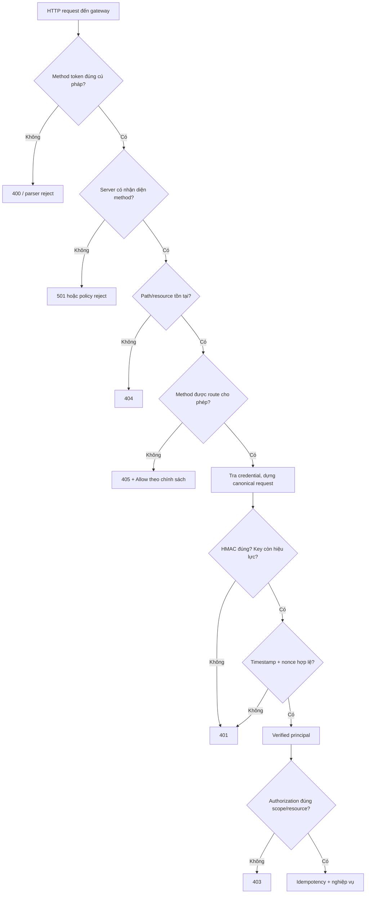
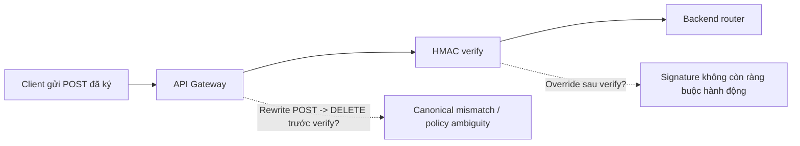

# Method không hỗ trợ

## 1. Bối cảnh: HTTP method là một phần của request được xác thực

Trong HTTP, **method** (phương thức) cho biết hành động mà client muốn thực hiện với tài nguyên, ví dụ `GET` đọc dữ liệu, `POST` tạo hoặc gửi một thao tác, `PUT` thay thế biểu diễn tài nguyên, `PATCH` cập nhật một phần và `DELETE` yêu cầu xóa. API không nhất thiết hỗ trợ tất cả phương thức đó trên mọi endpoint.

Trong module `SECURITY_AUTHENTICATION_HMAC_REQUEST_AUTHENTICATION`, client và server dùng shared secret để ký/xác minh một **canonical request** gồm HTTP method, URI, những header đã chọn và body hoặc hash body theo hợp đồng. Vấn đề của bài này là: **server phải làm gì khi request sử dụng method không được endpoint hỗ trợ, kể cả khi HMAC hợp lệ?**

Giả sử dịch vụ chỉ cho phép:

```text
POST /v1/transfers             Tạo yêu cầu chuyển tiền
GET  /v1/transfers/tr-101      Xem yêu cầu chuyển tiền
```

Một client gửi `PUT /v1/transfers` hoặc `DELETE /v1/transfers/tr-101` phải bị từ chối theo chính sách method, **không phải vì thuật toán HMAC không tính được**. Thậm chí nếu bên gọi giữ secret hợp lệ và tự ký một request `DELETE` mới, việc **authentication thành công không cấp quyền sử dụng method không được triển khai**.

Mục tiêu học tập:

- Phân biệt HTTP method hợp lệ về cú pháp, method server không hỗ trợ, method endpoint không cho phép và method bị cấm bởi authorization.
- Giải thích các phản hồi thường gặp: `400`, `404`, `405 Method Not Allowed`, `501 Not Implemented`, `401` và `403`.
- Hiểu vì sao HTTP method cần nằm trong HMAC signature input và vì sao không được tự đổi `post` thành `POST` trước khi kiểm tra.
- Thiết kế chặn method ngoài allowlist đúng ở gateway, router và service mà không tạo đường vòng xác thực.
- Nhận diện method override, tự động hỗ trợ `HEAD`/`OPTIONS`, CORS preflight và method rewriting qua proxy.
- Thực hành Java 17, kiểm thử timestamp/nonce, key rotation và phân biệt xác thực với phân quyền.

## 2. “Không hỗ trợ” có thể mang những nghĩa khác nhau

Đầu tiên cần tách **mức server**, **mức tài nguyên/endpoint**, **mức xác thực** và **mức phân quyền**.

| Tình huống | Ý nghĩa | Phản hồi điển hình |
| --- | --- | --- |
| Method token không hợp lệ về cú pháp HTTP | Request không được parser chấp nhận | `400 Bad Request` hoặc bị HTTP server từ chối ngay khi parse |
| Server không nhận diện/không có khả năng hỗ trợ method đó ở mức tổng thể | Ví dụ API không có implementation cho một extension method bất kỳ | `501 Not Implemented` |
| Server có hỗ trợ method nhưng **tài nguyên đích không cho phép** method đó | Server hỗ trợ `PUT` ở nơi khác, nhưng `PUT /v1/transfers` không được khai báo | **`405 Method Not Allowed`**, kèm `Allow` |
| Không có resource/route phù hợp, kể cả với method khác | Path không tồn tại hoặc không được công bố | Thường `404 Not Found` |
| Chưa xác thực được credential HMAC | Thiếu chữ ký, sai key ID, HMAC không khớp, nonce/timestamp không hợp lệ | Thường `401 Unauthorized` |
| Xác thực thành công nhưng **principal không có quyền** làm hành động hợp lệ trên tài nguyên | Ví dụ có route `DELETE` nhưng tài khoản chỉ có `transfers:read` | **`403 Forbidden`** |
| Gateway chặn method theo chính sách bảo mật trước router | Method bị cấm ở ingress, có thể vẫn được service/framework hiểu | Theo hợp đồng API, thường `405`, `403` hoặc phản hồi chặn phù hợp; phải nhất quán |

### 2.1. `405 Method Not Allowed`

`405` nói rằng **method được server biết đến nhưng không áp dụng cho tài nguyên đích**. Ví dụ:

```http
PUT /v1/transfers HTTP/1.1
Host: api.example.test
X-Client-Id: merchant-42
X-Signature: <signature>
```

Nếu `/v1/transfers` chỉ cho phép `POST`, phản hồi có thể là:

```http
HTTP/1.1 405 Method Not Allowed
Allow: POST
Content-Type: application/problem+json

{"title":"Method Not Allowed","status":405}
```

Theo ngữ nghĩa HTTP, server tạo phản hồi `405` phải gửi field **`Allow`** liệt kê những method hiện được tài nguyên hỗ trợ. Giá trị này cần phản ánh routing và hành vi **thực tế**, không chỉ một danh sách mong muốn trong tài liệu. Nếu tầng framework tự cấp `HEAD` hoặc `OPTIONS`, phải kiểm tra kỹ chúng có thực sự được hỗ trợ hay đã bị vô hiệu hóa.

**Lưu ý bảo mật:** `Allow` có thể làm lộ các khả năng của route nội bộ. Với API nhạy cảm, chính sách có thể yêu cầu xác thực trước khi trả thông tin route, hoặc dùng phản hồi che giấu tài nguyên theo hợp đồng. Quyết định thứ tự phản hồi phải nhất quán giữa gateway và backend; không lấy việc trả `405` làm lý do bỏ qua xác thực cho một thao tác khác.

### 2.2. `501 Not Implemented` không phải phiên bản khác của `405`

`501` phù hợp khi server **không nhận diện hoặc không hỗ trợ khả năng thực hiện method** ở mức tổng thể. Chẳng hạn một HTTP server chỉ cài đặt `GET`/`POST` mà nhận extension method `FROB` có cú pháp hợp lệ: tùy triển khai, nó có thể trả `501`.

Không nên trả `501` chỉ vì `PUT` không được phép trên **một endpoint** trong khi ứng dụng vẫn hỗ trợ `PUT` ở endpoint khác. Trường hợp đó phù hợp hơn với `405`.

### 2.3. `401` và `403` không đồng nghĩa “method không hỗ trợ”

Nếu tài nguyên hỗ trợ `DELETE` nhưng caller **không gửi được chữ ký hợp lệ**, lỗi nằm ở **authentication**. Nếu caller xác thực thành công nhưng principal không có scope `transfers:delete`, lỗi nằm ở **authorization**. Chỉ khi method bản thân nó không được tài nguyên hỗ trợ thì mới là quyết định `405`.

Không suy luận “có HMAC hợp lệ” đồng nghĩa “phải cho phép mọi HTTP method”. HMAC trả lời câu hỏi **ai đang sử dụng credential**, không trả lời câu hỏi API hỗ trợ method nào hoặc caller có quyền gì.

## 3. HTTP method là token phân biệt chữ hoa/thường

Theo ngữ nghĩa HTTP, **method token phân biệt chữ hoa/thường** (*case-sensitive*). `POST`, `Post` và `post` không phải ba cách viết tương đương của cùng một HTTP method. Các method phổ biến được viết **uppercase theo quy ước**, nhưng điều đó không cho phép verifier tự động chuyển mọi giá trị sang uppercase rồi coi như request ban đầu mang `POST`.

So sánh:

```text
POST /v1/transfers   -> method POST mà endpoint có thể hỗ trợ
post /v1/transfers   -> token hợp lệ khác, không phải POST
PoSt /v1/transfers   -> token hợp lệ khác, không phải POST
```

Một số thư viện hoặc gateway có thể tự chuẩn hóa hoặc từ chối token method lạ trước khi handler nhận được. Thiết kế an toàn là:

1. Kiểm tra method **thực nhận** theo cú pháp HTTP ở ingress.
2. Chỉ chấp nhận những method **đúng case** được công bố trong allowlist; với API thông thường, tập được phép dùng chữ hoa.
3. Đưa **đúng method đó** vào canonical request và không thay đổi sau khi ký/xác minh.
4. Nếu một proxy cần chuyển đổi method, phải có hợp đồng biến đổi rõ ràng, không được để verifier và router hiểu hai method khác nhau.

Sai lầm điển hình:

```java
// Không nên dùng để biến method bất kỳ từ mạng thành method đã ký.
String methodForSignature =
        requestMethod.toUpperCase(java.util.Locale.ROOT);
```

Nếu verifier tính HMAC cho `POST` nhưng backend dispatch dựa trên một method khác, điều kiện ràng buộc giữa chữ ký và hành vi thực hiện bị phá vỡ. **Không tự sửa đầu vào để làm chữ ký khớp**: từ chối token không thuộc allowlist hoặc áp dụng một giao thức chuẩn hóa duy nhất đã được kiểm thử xuyên các tầng.

## 4. Vì sao method phải có trong canonical request?

Giả sử hợp đồng HMAC chỉ ký path và body:

```text
/v1/transfers
SHA256({"transferId":"tr-101","amount":250000})
```

Chữ ký trên chuỗi này **không phân biệt** `POST /v1/transfers` với `DELETE /v1/transfers` hoặc `GET /v1/transfers`. Nếu API có nhiều method dùng cùng path, hoặc gateway thực hiện method override, một request có thể chuyển thành hành động khác mà chữ ký không đổi.

Hợp đồng tốt ràng buộc method vào input:

```text
canonical = METHOD + LF
          + RAW_PATH + LF
          + RAW_QUERY + LF
          + SIGNED_HEADERS + LF
          + SHA256_HEX(BODY_BYTES)

tag = HMAC_SHA256(sharedSecret, UTF8(canonical))
```

Khi đổi `POST` sang `DELETE` **mà giữ tag cũ**, HMAC phải thất bại. Ngược lại, nếu bên gửi **có shared secret** và ký lại request `DELETE`, HMAC có thể hợp lệ về mặt mật mã; router vẫn phải kiểm tra method có được hỗ trợ và authorization phải quyết định quyền thực hiện.

### 4.1. Hợp đồng minh họa HTTP-HMAC-METHOD-V1

Ví dụ tự chứa cho endpoint `POST /v1/transfers?currency=VND`. Các dòng được nối bằng **LF (`\n`)**, không có LF cuối; toàn bộ chuỗi được mã hóa **UTF-8** trước khi tính HMAC-SHA256:

```text
HTTP-HMAC-METHOD-V1
POST
/v1/transfers
currency=VND
authority:api.example.test
content-type:application/json
x-client-id:merchant-42
x-key-id:k-2026-11
x-timestamp:<unix-seconds>
x-nonce:<unique-random-nonce>
<lowercase-sha256-hex-of-exact-body-bytes>
```

Đây là **11 dòng**. Các giá trị trong dấu nhọn là **placeholder**, không phải vector ký có thể chạy trực tiếp. Dòng body digest có đúng 64 ký tự hex chữ thường khi dùng SHA-256.

| Thành phần | Cách đưa vào hợp đồng |
| --- | --- |
| Domain/version | Dòng `HTTP-HMAC-METHOD-V1` để phân biệt hợp đồng |
| **Method** | Giữ nguyên token method **đúng case** đã được endpoint cho phép |
| Raw path/query | Lấy tại điểm xác minh đã thống nhất; không tự rewrite/URL-decode |
| Authority | Chuẩn hóa từ nguồn ingress tin cậy; dùng để ràng buộc tenant/routing |
| Content-Type | Header được ký; trong demo chỉ nhận `application/json` |
| Client ID / Key ID | Header được ký, đồng thời ràng buộc credential trong kho tin cậy |
| Timestamp / nonce | Header được ký và được kiểm tra freshness/replay riêng |
| Body digest | SHA-256 của đúng byte body đã thống nhất trước khi parser tự sửa nội dung |

**Đây chỉ là hợp đồng dành cho bài học, không phải chuẩn bắt buộc.** Một API thực cần quy định rõ URI encoding, duplicate header, whitespace, HTTP authority, query, body rỗng, content coding và tập method cho từng route. Không thể chỉ nói “ký HTTP method” mà bỏ qua những chi tiết có thể làm client và server tính khác byte.

### 4.2. Tại sao không ký tên method đã được “suy diễn” từ route?

Ví dụ có middleware lấy route handler name là `createTransfer` rồi dùng nó thay method trong input. Nếu gateway tự chuyển `PUT` thành `POST` ở trước handler, hai request khác nhau có thể cùng route và cùng chuỗi ký. Contract phải ràng buộc **phương thức trên request đã được hệ thống công bố để xác minh**, và mọi phép biến đổi trước khi gọi verifier phải được thiết kế rõ ràng.

Khi cần bảo vệ cả original method và effective method (ở ứng dụng có override được phép), có thể đưa **cả hai** vào hợp đồng versioned. Cách đơn giản và an toàn hơn cho API HMAC trong bài này là **tắt hoàn toàn method override**.

## 5. Thiết kế chặn method không hỗ trợ ở những tầng nào?



Sơ đồ trên thể hiện **một phương án**: kiểm tra cú pháp và route/method trước khi xác thực HMAC, nhờ đó giảm chi phí mật mã đối với request chắc chắn không được xử lý. Đây **không phải thứ tự bắt buộc duy nhất** cho mọi API. Với tài nguyên nhạy cảm, triển khai có thể xác thực trước khi tiết lộ route hoặc header `Allow`; nhưng dù chọn thứ tự nào cũng phải bảo đảm:

- Method **không được hỗ trợ** không bao giờ được thực thi nghiệp vụ.
- Không tạo principal “đã xác thực” từ giá trị client ID tự khai.
- Không đổi method giữa bước HMAC verifier và bước router/business.
- Không nhận chữ ký thiếu method trong canonical request.
- Không claim nonce của client từ request giả trước khi HMAC hợp lệ.
- Không coi việc server trả `405` là bằng chứng rằng request đã được xác thực.

### 5.1. Phân biệt chính sách ở gateway và service

**Gateway:** nên từ chối method không mong muốn, giới hạn method nguy hiểm không sử dụng và bảo vệ khỏi request smuggling. Cần xác định nguồn method tin cậy từ HTTP parser và tránh sửa method trước khi verify mà không có contract.

**Router/service:** nên có allowlist **theo endpoint** và theo đúng path pattern. `GET /v1/transfers/tr-101` có thể được phép nhưng `DELETE` bị từ chối; `POST /v1/transfers` được phép nhưng `PUT` không có route.

**Authorization:** sau khi authn thành công, kiểm tra scope/permission cho route và tài nguyên, ví dụ `transfers:create`, `transfers:read`; một method được router cho phép không đồng nghĩa credential được phép gọi nó.

Để an toàn trước các đường bypass, các rule ở ingress và backend phải đồng bộ về **effective method** và route. Backend không được cho phép gọi trực tiếp một endpoint nhạy cảm bỏ qua gateway, trừ khi nó thực hiện một authentication boundary độc lập đáng tin.

### 5.2. Method allowlist theo tài nguyên, không chỉ global

Chỉ có một allowlist toàn cục như `{GET, POST, PUT, PATCH, DELETE}` là **không đủ**: nó vẫn cho phép `DELETE` trên mọi route nếu code không kiểm tra tiếp. Cần kết hợp:

```text
Global capability:
  GET, HEAD, POST, PUT, PATCH, DELETE, OPTIONS

Route policy:
  /v1/transfers                 -> POST
  /v1/transfers/{transferId}    -> GET
  /v1/health                    -> GET

Authorization policy (sau authentication):
  merchant-42 + POST /v1/transfers -> transfers:create
  merchant-42 + GET /v1/transfers/{id} -> transfers:read + owner check
```

**Không** đưa thông tin permission của principal vào header `Allow` như thể đó là các method có thật của resource; `Allow` phản ánh các method resource hỗ trợ, trong khi authorization có thể ngăn principal sử dụng một số method đó.

## 6. Java 17: cổng kiểm soát method và HMAC bind method

Đoạn Java sau là **mô hình độc lập với servlet framework** để minh họa hai việc: (1) kiểm tra cú pháp/token + method/route allowlist; (2) đưa method đúng vào canonical HMAC input. Đầu vào `RequestData` phải được adapter HTTP dựng từ request thực nhận **trước khi** middleware rewrite method/path. Mã không thay thế parser, credential store, nonce store hay authorization của ứng dụng thật.

```java
import java.nio.charset.StandardCharsets;
import java.security.GeneralSecurityException;
import java.security.MessageDigest;
import java.security.SecureRandom;
import java.util.Base64;
import java.util.HexFormat;
import java.util.Map;
import java.util.Set;
import java.util.TreeSet;
import javax.crypto.Mac;
import javax.crypto.spec.SecretKeySpec;

public final class HmacMethodBoundary {
    private static final String ALGORITHM = "HmacSHA256";
    private static final Set<String> IMPLEMENTED = Set.of(
        "GET", "HEAD", "POST", "PUT", "PATCH", "DELETE", "OPTIONS");

    // Demo exact-path; hệ thống thật phải dùng route matcher đáng tin.
    private static final Map<String, Set<String>> ALLOWED = Map.of(
        "/v1/transfers", Set.of("POST"),
        "/v1/transfers/tr-101", Set.of("GET")
    );

    public record Decision(int status, String allowHeader) {
        public boolean accepted() { return status == 0; }
    }

    public record RequestData(
        String method,
        String rawPath,
        String rawQuery,
        String authority,
        String contentType,
        String clientId,
        String keyId,
        String timestamp,
        String nonce,
        byte[] body
    ) {}

    private HmacMethodBoundary() {}

    // Cú pháp tchar của HTTP field token; method là token case-sensitive.
    private static boolean token(String method) {
        if (method == null || method.isEmpty() || method.length() > 32) {
            return false;
        }
        String symbols = "!#$%&'*+-.^_`|~";
        for (int i = 0; i < method.length(); i++) {
            char c = method.charAt(i);
            boolean letter = c >= 'A' && c <= 'Z'
                          || c >= 'a' && c <= 'z';
            boolean digit = c >= '0' && c <= '9';
            if (!letter && !digit && symbols.indexOf(c) < 0) {
                return false;
            }
        }
        return true;
    }

    public static Decision methodDecision(String method, String rawPath) {
        if (!token(method)) {
            return new Decision(400, "");
        }
        if (!IMPLEMENTED.contains(method)) {
            // Method hợp lệ nhưng service không cài đặt ở đâu.
            return new Decision(501, "");
        }

        Set<String> allowedForPath = ALLOWED.get(rawPath);
        if (allowedForPath == null) {
            return new Decision(404, "");
        }
        if (!allowedForPath.contains(method)) {
            // Servlet/API adapter phải phát Allow khi trả 405.
            return new Decision(405,
                    String.join(", ", new TreeSet<>(allowedForPath)));
        }
        return new Decision(0, "");
    }

    private static String oneLine(String s) {
        if (s == null || s.indexOf('\r') >= 0 || s.indexOf('\n') >= 0) {
            throw new IllegalArgumentException("Invalid signed component");
        }
        return s;
    }

    public static byte[] canonicalBytes(RequestData r)
            throws GeneralSecurityException {
        if (r == null || r.body() == null) {
            throw new IllegalArgumentException("Missing request/body");
        }
        if (!methodDecision(r.method(), r.rawPath()).accepted()) {
            throw new IllegalArgumentException("Unsupported method/route");
        }
        // HTTP adapter phải kiểm tra method/raw path/query, signed
        // header uniqueness, authority và content coding đầy đủ.
        String query = r.rawQuery() == null ? "" : r.rawQuery();
        String bodyHash = HexFormat.of().formatHex(
            MessageDigest.getInstance("SHA-256").digest(r.body()));

        String text = String.join("\n",
            "HTTP-HMAC-METHOD-V1",
            oneLine(r.method()),  // KHÔNG chuyển thành uppercase.
            oneLine(r.rawPath()),
            oneLine(query),
            "authority:" + oneLine(r.authority()),
            "content-type:" + oneLine(r.contentType()),
            "x-client-id:" + oneLine(r.clientId()),
            "x-key-id:" + oneLine(r.keyId()),
            "x-timestamp:" + oneLine(r.timestamp()),
            "x-nonce:" + oneLine(r.nonce()),
            bodyHash
        );
        return text.getBytes(StandardCharsets.UTF_8);
    }

    public static byte[] hmac(byte[] secret, byte[] input)
            throws GeneralSecurityException {
        if (secret == null || secret.length < 32) {
            throw new IllegalArgumentException("Invalid secret");
        }
        Mac mac = Mac.getInstance(ALGORITHM);
        mac.init(new SecretKeySpec(secret, ALGORITHM));
        return mac.doFinal(input);
    }

    public static String sign(RequestData r, byte[] secret)
            throws GeneralSecurityException {
        return Base64.getUrlEncoder().withoutPadding()
            .encodeToString(hmac(secret, canonicalBytes(r)));
    }

    public static boolean verify(
            RequestData r, byte[] secret, String suppliedSignature)
            throws GeneralSecurityException {
        if (suppliedSignature == null
                || !suppliedSignature.matches("[A-Za-z0-9_-]{43}")) {
            return false;
        }
        byte[] received;
        try {
            received = Base64.getUrlDecoder().decode(suppliedSignature);
        } catch (IllegalArgumentException ex) {
            return false;
        }
        if (received.length != 32) return false;
        String encoded = Base64.getUrlEncoder().withoutPadding()
                .encodeToString(received);
        if (!encoded.equals(suppliedSignature)) return false;

        byte[] expected = hmac(secret, canonicalBytes(r));
        return MessageDigest.isEqual(expected, received);
    }

    public static void main(String[] args)
            throws GeneralSecurityException {
        byte[] secret = new byte[32];
        new SecureRandom().nextBytes(secret); // Chỉ dùng cho lab.

        RequestData allowed = new RequestData(
            "POST",
            "/v1/transfers",
            "currency=VND",
            "api.example.test",
            "application/json",
            "merchant-42",
            "k-2026-11",
            "1790000000", // Timestamp minh họa, không mặc định hợp lệ.
            "Rk8t15Yv0jOa8Pn6",
            "{\"transferId\":\"tr-101\",\"amount\":250000}"
                .getBytes(StandardCharsets.UTF_8)
        );

        if (!methodDecision(allowed.method(), allowed.rawPath()).accepted()) {
            throw new AssertionError("POST must be supported");
        }

        String tag = sign(allowed, secret);
        if (!verify(allowed, secret, tag)) {
            throw new AssertionError("Valid tag must pass");
        }

        Decision unsupported = methodDecision("PUT", "/v1/transfers");
        if (unsupported.status() != 405
                || !"POST".equals(unsupported.allowHeader())) {
            throw new AssertionError("Expect 405 and Allow: POST");
        }

        // Không được canonicalize PUT thành POST để dùng lại tag.
        Decision lowerCase = methodDecision("post", "/v1/transfers");
        if (lowerCase.accepted()) {
            throw new AssertionError("Method token is case-sensitive");
        }
    }
}
```

### 6.1. Những giới hạn cần nói rõ

- Bộ route trong ví dụ dùng **exact path** để code dễ đọc. Production cần route matcher đúng cho path variable, slash cuối, percent-encoding và request target sau proxy.
- `methodDecision` chọn **400/501/404/405 theo policy của demo**, không phải khẳng định mọi HTTP stack phải trả cùng mã trong mọi tình huống. HTTP server có thể chặn method lạ ngay trước khi Java nhận request.
- Mã kiểm tra global method trước route; `post` khác `POST` nên bị coi là method chưa được triển khai. Không được uppercase `post` để gộp vào `POST`.
- Hợp đồng ký trong ví dụ coi query không có `?` và query rỗng giống nhau; API cần phân biệt hai dạng này phải bổ sung quy tắc.
- `oneLine` chỉ chặn CR/LF và null, **chưa** đủ để chặn duplicate headers, percent-encoding bất nhất, authority không được phép, body quá lớn, content coding khác nhau hay request smuggling. HTTP adapter/gateway cần kiểm tra trước.
- `verify` chỉ xác minh mật mã trên bytes đã chuẩn hóa. Ứng dụng thật cần kiểm tra client ID + key ID với **credential store đáng tin**, trạng thái key, timestamp, nonce và authorization trước khi thực thi.
- `Mac` có trạng thái nội bộ, nên ví dụ tạo instance mới mỗi phép tính. Không dùng một `static Mac` chung cho nhiều luồng.
- `NoSuchAlgorithmException` hoặc `InvalidKeyException` của JCA không phải lý do bỏ qua HMAC hoặc fallback sang thuật toán khác. Hệ thống phải fail-closed nếu verifier không hoạt động.

### 6.2. Khi phương thức đã bị từ chối, có cần kiểm tra HMAC?

Có thể **từ chối sớm** request `PUT /v1/transfers` với `405` mà không thực hiện HMAC nếu chính sách không cần xác thực trước khi tiết lộ route. Nhưng không được coi request đó là đã xác thực và **không được xử lý nghiệp vụ**. Với route nhạy cảm, có thể kiểm tra authn sớm trước khi quyết định hiển thị `405`/`Allow`. Trong cả hai lựa chọn, phải ngăn request bypass qua một đường routing khác.

Cũng không nên ghi nonce của client khi mới nhìn thấy header `X-Nonce` trên request chưa xác minh; kẻ không có secret có thể dùng request giả để chiếm nonce của người khác. Chỉ claim nonce nguyên tử sau khi đã kiểm tra HMAC hợp lệ theo chính sách xác thực.

## 7. Method override: đường vòng nguy hiểm

Không ít framework hỗ trợ “method override”, ví dụ:

```http
POST /v1/transfers/tr-101 HTTP/1.1
Host: api.example.test
X-HTTP-Method-Override: DELETE
Content-Type: application/json
X-Signature: <signature-of-POST>
```

Một biến thể khác dùng query `?_method=DELETE` hoặc form field `_method=DELETE`. Vấn đề phát sinh khi:

1. Client hoặc attacker gửi **`POST`** trên wire.
2. HMAC verifier ký/xác minh **`POST`**.
3. Middleware phía sau đọc override và thực thi hành động **`DELETE`**.
4. Router và lớp authorization có thể áp dụng policy khác với method đã được ký.

Nếu override không được ràng buộc vào chữ ký và policy, một tag hợp lệ cho `POST` có thể bị tái sử dụng với **hành động hiệu lực khác**.

**Khuyến nghị cho API HMAC:** vô hiệu hóa method override nếu không thật sự cần. Đồng thời từ chối `X-HTTP-Method-Override`, `X-Method-Override`, form field `_method` hoặc cơ chế tương tự tại đúng lớp ingress, tránh middleware nội bộ bật lại. Không chỉ xóa header ở backend sau khi một middleware đã thay đổi route.

Nếu bắt buộc hỗ trợ override có chủ đích, phải version hợp đồng ký để **ràng buộc original method, effective method và tín hiệu override** vào signature input; kiểm tra authorization trên **effective method** và đảm bảo gateway, verifier, router hiểu giống nhau. Điều này phức tạp hơn đáng kể so với chính sách “không override”.

### 7.1. Proxy rewrite method trước hoặc sau xác minh



Một gateway có thể định tuyến thông qua adapter chuẩn hóa HTTP/1.1 sang HTTP/2, nhưng nó **không được âm thầm đổi ý nghĩa method** mà vẫn tuyên bố HMAC bảo vệ request ban đầu. Nếu có biến đổi, cần xác định điểm xác minh và input thực dùng trong hợp đồng.

Cách vận hành đơn giản: **xác minh method đã nhận tại public ingress trước mọi rewrite**, chuyển verified principal và action/route đã được kiểm chứng qua kênh nội bộ tin cậy, đồng thời backend kiểm tra authorization độc lập. Không tin `X-Verified-Client`, `X-Original-Method` hay forwarded headers do client bên ngoài tự đặt.

## 8. Các trường hợp đặc biệt: HEAD, OPTIONS, TRACE và CONNECT

### 8.1. HEAD và tự động ánh xạ GET

`HEAD` yêu cầu metadata tương tự `GET` nhưng server **không gửi nội dung body trong response HEAD**. Nhiều framework tự cung cấp xử lý `HEAD` cho route `GET`; một số có thể gọi cùng handler rồi loại response body.

Trong HMAC, `HEAD` vẫn là method **khác `GET`**, nên canonical request cho hai method phải khác:

```text
GET  /v1/transfers/tr-101    -> input chứa "GET"
HEAD /v1/transfers/tr-101    -> input chứa "HEAD"
```

Nếu không muốn hỗ trợ `HEAD`, phải kiểm tra xem framework/gateway có tự cho phép hay không và tắt hoặc chặn đúng tầng. Nếu hỗ trợ, nêu rõ `HEAD` trong route/`Allow` và thiết kế authentication/authorization phù hợp. Không cho phép signature của `GET` được dùng để xác thực request `HEAD` chỉ vì chúng chia sẻ handler.

### 8.2. OPTIONS và CORS preflight

Browser có thể gửi một **CORS preflight**:

```http
OPTIONS /v1/transfers HTTP/1.1
Origin: https://merchant.example.test
Access-Control-Request-Method: POST
Access-Control-Request-Headers: content-type,x-signature,x-client-id
```

Đây **không phải** một request `POST`. HTTP method thực nhận là `OPTIONS`; `Access-Control-Request-Method: POST` chỉ khai báo phương thức browser **dự kiến** dùng sau khi preflight thành công.

CORS preflight thường không mang credential HMAC của request nghiệp vụ. Một server có thể cho phép `OPTIONS` qua **một đường xử lý CORS riêng**, với chính sách Origin, method và header phù hợp, **không tạo verified principal và không thực thi nghiệp vụ**. Request `POST` thực tế sau đó vẫn phải qua đầy đủ HMAC, timestamp/nonce và authorization. CORS không phải cơ chế xác thực API.

Nếu không dùng CORS hoặc không hỗ trợ preflight trên endpoint, cần phản hồi theo chính sách rõ ràng, không tự coi `Access-Control-Request-Method` là method được ký.

### 8.3. TRACE, CONNECT và những method mở rộng

- `TRACE` có chức năng chẩn đoán request vòng lặp tại tầng HTTP và thường bị vô hiệu hóa trên API ứng dụng vì rủi ro tiết lộ dữ liệu/chính sách.
- `CONNECT` chủ yếu dùng thiết lập tunnel qua proxy; API nghiệp vụ thường không cài đặt method này.
- `PATCH`, `PROPFIND`, `PURGE` và các extension method khác không tự trở thành hợp lệ chỉ vì HTTP parser nhận chúng như token.

Cần **xác định chính xác capability và allowlist của hệ thống**. Global policy có thể tắt method không sử dụng; từng endpoint còn phải có allowlist cụ thể. Tùy server và routing, request có thể nhận `405`, `501` hoặc phản hồi chặn khác. Không tự suy diễn mọi method lạ đều phải `405` hoặc mọi method bị từ chối đều phải `501`.

### 8.4. GET có body và Content-Type không mong muốn

Ngữ nghĩa nội dung request với `GET` không được định nghĩa chung để thay thế cách truyền tham số thông thường. Một API có thể từ chối `GET` có body, hoặc quy định rõ chính sách riêng. Nếu backend thực sự dùng body trong `GET`, phần body đó phải được bảo vệ theo hợp đồng ký; nếu backend bỏ qua body nhưng gateway lại dùng để routing, có thể xuất hiện sai lệch ngữ nghĩa.

Với HMAC, không tùy tiện “bỏ body khỏi input vì method là GET” khi framework hoặc handler vẫn có thể dựa vào body. Đặt **request schema và body policy theo method/endpoint**, kiểm tra nhất quán trước khi cấp quyền.

## 9. Chống replay, key rotation và authorization trong quyết định method

### 9.1. Timestamp và nonce

HMAC-SHA256 chỉ xác nhận rằng dữ liệu đã ký khớp với secret; một request `POST` hợp lệ có thể bị **replay** nếu server chỉ kiểm tra MAC. Thêm `X-Timestamp` và `X-Nonce` vào canonical input rồi:

- Từ chối timestamp nằm ngoài cửa sổ freshness đã công bố, ví dụ lệch quá ±300 giây so với server clock.
- Sau HMAC hợp lệ, claim nonce **nguyên tử** theo client (và phạm vi key phù hợp) trong kho dùng chung giữa các instance, TTL bao phủ thời gian request còn có thể được chấp nhận.
- Không coi “method không được hỗ trợ” là lý do cho phép bỏ nonce với một nghiệp vụ khác. Không claim nonce bằng request giả chưa qua HMAC.

Nếu secret bị lộ, attacker có thể ký request **mới** với timestamp/nonce mới; phải thu hồi credential, không chỉ thu hẹp cửa sổ replay.

### 9.2. Key rotation

`X-Key-Id` phải được ràng buộc trong input; server tra bản ghi credential đúng `(clientId, keyId)`, môi trường và thuật toán. Rotation định kỳ có thể có thời hạn chuyển đổi giữa key cũ và mới. Khi **nghi secret bị lộ**, key cũ phải bị `REVOKED` và từ chối tại mọi verifier/cache.

Dù key mới hợp lệ, nó **không mở rộng tập HTTP method được endpoint hỗ trợ**. Key chỉ liên quan khả năng chứng minh credential; method policy và authorization là các kiểm soát riêng.

### 9.3. Authorization và nguyên tắc least privilege

Ví dụ:

| Principal đã xác thực | Endpoint/method được route hỗ trợ | Quyền principal | Kết quả |
| --- | --- | --- | --- |
| `merchant-42` | `POST /v1/transfers` | `transfers:create` | Có thể tiếp tục xử lý khi đủ điều kiện nghiệp vụ |
| `merchant-42` | `GET /v1/transfers/tr-101` | `transfers:read` và là owner | Có thể đọc |
| `merchant-73` | `GET /v1/transfers/tr-101` | `transfers:read` nhưng không sở hữu resource | **403** hoặc che giấu theo chính sách |
| `merchant-42` | `DELETE /v1/transfers/tr-101` | Bất kỳ scope nào | **405** nếu resource không hỗ trợ DELETE |
| Caller chưa xác thực | `POST /v1/transfers` | Chưa xác định principal | **401** |
| Caller bất kỳ | `PUT /v1/transfers` | Không liên quan khi route không hỗ trợ | **405** theo policy của ví dụ |

**Không nhầm:** `405` là chính sách method/tài nguyên, `403` là quyền của principal **đã xác thực**. Trong hệ thống có yêu cầu che giấu endpoint, thứ tự và mã trả có thể khác để tránh tiết lộ routing, nhưng quyền và khả năng thực thi vẫn phải được bảo vệ nhất quán.

### 9.4. Idempotency không thay thế method policy

`GET` được định nghĩa là safe theo ngữ nghĩa HTTP; `PUT` và `DELETE` mang tính idempotent theo ngữ nghĩa giao thức, còn `POST` không có đảm bảo idempotency chung. Tuy nhiên *đặc tính method* không thay thế kiểm soát nghiệp vụ. Với `POST /v1/transfers`, cần `Idempotency-Key` hoặc transfer ID để tránh xử lý chuyển tiền trùng khi client retry hợp lệ. Phải ràng buộc idempotency key với dữ liệu đã ký hoặc cơ chế tin cậy tương đương.

Một method không được hỗ trợ không thể “được phép” chỉ vì nó idempotent, và một method được phép không tự chống replay nếu thiếu timestamp/nonce.

## 10. Bài thực hành và ma trận kiểm thử

Thiết lập một HTTP API thử nghiệm có gateway và backend, với hai route `POST /v1/transfers` và `GET /v1/transfers/{id}`. Sử dụng secret test được sinh bằng `SecureRandom`, không dùng key production. Hợp đồng ký bao gồm method đúng case, raw URI/query, selected headers, body digest, timestamp và nonce.

### 10.1. Quy trình thử nghiệm

1. Xác nhận router trả `405` và `Allow` phù hợp cho một method đã biết nhưng không được route hỗ trợ.
2. Lấy exact method trước khi gateway rewrite; kiểm tra nó có mặt trong canonical bytes.
3. Ký request đúng phương thức rồi sửa method **mà giữ signature cũ**: HMAC phải thất bại nếu request đi tới verifier.
4. Ký lại bằng secret đúng cho một method bị route cấm: HMAC có thể hợp lệ về mặt mật mã, nhưng **method gate vẫn từ chối**.
5. Thử method override, CORS preflight, `HEAD`, timestamp/nonce, key revoked và authorization.
6. Lặp test qua các instance/backend/gateway khác nhau để phát hiện sai lệch chính sách và cache.

### 10.2. Ma trận ca thử

| Test | Tác động | Kết quả mong đợi |
| --- | --- | --- |
| T1 | `POST /v1/transfers`, HMAC đúng, key/nonce/time hợp lệ, quyền đủ | Qua method gate + authentication + authorization |
| T2 | `PUT /v1/transfers`, token được server nhận diện | `405` với `Allow: POST` theo route demo |
| T3 | `DELETE /v1/transfers/tr-101`, server hỗ trợ DELETE ở nơi khác | `405` với `Allow: GET` |
| T4 | Token method chứa khoảng trắng/control | HTTP parser từ chối; không chạy nghiệp vụ |
| T5 | Extension method `FROB` có cú pháp token hợp lệ, server không triển khai | `501` hoặc chính sách chặn tương đương của server |
| T6 | `post /v1/transfers` | Không được coi là `POST`; từ chối theo policy |
| T7 | `Post /v1/transfers` | Không được tự uppercase; từ chối theo policy |
| T8 | Không có route cho path, dù method `GET` hợp lệ | `404` hoặc policy che giấu resource |
| T9 | Thay `POST` thành `PUT` nhưng giữ signature cũ | Nếu xác minh, HMAC không khớp; không thực thi |
| T10 | Ký mới `PUT` với secret đúng nhưng route chỉ hỗ trợ `POST` | Method gate vẫn chặn, không xử lý nghiệp vụ |
| T11 | `POST` hợp lệ nhưng thiếu signature | Từ chối authentication, thường `401` |
| T12 | `POST` HMAC đúng nhưng thiếu scope `transfers:create` | Xác thực thành công, authorization trả `403` |
| T13 | `X-HTTP-Method-Override: DELETE` | Bị từ chối theo policy cấm override |
| T14 | Query `?_method=DELETE` hoặc form field override | Không được thay đổi effective method ngoài hợp đồng |
| T15 | Gateway biến `POST` thành `DELETE` sau khi verify | Bị ngăn bởi ingress/router contract, không có thao tác ngoài chữ ký |
| T16 | Gateway biến `POST` thành `PUT` trước khi verify | Xác minh input khác hoặc method policy chặn |
| T17 | Framework tự cấp `HEAD` cho route `GET` | Chỉ được chấp nhận nếu policy có `HEAD` và HMAC ký `HEAD` |
| T18 | CORS `OPTIONS` preflight trước `POST` | Chỉ xử lý preflight, không tạo principal và không gọi nghiệp vụ |
| T19 | `Access-Control-Request-Method: DELETE` trên `OPTIONS` | Không được coi là request thực `DELETE` hoặc cấp quyền DELETE |
| T20 | `TRACE` hoặc `CONNECT` trên API nghiệp vụ | Bị chặn theo global method policy |
| T21 | `GET` có body ngoài policy | Bị từ chối theo schema, không silently đổi ngữ nghĩa |
| T22 | `POST` signed timestamp quá hạn | HMAC có thể đúng nhưng freshness từ chối |
| T23 | Replay nguyên `POST` với cùng nonce | Lần sau bị từ chối qua shared nonce store |
| T24 | Hai instance đồng thời nhận cùng nonce | Tối đa một claim thành công |
| T25 | Key ID bị `REVOKED` nhưng tag đúng theo secret cũ | Từ chối credential; method được hỗ trợ không cứu key |
| T26 | `X-Verified-Client: admin` do caller tự gửi | Backend không tin header giả và không bypass authn |
| T27 | Gateway/Backend khác danh sách method | Test phải phát hiện policy drift, không có đường bypass |
| T28 | Mất provider HMAC hoặc nonce store | Fail-closed với endpoint nhạy cảm, không cho qua request |
| T29 | Thêm route thực `PATCH` ở version API mới | Cập nhật allowlist, canonical test, authz và `Allow` đồng bộ |
| T30 | Retry `POST` đúng key và thời gian nhưng idempotency key trùng | Bảo vệ theo hợp đồng idempotency, không tạo giao dịch trùng |

### 10.3. Tình huống A — “HMAC đúng nên PUT phải được thực hiện?”

Một client có secret hợp lệ ký `PUT /v1/transfers` với timestamp và nonce mới. Verifier xác nhận HMAC hợp lệ. Tuy nhiên API chỉ có route `POST /v1/transfers`.

**Phân tích:** HMAC chứng minh request được ký bằng credential, **không** mở rộng năng lực endpoint. `PUT` phải bị từ chối theo method policy, thường `405` nếu server hỗ trợ method đó ở nơi khác. Không tự chuyển `PUT` sang `POST`.

### Tình huống B — “Đổi case cho tiện”

Gateway nhận `post /v1/transfers` và tự đổi thành `POST` trước khi tính canonical HMAC; backend cũng cho phép route `POST`.

**Phân tích:** HTTP method là **case-sensitive**. Tự chuẩn hóa có thể làm sai lệch giữa request gốc và thông điệp đã ký. Nên từ chối method không thuộc allowlist đúng case. Nếu tồn tại proxy cố tình biến đổi theo giao thức riêng, phải có hợp đồng chặt chẽ và kiểm thử; không coi đó là xử lý mặc định an toàn.

### Tình huống C — “Header override đổi POST thành DELETE”

Client ký `POST /v1/transfers/tr-101` nhưng truyền `X-HTTP-Method-Override: DELETE`. Gateway kiểm tra chữ ký trên `POST` rồi middleware sau gateway chuyển route thành `DELETE`.

**Phân tích:** Đây là đường vòng về **effective method**. Tắt override cho API HMAC hoặc ràng buộc cả original/effective method vào hợp đồng ký và kiểm tra quyền trên method thực thi; tuyệt đối không cho lớp sau đổi hành động ngoài dữ liệu đã xác minh.

### Tình huống D — “OPTIONS preflight thành công là đã xác thực?”

Browser gửi preflight `OPTIONS` với `Access-Control-Request-Method: POST`; gateway phản hồi CORS thành công, nhưng request `POST` thực tế không có HMAC.

**Phân tích:** CORS preflight chỉ kiểm tra khả năng cross-origin ở mức browser, **không phải bằng chứng xác thực client**. Request `POST` thật vẫn phải có chữ ký đúng, timestamp/nonce hợp lệ và đủ quyền.

### Tình huống E — “Method đã bị từ chối, có cần claim nonce?”

Một request `DELETE` không được phép mang `X-Client-Id` và `X-Nonce` do caller tự khai, không có HMAC hợp lệ. Gateway muốn ghi nonce vào Redis trước khi trả `405`.

**Phân tích:** Không nên. Một bên không giữ secret có thể **chiếm nonce** của client hợp lệ và gây từ chối dịch vụ. Nếu method được từ chối sớm, không cần claim nonce; nếu quy trình chạy HMAC trước, chỉ claim nonce **sau khi MAC hợp lệ** và theo đúng chính sách replay.

## 11. Checklist triển khai method policy an toàn

- [ ] Có danh sách method được server triển khai và **allowlist theo từng endpoint/resource**, không chỉ global list.
- [ ] Phân biệt `405 + Allow` với `501`, `404`, `400`, `401` và `403`; tránh làm lộ khả năng route nhạy cảm ngoài ý muốn.
- [ ] Kiểm tra token HTTP method **case-sensitive**, không tự biến `post` thành `POST` trước ký hoặc routing.
- [ ] **Method thực thi** luôn khớp method đã được ràng buộc trong canonical HMAC input; có version contract và test byte-level.
- [ ] Tắt các cơ chế `X-HTTP-Method-Override`, `_method` không sử dụng hoặc thiết kế cơ chế ký/ủy quyền rõ nếu bắt buộc dùng.
- [ ] Kiểm thử `HEAD` được framework tự tạo từ `GET`, `OPTIONS` CORS preflight và chặn `TRACE`/`CONNECT` theo policy.
- [ ] Proxy/gateway không rewrite method hay effective action ngoài hợp đồng; backend không chấp nhận đường gọi bypass ingress.
- [ ] Canonical request có method, raw URI/query, selected headers, body/hash và metadata ký; kiểm tra duplicate headers và encoding nhất quán.
- [ ] Shared secret đủ mạnh, tra theo client/key ID, trạng thái rotation/revocation; không log secret.
- [ ] Timestamp và nonce được ký; kiểm tra freshness và claim nonce **sau HMAC hợp lệ** trong kho chia sẻ nguyên tử.
- [ ] Sau authentication thành công, **authorization riêng** kiểm tra principal, scope, hành động và tài nguyên; dùng idempotency cho thao tác nhạy cảm.
- [ ] Test đủ mã lỗi, method override, case, gateway, multiple instances, key revoked và provider failure; fail-closed khi không xác minh được.

**Kết luận:** “Method không hỗ trợ” trước hết là một **quyết định HTTP routing và policy**, không phải lỗi tính toán HMAC. Trong xác thực request bằng HMAC, server phải đưa **đúng HTTP method** vào canonical request, từ chối method ngoài allowlist và không cho proxy/override biến hành động sau xác minh. Credential hợp lệ chỉ chứng minh danh tính; replay defense, key rotation và authorization vẫn bắt buộc trước khi thực thi nghiệp vụ.

