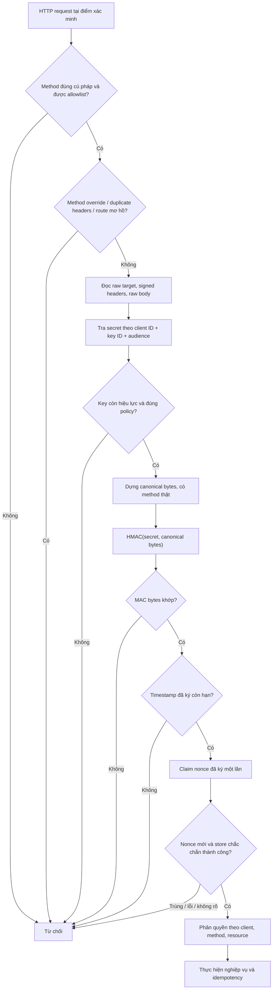
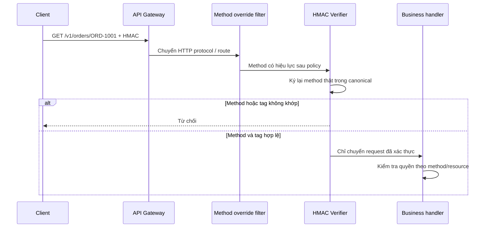

# Method trong signature

> **Chương:** HTTP method  
> **Chủ đề:** Ràng buộc phương thức HTTP vào chữ ký HMAC để ngăn request bị đổi hành động khi đi qua client, proxy/gateway và backend.  
> **Bối cảnh:** Xác thực HTTP request bằng shared secret và canonical request gồm method, URI, header hoặc body theo hợp đồng ký. Bài học có ví dụ Java 17, kiểm thử timestamp/nonce chống replay, key rotation và phân biệt xác thực với phân quyền.

## 1. Vì sao phải ký HTTP method?

Xét hai request cùng trỏ đến một đơn hàng nhưng mang ý nghĩa nghiệp vụ khác nhau:

```http
GET /v1/orders/ORD-1001 HTTP/1.1
Host: orders.example.test
X-Client-Id: partner-01
X-Key-Id: key-2026-11
X-Timestamp: 1795800000
X-Nonce: YowIqm3CAivhwx8w5P7spA
X-Signature: <base64url-hmac>

```

```http
DELETE /v1/orders/ORD-1001 HTTP/1.1
Host: orders.example.test
X-Client-Id: partner-01
X-Key-Id: key-2026-11
X-Timestamp: 1795800000
X-Nonce: YowIqm3CAivhwx8w5P7spA
X-Signature: <chu-ky-cu>
```

Giả sử hệ thống ký **chỉ URI, timestamp, nonce và hash body**, nhưng **bỏ qua HTTP method**. Kẻ tấn công đã thu được một GET hợp lệ có thể đổi thành DELETE và giữ nguyên chữ ký: mọi thành phần **đã ký** không đổi nên kết quả tính lại HMAC vẫn có thể khớp. Nếu backend cũng cho client này gọi DELETE và không có hàng rào khác, request bị đổi phương thức có nguy cơ xóa tài nguyên.

**Mục tiêu của bài học:** Phải ký **method thực sự có hiệu lực đối với request được xử lý**, chứ không chỉ method do client tự khai trong một header. Khi GET đổi thành DELETE, canonical bytes đổi và chữ ký GET cũ không được xác minh cho DELETE.

Công thức minh họa:

```text
canonical_request = version || LF || audience || LF ||
                    method || LF || raw_target || LF ||
                    signed_headers || LF || body_digest || ...
tag = HMAC_SHA256(shared_secret, UTF8(canonical_request))
```

HMAC bảo vệ **đúng bytes mà hợp đồng ký đưa vào**. Nó không tự đọc HTTP method và không thể bảo vệ một trường bị bỏ sót trong canonical request.

## 2. HTTP method là gì và tại sao có ý nghĩa bảo mật?

HTTP method (phương thức HTTP) cho biết **ngữ nghĩa hành động** mà client yêu cầu trên resource đích. Method ảnh hưởng đến định tuyến, chính sách truy cập, cache, retry và cách ứng dụng xử lý body.

| Method | Ý nghĩa thông dụng | Đặc điểm cần chú ý khi ký |
| --- | --- | --- |
| `GET` | Truy xuất biểu diễn của resource | Có thể được cache; phải ký đúng `GET`, không tự suy từ handler |
| `HEAD` | Như GET nhưng không trả response content | Nhiều framework tái sử dụng GET handler; chữ ký vẫn cần ràng buộc `HEAD` nếu request thật là HEAD |
| `POST` | Yêu cầu xử lý theo ngữ nghĩa resource | Thường gây side effect; ký cả method, target và payload/metadata |
| `PUT` | Tạo hoặc thay thế trạng thái resource đích | Có ngữ nghĩa khác POST/PATCH; không thể dùng tag POST để ký PUT |
| `PATCH` | Áp dụng thay đổi một phần | Ký method và body/Content-Type phù hợp định dạng patch |
| `DELETE` | Yêu cầu xóa liên kết của resource đích | Không nhầm tag GET/POST với quyền DELETE |
| `OPTIONS` | Mô tả lựa chọn giao tiếp hoặc xử lý CORS preflight | Quy tắc miễn xác thực nếu có phải giới hạn chặt ở preflight, không áp dụng cho thao tác nghiệp vụ |
| `TRACE` / `CONNECT` | Chẩn đoán đường đi / thiết lập tunnel | Thường không cần cho business API; nên có chính sách rõ và tắt khi không dùng |

Theo ngữ nghĩa HTTP, method token **phân biệt chữ hoa/chữ thường**: `GET` không tự động tương đương `get`. Các method chuẩn được viết hoa, nhưng **việc hỗ trợ extension method** phải được giao thức và ứng dụng quy định rõ. Đừng chuẩn hóa tùy tiện một method lạ bằng cách gọi `toUpperCase()` rồi xem là yêu cầu hợp lệ.

Một số method được mô tả là *safe* hoặc *idempotent* trong ngữ nghĩa HTTP; điều đó **không** chứng minh request đã được xác thực hoặc được phân quyền. Ví dụ GET về mặt ngữ nghĩa nên an toàn, nhưng một GET bị giả mạo vẫn có thể làm lộ dữ liệu nếu không kiểm tra quyền; DELETE có tính idempotent theo ý nghĩa kết quả dự kiến của method nhưng vẫn là hành động nhạy cảm.

### 2.1 Hợp đồng ký phải xác định method ở dạng nào

Một hợp đồng ký nên trả lời:

- Method nào được phép cho endpoint và cho signing profile hiện tại?
- Client ký đúng **method đang gửi trên wire** hay một method “effective” sau biến đổi đã được định nghĩa?
- Hệ thống chấp nhận method extension hay chỉ tập cụ thể như `GET`, `POST`, `PUT`, `PATCH`, `DELETE`?
- Có bước method override hoặc rewrite nào trước/sau xác minh không?
- Khi HTTP/2 hoặc HTTP/3 được chuyển đổi sang HTTP/1.1, verifier lấy method từ đâu?
- Nếu request bị từ chối do method không được hỗ trợ, có làm tốn nonce hoặc gọi nghiệp vụ không?

**Hướng mặc định dễ chứng minh:** Dùng **method thật tại trust boundary được thống nhất**, so khớp **chính xác** với allowlist của endpoint, ràng buộc nguyên văn method đó trong canonical request rồi xác minh HMAC. Không tự chuyển `get` thành `GET` sau khi nhận.

## 3. Method nằm ở đâu trong HTTP/1.1 và HTTP/2?

### HTTP/1.1: request line

```http
POST /v1/transfers?mode=commit HTTP/1.1
Host: payments.example.test
Content-Type: application/json
```

Ở đây method là `POST`, request target là `/v1/transfers?mode=commit`. Hợp đồng có thể ký trực tiếp method và raw target tại một ranh giới tin cậy đã xác định.

### HTTP/2: pseudo-header

```text
:method: POST
:scheme: https
:authority: payments.example.test
:path: /v1/transfers?mode=commit
content-type: application/json
```

Với HTTP/2, method được truyền qua pseudo-header `:method`, không phải request line dạng HTTP/1.1. Khi reverse proxy chuyển đổi giao thức, verifier nên lấy **method thực nhận do HTTP stack chuẩn cung cấp**, không đọc header tự đặt tên `X-Method` hoặc `X-HTTP-Method` như thể đó là method của request.

Nếu gateway thực hiện chuyển đổi HTTP/2 → HTTP/1.1, cùng một method như `POST` về mặt token vẫn có thể được giữ nguyên. Tuy nhiên, canonicalization cần kiểm tra đầy đủ **URI, authority, content type, query và body** vì các phần đó có thể thay đổi trong quá trình chuyển đổi.

### HTTP method là giá trị, không phải danh tính

Server không được suy method từ header khác, JSON body hoặc tên route:

```text
X-Client-Method: DELETE
{"method":"DELETE"}
```

Các trường đó là dữ liệu do bên gửi khai báo, không thay thế method HTTP ở ranh giới xử lý. Nếu ứng dụng có cơ chế override method riêng, phải xử lý nó như một **thay đổi giao thức đáng tin và có kiểm soát**, không tự động chấp nhận.

## 4. Hợp đồng canonical request có method được ký

Giả sử chúng ta thiết kế signing profile `request-hmac-v1` cho API thanh toán, dùng HMAC-SHA256 với shared secret.

| Vị trí | Trường | Ví dụ canonical | Điều kiện |
| --- | --- | --- | --- |
| 1 | Contract version | `request-hmac-v1` | Cố định và có trong MAC |
| 2 | Audience | `payments-api-prod` | Gắn với API/môi trường đích từ policy server |
| 3 | Method | `POST` | Method thực tại điểm xác minh, được allowlist |
| 4 | Raw request target | `/v1/transfers?mode=commit` | Path/query đúng biểu diễn hợp đồng |
| 5 | Content-Type | `application/json` | Theo quy tắc ký header của API |
| 6 | Client ID | `billing-service` | Gắn với secret đã đăng ký |
| 7 | Key ID | `key-2026-11` | Chỉ chọn key còn hiệu lực |
| 8 | Timestamp | `1795800000` | Đã ký, sau đó kiểm tra cửa sổ thời gian |
| 9 | Nonce | `YowIqm3CAivhwx8w5P7spA` | Đã ký, sau đó claim một lần |
| 10 | Body digest | SHA-256 hex chữ thường của raw body bytes | Phát hiện sửa payload |

Với hợp đồng này, các trường trên được nối bằng **một byte LF `0x0A`** giữa từng dòng, sử dụng UTF-8 và **không có LF cuối**:

```text
request-hmac-v1
payments-api-prod
POST
/v1/transfers?mode=commit
application/json
billing-service
key-2026-11
1795800000
YowIqm3CAivhwx8w5P7spA
<sha256-hex-of-raw-body>
```

Chữ ký:

```text
bodyDigest = lowercase_hex(SHA256(raw_body_bytes))
canonicalBytes = UTF8(join_fields_with_LF_without_final_LF)
tag = HMAC_SHA256(secret_for_client_and_key_id, canonicalBytes)
signature = BASE64URL_NO_PADDING(tag)
```

Đây là **hợp đồng minh họa**, không phải chuẩn canonical request dùng chung cho mọi ứng dụng. Nếu `Host`/authority, tenant, request content encoding, conditional headers hoặc trường khác quyết định hành động, chúng phải được ký hoặc được cố định bởi hạ tầng đáng tin. Không bao giờ mặc định rằng chỉ cần ký method là có thể bỏ qua URI/body.

### 4.1 Vì sao method cần có vị trí riêng?

HMAC hoạt động trên dãy bytes, không hiểu tên trường. Một cấu trúc canonical rõ ràng giúp không lẫn giá trị method với các thành phần khác.

Ví dụ hai chuỗi:

```text
request-hmac-v1
payments-api-prod
GET
/v1/orders/ORD-1001
...
```

và:

```text
request-hmac-v1
payments-api-prod
DELETE
/v1/orders/ORD-1001
...
```

khác nhau ít nhất ở dòng method; vì vậy HMAC hợp lệ cho GET **không trở thành** HMAC hợp lệ cho DELETE khi các bytes khác giữ nguyên.

Nếu nối các trường bằng LF, server cần cấm CR/LF trong từng field hoặc dùng một định dạng có length-prefix/escaping được đặc tả thống nhất. Nếu không, việc nối chuỗi có thể gây nhập nhằng trường.

### 4.2 Không ép method thành GET chỉ vì cùng handler

Một số framework có thể xử lý HEAD bằng cách tái sử dụng handler của GET, hoặc có route `GET /resource` và `HEAD /resource` dùng cùng mã nghiệp vụ. **Handler giống nhau không làm cho HTTP method giống nhau.** Chữ ký cho HEAD phải ký `HEAD` khi phương thức request thực là HEAD, trừ khi có một hợp đồng riêng được thiết kế và phân tích rủi ro.

Tương tự, cùng một method nhưng target khác nhau (ví dụ `POST /v1/transfers` và `POST /v1/refunds`) phải có canonical bytes khác. Ký method **và** URI mới đủ bảo vệ ranh giới hành động.

### 4.3 Không suy method từ body hay signature header

Sai lầm có thể gặp:

```text
server nhận một header X-Signed-Method: GET
server ký/xác minh trên X-Signed-Method
server lại xử lý request HTTP DELETE thực tế
```

Khi đó MAC có thể khớp với giá trị GET khai báo, trong khi backend thực hiện DELETE. Nếu giao thức có truyền một bản sao của method trong header, verifier phải **đối chiếu chính xác với method thật** trước khi chấp nhận. Mặc định nên bỏ nhu cầu về header sao chép này và lấy method từ đối tượng request tin cậy tại điểm xác minh.

## 5. Mô hình đe dọa khi HTTP method không được ký hoặc bị hiểu sai

| Tình huống | Kỹ thuật khai thác hoặc nguyên nhân | Điều có thể xảy ra | Biện pháp |
| --- | --- | --- | --- |
| Không ký method | Chỉ MAC path/body/timestamp | Đổi GET thành DELETE với tag cũ | Ký method thật trong canonical request |
| Ký method do client tự khai | `X-Signed-Method: GET` nhưng request là DELETE | MAC hợp lệ cho trường sai | Đối chiếu với method hiệu lực hoặc không dùng header sao chép |
| Tự uppercase mọi method | `get` trở thành `GET` sau normalize | Hai request khác nhau bị hiểu như một | So khớp exact token theo contract; từ chối method lạ |
| Method override | `X-HTTP-Method-Override: DELETE` trong một POST | Backend có thể chạy DELETE sau bước HMAC của POST | Vô hiệu hóa override không cần thiết; xác minh method có hiệu lực |
| Form method override | Body có `_method=DELETE` và framework đổi route | Request ký POST nhưng xử lý DELETE | Kiểm soát filter order; từ chối override ở signed endpoints |
| Proxy rewrite method | Gateway chuyển POST sang PUT | Verifier ký một method, backend xử lý method khác | Chọn điểm xác minh và chính sách rewrite nhất quán |
| HEAD → GET handler fallback | Framework tái dùng handler | Nhầm HEAD và GET khi tạo canonical | Lấy method thực, không dựa tên handler |
| CORS preflight bypass | Route OPTIONS được miễn xác thực không có giới hạn | Có thể tạo đường vòng kiểm tra nếu middleware bị áp dụng sai | Chỉ miễn đúng preflight, vẫn bảo vệ business methods |
| Unsupported extension method | Proxy/backend hiểu khác một token | Parser differential hoặc route ngoài dự kiến | Allowlist method; reject method không hỗ trợ |
| Query/route đổi nhưng method giữ nguyên | Chỉ ký method | Có thể đổi endpoint/hành động | Ký cả raw target và các header/body ảnh hưởng kết quả |
| Replay request nguyên vẹn | Method đã ký vẫn giữ nguyên | HMAC đúng nhưng thao tác chạy lại | Timestamp và nonce store nguyên tử |
| Method và HMAC đúng, không có quyền | Client ký DELETE hợp lệ nhưng thiếu quyền xóa | Vượt quyền nghiệp vụ nếu không kiểm tra | Phân quyền theo client + resource + action |

**Lưu ý:** Người không biết secret thường không thể tự tạo MAC mới cho method khác. Tuy nhiên, nếu method bị loại khỏi phạm vi ký, họ **không cần tạo MAC mới**; chỉ cần giữ nguyên tag của các field đã ký. Đây là lỗi *signing coverage*, không phải lỗ hổng nguyên thủy mật mã HMAC.

### 5.1 Method override cần quyết định chính sách ngay từ đầu

Một số hệ thống cũ cho phép gửi POST nhưng xử lý như PUT/DELETE qua:

```http
POST /v1/orders/ORD-1001 HTTP/1.1
X-HTTP-Method-Override: DELETE
```

hoặc:

```text
POST /form-endpoint
_method=DELETE
```

Nếu bộ xác minh HMAC chạy **trước** filter override nhưng backend thực hiện **sau** filter, có thể xảy ra sự lệch giữa “method đã xác minh” và “method thực thi”.

Chọn **một** chính sách có thể kiểm chứng:

1. **Ưu tiên:** Không hỗ trợ method override trên API dùng HMAC; từ chối header/field override tại gateway và framework.
2. **Nếu cần hỗ trợ:** Xác định method hiệu lực duy nhất **trước** khi canonicalize, gắn cả method vận chuyển và method hiệu lực vào dữ liệu được ký nếu hợp đồng yêu cầu, bảo đảm verifier và router sử dụng **cùng một giá trị đã được xác minh**, đồng thời kiểm soát đúng thứ tự middleware.

Không được chấp nhận “ký POST, thực thi DELETE” mà không có một chính sách riêng ràng buộc đầy đủ và kiểm thử ranh giới này.

### 5.2 OPTIONS, HEAD và cache

- **OPTIONS/CORS:** Một preflight do trình duyệt tạo thường không mang HMAC signature của application request. Có thể xử lý preflight bằng nhánh riêng **chỉ đối với request preflight hợp lệ**, không cấp quyền cho POST/DELETE chỉ vì OPTIONS được miễn. `Access-Control-Request-Method` mô tả method của request tiếp theo, **không** phải method HTTP hiện tại.
- **HEAD:** Không gán tự động method GET vào chuỗi ký chỉ vì framework fallback sang GET handler.
- **Cache/CDN:** Nếu có cache, cần xác minh HMAC/identity tại đúng điểm theo hợp đồng và bảo đảm cache key, scope, tenant và authorization không làm lộ response. “GET có thể cache” không có nghĩa được bỏ qua xác thực trong đường đi truy xuất dữ liệu.

## 6. Luồng xác minh HMAC có method trong canonical



**Thứ tự có thể tối ưu về mặt hiệu năng**, nhưng quyết định cuối cùng phải là kết quả của mọi điều kiện bắt buộc. Nếu thiếu key, sai MAC, timestamp sai, nonce đã dùng, replay store lỗi hoặc client thiếu quyền, không được thực thi business handler.

Khi lựa chọn method và key, đừng coi giá trị `X-Client-Id` hoặc `X-Key-Id` tự khai là danh tính đã xác thực. Chúng chỉ giúp server tìm tập key được phép theo policy. Sau khi xác minh MAC mới có thể xác thực danh tính client tương ứng và tiếp tục phân quyền.

## 7. Thực hành Java 17: method thay đổi làm MAC không khớp

Đoạn mã sau là demo độc lập dùng JDK 17. Chúng ta ký một request GET có body rỗng, rồi thử thay thành DELETE nhưng giữ nguyên signature. Đây là tình huống mà việc bỏ method khỏi canonical request rất dễ gây nguy hiểm.

Hợp đồng minh họa của chương trình:

- Chấp nhận các method chuẩn được allowlist, **không** uppercase input trước khi xác minh.
- Dùng raw target từ request ở điểm tin cậy, giới hạn ký tự/percent-encoding của ví dụ.
- Với body rỗng không có Content-Type, dùng sentinel `-`; với body JSON, dùng `application/json`.
- Ký version, audience, method, raw target, Content-Type, client ID, key ID, timestamp, nonce và SHA-256 của raw body.
- HMAC-SHA256 tạo tag 32 bytes; encode Base64URL không padding thành 43 ký tự.
- Demo chỉ kiểm tra cú pháp và MAC; timestamp/nonce chưa được xác minh bởi replay store thật.

```java
import java.nio.charset.StandardCharsets;
import java.security.GeneralSecurityException;
import java.security.MessageDigest;
import java.security.SecureRandom;
import java.time.Instant;
import java.util.Base64;
import java.util.HexFormat;
import java.util.Set;

import javax.crypto.Mac;
import javax.crypto.spec.SecretKeySpec;

public final class MethodSignatureDemo {
    private static final String ALGORITHM = "HmacSHA256";
    private static final String AUDIENCE = "orders-api-prod";

    private static final Set<String> ALLOWED_METHODS =
            Set.of("GET", "HEAD", "POST", "PUT", "PATCH", "DELETE");

    private MethodSignatureDemo() {}

    public record Request(
            String method,
            String rawTarget,
            String contentType,
            String clientId,
            String keyId,
            String timestamp,
            String nonce,
            byte[] body) {

        // Tạo bản sao để tránh ai đó sửa body sau khi ký.
        public Request {
            body = body == null ? null : body.clone();
        }

        @Override
        public byte[] body() {
            return body == null ? null : body.clone();
        }
    }

    private static boolean validRawTarget(String value) {
        if (value == null || value.length() > 2048
                || !value.startsWith("/") || value.contains("#")) {
            return false;
        }
        for (int i = 0; i < value.length(); i++) {
            char c = value.charAt(i);
            if (c <= 0x20 || c > 0x7e) return false;

            if (c == '%') {
                if (i + 2 >= value.length()
                        || !isAsciiHex(value.charAt(i + 1))
                        || !isAsciiHex(value.charAt(i + 2))) {
                    return false;
                }
                i += 2;
            }
        }
        return true;
    }

    private static boolean isAsciiHex(char c) {
        return (c >= '0' && c <= '9')
                || (c >= 'a' && c <= 'f')
                || (c >= 'A' && c <= 'F');
    }

    private static boolean validRequest(Request request) {
        if (request == null || request.body() == null
                || request.body().length > 1_048_576) {
            return false;
        }
        if (request.method() == null
                || !ALLOWED_METHODS.contains(request.method())
                || !validRawTarget(request.rawTarget())) {
            return false;
        }
        if (!"application/json".equals(request.contentType())
                && !"-".equals(request.contentType())) {
            return false;
        }
        if ("-".equals(request.contentType())
                && request.body().length != 0) {
            return false;
        }

        return request.clientId() != null
                && request.clientId().matches("[A-Za-z0-9._-]{1,64}")
                && request.keyId() != null
                && request.keyId().matches("[A-Za-z0-9._-]{1,64}")
                && request.timestamp() != null
                && request.timestamp().matches("[0-9]{10,12}")
                && validNonce(request.nonce());
    }

    private static boolean validNonce(String value) {
        if (value == null || !value.matches("[A-Za-z0-9_-]{22}")) {
            return false;
        }
        try {
            byte[] bytes = Base64.getUrlDecoder().decode(value);
            return bytes.length == 16
                    && Base64.getUrlEncoder().withoutPadding()
                            .encodeToString(bytes).equals(value);
        } catch (IllegalArgumentException invalid) {
            return false;
        }
    }

    private static byte[] canonicalBytes(Request request)
            throws GeneralSecurityException {
        if (!validRequest(request)) {
            throw new IllegalArgumentException("Invalid signed request");
        }

        byte[] body = request.body();
        String digest = HexFormat.of().formatHex(
                MessageDigest.getInstance("SHA-256").digest(body));

        String canonical = String.join("\n",
                "request-hmac-v1",
                AUDIENCE,
                request.method(), // Phải là method thực, đã kiểm tra.
                request.rawTarget(),
                request.contentType(),
                request.clientId(),
                request.keyId(),
                request.timestamp(),
                request.nonce(),
                digest);
        return canonical.getBytes(StandardCharsets.UTF_8);
    }

    private static byte[] hmac(byte[] secret, byte[] input)
            throws GeneralSecurityException {
        Mac mac = Mac.getInstance(ALGORITHM);
        mac.init(new SecretKeySpec(secret, ALGORITHM));
        return mac.doFinal(input);
    }

    private static String signForDemo(
            byte[] secret, Request request)
            throws GeneralSecurityException {
        byte[] tag = hmac(secret, canonicalBytes(request));
        return Base64.getUrlEncoder().withoutPadding()
                .encodeToString(tag);
    }

    private static boolean verify(
            byte[] resolvedSecret, Request actual,
            String encodedSignature)
            throws GeneralSecurityException {
        if (resolvedSecret == null || resolvedSecret.length == 0
                || !validRequest(actual)
                || encodedSignature == null
                || !encodedSignature.matches("[A-Za-z0-9_-]{43}")) {
            return false;
        }

        byte[] provided;
        try {
            provided = Base64.getUrlDecoder()
                    .decode(encodedSignature);
        } catch (IllegalArgumentException malformed) {
            return false;
        }

        if (provided.length != 32
                || !Base64.getUrlEncoder().withoutPadding()
                        .encodeToString(provided)
                        .equals(encodedSignature)) {
            return false;
        }

        byte[] expected = hmac(
                resolvedSecret, canonicalBytes(actual));
        return MessageDigest.isEqual(expected, provided);
    }

    private static String newNonce(SecureRandom random) {
        byte[] bytes = new byte[16];
        random.nextBytes(bytes);
        return Base64.getUrlEncoder().withoutPadding()
                .encodeToString(bytes);
    }

    public static void main(String[] args)
            throws GeneralSecurityException {
        SecureRandom random = new SecureRandom();
        byte[] secret = new byte[32];
        random.nextBytes(secret);

        String timestamp = Long.toString(
                Instant.now().getEpochSecond());
        byte[] emptyBody = new byte[0];
        String nonce = newNonce(random);

        Request get = new Request(
                "GET", "/v1/orders/ORD-1001",
                "-", "partner-01", "key-2026-11",
                timestamp, nonce, emptyBody);

        String originalTag = signForDemo(secret, get);
        Request delete = new Request(
                "DELETE", get.rawTarget(), get.contentType(),
                get.clientId(), get.keyId(),
                get.timestamp(), get.nonce(), get.body());

        Request lowercaseGet = new Request(
                "get", get.rawTarget(), get.contentType(),
                get.clientId(), get.keyId(),
                get.timestamp(), get.nonce(), get.body());

        Request otherTarget = new Request(
                "GET", "/v1/orders/ORD-9999",
                get.contentType(), get.clientId(), get.keyId(),
                get.timestamp(), get.nonce(), get.body());

        System.out.println("Original GET: "
                + verify(secret, get, originalTag));
        System.out.println("Changed to DELETE: "
                + verify(secret, delete, originalTag));
        System.out.println("Lowercase get: "
                + verify(secret, lowercaseGet, originalTag));
        System.out.println("Changed URI: "
                + verify(secret, otherTarget, originalTag));
        System.out.println("Exact replay (MAC only): "
                + verify(secret, get, originalTag));
    }
}
```

Lưu thành `MethodSignatureDemo.java` và chạy:

```bash
javac MethodSignatureDemo.java
java MethodSignatureDemo
```

Kết quả mong đợi:

```text
Original GET: true
Changed to DELETE: false
Lowercase get: false
Changed URI: false
Exact replay (MAC only): true
```

Giải thích:

- **Original GET:** Tag được tính bằng đúng secret và canonical bytes của GET, nên khớp.
- **Changed to DELETE:** Dòng method trong canonical bytes khác với bản GET; tag cũ không thể dùng cho DELETE.
- **Lowercase get:** Hợp đồng chỉ chấp nhận token `GET` đúng chữ hoa/thường, không tự biến đổi `get`.
- **Changed URI:** Ký cả raw target nên không thể mang tag sang đơn hàng khác.
- **Exact replay (MAC only):** Bản request giữ nguyên mọi bytes nên phép so sánh HMAC vẫn thành công. Cần thêm timestamp/nonce store để chặn lần dùng thứ hai.

**Giới hạn demo:** Đây là lõi kiểm tra format và HMAC. Nó không làm HTTP parsing thực, không có key resolver theo client/key ID, không xử lý duplicate headers, không từ chối method override từ gateway, không kiểm tra timestamp/nonce và chưa kiểm tra quyền. Trong production, adapter phải cung cấp **method và raw target thực sự được backend xử lý**, đồng thời dùng đúng body bytes đã xác minh, tránh sai lệch *time-of-check/time-of-use*.

### 7.1 So sánh MAC an toàn và bảo vệ key

Mẫu dùng một `Mac` mới cho mỗi lần tính và so sánh bytes bằng `MessageDigest.isEqual` thay vì viết vòng lặp dừng ở byte sai. Đầu vào signature được giới hạn chính xác Base64URL không padding của tag HMAC-SHA256 dài 32 bytes.

Secret trong ví dụ được sinh ngẫu nhiên **chỉ cho lần chạy demo**. Khi triển khai thật, dùng secret manager/KMS hoặc kho key đã đăng ký theo `clientId + keyId + audience`; key ID bị thu hồi không được chấp nhận. Không hardcode secret, không log raw shared secret hay expected MAC và không thử mọi key cho đến khi MAC khớp.

### 7.2 Ví dụ với POST và body

Đối với `POST /v1/transfers`, canonical request vẫn chứa method như GET, nhưng thường có thêm Content-Type và SHA-256 của raw JSON body:

```text
request-hmac-v1
payments-api-prod
POST
/v1/transfers
application/json
billing-service
key-2026-11
<unix-timestamp>
<random-nonce>
<sha256-hex-of-raw-json-bytes>
```

Nếu kẻ tấn công đổi `POST` thành `PUT` hoặc `PATCH` và giữ tag cũ, MAC phải sai. Nếu họ đổi body nhưng không đổi method, MAC cũng phải sai vì body digest đã ký. Nếu chỉ đổi một header nghiệp vụ **không nằm trong hợp đồng ký** thì HMAC có thể không phát hiện; đó là lý do phải rà soát đầy đủ đầu vào ảnh hưởng đến hành động.

## 8. Gateway, framework và ranh giới xử lý method

Trong hệ thống thật, request thường đi qua nhiều lớp:



Các câu hỏi review cấu hình cần trả lời rõ:

- Bộ xác minh chạy **trước hay sau** reverse proxy rewrite và method override filter?
- API có hỗ trợ `X-HTTP-Method-Override`, `X-Method-Override` hoặc form field `_method` không? Có thể tắt chúng cho signed endpoint không?
- Nếu dùng Spring MVC/WebFlux hoặc servlet stack, verifier đọc method của **request thật** hay một wrapper/router đã đổi method?
- Proxy có chuyển `:method` từ HTTP/2 thành method HTTP/1.1 đúng không? Có route nào đi vòng HMAC verifier không?
- CORS preflight OPTIONS có middleware riêng không, và route đó có thể bị lạm dụng để thực hiện nghiệp vụ không?
- Một request được ký GET có bị backend redirect/rewrite thành POST/DELETE một cách im lặng không?

**Nguyên tắc:** Cùng một hợp đồng ký phải điều khiển cả nơi tính MAC và nơi phân quyền/xử lý. Nếu verifier kiểm tra `POST` nhưng backend chạy `DELETE`, chữ ký không còn bảo vệ đúng hành động dù HMAC primitive hoạt động chính xác.

### 8.1 Key rotation không làm mất ràng buộc method

Khi chuyển từ key cũ sang key mới, client và server có thể tạm chấp nhận cả hai trong một khoảng transition được quy định. Dù dùng key nào, canonical request vẫn phải chứa method; không có quy tắc ngoại lệ “key cũ không ký method” nếu endpoint yêu cầu bảo vệ phương thức.

Nếu thay đổi format ký, ví dụ bản v1 từng thiếu method và bản v2 đã ký method, đó là **thay đổi bảo mật giao thức**. Cần profile/version mới, sunset version yếu và chính sách không cho downgrade, thay vì tự động fallback v1 khi chữ ký v2 không khớp.

### 8.2 Replay và idempotency độc lập với method binding

Một request `DELETE` đã được ký đúng method vẫn có thể bị phát lại nguyên vẹn. Để chống replay, cần ký timestamp và nonce, xác minh thời hạn rồi **claim nonce nguyên tử** trong store chia sẻ giữa các instance.

Ví dụ với cửa sổ chấp nhận timestamp ±300 giây, một request có timestamp ở tương lai 300 giây có thể còn hợp lệ tới gần **600 giây sau lần chấp nhận sớm nhất**. TTL của dấu nonce cần bao phủ thời gian đó và cộng margin phù hợp; ví dụ 660 giây khi mô hình thời gian cho phép. Khi store timeout/không chắc nonce mới, **fail closed** và không chạy nghiệp vụ.

Với thao tác có side effect, nên ký cả transaction ID hoặc idempotency key và bảo đảm xử lý nghiệp vụ idempotent; nonce không thay thế idempotency. Kẻ giữ shared secret hợp lệ vẫn có thể ký một request mới với nonce mới nên phân quyền theo method và resource là bắt buộc.

## 9. Ma trận kiểm thử method trong signature

Kiểm thử từ unit tới tích hợp qua API gateway, gồm HTTP/1.1 và HTTP/2. Mọi ca phải kiểm tra rằng **không có tác dụng nghiệp vụ** khi một bước xác thực bắt buộc thất bại.

| Tình huống | Thay đổi khi gửi | Kỳ vọng |
| --- | --- | --- |
| Baseline | GET đúng method, target, key và signature | HMAC hợp lệ; tiếp tục anti-replay, authorization |
| Đổi GET → DELETE | Giữ tag GET | HMAC sai |
| Đổi POST → PUT | Giữ body/target/tag POST | HMAC sai |
| Đổi POST → PATCH | Giữ tag POST | HMAC sai |
| Đổi method viết thường | `get` thay `GET` | Từ chối theo allowlist |
| Extension method lạ | `PURGE`, `PROPFIND` nếu endpoint không hỗ trợ | Từ chối |
| Whitespace/control trong method | Token bất hợp lệ hoặc parser mơ hồ | Từ chối ở HTTP parser/boundary |
| Đổi URI nhưng giữ method | `/orders/A` → `/orders/B` | HMAC sai nếu raw target được ký |
| Đổi query nhưng giữ method | `mode=preview` → `mode=commit` | HMAC sai nếu query được ký |
| Body sửa | Thay `amount` mà giữ tag | HMAC sai |
| Header nghiệp vụ sửa | Thay signed Content-Type/tenant | HMAC sai hoặc policy từ chối |
| Duplicate signed header | Hai `X-Client-Id`/`X-Timestamp` | Từ chối nhập nhằng |
| HEAD fallback | Ký HEAD, framework dùng GET handler | Verifier vẫn kiểm tra HEAD; quyền theo hành động |
| OPTIONS preflight | Header `Access-Control-Request-Method: DELETE` | Được xử lý đúng CORS policy; không thực thi DELETE |
| Override header | POST có `X-HTTP-Method-Override: DELETE` | Bị từ chối nếu override cấm; nếu cho phép phải khớp hợp đồng ký |
| Override form field | POST có `_method=DELETE` | Không đổi method sau verify mà không ràng buộc |
| Proxy thay method | Ingress nhận POST, backend thấy PUT | Từ chối hoặc chuyển đổi đã được ký/kiểm soát rõ |
| HTTP/2 → HTTP/1.1 | `:method: POST` chuyển thành request line | Cùng method token và canonical semantics |
| Key rotation | Request dùng key hết hạn | Từ chối dù method đã ký đúng |
| Replay nguyên request | Cùng method, nonce, signature | HMAC có thể đúng; nonce store từ chối |
| Replay store lỗi | Claim timeout | Fail closed, không chạy nghiệp vụ |
| Client thiếu quyền | HMAC POST/DELETE hợp lệ nhưng sai tenant | Authorization từ chối |
| Client retry hợp lệ | Method không đổi, nonce mới, cùng idempotency key | Không nhân đôi hiệu ứng nghiệp vụ |

### 9.1 Golden test vectors cho từng method

Nên lưu một tập test vector cố định bằng **secret thử nghiệm**. Với mỗi method được hỗ trợ, vector cần có:

```text
version: request-hmac-v1
algorithm: HmacSHA256
key_bytes_hex: <test-secret-hex>
method: GET | HEAD | POST | PUT | PATCH | DELETE
raw_target: <exact-path-and-query>
signed_headers: <exact-bytes-or-contract-values>
body_bytes_hex: <exact-bytes>
canonical_utf8_hex: <expected-exact-bytes>
hmac_bytes_hex: <expected-tag>
signature_base64url: <expected-encoding>
```

Test vector phải được kiểm tra chéo giữa ít nhất hai implementation nếu có client dùng ngôn ngữ khác Java. Nếu Java client tự ký rồi chính Java verifier tự kiểm tra bằng cùng hàm canonicalization sai, cả hai vẫn có thể báo “true” mà không phát hiện bất đồng hợp đồng với hệ thống khác.

### 9.2 Quy trình debug method mismatch

Khi chữ ký lệch qua gateway, hãy đối chiếu:

1. Method **trên wire** ở client, method mà ingress/gateway tiếp nhận và method backend thực sự xử lý.
2. Thứ tự middleware/filter: method override, routing, authorization, HMAC verification.
3. Canonical request bytes (với test secret và payload không nhạy cảm) tại từng điểm; ưu tiên so sánh method line đầu tiên.
4. Raw target, percent-encoding, query, Host/authority, signed header và body hash; method đúng nhưng trường khác có thể sai.
5. Key ID, key hiệu lực, algorithm/profile, signed timestamp và nonce.
6. Replay store và authorization nếu HMAC đã qua nhưng API vẫn từ chối.

Không log secret, raw HMAC expected hay full payload nhạy cảm ở môi trường thực. Dùng correlation ID, mã lỗi có cấu trúc và tracing đã hạn chế dữ liệu.

## 10. Bài tập áp dụng

**Bài 1 — Bỏ method khỏi canonical:** Trong chương trình demo, tạo một hàm ký thử nghiệm không đưa dòng method vào canonical. Ký GET rồi xác minh cùng tag với DELETE tại cùng URI/body. Quan sát rủi ro và giải thích vì sao đây là lỗi hợp đồng ký, không phải lỗi thuật toán HMAC-SHA256.

**Bài 2 — Casing và allowlist:** Thử `GET`, `get`, `GeT`, `PATCH` và một extension method. Viết bảng method nào được phép theo API. Vì sao việc tự uppercase trước khi ký có thể che giấu một dạng nhập nhằng?

**Bài 3 — Method override:** Dùng một gateway hoặc framework test cho phép `X-HTTP-Method-Override`. Gửi POST được ký, kèm header override thành DELETE. Tìm vị trí đặt verifier để đảm bảo method đã xác minh chính là method nghiệp vụ chạy; so sánh với lựa chọn **tắt override**.

**Bài 4 — HEAD và OPTIONS:** Tạo một endpoint dùng chung handler cho GET và HEAD, sau đó thử ký hai method. Với OPTIONS preflight, chứng minh header `Access-Control-Request-Method` không được coi là method thực.

**Bài 5 — HTTP/2 qua gateway:** Ký request HTTP/2 có `:method: POST` và `:path: /v1/transfers`; chuyển qua proxy sang HTTP/1.1. Kiểm tra canonical target, Content-Type và body digest, không chỉ method.

**Bài 6 — Replay và phân quyền:** Ký một DELETE hợp lệ rồi phát lại nguyên request: HMAC có thể đúng, nonce store phải từ chối. Tạo DELETE mới có nonce hợp lệ nhưng dùng client không có quyền xóa; authorization phải từ chối.

## 11. Câu hỏi tự kiểm tra

1. Nếu chỉ ký URI, timestamp và body hash mà bỏ method, chuyện gì có thể xảy ra khi GET bị đổi thành DELETE?
2. Tại sao HTTP method phải lấy từ request thực tại trust boundary thay vì một header `X-Signed-Method` do client gửi?
3. `GET` và `get` có tự động tương đương không? Hợp đồng ký nên kiểm soát chúng thế nào?
4. Trong HTTP/2, method được biểu diễn ở đâu và cần chú ý điều gì khi chuyển sang HTTP/1.1?
5. Vì sao HEAD và GET có thể chung handler nhưng không nên mặc định chung chữ ký?
6. Nếu có filter `X-HTTP-Method-Override`, thứ tự với HMAC verifier ảnh hưởng an toàn thế nào?
7. Chỉ ký method mà không ký raw target, query hoặc body có đủ bảo vệ hành động không?
8. Một request có method và HMAC hợp lệ đã được chống replay chưa?
9. Khi key rotation, có thể bỏ qua việc ký method cho key cũ để tương thích không?
10. HMAC và nonce hợp lệ cho một DELETE có đồng nghĩa client được phép xóa resource đó không?

**Điểm cần nhớ:** HTTP method là **một thành phần của hành động được xác thực**. Trong xác thực HTTP bằng HMAC, server phải kiểm tra method thật, đưa nó vào canonical bytes cùng URI và các header/body có ý nghĩa, rồi xác minh tag bằng đúng shared secret. Không để proxy, method override, framework routing hoặc client header làm lệch method đã ký so với method thực thi. Chữ ký đúng vẫn phải qua timestamp/nonce chống replay và phân quyền độc lập.
