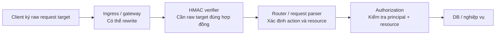

# URL parsing trong HMAC request authentication

## 1. Vì sao URL parsing là vấn đề bảo mật của HMAC?

Trong module `SECURITY_AUTHENTICATION_HMAC_REQUEST_AUTHENTICATION`, client và server chia sẻ secret để ký và xác minh HTTP request bằng HMAC. Hai bên phải biến request thành cùng một dãy **canonical bytes**, thường bao gồm HTTP method, URI, header đã chọn và/hoặc digest của raw body. Khi tài nguyên được xác định qua URL/path/query, **cách parse URL** trở thành một phần của hợp đồng bảo mật, không chỉ là việc gọi một API tiện ích.

Xét hai request:

```http
GET /v1/files/a%2Fb?view=raw HTTP/1.1
Host: api.example.test
```

```http
GET /v1/files/a/b?view=raw HTTP/1.1
Host: api.example.test
```

Chuỗi request target **khác byte** (`%2F` so với `/`), nhưng một số thành phần trung gian hoặc router có thể diễn giải chúng theo cùng một đường dẫn sau khi decode. Nếu client ký request target nguyên bản, còn gateway hoặc backend normalize trước khi xác minh, chữ ký có thể sai. Nguy hiểm hơn, nếu **verifier và authorizer/router hiểu đường dẫn khác nhau**, request có thể được xác minh theo một resource nhưng được thực thi trên resource khác.

**Ý chính:** HMAC bảo vệ các byte được ký. Nó **không tự giải quyết** sự nhập nhằng giữa nhiều cách biểu diễn URL có cùng (hoặc khác) ý nghĩa đối với các parser trong chuỗi client → gateway → backend. Thiết kế phải quy định **URL nào được chấp nhận, parse ở đâu, có normalize hay không, và dùng đúng kết quả nào cho xác minh lẫn phân quyền**.

Bài **“URL parsing”** thuộc chương **“URL và path”** tập trung vào những điểm này trong HMAC request authentication. Timestamp, nonce, key rotation và authorization được nhắc tới ở nơi chúng liên quan trực tiếp đến ranh giới xử lý URL.

### Mục tiêu học tập

Sau bài này, bạn có thể:

1. Phân biệt **URL đầy đủ**, **HTTP request target**, **path**, **query**, **authority**, **fragment** và **decoded value**.
2. Giải thích các cặp dễ nhầm: `%2F`/`/`, `%2e`/`.`, `+`/`%20`, duplicate query key, query rỗng và query không có.
3. Định nghĩa hợp đồng HMAC ký **raw origin-form request target** hoặc một dạng canonical target được version rõ ràng.
4. Viết parser Java 17+ cho một tập URL được hỗ trợ, tránh dùng `URLDecoder` sai ngữ cảnh.
5. Kiểm thử qua reverse proxy, API gateway, HTTP/1.1 và HTTP/2; không để signature verifier, router và authorizer diễn giải resource khác nhau.

## 2. Bản đồ các thành phần URL và request target

Ví dụ một URL đầy đủ:

```text
https://api.example.test:8443/v1/tenants/t-42/orders/o-7?expand=items&tag=a%2Bb#summary
|-----scheme-----|--------authority--------|-----------path-----------|-------query--------|fragment
```

Các thành phần:

| Thành phần | Ví dụ | Vai trò trong hệ thống |
| --- | --- | --- |
| Scheme | `https` | Chỉ giao thức kết nối; khi qua TLS terminator, backend có thể thấy scheme khác client nếu dùng metadata không tin cậy. |
| Authority | `api.example.test:8443` | Host/port của đích; dùng phân biệt dịch vụ/audience nếu hợp đồng yêu cầu. |
| Path | `/v1/tenants/t-42/orders/o-7` | Thường quyết định route, tenant ID và resource ID. |
| Query | `expand=items&tag=a%2Bb` | Các tham số lọc, hành động hoặc lựa chọn trả về; có thể ảnh hưởng đến quyền. |
| Fragment | `summary` | Được xử lý phía user agent; **không** nằm trong HTTP request target thông thường, không thể ký như một phần URL gửi đến server. |

Trong HTTP/1.1, client trực tiếp gọi origin server thường gửi **origin-form request target**:

```http
GET /v1/tenants/t-42/orders/o-7?expand=items&tag=a%2Bb HTTP/1.1
Host: api.example.test:8443
```

Ở đây, request target là **`/v1/tenants/t-42/orders/o-7?expand=items&tag=a%2Bb`**, **không** gồm scheme, host hoặc fragment. Nếu client ký full URL nhưng server ký origin-form path/query, hai bên sẽ tính HMAC khác nhau.

### 2.1 Các dạng HTTP request target cần phân biệt

| Dạng | Ví dụ | Ghi chú đối với HMAC |
| --- | --- | --- |
| **Origin-form** | `/v1/orders?limit=10` | Thường gặp khi gọi origin API. Có thể chọn làm hợp đồng duy nhất cho endpoint thông thường. |
| **Absolute-form** | `http://api.example.test/v1/orders?limit=10` | Có thể xuất hiện khi client gửi tới forward proxy HTTP/1.1; cần quy tắc riêng nếu hỗ trợ, không tự cắt chuỗi đoán path. |
| **Authority-form** | `api.example.test:443` | Dùng với `CONNECT` trong HTTP/1.1; không phải route API thông thường. |
| **Asterisk-form** | `*` | Dùng với `OPTIONS *`; phải có hợp đồng riêng nếu API hỗ trợ. |
| **HTTP/2 `:path`** | `/v1/orders?limit=10` | Pseudo-header mang path và query, nhưng qua gateway có thể được biến đổi trước khi vào framework. |

Trong bài này, hợp đồng mẫu chỉ chấp nhận **origin-form bắt đầu bằng `/`** cho những endpoint API thông thường. Các dạng khác bị từ chối bởi verifier theo hợp đồng mẫu, hoặc phải được xử lý bằng **version riêng đã đặc tả**. Đây là **quyết định của API**, không phải nhận định rằng các dạng request target khác vốn không hợp lệ trong HTTP.

**HTTP/2/HTTP/3** có pseudo-header `:scheme`, `:authority` và `:path`. Không thể mặc nhiên lấy một biến backend tên `requestURL` rồi cho rằng đó là raw target client đã ký; gateway có thể đã chuyển đổi hoặc normalize trước đó.

### 2.2 Authority, Host và audience

Nếu hai dịch vụ dùng cùng secret hoặc cùng quy tắc ký, một request đã ký cho dịch vụ A có thể bị chuyển sang dịch vụ B nếu hợp đồng **không ràng buộc đích nhận**. Có hai cách thiết kế phù hợp:

- **Ràng buộc audience phía server:** metadata key định nghĩa key chỉ dành cho `orders-api/prod`; canonical request có dòng cố định `audience:orders-api/prod` và verifier kiểm tra key có đúng audience thực tế.
- **Ký authority đã canonical hóa:** nếu thực sự cần ký host/port, quy định xử lý host viết hoa/thường, port mặc định, IPv6 literal, IDN/punycode, `Host` ở HTTP/1.1 và `:authority` ở HTTP/2. Không tin `X-Forwarded-Host` do client tự gửi.

Bài dùng cách **audience phía server** để tránh phụ thuộc việc gateway rewrite `Host`. Dù chọn cách nào, chỉ ký target mà bỏ qua bài toán audience khi dùng chung key có thể tạo khả năng **cross-service replay**. Secret nên được phân tách giữa các dịch vụ/môi trường nếu phù hợp.

## 3. Raw path khác decoded path như thế nào?

### 3.1 Percent-encoding là biểu diễn byte, không phải chuỗi trang trí

Trong URL, ký tự `%` mở đầu percent-encoding của một byte bằng hai chữ số hex. Ví dụ:

```text
raw path:        /v1/files/a%2Fb
decoded path:    /v1/files/a/b       // nếu bộ xử lý decode %2F thành slash
```

Dấu `/` là **ký tự phân tách segment** trong path, còn `%2F` là biểu diễn percent-encoded của byte slash. Một router có thể cho phép encoded slash trong một segment, router khác giải mã rồi tách thành nhiều segment; một số gateway từ chối encoded slash vì lý do an toàn.

| Hai raw value | Có thể khác ý nghĩa? | Điều quan trọng với HMAC |
| --- | --- | --- |
| `/files/a%2Fb` và `/files/a/b` | Có: một resource ID chứa slash so với hai segment. | Chữ ký theo raw bytes phải khác; router và authorizer không được suy diễn khác điểm verify. |
| `/files/%2e%2e/admin` và `/admin` | Có thể trùng sau percent decode và xử lý `..`. | Không được giả định nguyên raw path đã an toàn; xem xét dot-segment normalization. |
| `/files/%252F` và `/files/%2F` | Có thể trùng sau **double decode**. | Chỉ decode theo một quy tắc rõ, không để tầng sau tự decode thêm lần nữa. |
| `/files/a//b` và `/files/a/b` | Tùy router có gộp slash trùng hay không. | Quyết định reject hay preserve rõ ràng. |
| `/FILES` và `/files` | Tùy hệ thống/router có phân biệt hoa/thường. | Raw bytes khác; tránh routing khác với authorization. |
| `/%41` và `/A` | Cùng ký tự decoded khi giải mã escape. | Nếu hợp đồng ký raw target thì hai chữ ký khác; nếu normalize phải quy định phiên bản chính xác. |
| `/%2f` và `/%2F` | Thường giải mã thành cùng byte slash. | **Hex case khác ở raw bytes**; không tự viết hoa/lowercase escape ngoài hợp đồng. |

Với hợp đồng ký **raw target**, `%2f` và `%2F` là hai byte sequence văn bản khác nhau, dù cùng biểu diễn byte `0x2F` sau giải mã. HMAC sẽ khác. Nếu muốn canonicalize percent-encoding để coi chúng tương đương, đó là **quyết định thay đổi giao thức** và cần version/test vector đầy đủ.

### 3.2 Dot segments và path traversal

Các segment đặc biệt `.` và `..` có ngữ nghĩa liên quan đến đường dẫn tương đối. Các biến thể percent-encoded `%2e`, `%2e%2e`, ký tự backslash `\` (khi proxy hoặc framework coi như slash) và chuỗi double-encoded có thể tạo kết quả khác nhau giữa các lớp.

Một lựa chọn **phòng thủ đơn giản** cho API không cần các biểu diễn nhập nhằng là **từ chối**:

- Path có segment chính xác `.` hoặc `..`.
- Encoded dot (`%2e` với mọi kiểu hoa/thường) ở path.
- Encoded slash `%2f`, encoded backslash `%5c` hoặc backslash trực tiếp.
- Encoded percent `%25` trong path nếu hệ thống chưa chứng minh các tầng chỉ decode đúng một lần.
- Hai slash liên tiếp trong path nếu router có khả năng gộp chúng.

Chính sách trên khá nghiêm ngặt và **không bắt buộc cho mọi API**. Ví dụ một ứng dụng lưu trữ object key có thể cần encoded slash; khi đó phải thiết kế parser/router/authorization nhất quán hơn, định nghĩa canonical version và kiểm thử kỹ. Không được đơn giản thêm `URI.normalize()` rồi coi mọi trường hợp là an toàn: normalization có thể đổi resource mà client đã ký.

### 3.3 Unicode và IRI

Người dùng có thể nhìn thấy URL chứa tiếng Việt, nhưng trên wire, URI thường dùng **percent-encoding của các byte UTF-8** cho những ký tự không thuộc ASCII. Các biến thể Unicode normalization (NFC/NFD), chữ hoa/thường và encoder khác nhau có thể tạo byte khác dù giao diện hiển thị tương đương.

Hợp đồng mẫu trong bài yêu cầu raw origin-form target là **ASCII in được** với escape hợp lệ; ký nguyên byte ASCII đó. Nếu API cho phép ký URI Unicode thô hoặc một dạng IRI, cần quy định rõ **UTF-8/percent-encoding/Unicode normalization** và chứng minh proxy/backend tạo cùng byte. Tránh để Java `URI`, JavaScript `URL` và reverse proxy tự quyết định khác nhau.

## 4. Query string: dấu cộng, tham số trùng và dấu phân cách

### 4.1 Query không phải luôn là form data

Trong URI syntax, `+` là một ký tự có thể xuất hiện trong query. Khi xử lý dữ liệu theo **`application/x-www-form-urlencoded`**, nhiều decoder diễn giải `+` thành khoảng trắng. Hai ngữ cảnh **không giống nhau**.

```text
raw query A: name=a+b
raw query B: name=a%20b
raw query C: name=a%2Bb
```

Nếu client ký **raw query**:

- A, B, C có **ba dãy byte khác nhau**, nên MAC khác.
- Một bộ parser kiểu form có thể hiểu A và B là cùng `name = "a b"`, C là `name = "a+b"`.
- Nếu verifier dùng raw query còn backend dùng form decoder thì cần policy nhất quán về quyền, nhất là khi query chứa tenant/resource/action.

**Không dùng `java.net.URLDecoder` để “lấy raw query” hoặc normalize mọi URL path.** `URLDecoder` được thiết kế cho form encoding và diễn giải dấu `+` theo quy tắc form. Có thể dùng nó **ở lớp xử lý giá trị form** nếu API chọn chuẩn đó, nhưng không dùng làm canonicalizer ngầm của target HMAC.

### 4.2 Duplicate query keys: first-wins hay last-wins?

```http
GET /v1/orders?tenant=t-42&tenant=t-99 HTTP/1.1
```

Một thư viện có thể giữ giá trị đầu `t-42`, thư viện khác giữ giá trị cuối `t-99` hoặc trả về danh sách. HMAC trên nguyên raw query chỉ chứng minh client đã ký **cả chuỗi đó**; nó không khiến hai parser tự đồng ý về tenant nào sẽ được dùng.

Với query parameter **có ý nghĩa bảo mật** (`tenant`, `resourceId`, `scope`, `redirectUri`, `action`), nên:

1. Reject các key trùng khi endpoint không định nghĩa ý nghĩa của việc lặp.
2. Hoặc dùng một parser chung trả về **multimap** và policy rõ ràng về tham số lặp (không được ngầm lấy đầu/cuối khác nhau).
3. Giữ quy tắc này **giống nhau** ở ingress/verifier/router/authorization và service layer.
4. Nếu chọn normalize/sort query trước khi ký, đặc tả rõ cách sắp xếp duplicate, percent-encoding, các key rỗng và ký tự phân cách; đưa vào canonical format version.

### 4.3 Thứ tự, dấu `=` và query rỗng

| Raw target | Khác biệt quan sát được |
| --- | --- |
| `/orders?x=1&y=2` | Key `x` trước `y`. |
| `/orders?y=2&x=1` | Cùng cặp key/value nhưng **thứ tự raw query khác**. |
| `/orders?x` | Key `x` không có dấu `=`. |
| `/orders?x=` | Key `x` có giá trị rỗng sau dấu `=`. |
| `/orders` | **Không có** dấu `?`. |
| `/orders?` | Có dấu `?` nhưng query rỗng. |

Với hợp đồng ký raw target, những chuỗi đó **khác nhau**. Backend không được parse query thành map rồi nối lại vì map có thể mất thứ tự, mất duplicate và làm mất phân biệt `x`/`x=`, query rỗng/query không tồn tại.

Trong các API nhạy cảm, có thể **từ chối** query rỗng, value thiếu dấu `=`, key trùng hoặc dấu `;` nếu không thuộc contract. Quan trọng là **reject sớm và nhất quán**, thay vì mỗi tầng đoán một kiểu.

## 5. Chọn chiến lược URL canonicalization cho hợp đồng HMAC

Có hai hướng chính; không có một quy tắc tự động đúng cho mọi hệ thống.

### Cách A — Ký raw origin-form request target

```text
canonicalTarget = originalRawPathAndQuery
```

**Ưu điểm:** không làm mất byte gốc, không cần đoán query order hay percent-escape case; rất dễ có test vector byte-for-byte. **Điều kiện:** server phải nhận được chính raw target ở điểm verify, và phải **từ chối hoặc xử lý thống nhất** những cách viết URL gây nhập nhằng ở router/authorizer.

Với API REST có URL tương đối đơn giản, đây là lựa chọn tốt nếu gateway có thể preserve raw request target hoặc xác minh ngay tại ingress.

### Cách B — Ký một dạng normalized target theo phiên bản

Ví dụ protocol có thể quy định normalize percent escapes của ký tự unreserved, sort query bằng byte UTF-8 theo quy tắc xác định, bắt buộc một charset, ràng buộc host. **Không nên tự triển khai normalization tùy ý** vì:

- Duplicate key, order-sensitive query và dấu `+` có thể đổi ý nghĩa.
- `%2F`, dot segments và double decoding có thể thay path segment.
- Một thay đổi nhỏ trong phiên bản normalization có thể khiến client cũ không tương thích.
- Nếu router/authorizer dùng cách parse khác, việc HMAC khớp vẫn không giải quyết quyền resource.

Chỉ chọn cách B khi đặc tả đủ chính xác để **hai implementation độc lập** tạo đúng byte đã thống nhất, và đã có test vector với mọi edge case. Version phải cố định trong canonical string hoặc được ghim qua metadata key; không cho client hạ cấp phiên bản tùy ý.

### Bảng quyết định

| Vấn đề | Chọn raw target | Chọn normalized target |
| --- | --- | --- |
| Tái tạo byte HMAC | Giữ đúng raw path/query. | Phải thực thi cùng thuật toán normalize từng byte. |
| Gateway rewrite | Phải verify trước rewrite hoặc preserve raw target qua kênh tin cậy. | Chỉ an toàn khi gateway/backend cùng normalize như contract. |
| Duplicate query | Ký nguyên chuỗi; vẫn phải thống nhất semantics hoặc reject. | Cần quy tắc xác định thứ tự/lặp, có thể reject. |
| Encoded slash/dot | Có thể reject sớm trong chính sách URL. | Phải xử lý rất chặt để tránh resource mismatch. |
| Thay đổi quy tắc | Chỉ cần đổi contract khi tập URL hoặc cách ký thực sự đổi. | Mỗi thay đổi canonicalization cần version/test vector. |

## 6. Hợp đồng mẫu: URL parsing trong HMAC canonical request

Giả sử API `orders-api` có endpoint:

```http
GET /v1/tenants/t-42/orders/o-7?mode=full&tag=a%2Bb HTTP/1.1
Host: api.example.test
Accept: application/json
X-HMAC-Key-Id: partner-17:v3
X-HMAC-Timestamp: 1795838400
X-HMAC-Nonce: 9fc41749ac56ccfd4589b032779f6aee
X-HMAC-Signature: <base64-tag>
```

Đây là request minh họa; timestamp và tag placeholder **không phải chữ ký hợp lệ có thể dùng ngay**.

Hợp đồng `HMAC-REQUEST/URL-V1` trong bài quy định:

| Thành phần | Quy tắc |
| --- | --- |
| HTTP method | `GET` (trong ví dụ); method thực tế từ HTTP request line hoặc pseudo-header tương ứng. |
| Target | Chỉ **origin-form**, raw path + raw query, không có fragment/authority; không decode để ký. |
| Audience | `orders-api/prod`, đến từ server-side key metadata và cấu hình endpoint. |
| Signed header | `Accept` là `application/json`, thêm key ID, timestamp, nonce; mỗi header duy nhất. |
| Body digest | SHA-256 của **raw body bytes**; với GET không có body là SHA-256 của mảng byte rỗng. |
| Canonical bytes | UTF-8, **10 dòng** ngăn bởi `LF`, không có LF cuối. |
| MAC | HMAC-SHA256, full tag 32 byte; Base64 chuẩn có padding, 44 ký tự. |
| Replay | Timestamp epoch seconds và nonce được ký; server kiểm tra time window và reserve nonce nguyên tử. |
| URL policy | Origin-form ASCII; đối với ví dụ có thể reject encoded slash/dot/backslash, dot segment, duplicate query keys. |

Canonical string chính xác của request mẫu, với raw body rỗng:

```text
HMAC-REQUEST/URL-V1
HMAC-SHA256
GET
/v1/tenants/t-42/orders/o-7?mode=full&tag=a%2Bb
audience:orders-api/prod
accept:application/json
x-hmac-key-id:partner-17:v3
x-hmac-timestamp:1795838400
x-hmac-nonce:9fc41749ac56ccfd4589b032779f6aee
body-sha256:e3b0c44298fc1c149afbf4c8996fb92427ae41e4649b934ca495991b7852b855
```

Digest `e3b0c442...b855` là **SHA-256 của mảng byte rỗng**, không phải chữ ký HMAC. Chữ ký cần key secret, nên không có giá trị tag cụ thể trong ví dụ. Với POST/PATCH có body, hash trên **raw body bytes tại điểm ký**, không hash JSON parse/serialize lại.

Chú ý: **một server có key và HMAC hợp lệ không tự cho client quyền đọc tenant `t-42`**. Sau authentication và chống replay, authorization vẫn phải đối chiếu principal `partner-17` với tenant/resource và operation thực tế.

## 7. Java 17+: parse raw origin-form target mà không làm mất byte ký

Java có `java.net.URI` hỗ trợ phân biệt **raw** và **decoded** components:

| API `URI` | Kết quả |
| --- | --- |
| `getRawPath()` | Path ở dạng percent-encoded chưa decode. |
| `getPath()` | Path đã decode percent-encoding. |
| `getRawQuery()` | Query ở dạng raw percent-encoded hoặc `null` nếu không có query. |
| `getQuery()` | Query đã decode percent-encoding. |
| `normalize()` | Có thể thay path khi xử lý dot segments; **không dùng ngầm trên input cần ký raw**. |

**Quan trọng:** `URI.create(...)` chỉ parse **chuỗi đã được ứng dụng cung cấp**. Nó **không khôi phục byte gốc trên wire** nếu reverse proxy hoặc HTTP framework đã rewrite URL trước khi gọi. Phải lấy raw request target từ tầng ingress đáng tin cậy, hoặc xác minh HMAC ngay tại nơi còn giữ được các byte đó.

### 7.1 Parser mẫu có chính sách bảo thủ

Ví dụ Java này **cố tình chỉ hỗ trợ một tập origin-form URL**: ASCII in được, path bắt đầu bằng slash, không có fragment, không có encoded slash/dot/backslash/percent trong path, không có dot segments/slash trùng; query key chỉ gồm ASCII dễ kiểm soát và không được lặp. API cần URL phong phú hơn phải **thay đổi chính sách có chủ đích**, không tự bỏ kiểm tra.

```java
import java.net.URI;
import java.util.HashSet;
import java.util.Locale;
import java.util.Set;
import java.util.regex.Pattern;

record RawTarget(String original, String rawPath, String rawQuery) {
    private static final Pattern QUERY_NAME =
            Pattern.compile("[A-Za-z0-9._-]+");

    static RawTarget parseOriginForm(String wireTarget) {
        if (wireTarget == null
                || wireTarget.length() > 4096
                || !wireTarget.startsWith("/")) {
            throw new IllegalArgumentException("Unsupported request target");
        }

        // Để ký raw target dễ liên thông: cho phép ASCII hiển thị.
        for (int i = 0; i < wireTarget.length(); i++) {
            char c = wireTarget.charAt(i);
            if (c < 0x21 || c > 0x7e || c == '#' || c == '\\') {
                throw new IllegalArgumentException("Invalid target character");
            }
        }

        final URI uri;
        try {
            uri = URI.create(wireTarget); // kiểm tra escape % hợp lệ
        } catch (IllegalArgumentException ex) {
            throw new IllegalArgumentException("Malformed target", ex);
        }

        if (uri.isAbsolute() || uri.isOpaque()
                || uri.getRawAuthority() != null
                || uri.getRawFragment() != null
                || uri.getRawPath() == null
                || !uri.getRawPath().startsWith("/")) {
            throw new IllegalArgumentException("Not an origin-form target");
        }

        String rawPath = uri.getRawPath();
        String rawQuery = uri.getRawQuery();

        // Không âm thầm bỏ dấu '?' hay thay đổi raw target.
        String reconstructed = rawPath
                + (rawQuery == null ? "" : "?" + rawQuery);
        if (!wireTarget.equals(reconstructed)) {
            throw new IllegalArgumentException("Ambiguous target");
        }

        String lowerPath = rawPath.toLowerCase(Locale.ROOT);
        if (rawPath.contains("//")
                || lowerPath.contains("%2f")
                || lowerPath.contains("%5c")
                || lowerPath.contains("%2e")
                || lowerPath.contains("%25")) {
            throw new IllegalArgumentException("Unsupported path encoding");
        }
        for (String segment : rawPath.split("/", -1)) {
            if (".".equals(segment) || "..".equals(segment)) {
                throw new IllegalArgumentException("Dot segment not allowed");
            }
        }

        if (rawQuery != null && !rawQuery.isEmpty()) {
            Set<String> names = new HashSet<>();
            for (String pair : rawQuery.split("&", -1)) {
                // Không form-decode query; value được giữ nguyên raw.
                String name = pair.split("=", 2)[0];
                if (!QUERY_NAME.matcher(name).matches()
                        || !names.add(name)) {
                    throw new IllegalArgumentException(
                            "Ambiguous or duplicate query name");
                }
            }
        }
        return new RawTarget(wireTarget, rawPath, rawQuery);
    }
}
```

Chính sách này **bắt duplicate query names**, kể cả các tham số lặp có thể hợp lệ ở hệ thống khác. Với API thật, có thể cho một số query key lặp nếu **verifier, router và authorizer** thống nhất semantics. Ở ví dụ này, key tên `tenant` và `Tenant` vẫn được coi là khác theo ASCII case-sensitive; nếu tầng nghiệp vụ không phân biệt case thì **phải từ chối/chuẩn hóa theo một chính sách chung** thay vì dùng trực tiếp bộ parser mẫu.

Đoạn code cũng cho phép query value dạng raw `a%2Bb`, nhưng **không decode giá trị**. Ở service layer, cần parser được kiểm soát (decode chính xác một lần, charset/quy tắc `+` đã định) và phải dùng **cùng mô hình giá trị** cho authorization và business logic. Các trường hợp `?x` và `?x=` trong parser này vẫn giữ raw khác nhau; endpoint phải định nghĩa có cho phép cả hai và xử lý ra sao.

### 7.2 Tạo canonical request từ target đã validate

Đoạn dưới minh họa cách ghép các dòng; adapter HTTP phải kiểm tra signed headers **chính xác một giá trị**, body được đọc nguyên bản và key/algorithm đến từ metadata phía server.

```java
import java.nio.charset.StandardCharsets;
import java.security.GeneralSecurityException;
import java.security.MessageDigest;
import java.util.HexFormat;
import java.util.Objects;

final class UrlCanonicalV1 {
    private UrlCanonicalV1() {}

    static byte[] build(
            String method,
            RawTarget target,
            String audience,
            String accept,
            String keyId,
            String epochSeconds,
            String nonce,
            byte[] rawBody) {

        Objects.requireNonNull(target);
        Objects.requireNonNull(rawBody);
        if (!"GET".equals(method)
                || !"orders-api/prod".equals(audience)
                || !"application/json".equals(accept)
                || keyId == null
                || !keyId.matches("[A-Za-z0-9._:-]{1,100}")
                || epochSeconds == null
                || !epochSeconds.matches("(0|[1-9][0-9]{0,11})")
                || nonce == null
                || !nonce.matches("[0-9a-f]{32}")) {
            throw new IllegalArgumentException("Invalid signed fields");
        }
        if (rawBody.length != 0) {
            // Hợp đồng GET mẫu không cho body.
            throw new IllegalArgumentException("Unexpected GET body");
        }

        final String bodyHex;
        try {
            bodyHex = HexFormat.of().formatHex(
                    MessageDigest.getInstance("SHA-256")
                            .digest(rawBody));
        } catch (GeneralSecurityException e) {
            throw new IllegalStateException("SHA-256 unavailable", e);
        }

        String canonical = String.join("\n",
                "HMAC-REQUEST/URL-V1",
                "HMAC-SHA256",
                method,
                target.original(), // raw path + query, không decode/sort
                "audience:" + audience,
                "accept:" + accept,
                "x-hmac-key-id:" + keyId,
                "x-hmac-timestamp:" + epochSeconds,
                "x-hmac-nonce:" + nonce,
                "body-sha256:" + bodyHex);

        return canonical.getBytes(StandardCharsets.UTF_8);
    }
}
```

Phần HMAC-SHA256 phía server dùng `Mac.getInstance("HmacSHA256")` với secret tra từ key store, đối chiếu tag full 32 byte bằng `MessageDigest.isEqual` sau khi decode signature theo Base64 chuẩn. **Không lấy algorithm từ header do client tự chọn**, cũng không thử một loạt URI normalization rồi chấp nhận phương án đầu khớp.

### 7.3 Kiểm thử raw target và canonical bytes bằng `Clock.fixed`

Ví dụ kiểm tra parser mà không phụ thuộc HTTP framework:

```java
RawTarget target = RawTarget.parseOriginForm(
        "/v1/tenants/t-42/orders/o-7?mode=full&tag=a%2Bb");

if (!target.rawPath().equals("/v1/tenants/t-42/orders/o-7")) {
    throw new AssertionError("Raw path mismatch");
}
if (!target.rawQuery().equals("mode=full&tag=a%2Bb")) {
    throw new AssertionError("Raw query mismatch");
}

RawTarget noQuery = RawTarget.parseOriginForm("/v1/orders");
RawTarget emptyQuery = RawTarget.parseOriginForm("/v1/orders?");
if (noQuery.rawQuery() != null || !"".equals(emptyQuery.rawQuery())) {
    throw new AssertionError("Missing/empty query were conflated");
}

byte[] canonical = UrlCanonicalV1.build(
        "GET", target, "orders-api/prod", "application/json",
        "partner-17:v3", "1795838400",
        "9fc41749ac56ccfd4589b032779f6aee", new byte[0]);

String text = new String(canonical, java.nio.charset.StandardCharsets.UTF_8);
if (!text.startsWith("HMAC-REQUEST/URL-V1\nHMAC-SHA256\nGET\n")
        || !text.contains(
                "/v1/tenants/t-42/orders/o-7?mode=full&tag=a%2Bb\n")
        || !text.endsWith(
                "body-sha256:e3b0c44298fc1c149afbf4c8996fb92427ae41e4649b934ca495991b7852b855")) {
    throw new AssertionError("Canonical vector mismatch");
}
```

Test này kiểm tra một phần golden vector nhưng **không thay thế byte-for-byte golden test hoàn chỉnh**. Test đầy đủ nên so toàn bộ `canonical` và expected tag với implementation độc lập có shared test key. Timestamp trong fixture chỉ là dữ liệu ký; khi chạy authentication end-to-end còn phải dùng đồng hồ test phù hợp, ví dụ `Clock.fixed`, để tránh bị từ chối vì đã quá hạn.

## 8. Ranh giới tin cậy: gateway, HTTP framework, router và authorizer



Tất cả những thành phần trên phải đồng ý request nhắm vào **cùng resource**. Chỉ cần một chỗ decode khác, có thể tạo ra **parser differential**: verifier cho rằng path `/files/a%2Fb` là một resource ID, nhưng backend router hiểu thành `/files/a/b` và gọi action khác.

### 8.1 Verify ở gateway hay backend?

**Xác minh tại gateway:** gateway lấy request target từ nguồn ingress đáng tin (trước rewrite) và xác minh HMAC, timestamp, nonce. Sau đó nó tạo **trusted principal context** cho backend qua kết nối xác thực như mTLS hoặc assertion nội bộ an toàn. Gateway phải xóa/ghi đè header `X-Verified-Client` do người ngoài tự gửi. Backend vẫn kiểm tra **authorization mức resource** và phải biết URI/resource thực sự đã được gateway cho phép.

**Xác minh tại backend:** gateway phải giữ nguyên target đã ký, hoặc truyền **bản gốc qua kênh nội bộ được bảo vệ** và đồng thời bảo đảm thông tin này tương ứng với route/resource backend thực thi. Đừng tin `X-Original-URI` hay `X-Forwarded-Host` từ Internet: chúng có thể được client giả mạo nếu không được gateway thiết lập và bảo vệ.

Tại JVM servlet container, `getRequestURI()` và các API route thông dụng có thể đã được container xử lý theo cấu hình; không mặc định chúng trả chính xác byte request target ở ingress. Với Spring, Netty hoặc gateway cụ thể, phải kiểm thử API lấy **raw target** ở tầng được chọn, bao gồm URL chứa encoded slash, duplicate query, Unicode và HTTP/2.

### 8.2 Signature đúng nhưng resource sai: vì sao vẫn cần authorization?

Một client hợp lệ có thể tự ký request tới **tenant/resource khác** bằng secret của chính mình:

```http
GET /v1/tenants/t-99/orders/o-7?mode=full HTTP/1.1
X-HMAC-Key-Id: partner-17:v3
X-HMAC-Timestamp: <epoch-seconds>
X-HMAC-Nonce: <new-nonce>
X-HMAC-Signature: <valid-hmac>
```

Nếu key `partner-17` được cấp cho `tenant=t-42`, HMAC có thể đúng và nonce vẫn mới. Server **phải chặn** việc truy cập `t-99` bằng authorization theo principal và resource. HMAC chứng minh bên gửi biết secret; nó không có nghĩa người gửi được phép chọn mọi tenant ID.

Với URL phức tạp, authorization không nên chỉ so chuỗi path từ một parser trong khi controller dùng một parser khác. Quy tắc tốt là định tuyến và trích xuất resource từ **một biểu diễn đã validate nhất quán**, kiểm tra quyền theo resource ID thực sự dùng để truy vấn DB, và ràng buộc tenant/ownership trong transaction hoặc query.

## 9. URL parsing, replay và vòng đời key

### 9.1 Chống replay vẫn độc lập với URL parsing

Dù URL được parse đúng và HMAC hợp lệ, kẻ tấn công vẫn có thể phát lại **nguyên request** trong cửa sổ timestamp. Hợp đồng phải đưa `X-HMAC-Timestamp` và `X-HMAC-Nonce` vào canonical request. Server kiểm tra thời gian theo clock đáng tin, rồi reserve nonce **nguyên tử** tại kho dùng chung giữa các replica:

```redis
SET hmac:nonce:partner-17:v3:9fc41749ac56ccfd4589b032779f6aee 1 NX EX 630
```

`NX` chặn nonce đã dùng, `EX` gắn TTL đồng thời. Với cửa sổ timestamp đối xứng ±300 giây, tổng khoảng thời gian một timestamp có thể hợp lệ dài tới 600 giây; TTL 630 giây chỉ là ví dụ có dự phòng cho lệch đồng hồ/độ trễ nhỏ. Hệ thống phải tính TTL theo ràng buộc thực tế, đồng bộ clock và **fail-closed** khi nonce store không sẵn sàng. Không dùng `GET` rồi `SET` rời vì race condition.

Nonce là kiểm soát phát lại **cùng signed request**. Với nghiệp vụ có side effect, vẫn cần **idempotency key** để hai request mới khác nonce nhưng cùng ý định không tạo giao dịch trùng. Nếu idempotency key nằm trong header, nên đưa vào canonical contract khi có ý nghĩa bảo mật.

### 9.2 Key rotation và canonical format version

Khi chuyển key `partner-17:v3` sang `partner-17:v4`, key mới có thể vẫn dùng cùng quy tắc `URL-V1`. Hệ thống tra metadata key để xác định **secret, HMAC algorithm, canonical format version, audience, principal và trạng thái verify**. Không thử lần lượt `URL-V1`, phiên bản “sort query” và phiên bản “decode URL” đến khi MAC khớp.

Khi thật sự đổi canonicalization (ví dụ chuyển từ ký raw query sang ký query sorted), phải ban hành **version mới**, golden vectors đa ngôn ngữ, migration có thời hạn và key metadata ràng buộc version. Khi key bị revoke, request có timestamp cũ còn hợp lệ cũng không được “phục hồi” quyền verify.

## 10. Ma trận kiểm thử URL parsing qua toàn hệ thống

Đặt luồng integration test **client → gateway/proxy → HMAC verifier → router → authorization → nghiệp vụ**, vì test đơn lẻ với `java.net.URI` không tái hiện được mọi rewrite của HTTP server.

| Case | Input/thao tác | Kỳ vọng |
| --- | --- | --- |
| U01 | `/v1/orders?x=1&y=2`, ký raw target đúng. | Parser giữ nguyên byte; HMAC pass khi key/nonce/timestamp hợp lệ. |
| U02 | Đảo `x=1&y=2` thành `y=2&x=1` sau khi ký. | HMAC fail vì raw query khác. |
| U03 | `/files/a%2Fb` và `/files/a/b`. | URL policy bảo thủ reject encoded slash; không route sang tài nguyên bất ngờ. |
| U04 | `%2f` so với `%2F` trong path. | Không tự coi cùng raw bytes; policy mẫu reject cả hai. |
| U05 | `/%2e%2e/admin` hoặc `/../admin`. | Reject theo policy chống dot segments. |
| U06 | `/%252F` trong path và tầng ứng dụng double decode. | Policy mẫu reject `%25`; không cho các tầng tự decode tiếp. |
| U07 | Path có `//` hoặc backslash `\`. | Reject nếu không được contract hỗ trợ. |
| U08 | Query `name=a+b`, `name=a%20b`, `name=a%2Bb`. | Raw query khác nhau; không dùng `URLDecoder` khi ký raw target. |
| U09 | `?tenant=t-42&tenant=t-99`. | Reject duplicate key theo policy mẫu; không để first/last-wins khác nhau. |
| U10 | Query param name percent-encoded hoặc không phù hợp whitelist của ví dụ. | Reject nếu tên không thuộc định dạng đã chọn. |
| U11 | `?x` khác `?x=`. | Raw bytes khác; endpoint định nghĩa rõ semantics. |
| U12 | `/orders` khác `/orders?`. | Phân biệt absent query và empty query, không âm thầm bỏ `?`. |
| U13 | `POST http://api.example.test/v1/orders` gửi vào verifier chỉ hỗ trợ origin-form. | Reject absolute-form; không tự cắt và ký lại. |
| U14 | `CONNECT api.example.test:443` hoặc `OPTIONS *`. | Không đi qua canonicalizer origin-form; cần hợp đồng riêng nếu hỗ trợ. |
| U15 | URL chứa `#fragment` ở raw request target. | Reject; fragment không thuộc request target thông thường. |
| U16 | URL chứa escape `%G0` hoặc dấu `%` không đủ hai hex. | Reject input sai percent-encoding. |
| U17 | URI Unicode thô so với percent-encoded UTF-8. | Policy ASCII mẫu từ chối non-ASCII thô; signed bytes nhất quán. |
| U18 | HTTP/2 `:path` đi qua gateway đổi sang HTTP/1.1. | Raw target dùng để verify đúng hợp đồng; quan sát và reject mismatch. |
| U19 | Gateway normalize `%2F` hoặc đổi thứ tự query sau client ký. | MAC fail hoặc ingress từ chối theo policy; không fallback nhiều normalization. |
| U20 | Hai header `Host`/`:authority` mâu thuẫn khi đổi phiên bản HTTP. | Quy tắc authority/audience nhất quán; không tin forward headers không xác thực. |
| U21 | Rewrite route đến tenant khác sau khi gateway xác minh. | Backend không thực thi resource trái với context và authorization; reject mismatch. |
| U22 | HMAC/key đúng, request trùng nonce trên hai replica. | Chỉ một atomic nonce reserve thành công. |
| U23 | Clock server sai hoặc nonce store mất kết nối. | Fail-closed, không bỏ qua anti-replay. |
| U24 | Key bị revoke nhưng URL và HMAC cũ vẫn đúng. | Từ chối authentication theo key status hiện tại. |
| U25 | Client có HMAC hợp lệ cho `t-42` nhưng tự ký path `t-99`. | Authentication pass; authorization từ chối resource ngoài grant. |
| U26 | Hai request cùng business intent, nonce khác nhau, URL hợp lệ. | Idempotency ngăn side effect trùng. |
| U27 | `/orders` với body rỗng, hash SHA-256 chuẩn. | Canonical vector chứa digest rỗng chính xác, không biến thành chuỗi rỗng. |
| U28 | Java, Go và Node/Python ký cùng raw target và body fixture. | Canonical bytes, HMAC raw tag và Base64 chữ ký giống nhau. |

### Kiểm thử về “ý nghĩa resource”, không chỉ kiểm tra MAC

Với mỗi input có thể nhập nhằng, ghi lại **ba kết quả** trong môi trường test:

1. **Verifier đã ký/đối chiếu byte nào?** Từ điểm ingress nào?
2. **Router đã chọn route/resource nào?** Query/path được decode và đối chiếu như thế nào?
3. **Authorizer đã quyết định trên resource nào?** Có đúng resource mà DB/controller thực thi không?

Một test chỉ kiểm tra `401` hay `200` chưa đủ để phát hiện truy cập tài nguyên ngoài tenant. Với request có side effect, phải xác nhận không có update/create sai dù parser mơ hồ hoặc authentication từ chối.

## 11. Triển khai và vận hành: checklist ngắn

Trước khi phát hành một HMAC API có URL/path/query trong chữ ký:

- **Chốt phạm vi URL**: origin-form hay dạng khác; giữ raw target hay normalized target; version nào.
- **Chốt phép parse**: percent encoding, case, slash/dot segments, duplicate query, `+`, key không có `=`, query rỗng, charset và giới hạn kích thước.
- **Chốt trust boundary**: xác minh tại ingress hay backend; nơi lấy raw target; cách bảo vệ metadata qua gateway.
- **Chốt signed fields**: method, URL, audience/authority, header/body, key ID, timestamp, nonce và phiên bản canonical.
- **Chốt bảo mật phía server**: key status/rotation, clock skew, atomic nonce TTL đủ dài, principal và authorization theo resource.
- **Chốt test vector**: byte canonical chính xác và HMAC kỳ vọng từ client độc lập; cases HTTP/1.1/HTTP/2 và proxy.
- **Chốt telemetry**: thống kê lỗi `malformed_target`, `ambiguous_query`, `canonical_mismatch`, `invalid_hmac`, `timestamp_out_of_window`, `nonce_replay` và authorization denial mà không ghi secret hoặc toàn bộ signed request nhạy cảm.

**Không log secret, chữ ký đầy đủ hoặc payload nhạy cảm**. Với lỗi canonical mismatch, có thể ghi correlation ID, key/version, loại thành phần khác nhau và digest/chỉ số chẩn đoán phù hợp chính sách dữ liệu; tránh ghi raw URI chứa thông tin cá nhân/token. Bảo vệ URL log vì query thường bị thu thập trong access log và telemetry.

## 12. Bài tập tình huống: cùng request, ba cách hiểu

**Đề bài:** Client có key HMAC hợp lệ cho tenant `t-42` gửi:

```http
GET /v1/tenants/t-42/orders?tenant=t-42&tenant=t-99&tag=a%2Bb HTTP/1.1
X-HMAC-Key-Id: partner-17:v3
X-HMAC-Timestamp: <epoch-seconds>
X-HMAC-Nonce: <new-nonce>
X-HMAC-Signature: <valid-hmac-over-raw-target>
```

Gateway giữ raw target và xác minh chữ ký thành công. Một lớp ứng dụng lấy tham số `tenant` **đầu tiên** (`t-42`) để kiểm tra quyền, nhưng lớp repository lấy `tenant` **cuối cùng** (`t-99`) để truy vấn dữ liệu.

**Phân tích:**

1. **Đây là parser differential và lỗ hổng phân quyền**, không phải HMAC-SHA256 yếu. MAC có thể hợp lệ vì client hợp pháp tự ký nguyên raw target.
2. Với policy bảo thủ của bài, verifier/router phải **từ chối duplicate query key `tenant`** trước khi vào nghiệp vụ. Nếu API thực sự cho phép repeated key, các lớp phải dùng cùng một cấu trúc dữ liệu và quy tắc trích xuất quyền/resource không mơ hồ.
3. Không được chỉ xác minh rằng query đã được ký: **quyền phải kiểm tra trên chính tenant/resource mà backend dùng để đọc hoặc ghi**.
4. `tag=a%2Bb` giữ raw bytes để ký; decoder ở tầng nghiệp vụ phải xử lý nó đúng theo hợp đồng, không dùng decoder form cho toàn request một cách ngầm định.
5. Timestamp và nonce đã ký, key rotation và idempotency vẫn là các kiểm soát độc lập: không có bước nào tự sửa lỗi parser đang hiểu resource khác nhau.

### Câu hỏi tự kiểm tra

1. URL đầy đủ và HTTP origin-form request target khác nhau ở thành phần nào?
2. Vì sao fragment `#...` không nên có mặt trong canonical HTTP request target?
3. `URI.getRawPath()` khác `URI.getPath()` như thế nào?
4. Vì sao `/a%2Fb` và `/a/b` là tình huống cần test cả verifier, router và authorization?
5. Vì sao `URLDecoder` không được dùng như một canonical URL parser tổng quát?
6. Với raw query `?x=1&x=2`, điều gì xảy ra nếu verifier lấy giá trị đầu nhưng backend dùng giá trị cuối?
7. Tại sao ký raw target không đồng nghĩa parser/resource semantics của các tầng đã thống nhất?
8. Nếu HTTP/2 gateway đổi `:path` trước backend, nên xác minh HMAC ở đâu hoặc phải bảo toàn thông tin nào?
9. Key ID và thuật toán đúng có tự cấp quyền đọc tenant khác không?
10. Khi thay chiến lược từ raw target sang query sorting, phải làm gì để không phá phiên bản client cũ?
11. Timestamp/nonce đã ký bảo vệ loại replay nào và vì sao vẫn cần idempotency nghiệp vụ?
12. Bạn sẽ thiết kế test vector nào để phát hiện sự khác biệt giữa hai parser Java và Node?

**Ghi nhớ:** **URL parsing là một phần của hợp đồng chữ ký HMAC.** Hãy xác định đúng request target, bảo toàn byte đã ký hoặc dùng **canonicalization được version rõ ràng**, xử lý nhất quán percent-encoding, query và proxy rewrite. Sau khi HMAC + timestamp/nonce hợp lệ, server vẫn phải **phân quyền theo tài nguyên thực tế**. Một chữ ký mạnh không thể bù cho hai lớp hiểu cùng một URL thành hai resource khác nhau.

