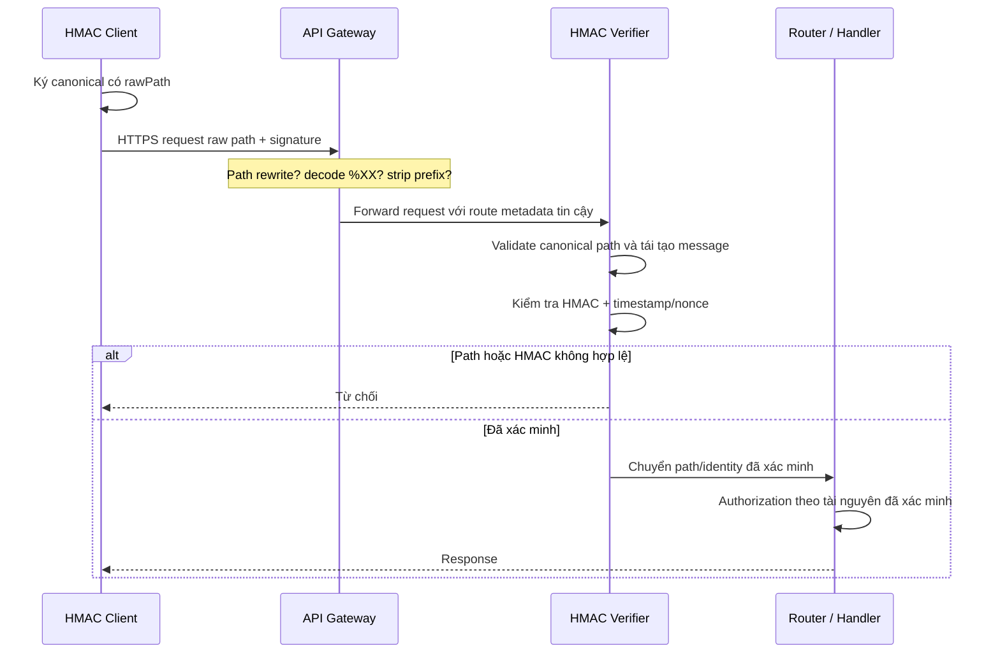

# Path normalization trong xác thực HTTP request bằng HMAC

## 1. Vấn đề: một tài nguyên có thể có nhiều cách viết path

**Path normalization (chuẩn hóa đường dẫn URL)** là tập hợp quy tắc biến đổi cách biểu diễn path thành một dạng được quy ước, ví dụ xử lý dấu chấm đại diện thư mục (`.`, `..`), dấu gạch chéo lặp, percent-encoding hoặc ký tự Unicode. Trong HTTP request authentication, sự khác biệt giữa **path mà client ký**, **path mà server dùng xác minh** và **path mà router thực sự xử lý** có thể làm sai HMAC hoặc tạo ra lỗ hổng bảo mật.

Đây là bài **Path normalization** thuộc chương **URL và path** của module `SECURITY_AUTHENTICATION_HMAC_REQUEST_AUTHENTICATION`. Mục tiêu module là thiết kế xác thực HTTP request bằng HMAC với **shared secret** và **canonical request** gồm method, URI, header hoặc body theo hợp đồng; kiểm tra chữ ký, chống replay với timestamp/nonce, quản lý key rotation, kiểm thử proxy/gateway và phân biệt authentication với authorization. Trong phạm vi đó, path không chỉ là một chuỗi dùng để định tuyến: nó là **một phần của dữ liệu cần bảo vệ bằng chữ ký**.

Hãy xét một API đọc tài liệu:

```http
GET /v1/accounts/A123/documents/2026 HTTP/1.1
Host: api.example.test
```

Một số biểu diễn dễ gây nhầm lẫn:

```text
/v1/accounts/A123/documents/2026
/v1/accounts/A123/./documents/2026
/v1/accounts/B999/../A123/documents/2026
/v1/accounts/A123//documents/2026
/v1/accounts/A123%2Fdocuments/2026
```

Các chuỗi trên **khác byte**. Một vài thành phần có thể diễn giải một số chuỗi thành cùng đường dẫn logic, trong khi thành phần khác coi chúng là những route khác nhau hoặc từ chối. Đặc biệt, `%2F` là biểu diễn percent-encoded của dấu `/` nhưng **không được tùy tiện** giải mã thành dấu phân tách path: điều này có thể thay đổi cấu trúc segment, quyền truy cập và cách router khớp route.

**Nguyên tắc cốt lõi:** HMAC xác thực những **byte canonical đã được ký**, không chứng minh rằng tất cả proxy, web server và framework đang hiểu chúng như nhau. Thiết kế phải đảm bảo **đường dẫn được xác minh chính là đường dẫn chi phối nghiệp vụ sau xác minh**.

## 2. Phân biệt URL, path, query và request target

Một URL có các thành phần:

```text
https://api.example.test:443/v1/accounts/A123/documents?limit=20#section
|scheme|       authority     |           path           | query  |fragment
```

Trong HTTP request thông thường đến origin server:

- **Scheme/authority** xác định origin hoặc service đích, ví dụ `https://api.example.test`; có thể lấy từ cấu hình đáng tin cậy hoặc metadata ingress đã xác thực.
- **Path** là phần đường dẫn, ví dụ `/v1/accounts/A123/documents`, chứa những segment ngăn bằng dấu `/`.
- **Query** là phần sau dấu `?`, ví dụ `limit=20`; query **không thuộc path**, dù một số API ký chung path + query thành *request target*.
- **Fragment** sau `#` là thành phần client-side, **không được gửi trong HTTP request target** và không đưa vào chữ ký request thực gửi.
- **Request target** trong dạng origin-form của HTTP/1.1 thường là path cùng query; trong HTTP/2, adapter có thể lấy từ pseudo-header `:path`. Dù dùng phiên bản HTTP nào, cần dựng **một biểu diễn canonical theo hợp đồng**, không ký bytes của framing từng hop.

Ví dụ:

```http
GET /v1/accounts/A123/documents?limit=20 HTTP/1.1
Host: api.example.test
```

Ở đây:

```text
rawPath  = /v1/accounts/A123/documents
rawQuery = limit=20
rawTarget = /v1/accounts/A123/documents?limit=20
```

Nếu hợp đồng ký hai dòng riêng cho `rawPath` và `rawQuery`, hai phía phải giữ **đúng ranh giới** đó. Nếu hợp đồng ký một dòng `rawTarget`, phải quy định cách xử lý query rỗng, ký tự `?` trong query và thứ tự tham số. Không được để một phía ký path không kèm query trong khi phía kia ký path + query.

## 3. Các phép biến đổi path và mức độ rủi ro

| Biến đổi | Ví dụ | Vì sao cần quy định chặt |
| --- | --- | --- |
| **Dot segments** | `/a/./b`, `/a/x/../b` | Bộ định tuyến hoặc proxy có thể loại `.` và `..`; nếu verify trước/sau khác nhau, path được ký không còn là path được xử lý. |
| **Repeated slash** | `/a//b` vs `/a/b` | Một thành phần gộp slash, một thành phần giữ nguyên; có thể khớp route khác nhau. |
| **Trailing slash** | `/users` vs `/users/` | Có hệ thống coi như nhau, có hệ thống coi khác hoặc redirect. |
| **Percent-encoding** | `/a/%62` vs `/a/b` | Percent-encoding tạo biểu diễn byte khác; decode không nhất quán gây mismatch hoặc bypass kiểm tra. |
| **Encoded separators** | `%2F`, `%5C` | Encoded slash/backslash có thể trở thành dấu phân tách trong một lớp khác. |
| **Double encoding** | `%252F` → `%2F` → `/` | Nếu nhiều lớp giải mã, path có thể đổi cấu trúc sau lần verify. |
| **Percent-encoded dots** | `%2e`, `%2e%2e` | Một bước decode có thể tạo `.`/`..` mà bước kiểm tra ban đầu chưa thấy. |
| **Unicode normalization** | Unicode NFC và NFD trông giống nhau | Byte UTF-8 và cách encode URL có thể khác; cần chính sách nhất quán. |
| **Case sensitivity** | `/Users` vs `/users` | Path của URL thường được xem là phân biệt hoa/thường theo ứng dụng; không tự lowercase nếu router không làm vậy. |
| **Path parameters** | `/users;active=true/42` | Một số framework xử lý dấu `;`/matrix parameter khác; filter có thể xem là path gốc nhưng router lại loại parameter. |
| **Proxy path rewrite** | `/public/v1/a` → `/v1/a` | Gateway và backend quan sát hai đường dẫn khác nhau; cần xác định điểm verify cùng route tin cậy. |

**Không có một phép `normalize()` duy nhất phù hợp với mọi API.** Quy tắc URI của RFC 3986, cấu hình web server, bộ giải mã percent và framework router có phạm vi khác nhau. Một path có thể “hợp lệ” theo cú pháp URI nhưng **không hợp lệ theo hợp đồng ký** của API.

### Ví dụ bypass nếu kiểm tra và xử lý không cùng một path

Một anti-pattern:

```text
1. Security filter kiểm tra chuỗi raw path không bắt đầu bằng /admin.
2. Filter xác minh HMAC trên raw path.
3. Router phía sau giải mã %2F hoặc loại dot segments.
4. Router thực thi trên một path khác với path đã kiểm tra quyền.
```

Khi đó HMAC có thể hoàn toàn chính xác đối với raw path, nhưng hệ thống vẫn có thể xử lý **tài nguyên ngoài phạm vi được kiểm tra**. Điều kiện an toàn phải đồng thời thỏa mãn:

```text
signed-path identity == verified-route identity == authorized-resource identity
```

Dấu `==` ở đây biểu thị **sự ràng buộc về ngữ nghĩa và chính sách**, không nhất thiết là phép so sánh chuỗi nguyên văn trong mọi hệ thống. Với hợp đồng ký raw path nghiêm ngặt, cách đơn giản nhất là đảm bảo router **không diễn giải lại** raw path thành một tài nguyên khác.

## 4. Hai chiến lược thiết kế: chuẩn hóa xác định hoặc từ chối biểu diễn mơ hồ

### Chiến lược A: chấp nhận một dạng canonical duy nhất

Đây là lựa chọn dễ triển khai và dễ kiểm thử cho nhiều API nội bộ có path dùng ASCII:

1. Định nghĩa **ngữ pháp path cho từng endpoint**; ví dụ path chỉ gồm dấu `/` và các ký tự unreserved ASCII `A–Z a–z 0–9 - . _ ~`.
2. **Từ chối** dot segments `.`/`..`, slash lặp, trailing slash không được hỗ trợ, backslash, `;`, `%`, khoảng trắng, control characters và path không khớp route.
3. Không “sửa hộ” request bằng cách decode, gộp slash hoặc bỏ `..`; request không canonical bị **từ chối trước khi dùng cho authorization**.
4. Canonical HMAC ký **chính raw path được chấp nhận**; request router/handler xử lý cũng phải tuân theo ngữ pháp tương ứng.

Ưu điểm: giảm nhập nhằng, dễ dùng golden fixtures. Nhược điểm: không phù hợp nếu API cần hỗ trợ path chứa dấu cách, ký tự Unicode, encoded slash hoặc resource identifier phức tạp. Khi đó có thể chọn chiến lược B.

### Chiến lược B: định nghĩa phép chuẩn hóa có version, hoàn toàn xác định

Nếu API bắt buộc hỗ trợ path đa ngôn ngữ hoặc percent-encoding:

1. Quy định **chính xác** phiên bản chuẩn hóa, ví dụ dạng percent-encoding cho từng ký tự, case của hex trong `%XX`, Unicode normalization, dot segments và slash.
2. Cố định **thứ tự xử lý**: kiểm tra byte/cú pháp, decode có giới hạn, canonicalize theo một hàm đã được chuẩn hóa, rồi tạo bytes ký. Không để lớp thứ hai decode thêm sau verify.
3. Tách rõ **encoded slash** là dữ liệu của một segment hay dấu ngăn segment; nếu không thể bảo đảm nhất quán, từ chối `%2F` và `%5C`.
4. Router và authorization phải dùng **cùng danh tính tài nguyên** mà verifier đã tính được; nếu qua gateway, cần metadata route đáng tin cậy hoặc xác minh tại đúng ranh giới.
5. Đặt phiên bản chuẩn hóa vào **signature version**, bởi đổi canonicalization sẽ làm thay đổi bytes HMAC. Không đổi âm thầm sau khi phát hành SDK.

**Không đơn giản dùng `URLDecoder.decode(path)` để “chuẩn hóa path”.** `URLDecoder` phục vụ cú pháp `application/x-www-form-urlencoded` (chẳng hạn `+` được diễn giải thành space) và không phải hàm canonicalize HTTP path chung. Decode nhiều lần càng nguy hiểm.

## 5. Hợp đồng ký minh họa: ký path nguyên dạng nhưng chỉ chấp nhận path canonical

Để tập trung vào Path normalization, ta định nghĩa một API đọc giao dịch:

```http
GET /v1/accounts/A123/transactions?limit=20 HTTP/1.1
Host: api.example.test
Accept: application/json
X-Key-Id: client-a-2026-11
X-Signature-Version: hmac-path-v1
X-Timestamp: 2026-11-28T02:05:00Z
X-Nonce: zX6rA3wyTFv2P9uLk0nD7g
X-Signature: <64 lowercase hex characters>
```

Hợp đồng `hmac-path-v1` là **ví dụ tự định nghĩa**, không phải chuẩn chung của HTTP. Quy tắc cụ thể:

- **Method:** chính xác `GET`.
- **Origin/audience:** `https://api.example.test`, lấy từ cấu hình và routing tin cậy; không lấy mù quáng từ `Host` hoặc `X-Forwarded-Host` do caller gửi.
- **Path:** raw path bắt đầu bằng `/`, segment chỉ gồm unreserved ASCII; không được có `.`, `..`, `//`, slash cuối, percent-encoding, backslash, control characters, path parameter hoặc chuỗi trống ngoài root path. Route minh họa yêu cầu `/v1/accounts/{accountId}/transactions`, với `accountId` khớp `[A-Za-z0-9_-]{1,64}`.
- **Query:** ví dụ chỉ cho phép chính xác chuỗi raw query `limit=20`; hệ thống thực có thể thiết kế ngữ pháp query phức tạp riêng, có quy tắc về thứ tự/trùng/percent-encoding. Query không bị gộp vào path.
- **Body:** GET không có body; ký `SHA-256` trên dãy byte rỗng.
- **Signed headers:** `Accept` chỉ nhận `application/json`; key ID, signature version, timestamp, nonce đều là các header đơn trị đã được kiểm tra cú pháp. `X-Signature` là MAC đầu ra, không nằm trong message được ký.
- **Canonical bytes:** các dòng nối bằng `LF` (`0A`), UTF-8, **không có LF cuối**; mọi field không được chứa CR/LF. MAC = `HMAC-SHA256(secret, canonicalBytes)`, biểu diễn **64 ký tự hex thường**.

Canonical message được ký:

```text
HMAC-PATH-V1
GET
https://api.example.test
/v1/accounts/A123/transactions
limit=20
accept:application/json
x-key-id:client-a-2026-11
x-signature-version:hmac-path-v1
x-timestamp:2026-11-28T02:05:00Z
x-nonce:zX6rA3wyTFv2P9uLk0nD7g
e3b0c44298fc1c149afbf4c8996fb92427ae41e4649b934ca495991b7852b855
```

Lợi ích của việc tách hai dòng `rawPath`/`rawQuery`: hợp đồng phân biệt rõ phần định danh tài nguyên với phần tham số truy vấn. Khi query rỗng, vẫn phải ghi **dòng trống ở đúng vị trí** nếu schema cho phép query rỗng; không được bỏ một dòng khiến thứ tự các field lệch. Trong ví dụ này query bắt buộc là `limit=20`, nên trường hợp đó bị từ chối.

### Từ chối path không canonical thay vì tự sửa

| Raw path đến server | Kết quả theo hợp đồng minh họa | Lý do |
| --- | --- | --- |
| `/v1/accounts/A123/transactions` | Có thể chấp nhận nếu credential, HMAC, replay và quyền hợp lệ. | Dạng canonical duy nhất được hỗ trợ. |
| `/v1/accounts/A123/./transactions` | **Từ chối**. | Dot segment `.`. |
| `/v1/accounts/B999/../A123/transactions` | **Từ chối**. | Dot segment `..`, có nguy cơ traversal. |
| `/v1//accounts/A123/transactions` | **Từ chối**. | Repeated slash tạo segment rỗng. |
| `/v1/accounts/A123/transactions/` | **Từ chối**. | Trailing slash không khớp route đã công bố. |
| `/v1/accounts/A%3123/transactions` | **Từ chối**. | Percent-encoding không được phép trong profile. |
| `/v1/accounts/A123%2Ftransactions` | **Từ chối**. | Encoded slash có thể đổi cấu trúc segment. |
| `/v1/accounts/%252e%252e/transactions` | **Từ chối**. | Có percent-encoding/double encoding. |
| `/v1/accounts/A123;role=admin/transactions` | **Từ chối**. | Dấu `;`/matrix parameter không được profile hỗ trợ. |
| `/v1/Accounts/A123/transactions` | **Từ chối** nếu route chỉ hỗ trợ chữ thường ở `accounts`. | Không lowercase path một cách tùy tiện. |

Một path bị từ chối **không được tự sửa rồi sử dụng lại chữ ký cũ**. Nếu client muốn gọi một path canonical khác, nó phải tạo request mới và ký lại đúng path đó.

## 6. Java 17+: kiểm tra path canonical trước khi xác minh HMAC

Đoạn code dưới đây **cố ý chọn chiến lược A**: chấp nhận chỉ unreserved ASCII trong path, cấm các dạng nhập nhằng và yêu cầu route rõ ràng. Nó tập trung minh họa nguyên tắc “ký đúng path mà router dùng”, không phải framework HTTP hoàn chỉnh. HTTP adapter bên ngoài phải cung cấp **raw path và raw query trước khi bị decode/rewrite**, phát hiện header trùng/CR-LF, giới hạn kích thước request, cấm body GET và đảm bảo router sau verify không đổi ngữ nghĩa path.

```java
import java.nio.charset.StandardCharsets;
import java.security.GeneralSecurityException;
import java.security.MessageDigest;
import java.time.Clock;
import java.time.Duration;
import java.time.Instant;
import java.time.format.DateTimeParseException;
import java.util.HexFormat;
import java.util.Set;
import javax.crypto.Mac;
import javax.crypto.spec.SecretKeySpec;

public final class StrictHmacPathVerifier {
    private static final String ORIGIN = "https://api.example.test";
    private static final String VERSION = "hmac-path-v1";
    private static final String QUERY = "limit=20";
    private static final String PREFIX = "HMAC-PATH-V1";
    private static final HexFormat HEX = HexFormat.of();
    private static final Duration ALLOWED_SKEW = Duration.ofMinutes(5);
    private static final Duration NONCE_TTL = Duration.ofMinutes(11);

    // Adapter cung cấp raw path/query, chưa decode rồi normalize.
    public record Request(
            String method, String rawPath, String rawQuery,
            String trustedOrigin, String accept, String keyId,
            String signatureVersion, String timestamp, String nonce,
            byte[] body, String signatureHex) {}

    public record Credential(
            byte[] secret, boolean active, String origin,
            Set<String> permittedVersions) {}

    public interface CredentialStore {
        Credential find(String keyId);
    }

    public interface NonceStore {
        // Kho chia sẻ giữa các instance; atomic insert-if-absent và TTL.
        boolean claim(String keyId, String nonce, Duration ttl);
    }

    // Không silently remove dot-segments, không percent-decode.
    public static boolean isCanonicalPath(String rawPath) {
        if (rawPath == null || !rawPath.startsWith("/")) return false;
        if ("/".equals(rawPath)) return true; // Root nếu route khác cho phép.
        if (rawPath.endsWith("/")) return false;
        String[] segments = rawPath.substring(1).split("/", -1);
        for (String segment : segments) {
            if (segment.isEmpty()
                    || ".".equals(segment) || "..".equals(segment)) {
                return false;
            }
            for (int i = 0; i < segment.length(); i++) {
                char c = segment.charAt(i);
                boolean unreserved = (c >= 'A' && c <= 'Z')
                        || (c >= 'a' && c <= 'z')
                        || (c >= '0' && c <= '9')
                        || c == '-' || c == '.' || c == '_'
                        || c == '~';
                if (!unreserved) return false;
            }
        }
        return true;
    }

    public static byte[] canonicalBytes(Request r)
            throws GeneralSecurityException {
        String digest = HEX.formatHex(
                MessageDigest.getInstance("SHA-256").digest(r.body()));
        String canonical = String.join("\n",
                PREFIX,
                r.method(),
                ORIGIN,
                r.rawPath(),
                r.rawQuery(),
                "accept:" + r.accept(),
                "x-key-id:" + r.keyId(),
                "x-signature-version:" + r.signatureVersion(),
                "x-timestamp:" + r.timestamp(),
                "x-nonce:" + r.nonce(),
                digest);
        return canonical.getBytes(StandardCharsets.UTF_8);
    }

    private static byte[] hmacSha256(byte[] key, byte[] message)
            throws GeneralSecurityException {
        Mac mac = Mac.getInstance("HmacSHA256");
        mac.init(new SecretKeySpec(key, "HmacSHA256"));
        return mac.doFinal(message);
    }

    public static boolean verify(
            Request r, CredentialStore credentials,
            NonceStore nonces, Clock clock)
            throws GeneralSecurityException {
        if (r == null || r.method() == null || r.rawPath() == null
                || r.rawQuery() == null || r.trustedOrigin() == null
                || r.accept() == null || r.keyId() == null
                || r.signatureVersion() == null || r.timestamp() == null
                || r.nonce() == null || r.body() == null
                || r.signatureHex() == null) return false;

        // Từ chối path mơ hồ trước khi tính canonical/HMAC.
        if (!isCanonicalPath(r.rawPath())
                || !r.rawPath().matches(
                    "/v1/accounts/[A-Za-z0-9_-]{1,64}/transactions")
                || !QUERY.equals(r.rawQuery())
                || !"GET".equals(r.method())
                || !ORIGIN.equals(r.trustedOrigin())
                || !"application/json".equals(r.accept())
                || !VERSION.equals(r.signatureVersion())
                || !r.keyId().matches("[A-Za-z0-9._-]{1,128}")
                || !r.nonce().matches("[A-Za-z0-9_-]{16,128}")
                || r.body().length != 0
                || !r.signatureHex().matches("[0-9a-f]{64}")) {
            return false;
        }

        Instant timestamp;
        try {
            timestamp = Instant.parse(r.timestamp());
        } catch (DateTimeParseException ex) {
            return false;
        }
        if (timestamp.getNano() != 0
                || !timestamp.toString().equals(r.timestamp())
                || Duration.between(clock.instant(), timestamp)
                    .abs().compareTo(ALLOWED_SKEW) > 0) {
            return false;
        }

        Credential credential = credentials.find(r.keyId());
        if (credential == null || !credential.active()
                || credential.secret() == null
                || credential.secret().length == 0
                || !ORIGIN.equals(credential.origin())
                || credential.permittedVersions() == null
                || !credential.permittedVersions().contains(VERSION)) {
            return false;
        }

        byte[] expected = hmacSha256(
                credential.secret(), canonicalBytes(r));
        byte[] supplied = HEX.parseHex(r.signatureHex());
        if (!MessageDigest.isEqual(expected, supplied)) return false;

        // Chỉ claim nonce khi MAC đúng; tiếp theo vẫn phải authorization.
        return nonces.claim(r.keyId(), r.nonce(), NONCE_TTL);
    }
}
```

Trong ví dụ này, **`isCanonicalPath` không chuyển đổi path** mà chỉ nhận hoặc từ chối. Một path như `/v1/accounts/A123/./transactions` không thể “vô tình” trở thành path đã ký hợp lệ sau `normalize()`. Tuy nhiên verifier vẫn phải kiểm tra **route** và **quyền đọc tài khoản**: một request đến `/v1/accounts/B999/transactions` có chữ ký HMAC hợp lệ bằng credential nào đó không tự chứng minh caller có quyền xem `B999`.

### Kiểm tra API `java.net.URI` nhưng không dùng nhầm vào bước bảo mật

Khi làm client Java:

```java
import java.net.URI;

URI uri = URI.create(
        "https://api.example.test/v1/accounts/A123/transactions?limit=20");
String rawPath = uri.getRawPath();   // Path encoded/raw của URI object
String path = uri.getPath();         // Path đã decode percent-encoding
String rawQuery = uri.getRawQuery(); // Query nguyên dạng trong URI object
```

`getRawPath()` và `getPath()` **không thay thế cho nhau** trong hợp đồng ký. Khi URI chứa `%2F`, giá trị decoded path có thể chứa dấu `/` mới, làm biến đổi segment mà caller tưởng đã ký. `URI.normalize()` có hỗ trợ xử lý cú pháp dot segments nhưng **không phải phép chuẩn hóa bảo mật hoàn chỉnh** cho API HMAC: nó không thống nhất cách proxy/framework decode percent-encoding, xử lý encoded slash hoặc route ra sao.

Trong server Java, không giả định phương thức `getRequestURI()`, `getPathInfo()` hoặc biến thể API của framework luôn trả về cùng **raw target**. Một số server/proxy đã decode hoặc loại dot segments trước khi ứng dụng đọc được. Hãy kiểm thử framework đang dùng, định nghĩa ranh giới ingress và từ chối những dạng raw path không thể bảo toàn qua toàn đường đi.

## 7. Proxy/gateway: chuẩn hóa ở điểm nào?

Một hệ thống triển khai phổ biến:



Có hai cách bố trí thường gặp:

**Cách 1 — Gateway xác minh HMAC trước khi rewrite.** Gateway có raw path do client gửi; nó xác minh theo hợp đồng, kiểm tra key scope/audience và chống replay. Sau đó gateway chuyển tiếp request đã được xác thực tới backend qua TLS/mTLS hoặc kênh tin cậy tương đương. Backend chỉ tin metadata caller identity từ **gateway đã xác thực**, phải chặn bypass đường mạng và phải đảm bảo route sau rewrite vẫn khớp tài nguyên được cấp quyền.

**Cách 2 — Backend xác minh HMAC sau gateway.** Gateway phải chuyển được dữ liệu canonical tương đương và **nguồn gốc raw path đáng tin cậy** mà hợp đồng yêu cầu. Nếu gateway rewrite trước khi backend kiểm tra, có thể cần một contract ký **logical target** được hai phía hiểu thống nhất; không được tin `X-Original-URI` do client tự đặt. Gateway phải strip header đầu vào có thể giả mạo, gắn metadata mới được bảo vệ qua kênh upstream và backend chỉ chấp nhận nó từ gateway hợp lệ.

**Không có cách “tự nhiên đúng” cho mọi gateway.** Phải quyết định rõ **request nào được ký**, **tại ranh giới nào được xác minh**, **request nào được router thực thi** và **cách ràng buộc ba thực thể đó**.

### Các trường hợp đặc biệt

- **Strip prefix:** client ký `/public/v1/accounts/A123`, backend nhìn thấy `/v1/accounts/A123`; nếu verifier chỉ dùng backend path sau rewrite, MAC sai. Nếu bỏ luôn prefix khỏi phần ký, có thể lại mất ràng buộc route public; cần contract chủ động.
- **Double decoding:** gateway decode `%252F` thành `%2F`; framework backend decode lần nữa thành `/`. Một filter kiểm tra ở giữa có thể không phát hiện encoded separator cuối cùng.
- **Dot-segment removal:** gateway loại `..` trước khi verifier ghi log/kiểm tra. Truy vết raw request nên ở ingress, nhưng đừng log full path/query chứa dữ liệu nhạy cảm nếu không cần.
- **HTTP/2 → HTTP/1.1:** adapter phải giữ nhất quán giá trị target canonical, không ký tùy tiện bytes framing hoặc pseudo-header mà downstream không còn giữ nguyên.
- **Redirect:** redirect từ `/v1/a` sang `/v1/a/` là một **request target mới**; client muốn gửi lại phải xác minh destination và **ký lại**, không tái sử dụng chữ ký cũ.

## 8. Path normalization, replay và authorization

Path normalization là một phần của bảo vệ tính toàn vẹn, **không thay thế** những kiểm soát khác:

1. **HMAC:** ràng buộc canonical path/URI, method và những trường được ký với secret của credential.
2. **Timestamp + nonce:** cả hai phải có trong canonical request, được server kiểm tra cửa sổ thời gian và claim nonce theo thao tác nguyên tử dùng chung giữa các instance. Nếu replay nguyên request, HMAC vẫn khớp nhưng nonce đã sử dụng phải bị từ chối.
3. **Key scope và rotation:** `X-Key-Id` tra credential còn hiệu lực, ràng buộc với tenant/service/audience và signature version. Rotating key không tự sửa được path canonicalization bất nhất; muốn đổi contract cần version mới.
4. **Authorization:** sau khi có caller identity và **route tài nguyên đã xác minh**, kiểm tra quyền của caller với account ID, file ID hoặc tài nguyên tương ứng.
5. **Transport identity:** client phải xác minh server TLS certificate/hostname; HMAC request không thay thế HTTPS hay tự mã hóa dữ liệu.

Một chữ ký có thể hợp lệ trên `/v1/accounts/B999/transactions` nếu caller biết shared secret của chính họ. Server vẫn phải từ chối nếu caller **không có quyền** xem `B999`. Ngược lại, path không canonical nên bị từ chối dù credential có quyền đọc tài nguyên sau khi một lớp nào đó tự chuẩn hóa.

## 9. Ma trận kiểm thử path normalization

Nên có **golden fixtures** chứa method, origin, raw path, raw query, signed headers, body bytes/digest, canonical UTF-8 bytes, MAC kỳ vọng và route mà backend thực thi. Chạy cùng fixture qua client SDK, gateway và server.

| Test | Kết quả mong đợi theo hợp đồng minh họa |
| --- | --- |
| `/v1/accounts/A123/transactions`, query `limit=20`, HMAC đúng. | Path được chấp nhận; kiểm tra nonce và authorization tiếp tục. |
| Thêm `/./` hoặc `/../` vào path. | Từ chối path không canonical, không tự normalize rồi dùng MAC cũ. |
| Thêm slash đôi `//` hoặc slash cuối. | Từ chối theo ngữ pháp path. |
| Thay chữ hoa/thường của đoạn route: `/Accounts/`. | Không khớp route; không lowercase âm thầm. |
| Chèn `%2F`, `%5C`, `%2e`, `%252F`. | Từ chối vì profile không cho percent-encoding. |
| Thêm `;`/matrix parameter vào segment. | Từ chối; không cho framework loại parameter rồi route sang path khác. |
| Chèn backslash, space, ký tự điều khiển hoặc Unicode trực tiếp. | Từ chối bởi strict ASCII path policy. |
| Thay `A123` thành `B999` nhưng giữ chữ ký cũ. | Chữ ký không khớp; nếu ký mới hợp lệ vẫn cần authorization cho B999. |
| Giữ path, đổi `limit=20` thành `limit=200`. | Query contract từ chối; không bỏ query khỏi chữ ký. |
| Ký `getPath()` đã decode nhưng server ký `getRawPath()`. | Phát hiện mismatch; client/server cùng tuân một canonical profile. |
| Gateway strip prefix hoặc rewrite encoded path. | Tìm được khác biệt ở từng hop; hợp đồng xác định verify trước/sau rewrite. |
| Gateway cho client tự gửi `X-Original-URI`. | Strip/ignore header chưa đáng tin; backend không dùng nó làm raw path tin cậy. |
| HTTP/1.1 và HTTP/2 trên cùng request logic. | Canonical target giống nhau nếu adapter đáp ứng contract. |
| MAC đúng nhưng timestamp hết hạn hoặc nonce đã dùng. | Replay layer từ chối. |
| Key đã revoke, version không được phép, route hoặc audience sai. | Từ chối theo key policy; không fallback. |
| MAC đúng, path hợp lệ nhưng caller thiếu quyền đọc account. | Authorization từ chối. |

### Bài tập thực hành

1. Tạo request `GET /v1/accounts/A123/transactions?limit=20`, tính canonical UTF-8 bytes và HMAC-SHA256 theo profile ở mục 5; in MAC ở dạng lowercase hex.
2. Giữ MAC ban đầu, lần lượt thay path bằng các biến thể `/./`, `//`, `%2F`, `%252F`; ghi rõ lỗi xuất hiện ở **path validation**, **route check** hay **HMAC**.
3. Dùng `URI.getRawPath()` và `URI.getPath()` với một URI có `%2F`; quan sát hai string khác nhau và giải thích tại sao chọn nhầm API có thể phá hợp đồng.
4. Đặt gateway rewrite `/public/v1` thành `/v1`; quan sát raw path ở từng hop và chọn một điểm verify bảo đảm route không bị đổi nghĩa.
5. Đổi account ID `A123` thành `B999` và ký lại bằng key hợp lệ của chính client; xác minh rằng bước **authorization** vẫn phải kiểm tra quyền đọc `B999`.
6. Phát lại nguyên request hai lần trong cửa sổ timestamp; phân biệt kết quả HMAC với kết quả nonce store.

## 10. Checklist triển khai

- [ ] Có **signature version** công bố rõ raw/canonical path format, encoding, delimiter và ranh giới giữa path/query.
- [ ] Path bị mơ hồ phải bị từ chối, hoặc được chuẩn hóa theo **một thuật toán versioned xác định** trước khi ký/xử lý.
- [ ] Xử lý dot segments, encoded slash/backslash, double encoding, slash đôi, trailing slash, matrix parameter, Unicode và case theo chính sách cụ thể.
- [ ] Không dùng `URLDecoder`/decode lặp để “sửa path”; không mặc định `URI.normalize()` giải quyết được vấn đề bảo mật.
- [ ] Method, origin/audience, path, query, signed headers và body/digest đều được ký hoặc được ràng buộc tương đương theo hợp đồng.
- [ ] HTTP adapter cung cấp **raw path thực nhận** hoặc logical target đã chuẩn hóa một cách tin cậy; router xử lý **đúng tài nguyên đã xác minh**.
- [ ] Gateway/proxy strip forwarding header giả mạo và có chính sách rewrite rõ; kiểm thử toàn bộ đường đi từ client đến backend.
- [ ] Server tra key ID từ kho tin cậy, kiểm tra key scope/version/rotation và so sánh HMAC đúng format bằng hàm phù hợp.
- [ ] Timestamp/nonce được ký và được kiểm tra replay bằng nonce store nguyên tử trên các instance.
- [ ] Authorization theo account/resource sau xác thực; HTTPS/TLS xác minh server và bảo vệ đường truyền.
- [ ] Có golden fixtures và negative tests cho các path encoding, proxy rewrite, route ambiguity và quyền truy cập.

**Điểm cần nhớ:** *Path normalization* trong HMAC HTTP request không chỉ nhằm tạo ra một URL đẹp. Yêu cầu quan trọng nhất là **client ký, verifier xác minh và router/authorization xử lý cùng một danh tính tài nguyên**. Một profile nghiêm ngặt có thể từ chối path mơ hồ thay vì tự sửa; một profile linh hoạt hơn phải công bố thuật toán chuẩn hóa có version, áp dụng nhất quán trên mọi hop và bảo đảm không có phép giải mã hoặc rewrite thêm làm thay đổi mục tiêu sau khi kiểm tra chữ ký.
