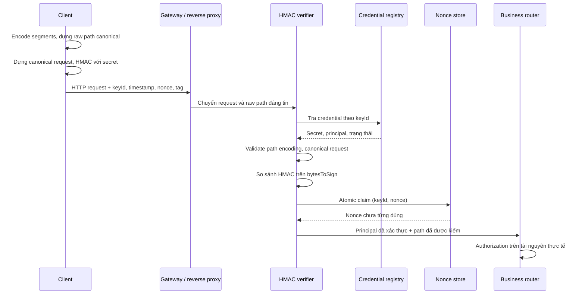

# Path encoding trong URL: chuẩn hóa đúng byte trước khi ký HMAC

> **Chương:** URL và path  
> **Bài học:** Path encoding  
> **Bối cảnh:** Thiết kế xác thực HTTP request bằng **HMAC** với shared secret, canonical request có method, URI, các header hoặc body theo hợp đồng ký. Nội dung này giải thích cách path được percent-encode theo URI, vì sao sai lệch giải mã/chuẩn hóa có thể làm chữ ký sai hoặc tạo lỗ hổng, và cách kiểm soát khi client đi qua proxy/gateway.

## 1. Path encoding là gì?

**Path** là phần của URI xác định đường dẫn phân cấp tới tài nguyên. Trong URI, ký tự **`/`** thường đóng vai trò dấu phân tách giữa các **path segment**. **Path encoding** là cách chuyển những byte không được biểu diễn trực tiếp trong URI thành dạng **percent-encoding** `%HH`, với `HH` là hai chữ số hệ thập lục phân biểu thị **một byte**.

Ví dụ một URL:

```text
https://api.example.test/v1/files/h%E1%BB%93%20s%C6%A1?download=1
                         |----------------------------| |--------|
                                   path                   query
```

Path ở đây là:

```text
/v1/files/h%E1%BB%93%20s%C6%A1
```

Về ý nghĩa cho người dùng, segment cuối có thể là `hồ sơ`. Nhưng HMAC không ký “ý nghĩa trông giống nhau” mà ký **một chuỗi byte cụ thể theo hợp đồng**. Nếu client ký path chứa `%E1%BB%93` nhưng server dựng path theo một biểu diễn khác, tag sẽ không khớp trừ khi cả hai đã thỏa thuận quy tắc canonicalization an toàn.

Các điểm cần nhớ ngay:

- `%HH` biểu thị **một byte**, không nhất thiết một ký tự Unicode.
- Dấu `/` không phải byte tùy ý: nó có ý nghĩa **ranh giới segment**.
- **`%2F` là dấu slash được mã hóa**, có thể mang ý nghĩa khác slash phân tách; việc tự decode có thể làm đổi route.
- Tên method, path, query, header và body digest được ký theo **hợp đồng HMAC**; path encoding chỉ giải quyết một thành phần.
- **Path encoding không phải mã hóa bảo mật.** Percent-encoding không che giấu thông tin; cần HTTPS/TLS để bảo vệ dữ liệu khi truyền.

## 2. Phân tách URL, request target, path và query

Xét:

```text
https://api.example.test:443/v1/orders/ORD-42/items?view=full#details
|___| |___________________| |____________________| |_______| |_____|
scheme      authority               path          query    fragment
```

| Thành phần | Ví dụ | Vai trò trong HTTP HMAC request auth |
| --- | --- | --- |
| **Scheme** | `https` | Ảnh hưởng cách truy cập; TLS là bắt buộc theo chính sách API. |
| **Authority** | `api.example.test:443` | Có thể quyết định virtual host/tenant/service; ký hoặc cố định tin cậy nếu ảnh hưởng định tuyến. |
| **Path** | `/v1/orders/ORD-42/items` | Thường **phải ký**, vì chọn endpoint và tài nguyên. |
| **Query** | `view=full` | Phải được xét **riêng** theo hợp đồng query encoding/canonicalization. |
| **Fragment** | `details` | Không được gửi tới HTTP server trong request target thông thường; không dựa vào fragment để bảo vệ thao tác server. |

Trong HTTP/1.1, origin-form request target thường có dạng:

```http
GET /v1/orders/ORD-42/items?view=full HTTP/1.1
Host: api.example.test
```

Trong HTTP/2, ý nghĩa tương ứng có thể được biểu diễn bằng pseudo-header `:method`, `:scheme`, `:authority` và `:path`. Hợp đồng ký phải xác định **thành phần logic nào được dùng**, thay vì dựa vào việc request được biểu diễn dưới HTTP/1.1 hay HTTP/2.

**Không được gộp path và query tùy ý.** Với `/a%3Fb?x=1`, `%3F` nằm **trong path** (ký tự `?` đã được percent-encode), còn dấu `?` không encode phía sau mới tách query. Nếu decode cả request target trước khi tách thành phần, bạn có thể biến `%3F` thành dấu phân cách mới và tạo kết quả sai.

## 3. Quy tắc percent-encoding theo RFC 3986

### 3.1. Unreserved và reserved

Các ký tự **unreserved** của URI là:

```text
ALPHA / DIGIT / "-" / "." / "_" / "~"
```

Nhiều hợp đồng canonical path giữ chúng ở dạng ký tự ASCII trực tiếp. Những ký tự còn lại có thể cần percent-encode tùy vị trí và hợp đồng.

**Reserved characters** gồm:

```text
gen-delims: ":" / "/" / "?" / "#" / "[" / "]" / "@"
sub-delims: "!" / "$" / "&" / "'" / "(" / ")" / "*" / "+" / "," / ";" / "="
```

**Cảnh báo:** RFC 3986 **không** nói mọi reserved character bắt buộc phải percent-encode ở mọi vị trí. Trong path segment, một số ký tự như `:`, `@` và sub-delims có thể xuất hiện hợp lệ. Vì ý nghĩa của chúng phụ thuộc ứng dụng/router, một signing contract được quyền chọn **tập con nghiêm ngặt hơn**: chẳng hạn chỉ cho unreserved trực tiếp và yêu cầu percent-encode những byte được cho phép khác.

| Byte/ký tự | Cách biểu diễn thường gặp trong path | Lưu ý |
| --- | --- | --- |
| `A`, `9`, `-`, `_`, `.`, `~` | Giữ trực tiếp | Nằm trong unreserved. |
| Khoảng trắng (byte 0x20) | `%20` | **Không mặc định dùng `+` trong path**. |
| Dấu cộng `+` | `%2B` nếu hợp đồng dùng subset nghiêm ngặt | Trong path, `+` không mặc nhiên là khoảng trắng như cách mã hóa form query. |
| Dấu `%` | `%25` | Dễ gặp lỗi double-decode; cần chính sách rõ. |
| Dấu slash `/` | Giữ làm **dấu phân tách segment** | `%2F` bên trong segment là vấn đề định tuyến nhạy cảm. |
| Dấu hỏi `?` ở **trong segment** | `%3F` | `?` chưa encode sẽ mở đầu query. |
| Dấu thăng `#` ở **trong segment** | `%23` | `#` chưa encode là delimiter fragment của URI. |
| Ký tự Unicode `ồ` | Các byte UTF-8 được encode từng byte: `%E1%BB%93` | Một ký tự có thể thành **nhiều triplet**. |

### 3.2. Percent-encoding là **byte-level**, UTF-8 là **character encoding**

Với chuỗi `hồ sơ`:

1. Unicode text được mã hóa sang **UTF-8 bytes**.
2. Các byte ASCII unreserved có thể giữ nguyên.
3. Byte còn lại được viết `%HH`, theo quy tắc định dạng hex của contract.

Ví dụ:

```text
"hồ sơ" (Unicode)
UTF-8 bytes:
  h = 68
  ồ = E1 BB 93
  <space> = 20
  s = 73
  ơ = C6 A1

Path segment:
  h%E1%BB%93%20s%C6%A1
```

Không được lấy mã điểm Unicode `U+1ED3` của `ồ` rồi viết `%1ED3`: `%HH` luôn biểu diễn **một byte** và cần **đúng hai chữ số hex**.

**Quy tắc hiển thị hex:** `%2f` và `%2F` đều mã hóa byte `0x2F` theo URI. Nhiều canonical contract quy định dạng **chữ hoa** trong hex (`%2F`), nhưng đổi cách viết triplet chỉ là một loại chuẩn hóa; **không được đồng nghĩa hóa `%2F` với slash phân tách `/`** một cách vô điều kiện.

### 3.3. Vì sao `+` trong path khác `+` trong form/query?

Trong `application/x-www-form-urlencoded`, byte khoảng trắng có thể được biểu diễn thành dấu `+`. Quy ước này thuộc **form encoding**, không phải quy tắc chung cho mọi URI path.

```text
Path segment muốn biểu diễn "a b":
    a%20b

Path segment muốn biểu diễn "a+b":
    a%2Bb          (theo contract chỉ giữ unreserved trực tiếp)

Form body/query theo x-www-form-urlencoded:
    a+b            có thể được giải mã thành "a b"
```

Dùng `java.net.URLEncoder` để “encode path” là lỗi phổ biến: `URLEncoder` phục vụ **form encoding**, không phải bộ mã hóa path segment tổng quát. Nó thường biến dấu cách thành `+`, không thích hợp nếu hợp đồng path yêu cầu `%20`.

## 4. Path segment khác path nguyên vẹn

Dấu slash `/` phân tách segment:

```text
/v1/users/alice/orders/42
    |___| |___| |____| |__|
   segments after leading slash
```

Một route có thể có biến `{userId}`. Nếu giá trị `userId` là `alice/bob`, bạn **không thể đơn giản encode cả path** rồi tin `%2F` sẽ được mọi proxy/router hiểu là dấu slash **nằm trong** ID. Một số stack:

- Giữ `%2F` và routing trên raw path.
- Decode `%2F` thành `/` trước routing, làm **tăng số segment**.
- Từ chối encoded slash để tránh path confusion.
- Decode ở một tầng, rồi vô tình decode **lần nữa** ở tầng sau.

Đây là lý do nên có API design quy định **segment identifier không chứa slash** (hoặc mã hóa ID theo bảng chữ cái an toàn như Base64URL/slug riêng) nếu hệ thống không kiểm soát nhất quán mọi hop.

**Encode một segment ≠ encode toàn path.** Muốn tạo `/v1/users/{userId}`, hãy dựng các dấu `/` phân cấp rõ ràng và encode **riêng giá trị segment**. Không gọi một hàm form-urlencode lên chuỗi `/v1/users/alice` vì nó có thể biến slash separator thành `%2F`.

## 5. Những ca path encoding có thể phá HMAC hoặc tạo lỗ hổng

| Path đầu vào | Nguy cơ | Quyết định phải có trong contract |
| --- | --- | --- |
| `/a/b` và `/a%2Fb` | Encoded slash có thể biến segment thành route khác. | **Nên từ chối encoded slash** nếu chưa chứng minh toàn bộ stack thống nhất. |
| `/a%5Cb` | Encoded backslash có thể được một số tầng coi là dấu phân tách path. | Từ chối hoặc có chính sách chặt chẽ, thống nhất. |
| `/a/../admin` | Dot-segment traversal nếu router collapse. | Từ chối dot segments hoặc chuẩn hóa tại cùng trust boundary. |
| `/a/%2e%2e/admin` | Encoded dot segments có thể thành `..` sau decode. | Kiểm **sau khi decode theo contract**, không chỉ tìm chuỗi raw `../`. |
| `/a//b` | Repeated slash có thể bị proxy collapse hoặc router phân biệt. | Quy định rõ; API đơn giản có thể reject. |
| `/a/b/` và `/a/b` | Trailing slash có thể tạo route/redirect khác. | Chọn policy nhất quán; không tự coi là một nếu framework phân biệt. |
| `/%41` và `/A` | Percent-encoded unreserved thường có thể chuẩn hóa. | Chuẩn hóa **chỉ nếu** downstream cùng hiểu; hoặc reject noncanonical form. |
| `/%2f` và `/%2F` | Hex case khác nhưng byte giống nhau. | Quy định hex case; không decode slash thành path separator. |
| `/a%252Fb` | Double encoding: decode một lần → `a%2Fb`, hai lần → `a/b`. | Không double-decode; có thể reject encoding gây mơ hồ. |
| `/a%00b` | NUL byte có thể làm parser/thư viện bị cắt chuỗi hoặc reject. | Reject NUL/control bytes. |
| `/%C0%AF` | UTF-8 overlong/malformed có thể bị parser xử lý khác nhau. | Decode UTF-8 **strict**, reject malformed sequences. |
| `/cafe%CC%81` và `/caf%C3%A9` | Unicode có dạng decomposed/composed nhìn gần giống. | Quy định có áp dụng NFC hay giữ nguyên byte; verifier và business phải thống nhất. |
| `/a;b=1` và `/a` | Một số router hỗ trợ matrix parameters sau `;`. | Ký/kiểm đúng semantics hoặc reject `;` nếu API không dùng. |
| `/api/%3Fsecret` | Decode `%3F` thành `?` trước khi tách path/query có thể làm lệch parser. | Tách thành phần ở đúng lớp, reject ambiguity. |

**Lỗi an ninh cốt lõi:** verifier ký một **path logic khác** với path mà business router thực sự dùng. HMAC có thể đúng trên thông tin verifier nhìn thấy, nhưng request được thực thi ở một tài nguyên khác.

### 5.1. Percent-encoding ≠ authorization bypass protection

Giả sử hệ thống cho phép client ghi `/v1/users/alice/files` nhưng cấm `/admin`. Nếu verifier kiểm path trước khi decode rồi backend decode thêm `%2e%2e` hoặc `%2F`, attacker có thể thử đưa request tới route ngoài phạm vi đã ký/cho phép. Chữ ký HMAC **không tự chữa lỗi** khác biệt diễn giải giữa các tầng.

Cần **cùng một biểu diễn request đã được xác thực** cho bước kiểm routing/authorization và thực thi, đồng thời từ chối những biến thể không được hợp đồng hỗ trợ.

### 5.2. Vì sao không nên decode rồi re-encode tùy ý?

Một bộ “normalize” ngây thơ:

```text
decoded = URLDecode(rawPath)
canonical = URLEncode(decoded)
```

có nhiều vấn đề:

- `URLDecode` thường theo quy tắc form, biến `+` thành khoảng trắng.
- Có thể decode `%2F` thành slash mới, làm đổi số segment.
- Có thể collapse dot segments trước/sau routing theo thứ tự khác backend.
- Re-encode Unicode có thể dùng charset khác hoặc biến đổi normalization.
- Decode hai lần biến `%252F` thành `/`.
- Có thể bỏ qua lỗi percent triplet/UTF-8 không hợp lệ.

**Mỗi lần parse/decode/normalize phải có đặc tả byte-level và chủ sở hữu rõ ràng.** Nhiều API nội bộ an toàn hơn khi yêu cầu client gửi **đúng một dạng path canonical** rồi từ chối dạng khác, thay vì chấp nhận mọi biến thể và đoán xem chúng có tương đương không.

## 6. Một hợp đồng path encoding nghiêm ngặt để học

Hợp đồng ví dụ `PATH-V1` sau đây **không phải chuẩn URI áp dụng toàn cầu**. Nó cố ý chỉ hỗ trợ **tập con URI path** để dễ kiểm thử an toàn ở API HMAC:

1. Path bắt đầu bằng `/`. Path gốc `/` được phép.
2. Không có **empty segment** bên trong path (không `//`), không có trailing slash trừ path gốc.
3. Segment client có thể chứa Unicode, nhưng trên wire **phải là ASCII với UTF-8 percent-encoding**.
4. Trong mỗi segment, chỉ giữ trực tiếp ASCII **unreserved** `A-Z a-z 0-9 - . _ ~`; mọi byte khác được encode thành `%HH` với **hex chữ hoa**.
5. Từ chối `.` và `..` sau khi decode percent-encoding; không “collapse” chúng.
6. Từ chối slash, backslash, dấu `;` và các ký tự điều khiển ở trong segment kể cả khi được percent-encode; không cho matrix-param hoặc path separator ẩn.
7. Từ chối literal `?`/`#` trong raw path: chúng thuộc dấu phân cách URI, không phải segment.
8. Decode chuỗi percent-encoding bằng **UTF-8 nghiêm ngặt**, từ chối invalid/overlong UTF-8 và surrogate không hợp lệ.
9. Với API minh họa, **không cho ký tự `%` xuất hiện sau khi decode** để giảm nguy cơ double-encoding/double-decoding (`%25` không được chấp nhận). Nếu nghiệp vụ phải cho phép literal percent, cần thêm quy tắc và kiểm thử riêng.
10. Không tự Unicode-normalize NFC/NFD: những chuỗi Unicode có byte khác nhau vẫn khác nhau. Nếu muốn dùng NFC, phải quy định rõ ở cả client, verifier **và nghiệp vụ** trước khi thay đổi contract.
11. Verifier tính biểu diễn canonical từ raw path, rồi **bắt buộc raw path ban đầu phải bằng canonical path**. Không âm thầm nhận `/%41` thay cho `/A` hoặc `/%2b` thay cho `/%2B`.

**Vì sao chọn reject noncanonical?** Khi có nhiều reverse proxy và router với cách xử lý URI khác nhau, việc chấp nhận nhiều biểu diễn thay thế có thể khiến verifier ký một path còn backend định tuyến path khác. Chính sách yêu cầu một dạng trên wire giúp giảm tập hành vi cần hỗ trợ.

**Giới hạn có chủ đích:** ví dụ này từ chối một số path **hợp lệ theo RFC 3986** như segment chứa `;` hoặc slash encode. Điều đó không làm RFC sai; đó là quyết định của **hợp đồng API**. Chỉ dùng `PATH-V1` khi đường ingress, framework và router đều có thể thi hành cùng chính sách.

## 7. Java 17+: encode segment và kiểm canonical raw path

Mã sau cho thấy rõ cách:

- Encode từng **UTF-8 byte** của segment.
- Không dùng `URLEncoder` để encode path.
- Đọc `%HH` từ một **raw path** đã được HTTP adapter cung cấp mà chưa decode thành segment logic.
- Reject slash/backslash ẩn, dot segments, control characters, dấu `;`, percent sau decode và invalid UTF-8.
- So sánh với dạng canonical để từ chối mixed-case escapes hoặc encoded unreserved.
- Giữ nguyên slash separator đã được xây bởi ứng dụng.

```java
import java.io.ByteArrayOutputStream;
import java.nio.ByteBuffer;
import java.nio.CharBuffer;
import java.nio.charset.CharacterCodingException;
import java.nio.charset.CodingErrorAction;
import java.nio.charset.StandardCharsets;
import java.util.ArrayList;
import java.util.List;

public final class StrictPathEncodingV1 {
    private static final char[] HEX = "0123456789ABCDEF".toCharArray();

    private StrictPathEncodingV1() {}

    private static boolean unreserved(int b) {
        return (b >= 'A' && b <= 'Z')
                || (b >= 'a' && b <= 'z')
                || (b >= '0' && b <= '9')
                || b == '-' || b == '.' || b == '_' || b == '~';
    }

    private static void validateSegmentText(String text) {
        if (text.isEmpty() || text.equals(".") || text.equals("..")) {
            throw new IllegalArgumentException("Empty/dot path segment");
        }
        for (int i = 0; i < text.length(); i++) {
            char c = text.charAt(i);
            // Giới hạn hợp đồng của API này, không phải URI chung.
            if (c == '/' || c == '\\' || c == ';' || c == '%'
                    || c < 0x20 || c == 0x7F) {
                throw new IllegalArgumentException(
                        "Forbidden character in path segment");
            }
        }
    }

    public static String encodeSegment(String segment)
            throws CharacterCodingException {
        validateSegmentText(segment);
        ByteBuffer bytes = StandardCharsets.UTF_8.newEncoder()
                .onMalformedInput(CodingErrorAction.REPORT)
                .onUnmappableCharacter(CodingErrorAction.REPORT)
                .encode(CharBuffer.wrap(segment));

        StringBuilder encoded = new StringBuilder();
        while (bytes.hasRemaining()) {
            int b = bytes.get() & 0xFF;
            if (unreserved(b)) {
                encoded.append((char) b);
            } else {
                encoded.append('%')
                        .append(HEX[b >>> 4])
                        .append(HEX[b & 15]);
            }
        }
        return encoded.toString();
    }

    private static int hex(char ch) {
        if (ch >= '0' && ch <= '9') return ch - '0';
        if (ch >= 'a' && ch <= 'f') return ch - 'a' + 10;
        if (ch >= 'A' && ch <= 'F') return ch - 'A' + 10;
        return -1;
    }

    private static String canonicalSegment(String rawSegment)
            throws CharacterCodingException {
        if (rawSegment.isEmpty()) {
            throw new IllegalArgumentException("Empty path segment");
        }

        ByteArrayOutputStream decodedBytes = new ByteArrayOutputStream();
        for (int i = 0; i < rawSegment.length();) {
            char ch = rawSegment.charAt(i);
            if (ch == '%') {
                if (i + 2 >= rawSegment.length()) {
                    throw new IllegalArgumentException("Truncated %HH");
                }
                int high = hex(rawSegment.charAt(i + 1));
                int low = hex(rawSegment.charAt(i + 2));
                if (high < 0 || low < 0) {
                    throw new IllegalArgumentException("Malformed %HH");
                }
                decodedBytes.write((high << 4) | low);
                i += 3;
            } else {
                // Path trên wire phải là ASCII unreserved hoặc %HH.
                if (ch > 0x7F || !unreserved(ch)) {
                    throw new IllegalArgumentException(
                            "Raw path contains noncanonical character");
                }
                decodedBytes.write(ch);
                i++;
            }
        }

        String decoded = StandardCharsets.UTF_8.newDecoder()
                .onMalformedInput(CodingErrorAction.REPORT)
                .onUnmappableCharacter(CodingErrorAction.REPORT)
                .decode(ByteBuffer.wrap(decodedBytes.toByteArray()))
                .toString();

        // encodeSegment áp dụng giới hạn slash, backslash, dot segments,
        // dấu %, semicolon, control chars sau khi decode.
        String canonical = encodeSegment(decoded);
        if (!rawSegment.equals(canonical)) {
            throw new IllegalArgumentException(
                    "Noncanonical segment; use: " + canonical);
        }
        return canonical;
    }

    public static String canonicalRawPath(String rawPath)
            throws CharacterCodingException {
        if (rawPath == null || rawPath.length() > 4096
                || !rawPath.startsWith("/")) {
            throw new IllegalArgumentException("Invalid raw path");
        }
        if (rawPath.equals("/")) return "/";

        String[] parts = rawPath.substring(1).split("/", -1);
        List<String> canonicalParts = new ArrayList<>();
        for (String part : parts) {
            canonicalParts.add(canonicalSegment(part));
        }
        return "/" + String.join("/", canonicalParts);
    }

    private static void expectRejected(String rawPath) throws Exception {
        try {
            canonicalRawPath(rawPath);
            throw new AssertionError("Must reject: " + rawPath);
        } catch (IllegalArgumentException
                 | CharacterCodingException expected) {
            // Reject input mơ hồ hoặc không canonical.
        }
    }

    public static void main(String[] args) throws Exception {
        String raw = "/v1/files/" + encodeSegment("hồ sơ+2026");
        String expected = "/v1/files/h%E1%BB%93%20s%C6%A1%2B2026";
        if (!expected.equals(raw)
                || !raw.equals(canonicalRawPath(raw))) {
            throw new AssertionError("Canonical UTF-8 path mismatch");
        }

        expectRejected("/v1/files/a%2Fb");   // encoded slash
        expectRejected("/v1/files/%2e%2e"); // encoded dot-dot
        expectRejected("/v1/files/%41");    // encoded unreserved
        expectRejected("/v1/files/a//b");   // empty segment
        expectRejected("/v1/files/%C0%AF"); // malformed UTF-8
        expectRejected("/v1/files/a%252Fb");// double encoding

        System.out.println("PASS: strict path encoding");
        System.out.println("Canonical raw path: " + raw);
    }
}
```

### Cách đọc mã và giới hạn quan trọng

- `encodeSegment("hồ sơ+2026")` mã hóa UTF-8 theo **từng byte**; `+` thành `%2B`, khoảng trắng thành `%20`.
- `canonicalRawPath(...)` chỉ chấp nhận **raw path đã ở dạng canonical**; không silently normalize.
- `/%41` bị từ chối dù byte `%41` tương ứng chữ `A`, vì hợp đồng yêu cầu viết chữ unreserved trực tiếp. Cách xử lý này **cố ý nghiêm hơn RFC** để giảm ambiguity.
- `/%2F` bị từ chối vì decode ra slash **bên trong segment**.
- `/%2e%2e` bị từ chối vì decode thành dot segment `..`.
- `/%C0%AF` bị từ chối do UTF-8 sai.
- `/%252F` bị từ chối vì sau decode có ký tự `%`; hợp đồng ví dụ không cho percent literal.
- Ví dụ không tự chuẩn hóa Unicode NFC; nếu API cần như vậy phải định nghĩa/triển khai riêng.
- Ví dụ không giải quyết tất cả vấn đề proxy, request smuggling, kiểm soát route, host, query hoặc framework mapping. **Chỉ được đưa vào production sau khi hợp đồng và điểm xác minh đã được thiết kế đầy đủ**.

**Không nên để một URL framework decode path trước rồi mới dùng hàm này**, vì khi đó thông tin `%2F` so với `/` có thể đã mất. Bộ canonicalizer cần nhận **raw-path representation đáng tin ở đúng điểm xác minh**.

## 8. Java `URI` và lỗi dùng sai `URLEncoder`

### 8.1. Raw path và decoded path của `java.net.URI`

Ví dụ Java:

```java
import java.net.URI;

URI uri = URI.create(
        "https://api.example.test/v1/files/a%2Bb?download=1");

System.out.println(uri.getRawPath()); // /v1/files/a%2Bb
System.out.println(uri.getPath());    // /v1/files/a+b
System.out.println(uri.getRawQuery()); // download=1
```

`getRawPath()` giữ lại cách percent-encode trong URI object; `getPath()` trả về path sau khi giải mã percent-encoding. **Cả hai đều không tự bảo đảm raw bytes nguyên bản trên đường mạng nếu framework/proxy đã xử lý trước khi tạo `URI`.**

Với HMAC, không tùy tiện dùng `uri.getPath()` để dựng signing input nếu hợp đồng cần phân biệt encoded slash và slash phân tách. Đồng thời `getRawPath()` cũng **không phải “canonical path” tự động**: còn phải kiểm tra và chuẩn hóa/từ chối theo hợp đồng.

### 8.2. Vì sao `URLEncoder` không phù hợp với path?

`java.net.URLEncoder` dùng quy tắc `application/x-www-form-urlencoded`. Ví dụ:

```java
import java.net.URLEncoder;
import java.nio.charset.StandardCharsets;

String value = "hồ sơ+2026";
String form = URLEncoder.encode(value, StandardCharsets.UTF_8);
// Ví dụ dạng form: h%E1%BB%93+s%C6%A1%2B2026
```

Trong đó khoảng trắng thành `+`, còn hợp đồng `PATH-V1` yêu cầu `%20`. **Đừng lấy `URLEncoder.encode(...)` để ký raw path**, và cũng đừng tự `URLDecoder.decode(...)` toàn bộ path bằng quy tắc form.

Muốn tạo URL có nhiều segment, encode **mỗi segment riêng**, rồi ghép các dấu slash do ứng dụng kiểm soát. Với framework có URI builder riêng, cần xác minh semantics của encoder đó, nhất là dấu slash trong path parameter, percent-encoding đã có sẵn và chế độ double encoding.

## 9. Từ path encoding đến canonical request và HMAC

Một ví dụ request dùng path đã chuẩn hóa:

```http
POST /v1/files/h%E1%BB%93%20s%C6%A1%2B2026?mode=replace HTTP/1.1
Host: api.example.test
Content-Type: application/json
X-Key-Id: client-A-k2
X-Timestamp: 1795800000
X-Nonce: 46812f7bdfd342699bd04a9f955c3eb4
X-Signature: v1=<BASE64URL_TAG>

{"visibility":"private"}
```

Giả sử hợp đồng ký `HMAC-SHA256/v1` yêu cầu:

```text
canonicalRequest =
    METHOD + "\n" +
    AUTHORITY + "\n" +
    CANONICAL_PATH + "\n" +
    CANONICAL_QUERY + "\n" +
    CANONICAL_SIGNED_HEADERS + "\n" +
    SIGNED_HEADER_NAMES + "\n" +
    LOWERCASE_HEX_SHA256_RAW_BODY

bytesToSign =
    UTF8("HMAC-SHA256/v1\n" + canonicalRequest)

tagBytes = HMAC-SHA256(sharedSecretBytes, bytesToSign)
```

`CANONICAL_PATH` phải đi qua chính sách `PATH-V1`: `/v1/files/h%E1%BB%93%20s%C6%A1%2B2026`. Query `mode=replace` cần **quy tắc riêng**, không trộn quy tắc form-query với path encoding.

Canonical request minh họa sẽ có hình thức:

```text
POST
api.example.test
/v1/files/h%E1%BB%93%20s%C6%A1%2B2026
mode=replace
content-type:application/json
x-key-id:client-A-k2
x-nonce:46812f7bdfd342699bd04a9f955c3eb4
x-timestamp:1795800000
content-type;x-key-id;x-nonce;x-timestamp
<SHA256_HEX_OF_EXACT_RAW_BODY>
```

`<SHA256_HEX_OF_EXACT_RAW_BODY>` và `<BASE64URL_TAG>` là **placeholder giảng giải**, không phải hash/signature tính sẵn; khi chạy thật phải thay bằng dữ liệu tính trên đúng body bytes và secret. Timestamp/nonce chỉ dùng minh họa, không tái sử dụng.

**Tại sao path phải được ký?** Nếu chữ ký chỉ bảo vệ body còn kẻ tấn công chuyển request từ `/v1/files/alice` sang `/v1/files/bob`, endpoint/tài nguyên có thể đổi mà tag vẫn đúng. Khi method, authority/path, query và body digest nằm trong dữ liệu ký, thay các trường đó sẽ khiến HMAC mismatch — miễn là verifier và router diễn giải **cùng path đã xác thực**.

### Luồng xác minh



Sơ đồ rút gọn bước kiểm timestamp và lỗi parsing. **Chỉ claim nonce sau khi HMAC hợp lệ** và timestamp đạt freshness window; business phải dùng cùng route/identity đã được xác minh.

## 10. Proxy/gateway có thể đổi path thế nào?

Khi hệ thống có gateway, việc path được encode đúng ở client **chưa đủ**. Các hop có thể:

- Rewrite path prefix: `/public/v1/files/a` → `/v1/files/a`.
- Decode `%2F` hoặc từ chối encoded slash trước khi forward.
- Collapse `//` thành `/` hoặc giải quyết dot segments `/a/../b`.
- Chuẩn hóa percent-hex chữ hoa/thường.
- Thay `Host`/`:authority` hoặc chuyển HTTP/1.1 sang HTTP/2.
- Biến URI path parameter, matrix parameter hoặc servlet routing path theo cấu hình.
- Forward `X-Original-URI`, `X-Rewrite-URL` hoặc `X-Forwarded-*` với giá trị không thực sự được xác minh nếu ứng dụng tin trực tiếp header client gửi.

| Điểm xác minh | Ưu điểm | Điều kiện bắt buộc |
| --- | --- | --- |
| **Gateway xác minh trước rewrite** | Có cơ hội thấy request target từ Internet và áp chính sách path encoding tại ingress. | Gateway phải giữ một cách parse thống nhất với router, xóa header principal do client tự khai, xác minh HMAC và chuyển identity qua kênh nội bộ bảo vệ. |
| **Service xác minh sau rewrite** | Service tự kiểm tag và credential. | Cần quy định raw/logical path nào được ký và nhận giá trị gốc từ **nguồn tin cậy**; service không được tự tin `X-Original-URI` do caller kiểm soát. |
| **Nhiều tầng cùng kiểm** | Có thể tăng kiểm soát tại mỗi trust boundary. | Mỗi tầng phải hiểu đúng signing contract và không dùng các biểu diễn route không tương thích. |

**Ví dụ sự cố thường gặp:**

```text
Client ký:
  POST /public/v1/files/a%2Bb

Gateway forward:
  POST /v1/files/a%2Bb

Verifier tự dựng:
  POST /v1/files/a%2Bb
```

Nếu client ký path `/public/v1/files/a%2Bb` mà server ký `/v1/files/a%2Bb`, signature **không khớp**. Không sửa bằng cách bỏ path khỏi HMAC. Hãy xác định điểm kiểm trước rewrite hoặc đặc tả canonical **logical path** mà client/server cùng xây và gateway bảo vệ được.

**Kiểm thử trust boundary:** backend không được có đường gọi trực tiếp từ Internet bỏ qua verifier, và mọi header nội bộ chứa principal/raw-original-path phải bị xóa khỏi request không tin cậy trước khi gateway tạo giá trị đáng tin.

## 11. Các bất biến bảo mật cần giữ khi xử lý path

1. **Ký method cùng path.** `POST /v1/files/x` khác `DELETE /v1/files/x`.
2. **Ký authority khi nó ảnh hưởng routing/tenant.** Cùng path trên host khác có thể là tài nguyên khác.
3. **Không mặc định coi hai path khác byte là một.** Chỉ normalize khi backend và verifier đã đồng ý chính xác về ý nghĩa.
4. **Reject parser ambiguity.** Encoded slash, backslash, dot segments, double encoding, malformed UTF-8, repeated slash cần quyết định dứt khoát.
5. **Query có contract riêng.** Không áp `URLEncoder` cho path rồi dùng parser form-query chung.
6. **Hash đúng raw body bytes** khi body được ký; JSON có cùng ý nghĩa nhưng byte khác có thể tạo digest khác.
7. **Ràng buộc key ID, timestamp và nonce** trong signing input. Key ID chỉ dùng tra secret, không phải bằng chứng danh tính.
8. **Không dùng source path giả.** `X-Original-URI` do Internet gửi không đáng tin cho tới khi trusted gateway thay thế và bảo vệ.
9. **Route thực thi phải trùng route đã được xác thực.** Tránh verifier ký raw path còn handler dùng path đã double-decode.
10. **Không nhầm authentication với authorization.** HMAC khớp chỉ xác thực credential/signing input; principal vẫn cần được cấp quyền với route/tài nguyên.

### Replay vẫn là nguy cơ dù path được ký đúng

Một attacker có thể chép nguyên request có path canonical, signature đúng rồi **gửi lại**. HMAC không nhớ request từng được xử lý. Cần:

- `X-Timestamp` và `X-Nonce` được **ký**.
- Server kiểm freshness window và **atomic claim nonce** trên `(keyId, nonce)` trong kho dùng chung.
- TTL nonce đủ bao phủ toàn bộ khoảng timestamp còn hợp lệ. Với cửa sổ đối xứng ±300 giây, TTL chỉ 300 giây từ lần nhận đầu tiên có thể quá ngắn.
- Khi replay store lỗi ở API nhạy cảm, **fail closed** theo chính sách.

Với POST có tác động nghiệp vụ, **idempotency key** là vấn đề riêng: retry hợp lệ có thể dùng nonce mới, chữ ký mới và cùng idempotency key được ký để tránh ghi giao dịch hai lần. Không dùng replay cache thay cho transaction/idempotency policy.

### Rotation vẫn là nguy cơ vận hành riêng

Khi đổi `client-A-k1` sang `client-A-k2`:

- Server dùng `keyId` để tra **đúng secret**, principal, môi trường và trạng thái credential.
- Credential cũ `REVOKED`/`EXPIRED` phải bị từ chối dù tag theo khóa cũ vẫn tính đúng.
- Client ký request mới bằng key mới; path encoding `PATH-V1` có thể giữ nguyên nếu contract không đổi.
- Không thử mọi khóa cho tới khi tìm được HMAC khớp.
- Java `Mac.reset()` **không thay khóa**; muốn key mới phải `init(newKey)` hoặc tạo `Mac` tương ứng.

## 12. Bộ kiểm thử path encoding cho HMAC request

Thực hiện trong môi trường được phép, với client/secret thử, gateway thật và verifier có replay store. Trước tiên cố định request hợp lệ, sau đó thay riêng **một biến** để quan sát.

| # | Ca kiểm thử | Kết quả mong đợi |
| --- | --- | --- |
| 1 | `/v1/files/alice` là path ASCII canonical. | Client và server tạo cùng path/signing bytes, tag hợp lệ. |
| 2 | `/v1/files/h%E1%BB%93%20s%C6%A1` dùng UTF-8 percent-encoding chuẩn. | Được chấp nhận nếu router/backend xử lý đúng cùng raw path. |
| 3 | Gửi raw path có dấu cách thay vì `%20`. | Từ chối theo `PATH-V1`. |
| 4 | Dùng `+` trực tiếp thay cho `%20`. | Từ chối hoặc được hiểu như dấu cộng literal tùy contract; **không coi mặc nhiên là space**. |
| 5 | `a%2Bb` so với `a+b`. | Chỉ biểu diễn có encoding đúng contract được chấp nhận; không nhầm plus với space. |
| 6 | `/a%2Fb` so với `/a/b`. | Encoded slash bị từ chối; không đổi cấu trúc route sau verify. |
| 7 | `/a%5Cb` hoặc backslash trực tiếp. | Từ chối theo contract ví dụ. |
| 8 | `/a/../admin` hoặc `/a/%2e%2e/admin`. | Từ chối dot segments, kể cả escaped. |
| 9 | `/a//b` hoặc `/a/b/`. | Từ chối empty/trailing segment, trừ root `/`. |
| 10 | `/%41` so với `/A`. | `/%41` bị từ chối do noncanonical unreserved; `/A` được chấp nhận. |
| 11 | `/%2b` so với `/%2B`. | Chỉ percent-hex uppercase được chấp nhận khi byte khác được phép. |
| 12 | `/a%252Fb`. | Từ chối vì percent literal sau decode có rủi ro double decode theo contract. |
| 13 | `/%C0%AF` hoặc `/%FF`. | Từ chối UTF-8 sai/overlong. |
| 14 | `/a%00b` và escaped control characters. | Từ chối control/NUL. |
| 15 | `/a;b=1` hoặc `/a%3Bb`. | Từ chối matrix-param semicolon theo contract. |
| 16 | Unicode composed vs decomposed (`é` và `e + combining accent`). | Không tự coi là giống nhau nếu contract chưa có NFC. |
| 17 | Đổi path `/v1/files/alice` thành `/v1/files/bob`, giữ tag. | HMAC mismatch vì path nằm trong signing input. |
| 18 | Đổi method `POST` thành `DELETE`, giữ path và tag. | HMAC mismatch vì method được ký. |
| 19 | Gửi cùng URL qua HTTP/1.1 và HTTP/2. | Cùng request logic và canonical bytes khi các thành phần được bảo toàn. |
| 20 | Gateway rewrite path prefix sau khi client ký. | Verifier dùng giá trị đúng hợp đồng; mismatch fail closed, không bỏ ký path. |
| 21 | Proxy tự decode `%2F` hoặc collapse dot segments. | Không có đường bypass; reject ở ingress hoặc canonical hóa an toàn end-to-end. |
| 22 | Client chèn `X-Original-URI` hoặc `X-Forwarded-Host` giả. | Verifier không lấy làm nguồn path/authority tin cậy. |
| 23 | Key ID A nhưng tag ký bằng secret B. | Xác thực thất bại, không gán principal A. |
| 24 | Phát lại nguyên request cùng nonce. | Nonce store atomic từ chối replay dù HMAC vẫn đúng. |
| 25 | Key cũ đã revoke nhưng request ký đúng bằng key cũ. | Từ chối credential; rotation được thực thi. |
| 26 | Principal A ký đúng path đến tài nguyên chỉ B có quyền. | Authentication có thể đạt; authorization phải từ chối. |

### Chẩn đoán lỗi chữ ký ở path

Dùng **fixture không nhạy cảm**, so sánh theo thứ tự:

```text
[1] HTTP method (chính xác token)
[2] Authority / host tại điểm verify
[3] Raw request target trước proxy
[4] Raw path và thứ tự percent-escapes
[5] Tập path segments; slash/encoded slash/dot segments
[6] UTF-8 decoding và chính sách Unicode normalization
[7] Canonical path thực tế mà verifier ký
[8] Path mà business router/authorization sử dụng
[9] Canonical query (khác với path)
[10] Signed headers và raw body digest
[11] Bytes của string-to-sign (UTF-8, LF, version)
[12] Key ID -> secret, HMAC tag bytes, Base64URL transport
[13] Timestamp/nonce, freshness và replay store
```

Không nên log raw secret, full signature hoặc path chứa dữ liệu nhạy cảm trong production. Với endpoint an ninh cao, ghi **correlation ID**, key ID đã giảm nhạy cảm nếu cần, loại lỗi (`noncanonical_path`, `bad_signature`, `stale_timestamp`, `nonce_reused`, `forbidden`) và diagnostic đã được kiểm soát truy cập.

## 13. Câu hỏi tự kiểm tra

**Câu 1.** Vì sao `%2F` không thể được coi tùy tiện là cùng nghĩa với `/`?

*Đáp án:* `/` tách path segments; `%2F` là byte slash đã encode **bên trong một segment** theo URI. Decode ở các tầng khác nhau có thể đổi cấu trúc route, khiến verifier ký khác điều backend thực thi.

**Câu 2.** Với ký tự Unicode `ồ`, vì sao không thể dùng `%1ED3`?

*Đáp án:* Percent-encoding mã hóa từng **byte**, mỗi triplet có đúng hai chữ số hex. `ồ` được mã hóa UTF-8 thành `E1 BB 93`, nên dạng tương ứng là `%E1%BB%93`.

**Câu 3.** `URLEncoder.encode("a b", UTF_8)` có thích hợp để encode một path segment không?

*Đáp án:* Không mặc định. `URLEncoder` theo form encoding có thể biến space thành `+`, trong khi hợp đồng path thường yêu cầu `%20`. Nên dùng encoder riêng cho path segment hoặc URI builder với semantics đã kiểm chứng.

**Câu 4.** Tại sao `URI.getRawPath()` không đồng nghĩa “canonical path”?

*Đáp án:* `getRawPath` trả biểu diễn path còn percent-encoding từ đối tượng URI, chưa áp dụng chính sách ký về encoded slash, dot segments, percent-hex case, UTF-8 và ranh giới router/proxy.

**Câu 5.** Tại sao hai đường dẫn `/caf%C3%A9` và `/cafe%CC%81` có thể khác chữ ký?

*Đáp án:* Chúng chứa các byte UTF-8 khác nhau cho biểu diễn Unicode composed và decomposed. Nếu hợp đồng không áp dụng cùng quy tắc Unicode normalization, chúng là hai signing inputs khác nhau.

**Câu 6.** Tại sao ví dụ `PATH-V1` từ chối `/%41` dù byte `0x41` là chữ `A`?

*Đáp án:* Vì API minh họa chỉ cho unreserved ở dạng literal, không chấp nhận biểu diễn thay thế. Giảm số dạng path hợp lệ giúp tránh parser mismatch; đây là chính sách API nghiêm hơn URI RFC.

**Câu 7.** Nếu proxy rewrite `/public/v1/files/a` thành `/v1/files/a`, có nên bỏ path khỏi signing input để HMAC khớp không?

*Đáp án:* Không. Bỏ path có thể khiến một tag hợp lệ bị dùng ở endpoint khác. Cần thống nhất điểm verify/canonical logical path hoặc truyền dữ liệu gốc qua trust boundary được bảo vệ.

**Câu 8.** Nếu HMAC đúng cho `/v1/files/alice`, liệu principal của client được phép truy cập mọi file của Alice không?

*Đáp án:* Không. HMAC xác thực quyền sử dụng secret và dữ liệu đã ký. **Authorization** phải quyết định principal có quyền với file/tài nguyên cụ thể hay không.

**Câu 9.** Chữ ký HMAC đúng với path canonical có tự chống replay không?

*Đáp án:* Không. Cần timestamp và nonce được ký, freshness check, atomic nonce store và TTL phù hợp.

**Câu 10.** Có thể dùng cùng một bộ secret cho mọi môi trường và “an toàn” nhờ canonical path không?

*Đáp án:* Không. Cần cấp credential riêng theo client/môi trường, quản lý key rotation/revocation và kiểm quyền sau xác thực. Path encoding không giải quyết vấn đề bảo vệ secret.

---

## Tài liệu tham khảo

- [RFC 3986 – Uniform Resource Identifier (URI): Generic Syntax](https://www.rfc-editor.org/rfc/rfc3986): phân biệt URI components, unreserved/reserved, percent-encoding, path segments và dot-segment removal.
- [RFC 9110 – HTTP Semantics](https://www.rfc-editor.org/rfc/rfc9110): HTTP request target, method và ý nghĩa các HTTP fields.
- [RFC 9112 – HTTP/1.1](https://www.rfc-editor.org/rfc/rfc9112): cú pháp request-line và xử lý HTTP/1.1 message.
- [RFC 9421 – HTTP Message Signatures](https://www.rfc-editor.org/rfc/rfc9421): ràng buộc các thành phần HTTP trong signature base.
- [Oracle Java SE 17 – `java.net.URI`](https://docs.oracle.com/en/java/javase/17/docs/api/java.base/java/net/URI.html): `getRawPath` và `getPath`.
- [Oracle Java SE 17 – `URLEncoder`](https://docs.oracle.com/en/java/javase/17/docs/api/java.base/java/net/URLEncoder.html): form encoding khác path encoding.
- [Oracle Java SE 17 – `javax.crypto.Mac`](https://docs.oracle.com/en/java/javase/17/docs/api/java.base/javax/crypto/Mac.html): tính HMAC trên byte signing input.

**Ghi nhớ:** Path encoding là quy ước **biểu diễn byte và ranh giới segment của URI**, không phải “encode URL cho đẹp”. Trong HMAC request authentication, client và verifier phải dùng **cùng canonical path byte-level** và router phải thực thi **đúng đường dẫn đã được xác thực**. Cần xử lý có chủ đích `%2F`, dấu `.`/`..`, percent-hex case, UTF-8, dấu `+`, duplicate decoding và các rewrite qua gateway; đồng thời ký method/URI/header/body theo hợp đồng, chống replay bằng timestamp/nonce, quản lý secret/key rotation và kiểm authorization riêng.
