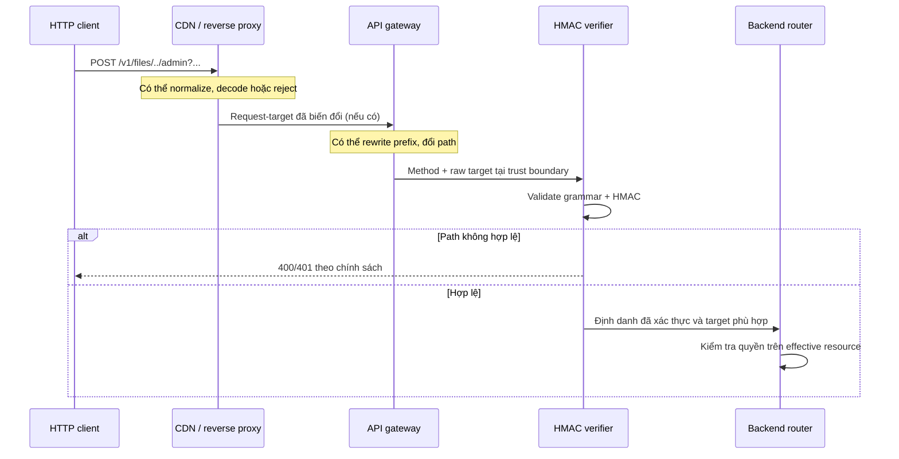

# Dot segment trong URL và path của HMAC request authentication

## Mục tiêu học tập

Trong chương **URL và path**, *dot segment* là thành phần đường dẫn có giá trị `.` hoặc `..`. Trong cú pháp URI, `.` biểu thị phân đoạn hiện tại, còn `..` liên quan đến việc đi lên một cấp trong quá trình xử lý đường dẫn. Hai ký hiệu này tưởng như đơn giản nhưng có ảnh hưởng lớn đến **canonical request**, định tuyến, phân quyền tài nguyên và tính nhất quán giữa client, proxy/gateway và HTTP server.

Bài thuộc module `SECURITY_AUTHENTICATION_HMAC_REQUEST_AUTHENTICATION`. Module thiết kế xác thực HTTP request bằng **HMAC với shared secret**, ký các thành phần như method, URI, header hoặc body theo hợp đồng; kiểm tra chữ ký, chống replay bằng timestamp/nonce, thực hiện key rotation, thử nghiệm qua proxy/gateway và phân biệt **authentication** với **authorization**.

Sau bài này, bạn có thể:

- Nhận ra dot segment ở dạng trực tiếp (`.`, `..`) và những biến thể mã hóa có thể được tầng xử lý khác diễn giải thành dấu chấm.
- Phân biệt **raw URI/path**, **path sau khi loại dot segment**, **path sau percent-decoding** và **route/tài nguyên thực tế** mà backend xử lý.
- Giải thích cách dot segment gây lỗi chữ ký HMAC hoặc tạo lỗ hổng **xác minh một đường dẫn nhưng thực thi đường dẫn khác**.
- Chọn chính sách rõ ràng: ký raw target và từ chối đường dẫn mơ hồ, hoặc định nghĩa phép chuẩn hóa có thứ tự/chính sách chặt chẽ.
- Viết ví dụ Java 17 tạo HMAC trên raw target với grammar path hạn chế; thử path hợp lệ, thay tài nguyên, `..` và `%2e%2e`.
- Kết hợp kiểm tra path với timestamp/nonce, quản lý credential, proxy/gateway, kiểm tra quyền theo tài nguyên đã resolve và kiểm thử end-to-end.

## 1. Dot segment là gì?

Một URI có **path** gồm các segment ngăn nhau bởi `/`. Hai segment có ý nghĩa đặc biệt khi thực hiện thuật toán *remove dot segments* của URI:

- `.`: một segment chỉ chứa **một dấu chấm**.
- `..`: một segment chỉ chứa **hai dấu chấm**.

Ví dụ:

```text
/v1/files/./report-17
/v1/files/archive/../report-17
```

Khi áp dụng phép loại dot segment cho những path trên, kết quả lần lượt là:

```text
/v1/files/report-17
/v1/files/report-17
```

Bảng minh họa:

| Path đầu vào | Path sau khi loại dot segment | Diễn giải |
| --- | --- | --- |
| `/a/./b` | `/a/b` | Segment `.` không thay đổi vị trí đi đến. |
| `/a/x/../b` | `/a/b` | `x/..` bị loại theo quy tắc xử lý đường dẫn. |
| `/a/b/.` | `/a/b/` | Dấu slash cuối có thể được giữ; không mặc định giống `/a/b`. |
| `/a/b/..` | `/a/` | Lùi khỏi `b`, giữ ý nghĩa kết thúc bằng slash. |
| `/a//b` | `/a//b` | **Hai slash liên tiếp không phải dot segment**; chỉ remove dot segments không có nghĩa tự gộp slash. |
| `/a/b?x=../c` | `/a/b?x=../c` | `../` trong **query** không phải dot segment của **path**. |

Thuật toán *remove_dot_segments* được mô tả trong RFC 3986, mục 5.2.4, đặc biệt dùng trong xử lý tham chiếu URI. Không nên giả định rằng **mọi HTTP intermediary** đều áp dụng đúng cùng thuật toán, cùng thứ tự với percent-decoding hoặc cùng quy tắc route của ứng dụng.

### 1.1. Chỉ segment `.` hoặc `..` mới là dot segment

```text
/a/.                # có dot segment
/a/..               # có dot segment
/a/.hidden           # tên segment bình thường
/a/file..txt         # tên segment bình thường
/a/...               # ba dấu chấm, không phải segment ".."
```

Không được xóa mọi dấu chấm trong path. File `.hidden` hoặc `report.v2` không trở thành dot segment chỉ vì chứa ký tự `.`.

Đối với **API nhạy cảm**, một chính sách route có thể chọn hạn chế tập ký tự được phép ở ID/path để giảm rủi ro. Đó là **chính sách API**, không phải định nghĩa mới của dot segment.

### 1.2. Path không phải URL đầy đủ

URL ví dụ:

```text
https://files.example.test/v1/files/./report-17?tenant=merchant-42#details
```

Có những phần khác nhau:

- `https` là scheme; `files.example.test` là authority/host.
- `/v1/files/./report-17` là **path** chứa dot segment.
- `tenant=merchant-42` là **query**, không nằm trong thuật toán loại dot segment của path.
- `#details` là **fragment** ở phía client; fragment không nằm trong HTTP request target gửi tới origin server.

Trong HTTP/1.1 origin-form thường có request-target dạng **path + dấu ? và query**; HTTP/2/HTTP/3 thường chuyển giá trị tương ứng qua pseudo-header `:path`. Khi ký HMAC phải công bố **chính xác phần nào được lấy**, thay vì tùy tiện gọi `uri.toString()` trong SDK này và `getPath()` trong SDK khác.

## 2. Vì sao dot segment quan trọng với HMAC?

Chữ ký HMAC được tính trên **byte được chọn từ request**, không hiểu được route hoặc semantics của HTTP.

```text
signature = HMAC-SHA256(sharedSecret, canonicalRequestBytes)
```

Nếu canonical request ký **raw path**:

```text
POST /v1/files/./report-17
POST /v1/files/report-17
```

thì hai đầu vào khác byte và **phải cho MAC khác nhau** (trong giả định HMAC an toàn), dù một router có thể xử lý chúng như cùng tài nguyên.

Điều này dẫn tới hai mục tiêu khác nhau:

1. **Không từ chối nhầm:** Client và verifier dùng cùng biểu diễn byte/path. Nếu client ký raw target nhưng proxy xóa `.` trước khi verifier nhìn thấy request, HMAC bị sai dù client có secret đúng.
2. **Không xác thực nhầm tài nguyên:** Verifier và nơi thực thi phải thống nhất **effective target**. Nếu verifier kiểm tra quyền theo chuỗi có `..` nhưng router phía sau loại dot segment và chuyển sang tài nguyên khác, HMAC hợp lệ **vẫn không bảo đảm quyền truy cập đúng**.

Ví dụ đáng chú ý:

```text
Raw target:       /v1/public/../admin/export
Normalized path:  /v1/admin/export
```

Nếu client **tự ký** raw target trên, phép HMAC có thể hoàn toàn hợp lệ. Nhưng nếu gateway phân quyền theo `startsWith("/v1/public/")` mà backend xử lý đường dẫn sau chuẩn hóa thành `/v1/admin/export`, hệ thống có nguy cơ **vượt ranh giới quyền**. Đây không phải lỗi của SHA-256; lỗi là các thành phần diễn giải target không nhất quán.

**Nguyên tắc:** HMAC chứng minh các trường được ký không bị sửa mà không có khóa. Nó **không tự cho phép** client gọi mọi path, và không sửa lỗi route/path traversal hoặc policy kiểm tra quyền trên representation sai.

## 3. Các cách biểu diễn dễ gây nhầm lẫn

### 3.1. Dấu chấm trực tiếp

```text
/v1/files/./report-17
/v1/files/../admin/export
/v1/files/section/../../admin/export
```

Đây là trường hợp dễ nhận biết nhất. Nếu API ký raw target, cách triển khai an toàn thường là **từ chối** dot segment tại điểm tiếp nhận đã chọn; như vậy không cần dự đoán thành phần nào sẽ chuẩn hóa path sau đó.

### 3.2. Percent-encoded dot

Dấu chấm `.` có mã ASCII hex `2E`. Những chuỗi sau có thể mang ý nghĩa tương đương **sau khi percent-decoding phù hợp**:

```text
/v1/files/%2e/report-17
/v1/files/%2E%2E/admin
/v1/files/.%2e/admin
/v1/files/%2e./admin
```

RFC 3986 cho phép percent-encoding ký tự thuộc tập **unreserved**, trong đó có dấu chấm. Một số bộ chuẩn hóa có thể chuyển `%2e` thành `.` trước khi xử lý dot segment; một số lớp routing lại có cách xử lý khác.

**Cảnh báo về thứ tự:** thuật toán remove-dot-segments xử lý **segment của path ở dạng được đưa vào nó**; không được tự suy rằng một chuỗi percent-encoded sẽ được mọi thư viện xử lý giống nhau. Nếu một lớp **decode trước** rồi loại `..`, trong khi lớp khác **loại trước** rồi decode, hai lớp có thể hiểu path khác nhau.

Ví dụ:

```text
Input:  /v1/files/%2e%2e/admin
Sau một lần decode: /v1/files/../admin
Sau remove dot segments: /v1/admin
```

Trong mô hình ký raw target, `%2e%2e` và `..` vẫn là **hai chuỗi ký khác nhau**. Nếu ứng dụng không hỗ trợ path mã hóa phức tạp, việc từ chối cả hai giúp giảm độ mơ hồ.

### 3.3. Double encoding và encoded separator

```text
%252e%252e   -> sau decode một lần: %2e%2e
%2e%2e       -> sau decode tiếp:    ..
%2f          -> sau decode:          /
%5c          -> sau decode:          \  (backslash)
```

**Double decoding** xảy ra nếu hai thành phần liên tiếp đều decode phần đã decode trước đó. Trường hợp này có thể biến chuỗi ban đầu không chứa literal `..` thành một đường dẫn đi lên cấp khác.

Encoded slash (`%2F`) hoặc backslash (`%5C`) có thể làm **thay đổi ranh giới segment** ở tầng sau. Backslash không phải dấu phân cách path chuẩn trong cú pháp URI nhưng có thể được vài thành phần hoặc hệ thống file diễn giải như separator. Vì vậy cần kiểm thử cặp proxy–backend–filesystem cụ thể thay vì giả định chúng đồng nhất.

Các dấu hiệu cần kiểm tra:

| Raw path | Nguy cơ nếu các tầng xử lý khác nhau |
| --- | --- |
| `/a/../b` | Một lớp giữ nguyên, lớp khác loại dot segment. |
| `/a/%2e%2e/b` | Một lớp nhìn thấy encoded bytes, lớp khác decode thành `..`. |
| `/a/%252e%252e/b` | Có lớp decode một lần, lớp sau decode lần thứ hai. |
| `/a/..%2fb` | Encoded slash có thể biến thành dấu phân cách path. |
| `/a/..%5cb` | Backslash có thể được đối xử như separator ở tầng khác. |
| `/a/..;v=1/b` | Parser matrix/path parameter có thể bỏ phần sau dấu `;` trước khi so route. |
| `/a//b` | Có tầng giữ hai slash, tầng khác gộp một slash. |
| `/a/%GG/b` | Percent-encoding sai cú pháp cần được từ chối, không cố sửa. |

Ký raw path **không tự vô hiệu hóa** các tình huống trên nếu request được ký từ đầu bởi client có secret hoặc nếu verifier và business router diễn giải raw path khác nhau. Cần thống nhất giải mã và kiểm soát target **trước thao tác nghiệp vụ**.

### 3.4. Unicode normalization có liên quan không?

Dấu chấm ASCII chuẩn là một ký tự cụ thể. Trong vài hệ sinh thái, ký tự Unicode có hình dạng gần giống dấu chấm có thể bị biến đổi bởi Unicode normalization hoặc bộ lọc tự viết. Không nên tự cho rằng một ký tự “nhìn giống dấu chấm” sẽ được mọi stack xem là dấu chấm, cũng không cho rằng mọi stack giữ nguyên.

Với route/API chỉ cần ID ASCII, cách giảm rủi ro tốt là **quy định route segment chỉ nhận ASCII an toàn**, không đưa Unicode path tùy ý qua nhiều lớp decoder khác nhau. Nếu API bắt buộc hỗ trợ tên Unicode trong path, cần một hợp đồng rõ về UTF-8, percent-encoding, normalization và tài nguyên sau khi resolve.

## 4. Hai chiến lược canonicalization và lựa chọn bảo mật

### 4.1. Chiến lược A: ký raw target, từ chối path không hợp lệ

Client ký chính xác method và **raw path + query** đã công bố; server lấy raw target ở **cùng trust boundary** và tái tạo canonical bytes.

```text
Client: POST /v1/files/file-123/actions/archive?tenant=tenant-42
                    |
                    v
        HMAC(raw path+query)
                    |
                    v
Verifier: validate strict route + compute HMAC
                    |
                    v
Backend: execute same resolved resource
```

Với API chỉ có route `/v1/files/{fileId}/actions/archive` và `fileId` là định danh ASCII, hợp đồng có thể:

- Chỉ chấp nhận path khớp đúng `/v1/files/[A-Za-z0-9_-]+/actions/archive`, với giới hạn độ dài ID.
- Không hỗ trợ percent-encoded path segment, literal dot segment, slash đôi, backslash hoặc `;` trong route này.
- Query chỉ nhận một tham số `tenant` theo grammar chặt; từ chối key trùng hoặc thêm tham số không công bố.
- Ký **toàn bộ raw target được chấp nhận**, không cố khôi phục target gốc từ URL đã qua router.
- Phân quyền dựa trên **fileId và tenant đã parse từ target hợp lệ**, và vẫn kiểm tra quyền từ registry/server, không dựa vào HMAC như một quyền bao trùm.

Đây là chiến lược **cố ý giới hạn biểu diễn**, phù hợp với API M2M có endpoint ít biến thể. Nó không phải yêu cầu mọi HTTP API phải cấm `.` trong mọi filename.

### 4.2. Chiến lược B: chuẩn hóa trước khi ký và xử lý

Một API khác có thể muốn coi `/a/./b` và `/a/b` là cùng target. Trong trường hợp đó, cần hợp đồng canonicalization chi tiết hơn:

1. Chốt nguồn raw path, bước percent-decoding nào được phép, thứ tự xử lý và giới hạn số lần decode.
2. Định nghĩa thuật toán remove-dot-segments, slash kép, encoded separator, Unicode, query và tham số lặp.
3. Ràng buộc **normalized target mà HMAC xác minh** với đúng route/resource được backend xử lý; không để backend decode hoặc normalize thêm theo cách thay semantics.
4. Đảm bảo proxy và framework giữ nguyên dữ liệu hoặc xác minh trước khi biến đổi; có bộ test vector chung.
5. Khi thay đổi thuật toán chuẩn hóa, phát hành **phiên bản hợp đồng mới**, không tự thử nhiều phép chuẩn hóa đến khi chữ ký khớp.

Cách B phức tạp hơn. Không dùng `URI.normalize()` ở một bên rồi mặc định rằng HTTP server ở bên còn lại, reverse proxy hoặc path resolver của filesystem sẽ xử lý cùng thứ tự. Java `java.net.URI` có `getRawPath()` và `getPath()` với ý nghĩa khác nhau về escaped path; việc object URI đã được tạo **sau proxy rewrite** cũng có thể khiến “raw” không còn là raw ở phía client.

### 4.3. Bất biến cần chứng minh

Dù chọn chiến lược nào, mô hình bảo mật nên bảo đảm:

> Những gì verifier **xác minh và phân quyền** phải ràng buộc với chính method, endpoint, tenant và tài nguyên mà handler **thực sự sử dụng**.

Đối với đường dẫn dẫn tới file vật lý, kiểm tra quyền trên **đường dẫn/đối tượng đã resolve an toàn**, không chỉ chuỗi URL; cần ngăn traversal thoát khỏi thư mục gốc và cân nhắc symlink. HMAC không thay thế kiểm tra filesystem path containment và authorization trên đối tượng thực tế.

## 5. Hợp đồng ký `path-v1` minh họa

Để dễ kiểm thử, bài này dùng **chiến lược A**: ký raw target và chỉ chấp nhận path phù hợp một route chặt. Không có định dạng canonical HMAC dùng chung cho mọi API: mọi quy tắc dưới đây là **hợp đồng giáo dục của ví dụ**, không phải mặc định của HTTP.

### 5.1. HTTP request

```http
POST /v1/files/file-123/actions/archive?tenant=tenant-42 HTTP/1.1
Host: files.example.test
Content-Type: application/json
X-Client-Id: archiver-service-prod
X-Key-Id: key-2026-11
X-Timestamp: 1795800000
X-Nonce: 7UbTspe51LAZgMk9IQLDFg
X-Content-SHA256: <base64url-sha256-body>
X-Signature: <base64url-hmac-sha256>

{"reason":"expired"}
```

Timestamp cố định chỉ dùng để minh họa; request thực phải lấy epoch seconds hiện tại và nonce mới. Hai chuỗi `<...>` là placeholder, phải được tính từ byte body và secret trước khi gửi.

### 5.2. Canonical request 11 dòng

Hợp đồng xác định **11 trường UTF-8**, nối bằng đúng một LF (`\n`), **không có LF cuối**:

```text
HMAC-SHA256
path-v1
files-api-prod
archiver-service-prod
key-2026-11
POST
/v1/files/file-123/actions/archive?tenant=tenant-42
application/json
<base64url-sha256-body>
1795800000
7UbTspe51LAZgMk9IQLDFg
```

| Dòng | Trường | Quy tắc |
| --- | --- | --- |
| 1 | `HMAC-SHA256` | Nhãn thuật toán của hợp đồng; Java sử dụng `HmacSHA256`. |
| 2 | `path-v1` | Phiên bản cố định của quy tắc ký; không âm thầm chuyển bản khác. |
| 3 | `files-api-prod` | Audience đáng tin cậy do server cấu hình và được credential cho phép. |
| 4 | Client ID | `X-Client-Id` được ký, chỉ là chỉ dẫn tra registry trước xác thực. |
| 5 | Key ID | `X-Key-Id` được ký và phải thuộc đúng client ID. |
| 6 | `POST` | Method thực nhận phải đúng; không cho method override. |
| 7 | Raw target | `/v1/files/{fileId}/actions/archive?tenant={tenantId}` với grammar ASCII chặt. |
| 8 | `application/json` | Exact Content-Type trong hợp đồng mẫu. |
| 9 | SHA-256 body | Base64URL không padding trên **byte body chính xác**. |
| 10 | Epoch seconds | Timestamp dạng số thập phân, được HMAC bảo vệ. |
| 11 | Nonce | Base64URL không padding của 16 byte CSPRNG, được HMAC bảo vệ. |

Quy tắc tiếp nhận:

1. **Path grammar:** `/v1/files/[A-Za-z0-9_-]{1,64}/actions/archive`. Không cho encoded path, literal `.`/`..`, slash thừa, semicolon hay backslash. Chọn quy tắc này để không có bước decode/normalize nào cần thiết sau verify ở route minh họa.
2. **Query grammar:** chính xác `tenant=[A-Za-z0-9_-]{1,64}`, một tham số duy nhất. Query thuộc raw target được ký. Các route khác cần hợp đồng query riêng, không áp dụng cứng quy tắc này cho mọi URL.
3. **Method và header:** chỉ `POST`, Content-Type chính xác `application/json`. Header liên quan đến HMAC phải có **một giá trị duy nhất**, không trùng/mơ hồ. Trong hợp đồng này `Content-Encoding` chỉ được vắng mặt hoặc là `identity`.
4. **Body:** SHA-256 của **byte body thực nhận**, trước JSON parse hoặc re-serialization. Ký digest Base64URL không padding. Giới hạn kích thước body ở điểm tiếp nhận.
5. **Encoding:** mọi trường canonical là chuỗi UTF-8, cấm CR/LF; các trường ID, path và query phải đáp ứng cú pháp đã định. Không dùng `System.lineSeparator()` hoặc default charset.
6. **Credential:** client/server được cấp shared secret mạnh, độc lập cho client và môi trường. `clientId`, `keyId` và audience được đưa vào MAC; registry ràng buộc quan hệ và tình trạng khóa.
7. **Replay:** timestamp là Unix epoch **giây**, nonce sinh ngẫu nhiên đủ entropy; server kiểm tra cửa sổ thời gian và lưu nonce đã dùng theo thao tác nguyên tử.

Hợp đồng này **không đưa `Host` vào dữ liệu ký** vì thay vào đó ký audience do server cấu hình, và phải bảo đảm đường đi gateway không đưa request đến một operation/audience ngoài chính sách.

### 5.3. Vì sao phải ràng buộc cả đường dẫn và query?

Giả sử client được quyền lưu trữ file `file-123` nhưng không phải `file-999`. Nếu attacker đổi raw target sau khi ký:

```text
Đã ký:   /v1/files/file-123/actions/archive?tenant=tenant-42
Đã sửa:  /v1/files/file-999/actions/archive?tenant=tenant-42
```

Hai canonical request khác ở dòng 7 nên MAC không còn khớp. Tuy nhiên, khi client hợp lệ **tự ký** request đến `file-999`, HMAC vẫn có thể đúng. Server phải kiểm tra **authorization theo fileId và tenant**; chữ ký hợp lệ không cấp mọi quyền.

## 6. Java 17: từ chối dot segment trước khi xác minh HMAC

Ví dụ sau dùng JDK 17+, tập trung vào **quy tắc path được chấp nhận** và tính toàn vẹn của raw target. Chương trình dùng route cố định của hợp đồng `path-v1` nên từ chối mọi dấu percent (`%`) trong phần path, kể cả `%2e` và `%252e`. Đây là lựa chọn cố ý để giảm mơ hồ ở endpoint này, không phải thuật toán percent-decoding chung.

```java
import java.nio.charset.StandardCharsets;
import java.security.GeneralSecurityException;
import java.security.MessageDigest;
import java.security.SecureRandom;
import java.time.Instant;
import java.util.Arrays;
import java.util.Base64;
import java.util.Objects;
import java.util.regex.Pattern;
import javax.crypto.Mac;
import javax.crypto.spec.SecretKeySpec;

public final class DotSegmentHmacDemo {
    private static final String AUDIENCE = "files-api-prod";

    private static final Pattern ROUTE = Pattern.compile(
            "/v1/files/[A-Za-z0-9_-]{1,64}/actions/archive");
    private static final Pattern TENANT_QUERY = Pattern.compile(
            "tenant=[A-Za-z0-9_-]{1,64}");
    private static final Pattern ID = Pattern.compile(
            "[A-Za-z0-9_-]{1,64}");
    private static final Pattern TIMESTAMP = Pattern.compile(
            "[1-9][0-9]{0,18}");
    private static final Pattern NONCE = Pattern.compile(
            "[A-Za-z0-9_-]{22}");
    private static final Base64.Encoder B64 =
            Base64.getUrlEncoder().withoutPadding();
    private static final Base64.Decoder B64_DECODER =
            Base64.getUrlDecoder();

    private DotSegmentHmacDemo() {}

    record RequestData(
            String method, String rawTarget, String contentType,
            byte[] body, String clientId, String keyId,
            String timestamp, String nonce) {
        RequestData {
            body = Objects.requireNonNull(body, "body").clone();
        }
        @Override public byte[] body() {
            return body.clone();
        }
    }

    record SignedHeaders(String contentSha256, String signature) {}

    static void validate(RequestData r) {
        if (!"POST".equals(r.method())
                || !"application/json".equals(r.contentType())) {
            throw new IllegalArgumentException("Invalid method/content-type");
        }
        String rawTarget = r.rawTarget();
        if (rawTarget == null || rawTarget.length() > 2048) {
            throw new IllegalArgumentException("Invalid request target");
        }
        // Chỉ cho đúng một '?' giữa path và query.
        int q = rawTarget.indexOf('?');
        if (q < 0 || q != rawTarget.lastIndexOf('?')) {
            throw new IllegalArgumentException("Expected one query separator");
        }
        String path = rawTarget.substring(0, q);
        String query = rawTarget.substring(q + 1);

        // Grammar này chủ ý cấm '.', '..', '%2e', '%252e',
        // encoded slash và dấu slash thừa ở path.
        if (!ROUTE.matcher(path).matches()
                || !TENANT_QUERY.matcher(query).matches()) {
            throw new IllegalArgumentException("Ambiguous/unsupported path");
        }
        if (r.body().length > 1_048_576) {
            throw new IllegalArgumentException("Body too large");
        }
        if (r.clientId() == null || !ID.matcher(r.clientId()).matches()
                || r.keyId() == null || !ID.matcher(r.keyId()).matches()) {
            throw new IllegalArgumentException("Invalid client/key ID");
        }
        if (r.timestamp() == null
                || !TIMESTAMP.matcher(r.timestamp()).matches()) {
            throw new IllegalArgumentException("Invalid timestamp format");
        }
        String nonce = r.nonce();
        if (nonce == null || !NONCE.matcher(nonce).matches()) {
            throw new IllegalArgumentException("Invalid nonce format");
        }
        byte[] decoded = B64_DECODER.decode(nonce);
        if (decoded.length != 16 ||
                !B64.encodeToString(decoded).equals(nonce)) {
            throw new IllegalArgumentException("Non-canonical nonce");
        }
    }

    static String bodyHash(byte[] body) throws GeneralSecurityException {
        return B64.encodeToString(
                MessageDigest.getInstance("SHA-256").digest(body));
    }

    static String canonical(RequestData r, String hash) {
        validate(r);
        // Đủ 11 trường, ký raw target đã kiểm tra, không normalize.
        return String.join("\n",
                "HMAC-SHA256", "path-v1", AUDIENCE,
                r.clientId(), r.keyId(), r.method(), r.rawTarget(),
                r.contentType(), hash, r.timestamp(), r.nonce());
    }

    static byte[] mac(byte[] secret, String canonical)
            throws GeneralSecurityException {
        Mac engine = Mac.getInstance("HmacSHA256");
        engine.init(new SecretKeySpec(secret, "HmacSHA256"));
        return engine.doFinal(canonical.getBytes(StandardCharsets.UTF_8));
    }

    static SignedHeaders sign(RequestData r, byte[] secret)
            throws GeneralSecurityException {
        String hash = bodyHash(r.body());
        return new SignedHeaders(
                hash, B64.encodeToString(mac(secret, canonical(r, hash))));
    }

    static boolean verifyMac(RequestData r, SignedHeaders headers, byte[] secret)
            throws GeneralSecurityException {
        if (headers == null || headers.contentSha256() == null
                || headers.signature() == null) {
            return false;
        }
        try {
            String actualHash = bodyHash(r.body());
            if (!actualHash.equals(headers.contentSha256())) {
                return false;
            }
            String sig = headers.signature();
            if (!sig.matches("[A-Za-z0-9_-]{43}")) {
                return false;
            }
            byte[] supplied = B64_DECODER.decode(sig);
            if (supplied.length != 32
                    || !B64.encodeToString(supplied).equals(sig)) {
                return false;
            }
            byte[] expected = mac(secret, canonical(r, actualHash));
            return MessageDigest.isEqual(expected, supplied);
        } catch (IllegalArgumentException ex) {
            return false;
        }
    }

    static RequestData withTarget(RequestData r, String target) {
        return new RequestData(r.method(), target, r.contentType(),
                r.body(), r.clientId(), r.keyId(), r.timestamp(), r.nonce());
    }

    static boolean signerRejects(RequestData r, byte[] secret)
            throws GeneralSecurityException {
        try {
            sign(r, secret);
            return false;
        } catch (IllegalArgumentException expected) {
            return true;
        }
    }

    public static void main(String[] args)
            throws GeneralSecurityException {
        SecureRandom random = new SecureRandom();
        byte[] secret = new byte[32]; // Chỉ mô phỏng cấp phát an toàn.
        random.nextBytes(secret);
        byte[] nonce = new byte[16];
        random.nextBytes(nonce);

        RequestData original = new RequestData(
                "POST",
                "/v1/files/file-123/actions/archive?tenant=tenant-42",
                "application/json",
                "{\"reason\":\"expired\"}".getBytes(StandardCharsets.UTF_8),
                "archiver-service-prod", "key-2026-11",
                Long.toString(Instant.now().getEpochSecond()),
                B64.encodeToString(nonce));

        SignedHeaders signed = sign(original, secret);
        System.out.println("Original valid: " +
                verifyMac(original, signed, secret));

        // Đổi resource nhưng giữ chữ ký cũ: vẫn đúng grammar, sai MAC.
        RequestData otherFile = withTarget(original,
                "/v1/files/file-999/actions/archive?tenant=tenant-42");
        System.out.println("Changed file accepted: " +
                verifyMac(otherFile, signed, secret));

        // Path nguy hiểm không được cho qua kể cả khi caller có secret.
        RequestData literalDotDot = withTarget(original,
                "/v1/files/../actions/archive?tenant=tenant-42");
        RequestData encodedDotDot = withTarget(original,
                "/v1/files/%2e%2e/actions/archive?tenant=tenant-42");
        RequestData doubleEncoded = withTarget(original,
                "/v1/files/%252e%252e/actions/archive?tenant=tenant-42");

        System.out.println("Literal dot segment rejected: " +
                signerRejects(literalDotDot, secret));
        System.out.println("Encoded dot segment rejected: " +
                signerRejects(encodedDotDot, secret));
        System.out.println("Double-encoded path rejected: " +
                signerRejects(doubleEncoded, secret));

        Arrays.fill(secret, (byte) 0);
    }
}
```

Kết quả kỳ vọng:

```text
Original valid: true
Changed file accepted: false
Literal dot segment rejected: true
Encoded dot segment rejected: true
Double-encoded path rejected: true
```

**Vì sao code không tự gọi `URI.normalize()`?** Vì hợp đồng ví dụ không định nghĩa bước chuẩn hóa path: nó chỉ **chấp nhận đúng một grammar raw path** rồi ký nguyên raw target. Nếu gọi normalize một cách âm thầm trước khi ký, client và server có thể không thống nhất liệu dấu `..` đã được xử lý và tài nguyên cuối cùng là gì.

**Giới hạn của demo:** `verifyMac` kiểm tra cú pháp path/canonical, body hash và HMAC của một `RequestData` đã được tạo. Đây **không phải** triển khai HTTP server đầy đủ: code chưa kiểm tra header trùng, `Content-Encoding` thực nhận, timestamp còn trong cửa sổ, nonce store, client/key registry, trạng thái key hoặc authorization. Adapter HTTP production phải thu thập raw target từ ranh giới tin cậy và bảo đảm router không diễn giải lại path theo cách khác sau xác minh.

### 6.1. Nếu API buộc phải hỗ trợ percent-encoding trong path?

Không đơn giản thay route regex bằng `.*`. Hãy:

1. Quy định rõ percent-encoded UTF-8 hợp lệ, ký tự được phép, số lần decode và thứ tự canonicalization.
2. Từ chối percent sequence không hợp lệ và các separator/chuỗi có thể biến thành dot segment sau decode nếu không nằm trong semantics cho phép.
3. Tách parse path segment khỏi filesystem path; tránh dùng trực tiếp một giá trị path parameter làm đường dẫn file.
4. Đảm bảo gateway, framework và handler có **cùng effective target**. Nếu cần đưa normalized target vào HMAC, hãy phát hành **phiên bản hợp đồng riêng** cùng test vector.
5. Trên route có dữ liệu nhạy cảm, dùng authorization sau khi resolve resource ID. Không xem decode một lần là đã đủ nếu downstream có thể decode tiếp.

Không có một bộ lọc chuỗi như `path.contains("..")` đủ để bảo vệ mọi trường hợp. Nó có thể bỏ sót `%2e%2e` hoặc double encoding, đồng thời chặn nhầm các tên file hợp lệ có dấu chấm.

## 7. Proxy, gateway và vấn đề “raw path của ai?”

Một chuỗi path có thể biến đổi qua nhiều hop:



Có hai mô hình triển khai rõ ràng:

**Mô hình A — verify tại edge/gateway trước rewrite.** Điểm kiểm tra lấy path và method đúng như đối tượng ký ở ranh giới đã thiết kế; sau khi xác minh thành công, gateway chuyển **authenticated client principal** và target/operation đã được kiểm tra đến backend qua kênh nội bộ có danh tính, tính toàn vẹn và chính sách tin cậy phù hợp. Gateway phải xóa header principal do client ngoài internet tự gửi.

**Mô hình B — verify tại backend.** Proxy/gateway phải bảo toàn raw target đã ký, hoặc truyền metadata gốc đáng tin cậy **được thiết lập lại bởi gateway**, không chấp nhận dữ liệu gốc từ header do client tự khai. Backend phải ràng buộc metadata đã xác minh với target handler thực thi.

Nếu gateway đã xóa dot segment **trước điểm verify**, backend không thể khôi phục raw target ban đầu chỉ bằng `HttpServletRequest.getRequestURI()`. Tên “raw” trong API/framework chỉ có nghĩa raw **so với trạng thái mà tầng đó đang nắm giữ**, không chứng minh request chưa từng bị chỉnh sửa bởi một hop phía trước.

### 7.1. Path-based authorization và lỗi prefix check

Ví dụ sau **không an toàn** nếu route có thể chứa dot segment được chuẩn hóa sau bước kiểm tra:

```java
if (rawPath.startsWith("/v1/public/")) {
    allowRequest();
}
// Một layer khác chuyển /v1/public/../admin thành /v1/admin.
```

Một phép kiểm tra prefix chuỗi trước khi xác định effective target có thể không tương ứng với hành động thực. Cách xử lý:

- Từ chối dot segment/biến thể encoding ở biên với route không cần chúng.
- Thực hiện authorization theo **route, resource ID, tenant và action đã được resolve đáng tin cậy**.
- Giữ nhất quán kết quả resolve giữa verifier, router và business handler; không cho request được xác minh cho một route rồi chạy sang route khác do rewrite/override.

### 7.2. Body/header cũng có thể làm HMAC sai

Dù chủ đề bài là dot segment, path chỉ là **một trong các trường ký**. Gateway có thể:

- Thêm hoặc sửa Content-Type.
- Giải nén `Content-Encoding`, serialize lại JSON hoặc thay body bytes.
- Đổi method hoặc xử lý header method override.
- Sắp lại query hoặc decode dấu `+`/`%20`.
- Thêm `X-Forwarded-*`/`X-Original-URI`, tạo nguồn gốc không đáng tin nếu không khóa trust boundary.

Phải thống nhất tất cả trường trong canonical request. Không “sửa” lỗi mismatch path bằng cách bỏ URI khỏi chữ ký; phải xác minh tại đúng điểm và tránh biến đổi ngoài hợp đồng.

## 8. Xác thực, chống replay, key rotation và phân quyền

Canonical path hợp lệ chỉ có nghĩa **cú pháp đường dẫn phù hợp hợp đồng**, không chứng minh request được ký đúng hay client có quyền trên file đó.

Một luồng server an toàn gồm:

1. **Parse và giới hạn request:** chặn raw target không hợp lệ, header trùng, body quá lớn, method/encoding không hỗ trợ. Đọc đúng byte/path theo trust boundary.
2. **Tra khóa:** dùng `clientId` và `keyId` do request khai để tra registry; kiểm tra khóa thuộc đúng client, còn hiệu lực và được phép với audience. Không đọc shared secret từ request header.
3. **Kiểm tra timestamp:** ví dụ cho lệch **±300 giây** so với đồng hồ server đã đồng bộ; timestamp vẫn là dữ liệu chưa tin cậy cho tới khi MAC hợp lệ.
4. **Dựng canonical request và tính HMAC:** từ đúng method/raw target/header/body thực nhận, dùng `Mac.getInstance("HmacSHA256")` và raw secret đã cấp. Giải mã chữ ký Base64URL, so sánh byte MAC bằng `MessageDigest.isEqual`.
5. **Claim nonce sau MAC:** dùng thao tác ghi một lần **nguyên tử** trong kho dùng chung, khóa theo `(audience, clientId, keyId, nonce)`. Từ chối nonce đã dùng hoặc khi kho không khả dụng theo chính sách bảo mật. Với cửa sổ timestamp ±300 giây, TTL khoảng **610 giây kể từ lúc claim** là ví dụ có biên cho tối đa 600 giây còn có thể replay.
6. **Tạo authenticated client principal:** scopes, tenants và policy lấy từ registry đáng tin, không phải header `X-Role`/`X-Scope` do client tự khai.
7. **Phân quyền trên effective resource:** kiểm tra client có scope `files:archive`, đúng tenant và thực sự được thao tác trên file ID đã resolve hay không; sau đó mới xử lý nghiệp vụ.

### 8.1. Replay không cần thay đổi path

Kẻ tấn công có thể phát lại **nguyên request** đã ký, giữ nguyên path không có dot segment. MAC vẫn có thể khớp. Vì vậy:

- Timestamp và nonce phải nằm trong **dữ liệu được HMAC ký**.
- Nonce phải được ghi bằng atomic claim, chia sẻ giữa nhiều instance.
- Idempotency nghiệp vụ (ví dụ archive một file chỉ xử lý một lần) là cơ chế khác; request có **nonce mới** vẫn có thể lặp lại hành động nếu thiếu kiểm soát nghiệp vụ.

### 8.2. Rotation và hợp đồng path là hai thứ độc lập

- **Key rotation:** đổi secret/key ID cho cùng client identity, có overlap hữu hạn rồi thu hồi khóa cũ. Nếu khóa `REVOKED`, server từ chối dù phép toán HMAC trên dữ liệu cũ vẫn khớp.
- **Contract migration:** đổi từ `path-v1` (chỉ cho ASCII route chặt) sang một hợp đồng cho phép percent-encoding/normalization. Đây là thay đổi semantics của path ký, cần **version mới, test vector mới và policy chặt**, không thử nhiều cách chuẩn hóa đến khi MAC khớp.
- **Authorization:** chữ ký HMAC hợp lệ cho `file-999` không tự cấp quyền archive file này. Quyền quyết định dựa trên principal và effective resource.

Đặc biệt, không dùng `X-Client-Id`, `X-Tenant-Id` hay raw prefix tự khai như bằng chứng đủ để cho phép thao tác.

## 9. Kiểm thử dot segment trên toàn đường đi request

Để kiểm tra đầy đủ, cần quan sát **raw target tại điểm ký**, **target tại verifier**, **route/effective resource tại handler** và kết quả authorization. Chỉ kiểm tra status `401` chưa đủ để biết lỗi do dot segment, secret, timestamp hay route.

| Test case | Biến thể | Kỳ vọng theo `path-v1` |
| --- | --- | --- |
| Hợp lệ | `/v1/files/file-123/actions/archive?tenant=tenant-42` | Path đạt grammar; MAC được xác minh nếu tất cả điều kiện khác hợp lệ. |
| Dot segment đơn | `/v1/files/./file-123/actions/archive?tenant=tenant-42` | Từ chối path, không normalize rồi ký. |
| Parent segment | `/v1/files/../admin/actions/archive?tenant=tenant-42` | Từ chối, không chạy route khác. |
| Encoded dot | `/v1/files/%2e/actions/archive?tenant=tenant-42` | Từ chối theo grammar ASCII của endpoint. |
| Encoded parent | `/v1/files/%2e%2e/actions/archive?tenant=tenant-42` | Từ chối, không để backend tự decode sau verify. |
| Uppercase encoded dot | `/v1/files/%2E%2E/actions/archive?tenant=tenant-42` | Từ chối bất kể chữ hoa/thường hex. |
| Mixed encoding | `/v1/files/.%2e/actions/archive?tenant=tenant-42` | Từ chối. |
| Double encoding | `/v1/files/%252e%252e/actions/archive?tenant=tenant-42` | Từ chối trước khi tầng sau có thể decode lần hai. |
| Encoded slash | `/v1/files/file%2f999/actions/archive?tenant=tenant-42` | Từ chối vì path grammar không cho `%`. |
| Backslash | `/v1/files/file\123/actions/archive?tenant=tenant-42` | Từ chối. |
| Slash lặp | `/v1/files//file-123/actions/archive?tenant=tenant-42` | Từ chối theo route grammar. |
| Matrix parameter | `/v1/files/file-123;v=1/actions/archive?tenant=tenant-42` | Từ chối nếu framework có thể bỏ `;v=1`. |
| Query sai grammar | `?tenant=tenant-42&tenant=tenant-99` | Từ chối tham số lặp và không cho nhiều cách parse. |
| Thay file ID sau ký | Đổi `file-123` thành `file-999`, giữ MAC | Grammar vẫn đúng nhưng HMAC sai; không xử lý file khác. |
| Thay query sau ký | Đổi `tenant-42` thành `tenant-99`, giữ MAC | HMAC sai. |
| Client ký path ngoài quyền | Dùng secret thật để ký `file-999` | HMAC có thể hợp lệ, **authorization** phải từ chối nếu không có quyền. |
| Proxy normalize trước verify | Client ký path chứa `./`, gateway xóa `./` | Phát hiện mismatch hoặc chặn tại edge, không tự thử hai path đến khi MAC khớp. |
| Gateway rewrite sau verify | Route ngoài `/external/...` chuyển vào `/internal/...` | Backend chỉ thực thi effective resource đã được ràng buộc với request được xác minh. |
| Nonce replay | Gửi lại nguyên request đã ký | Lần sau bị chặn tại nonce store. |
| Key revoked | Dùng key ID đã thu hồi | Từ chối ngay cả khi MAC về mặt toán học đúng. |
| MAC đúng nhưng tenant ngoài quyền | Archive file của tenant khác | Authorization từ chối, ví dụ `403 Forbidden`. |

**Kiểm thử liên SDK:** Dùng secret giả và công bố test vector gồm method, raw target, raw body bytes, header đã ký, timestamp, nonce, canonical bytes (có thể xuất hex), body hash và MAC. Các SDK Java/Go/Node phải cùng tạo byte canonical. Đặc biệt nên có vector khác nhau chỉ ở `/./`, `/../` và `%2e` để phát hiện framework đã âm thầm đổi path trước khi ký.

### 9.1. Chẩn đoán lỗi chữ ký liên quan path

| Triệu chứng | Giả thuyết | Cách kiểm tra |
| --- | --- | --- |
| Chỉ lỗi khi path có `%2e` hoặc `%2f` | Proxy/router decode khác nhau. | Ghi lại raw target tại điểm ký và verifier bằng test data, kiểm tra thứ tự decode. |
| Chỉ lỗi sau gateway | Rewrite prefix hoặc remove-dot-segments trước verify. | Xác định lại trust boundary; so sánh exact path tại từng hop bằng dữ liệu thử. |
| HMAC đúng nhưng đọc/xóa nhầm tài nguyên | Verifier và business handler resolve khác nhau. | Kiểm tra mapping path → resource ID và authorization trên effective resource. |
| Đường dẫn `/a//b` chạy lúc được lúc không | Các proxy/router khác nhau gộp slash khác nhau. | So sánh behavior từng ingress instance và route config. |
| HMAC đúng nhưng API trả `403` | Credential không có quyền trên effective file/tenant. | Kiểm tra scopes, tenant và ownership, không đổi thuật toán ký. |
| HMAC đúng nhưng trả `401` | Replay, timestamp, key hết hạn/thu hồi. | Dựa trên mã lý do nội bộ không lộ secret. |

Không log shared secret hoặc raw body nhạy cảm chỉ để debug canonicalization. Có thể dùng test vector giả và digest của canonical bytes, metadata path đã lọc hoặc correlation ID để tìm ra mismatch.

## 10. Bài thực hành

Xây dựng endpoint `POST /v1/files/{fileId}/actions/archive?tenant={tenantId}` sử dụng HMAC-SHA256:

1. **Cấp credential:** tạo 32 byte secret ngẫu nhiên bằng `SecureRandom` và đăng ký `clientId`, `keyId`, audience `files-api-prod`, scopes và tenants. Secret được giữ an toàn, không đưa vào HTTP header.
2. **Định nghĩa grammar path:** chỉ ID ASCII `[A-Za-z0-9_-]{1,64}`, đúng path `/v1/files/{fileId}/actions/archive`, query chỉ có một `tenant`. Từ chối `.`, `..`, percent-encoded path, slash lặp và semicolon của route này.
3. **Xây canonical request:** 11 dòng gồm algorithm, `path-v1`, audience, client/key ID, method, raw target, Content-Type, body hash, timestamp và nonce; UTF-8, LF, không LF cuối.
4. **Tạo signer Java:** dùng `MessageDigest("SHA-256")` băm byte JSON và `Mac("HmacSHA256")` với `SecretKeySpec` tính signature Base64URL không padding.
5. **Tạo verifier:** tự lấy raw method/target/body ở ranh giới đáng tin cậy, kiểm tra grammar **trước** khi dùng chúng trong canonical request, tra secret từ registry theo cặp client/key, so sánh byte HMAC.
6. **Thử bypass:** `/v1/files/../admin`, `%2e%2e`, `.%2E`, `%252e%252e`, `%2f`, `..;x`, slash lặp và query key trùng. Bảo đảm chúng bị từ chối **trước thao tác nghiệp vụ**, không bị decode hoặc normalize thành route khác.
7. **Thử proxy/gateway:** đặt một rewrite prefix và một lớp có khả năng decode URI; xác định điểm verify trước/sau transform. Kiểm tra request được xác minh cho file nào và handler thực thi file nào.
8. **Thêm chống replay:** timestamp ±300 giây và nonce 128 bit lưu nguyên tử trong kho chung; gửi cùng nonce đến hai instance để xác nhận tối đa một request được claim.
9. **Thêm key rotation và authorization:** dùng key mới trong overlap rồi revoke key cũ; tạo request ký đúng cho file thuộc tenant ngoài quyền để kiểm tra `403` dù HMAC hợp lệ.

**Câu hỏi tự đánh giá:** Vì sao `/a/../b` và `/b` có thể đi đến cùng tài nguyên nhưng vẫn khác chữ ký khi ký raw path? `%2e%2e` có phải là literal dot segment trước percent-decoding không? Tại sao chỉ kiểm tra `rawPath.contains("..")` là chưa đủ? Một client biết secret có thể ký `/v1/public/../admin`: HMAC hợp lệ có cho phép nó truy cập admin không? Vì sao `URI.normalize()` gọi ở phía client có thể làm sai chữ ký nếu backend ký raw target? Khi gateway đã normalize trước verifier, verifier có thể khôi phục path nguyên gốc một cách chắc chắn không? Timestamp/nonce ngăn lỗi nào mà quy tắc dot segment không ngăn được?

## 11. Tài liệu tham khảo

- **RFC 3986 — Uniform Resource Identifier: Generic Syntax**, đặc biệt mục **5.2.4 Remove Dot Segments** và quy tắc percent-encoding của URI.
- **RFC 9110 — HTTP Semantics:** method, target URI, ngữ nghĩa HTTP và ranh giới xử lý request.
- **RFC 9112 / RFC 9113 / RFC 9114:** biểu diễn và truyền HTTP/1.1, HTTP/2, HTTP/3, bao gồm request target và pseudo-header.
- **RFC 2104 — HMAC: Keyed-Hashing for Message Authentication:** cách HMAC ràng buộc secret và byte thông điệp.
- **RFC 4648 — Base Encodings:** Base64URL của hash và MAC.
- **Java SE API — `java.net.URI`, `javax.crypto.Mac`, `javax.crypto.spec.SecretKeySpec`, `java.security.MessageDigest`:** làm việc với URI/khóa/HMAC trong Java.

**Kết luận:** Dot segment không đơn thuần là chi tiết trình bày URL. Trong HMAC request authentication, nó làm lộ rõ câu hỏi **client đã ký path nào, verifier đã kiểm tra path nào và backend thực sự xử lý tài nguyên nào**. Một hợp đồng canonical request có phiên bản, policy path không nhập nhằng, trust boundary thống nhất và authorization theo effective resource là cần thiết để tránh cả lỗi MAC giả lẫn lỗi thực thi sai tài nguyên.

