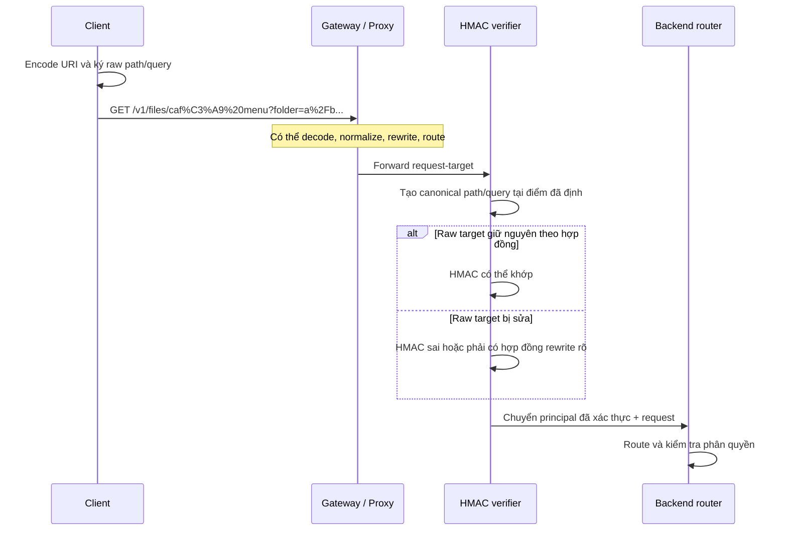

# Percent encoding

## 1. Percent encoding là gì và tại sao quan trọng với HMAC?

**Percent encoding** (còn gọi là *percent-encoding*) là cách biểu diễn một byte trong URI dưới dạng **`%HH`**, với `HH` là hai chữ số hexadecimal. Ví dụ byte có giá trị `0x20` (dấu cách ASCII) được biểu diễn là `%20`; byte `0x2F` (dấu gạch chéo `/`) là `%2F`.

Trong HTTP request authentication bằng **HMAC**, server không kiểm tra “ý nghĩa gần giống nhau” của hai URL. Server cần dựng lại **đúng chuỗi byte canonical request** mà client đã dùng để ký. Chỉ cần sender ký `/files/a%2Fb` nhưng verifier dùng `/files/a/b` thì chữ ký HMAC có thể khác nhau, dù một tầng ứng dụng hoặc router diễn giải các URL ấy thành cùng tài nguyên.

Bài này thuộc chương **URL và path**, mô-đun **`SECURITY_AUTHENTICATION_HMAC_REQUEST_AUTHENTICATION`**. Toàn bộ mô-đun tập trung xác thực HTTP request bằng HMAC với shared secret và canonical request có method, URI, header hoặc body theo hợp đồng ký, đồng thời chống replay bằng timestamp/nonce, xoay khóa, kiểm thử qua proxy/gateway và tách xác thực khỏi phân quyền. Trọng tâm ở đây là **cách mã hóa URL/path/query ảnh hưởng trực tiếp tới chữ ký**, không chỉ cách làm URL “đẹp”.

Sau bài này, bạn cần có thể:

- Đọc đúng `%HH` và mã hóa văn bản Unicode thành **byte UTF-8 rồi mới percent-encode**.
- Phân biệt **raw path/raw query** với **decoded path/decoded query**.
- Hiểu vì sao `%2F`, `%252F`, `%20`, `+`, `%2E` và query lặp là các trường hợp nhạy cảm.
- Thiết kế **hợp đồng canonical URI** rõ ràng cho client–gateway–server.
- Viết và kiểm thử Java signer/verifier sao cho percent encoding **không bị thay đổi ngoài ý muốn**.
- Không nhầm việc HMAC hợp lệ với việc router, tầng nghiệp vụ hoặc tầng phân quyền đã an toàn.

## 2. Cơ chế mã hóa từng byte thành `%HH`

Theo cú pháp URI phổ biến của RFC 3986, thành phần **unreserved** bao gồm:

```text
A-Z a-z 0-9 - . _ ~
```

Các ký tự này thường được giữ nguyên khi mã hóa một *component*. Byte không thuộc nhóm unreserved có thể cần biểu diễn bằng percent encoding tùy vị trí và hợp đồng. Cách thực hiện đúng với ký tự Unicode là:

1. Lấy chuỗi Unicode theo encoding được chọn, **thường là UTF-8**.
2. Chuyển chuỗi thành **các byte UTF-8**.
3. Với từng byte cần escape, ghi `%` và **hai chữ số hex** tương ứng.
4. Quy định rõ dùng chữ hex hoa hay thường khi dựng **canonical representation**; trong ví dụ bài này dùng hex **uppercase**.

| Đầu vào | Byte UTF-8 (hex) | Percent-encoded trong một component |
| --- | --- | --- |
| `A` | `41` | `A` |
| Dấu cách | `20` | `%20` |
| `/` | `2F` | `%2F` |
| `+` | `2B` | `%2B` |
| `%` | `25` | `%25` |
| `é` | `C3 A9` | `%C3%A9` |
| `à` | `C3 A0` | `%C3%A0` |
| `đ` | `C4 91` | `%C4%91` |

Ví dụ cụm `café menu` thành:

```text
café menu
  |
  | UTF-8 bytes
  v
63 61 66 C3 A9 20 6D 65 6E 75
  |
  | Percent-encode bytes outside unreserved
  v
caf%C3%A9%20menu
```

**Một ký tự Unicode không nhất thiết tương ứng một `%HH`.** `é` trong UTF-8 cần **hai byte**, nên thành `%C3%A9`; các ký tự ngoài ASCII khác có thể cần ba hoặc bốn byte. Đừng dùng code point Unicode rồi chuyển trực tiếp thành một `%HH`.

### 2.1. Hex hoa/thường và tính duy nhất của chữ ký

`%2F` và `%2f` đều biểu diễn byte `0x2F`. Tương tự, `%7E` có thể được giải mã thành ký tự unreserved `~`. Tuy nhiên, **raw strings** của chúng **khác byte**:

```text
Raw A: /v1/files/a%2Fb
Raw B: /v1/files/a%2fb
Raw C: /v1/files/a/b
```

Nếu giao thức HMAC ký **raw path đúng như được gửi**, ba chuỗi trên không có cùng chữ ký. Một hệ thống khác có thể chọn chuẩn hóa `%2f` thành `%2F`, nhưng khi đó **cả sender và verifier phải áp dụng chính xác cùng quy tắc trước khi ký**.

Trong bài này, hợp đồng minh họa **giữ nguyên raw path/query, yêu cầu escape `%HH` viết bằng hex uppercase, và từ chối cách viết không tuân thủ**. Lựa chọn đó giúp hạn chế các biến thể không cần thiết, nhưng không đồng nghĩa với việc đã giải quyết mọi vấn đề định tuyến hoặc phân quyền ở tầng sau.

## 3. Reserved characters và ranh giới giữa path, segment, query

RFC 3986 phân biệt **unreserved** với những ký tự có thể mang vai trò phân cách hoặc cú pháp trong URI. Một số ký tự đáng chú ý là:

```text
/ ? # [ ] @ : ! $ & ' ( ) * + , ; =
```

Các ký tự này **không luôn cần escape ở mọi vị trí**. Ý nghĩa của chúng phụ thuộc **URI component** đang xử lý.

| Ký tự | Trong ngữ cảnh | Rủi ro khi xử lý sai |
| --- | --- | --- |
| `/` | Phân tách path segments | `a/b` có hai segment; `a%2Fb` có một segment chứa slash khi được decode |
| `?` | Bắt đầu query trong URI | Encode hoặc decode sai có thể chuyển dữ liệu giữa path và query |
| `&` | Thường phân cách query parameters | Dữ liệu trong giá trị phải được encode nếu không muốn tách thêm tham số |
| `=` | Thường phân cách tên và giá trị query | Decode/encode sai làm thay đổi parsing parameter |
| `#` | Bắt đầu fragment | Fragment **không được gửi** như một phần HTTP request target |
| `%` | Dấu bắt đầu percent triplet | Dấu `%` literal phải thành `%25` khi dùng trong component |
| `+` | Dấu cộng bình thường trong URI query | Dễ bị nhầm thành dấu cách bởi form decoder |
| `;` | Có thể là ký tự dữ liệu hoặc separator trong cách xử lý path/query riêng | Proxy/router/framework có thể xử lý matrix/path params khác nhau |

Với URI:

```text
https://api.example.test/v1/files/caf%C3%A9%20menu?folder=a%2Fb&tag=a&tag=b
|______ scheme+authority ______|________ raw path ________|______ raw query ______|
```

Ta phải phân biệt **đường dẫn** với **từng path segment**, **query string** với **query parameter value**. Nếu muốn đưa chuỗi `a/b` vào **một segment**, encoder của segment thường phải tạo `a%2Fb`. Ngược lại, nếu `/` là separator thực sự giữa các segment, giữ nguyên `/`. Không nên encode toàn bộ URL bằng một hàm được thiết kế cho query value.

### 3.1. `%2F` là ký tự slash được encode, không đương nhiên là separator

Hai request target:

```http
GET /v1/files/a%2Fb HTTP/1.1
GET /v1/files/a/b HTTP/1.1
```

Có thể được router, proxy hoặc framework **diễn giải khác nhau**. Một số hệ thống từ chối encoded slash; một số decode nó rồi định tuyến; một số bảo toàn slash trong cùng một segment. HMAC trên raw path phân biệt được hai giá trị, **nhưng không quyết định cách router diễn giải**.

Nếu ứng dụng lưu file theo đường dẫn hoặc kiểm tra quyền theo segment, phải có chính sách rõ: cho phép encoded slash chỉ khi tất cả các tầng đồng thuận; nếu không cần thì **từ chối `%2F`, `%5C` và các biến thể nguy hiểm tại ranh giới tiếp nhận** để tránh lệch định tuyến, path traversal hoặc bypass authorization.

## 4. Raw URI, decoded URI và double encoding

Một URL thường có **nhiều biểu diễn** trong code.

Ví dụ:

```text
Raw path:
  /v1/files/caf%C3%A9%20menu
Decoded path:
  /v1/files/café menu

Raw query:
  folder=a%2Fb&tag=a&tag=b
Decoded query:
  folder=a/b&tag=a&tag=b
```

Hai cách biểu diễn phục vụ mục đích khác nhau. Với hợp đồng ký **raw request target**, phải sử dụng **raw path/query**, không tự decode rồi encode lại để “làm sạch”.

### 4.1. Double encoding: `%252F` không phải `%2F`

Dấu phần trăm `%` có byte `0x25`, được mã hóa là `%25`. Bởi vậy:

```text
a%252Fb
  |
  | decode 1 lần
  v
a%2Fb
  |
  | decode lần 2
  v
a/b
```

Nếu gateway decode **một lần** nhưng backend decode **hai lần**, hai thành phần có thể nhìn thấy đường dẫn khác nhau. Tình huống này không chỉ làm HMAC sai mà còn tạo rủi ro **path traversal, route confusion hoặc vượt kiểm tra quyền** nếu router và security middleware không đồng thuận.

**Không khắc phục bằng cách decode lặp cho đến khi không còn `%`.** Decode nhiều lần là hành vi nguy hiểm khi dữ liệu đầu vào không đáng tin cậy. Hợp đồng cần xác định rõ **có decode hay không, decode đúng một lần ở lớp nào, và tầng nào được phép sử dụng kết quả decoded**.

### 4.2. Encoded unreserved và vấn đề “cùng nghĩa nhưng khác chữ ký”

`%61` có thể giải mã thành `a`. Vì vậy `/v1/%61pi` và `/v1/api` có thể được tầng routing hiểu giống nhau, nhưng nếu ký raw path thì chữ ký khác nhau. Một chính sách canonicalization phức tạp hơn có thể bắt buộc unreserved characters phải được biểu diễn trực tiếp; nhưng nếu chọn chính sách ấy, client và server cần kiểm thử đồng bộ thay vì tự giả định thư viện URI đã chuẩn hóa đúng.

Ngược lại, nếu hợp đồng quy định ký raw path, việc **không đồng nhất** hai chuỗi trên là hoàn toàn nhất quán. Điều quan trọng là server có quy tắc **route/authorize** không tạo đường vòng qua một biến thể khác.

## 5. Dấu cách: `%20` không tương đương `+` trong mọi URI

Một bẫy thường gặp là trộn **URI percent encoding** với **`application/x-www-form-urlencoded`**.

Trong biểu diễn **form encoding**, dấu cách thường thành `+`, còn dấu cộng literal được biểu diễn là `%2B`. Nhưng trong **URI query thông thường**, dấu `+` chỉ là dấu cộng trừ khi ứng dụng chủ động áp dụng quy tắc form decoding.

```text
Input text: "a b"
RFC3986-style percent-encoded component: a%20b
Form-encoded value:                   a+b

Input text: "a+b"
RFC3986-style percent-encoded component: a%2Bb
Form-encoded value:                   a%2Bb
```

Ví dụ hai query:

```text
?q=a+b
?q=a%20b
```

Có thể được một form decoder coi cùng giá trị `a b`, nhưng **raw query bytes khác nhau**, nên HMAC theo hợp đồng raw-query khác nhau. Nếu client ký `q=a+b` còn server tự dùng `URLDecoder` để dựng lại `q=a%20b`, chữ ký không còn khớp.

**Quy tắc thực hành:** xác định URI query có dùng **form semantics** hay không. Với hợp đồng minh họa của bài này, query được ký **nguyên raw bytes** và phía sender encode tên/giá trị theo quy tắc RFC3986-style (`space → %20`, `+ → %2B`); không dùng `URLEncoder` hoặc `URLDecoder` để tùy ý chuẩn hóa path/query.

## 6. Query parameter: thứ tự, tên lặp, rỗng và dấu phân cách

Một URL có thể chứa query đơn giản hoặc nhiều trường hợp mơ hồ:

```text
?a=1&b=2
?b=2&a=1
?tag=a&tag=b
?tag=b&tag=a
?flag
?flag=
?x=&x=2
?x=a%26b
```

Không nên biến mọi raw query thành `Map<String,String>` ngay trước khi ký:

- `Map` thông thường có thể mất **thứ tự tham số**.
- Một key xuất hiện **nhiều lần** có thể bị ghi đè, lấy giá trị đầu hoặc cuối tùy framework.
- `?flag` và `?flag=` có thể được parse khác nhau.
- `%26` là dấu `&` **bên trong giá trị**; nếu decode quá sớm rồi split, dữ liệu có thể bị nhầm thành tham số khác.
- Một số framework tự chuẩn hóa hoặc sắp xếp query, tạo ra một chuỗi khác với request target gốc.

Hai chiến lược phổ biến:

| Chiến lược ký query | Cách làm | Điều kiện |
| --- | --- | --- |
| **Raw-preserving** | Ký chính raw query string theo thứ tự đã gửi | Server phải nhận/bảo toàn raw request target tại điểm xác minh |
| **Canonical query parameters** | Parse theo luật chặt chẽ, encode và sắp xếp theo quy tắc xác định | Phải quy định rõ sort key/value theo byte nào, handling của duplicate, empty, `+`, `%HH` |

Cả hai có thể đúng nếu có hợp đồng đủ chi tiết. Trong bài này ta dùng **raw-preserving** để làm nổi bật tác động của percent encoding. Server **không được tự sắp xếp query**, gộp duplicate hoặc thay `%2F` thành `/` trước khi tính chữ ký.

**Quan trọng:** việc ký query còn cần bảo đảm rằng tầng nghiệp vụ và phân quyền sẽ **hiểu query nhất quán** với tầng kiểm tra chữ ký. Nếu server xác minh raw query `merchantId=m-42&merchantId=m-99` nhưng ứng dụng nghiệp vụ chỉ đọc tham số cuối, vẫn có thể có lỗ hổng chính sách; với trường nhạy cảm như merchant ID, nên **từ chối tham số lặp**.

## 7. Hợp đồng canonical request minh họa: raw path/raw query

Thiết kế một phiên bản có tên **`HMAC-SHA256-V1`** cho API lấy metadata file, dùng `GET` và không có body. Đây là **hợp đồng học tập**, không phải chuẩn URL signing áp dụng tự động cho mọi sản phẩm.

### 7.1. Quy tắc bắt buộc

1. HTTP method `GET` viết hoa; sử dụng HTTPS.
2. `rawPath` là public path có dấu `/` đầu, lấy **đúng như request target được gửi**. `rawQuery` là phần sau dấu `?`, **không gồm dấu `?`**; khi không có query thì là chuỗi rỗng.
3. URI components được tạo từ UTF-8; mọi percent triplet phải có **hex uppercase** (`%2F` hợp lệ, `%2f` bị từ chối theo V1). **Không tự decode rồi re-encode tại verifier**.
4. Trong ví dụ học tập chỉ dùng raw path/query ASCII đã percent-encoded đúng, không chứa literal space, CR, LF, fragment hay dấu `#`. Router phải có chính sách riêng cho encoded slash, backslash, dot segments.
5. Signed metadata gồm `X-Client-Id`, `X-Key-Id`, `X-Timestamp` (Unix seconds), `X-Nonce`, mỗi header đúng một giá trị và có cú pháp được kiểm tra.
6. `bodyHash` là hex lowercase của `SHA-256` trên **0 byte**, vì request mẫu không có body.
7. Canonical request gồm **chín dòng** theo thứ tự bên dưới, nối bằng `LF`, **không có LF cuối**.
8. HMAC-SHA-256 tính trên byte UTF-8 của canonical request; truyền **32 byte tag đầy đủ** dưới dạng Base64 chuẩn có padding trong `X-Signature`.
9. Gateway **không được rewrite raw target trước điểm xác minh**, hoặc phải xác minh ngay tại gateway; nếu dùng backend verifier, metadata public-original phải đến từ nguồn đáng tin cậy và không được chấp nhận từ header client tự khai báo.

Request mẫu:

```http
GET /v1/files/caf%C3%A9%20menu?folder=a%2Fb&tag=a&tag=b&space=x%20y HTTP/1.1
Host: api.example.test
X-Client-Id: client-42
X-Key-Id: key-demo-01
X-Timestamp: 1795856400
X-Nonce: AAAAAAAAAAAAAAAAAAAAAA
X-Signature: <base64-hmac-sha256>
```

Ở đây:

- `caf%C3%A9%20menu` được tạo từ text `café menu`.
- `folder=a%2Fb` mang giá trị tham số `a/b` mà dấu slash **không phải separator của path**.
- `tag=a&tag=b` cố ý giữ **hai tham số cùng tên** để kiểm chứng raw-query signing. Đây không phải khuyến nghị cho những trường nghiệp vụ nhạy cảm.
- `space=x%20y` dùng `%20` cho dấu cách.

Canonical request chính xác (9 dòng):

```text
HMAC-SHA256-V1
GET
/v1/files/caf%C3%A9%20menu
folder=a%2Fb&tag=a&tag=b&space=x%20y
x-client-id:client-42
x-key-id:key-demo-01
x-timestamp:1795856400
x-nonce:AAAAAAAAAAAAAAAAAAAAAA
e3b0c44298fc1c149afbf4c8996fb92427ae41e4649b934ca495991b7852b855
```

Dòng cuối là `SHA-256(empty byte[])`. Để cung cấp **test vector có thể đối chiếu độc lập**, dùng secret **thử nghiệm** 32 ký tự ASCII:

```text
0123456789abcdef0123456789abcdef
```

Chuỗi canonical request dài **244 byte UTF-8**, cho chữ ký HMAC-SHA-256 đầy đủ, mã hóa Base64 như sau:

```text
CCaFBfJKWrtXFN1DivLuso6ZZq3ei+ykOcIFKLDEa0g=
```

Timestamp, nonce lặp ký tự `A` và secret có trong tài liệu **không dùng trong production**. Trong hệ thống thật cần secret ngẫu nhiên đủ entropy, timestamp hiện tại và nonce CSPRNG mới cho mỗi request; server phải từ chối replay.

## 8. Java 17+: phân biệt `URI.getRawPath()` và `URI.getPath()`

`java.net.URI` có nhiều API dễ gây nhầm lẫn:

| Java API | Kết quả logic | Tác động đến HMAC raw-target |
| --- | --- | --- |
| `uri.getRawPath()` | Path còn percent escapes | Phù hợp nếu URI mà client dựng giống public raw path sẽ gửi |
| `uri.getPath()` | Path đã percent-decode theo quy tắc URI | **Không** dùng làm raw path trong hợp đồng V1 |
| `uri.getRawQuery()` | Query còn percent escapes | Dùng để ký raw query, bảo toàn thứ tự/triplet |
| `uri.getQuery()` | Query đã percent-decode | Có thể làm mất ranh giới encoded separators khi re-serialize |
| `uri.getRawFragment()` | Fragment, nếu có | Fragment **không được gửi** trong HTTP request target; phải loại khỏi signing contract |
| `uri.normalize()` | Chuẩn hóa một số path dot segments | **Không** gọi sau khi ký hoặc mặc định áp dụng trước khi ký mà không có hợp đồng |

Ví dụ:

```java
import java.net.URI;

URI uri = URI.create(
        "https://api.example.test/v1/files/caf%C3%A9%20menu"
      + "?folder=a%2Fb&tag=a&tag=b&space=x%20y");

System.out.println(uri.getRawPath());
// /v1/files/caf%C3%A9%20menu

System.out.println(uri.getPath());
// /v1/files/café menu

System.out.println(uri.getRawQuery());
// folder=a%2Fb&tag=a&tag=b&space=x%20y

System.out.println(uri.getQuery());
// folder=a/b&tag=a&tag=b&space=x y
```

**Không dùng `getPath()` rồi gọi `URLEncoder.encode(...)` để tái tạo raw path.** Cách đó có thể biến separator `/` thành `%2F`, biến dấu cách thành `+` hoặc double-encode dấu `%`. Các constructor `URI` nhận component đã decoded cũng có thể escape lại input; phải biết rõ API nhận **raw** hay **decoded** component để tránh `%252F`.

### 8.1. `URLEncoder` và `URLDecoder` dành cho form data

Trong JDK, `java.net.URLEncoder` xử lý định dạng **`application/x-www-form-urlencoded`**, không phải encoder tổng quát cho toàn bộ URI path. Ví dụ:

```java
import java.net.URLEncoder;
import java.net.URLDecoder;
import java.nio.charset.StandardCharsets;

System.out.println(
    URLEncoder.encode("a b", StandardCharsets.UTF_8));
// a+b

System.out.println(
    URLEncoder.encode("a/b", StandardCharsets.UTF_8));
// a%2Fb

System.out.println(
    URLDecoder.decode("a+b", StandardCharsets.UTF_8));
// a b
```

`URLDecoder.decode("a+b")` trả `a b` theo form semantics; điều đó **không có nghĩa** mọi raw URI query chứa dấu `+` đều biểu diễn dấu cách. Tốt nhất phải phân biệt ba loại dữ liệu trong code: **decoded component value**, **encoded component**, và **raw request target**.

## 9. Java 17+: encoder cho một component theo RFC3986-style

Khi **xây dựng** URL, có thể viết một encoder đơn giản chỉ giữ nguyên các byte unreserved, còn lại percent-encode dạng uppercase. Đây là encoder cho **một path segment hoặc một query name/value**, không dùng cho toàn bộ URL.

```java
import java.nio.charset.StandardCharsets;
import java.util.Objects;

public final class UriComponentEncoder {
    private static final char[] HEX = "0123456789ABCDEF".toCharArray();

    private UriComponentEncoder() {}

    public static String encode(String value) {
        Objects.requireNonNull(value, "value");
        byte[] bytes = value.getBytes(StandardCharsets.UTF_8);
        StringBuilder out = new StringBuilder(bytes.length * 3);

        for (byte b : bytes) {
            int ub = b & 0xff;
            if (isUnreserved(ub)) {
                out.append((char) ub);
            } else {
                out.append('%')
                   .append(HEX[ub >>> 4])
                   .append(HEX[ub & 0x0f]);
            }
        }
        return out.toString();
    }

    private static boolean isUnreserved(int b) {
        return (b >= 'A' && b <= 'Z')
            || (b >= 'a' && b <= 'z')
            || (b >= '0' && b <= '9')
            || b == '-' || b == '.' || b == '_' || b == '~';
    }
}
```

Dùng để xây dựng segment/query value:

```java
String segment = UriComponentEncoder.encode("café menu");
// caf%C3%A9%20menu

String value = UriComponentEncoder.encode("a/b");
// a%2Fb

String query = "folder=" + value
        + "&tag=a&tag=b"
        + "&space=" + UriComponentEncoder.encode("x y");
// folder=a%2Fb&tag=a&tag=b&space=x%20y

String rawPath = "/v1/files/" + segment;
```

Một số lưu ý:

- **Không gọi `encode` lần thứ hai trên một component đã encode.** `a%2Fb` qua lần encode tiếp theo sẽ thành `a%252Fb`.
- Encoder này dùng `String.getBytes(UTF_8)`; trong code production, nên kiểm tra đầu vào Unicode không hợp lệ, chẳng hạn surrogate không ghép cặp, bằng UTF-8 encoder được cấu hình **REPORT** thay vì để phép thay thế ký tự xảy ra âm thầm.
- Việc encode từng value không tự đảm bảo **query parameter ordering**, xử lý duplicate hoặc ràng buộc merchant/tenant; các phần đó thuộc hợp đồng ký và chính sách nghiệp vụ.
- **Không dùng encoder này cho raw path đã có separator `/`**: nó sẽ encode cả separator và biến cấu trúc tuyến đường thành dữ liệu.
- Đầu vào thô cần được kiểm tra giới hạn độ dài, loại ký tự và tính hợp lệ trước khi đưa vào một URI.

## 10. Java 17+: ký chính raw path và raw query

Ví dụ sau dựng canonical request theo **chín dòng** của mục 7. Nó dùng `URI.getRawPath()` và `URI.getRawQuery()`, kiểm tra cú pháp raw ASCII/percent triplets, rồi tính HMAC-SHA-256. Phần này tập trung vào **canonical URL**, chưa triển khai đầy đủ HTTP verifier, cache chống replay hay authorization.

```java
import java.net.URI;
import java.nio.charset.StandardCharsets;
import java.security.GeneralSecurityException;
import java.util.Base64;
import java.util.Objects;
import javax.crypto.Mac;
import javax.crypto.spec.SecretKeySpec;

public final class RawUrlHmacSigner {
    private RawUrlHmacSigner() {}

    public static String canonicalGet(
            URI uri, String clientId, String keyId,
            String timestampSeconds, String nonce) {

        Objects.requireNonNull(uri, "uri");
        if (!"https".equalsIgnoreCase(uri.getScheme())
                || uri.getRawFragment() != null) {
            throw new IllegalArgumentException(
                    "Expected HTTPS URL without fragment");
        }
        String path = uri.getRawPath();
        String query = uri.getRawQuery();

        if (path == null || !path.startsWith("/")) {
            throw new IllegalArgumentException("Invalid raw path");
        }
        if (query == null) {
            query = "";
        }

        validateRawAscii(path);
        validateRawAscii(query);
        checkId(clientId);
        checkId(keyId);
        if (!timestampSeconds.matches("[0-9]{1,20}")
                || !nonce.matches("[A-Za-z0-9_-]{22}")) {
            throw new IllegalArgumentException(
                    "Invalid timestamp/nonce syntax");
        }

        return String.join("\n",
                "HMAC-SHA256-V1",
                "GET",
                path,
                query,
                "x-client-id:" + clientId,
                "x-key-id:" + keyId,
                "x-timestamp:" + timestampSeconds,
                "x-nonce:" + nonce,
                "e3b0c44298fc1c149afbf4c8996fb92427ae41e4649b934ca495991b7852b855");
    }

    public static String signatureBase64(
            byte[] secret, String canonicalRequest)
            throws GeneralSecurityException {
        Objects.requireNonNull(secret, "secret");
        Objects.requireNonNull(canonicalRequest, "canonicalRequest");
        if (secret.length == 0) {
            throw new IllegalArgumentException("Missing HMAC secret");
        }
        Mac mac = Mac.getInstance("HmacSHA256");
        mac.init(new SecretKeySpec(secret, "HmacSHA256"));
        byte[] tag = mac.doFinal(
                canonicalRequest.getBytes(StandardCharsets.UTF_8));
        return Base64.getEncoder().encodeToString(tag);
    }

    private static void checkId(String value) {
        if (value == null
                || !value.matches("[A-Za-z0-9._-]{1,80}")) {
            throw new IllegalArgumentException("Invalid client/key ID");
        }
    }

    private static void validateRawAscii(String raw) {
        for (int i = 0; i < raw.length(); i++) {
            char c = raw.charAt(i);
            if (c == '%') {
                if (i + 2 >= raw.length()
                        || !upperHex(raw.charAt(i + 1))
                        || !upperHex(raw.charAt(i + 2))) {
                    throw new IllegalArgumentException(
                            "Malformed/noncanonical percent triplet");
                }
                i += 2;
            } else if (c < 0x21 || c > 0x7e
                    || c == '#' || c == '\\') {
                throw new IllegalArgumentException(
                        "Unsupported raw URI character");
            }
        }
    }

    private static boolean upperHex(char c) {
        return c >= '0' && c <= '9'
            || c >= 'A' && c <= 'F';
    }
}
```

**Giới hạn có chủ đích của mã mẫu:**

1. Nó kiểm tra percent triplet đúng dạng uppercase, **không** chứng minh các escape tạo thành chuỗi UTF-8 hợp lệ hay toàn bộ URI có ngữ nghĩa routing an toàn. Server phải có kiểm tra riêng cho encoded slash/backslash, dot segments, NUL và input Unicode.
2. Nó không cung cấp một URI parser đầy đủ cho HTTP server và không tự bảo toàn request-target qua reverse proxy. Cần kiểm thử **raw target thật** mà HTTP stack đưa tới verifier.
3. Nó không cấm mọi ký tự reserved trong raw query/path; các quy tắc encoding theo **từng component** và chính sách router vẫn phải được áp dụng khi tạo URI.
4. Cú pháp nonce 22 ký tự không chứng minh nonce được tạo bằng CSPRNG hoặc chưa từng được dùng. Timestamp là chuỗi số; server còn phải parse an toàn, kiểm cửa sổ thời gian, chống replay theo principal và key policy.
5. Trong ứng dụng thật cần kiểm soát secret/`keyId`, độ dài tag Base64, phân quyền và rate limiting; ví dụ cố ý giữ riêng phần percent encoding.

### 10.1. Kiểm chứng test vector

```java
import java.net.URI;
import java.nio.charset.StandardCharsets;

URI uri = URI.create(
        "https://api.example.test/v1/files/caf%C3%A9%20menu"
      + "?folder=a%2Fb&tag=a&tag=b&space=x%20y");

String canonical = RawUrlHmacSigner.canonicalGet(
        uri, "client-42", "key-demo-01",
        "1795856400", "AAAAAAAAAAAAAAAAAAAAAA");

byte[] testSecret = (
        "0123456789abcdef0123456789abcdef"
).getBytes(StandardCharsets.US_ASCII);

String signature = RawUrlHmacSigner.signatureBase64(
        testSecret, canonical);

if (!signature.equals(
        "CCaFBfJKWrtXFN1DivLuso6ZZq3ei+ykOcIFKLDEa0g=")) {
    throw new AssertionError("Unexpected HMAC signature");
}
```

Giá trị ký **khác** nếu đổi `%2F` thành `/`, `%20` thành `+`, đảo thứ tự `tag=a&tag=b`, thay raw path hay thêm LF cuối canonical string. Test vector này cho phép client Java và verifier ở ngôn ngữ khác đối chiếu chính xác **byte canonical**, không chỉ đối chiếu HMAC do cùng implementation tạo ra.

## 11. Gateway, reverse proxy và ranh giới xác minh

Percent encoding trở nên khó xử lý hơn khi request đi qua nhiều lớp:



**Rủi ro điển hình:**

- **Decode trước xác minh:** client ký `/v1/files/a%2Fb`, gateway chuyển thành `/v1/files/a/b`; verifier không thể dựng lại raw target ban đầu chỉ từ path đã decoded.
- **Normalize percent triplets:** gateway đổi `%2f` thành `%2F` hoặc `%7E` thành `~`; raw-signature khác.
- **Loại dot segments:** `/a/../b` hoặc biến thể encoded có thể bị normalize thành `/b`, làm signer/verifier không còn thống nhất.
- **Đổi thứ tự query:** `a=1&b=2` thành `b=2&a=1` trong khi hợp đồng ký raw query.
- **Gộp duplicate query:** `tag=a&tag=b` bị rút gọn còn một giá trị.
- **Double decoding:** một lớp decode `%252F` thành `%2F`, lớp sau decode tiếp thành `/`.
- **Nhầm authority:** client ký public host/path, backend nhận internal host/path; khác biệt không được sửa bằng cách “bỏ host/URI khỏi chữ ký”.

### 11.1. Đặt HMAC verifier trước hay sau gateway rewrite?

Hai mô hình hợp lệ nếu được thiết kế chặt:

**Phương án A — xác minh tại gateway trước rewrite.** Gateway thấy request target công khai, tạo canonical bytes trước khi chuyển đổi đường dẫn và xác minh HMAC. Sau đó gateway chỉ chuyển **principal đã xác thực** cùng request tới backend qua kênh nội bộ tin cậy. Backend không được tin header principal do client Internet tự khai báo.

**Phương án B — xác minh tại backend.** Gateway phải **giữ nguyên raw path/query đã ký** cho đến điểm backend xác minh, hoặc cung cấp bản public-original qua một kênh metadata được bảo vệ khỏi client giả mạo, với quy tắc ngăn mâu thuẫn. Header như `X-Original-URI` nếu do client tự gửi **không phải bằng chứng** của URI gốc.

Một yêu cầu vận hành quan trọng: **điểm dùng để phân quyền và routing phải tương thích với dữ liệu đã được xác thực**. Nếu verifier ký raw path nhưng router âm thầm decode thêm lần nữa rồi đi vào tài nguyên khác, chữ ký “đúng” không cứu được lỗi route/authorization.

## 12. Percent encoding, dot segments và path traversal

Đối với path, cần đặc biệt cảnh giác với các biểu diễn liên quan dấu chấm và dấu slash:

```text
/admin/../public
/admin/%2E%2E/public
/admin/%2e%2e/public
/admin/%252E%252E/public
/files/a%2Fb
/files/a%5Cb
/files/%00secret
```

Không phải mọi chuỗi trong bảng đều được HTTP server xử lý giống nhau. **Nguy cơ nằm ở sự khác biệt cách decode/normalize giữa các tầng**. Ví dụ, nếu gateway kiểm tra prefix trước khi decode nhưng backend decode `%2E%2E` thành `..` rồi áp dụng path traversal, một kiểm tra tuyến đường đơn giản có thể bị vượt qua.

Hợp đồng HMAC raw path giải quyết **tính toàn vẹn của raw path đã ký**, nhưng **không tự bảo đảm path đó là an toàn**. Kiểm tra routing và authorization cần:

1. Xác định rõ **số lần decode**, xử lý `%HH` không hợp lệ, slash/backslash và Unicode không hợp lệ.
2. **Không decode nhiều lần** chỉ để “cố tìm một path hợp lệ”.
3. Quy định có chấp nhận `. / ..` segments, encoded variants, NUL, encoded separator và path parameters không; nên từ chối những biến thể không cần cho API.
4. Sau khi áp dụng **một chính sách path canonicalization nhất quán**, kiểm tra quyền trên **tài nguyên thực sự được route tới**.
5. Kiểm thử cùng policy trên gateway, load balancer, reverse proxy, web framework và tầng file storage.
6. Tránh đánh giá authorization trên raw path khác với path mà router dùng để quyết định handler/resource.

**Không đồng nhất** việc percent triplet viết uppercase với việc path an toàn; `%2E%2E` vẫn được viết uppercase nhưng có thể mang ý nghĩa đặc biệt nếu downstream decode thành `..`.

## 13. Percent encoding và các lớp bảo vệ khác

### 13.1. Timestamp và nonce phải nằm trong dữ liệu ký

Giả sử request GET có raw path/query hợp lệ và HMAC đúng. Đối thủ thu thập được **bản sao request đầy đủ** vẫn có thể gửi lại y nguyên nếu server không dùng **timestamp và nonce** để phát hiện replay.

Thiết kế cần:

- Sender ký **Unix timestamp** và **nonce mới** cùng method, raw URI và các header/body được bảo vệ.
- Verifier kiểm tra timestamp trong cửa sổ được cấu hình.
- Verifier **chỉ chấp nhận nonce sau khi HMAC hợp lệ**, dùng thao tác *insert-if-absent nguyên tử* trên kho dùng chung theo principal; giữ TTL đến khi timestamp không còn được chấp nhận.
- Nếu sender retry có chủ đích, tạo timestamp/nonce/chữ ký mới. Với thao tác nghiệp vụ có tác dụng phụ, cần thêm **idempotency key** ổn định cho cùng ý định.

Percent encoding không giải quyết replay. Nó chỉ giúp xác định **chính xác URI nào** đã được đưa vào HMAC.

### 13.2. Key rotation và tính nhất quán URI

Khi chuyển từ secret `key-A` sang `key-B`, cùng raw URL vẫn phải tạo **cùng canonical URI bytes**, nhưng HMAC sẽ đổi vì secret/key ID khác. `X-Key-Id` cần ràng buộc vào chữ ký; server chỉ chấp nhận key đang hiệu lực cho đúng client. Nếu key đã bị lộ, đối thủ có thể tạo chữ ký mới trên URI tùy ý; cần thu hồi secret, không thể xử lý chỉ bằng chuẩn hóa percent encoding.

### 13.3. Authentication khác authorization

Một request có chữ ký hợp lệ trên raw target `/v1/merchants/m-99/payments` **không có nghĩa** client được phép xem merchant `m-99`. Bước phân quyền vẫn phải dùng principal đã xác thực và tài nguyên cuối cùng mà router đã xác định.

Đối với endpoint có `merchantId` ở query, không được để `merchantId=m-42&merchantId=m-99` đi qua với hai cách parse khác nhau giữa verifier và application. Chữ ký bảo vệ **byte query**, nhưng không quyết định **ngữ nghĩa của duplicate parameters**; phải có chính sách validate rõ ở tầng ứng dụng.

## 14. Ma trận kiểm thử bắt buộc

Một bộ test tốt cần cả **vector mật mã độc lập** và **kiểm thử qua HTTP stack/gateway**. Không chỉ tự gọi `sign` rồi `verify` bằng cùng một thư viện: hai hàm có thể cùng mắc lỗi re-encode nên test vẫn xanh.

| Kiểm thử | Raw input / thao tác | Kỳ vọng |
| --- | --- | --- |
| UTF-8 multibyte | Encode `café menu` | `caf%C3%A9%20menu` |
| Literal plus | Encode value `a+b` | `a%2Bb` theo component encoder |
| Space | Encode `a b` | `a%20b`, không phải `a+b` |
| Slash trong segment | Encode `a/b` làm một segment | `a%2Fb`; routing phải có policy riêng |
| Literal percent | Encode `a%2Fb` như văn bản mới | `a%252Fb`, phát hiện double-encode |
| Hex case | Đưa `%2f` vào raw URI khi V1 yêu cầu uppercase | Từ chối theo V1, không normalize âm thầm |
| Escape sai | `%`, `%2`, `%GG` | Từ chối input không hợp lệ |
| Raw vs decoded path | `getRawPath()` so với `getPath()` | Kết quả khác; signer dùng raw |
| Unicode raw/decoded | Path `caf%C3%A9` và `café` | Không tự giả định cùng byte ký |
| Query order | Đổi `a=1&b=2` thành `b=2&a=1` | Chữ ký raw-query khác |
| Duplicate query | `tag=a&tag=b` | Không mất thứ tự hoặc giá trị khi ký |
| Encoded delimiter | `x=a%26b` | Không tách thêm tham số khi parse đúng |
| Empty query | Không query so với `?` hoặc `flag` | Phải phân biệt theo hợp đồng; không tự rút gọn |
| `+` vs `%20` | `q=a+b` và `q=a%20b` | Raw-signature khác |
| Encoded dot segment | `%2E%2E` và `..` | Kiểm tra policy routing/security, không chỉ HMAC |
| Encoded slash/backslash | `%2F`, `%5C` | Policy reject/route nhất quán trên các tầng |
| Double decoding | `%252F` qua hai middleware | Không decode hai lần; phát hiện chênh lệch |
| Fragment | URI có `#fragment` | Fragment không thuộc HTTP request target; signer mẫu từ chối |
| Test vector V1 | Raw URL và secret cố định ở mục 7 | 244 byte canonical, chữ ký đúng |
| Tamper method | Đổi `GET` thành `POST`, giữ tag cũ | HMAC không khớp |
| Tamper URI | Đổi path/query sau khi ký | HMAC không khớp |
| Gateway rewrite | Rewrite path hoặc query trước verifier | Phát hiện sai canonical hoặc xác minh tại ranh giới đã định |
| HTTP/2 migration | Proxy chuyển từ HTTP/2 sang HTTP/1.1 | Giữ đúng semantic request target và raw representation theo contract |
| Replay | Gửi nguyên request có nonce đã dùng | Từ chối bởi replay store |
| Key rotation | Ký bằng key active, key cũ, key thu hồi | Chỉ key được phép mới xác thực |
| Merchant không thuộc quyền | HMAC trên URI hợp lệ nhưng merchant sai | Từ chối tại authorization |
| Large/malformed target | Raw URI quá dài, ký tự điều khiển hoặc percent sai | Từ chối trước khi cấp tài nguyên xử lý tốn kém |

### 14.1. Cách chẩn đoán lỗi chữ ký sai

Khi sender báo đã ký đúng nhưng verifier từ chối, nên kiểm tra theo lớp:

1. **Raw request target phía sender** là gì, gồm đúng path và query chưa?
2. **Raw request target tại điểm verifier** có giống hệt không? Proxy có rewrite, decode hay sort query không?
3. Hợp đồng có giữ nguyên `%HH`, uppercasing percent escapes, reject encoded slash hoặc normalize unreserved không?
4. Các thành phần khác của canonical request (method, headers, body hash, timestamp, nonce) đã có cùng byte chưa?
5. Secret/`keyId`, thuật toán HMAC, tag length và Base64 encoding có cùng không?
6. Sau HMAC, replay store và authorization có từ chối vì lý do riêng không?

Trong môi trường thử nghiệm, có thể lưu **hex dump của canonical bytes** với dữ liệu giả để so sánh byte-by-byte. Trong production, tránh ghi shared secret, chữ ký nguyên vẹn hoặc URL chứa thông tin nhạy cảm vào log; sử dụng request ID, mã lỗi và fingerprint được che theo chính sách bảo mật.

## 15. Bài tập thực hành

Một dịch vụ Java dùng HMAC-SHA-256 xác thực:

```text
GET /v1/files/caf%C3%A9%20menu?folder=a%2Fb&tag=a&tag=b&space=x%20y
```

Gateway có thể decode URL trước khi chuyển backend. Bộ kiểm tra chữ ký ở backend dùng `URI.getPath()`, còn client dùng `getRawPath()`.

Hãy trả lời:

1. Vì sao `getRawPath()` và `getPath()` cho giá trị khác nhau? Với hợp đồng ký raw path, dùng phương thức nào?
2. `é` được mã hóa thành mấy percent triplets khi dùng UTF-8?
3. `a%2Fb`, `a/b` và `a%252Fb` có giống nhau về raw bytes không? Khi nào chúng có thể bị diễn giải giống nhau?
4. `q=a+b` và `q=a%20b` có cùng nghĩa theo RFC3986-style raw query không? `URLDecoder` có thể gây hiểu nhầm gì?
5. Nếu verifier sort `tag=a&tag=b` rồi nối lại hoặc bỏ một giá trị, chữ ký có khớp không?
6. Vì sao một request HMAC hợp lệ trên path chứa `%2E%2E` vẫn có thể là rủi ro path traversal?
7. Khi gateway rewrite path, nên chọn xác minh trước hay sau rewrite và cần bảo toàn thông tin gì?
8. Client encode raw path lần thứ hai: `%2F` trở thành `%252F`. Điều gì xảy ra với signature và routing?
9. Tại sao fragment `#section` không có trong canonical request target mà HTTP server nhận?
10. Nếu client ký đúng URI nhưng request bị phát lại nguyên vẹn trong cửa sổ timestamp, cần cơ chế gì?
11. Nếu secret bị lộ, percent encoding chuẩn có ngăn người khác tạo chữ ký mới không?
12. Sau khi HMAC hợp lệ, client truy cập merchant khác qua một query string có param trùng. Cần kiểm tra gì ngoài chữ ký?

**Gợi ý trả lời:** (1) Raw giữ escape; dùng `getRawPath` cho V1; (2) hai triplets `%C3%A9`; (3) khác raw bytes, chỉ có thể trở nên giống nhau qua bước decode/normalization khác nhau; (4) raw khác; `URLDecoder` dùng form semantics và đổi `+` thành space; (5) không; (6) router có thể decode thành `..` và điều hướng ra ngoài phạm vi; (7) xác minh trước rewrite hoặc bảo toàn public-original target từ gateway tin cậy; (8) chữ ký khác và có thể đổi tài nguyên được route tới; (9) fragment xử lý phía client, không truyền trong HTTP request target; (10) timestamp + nonce được ký, atomic replay store; (11) không, cần thu hồi/xoay khóa; (12) thống nhất cách parse duplicate và phân quyền trên tài nguyên thực sự.

## 16. Tổng kết

**Percent encoding là một phần của hợp đồng xác thực, không chỉ là thao tác trang trí URL.** Với HMAC request authentication, phải phân biệt byte UTF-8, escape `%HH`, raw path/query, decoded path/query và ý nghĩa sau khi router xử lý. `%2F`, `%252F`, `%20`, `+`, encoded dot segments hoặc query parameters trùng đều có thể tạo khác biệt giữa sender, gateway, verifier và application.

Một hệ thống đáng tin cậy cần **một canonical URI contract thống nhất**, xác minh tại ranh giới còn bảo toàn request target, kiểm tra raw/decoded nhất quán, chặn dạng đường dẫn mơ hồ không cần thiết và **phân quyền trên đúng tài nguyên đã route**. Song song, HMAC phải bảo vệ method, các header và body quan trọng; timestamp/nonce chống replay, key rotation và quản lý secret duy trì tính xác thực. Khi các lớp phối hợp đúng, signature mới có ý nghĩa bảo vệ request từ client đến server.

