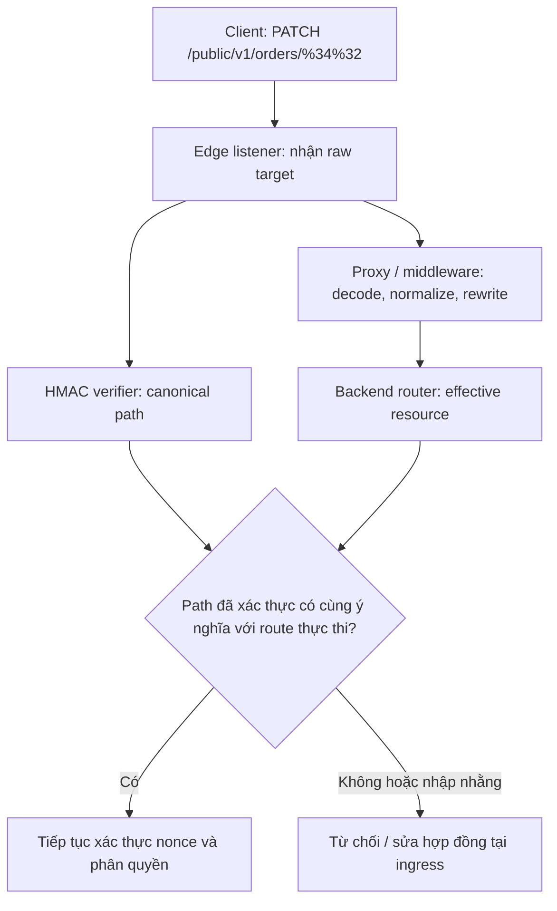

# Tránh path ambiguity trong URL khi xác thực HTTP request bằng HMAC

**Path ambiguity** (tính nhập nhằng của đường dẫn) xuất hiện khi hai thành phần xử lý HTTP không thống nhất về **đường dẫn thực sự được yêu cầu**. Ví dụ, gateway có thể nhìn thấy `/v1/orders/%34%32`, trong khi router backend giải mã thành `/v1/orders/42`; hoặc proxy xóa `/../` nhưng bộ xác minh HMAC lại ký chuỗi chưa được xử lý. Với xác thực request, đây không chỉ là lỗi tương thích: nếu verifier xác nhận một path nhưng handler thực thi một tài nguyên khác, quyết định bảo mật có thể áp vào **sai đối tượng**.

Bài **Tránh path ambiguity** thuộc chương **URL và path** của module `SECURITY_AUTHENTICATION_HMAC_REQUEST_AUTHENTICATION`. Hợp đồng của module là xác thực HTTP request bằng **HMAC và shared secret**, với canonical request ràng buộc phương thức, URI, header hoặc body; có cơ chế xác minh chữ ký, chống replay bằng timestamp/nonce, key rotation, kiểm thử proxy/gateway và phân biệt xác thực với phân quyền. Bài này chọn một nguyên tắc thực hành xuyên suốt: **path được ký, path được xác minh, path được phân quyền và path được thực thi phải thống nhất về ý nghĩa**.

## 1. Mục tiêu học tập

Sau bài học, bạn có thể:

1. Giải thích path ambiguity xảy ra thế nào giữa raw URI, decoded path, normalized path, route mapping và đường dẫn sau rewrite.
2. Nhận diện nguy cơ từ `%2F`, `%5C`, `%2e`, `..`, nhiều dấu `/`, dấu `;`, percent-decoding nhiều lần, encoding Unicode và query nhập nhằng.
3. Định nghĩa hợp đồng ký HMAC có phiên bản, chọn **nguồn path đáng tin cậy** và tránh sử dụng dữ liệu đã bị parser khác diễn giải lại.
4. Thiết kế chính sách từ chối path nhập nhằng (*reject noncanonical representations*) cho một nhóm endpoint cụ thể, thay vì tự sửa URI cho “khớp chữ ký”.
5. Viết ví dụ Java 17 ký/xác minh HMAC-SHA256 gắn với **raw request target** và kiểm thử các biến thể nguy hiểm.
6. Kết hợp kiểm soát path với nonce/timestamp, key rotation, phân quyền tenant/resource và test xuyên suốt gateway.

## 2. Vì sao một URL có thể bị hiểu thành nhiều path?

Một URL thường có dạng:

```text
https://api.example.test/v1/orders/42?expand=items
\___/  \______________/ \___________/ \__________/
scheme     authority       path         query
```

Trong request HTTP/1.1 gửi trực tiếp tới origin server, client thường gửi **origin-form request target**:

```http
GET /v1/orders/42?expand=items HTTP/1.1
Host: api.example.test
```

Ở HTTP/2 hoặc HTTP/3, phần path và query của request thông thường nằm trong pseudo-header `:path`; method nằm trong `:method`. **Fragment** `#section` của URL ở phía client không được đưa vào request target trên HTTP. Path và query thuộc cùng request target nhưng cần được phân biệt khi định tuyến và ký.

| Khái niệm | Ví dụ | Điều cần phân biệt |
| --- | --- | --- |
| **Raw request target** | `/v1/orders/%34%32?x=1` | Biểu diễn URI theo request được nhận ở điểm xác minh, chưa tùy tiện decode/rebuild. |
| **Raw path** | `/v1/orders/%34%32` | Phần trước dấu `?`; dấu percent escape vẫn được giữ. |
| **Decoded path** | `/v1/orders/42` | Một kết quả có thể có sau percent-decoding. Không mặc nhiên thay thế raw path. |
| **Normalized path** | `/v1/orders/42` | Kết quả có thể sau loại dot-segment, gộp dấu `/` hoặc chuẩn hóa khác. |
| **Effective route** | `OrderController.update(42)` | Endpoint mà backend thực thi sau quá trình match/rewrite. |
| **Trusted original path** | Path được edge ghi nhận trước rewrite qua cơ chế nội bộ tin cậy | Cần chứng minh nguồn và tính toàn vẹn, không lấy từ header client tự khai. |

**Raw** ở đây phải được hiểu trong ngữ cảnh: tầng HTTP có thể đã chuẩn hóa trước khi cung cấp giá trị cho Java filter. Một API tên `getRawPath()` chỉ bảo toàn percent escape **trong đối tượng URI đã được tạo**, chứ không hứa khôi phục được request target ban đầu nếu proxy đã chỉnh sửa trước đó.

### Trục trặc do cùng path được xử lý ở nhiều thời điểm



Nếu verifier ký `/public/v1/orders/%34%32` nhưng proxy rewrite thành `/v1/orders/42`, việc thay đổi là **dễ hiểu và có thể được thiết kế có chủ ý**. Tuy nhiên, không thể tự kết luận an toàn nếu chưa ràng buộc tuyến chuyển đổi với resource mà backend thực thi. Phương án dễ kiểm chứng nhất là xác minh ở edge trước rewrite, rồi chuyển **principal đã xác thực** và thông tin định tuyến đã kiểm soát tới backend.

## 3. Các nguồn path ambiguity thường gặp

Không phải mọi biểu diễn khác nhau đều là tấn công. Nguy cơ xuất hiện khi verifier, WAF, gateway, router và backend **chấp nhận hoặc diễn giải các biểu diễn khác nhau**.

| Biểu diễn đầu vào | Khả năng bất đồng | Rủi ro |
| --- | --- | --- |
| `/v1/orders/%34%32` so với `/v1/orders/42` | Percent-decoding thành ký tự `42`. | Verifier ký raw path nhưng một lớp khác định tuyến theo decoded path. |
| `/v1/a%2Fb` so với `/v1/a/b` | `%2F` có thể trở thành dấu phân đoạn `/`. | ID một segment có thể biến thành hai segment. |
| `/v1/a%5Cb` | `%5C` có thể trở thành `\`; một số thành phần coi backslash là separator. | Route và kiểm tra path traversal không nhất quán. |
| `/v1/./orders` hoặc `/v1/x/../orders` | Dot-segment resolution. | Rule bảo vệ một path nhưng handler đi sang path khác. |
| `/v1/%2e%2e/admin` | Percent-encoded `..` rồi normalize. | Chặn `..` raw chưa đủ nếu decode trước khi route. |
| `/v1/%252e%252e/admin` | Decode `%25` thành `%`; lần decode thứ hai tạo `..`. | **Double-decoding** vượt qua kiểm tra chỉ thực hiện một lần. |
| `/v1//orders/42` | Một lớp gộp `//`, lớp khác giữ nguyên. | Route alias, bypass rule prefix hoặc HMAC mismatch. |
| `/v1/orders/42/` | Có tầng coi slash cuối tương đương không có slash. | Cùng resource có nhiều biểu diễn khác byte. |
| `/v1/orders/42;role=admin` | Một số framework có quy tắc path/matrix parameters, loại đoạn sau `;`. | Path kiểm tra khác path handler dùng. |
| `/V1/orders/42` | Path thường phân biệt hoa/thường; routing/ngôn ngữ có thể không. | Chính sách allowlist không đồng nhất. |
| Unicode có nhiều dạng biểu diễn | Ký tự nhìn giống nhau có thể khác bytes hoặc dạng normalization. | Client/server không khớp canonical bytes; log và review khó phân biệt. |
| Query tham số lặp, ví dụ `?role=user&role=admin` | Parser chọn first/last/all, trong khi verifier ký map hoặc raw query. | Giá trị nghiệp vụ mà backend dùng có thể không phải giá trị đã kiểm tra. |

**Phân biệt hai vấn đề:**

- **Chữ ký không khớp (*false negative*)**: client và server dùng cùng secret nhưng HMAC tính trên hai chuỗi khác byte do rewrite. Đây là lỗi tích hợp, có thể khiến request hợp lệ bị từ chối.
- **Lệch ý nghĩa bảo mật (*security mismatch*)**: verifier kiểm tra/cho phép một resource, nhưng handler thực thi resource khác sau khi giải mã/chuẩn hóa. Kể cả HMAC khớp trên chuỗi mà verifier chọn, quyết định truy cập vẫn có thể sai. Điều này không có nghĩa HMAC bị phá về mặt mật mã; **hợp đồng ký hoặc ranh giới tin cậy mới là vấn đề**.

### 3.1. Encoded slash và backslash

Đường dẫn `/files/team%2Fadmin` có thể được hiểu là ID `team/admin` trong **một** path segment, hoặc hai segment `team` và `admin` sau decode. Nếu hệ thống dùng path segment để phân quyền thư mục, hai cách hiểu có thể chọn tài nguyên khác nhau. Tương tự, `%5C` rất nguy hiểm trong môi trường có tầng chấp nhận `\` như dấu phân tách.

Với API không cần slash nằm trong một ID, chính sách đơn giản là **từ chối encoded slash/backslash trong path** và kiểm thử để chắc chắn việc từ chối diễn ra **trước khi chúng bị decode mất dấu vết**.

### 3.2. Dot-segment và double decoding

Ví dụ:

```text
/v1/orders/../admin
/v1/orders/%2e%2e/admin
/v1/orders/%252e%252e/admin
```

Khi trải qua các bước decode/normalize khác nhau, những chuỗi này có thể dẫn tới route không như verifier đã kiểm tra. Không nên xử lý bằng cách “decode lần nữa nếu còn dấu `%`” hoặc cứ tự `normalize()` rồi dùng một path mới để xác minh. Với endpoint không cần những biểu diễn này, **từ chối ngay tại điểm tin cậy** là lựa chọn an toàn và dễ kiểm thử.

### 3.3. Separator, matrix parameter và slash cuối

Một số container/framework có tùy chọn strip `;...` hoặc gộp `//`; một số router tự redirect path có slash cuối sang dạng không slash. Nếu những phép biến đổi diễn ra **trước** hoặc **sau** HMAC verifier theo thứ tự không nhất quán, hai request raw khác nhau có thể trở thành cùng resource hoặc một request có thể đổi route. Với endpoint có chữ ký, cần quyết định: chỉ chấp nhận một biểu diễn duy nhất, hoặc quy định **canonicalization có phiên bản** và buộc mọi tầng thực thi cùng quy tắc.

### 3.4. Unicode và encoding

URI raw thường sử dụng percent-encoding cho byte không nằm trong bộ ký tự trực tiếp. Cùng ký tự có thể có những biểu diễn Unicode khác nhau (ví dụ ký tự dựng sẵn và tổ hợp dấu), và một số hệ thống file/DB/framework có thể normalize. Một path chứa ký tự nhìn giống nhau **không chắc cùng bytes**. Đừng dựa vào hình thức hiển thị trên log để kết luận HMAC đã ký cùng tài nguyên. Với API ID có thể định nghĩa bằng ASCII số/chữ không dấu, **giới hạn ID vào bảng chữ cái rõ ràng** sẽ giảm đáng kể bề mặt nhập nhằng.

## 4. Chiến lược phòng thủ: một hợp đồng, một cách hiểu

Không có một hàm `normalizePath()` mặc định nào an toàn cho mọi loại route. Cần chọn **chính sách theo tài nguyên** và kiểm chứng xuyên suốt hạ tầng.

### Chiến lược A — Chấp nhận duy nhất dạng path chuẩn của API

Giả sử API chỉ hỗ trợ cập nhật đơn hàng bằng:

```text
PATCH /v1/orders/{positiveDecimalId}
```

Ví dụ chính sách **strict V1**:

- Raw origin-form path phải khớp **`/v1/orders/[1-9][0-9]{0,11}`**; `42` hợp lệ, `042` hoặc `0` không hợp lệ theo chính sách ID ví dụ.
- Endpoint này **không nhận query**, dù `?` rỗng; cần query thì thiết kế phiên bản/endpoint có quy tắc rõ.
- Không cho phép percent escape trong path, slash đôi, dot-segment, dấu `;`, backslash, trailing slash, Unicode hoặc absolute-form.
- Chỉ nhận method `PATCH` đúng chữ hoa, với media type và header ký đã định nghĩa.
- Router/backend phải dùng đúng ID đã được validate, không áp dụng một quy tắc decode/route khác làm thay đổi resource.
- Những yêu cầu hợp lệ nhưng dùng biểu diễn khác **bị từ chối**, không được tự sửa thành canonical path rồi cho qua.

Ưu điểm: có thể kiểm thử bằng regex, giảm khả năng parser disagreement. Đổi lại, chính sách **rất hẹp**, chỉ phù hợp endpoint có cấu trúc path rõ ràng. Không sao chép regex này sang mọi API, nhất là URL cần slug Unicode, query hoặc path segment đa dạng.

### Chiến lược B — Canonicalization có phiên bản

Với API bắt buộc hỗ trợ percent-encoding, có thể xây một thuật toán canonicalization **được đặc tả từng byte**: parse theo chuẩn đã chọn, quy tắc percent escape, Unicode, thứ tự query, ký tự được phép, duplicate parameters, slash, dot-segment, host và phương thức. Cả client, verifier, gateway và backend phải dùng **cùng thuật toán và cùng cách định tuyến**. Tài liệu ký cần nêu rõ:
 
1. Đầu vào là raw target **ở đâu**, trước hay sau rewrite?
2. Có decode không, decode bao nhiêu lần, áp dụng quy tắc nào?
3. Phần nào được chuẩn hóa? Phần nào phải giữ byte gốc?
4. Nếu hai raw path trở thành cùng canonical path, backend **có thực sự xử lý cùng resource với cùng quyền** không?
5. Các biểu diễn mơ hồ bị từ chối hay được chọn một dạng duy nhất? Có test vector đầy đủ chưa?
6. Nếu client gửi path bị sửa trên đường truyền, chữ ký phải thất bại hay chuyển đổi này là một phần hợp đồng có kiểm soát?

Đây là bài toán thiết kế giao thức khó hơn chiến lược A; nếu chưa có lý do rõ ràng, ưu tiên **allowlist route hẹp**.

## 5. HMAC bảo vệ path như thế nào?

Ta dùng hợp đồng ký minh họa **HMAC-SHA256-V1** cho endpoint `PATCH /v1/orders/42`. Chữ ký sử dụng shared secret của credential đã đăng ký và bao gồm path bên cạnh method, header và digest của body.

| Thành phần | Quy tắc V1 |
| --- | --- |
| Version/audience | Hai dòng `HMAC-SHA256-V1` và `orders-api-prod`, cố định. |
| Method | Chính xác `PATCH`, không tự chuyển case. |
| Raw request target | Một dòng `/v1/orders/42` đã thỏa allowlist path strict, không có query. |
| Content type | `content-type:application/json-patch+json`, một giá trị duy nhất. |
| Điều kiện cập nhật | `if-match:"order-42-v7"`, ký để bảo vệ precondition. |
| Key ID | `x-key-id:partner-a-202611` để tra đúng secret ACTIVE. |
| Timestamp | `x-timestamp:<UTC dạng RFC 3339 theo V1>`; được ký và kiểm tra freshness. |
| Nonce | `x-nonce:<Base64URL random 128-bit>`; được ký và chỉ sử dụng một lần. |
| Body | `sha256:<lowercase hex SHA-256(raw body bytes)>`. |
| MAC output | HMAC-SHA256 đầy đủ 32 byte, Base64 chuẩn có padding trong header `X-Signature: v1=...`. |
| Encoding chuỗi ký | UTF-8, LF giữa các dòng, không có LF cuối. |

Request client gửi:

```http
PATCH /v1/orders/42 HTTP/1.1
Host: api.example.test
Content-Type: application/json-patch+json
If-Match: "order-42-v7"
X-Key-Id: partner-a-202611
X-Timestamp: 2026-11-28T02:00:00Z
X-Nonce: Zq8DxKtUokcwPGNj3d_yvQ
X-Signature: v1=<BASE64_FULL_HMAC_SHA256>

[{"op":"replace","path":"/deliveryInstructions","value":"Leave at reception"}]
```

Canonical request:

```text
HMAC-SHA256-V1
orders-api-prod
PATCH
/v1/orders/42
content-type:application/json-patch+json
if-match:"order-42-v7"
x-key-id:partner-a-202611
x-timestamp:2026-11-28T02:00:00Z
x-nonce:Zq8DxKtUokcwPGNj3d_yvQ
sha256:<LOWERCASE_HEX_OF_RAW_BODY_SHA256>
```

`<...>` là placeholder, không phải signature/digest thật. Client phải tính SHA-256 từ raw JSON Patch body, thay dòng cuối, rồi tính:

\[
\mathrm{tag} = \operatorname{HMAC}_{\mathrm{SHA256}}
  (\mathrm{sharedSecret},\ \operatorname{UTF8}(\mathrm{canonicalRequest}))
\]

Server **tự dựng** canonical request từ các trường đã nhận ở điểm xác minh, tra đúng shared secret theo key ID và so sánh **raw MAC bytes** an toàn. Không cho client gửi sẵn “canonical path” để server tin, cũng không dùng `X-Original-URI` từ phía ngoài làm dữ liệu ký.

### Path ambiguity có thể làm chữ ký không còn có ý nghĩa như dự kiến

Giả sử verifier nhận signature hợp lệ cho `/v1/orders/42`. Nếu một tầng khác thực thi request trên `/v1/orders/43` vì một phép rewrite hoặc tham số path do client kiểm soát nằm **ngoài dữ liệu ký**, verifier đã chứng minh một điều khác với hành động thực tế. Việc MAC hợp lệ **không tự bù đắp** lỗi ánh xạ tài nguyên. Cần đảm bảo effective route và resource ID đi vào authorization **chính là route/ID có ý nghĩa đã được xác minh**.

Nếu backend chỉ nhìn raw path sau rewrite, có thể phát sinh **MAC mismatch** ngay cả khi không có attacker: signature của client và HMAC của backend khác byte. Không sửa bằng cách “thử URI trước và sau rewrite cho đến khi có chữ ký khớp”; hãy lựa chọn rõ điểm xác minh hoặc xây hợp đồng chuyển đổi tin cậy.

## 6. Java 17: kiểm soát path strict trước khi tạo HMAC

Ví dụ sau chọn **Chiến lược A** để tránh sự nhập nhằng: endpoint chỉ chấp nhận `PATCH /v1/orders/{positiveDecimalId}` không query, không percent-encoding. Hợp đồng cũng yêu cầu `Content-Type` và strong ETag chính xác, nhưng **các điều kiện dùng chung với HTTP adapter phải được bảo đảm bên ngoài class này**.

Class dùng Java 17, `javax.crypto.Mac` và `MessageDigest.isEqual`. Dữ liệu đầu vào được truyền từ lớp HTTP listener **đáng tin cậy**; không tự lấy raw target qua header do client đặt.

```java
import java.nio.charset.StandardCharsets;
import java.security.GeneralSecurityException;
import java.security.MessageDigest;
import java.time.Instant;
import java.time.format.DateTimeParseException;
import java.util.Arrays;
import java.util.Base64;
import java.util.HexFormat;
import java.util.List;
import java.util.regex.Pattern;
import javax.crypto.Mac;
import javax.crypto.spec.SecretKeySpec;

public final class StrictPathHmacV1 {
    private static final String HMAC_ALGO = "HmacSHA256";
    private static final String PREFIX = "v1=";
    private static final String AUDIENCE = "orders-api-prod";
    private static final String CONTENT_TYPE = "application/json-patch+json";
    private static final Pattern RAW_TARGET =
            Pattern.compile("/v1/orders/[1-9][0-9]{0,11}");
    private static final Pattern KEY_ID =
            Pattern.compile("[A-Za-z0-9_-]{1,80}");
    private static final Pattern STRONG_ETAG =
            Pattern.compile("\"[A-Za-z0-9._-]{1,128}\"");
    private static final Pattern UTC_SECONDS =
            Pattern.compile("[0-9]{4}-[0-9]{2}-[0-9]{2}T"
                    + "[0-9]{2}:[0-9]{2}:[0-9]{2}Z");

    private StrictPathHmacV1() {}

    public record SignedRequest(
            String method,
            String rawTarget,
            String contentType,
            String ifMatch,
            String keyId,
            String timestamp,
            String nonce,
            byte[] rawBody) {}

    // Chính sách cho duy nhất một nhóm route. Không decode hay normalize.
    public static void validateRawTarget(String target) {
        if (target == null || !RAW_TARGET.matcher(target).matches()) {
            throw new IllegalArgumentException(
                    "Raw target is not an allowed canonical order route");
        }
    }

    private static void validate(SignedRequest req) {
        if (req == null || !"PATCH".equals(req.method())
                || !CONTENT_TYPE.equals(req.contentType())
                || !STRONG_ETAG.matcher(
                        req.ifMatch() == null ? "" : req.ifMatch()).matches()
                || !KEY_ID.matcher(
                        req.keyId() == null ? "" : req.keyId()).matches()
                || !UTC_SECONDS.matcher(
                        req.timestamp() == null ? "" : req.timestamp()).matches()
                || req.nonce() == null
                || req.rawBody() == null
                || req.rawBody().length > 65536) {
            throw new IllegalArgumentException("Invalid signed fields");
        }
        validateRawTarget(req.rawTarget());
        try {
            Instant.parse(req.timestamp());
        } catch (DateTimeParseException ex) {
            throw new IllegalArgumentException("Invalid timestamp", ex);
        }
        // Kiểm tra Base64URL canonical của đúng 16 bytes nonce.
        try {
            byte[] nonce = Base64.getUrlDecoder().decode(req.nonce());
            if (nonce.length != 16
                    || !Base64.getUrlEncoder().withoutPadding()
                            .encodeToString(nonce).equals(req.nonce())) {
                throw new IllegalArgumentException("Invalid nonce format");
            }
        } catch (IllegalArgumentException ex) {
            throw new IllegalArgumentException("Invalid nonce format", ex);
        }
    }

    public static byte[] canonicalBytes(SignedRequest req)
            throws GeneralSecurityException {
        validate(req);
        String bodyHash = HexFormat.of().formatHex(
                MessageDigest.getInstance("SHA-256").digest(req.rawBody()));
        String canonical = String.join("\n",
                "HMAC-SHA256-V1",
                AUDIENCE,
                req.method(),
                req.rawTarget(),
                "content-type:" + req.contentType(),
                "if-match:" + req.ifMatch(),
                "x-key-id:" + req.keyId(),
                "x-timestamp:" + req.timestamp(),
                "x-nonce:" + req.nonce(),
                "sha256:" + bodyHash);
        return canonical.getBytes(StandardCharsets.UTF_8);
    }

    private static byte[] mac(byte[] secret, byte[] canonical)
            throws GeneralSecurityException {
        // Đây là policy provisioning, không phải giới hạn của HMAC/JCA.
        if (secret == null || secret.length < 32) {
            throw new IllegalStateException("Credential violates key policy");
        }
        Mac mac = Mac.getInstance(HMAC_ALGO);
        mac.init(new SecretKeySpec(secret, HMAC_ALGO));
        return mac.doFinal(canonical);
    }

    public static String sign(byte[] secret, SignedRequest request)
            throws GeneralSecurityException {
        return PREFIX + Base64.getEncoder().encodeToString(
                mac(secret, canonicalBytes(request)));
    }

    public static boolean verify(
            byte[] activeSecret, SignedRequest received, String signature)
            throws GeneralSecurityException {
        if (signature == null || !signature.startsWith(PREFIX)) {
            return false;
        }
        String encoded = signature.substring(PREFIX.length());
        byte[] supplied;
        try {
            supplied = Base64.getDecoder().decode(encoded);
        } catch (IllegalArgumentException malformed) {
            return false;
        }
        if (supplied.length != 32
                || !Base64.getEncoder().encodeToString(supplied)
                        .equals(encoded)) {
            return false;
        }
        byte[] expected = mac(activeSecret, canonicalBytes(received));
        return MessageDigest.isEqual(expected, supplied);
    }

    public static void main(String[] args) throws Exception {
        // Test key cố định, không dùng làm production credential.
        byte[] secret = new byte[32];
        Arrays.fill(secret, (byte) 0x4a);
        byte[] body = ("[{\"op\":\"replace\",\"path\":\"/deliveryInstructions\","
                + "\"value\":\"Leave at reception\"}]")
                .getBytes(StandardCharsets.UTF_8);

        SignedRequest valid = new SignedRequest(
                "PATCH", "/v1/orders/42", CONTENT_TYPE, "\"order-42-v7\"",
                "partner-a-202611", "2026-11-28T02:00:00Z",
                "Zq8DxKtUokcwPGNj3d_yvQ", body);
        String signature = sign(secret, valid);
        if (!verify(secret, valid, signature)) {
            throw new AssertionError("Valid signed request rejected");
        }

        List<String> ambiguous = List.of(
                "/v1/orders/%34%32",
                "/v1/orders/%2e%2e/42",
                "/v1/orders/%252e%252e/42",
                "/v1//orders/42",
                "/v1/orders/../42",
                "/v1/orders/042",
                "/v1/orders/42/",
                "/v1/orders/42?expand=items",
                "/v1/orders/42;role=admin",
                "https://api.example.test/v1/orders/42");
        for (String target : ambiguous) {
            try {
                validateRawTarget(target);
                throw new AssertionError("Ambiguous route accepted: " + target);
            } catch (IllegalArgumentException expected) {
                // V1 chủ động từ chối representation ngoài allowlist.
            }
        }

        SignedRequest otherId = new SignedRequest(
                "PATCH", "/v1/orders/43", valid.contentType(),
                valid.ifMatch(), valid.keyId(), valid.timestamp(),
                valid.nonce(), valid.rawBody());
        if (verify(secret, otherId, signature)) {
            throw new AssertionError("Signature was reused on another ID");
        }
        System.out.println("Strict raw-path HMAC checks passed");
    }
}
```

### Vì sao cách triển khai này tránh được một số bẫy?

- `RAW_TARGET.matcher(target).matches()` so sánh **toàn bộ** path với dạng được phép. Không có bước giải mã `%xx` hay gọi `URI.normalize()`; path chứa `%2F`, `%2e`, `;`, query hoặc absolute URL đều bị từ chối theo policy endpoint.
- Method `PATCH` được ký chính xác. `POST`, `patch` hay request-target khác không thể sử dụng cùng dữ liệu ký.
- `If-Match` được đưa vào MAC để người gửi không thể giữ chữ ký mà tùy ý đổi điều kiện phiên bản. Việc so **strong ETag hiện hành** trong transaction vẫn là trách nhiệm backend.
- Hash body tính từ **raw bytes**, không phải một JSON object được serialize lại.
- Key HMAC được giữ dạng `byte[]`; tag HMAC-SHA256 được so sánh bằng `MessageDigest.isEqual`. Base64 chỉ là định dạng truyền tag.
- `nonce` phải có đúng 16 byte khi giải mã Base64URL canonical, nhưng từ một request không thể chứng minh entropy thực sự. **Client phải tạo nonce bằng CSPRNG**, server còn phải claim nonce chống replay.
- Bài dùng `Instant.parse` chỉ để nhận timestamp theo định dạng; **chưa so với thời gian hiện tại**. Kiểm tra đồng hồ và nonce store thuộc tầng verifier đầy đủ.

**Giới hạn:** regex là chính sách cho **endpoint có path chỉ gồm chữ số**, không giải quyết toàn bộ path ambiguity trên mọi route. Nếu HTTP listener đã decode/normalize trước khi cung cấp `rawTarget`, regex có thể chỉ kiểm tra dữ liệu **sau khi thay đổi**, chứ không biết client gửi gì. Cần thực sự kiểm thử ingress/proxy và bảo đảm router backend không áp lại quy tắc khác. Đây là ví dụ lõi mật mã; chưa có DB, JSON Patch engine, HTTP adapter, authorization hay store chống replay.

## 7. Java web stack: raw path lấy từ đâu?

Không phải mọi Java HTTP framework đều cung cấp giống hệt **raw request target tại edge trước proxy rewrite**.

| Tầng | Giá trị thường có | Cần kiểm tra trước khi tin |
| --- | --- | --- |
| **CDN/edge listener** | Request-target ở HTTP/1.1, `:path` ở HTTP/2/3. | Có decode/normalize trước khi plugin xác thực chạy không? |
| **Reverse proxy** | Path nhận ở client và path upstream sau rewrite. | Việc strip prefix, rewrite, decode `%2F` và query có làm đổi byte ký không? |
| **Servlet container** | `HttpServletRequest.getRequestURI()` và `getQueryString()`. | Giá trị có giữ percent escape và prefix ban đầu không? Container/proxy đã chuyển đổi chưa? |
| **Java `URI`** | `getRawPath()` so với `getPath()`. | `getPath()` có thể trả về decoded path; `getRawPath()` không phục hồi byte đã bị proxy sửa. |
| **Spring MVC/router** | Path variable, matched route, decoded parameter map. | Đó là dữ liệu **đã parse**, không phải nguồn tin cậy để tái tạo raw target theo hợp đồng. |

Ví dụ sử dụng servlet, **chỉ khi deployment đã xác minh contract của container**:

```java
// request là jakarta.servlet.http.HttpServletRequest ở tầng phù hợp.
String rawPath = request.getRequestURI();
String rawQuery = request.getQueryString();
String rawTarget = rawQuery == null ? rawPath : rawPath + "?" + rawQuery;
StrictPathHmacV1.validateRawTarget(rawTarget); // V1 không cho query.
```

Nếu ứng dụng triển khai dưới context path hoặc proxy strip prefix, `request.getRequestURI()` có thể không tương ứng với route mà client ký. Nếu dữ liệu đã decode trước đó, kết quả kiểm tra không còn chứng minh raw path gốc hợp lệ. Điều kiện đúng **không phải** “API Java có chữ Raw trong tên”, mà là **chứng minh đường đi và ngữ nghĩa của bytes** qua các tầng trong deployment thật.

### Không tin header “original URL” do client gửi

Các header như `X-Original-URI`, `X-Rewrite-URL` hay `X-Forwarded-*` đôi khi được proxy sử dụng để truyền thông tin request ban đầu. Chúng **không tự đáng tin**. Client Internet có thể tự gửi một header cùng tên. Nếu cần mang path đã xác minh tới backend:

1. Gateway xóa các header nội bộ do client đưa vào.
2. Gateway tự tạo metadata từ dữ liệu ingress mà nó đã xác minh.
3. Kết nối gateway–backend được bảo vệ, và backend chỉ chấp nhận metadata qua ranh giới tin cậy.
4. Backend bảo đảm resource/tenant/route thực thi khớp với metadata đã xác thực.
5. Log và monitoring không biến chuỗi URI chưa kiểm chứng thành bằng chứng danh tính.

Với endpoint nhạy cảm, nên đặt HMAC verifier **trước các rewrite có thể đổi ngữ nghĩa**, hoặc thiết kế một cơ chế định tuyến đã được tin cậy và kiểm toán end-to-end.

## 8. Phân quyền phải dựa trên resource mà backend thực sự xử lý

Giả sử một client ký đúng:

```http
PATCH /v1/orders/42 HTTP/1.1
```

HMAC chứng minh request hợp lệ dưới credential đang hoạt động **cho canonical request chứa path `/v1/orders/42`**. Nhưng client có được sửa đơn 42 hay không là câu hỏi **authorization**.

| Lớp | Câu hỏi | Ví dụ |
| --- | --- | --- |
| **Authentication** | Client có tạo được MAC từ shared secret đúng key ID trên dữ liệu đã ký không? | HMAC đúng cho `PATCH /v1/orders/42`. |
| **Routing consistency** | Verifier, router và backend có thống nhất ID resource không? | Handler thực sự xử lý đơn **42**, không phải ID khác sau rewrite/decode. |
| **Authorization** | Client có quyền cập nhật đơn 42 của tenant tương ứng không? | Có thể thiếu `orders:update` hoặc không thuộc tenant. |
| **Business validation** | Bản ghi có thể thay đổi theo nghiệp vụ không? | Đơn đã giao hoặc ETag không khớp có thể bị từ chối. |

Đừng dùng một kiểm tra mơ hồ kiểu `path.startsWith("/v1/orders")` làm cơ sở cấp quyền, rồi để router giải mã thành `/v1/orders-admin` hay route khác. Cần phân quyền trên **resource ID và tenant đã được router đáng tin cậy xác định**, đồng thời bảo đảm việc xác định này nhất quán với canonical path đã xác minh.

Với endpoint PATCH JSON Patch, phân quyền còn phải kiểm tra **đường dẫn dữ liệu trong patch document**: `/deliveryInstructions` có thể được phép nhưng `/totalAmount` không. Đường `path` và `from` thuộc JSON Pointer, không phải HTTP URL path; đây là **một tầng parsing khác** cần quy tắc authorization riêng.

## 9. Path ambiguity và chống replay/key rotation

**Path chính xác vẫn chưa đủ để xác thực an toàn.** HMAC-SHA256 là xác định: nếu client gửi lại nguyên request đã ký thì MAC vẫn như cũ. Hợp đồng nên bao gồm:

- Timestamp UTC **đã ký**, chỉ nhận trong cửa sổ, ví dụ ±300 giây.
- Nonce **đã ký**, có entropy ngẫu nhiên đủ mạnh, chỉ dùng một lần cho credential tương ứng.
- Kho nonce dùng chung cho các instance và thao tác **claim nguyên tử** (*insert if absent*) sau khi HMAC đúng và trước side effect.
- TTL nonce kéo dài đến khi timestamp không còn được chấp nhận, cộng biên an toàn. Với cửa sổ ±5 phút, timestamp nhanh 5 phút có thể còn hợp lệ tối đa khoảng 10 phút từ lần nhận sớm nhất; TTL 5 phút từ lúc nhận có thể không đủ.
- **Fail closed** khi nonce store lỗi với endpoint bắt buộc chống replay.

Key rotation cũng là một phần của hợp đồng:

| Key ID | Client logic | Secret | Trạng thái |
| --- | --- | --- | --- |
| `partner-a-202611` | `partner-a` | Secret A | ACTIVE trong thời gian overlap. |
| `partner-a-202702` | `partner-a` | Secret B khác A | ACTIVE mới. |
| `partner-a-202608` | `partner-a` | Đã thu hồi | REVOKED, không chấp nhận. |

Server dùng **đúng một secret** theo `keyId`, không thử hàng loạt khóa nếu MAC không khớp. Khi key bị revoke, gateway/cache phải phản ánh thay đổi kịp thời. Đừng tái sử dụng cùng secret cho nhiều môi trường/audience rồi hy vọng path khác nhau ngăn được chữ ký bị phát lại ở dịch vụ khác.

Retry hợp lệ phải dùng timestamp/nonce mới và ký lại. Đối với thao tác tạo/sửa có side effect, cần cơ chế idempotency hoặc điều kiện phiên bản như `If-Match`. HMAC, replay prevention và idempotency giải quyết **ba mục đích khác nhau**.

## 10. Chiến lược kiểm thử qua proxy và gateway

Thay vì chỉ unit test HMAC trên chuỗi có sẵn, hãy gửi request qua **đúng HTTP listener, proxy, security filter, router và backend** của môi trường triển khai.

| Nhóm kiểm thử | Input / biến thể | Kết quả mong đợi |
| --- | --- | --- |
| Positive | `PATCH /v1/orders/42` với key, signature, timestamp, nonce, ETag hợp lệ. | Verifier tính MAC đúng; router xử lý resource 42; phân quyền tiếp tục. |
| Encoded digit | `/v1/orders/%34%32`. | Chính sách strict V1 từ chối raw biểu diễn ngoài allowlist. |
| Encoded slash | `/v1/orders/4%2F2`. | Từ chối; không diễn giải thành hai path segment. |
| Encoded backslash | `/v1/orders/4%5C2`. | Từ chối. |
| Encoded dot | `/v1/orders/%2e%2e/42`. | Từ chối. |
| Double encoding | `/v1/orders/%252e%252e/42`. | Từ chối; không thử decode nhiều lần để hợp thức hóa. |
| Dot-segment | `/v1/orders/../42`. | Từ chối, dù một tầng có thể normalize thành đường khác. |
| Repeated slash | `/v1//orders/42`. | Từ chối, không ngầm gộp. |
| Trailing slash | `/v1/orders/42/`. | Từ chối theo V1. |
| Semicolon parameter | `/v1/orders/42;role=admin`. | Từ chối; không để framework strip sau xác minh. |
| Query | `/v1/orders/42?x=1` hoặc `/v1/orders/42?`. | Từ chối vì endpoint ví dụ không nhận query. |
| ID alias | `/v1/orders/042`. | Từ chối theo chính sách ID dạng chuẩn. |
| Absolute-form | `https://api.example.test/v1/orders/42`. | Từ chối ở endpoint V1 chỉ nhận origin-form. |
| Sai signature | Ký path `/v1/orders/42`, gửi `/v1/orders/43` giữ nguyên tag. | MAC mismatch; không cập nhật đơn 43. |
| Trường ký thay đổi | Giữ tag, sửa `If-Match`, method, Content-Type hoặc một byte body. | Từ chối vì MAC khác hoặc validation thất bại. |
| Replay | Gửi cùng `(keyId, nonce)` đến hai instance đồng thời. | Tối đa một request claim thành công. |
| Credential | Key đã REVOKED hoặc thuộc audience khác. | Từ chối trước xử lý nghiệp vụ. |
| Authorization | Chữ ký đúng trên đơn 42 nhưng client chỉ có quyền đơn 43. | Phân quyền từ chối, không sửa resource. |
| Proxy rewrite | Client ký path có prefix công khai, backend nhận path đã strip. | Test xác nhận điểm xác minh và ánh xạ route; không chấp nhận “thử hai path”. |

**Test vector ký:** lưu secret thử nghiệm, raw method, raw target, header được ký, raw body bytes, digest body, canonical UTF-8, MAC raw dạng hex và Base64 wire. Không lưu secret production. **Test định tuyến:** log dưới dạng đã lọc cả canonical path được xác minh và route/resource ID backend chọn để kiểm tra bất đồng; không xuất raw secret hoặc body nhạy cảm vào log.

## 11. Những cách sửa lỗi tưởng đúng nhưng dễ tạo lỗ hổng

| Cách sửa nhanh | Vì sao không an toàn | Hướng thay thế |
| --- | --- | --- |
| `URLDecoder.decode(path)` trước khi ký vì “dễ so khớp”. | Có thể biến `%2F`, `%2e` hoặc `+` theo quy tắc ngoài hợp đồng; không bảo toàn raw path. | Ký dữ liệu đúng hợp đồng và validate biểu diễn ngay tại ingress. |
| Gọi `URI.normalize()` rồi ký path mới. | Có thể gộp dot-segment, làm verifier và backend khác nghĩa. | Chỉ normalize nếu có hợp đồng canonicalization được chứng minh và kiểm thử cùng router; không tự làm. |
| Decode hai lần “cho chắc”. | Tạo cơ hội double-encoding bypass, biến raw path thành đích khác. | Từ chối biểu diễn nhập nhằng, không thực hiện decode lặp tùy ý. |
| Cho phép `startsWith("/v1/orders")` để bảo vệ route. | Cùng prefix có thể bao gồm route không mong muốn. | Match toàn bộ route có cấu trúc và resource ID rõ. |
| Cho backend tin `X-Original-URI`. | Client ngoài có thể giả mạo header. | Chỉ metadata do gateway tin cậy tạo và bảo vệ, xóa header đầu vào. |
| Khi MAC sai, thử raw path, decoded path, normalized path. | Không còn một hợp đồng ký bất biến; tăng nguy cơ chữ ký được chấp nhận cho diễn giải khác. | Chọn một canonical representation có version, từ chối sai lệch. |
| “MAC đúng thì bỏ qua phân quyền route.” | MAC chứng minh possession của shared secret, không cấp quyền resource. | Authorize theo principal + effective resource nhất quán với path đã ký. |

## 12. Bài tập thực hành

### Bài 1 — Encoded slash

Client ký `GET /v1/files/team%2Fadmin`, gateway nghĩ `team%2Fadmin` là một file ID, nhưng backend coi thành hai segment `team/admin`. Vấn đề nằm ở đâu?

**Gợi ý đáp án:** Gateway/verifier và backend diễn giải path khác nhau. Chữ ký đúng không bảo đảm cả hai cùng tài nguyên. Nếu API không cần encoded slash, từ chối dạng này ngay tại điểm tin cậy; nếu phải hỗ trợ, cần hợp đồng chính xác và routing thống nhất.

### Bài 2 — Double decoding

Một hệ thống chỉ kiểm tra raw path không chứa `..`, sau đó proxy decode `%252e%252e` hai lần. Việc kiểm tra ban đầu có đủ không?

**Gợi ý đáp án:** Không. Sau hai lần decode, chuỗi có thể trở thành `..`. Kiểm tra raw bằng tìm substring không đủ; cần kiểm soát biểu diễn được phép và nhất quán số lần decode giữa các tầng. Với route số đơn hàng, dùng strict allowlist.

### Bài 3 — Ký một đường dẫn, xử lý đường dẫn khác

Verifier HMAC chấp nhận `PATCH /public/v1/orders/42`, rồi proxy strip `/public` và backend xử lý `/v1/orders/42`. Đây có phải luôn là lỗ hổng?

**Gợi ý đáp án:** Không nhất thiết. Rewrite có thể là cấu hình đáng tin cậy, cố định. Tuy nhiên phải kiểm chứng mapping nhất quán, không thể bị client điều khiển đến tài nguyên khác và authorization áp vào đúng resource. Điểm xác minh nên rõ ràng (thường trước rewrite), không dùng header giả do client cung cấp.

### Bài 4 — GetRawPath là đủ?

Một developer sử dụng `URI.getRawPath()` trên URL được framework dựng **sau proxy** và khẳng định đó là path nguyên bản client gửi. Khẳng định có chắc chắn không?

**Gợi ý đáp án:** Không. `getRawPath()` giữ các escape trong **đối tượng URI đang có**, nhưng không khôi phục thông tin đã bị upstream decode/rewrite. Cần xác định nguồn raw target ở HTTP listener đáng tin cậy và integration test.

### Bài 5 — HMAC và quyền tenant

Client có secret hợp lệ cho tenant B, gửi request ký đúng `PATCH /v1/orders/42` nhưng đơn 42 thuộc tenant A. Có thể cho phép không?

**Gợi ý đáp án:** Không. HMAC xác thực request từ client và bảo vệ path đã ký, không tự cấp quyền thao tác trên tenant A. Server cần kiểm tra principal, tenant và resource ID thực tế, không dựa vào key ID chưa xác minh hoặc một route alias.

## 13. Checklist triển khai

Trước khi đưa một endpoint có HMAC lên production, hãy xác nhận:

- [ ] Đã định nghĩa **request target có phiên bản**: origin-form hay dạng khác; path/query; cách percent-encoding, duplicate query và Unicode.
- [ ] Có **allowlist route hoặc canonicalization contract** thống nhất giữa client, verifier, gateway, router và backend.
- [ ] Biết chính xác **điểm lấy raw target trước mọi rewrite có ảnh hưởng**, đã kiểm thử bằng request thật.
- [ ] Các biểu diễn nhập nhằng (encoded slash, backslash, dot-segment, double encoding, semicolon, slash lặp...) được từ chối hoặc xử lý theo quy tắc đã chứng minh.
- [ ] Không tin `X-Original-URI`, `X-Forwarded-*` hay principal header do client tự gửi.
- [ ] Canonical request ký method, raw target, header có ảnh hưởng, body digest, audience, timestamp và nonce theo một version duy nhất.
- [ ] MAC được tính bằng secret tương ứng `keyId` đang ACTIVE; tag được kiểm tra đủ byte và so sánh an toàn.
- [ ] Nonce store dùng chung, claim nguyên tử và thời hạn lưu phù hợp cửa sổ timestamp; lỗi kho nonce phải fail closed.
- [ ] Có key rotation, revoke, audit metadata phù hợp và không rò rỉ shared secret.
- [ ] Backend authorize theo **resource/tenant thực thi nhất quán với path đã xác minh**, rồi mới thực hiện nghiệp vụ.
- [ ] Đã thử nghiệm đồng thời trên HTTP/1.1, HTTP/2, gateway, reverse proxy, servlet/framework, router và backend thực tế.

## 14. Tổng kết

**Tránh path ambiguity không có nghĩa là normalize URL càng nhiều càng tốt; nó có nghĩa là không để những thành phần bảo mật khác nhau hiểu một path thành nhiều resource.** Với HMAC HTTP request authentication, quyết định an toàn là **quy định rõ bytes được ký, chấp nhận một biểu diễn đáng tin cậy hoặc canonicalization có phiên bản, và ràng buộc ngữ nghĩa của route được thực thi với path đã xác minh**.

Ví dụ `/v1/orders/42` với ID chỉ gồm chữ số có thể dùng strict allowlist để loại bỏ phần lớn đường dẫn mơ hồ. Các API phức tạp hơn cần hợp đồng canonical URI, kiểm thử xuyên gateway và chính sách định tuyến rõ ràng. Dù HMAC đúng, hệ thống vẫn cần timestamp/nonce để chống replay, key rotation để quản lý shared secret và **authorization riêng** cho tài nguyên đã xác định.
