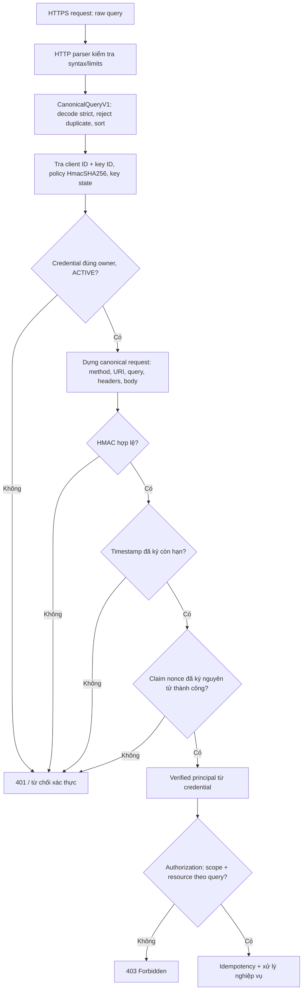

# Query parameter

## 1. Query parameter trong xác thực HTTP request bằng HMAC

Một request gửi đến API có thể chứa **query parameters** để xác định cách xử lý:

```http
GET /v1/transfers?status=pending&page=2&limit=20 HTTP/1.1
Host: api.example.test
X-Client-Id: merchant-42
X-Key-Id: key-2026-11
X-Timestamp: <unix-epoch-seconds>
X-Nonce: <unique-random-nonce>
X-Signature: <base64url-hmac-sha256>
```

Trong ví dụ, `status=pending`, `page=2` và `limit=20` là ba cặp **tên–giá trị** (*query parameter*); toàn bộ phần `status=pending&page=2&limit=20` là **query string**. Câu hỏi của bài học không chỉ là “có ký query hay không?”, mà còn là:

> Khi cùng một danh sách tham số có thể được viết theo nhiều cách khác nhau, **client và server chuẩn hóa từng query parameter như thế nào để HMAC luôn ký đúng nội dung mà backend thực sự sử dụng?**

Module `SECURITY_AUTHENTICATION_HMAC_REQUEST_AUTHENTICATION` thiết kế xác thực HTTP bằng **HMAC với shared secret**, trên canonical request có method, URI, header hoặc body theo hợp đồng ký. Bài **Query parameter** nằm trong chương *Query canonicalization* và đi sâu vào quá trình phân tích, kiểm tra, chuẩn hóa và sắp xếp các tham số trước khi đưa vào **signature input**.

Mục tiêu:

- Phân biệt *raw query string*, *parameter name/value*, *decoded parameter* và *canonical parameter*.
- Định nghĩa quy tắc cho `&`, `=`, phần trăm mã hóa (`%XX`), ký tự cộng `+`, khoảng trắng, giá trị rỗng, tên trùng, thứ tự và Unicode.
- Thiết kế **một hợp đồng canonical query xác định** đủ chặt để không xuất hiện *parameter pollution* hay *parser disagreement*.
- Cài đặt Java 17 chuẩn hóa query parameter và dùng kết quả trong HMAC-SHA256 request signing.
- Kiểm thử client–gateway–service, timestamp/nonce chống replay, key rotation và ranh giới giữa **authentication** với **authorization**.

## 2. Query string không đồng nghĩa với danh sách parameter đã parse

Một URL có thể chứa query string theo cú pháp:

```text
/v1/transfers?status=pending&page=2&limit=20
             ^^^^^^^^^^^^^^^^^^^^^^^^^^^^^^
             raw query string (không gồm dấu ?)
```

Trong quy ước phổ biến kiểu `name=value&name=value`:

| Cấp độ | Ví dụ | Ý nghĩa |
| --- | --- | --- |
| Raw query | `status=pending&page=2&limit=20` | Chuỗi mà adapter HTTP đọc từ request target |
| Raw pair | `page=2` | Một đoạn chia bằng ký tự `&` chưa được decode |
| Raw name | `page` | Phía trước dấu `=` đầu tiên trong pair |
| Raw value | `2` | Phía sau dấu `=` đầu tiên |
| Decoded name/value | `page` / `2` | Kết quả giải mã percent encoding theo chính sách |
| Canonical name/value | `page` / `2` | Kết quả mã hóa trở lại theo chuẩn duy nhất của hợp đồng |
| Canonical query | `limit=20&page=2&status=pending` | Biểu diễn toàn bộ parameter sau sắp xếp và nối lại |

Chú ý: **HTTP URI query tự nó không bắt buộc phải tuân theo cú pháp map tên–giá trị**. Dấu `&` và `=` là một quy ước phổ biến của API/form query. Khi chọn quy ước này để ký HMAC, cần ghi nó thành **hợp đồng của API**, không mặc định mọi URL đều có thể parse bằng cùng thuật toán.

### 2.1. Những dạng nhìn giống nhau nhưng khác byte

```text
?x=1             -> một parameter: name "x", value "1"
?x=              -> name "x", value rỗng
?x               -> có name "x" nhưng không có "="
?x=1&x=2         -> hai occurrence với cùng name
?x=1&            -> có dấu "&" cuối tạo segment rỗng
?%78=1           -> name percent-encoded; sau decode là "x"
?name=Mai%20Anh  -> dùng %20 cho khoảng trắng
?name=Mai+Anh    -> dấu cộng thô: có thể bị hiểu khác giữa các parser
```

Một framework có thể coi `?x` tương đương `?x=`, giữ giá trị đầu của `x=1&x=2` hoặc chọn giá trị cuối. Nếu verifier ký một kết quả parse còn backend dùng kết quả khác, chữ ký HMAC **không còn chứng minh chính xác hành vi đang được thực thi**.

### 2.2. “Không có query” và “query rỗng”

```text
GET /v1/transfers    -> raw query vắng mặt (null trong adapter)
GET /v1/transfers?   -> raw query tồn tại nhưng dài 0 ký tự ("")
GET /v1/transfers?x= -> raw query "x=", một parameter rỗng value
```

Một số framework loại bỏ dấu `?` cuối khi chuyển tiếp. Hợp đồng ký phải quyết định có **phân biệt** hai trường hợp đầu hay không. Hợp đồng minh họa ở dưới sẽ phân biệt chúng bằng hai marker riêng: `query-absent:` và `query-present:`.

## 3. Hai chiến lược: ký raw query hay ký query parameters đã chuẩn hóa

### 3.1. Ký raw query

Client giữ nguyên query string như thực sự gửi:

```text
/v1/transfers?b=2&a=1
    rawQuery = "b=2&a=1"

/v1/transfers?a=1&b=2
    rawQuery = "a=1&b=2"
```

Khi ký **raw query**, hai request trên có **signature input khác nhau** dù business handler có thể đọc cùng hai tham số. Đây là chiến lược khả thi khi client và verifier thống nhất giữ nguyên raw request target, và gateway không đổi biểu diễn query trước điểm xác minh.

**Ưu điểm:** đơn giản về byte-level, bảo vệ nguyên văn thứ tự và cách viết của query.

**Đánh đổi:** URL builder thay thứ tự parameter, proxy chuẩn hóa percent encoding, hoặc framework parse rồi dựng lại query có thể khiến HMAC thất bại. Ký raw vẫn phải kiểm tra sự mơ hồ của duplicate parameters; HMAC không tự sửa sai lệch giữa parser và business logic.

### 3.2. Ký canonical query parameters

Client và server:

1. Parse raw query thành các cặp tên–giá trị theo quy tắc rõ ràng.
2. Decode phần trăm mã hóa **đúng một lần** bằng UTF-8 nghiêm ngặt.
3. Validate schema, duplicate names, ký tự cấm và giới hạn kích thước.
4. Mã hóa lại từng name/value theo **một bộ quy tắc percent-encoding duy nhất**.
5. Sắp xếp theo thứ tự đã định nghĩa rồi nối thành canonical query.

Ví dụ:

```text
Request A raw: page=2&status=pending&limit=20
Request B raw: limit=20&page=2&status=pending

Canonical A:   limit=20&page=2&status=pending
Canonical B:   limit=20&page=2&status=pending
```

Hai query khác thứ tự **có thể tạo cùng signature input** theo chiến lược canonical parameters. Điều này **chỉ an toàn nếu backend cũng xử lý hai request theo cùng ngữ nghĩa**. Nếu query có duplicate tên, parser khác cách lấy phần tử thì việc sắp xếp đơn thuần không khắc phục được.

Bài này sẽ xây dựng một **hợp đồng parsed canonical query** cụ thể. Đây là ví dụ riêng phục vụ học tập; không phải quy chuẩn mặc định của JCA, HTTP hay tất cả hệ thống ký request.

## 4. Các nguy cơ đặc biệt của query parameter

### 4.1. Duplicate parameter và HTTP parameter pollution

```http
GET /v1/transfers?limit=10&limit=10000 HTTP/1.1
```

Nếu lớp xác minh kiểm tra `limit=10` nhưng handler sử dụng `limit=10000`, hệ thống có thể xử lý lượng dữ liệu hoặc chi phí lớn hơn mức được phép. Với `accountId`, `owner` hay `tenant`, sai lệch còn có thể dẫn tới lỗi kiểm soát truy cập.

Duplicate không chỉ xuất hiện dưới cách viết giống hệt nhau:

```text
?x=1&x=2
?x=1&%78=2
?%78=1&x=2
```

Sau decode phần trăm, cả `x` và `%78` đều là cùng một tên `x`. Hợp đồng phải kiểm tra **duplicate sau decode**, không chỉ so chuỗi raw names.

Trong hợp đồng minh họa, **tất cả decoded duplicate names đều bị từ chối**. Đây là lựa chọn cố ý phù hợp với những endpoint có một giá trị cho mỗi key. Nếu nghiệp vụ thực sự cần nhiều giá trị (ví dụ nhiều `tag`), phải thiết kế hợp đồng khác quy định chính xác thứ tự, sort, duplicate semantics và cách handler tiêu thụ mảng giá trị.

### 4.2. Dấu cộng, khoảng trắng và dấu phân tách

Dấu `+` có ý nghĩa khác nhau theo kiểu parse:

- Trong một số parser `application/x-www-form-urlencoded`, dấu `+` được chuyển thành khoảng trắng.
- Trong cách hiểu URI tổng quát, dấu `+` có thể là dấu cộng literal.
- `%20` là percent encoding của khoảng trắng, còn `%2B` là encoding của dấu cộng literal.

```text
name=Mai%20Anh   -> "Mai Anh" sau percent decode
name=Mai+Anh     -> phụ thuộc quy tắc parser
math=1%2B2       -> "1+2" sau percent decode
```

Hợp đồng ví dụ **từ chối raw `+`**. Khoảng trắng phải là `%20`, cộng literal phải là `%2B`. Điều này giảm khả năng client, gateway và backend dùng các parser khác nhau mà vẫn cho HMAC hợp lệ.

Tương tự, **raw `&` và `=` là ký hiệu cú pháp**; một ký tự `&` hoặc `=` là thành phần của **giá trị** phải được percent-encode thành `%26` hoặc `%3D`. Ví dụ:

```text
filter=type%3DA%26active%3Dtrue
decoded name  = "filter"
decoded value = "type=A&active=true"
```

Không được decode toàn bộ query trước rồi mới tách theo `&`: chuỗi `%26` lúc đó có thể bị hiểu nhầm là dấu phân tách parameter.

### 4.3. Percent encoding và double decoding

Mỗi percent triplet có dạng `%HH` với hai ký tự hex. Một số biểu diễn raw khác nhau giải mã thành cùng bytes:

```text
%2f  -> byte 0x2F
%2F  -> byte 0x2F
/    -> ký tự slash nếu parser cho phép raw slash
```

Trong hợp đồng ví dụ, các ký tự không thuộc nhóm *unreserved* trong value **phải được percent-encode**. Sau decode đúng một lần, chúng được encode lại bằng **hex uppercase**, nên `%2f` và `%2F` có cùng canonical form `%2F`.

```text
raw value:    %252F
decode once:  %2F        (ba ký tự %, 2, F)
re-encode:    %252F

raw value:    %2F
decode once:  /
re-encode:    %2F
```

**Không decode lần thứ hai.** Nếu một tầng decode `%252F` thành `%2F` rồi tầng khác lại decode thành `/`, verifier và handler có thể sử dụng hai ý nghĩa khác nhau. Cần thống nhất điểm decode, kiểm tra dữ liệu sau decode, và tránh double decoding ở downstream.

### 4.4. Unicode và UTF-8

Một tên hoặc giá trị có dấu phải được mã hóa thống nhất:

```text
city=H%E1%BB%93%20Ch%C3%AD%20Minh
```

Hợp đồng sẽ decode percent bytes bằng **UTF-8 có kiểm tra lỗi**. Input như percent escape dở dang `%A`, hex không hợp lệ `%G0` hoặc dãy byte UTF-8 không hợp lệ phải bị từ chối, không thay bằng ký tự U+FFFD rồi tiếp tục ký.

**Unicode normalization** là quyết định riêng. Chẳng hạn chữ có dấu được biểu diễn dạng *precomposed* và dạng *combining sequence* có thể hiển thị giống nhau nhưng có byte UTF-8 khác. Trong hợp đồng v1, **không thực hiện NFC/NFD normalization**; hai biểu diễn khác byte được xem là hai giá trị khác nhau. Nếu business coi chúng tương đương cho ID/tài nguyên, phải bổ sung validation/normalization ở cùng lớp và định nghĩa phiên bản hợp đồng phù hợp.

### 4.5. Giá trị rỗng, thiếu dấu bằng và segment rỗng

```text
?filter=    -> tên "filter", value rỗng: được phép ở tầng cú pháp
?filter     -> thiếu dấu "=": bị từ chối trong v1
?=value     -> tên rỗng: bị từ chối trong v1
?x=1&       -> có segment rỗng: bị từ chối trong v1
?&x=1       -> có segment rỗng: bị từ chối trong v1
```

Được phép về **cú pháp** không có nghĩa được phép về **nghiệp vụ**. Endpoint chuyển tiền có thể cấm `currency=` hoặc `accountId=` ở bước schema validation; verifier không nên âm thầm điền giá trị mặc định khiến giá trị đã ký và giá trị business sử dụng khác nhau.

## 5. Hợp đồng Query Parameter Canonicalization v1

Chúng ta định nghĩa hợp đồng học tập **`HTTP-HMAC-QPARAM-V1`**. Mục tiêu là **duy nhất một canonical string cho một tập query parameters hợp lệ** và ngăn parser ambiguity.

### 5.1. Các quy tắc bắt buộc

1. Query lấy từ **raw request target** tại authentication boundary; không lấy từ map parameter do middleware đã decode rồi nối lại. Có phân biệt absent (`null`) với present-empty (`""`).
2. Giới hạn độ dài raw query **4.096 ký tự ASCII** và tối đa **64 parameter**. Các giá trị lớn hơn bị từ chối trước bước HMAC tốn chi phí.
3. Nếu query present-empty, canonical marker là `query-present:`. Nếu vắng mặt hoàn toàn, marker là `query-absent:`.
4. Với query không rỗng, split bằng **raw `&`**, giữ cả segment rỗng để phát hiện lỗi. Mỗi pair phải có dấu `=` đầu tiên, name không rỗng; value có thể rỗng.
5. Trong raw name/value, chỉ cho phép ký tự ASCII *unreserved* (`A-Z`, `a-z`, `0-9`, `-._~`) hoặc percent triplet `%HH`. Ký tự reserved, khoảng trắng, dấu cộng, dấu `#` và Unicode raw phải được percent-encode.
6. Decode mỗi component `%HH` thành bytes, giải mã UTF-8 **strict** và từ chối control characters. Không decode nhiều lần.
7. Không chuẩn hóa Unicode NFC/NFD, không đổi case decoded name/value. Cấm **decoded duplicate names** theo so sánh chuỗi code point tương ứng. Ngoài ra endpoint có thể cấm alias/case collision như `AccountId` vs `accountId`.
8. Encode decoded name/value về UTF-8 rồi percent-encode mọi byte không phải ASCII unreserved, sử dụng **hex uppercase**.
9. Sắp xếp các pair theo **chuỗi encoded name**, nếu cần theo encoded value, với thứ tự **ASCII byte tăng dần**. Vì kết quả encode chỉ dùng ASCII, thứ tự so sánh string thông thường ở Java cho kết quả tương đương.
10. Nối mỗi pair bằng `=` và các pair bằng `&`, không thêm `&` cuối. Chuỗi đã chuẩn hóa được đặt trong một dòng duy nhất: `query-present:<pairs>`.

Đối với giá trị decode có ký tự điều khiển (ví dụ `%0D`, `%0A` hoặc `%00`), từ chối trước khi đưa vào canonical input. Các hạn chế này giúp tránh injection, lỗi parser và sử dụng dữ liệu không rõ nghĩa ở backend.

### 5.2. Ví dụ chuẩn hóa từng parameter

| Raw query | Decoded pairs | Canonical query marker |
| --- | --- | --- |
| `page=2&status=pending&limit=20` | page=2, status=pending, limit=20 | `query-present:limit=20&page=2&status=pending` |
| `b=2&a=1` | b=2, a=1 | `query-present:a=1&b=2` |
| `q=hello%20world` | q="hello world" | `query-present:q=hello%20world` |
| `math=1%2b2` | math="1+2" | `query-present:math=1%2B2` |
| `x=%2f` | x="/" | `query-present:x=%2F` |
| `x=%252F` | x="%2F" | `query-present:x=%252F` |
| `filter=` | filter="" | `query-present:filter=` |
| `city=H%E1%BB%93` | city="Hồ" | `query-present:city=H%E1%BB%93` |
| `null` (query không có mặt) | Không có pair | `query-absent:` |
| `""` (query có mặt nhưng rỗng) | Không có pair | `query-present:` |

Bảng này là ví dụ về **canonical text**, chưa phải chữ ký HMAC. Sắp xếp khiến `a=1&b=2` và `b=2&a=1` có cùng canonical marker; đây là hành vi có chủ đích, chỉ đúng khi cả routing/business cùng chấp nhận chúng tương đương.

### 5.3. Những input phải bị từ chối

| Input | Lý do |
| --- | --- |
| `x=1&x=2` | Trùng decoded name |
| `x=1&%78=2` | `%78` decode thành `x`, vẫn là trùng name |
| `x` | Thiếu dấu `=` |
| `=1` | Name rỗng |
| `x=1&` | Segment rỗng |
| `x=hello+world` | Raw `+` bị cấm để tránh form-vs-URI ambiguity |
| `x=a/b` | Raw slash trong component phải thành `%2F` ở v1 |
| `x=%Q0` | Percent escape sai |
| `x=%C3%28` | Byte UTF-8 không hợp lệ |
| `x=%0D%0A` | Control characters sau decode |
| `x=1#fragment` | Raw `#` không thuộc query parameter được phép |
| Tên chứa ký tự Unicode raw | V1 yêu cầu byte không unreserved phải percent-encode |

**Quan trọng:** việc từ chối một request không hợp đồng không có nghĩa mọi URL chứa các ký tự trên đều sai theo HTTP/URI. Đó là **chính sách cú pháp của giao thức ký cụ thể** nhằm đảm bảo hai bên hiểu giống nhau.

## 6. Đưa canonical query vào HMAC request signature

Để query parameters có tác dụng bảo vệ, canonical marker phải là một phần của **signature input được MAC bảo vệ**, cùng các trường quyết định hành vi:

```http
GET /v1/transfers?status=pending&page=2&limit=20 HTTP/1.1
Host: api.example.test
Accept: application/json
X-Client-Id: merchant-42
X-Key-Id: key-2026-11
X-Timestamp: <unix-epoch-seconds>
X-Nonce: <unique-random-nonce>
X-Signature: <base64url-hmac-sha256>
```

Hợp đồng `HTTP-HMAC-QPARAM-V1` chọn **11 dòng**, nối bằng LF (`\n`), không có LF cuối, mã hóa UTF-8:

```text
HTTP-HMAC-QPARAM-V1
GET
/v1/transfers
query-present:limit=20&page=2&status=pending
authority:api.example.test
accept:application/json
x-client-id:merchant-42
x-key-id:key-2026-11
x-timestamp:<unix-epoch-seconds>
x-nonce:<unique-random-nonce>
<64-lowercase-hex-characters-of-SHA256(exactBodyBytes)>
```

Với GET không có request body theo hợp đồng ví dụ, dòng cuối là SHA-256 hex của **zero bytes**; đây không phải một chuỗi trống. Method, raw path, authority, header được ký và body digest đều phải theo hợp đồng đã thống nhất. Nếu authority ảnh hưởng routing/tenant, chỉ sử dụng authority đã được **ingress kiểm tra**; không lấy giá trị `X-Forwarded-Host` do caller tự gửi.

`X-Client-Id` và `X-Key-Id` là dữ liệu tra credential ban đầu, nhưng phải **nằm trong signature input** để không thể thay owner/key ID mà giữ signature cũ. Signature output là tag HMAC, ví dụ dạng `Base64url(HMAC_SHA256(secret, UTF8(canonical)))`, không tự đưa `X-Signature` vào canonical input vì sẽ tạo vòng phụ thuộc.

**Đừng gộp ba cơ chế:**

- **Canonicalization** quyết định *những byte nào được ký*.
- **HMAC verification** quyết định *request có được tạo bằng secret tương ứng với credential tin cậy hay không*.
- **Authorization** quyết định *principal đã xác thực có được đọc/tạo/sửa tài nguyên với các query parameters đó không*.

Nếu client ký `owner=other-tenant` bằng secret hợp lệ, HMAC có thể đúng nhưng backend vẫn phải từ chối nếu principal không được đọc tài nguyên của tenant khác.

## 7. Java 17: canonicalize query parameters bằng UTF-8 nghiêm ngặt

Mã Java sau hiện thực những quy tắc **query parameter** ở mục 5. Điểm đáng chú ý là sử dụng `CharsetDecoder` với `CodingErrorAction.REPORT`, tránh tình trạng byte UTF-8 sai tự động thành ký tự thay thế. Trước khi gọi, HTTP adapter phải cung cấp **raw query thực nhận**, chưa được form-decode hoặc URL-reencode.

```java
import java.io.ByteArrayOutputStream;
import java.nio.ByteBuffer;
import java.nio.charset.CharacterCodingException;
import java.nio.charset.CodingErrorAction;
import java.nio.charset.StandardCharsets;
import java.util.ArrayList;
import java.util.Comparator;
import java.util.HashSet;
import java.util.List;
import java.util.Set;

public final class CanonicalQueryV1 {
    private static final char[] HEX = "0123456789ABCDEF".toCharArray();
    private static final int MAX_RAW_LENGTH = 4096;
    private static final int MAX_PARAMETERS = 64;

    private CanonicalQueryV1() {}

    private record Parameter(String nameEncoded, String valueEncoded) {}

    // ASCII unreserved theo URI: ALPHA / DIGIT / "-" / "." / "_" / "~".
    private static boolean unreserved(int b) {
        return (b >= 'A' && b <= 'Z')
            || (b >= 'a' && b <= 'z')
            || (b >= '0' && b <= '9')
            || b == '-' || b == '.' || b == '_' || b == '~';
    }

    private static int hexValue(char c) {
        if (c >= '0' && c <= '9') return c - '0';
        if (c >= 'A' && c <= 'F') return c - 'A' + 10;
        if (c >= 'a' && c <= 'f') return c - 'a' + 10;
        return -1;
    }

    // Decode từng component, KHÔNG decode cả query trước khi split '&'.
    private static String decodeComponent(String raw) {
        if (raw.length() > 1024) {
            throw new IllegalArgumentException("Parameter component too long");
        }
        ByteArrayOutputStream bytes = new ByteArrayOutputStream();

        for (int i = 0; i < raw.length(); i++) {
            char c = raw.charAt(i);
            if (c == '%') {
                if (i + 2 >= raw.length()) {
                    throw new IllegalArgumentException("Truncated percent escape");
                }
                int hi = hexValue(raw.charAt(i + 1));
                int lo = hexValue(raw.charAt(i + 2));
                if (hi < 0 || lo < 0) {
                    throw new IllegalArgumentException("Invalid percent escape");
                }
                bytes.write((hi << 4) | lo);
                i += 2;
            } else {
                // Quy ước v1: mọi ký tự reserved, '+' và non-ASCII
                // trong component phải được percent-encode.
                if (c > 0x7F || !unreserved(c)) {
                    throw new IllegalArgumentException(
                        "Raw character must be percent-encoded");
                }
                bytes.write((int) c);
            }
        }

        final String decoded;
        try {
            decoded = StandardCharsets.UTF_8.newDecoder()
                .onMalformedInput(CodingErrorAction.REPORT)
                .onUnmappableCharacter(CodingErrorAction.REPORT)
                .decode(ByteBuffer.wrap(bytes.toByteArray()))
                .toString();
        } catch (CharacterCodingException e) {
            throw new IllegalArgumentException("Invalid UTF-8 sequence", e);
        }

        if (decoded.codePoints().anyMatch(Character::isISOControl)) {
            throw new IllegalArgumentException("Control character forbidden");
        }
        return decoded;
    }

    // UTF-8 percent-encoding: raw unreserved, percent triplets uppercase.
    private static String encodeComponent(String decoded) {
        StringBuilder out = new StringBuilder();
        for (byte b : decoded.getBytes(StandardCharsets.UTF_8)) {
            int u = b & 0xFF;
            if (unreserved(u)) {
                out.append((char) u);
            } else {
                out.append('%');
                out.append(HEX[u >>> 4]);
                out.append(HEX[u & 0x0F]);
            }
        }
        return out.toString();
    }

    // null = absent query, "" = present empty query.
    public static String canonicalQueryMarker(String rawQuery) {
        if (rawQuery == null) return "query-absent:";
        if (rawQuery.length() > MAX_RAW_LENGTH) {
            throw new IllegalArgumentException("Query too long");
        }
        if (rawQuery.isEmpty()) return "query-present:";

        String[] rawPairs = rawQuery.split("&", -1);
        if (rawPairs.length > MAX_PARAMETERS) {
            throw new IllegalArgumentException("Too many query parameters");
        }

        Set<String> seenNames = new HashSet<>();
        List<Parameter> parameters = new ArrayList<>();

        for (String rawPair : rawPairs) {
            int eq = rawPair.indexOf('=');
            if (eq <= 0) {
                // Tránh empty segment, thiếu '=' và empty name.
                throw new IllegalArgumentException("Invalid query pair");
            }
            String name = decodeComponent(rawPair.substring(0, eq));
            String value = decodeComponent(rawPair.substring(eq + 1));
            if (name.isEmpty() || !seenNames.add(name)) {
                throw new IllegalArgumentException(
                    "Empty or duplicate decoded parameter name");
            }
            parameters.add(new Parameter(
                encodeComponent(name), encodeComponent(value)));
        }

        parameters.sort(
            Comparator.comparing(Parameter::nameEncoded)
                      .thenComparing(Parameter::valueEncoded)
        );

        List<String> encodedPairs = new ArrayList<>();
        for (Parameter p : parameters) {
            encodedPairs.add(p.nameEncoded() + "=" + p.valueEncoded());
        }
        return "query-present:" + String.join("&", encodedPairs);
    }

    public static void main(String[] args) {
        String a = canonicalQueryMarker(
            "page=2&status=pending&limit=20");
        String b = canonicalQueryMarker(
            "limit=20&page=2&status=pending");

        if (!a.equals(b) ||
            !a.equals("query-present:limit=20&page=2&status=pending")) {
            throw new AssertionError("Canonical query mismatch");
        }
        if (!"query-present:math=1%2B2".equals(
                canonicalQueryMarker("math=1%2b2"))) {
            throw new AssertionError("Percent hex must be uppercase");
        }
        if (canonicalQueryMarker(null)
                .equals(canonicalQueryMarker(""))) {
            throw new AssertionError("Absent and empty must differ");
        }

        try {
            canonicalQueryMarker("x=1&%78=2");
            throw new AssertionError("Duplicate must fail");
        } catch (IllegalArgumentException expected) {
            // Duplicate decoded parameter rejected.
        }
    }
}
```

### 7.1. Kiểm tra kỹ những gì mã đã thực hiện

Mã cố ý **không dùng `URLDecoder`** để parse query. `URLDecoder` có ngữ nghĩa của form encoding, trong đó raw `+` được hiểu là khoảng trắng, không phù hợp với hợp đồng v1 đang cấm raw `+`.

Mã cũng không dùng `Map<String,String>` đầu vào, vì map đã làm mất thông tin về thứ tự và duplicate occurrences. Thay vào đó, nó nhận raw string, split trước khi decode, kiểm tra **decoded duplicate names**, chuẩn hóa từng component rồi sort.

Các giới hạn được cài đặt:

- Raw query tối đa 4.096 ký tự, tối đa 64 cặp; mỗi raw component tối đa 1.024 ký tự.
- Chỉ nhận raw unreserved và `%HH` trong từng component; dấu `&` và `=` chỉ làm delimiter.
- UTF-8 malformed/unmappable và control characters bị từ chối.
- Tên decoded không được rỗng, duplicate decoded names bị từ chối; value rỗng được chấp nhận ở lớp cú pháp.
- Mã hóa lại UTF-8 với uppercase hex percent encoding; sort theo encoded name/value.
- Không đổi case, không chuẩn hóa Unicode; business validator phải áp dụng schema chính xác của endpoint.

**Còn thiếu để production:** quy tắc giới hạn decoded size theo từng loại field, business schema, chống alias Unicode/case giữa các tên mà ứng dụng coi tương đương, rate limits, kiểm soát raw request target tại HTTP adapter, và kiểm thử parser/routing/framework trong môi trường thật. V1 không cho duplicate; nếu thiết kế API sử dụng mảng tham số, cần version hợp đồng mới và test riêng.

### 7.2. Tại sao chưa thể dùng trực tiếp `getParameterMap()`?

Trong Java servlet framework, `request.getParameterMap()` thường đưa ra tên–giá trị **đã được parse và decode**, có thể gộp query với form data tùy ngữ cảnh và không giữ nguyên biểu diễn raw. Nếu verifier muốn ký canonical query theo hợp đồng v1, hãy **tự kiểm tra raw query tại ingress** trước khi framework hoặc proxy làm mất duplicate, và bảo đảm handler downstream tiêu thụ **chính kết quả parse đã được validate** hoặc một view có ngữ nghĩa tương đương.

Lỗ hổng xuất hiện nếu verifier kiểm tra một tập value nhưng business handler thực thi tập value khác. HMAC đúng trên canonical bytes không thay thế **data flow consistency** từ verifier tới nghiệp vụ.

## 8. Java 17: kết hợp canonical query với HMAC-SHA256

Sau khi có `CanonicalQueryV1.canonicalQueryMarker(...)`, ứng dụng có thể gắn nó vào canonical request và ký HMAC.

Ví dụ dưới đây chỉ triển khai **phần mật mã và định dạng input**. Các trường `method`, `rawPath`, `authority`, `accept` và signed headers phải được adapter lấy/validate từ request thực nhận theo hợp đồng; timestamp/nonce và key state được kiểm tra riêng trong pipeline.

```java
import java.nio.charset.StandardCharsets;
import java.security.GeneralSecurityException;
import java.security.MessageDigest;
import java.util.Base64;
import java.util.HexFormat;
import javax.crypto.Mac;
import javax.crypto.spec.SecretKeySpec;

public final class HmacQueryParamRequestV1 {
    private static final String ALGORITHM = "HmacSHA256";
    private static final String VERSION = "HTTP-HMAC-QPARAM-V1";

    public record SignedRequest(
        String method, String rawPath, String rawQuery,
        String authority, String accept, String clientId,
        String keyId, String timestamp, String nonce, byte[] body
    ) {}

    private HmacQueryParamRequestV1() {}

    private static String oneLine(String text) {
        if (text == null || text.indexOf('\r') >= 0
                || text.indexOf('\n') >= 0) {
            throw new IllegalArgumentException("Invalid signed component");
        }
        return text;
    }

    public static byte[] canonicalBytes(SignedRequest r)
            throws GeneralSecurityException {
        if (r == null || r.body() == null) {
            throw new IllegalArgumentException("Missing request/body");
        }
        String queryMarker =
            CanonicalQueryV1.canonicalQueryMarker(r.rawQuery());

        String bodyDigest = HexFormat.of().formatHex(
            MessageDigest.getInstance("SHA-256").digest(r.body())
        );
        String canonicalText = String.join("\n",
            VERSION,
            oneLine(r.method()),
            oneLine(r.rawPath()),
            queryMarker,
            "authority:" + oneLine(r.authority()),
            "accept:" + oneLine(r.accept()),
            "x-client-id:" + oneLine(r.clientId()),
            "x-key-id:" + oneLine(r.keyId()),
            "x-timestamp:" + oneLine(r.timestamp()),
            "x-nonce:" + oneLine(r.nonce()),
            bodyDigest
        );
        return canonicalText.getBytes(StandardCharsets.UTF_8);
    }

    public static byte[] hmacSha256(byte[] secret, byte[] input)
            throws GeneralSecurityException {
        if (secret == null || secret.length < 32) {
            throw new IllegalArgumentException("Weak or missing secret");
        }
        Mac mac = Mac.getInstance(ALGORITHM);
        mac.init(new SecretKeySpec(secret, ALGORITHM));
        return mac.doFinal(input);
    }

    public static String sign(SignedRequest request, byte[] secret)
            throws GeneralSecurityException {
        return Base64.getUrlEncoder().withoutPadding()
            .encodeToString(hmacSha256(secret, canonicalBytes(request)));
    }

    public static boolean verify(
            SignedRequest r, byte[] secret, String supplied)
            throws GeneralSecurityException {
        if (supplied == null || !supplied.matches("[A-Za-z0-9_-]{43}")) {
            return false;
        }

        final byte[] received;
        try {
            received = Base64.getUrlDecoder().decode(supplied);
        } catch (IllegalArgumentException malformed) {
            return false;
        }
        if (received.length != 32) return false;

        String canonicalEncoding = Base64.getUrlEncoder()
            .withoutPadding().encodeToString(received);
        if (!canonicalEncoding.equals(supplied)) return false;

        byte[] expected = hmacSha256(secret, canonicalBytes(r));
        return MessageDigest.isEqual(expected, received);
    }
}
```

**Vì sao không copy `rawQuery` trực tiếp vào chữ ký?** Hợp đồng v1 đã chọn **parsed canonical query** nên muốn `a=1&b=2` và `b=2&a=1` ra cùng chuỗi. Nếu đưa raw query trực tiếp vào, hai request này sẽ khác HMAC, trái với hợp đồng. Cần nhất quán: **không thử cả hai dạng raw và canonical rồi chấp nhận dạng nào khớp**.

Cũng không tự chọn thuật toán từ header của caller. `HmacSHA256` phải được server policy gắn với credential. `NoSuchAlgorithmException` hay `InvalidKeyException` từ JCA là lỗi khả năng xác minh hoặc key và không được bỏ bước xác thực.

### Minh họa một lần ký

```java
import java.nio.charset.StandardCharsets;
import java.security.SecureRandom;

byte[] testSecret = new byte[32];
new SecureRandom().nextBytes(testSecret);

HmacQueryParamRequestV1.SignedRequest r =
    new HmacQueryParamRequestV1.SignedRequest(
        "GET",
        "/v1/transfers",
        "status=pending&page=2&limit=20",
        "api.example.test",
        "application/json",
        "merchant-42",
        "key-2026-11",
        "1790000000", // ví dụ: không mặc định còn hợp lệ
        "nQ4a0YQe1JdV6BhK",
        new byte[0]
    );

String tag = HmacQueryParamRequestV1.sign(r, testSecret);
boolean cryptographicallyValid =
    HmacQueryParamRequestV1.verify(r, testSecret, tag);
// true về HMAC, nhưng chưa xác minh key state, timestamp, nonce hay scope.
```

Mã dùng `getBytes(UTF_8)` tường minh để ký đúng byte của canonical text. Chỉ tính `SHA-256` digest cho body **sau khi xác định đúng body bytes theo hợp đồng**; nếu proxy đổi content coding hoặc middleware tái serialize JSON, digest có thể khác dù client và server hiểu cùng ý nghĩa nghiệp vụ.

## 9. Authentication pipeline và chống replay



Bốn điểm không được bỏ:

**1. Credential lookup không phải authentication.** Header `X-Client-Id` và `X-Key-Id` do caller tự khai chỉ để chọn **bản ghi credential đáng tin**. Verifier phải xác minh tag bằng secret thuộc đúng client, môi trường, thuật toán, key ID và trạng thái. Sau HMAC hợp lệ và replay check, mới tạo principal từ credential đã xác minh.

**2. Timestamp và nonce phải nằm trong HMAC input.** Timestamp giới hạn thời gian, ví dụ server chấp nhận sai lệch ±300 giây. Nonce phải được claim **nguyên tử** trong kho chia sẻ theo client với TTL đủ bao phủ cửa sổ có thể chấp nhận request. Chỉ claim sau khi HMAC đúng để attacker không có secret không thể chiếm nonce hợp lệ. Với lỗi kho nonce ở endpoint nhạy cảm, hãy fail-closed.

**3. Secret bị lộ cần thu hồi.** Một attacker có secret có thể tự tạo canonical query, timestamp, nonce và HMAC mới; anti-replay chỉ ngăn phát lại request cũ, không ngăn request mới ký bằng secret lộ. Cần thu hồi key ID và cấp secret mới, đồng bộ trạng thái tới gateway/replica.

**4. HMAC không phải authorization.** Nếu `merchant-42` có HMAC đúng cho `GET /v1/transfers?owner=merchant-73`, server vẫn phải kiểm tra principal có quyền xem giao dịch của `merchant-73` hay không. Không dùng tham số `role=admin` hoặc `owner=...` do client tự ký để nâng quyền. Tùy chính sách, một principal đã xác thực nhưng không được phép nhận `403 Forbidden` hoặc cách che giấu tài nguyên thích hợp.

## 10. Proxy/gateway và sự nhất quán của parser

Một API gateway có thể biến đổi query:

```text
Client gửi:
GET /v1/transfers?page=2&status=pending

Gateway forward:
GET /v1/transfers?status=pending&page=2

CanonicalQueryV1 của cả hai:
query-present:page=2&status=pending
```

**Theo hợp đồng canonical parsed-query**, riêng hành động reorder hai tham số là an toàn nếu business thực sự coi hai request là tương đương. Tuy nhiên không phải mọi biến đổi đều như vậy.

| Biến đổi giữa client và verifier | Rủi ro | Biện pháp |
| --- | --- | --- |
| Đảo thứ tự các parameter duy nhất | Thường chỉ đổi raw string; canonical sort giữ output | Test vector chứng minh cùng canonical bytes |
| `%2f` thành `%2F` | Raw khác nhưng cùng decoded byte | Canonical encoder dùng uppercase hex |
| `%2B` thành raw `+` | Có thể khiến parser form hiểu thành khoảng trắng | V1 **từ chối raw `+`**; không tin biến đổi mơ hồ |
| `%20` thành raw space | Vi phạm cú pháp hợp đồng, có thể gây lỗi parse | Reject, không tự đoán |
| Thêm `x=1` cạnh `%78=2` | Duplicate sau decode; parser có thể chọn đầu/cuối | Reject decoded duplicate names |
| Tự bỏ empty value `flag=` | Input thay đổi ngữ nghĩa schema | Cấm transform âm thầm |
| Tự thêm giá trị mặc định `limit=20` | Client ký thiếu field; backend nhận thêm field | Có hợp đồng mặc định đáng tin hoặc từ chối sai khác |
| Đổi case tên như `Owner` → `owner` | V1 giữ nguyên case, thay canonical input | Không đổi case nếu hợp đồng không quy định |
| Double decode `%252F` thành `/` | Tài nguyên/ACL có thể hiểu khác | Decode chính xác một lần; validate xuyên các tầng |
| Viết lại query từ parameter map | Có thể mất duplicate, encoding hoặc null/empty | Parse/verify sớm ở ingress, không dựng lại từ map |
| Rewrite path hoặc authority | Signature input khác, có thể đổi routing | Verify trước rewrite hoặc truyền representation đáng tin |
| HTTP/1.1 → HTTP/2 | Biểu diễn request target/header khác | Trích xuất component ngữ nghĩa theo hợp đồng, không ký raw framing |

### Vị trí xác minh HMAC

Có hai phương án hợp lệ:

1. **Xác minh tại gateway trước mọi transform ảnh hưởng hành vi.** Gateway dựng canonical request, kiểm tra HMAC/timestamp/nonce rồi truyền verified principal qua kênh nội bộ tin cậy tới backend. Phải xóa/ghi đè mọi `X-Verified-Client` do caller tự gửi, xác thực workload/kênh và không cho backend bị truy cập vòng qua gateway.
2. **Xác minh tại service.** Gateway phải bảo toàn đủ raw HTTP components hoặc cấp một representation **được xác thực nguồn và chống giả mạo**, đảm bảo verifier và business dùng cùng parameter semantics. Không tin `X-Original-URI` hay `X-Forwarded-*` do caller tự khai.

Không để gateway và service cùng **claim một nonce** như hai request khác nhau; chỉ định tầng sở hữu replay state hoặc có giao thức xác thực nội bộ độc lập.

**TLS** bảo vệ bí mật/toàn vẹn trên đường truyền đến điểm kết thúc TLS. HMAC bảo vệ những thành phần đã đưa vào canonical request; nó không mã hóa URL, query hay body. Query có dữ liệu nhạy cảm có thể xuất hiện trong log/trình duyệt/referrer. Vì vậy không đặt secret hoặc dữ liệu cá nhân nhạy cảm vào query nếu có phương án an toàn hơn, và không log toàn bộ signed request kèm tag trong môi trường production.

## 11. Bộ test vector và bài thực hành

### 11.1. Test vector phải khóa “canonical bytes”

Đừng chỉ kiểm thử `sign(...)` rồi `verify(...)` bằng cùng một class, vì hai hàm có thể cùng mắc lỗi mà test vẫn xanh. Hãy chuẩn bị **vector độc lập** gồm raw query, expected canonical marker, exact canonical bytes (hex), test secret và expected HMAC tag tính bằng implementation khác.

Khung vector minh họa:

```yaml
contract: HTTP-HMAC-QPARAM-V1
rawQuery: "status=pending&page=2&limit=20"
expectedCanonicalMarker: "query-present:limit=20&page=2&status=pending"
method: GET
rawPath: /v1/transfers
authority: api.example.test
accept: application/json
clientId: merchant-42
keyId: key-2026-11
timestamp: "1790000000"
nonce: nQ4a0YQe1JdV6BhK
bodyUtf8: ""
expected:
  bodySha256Hex: <calculate-with-independent-tool>
  fullCanonicalBytesHex: <calculate-with-independent-tool>
  hmacSha256Base64url: <calculate-with-test-key-only>
```

Các giá trị `expected` có dấu nhọn **chưa được tính**, nên đây là mẫu để điền, không phải vector đã hoàn thành. Không sử dụng secret/key production để tạo test vector.

### 11.2. Ma trận kiểm thử query parameter

| Test | Request/query | Kết quả kỳ vọng |
| --- | --- | --- |
| T1. Baseline | `status=pending&page=2&limit=20` | Canonical = `limit=20&page=2&status=pending` |
| T2. Đảo thứ tự | `limit=20&status=pending&page=2` | Canonical **giống T1** |
| T3. Đổi value sau ký | `limit=20` → `limit=200`, giữ HMAC cũ | HMAC không khớp |
| T4. Đổi tên sau ký | `status` → `state`, giữ HMAC cũ | HMAC không khớp |
| T5. Percent hex case | `x=%2f` và `x=%2F` | Cùng canonical `x=%2F` |
| T6. Percent unreserved | `%78=1` và `x=1` (trong các request riêng) | Cùng canonical `x=1` |
| T7. Dấu cộng literal | `math=1%2b2` | Canonical `math=1%2B2` |
| T8. Raw plus | `math=1+2` | Từ chối theo v1 |
| T9. Khoảng trắng | `q=hello%20world` | Canonical giữ `q=hello%20world` |
| T10. Raw space | `q=hello world` | Từ chối theo v1 |
| T11. Ampersand trong value | `filter=a%26b` | Decoded value `a&b`, canonical `filter=a%26b` |
| T12. Dấu bằng trong value | `filter=a%3Db` | Decoded value `a=b`, canonical `filter=a%3Db` |
| T13. Trùng raw name | `x=1&x=2` | Từ chối |
| T14. Trùng sau decode | `x=1&%78=2` | Từ chối |
| T15. Empty value | `filter=` | Chấp nhận ở lớp cú pháp, schema có thể cấm |
| T16. Thiếu bằng | `filter` | Từ chối |
| T17. Empty name | `=1` | Từ chối |
| T18. Empty segment | `x=1&` hoặc `&x=1` | Từ chối |
| T19. Percent escape sai | `x=%Q0` hoặc `x=%2` | Từ chối |
| T20. UTF-8 sai | `x=%C3%28` | Từ chối strict decoder |
| T21. Control after decode | `x=%0D%0A` | Từ chối |
| T22. Non-ASCII encoded | `city=H%E1%BB%93` | Decode/encode đúng; canonical `city=H%E1%BB%93` |
| T23. Double encoding | `path=%252F` khác `path=%2F` | Hai canonical values khác nhau |
| T24. Absent vs empty query | null vs `""` | `query-absent:` khác `query-present:` |
| T25. Too many pairs | 65 parameters | Từ chối trước HMAC |
| T26. Oversized query | Dài hơn 4096 ký tự | Từ chối |
| T27. Key rotation | HMAC đúng theo key ID đã `REVOKED` | Từ chối authn ở mọi replica |
| T28. Replay | Gửi lại nguyên request đã ký với cùng nonce | HMAC đúng nhưng nonce đã dùng, từ chối |
| T29. Replay race | Hai replica nhận cùng nonce đồng thời | Tối đa một atomic claim thành công |
| T30. Gateway transform | Reorder query mà giữ cùng canonical semantics | Có thể hợp lệ theo v1; vẫn phải kiểm tra router tương đương |
| T31. Parser inconsistency | Verifier đọc `x` đầu, handler đọc `x` cuối | Bị chặn nhờ từ chối decoded duplicates |
| T32. Authorization | HMAC đúng cho `owner=other-tenant` | Authn pass, authz từ chối tài nguyên không thuộc quyền |
| T33. Header bị sửa | Đổi signed `X-Key-Id` hoặc `X-Timestamp` sau ký | HMAC không khớp hoặc credential bị từ chối |
| T34. Mất nonce store | Không thể xác nhận replay state | Endpoint nhạy cảm fail-closed |

### 11.3. Tình huống A — “Cùng query logic, chữ ký khác”

Client Java gửi `page=2&sort=createdAt`, client Python gửi `sort=createdAt&page=2`. Cả hai cùng secret, method, URI và body nhưng tính HMAC khác nhau.

**Phân tích:** Nếu dùng **raw-query signing**, thứ tự khác tạo input khác; đó là kết quả đúng theo hợp đồng raw. Nếu dùng `HTTP-HMAC-QPARAM-V1` ở bài này, cả hai phải sort canonical pairs thành `page=2&sort=createdAt` rồi ký; nếu vẫn khác, cần so expected canonical bytes hex, newline, charset và encoding.

### 11.4. Tình huống B — “Đã ký query nhưng vẫn vượt hạn mức”

Một request chứa `limit=10&limit=10000`. Verifier chọn giá trị đầu để kiểm tra hạn mức, handler lấy giá trị cuối.

**Phân tích:** Chữ ký hợp lệ trên chuỗi raw không chứng minh hai tầng sử dụng cùng giá trị. Cần từ chối **duplicate decoded names**, thống nhất parser và chỉ đưa dữ liệu đã validate đến business logic.

### 11.5. Tình huống C — “%252F thành slash”

Gateway xác minh `file=%252Fsecret` như giá trị literal `%2Fsecret`. Backend decode lần thứ hai rồi sử dụng `/secret` để chọn tài nguyên.

**Phân tích:** Hai tầng hiểu value khác nhau. Phải decode đúng **một lần** ở ranh giới chuẩn hóa, định nghĩa schema dữ liệu và cấm downstream double decode. HMAC trên canonical value không giải quyết lỗi parser nội bộ.

### 11.6. Tình huống D — “Cùng secret, request owner khác”

Client `merchant-42` ký thành công `GET /v1/transfers?owner=merchant-73` và nonce mới. Backend chỉ kiểm tra HMAC và trả toàn bộ giao dịch của `merchant-73`.

**Phân tích:** Đây là **thiếu authorization**, không phải lỗi query canonicalization. HMAC xác thực credential của `merchant-42`; backend phải kiểm tra quyền truy cập dữ liệu của owner `merchant-73` theo principal đã xác minh.

### 11.7. Tình huống E — “Cứ thử nhiều cách canonical là được?”

Hệ thống lần lượt kiểm HMAC trên raw query, query đã sort và query đã form-decode, rồi chấp nhận nếu một cách khớp.

**Phân tích:** Đây là thiết kế **không an toàn và khó kiểm toán**: một request có thể có nhiều interpretation hợp lệ, làm tăng nguy cơ parser disagreement và downgrade. Mỗi protocol version/credential phải gắn với **một canonicalization contract duy nhất**; sửa client không tương thích thay vì nới verifier theo nhiều cách đoán.

## 12. Checklist thiết kế Query parameter canonicalization

- [ ] Phân biệt raw query, raw pair, decoded name/value và canonical name/value; chọn rõ raw signing hay parsed canonical signing.
- [ ] Ghi phiên bản hợp đồng, nơi lấy raw query và quy tắc chính xác cho `&`, `=`, empty value, absent/empty query.
- [ ] Decode percent encoding đúng một lần, UTF-8 nghiêm ngặt; không dùng form decoding có `+` ngầm nếu hợp đồng không quy định.
- [ ] Có chính sách percent-encoding cho ký tự reserved, dấu cộng, khoảng trắng, Unicode và hex case.
- [ ] Kiểm tra **duplicate names sau decode**, tránh parameter pollution và parser disagreement; handler sử dụng cùng dữ liệu đã validate.
- [ ] Chốt thứ tự sort và encode thành ASCII/UTF-8 canonical bytes; không tự fallback thử nhiều canonicalization.
- [ ] Có giới hạn độ dài query, số parameter, kích thước name/value và schema theo endpoint.
- [ ] Đưa canonical query vào signature input cùng method, path, authority nếu cần, signed headers và body hash.
- [ ] Server chọn secret bằng `clientId + keyId` trong credential store tin cậy, kiểm tra thuật toán, trạng thái khóa và thu hồi.
- [ ] Timestamp/nonce đều được ký; nonce claim nguyên tử **sau HMAC hợp lệ**, chia sẻ giữa các instance; có key rotation/revocation.
- [ ] Kiểm thử gateway/proxy reorder, percent decode/reencode, double decode, path rewrite, forwarded headers và HTTP protocol conversion.
- [ ] Verified principal chỉ hình thành sau authn; authorization độc lập theo owner/resource/action, không tin role/owner tự khai trong query.
- [ ] Không log shared secret hay dữ liệu query nhạy cảm; dùng TLS và test vectors byte-level tính độc lập giữa các implementation.

**Kết luận:** *Query parameter canonicalization* không chỉ là “sort tên tham số”. Nó là **một hợp đồng cú pháp và ngữ nghĩa**: parse đúng một lần, decode UTF-8 nghiêm ngặt, xử lý duplicate/empty/encoding rõ ràng, encode về biểu diễn duy nhất rồi ký **cùng canonical bytes** ở cả client và server. Khi hợp đồng nhất quán qua proxy/gateway, HMAC có thể bảo vệ các lựa chọn nghiệp vụ nằm trong query; timestamp/nonce, key rotation và authorization tiếp tục bảo vệ những rủi ro nằm ngoài phép ký.

