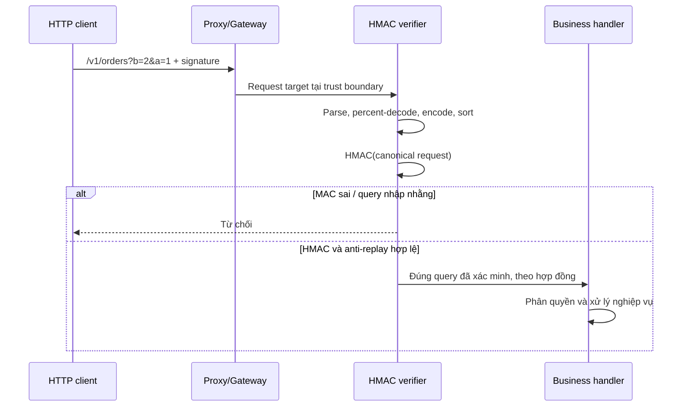

# Sắp xếp parameter trong Query canonicalization

> **Chương:** Query canonicalization  
> **Bài học:** Sắp xếp parameter (*query parameter sorting*) để client và server tạo cùng canonical request trước khi tính hoặc xác minh HMAC.  
> **Bối cảnh:** Xác thực HTTP request bằng shared secret, ký method, URI, header và body theo một hợp đồng cụ thể; kết hợp timestamp/nonce chống replay, key rotation, proxy/gateway và phân quyền.

## 1. Vấn đề: cùng một query nhưng thứ tự khác nhau

Giả sử một client gửi:

```http
POST /v1/orders?source=partner&region=vn HTTP/1.1
Host: orders.example.test
Content-Type: application/json
X-Client-Id: partner-01
X-Key-Id: key-2026-11
X-Timestamp: 1795800000
X-Nonce: Bph1bgR7mMYnUnkY_UY6NA
X-Signature: <base64url-hmac-sha256>

{"orderId":"ORD-1024","quantity":2}
```

Nếu một client khác gửi cùng hai tham số nhưng đổi vị trí thành `?region=vn&source=partner`, nhiều backend vẫn xử lý tương đương. Tuy nhiên, HMAC ký **bytes**, nên hai chuỗi query khác thứ tự sẽ tạo các thông điệp và MAC khác nhau nếu hợp đồng ký raw query.

Một giải pháp có điều kiện là **query canonicalization**: áp dụng thuật toán chung để biến danh sách parameter thành một biểu diễn ổn định rồi mới tính HMAC.

```text
Query A: source=partner&region=vn
Query B: region=vn&source=partner

Canonical query của cả hai:
region=vn&source=partner
```

Khi đặt canonical query đã sắp xếp vào cùng vị trí trong canonical request, hai request sẽ tạo cùng bytes **nếu và chỉ nếu** mọi trường được ký khác (method, path, headers, body hash, timestamp, nonce, audience, key) cũng giống nhau.

**Điều kiện tiên quyết:** Chỉ được coi thay đổi thứ tự là tương đương khi *ngữ nghĩa endpoint và toàn bộ chuỗi proxy/backend* cũng coi chúng tương đương. Nếu backend đọc “tham số đầu tiên thắng”, “tham số cuối thắng” hoặc thứ tự tham số lặp mang ý nghĩa, việc sắp xếp có thể che giấu khác biệt nghiệp vụ. Khi đó nên **giữ nguyên thứ tự gốc trong chữ ký hoặc từ chối kiểu query đó**, thay vì sắp xếp một cách máy móc.

## 2. Query parameter khác raw query như thế nào?

Phần query của URI là chuỗi ký tự sau dấu `?` đầu tiên và trước fragment (fragment không được gửi trong HTTP request-target thông thường). Với:

```text
/v1/orders?region=vn&source=partner
```

ta có:

- Raw path: `/v1/orders`.
- Raw query: `region=vn&source=partner`.
- Hai cặp parameter dưới **hợp đồng minh họa**: (`region`, `vn`) và (`source`, `partner`).

HTTP/URI **không bắt buộc** mọi query đều là tập các cặp `name=value` phân tách bằng `&`. Đó là quy ước của nhiều API. Ví dụ query của một ứng dụng tìm kiếm có thể là một chuỗi tùy ý, hoặc backend có thể hiểu dấu `;`, nhiều ký tự `=`, tham số lặp hay biểu diễn mảng khác nhau.

Vì vậy, trước khi ký bằng HMAC cần định nghĩa **hợp đồng query cụ thể**, không dùng một parser URL mặc định rồi hy vọng các ngôn ngữ có cùng kết quả.

### 2.1 Hai chiến lược canonicalization hợp lệ nhưng không thể trộn lẫn

| Chiến lược | Canonical query | Phù hợp | Rủi ro nếu dùng sai |
| --- | --- | --- | --- |
| **Ký raw query** | Giữ nguyên bytes/trật tự query tại điểm tin cậy | API mà thứ tự hoặc cách percent-encoding có ý nghĩa; cần bảo toàn chính xác request | Client và server phải nhìn thấy cùng raw target, proxy rewrite dễ làm MAC lệch |
| **Parse, chuẩn hóa, sắp xếp** | Diễn giải các cặp theo hợp đồng, encode lại rồi sort | API coi query là tập hoặc đa tập không phụ thuộc thứ tự | Parser khác nhau, trùng key, dấu `+`/`%20`, Unicode, form encoding gây *canonicalization ambiguity* |

Bài học tập trung vào **chiến lược thứ hai**. Đây là *một profile minh họa* và cần được thống nhất từ đầu; không tự động nâng cấp endpoint vốn đang ký raw query sang dạng sort mà vẫn dùng tên phiên bản cũ.

## 3. Định nghĩa quy tắc sắp xếp parameter

Để người học có thể triển khai và kiểm thử, ta chọn profile `query-sort-v1` với một bộ quy tắc **cố ý chặt**.

### 3.1 Hợp đồng query-sort-v1

1. **Đầu vào:** Raw query lấy từ request-target ở điểm xác minh đã thống nhất. Không lấy từ `Map<String, String>` đã parse vì Map thường làm mất key lặp, raw encoding và thứ tự.
2. **Phân tách:** Chia query theo byte ASCII `&`, giữ tất cả phần tử kể cả phần tử rỗng để có thể từ chối. Mỗi phần tử phải có **đúng một dấu `=` chưa percent-encode**; tên không rỗng, value được phép rỗng.
3. **Giới hạn:** Ví dụ không quá 32 cặp và 4 KiB raw query; ứng dụng production chọn giới hạn phù hợp. Query rỗng có dấu `?` bị từ chối; request không có query được ký dưới dạng chuỗi query trống.
4. **Cú pháp:** Tên và value chỉ dùng các ký tự *unreserved* ASCII `A-Z a-z 0-9 - . _ ~` trực tiếp, hoặc chuỗi percent escape dạng `%HH`. Các ký tự khác, bao gồm dấu cách, `+`, `;`, `/`, `&` và `=` bên trong tên/value, phải percent-encode. Dấu `&` và `=` dùng làm phân cách cấu trúc.
5. **Giải mã:** Percent-decode đúng **một lần** thành bytes rồi giải mã UTF-8 ở chế độ từ chối chuỗi byte không hợp lệ. Không tự dùng quy tắc `application/x-www-form-urlencoded` biến `+` thành dấu cách.
6. **Chuẩn hóa encoding:** Từ chuỗi Unicode hợp lệ vừa nhận, encode UTF-8 trở lại; ký tự unreserved giữ nguyên, các byte khác thành `%HH` với **hex chữ hoa**. Không tự áp dụng Unicode NFC/NFD; nếu nghiệp vụ cần normalization, phải version hóa quy tắc và thử độc lập.
7. **Sắp xếp:** So sánh các **tên đã canonical encode** theo thứ tự từ điển của bytes ASCII; nếu tên bằng nhau thì so sánh **value đã canonical encode**. Như vậy thứ tự của hai value lặp bị thay đổi theo một quy tắc xác định.
8. **Ghép lại:** Mỗi cặp là `name=value`, nối bằng `&`; không có `&` đầu/cuối và không có dấu `?` trong chuỗi canonical query.
9. **Duplicate parameter:** Profile mặc định chỉ dùng với endpoint đã xác nhận nhiều giá trị cùng tên **không phụ thuộc thứ tự**. Với endpoint chỉ cho một value/key hoặc backend có quy tắc “first wins/last wins”, **từ chối key lặp trước khi xác minh/chuyển vào nghiệp vụ**. Cần nhất quán về chính sách duplicate giữa gateway, verifier và handler.
10. **Phiên bản:** Đưa nhãn `query-sort-v1` hoặc nhãn phiên bản canonical request có ý nghĩa tương đương vào bytes được HMAC bảo vệ, để tách khỏi hợp đồng khác.

**Đây không phải một chuẩn HTTP áp dụng chung.** Hệ thống có thể chọn thuật toán sắp xếp khác, nhưng phải mô tả chính xác và không được để các tầng HTTP hiểu query khác nhau.

### 3.2 Minh họa sắp xếp theo key và value

```text
Raw query:
z=9&b=2&a=3&a=1&b=1

Sau parse/encode và sort:
a=1&a=3&b=1&b=2&z=9
```

Trong profile cho phép parameter lặp, danh sách đầu vào là một **đa tập cặp (name, value)**. Các phần tử lặp hoàn toàn giống nhau vẫn được giữ lại: `a=1&a=1` không tự biến thành `a=1`. Nếu nghiệp vụ chỉ cho một value của `a`, request phải được từ chối thay vì chọn giá trị tùy tiện.

### 3.3 Vì sao sort theo chuỗi **đã percent-encode**?

Có nhiều lựa chọn sort: theo code point Unicode đã decode, theo UTF-8 bytes, theo chuỗi percent-encode hay theo raw query ban đầu. Các lựa chọn này **không luôn tương đương**.

Ví dụ, byte percent escape có ký tự `%` nên thứ tự của `%2F` so với tên bắt đầu bằng `a` không nhất thiết giống thứ tự của chuỗi Unicode sau decode. Để tránh hai implementation tự chọn hai comparator, profile `query-sort-v1` quy định **sort theo chuỗi ASCII đã canonical encode**, với so sánh ký tự từng vị trí (vì toàn bộ ký tự là ASCII).

Bên ký và bên xác minh phải dùng **đúng cùng comparator**. Không dùng locale-specific collation, `Collator`, sort theo chữ thường hay comparator chỉ xét key mà quên xử lý các giá trị trùng key.

## 4. Các trường hợp biên bắt buộc có hợp đồng rõ

| Raw query | Query canonical / quyết định trong query-sort-v1 | Giải thích |
| --- | --- | --- |
| `b=2&a=1` | `a=1&b=2` | Sắp xếp tên tăng dần |
| `a=1&b=2` | `a=1&b=2` | Đã theo thứ tự |
| `tag=blue&tag=amber` | `tag=amber&tag=blue` nếu endpoint hỗ trợ đa tập | Sort theo value khi key trùng |
| `tag=blue&tag=amber` | **Từ chối** nếu endpoint chỉ cho một value/key | Không để parser chọn đầu/cuối |
| `a=&b=2` | `a=&b=2` | Value rỗng được phép |
| `a` | **Từ chối** | Không có `=`; tránh nhầm với `a=` |
| `=x` | **Từ chối** | Không cho tên rỗng |
| `a=1&&b=2` | **Từ chối** | Thành phần rỗng, không tự bỏ |
| `a=1&` | **Từ chối** | Dấu phân tách thừa |
| `q=a+b` | **Từ chối** | Raw `+` không theo profile; dùng `%2B` để biểu diễn dấu cộng |
| `q=a%2Bb` | `q=a%2Bb` | `+` literal được encode thành `%2B` |
| `q=a%20b` | `q=a%20b` | Khoảng trắng được encode thành `%20` |
| `q=a%2fb` | `q=a%2Fb` | Hex escape được chuẩn hóa chữ hoa |
| `%61=1` | `a=1` | Escape cho ký tự unreserved được decode rồi encode lại |
| `x=%252F` | `x=%252F` | Decode đúng một lần: dữ liệu có ký tự `%`, không biến tiếp thành slash |
| `q=%C0%AF` | **Từ chối** | Chuỗi byte UTF-8 không hợp lệ |
| `q=abc%` hoặc `q=%2` | **Từ chối** | Percent-encoding thiếu byte |
| `a=1;b=2` | **Từ chối** | Dấu `;` không phải separator của profile |
| `a=1=2` | **Từ chối** | Dấu `=` thứ hai phải encode thành `%3D` |
| `a=1&a=2` | Cho phép hoặc từ chối theo **duplicate policy** đã công bố | Không tự chuyển thành Map |
| Không có phần query | Chuỗi canonical query trống | Phân biệt với query có dấu `?` trống, bị từ chối theo profile |

### 4.1 Dấu cộng là bẫy điển hình

Trong URL query theo một số ứng dụng form encoding, `+` có thể đại diện dấu cách. Nhưng theo cú pháp URI thông thường, dấu `+` không tự động mang nghĩa này. Nếu client dùng `java.net.URLEncoder` (theo kiểu form encoding), nhưng server dùng parser percent encoding kiểu RFC 3986, một phía có thể hiểu `a+b` là `a b`, phía kia hiểu là `a+b`.

Profile này **cấm raw dấu `+`**. Muốn ký dấu cộng, dùng `%2B`; muốn ký khoảng trắng, dùng `%20`. Nếu một hệ thống bắt buộc dùng form encoding, hãy định nghĩa một profile riêng, đặc biệt phải xác định giải mã `+` ở bước nào và thử qua gateway.

### 4.2 Duplicate keys và parameter pollution

Ví dụ:

```text
role=user&role=admin
```

Giả sử verifier canonicalize tất cả cặp nhưng backend chỉ đọc `role=admin` (last wins), trong khi một tầng quyền khác đọc `role=user` (first wins). Hai tầng có thể đưa ra quyết định khác nhau dù MAC hợp lệ cho toàn bộ query. Đó là lỗi **parser differential / HTTP parameter pollution**.

Ký tất cả cặp là cần thiết nhưng **chưa đủ**: verifier phải dùng cùng ngữ nghĩa mà handler thực tế dùng. Với API quan trọng có tham số đơn trị (`amount`, `account`, `tenant`, `redirectUri`), lựa chọn dễ kiểm chứng nhất là **từ chối tên parameter lặp**, kể cả khi biểu diễn percent-encoding khác nhau, ví dụ `a=1&%61=2`.

Nếu endpoint hỗ trợ tham số đa trị có thứ tự, như `sort=price&sort=createdAt` và thứ tự hai khóa sort quyết định ưu tiên, không được sort lại value theo kiểu đa tập. Có thể tạo một canonical query bảo toàn thứ tự cặp hoặc dùng hợp đồng khác để giữ đúng thông tin nghiệp vụ; đừng làm mất tính phân biệt của request.

### 4.3 Unicode và percent escape

Hai chuỗi trông giống nhau có thể khác bytes UTF-8:

```text
q=%C3%A9      (U+00E9: é)
q=e%CC%81     (U+0065 rồi U+0301)
```

Theo profile hiện tại, chúng **không** được Unicode-normalize thành cùng một chuỗi. Nếu backend normalize rồi so sánh hoặc dùng query làm khóa tài nguyên theo quy tắc khác, phải điều chỉnh hợp đồng và kiểm thử những trường hợp đó. Percent-decode phải là **một lần**, UTF-8 lỗi phải bị từ chối, không dùng decoder thay byte lỗi bằng ký tự thay thế `U+FFFD`.

## 5. Đưa query đã sắp xếp vào canonical request HMAC

Giả sử API đặt hàng chọn profile `request-hmac-query-sort-v1`. Các trường được ký theo thứ tự cố định, dùng UTF-8 và byte LF `0x0A` giữa hai dòng, **không có LF cuối**:

```text
request-hmac-query-sort-v1
orders-api-prod
POST
/v1/orders
region=vn&source=partner
application/json
partner-01
key-2026-11
<unix-timestamp>
<base64url-random-nonce>
<sha256-hex-of-raw-body-bytes>
```

Trong ví dụ:

- `POST` là method thực nhận tại điểm verifier; không dùng `X-HTTP-Method-Override` do client tự gửi.
- `/v1/orders` là path được lấy theo hợp đồng; **không** ghép raw query gốc vào path vì canonical query đã có dòng riêng.
- `region=vn&source=partner` là kết quả sắp xếp query đã decode/encode theo profile `query-sort-v1`.
- `application/json` là Content-Type được ký. Những header khác quyết định cách xử lý nghiệp vụ phải được ký hoặc ràng buộc bởi nguồn tin cậy.
- `partner-01`, `key-2026-11` và audience ràng buộc key với client/môi trường; các header nhận diện chỉ đáng tin sau khi MAC được xác minh với key được phép.
- Timestamp và nonce phải được đưa vào bytes ký để hệ thống có thể chống replay.
- Body digest là SHA-256 của **raw body bytes**; không parse JSON rồi serialize lại trước khi hash.

```text
bodyHash       = lowercase_hex(SHA256(rawBodyBytes))
sortedQuery    = canonicalizeQuery(rawQuery)
canonicalBytes = UTF8(joinFieldsWithLF(..., sortedQuery, ..., bodyHash))
tag            = HMAC_SHA256(sharedSecret, canonicalBytes)
signature      = BASE64URL_NO_PADDING(tag)
```

Server phải **tự tái tạo** các bytes từ method, path, raw query, signed headers và raw body của request thực nhận. Nếu chỉ kiểm tra HMAC của một chuỗi `X-Canonical-Query` do client đưa mà backend đọc query khác, attacker có thể lợi dụng sự không khớp đó.

### 5.1 Nên sort toàn bộ query hay chỉ một số parameter?

Mặc định nên ký **toàn bộ các parameter có thể ảnh hưởng đến quyết định xử lý**, bao gồm tham số định tuyến, tenant, filter, paging, idempotency, giới hạn kết quả và flags. Nếu endpoint loại một số tham số ra khỏi chữ ký (ví dụ tracking không ảnh hưởng nghiệp vụ), phải chứng minh chúng không tác động đến quyền, route, body interpretation, caching hoặc side effect.

Đừng tự loại `debug=true`, `role=admin`, `mode=commit` khỏi chuỗi ký vì “chỉ là query phụ”. Nếu backend thật sự sử dụng chúng, request có thể bị đổi mà MAC vẫn hợp lệ.

### 5.2 Versioning và khóa

Sắp xếp query là một phần của **ký hiệu giao thức**. Thay đổi từ ký raw query sang ký query đã sort phải có version mới và test vector độc lập; một request không được “thử cả hai cách” trừ khi chính sách server cho phép rõ cho client/key/endpoint.

Key rotation thường chỉ đổi secret và `keyId`; không bắt buộc đổi thuật toán sort. Tuy nhiên, một profile ký yếu trước đây không được giữ lại vô thời hạn khi có yêu cầu bảo mật cao hơn; cần chặn *downgrade* bằng key policy phía server, không dựa vào header version do client tùy ý khai.

## 6. Thực hành Java 17: sort query theo hợp đồng và ký HMAC

Ví dụ dùng Java 17/JCA, không có thư viện ngoài. Mã minh họa:

1. Parse raw query và **kiểm tra chặt** syntax; không dùng `URLDecoder` vì dễ vô tình chuyển `+` thành dấu cách.
2. Percent-decode thành bytes, giải mã UTF-8 ở chế độ báo lỗi, rồi canonical percent-encode.
3. Sort theo tên canonical và value canonical; tùy endpoint **từ chối duplicate names**.
4. Đưa sorted query vào canonical request và tính HMAC-SHA256; đối chiếu tag bằng `MessageDigest.isEqual`.

Đây là **demo logic**, không phải HTTP filter production; adapter thực tế phải lấy raw query/path/body từ trust boundary đã thống nhất, xử lý duplicate HTTP headers, key lookup, timestamp/nonce và quyền nghiệp vụ.

```java
import java.io.ByteArrayOutputStream;
import java.nio.ByteBuffer;
import java.nio.charset.CharacterCodingException;
import java.nio.charset.CodingErrorAction;
import java.nio.charset.StandardCharsets;
import java.security.GeneralSecurityException;
import java.security.MessageDigest;
import java.security.SecureRandom;
import java.time.Instant;
import java.util.ArrayList;
import java.util.Base64;
import java.util.Comparator;
import java.util.HashSet;
import java.util.HexFormat;
import java.util.List;
import java.util.Set;

import javax.crypto.Mac;
import javax.crypto.spec.SecretKeySpec;

public final class QuerySortHmacDemo {
    private static final String MAC_ALGO = "HmacSHA256";
    private static final String VERSION = "request-hmac-query-sort-v1";
    private static final String AUDIENCE = "orders-api-prod";
    private static final int MAX_PAIRS = 32;
    private static final int MAX_QUERY_CHARS = 4096;

    private QuerySortHmacDemo() {}

    private record Pair(String name, String value) {}

    private static boolean unreserved(char c) {
        return (c >= 'A' && c <= 'Z')
                || (c >= 'a' && c <= 'z')
                || (c >= '0' && c <= '9')
                || c == '-' || c == '.' || c == '_' || c == '~';
    }

    private static int hexDigit(char c) {
        if (c >= '0' && c <= '9') return c - '0';
        if (c >= 'a' && c <= 'f') return 10 + c - 'a';
        if (c >= 'A' && c <= 'F') return 10 + c - 'A';
        return -1;
    }

    // Mỗi name/value: decode đúng một lần rồi encode theo RFC3986
    // unreserved, dùng %HH hex chữ hoa. Không form-decode dấu '+'.
    private static String canonicalComponent(String raw) {
        ByteArrayOutputStream bytes =
                new ByteArrayOutputStream(raw.length());

        for (int i = 0; i < raw.length();) {
            char c = raw.charAt(i);
            if (c == '%') {
                if (i + 2 >= raw.length()) {
                    throw new IllegalArgumentException("Bad percent escape");
                }
                int hi = hexDigit(raw.charAt(i + 1));
                int lo = hexDigit(raw.charAt(i + 2));
                if (hi < 0 || lo < 0) {
                    throw new IllegalArgumentException("Bad percent escape");
                }
                bytes.write((hi << 4) | lo);
                i += 3;
            } else {
                // Các ký tự reserved hoặc non-ASCII cần percent-encode.
                if (!unreserved(c)) {
                    throw new IllegalArgumentException(
                            "Unescaped query character");
                }
                bytes.write((byte) c);
                i++;
            }
        }

        final String value;
        try {
            value = StandardCharsets.UTF_8.newDecoder()
                    .onMalformedInput(CodingErrorAction.REPORT)
                    .onUnmappableCharacter(CodingErrorAction.REPORT)
                    .decode(ByteBuffer.wrap(bytes.toByteArray()))
                    .toString();
        } catch (CharacterCodingException invalidUtf8) {
            throw new IllegalArgumentException("Invalid UTF-8", invalidUtf8);
        }

        if (value.codePoints().anyMatch(Character::isISOControl)) {
            throw new IllegalArgumentException("Control character");
        }

        StringBuilder encoded = new StringBuilder();
        final char[] upperHex = "0123456789ABCDEF".toCharArray();
        for (byte b : value.getBytes(StandardCharsets.UTF_8)) {
            int unsignedByte = b & 0xff;
            if (unreserved((char) unsignedByte)) {
                encoded.append((char) unsignedByte);
            } else {
                encoded.append('%');
                encoded.append(upperHex[unsignedByte >>> 4]);
                encoded.append(upperHex[unsignedByte & 0x0f]);
            }
        }
        return encoded.toString();
    }

    // rejectDuplicates=true cho endpoint có parameter đơn trị.
    // false chỉ phù hợp khi endpoint hiểu duplicate như một đa tập.
    static String canonicalQuery(
            String rawQuery, boolean rejectDuplicates) {

        if (rawQuery == null) return "";  // Không có dấu ?.
        if (rawQuery.isEmpty()
                || rawQuery.length() > MAX_QUERY_CHARS) {
            throw new IllegalArgumentException("Invalid raw query size");
        }

        String[] pieces = rawQuery.split("&", -1);
        if (pieces.length > MAX_PAIRS) {
            throw new IllegalArgumentException("Too many pairs");
        }

        List<Pair> pairs = new ArrayList<>();
        Set<String> seenNames = new HashSet<>();

        for (String piece : pieces) {
            int equals = piece.indexOf('=');
            if (equals <= 0 || piece.indexOf('=', equals + 1) >= 0) {
                throw new IllegalArgumentException(
                        "Each pair must be name=value");
            }

            String name = canonicalComponent(
                    piece.substring(0, equals));
            String value = canonicalComponent(
                    piece.substring(equals + 1));

            if (rejectDuplicates && !seenNames.add(name)) {
                throw new IllegalArgumentException("Duplicate parameter");
            }
            pairs.add(new Pair(name, value));
        }

        pairs.sort(Comparator.comparing(Pair::name)
                .thenComparing(Pair::value));

        StringBuilder out = new StringBuilder();
        for (Pair pair : pairs) {
            if (out.length() != 0) out.append('&');
            out.append(pair.name()).append('=').append(pair.value());
        }
        return out.toString();
    }

    // Endpoint demo có query đơn trị; method/path/header cố định.
    static byte[] canonicalRequest(
            String rawQuery,
            String timestamp,
            String nonce,
            byte[] rawBody) throws GeneralSecurityException {

        if (timestamp == null
                || !timestamp.matches("[0-9]{10}")
                || nonce == null
                || !nonce.matches("[A-Za-z0-9_-]{22}")
                || rawBody == null || rawBody.length > 1_048_576) {
            throw new IllegalArgumentException("Bad request fields");
        }
        byte[] nonceBytes;
        try {
            nonceBytes = Base64.getUrlDecoder().decode(nonce);
        } catch (IllegalArgumentException malformed) {
            throw new IllegalArgumentException("Bad nonce", malformed);
        }
        if (nonceBytes.length != 16
                || !Base64.getUrlEncoder().withoutPadding()
                        .encodeToString(nonceBytes).equals(nonce)) {
            throw new IllegalArgumentException("Bad nonce encoding");
        }

        String sortedQuery = canonicalQuery(rawQuery, true);
        String bodyHash = HexFormat.of().formatHex(
                MessageDigest.getInstance("SHA-256").digest(rawBody));

        String canonical = String.join("\n",
                VERSION,
                AUDIENCE,
                "POST",
                "/v1/orders",
                sortedQuery,
                "application/json",
                "partner-01",
                "key-2026-11",
                timestamp,
                nonce,
                bodyHash);

        return canonical.getBytes(StandardCharsets.UTF_8);
    }

    private static byte[] hmac(byte[] secret, byte[] data)
            throws GeneralSecurityException {
        Mac mac = Mac.getInstance(MAC_ALGO);
        mac.init(new SecretKeySpec(secret, MAC_ALGO));
        return mac.doFinal(data);
    }

    static String sign(
            byte[] secret, byte[] canonical)
            throws GeneralSecurityException {
        return Base64.getUrlEncoder().withoutPadding()
                .encodeToString(hmac(secret, canonical));
    }

    static boolean verify(
            byte[] secret, byte[] canonical, String signature)
            throws GeneralSecurityException {
        if (signature == null
                || !signature.matches("[A-Za-z0-9_-]{43}")) {
            return false;
        }

        final byte[] supplied;
        try {
            supplied = Base64.getUrlDecoder().decode(signature);
        } catch (IllegalArgumentException malformed) {
            return false;
        }
        if (supplied.length != 32
                || !Base64.getUrlEncoder().withoutPadding()
                        .encodeToString(supplied).equals(signature)) {
            return false;
        }
        return MessageDigest.isEqual(
                hmac(secret, canonical), supplied);
    }

    public static void main(String[] args)
            throws GeneralSecurityException {
        byte[] secret = new byte[32];
        SecureRandom rng = new SecureRandom();
        rng.nextBytes(secret);

        byte[] nonceBytes = new byte[16];
        rng.nextBytes(nonceBytes);
        String nonce = Base64.getUrlEncoder()
                .withoutPadding().encodeToString(nonceBytes);
        String timestamp =
                Long.toString(Instant.now().getEpochSecond());
        byte[] body = "{\"orderId\":\"ORD-1024\"}"
                .getBytes(StandardCharsets.UTF_8);

        byte[] a = canonicalRequest(
                "source=partner&region=vn", timestamp, nonce, body);
        byte[] b = canonicalRequest(
                "region=vn&source=partner", timestamp, nonce, body);
        byte[] changed = canonicalRequest(
                "region=us&source=partner", timestamp, nonce, body);

        String signature = sign(secret, a);
        System.out.println("Sorted query: "
                + canonicalQuery("source=partner&region=vn", true));
        System.out.println("Order changes MAC bytes? "
                + !MessageDigest.isEqual(a, b));
        System.out.println("Reordered request valid: "
                + verify(secret, b, signature));
        System.out.println("Modified value valid: "
                + verify(secret, changed, signature));
        System.out.println("Multi-value sorted: "
                + canonicalQuery("tag=blue&tag=amber", false));

        try {
            canonicalQuery("role=user&%72ole=admin", true);
            System.out.println("Unexpected duplicate accepted");
        } catch (IllegalArgumentException expected) {
            System.out.println("Encoded duplicate rejected: true");
        }
    }
}
```

Lưu thành `QuerySortHmacDemo.java` rồi chạy bằng JDK 17:

```bash
javac QuerySortHmacDemo.java
java QuerySortHmacDemo
```

Kết quả mong đợi:

```text
Sorted query: region=vn&source=partner
Order changes MAC bytes? false
Reordered request valid: true
Modified value valid: false
Multi-value sorted: tag=amber&tag=blue
Encoded duplicate rejected: true
```

Giải thích:

- Hai query chỉ khác thứ tự và được endpoint xem là tương đương sẽ có cùng **canonical bytes**; MAC nhận được từ thứ tự thứ nhất xác minh được cho thứ tự thứ hai.
- Thay `region=vn` bằng `region=us` làm canonical value khác, nên MAC cũ bị từ chối.
- Với profile cho phép parameter lặp dạng đa tập, `tag=blue&tag=amber` được sắp xếp thành `tag=amber&tag=blue`.
- Với endpoint đơn trị, `role=user&%72ole=admin` phải bị từ chối vì `%72ole` canonicalize thành `role`, không được xem là key khác.
- Code không sử dụng `java.net.URLDecoder`, không tự chuyển raw `+` thành space và từ chối UTF-8 không hợp lệ.

**Giới hạn quan trọng:** Đây là lõi minh họa query canonicalization/HMAC. Method/path, content type, client/key ID và audience được cố định, không đọc từ HTTP framework. Hàm `verify` **chưa** kiểm tra timestamp có còn hạn, nonce đã sử dụng, key có active/đúng client hay client có quyền không. Production phải lấy dữ liệu thực từ HTTP request, áp dụng cùng parser với nghiệp vụ, kiểm tra key, chống replay, phân quyền và kiểm thử gateway thật.

## 7. So khớp query giữa gateway, verifier và backend

Một hệ thống có thể xử lý:



### 7.1 Các biến đổi dễ gây mismatch

- Gateway tự **sort query** hoặc viết lại percent-encoding trước verifier. Nếu biến đổi được hợp đồng cho phép và giữ nguyên ngữ nghĩa thì có thể không đổi canonical query; nhưng nếu làm mất duplicates hoặc chuyển `+` thành space, dữ liệu dùng để xác minh có thể khác nguồn gửi.
- Một framework chuyển `Map<String, String[]>` thành `Map<String, String>` và chỉ giữ value đầu/ cuối. Bộ xác minh có thể ký hai value, còn handler chỉ dùng một.
- Proxy giải mã `%252F` hai lần thành `/` trong khi verifier decode một lần; có nguy cơ route/parameter interpretation khác.
- Một client ký query đã sort nhưng gửi raw query khác và trông chờ server chỉ kiểm tra header `X-Sorted-Query`. Đây là **không đủ**; server phải dựng canonical từ query thực nhận.
- HTTP/2 gửi query trong `:path`; proxy chuyển HTTP/1.1 có thể tái tạo request-target hoặc normalize URI. Phải thử cả đường đi này.
- Nếu CDN/cache dùng query order và duplicate policy khác application, cache key có thể không tương ứng dữ liệu client được xác thực; cần cấu hình thống nhất phạm vi cache/tenant.

**Nguyên tắc:** Bộ xác minh phải làm việc trên **đúng dữ liệu mà backend thực sự xử lý**. Không chỉ yêu cầu hai phía ký cùng canonical string; còn phải chứng minh canonicalization không “hợp nhất” những request có ngữ nghĩa khác nhau trong các tầng xử lý.

### 7.2 Khi nào tuyệt đối không nên sort?

Không sort tự động nếu:

- API định nghĩa một danh sách có thứ tự, chẳng hạn `sort=price&sort=createdAt`.
- Backend diễn giải thứ tự cặp như thứ tự thực thi filters hoặc routing.
- Gateway và ứng dụng bất đồng về dấu `+`, ký tự `;`, percent-encoding, Unicode hoặc duplicate keys.
- Không thể truy cập raw query đủ chính xác để áp dụng parser theo hợp đồng.
- Phiên bản hợp đồng cũ đã quy định ký raw target và chưa có kế hoạch migration được version hóa.

Trong những trường hợp này, ký raw query nguyên vẹn (kèm exact target) hoặc từ chối query nhập nhằng thường an toàn hơn là sort một cách “thân thiện” nhưng làm mất ngữ nghĩa.

## 8. Quản lý key, timestamp/nonce và phân quyền

Sắp xếp parameter **không thay thế** các kiểm tra bảo mật khác.

### 8.1 Key rotation và policy

Một key resolver điển hình cần bảo đảm:

```text
(clientId, keyId, audience, signingProfile)
    -> active shared secret + thời hạn/key policy
```

Chỉ secret đúng client và profile được dùng để tính HMAC. Khi rotation, có thể có một khoảng chấp nhận key cũ và mới theo lịch, nhưng không chấp nhận key đã thu hồi. Nếu hợp đồng query đã đổi từ raw sang sort, phải version hóa `request-hmac-query-sort-v1` thay vì âm thầm fallback sang hợp đồng cũ.

HMAC hợp lệ chứng minh request phù hợp với shared secret trong ranh giới tin cậy đã định; nó không chứng minh client được phép thao tác trên mọi order/tenant. Backend vẫn phải kiểm tra **authorization** theo action/resource.

### 8.2 Timestamp và nonce chống replay

Kẻ tấn công phát lại **y nguyên** request với query đã sort, method, body, nonce, timestamp và tag cũ sẽ vẫn có HMAC hợp lệ. Vì thế:

- Timestamp phải nằm trong bytes được ký và được kiểm tra trong cửa sổ, ví dụ ±300 giây.
- Nonce phải được sinh từ CSPRNG, nằm trong canonical bytes và được **claim nguyên tử** trong replay store chia sẻ giữa các instance.
- TTL dấu nonce phải bao phủ toàn bộ thời gian một signed timestamp có thể còn hợp lệ. Cửa sổ ±300 giây có thể cần khoảng 600 giây từ lần nhận sớm cộng margin; ví dụ 660 giây nếu các giả định đồng hồ phù hợp.
- Nếu replay store lỗi/timeout/trạng thái không chắc chắn, phải **fail closed** trước nghiệp vụ. Không dùng HMAC khớp làm lý do bỏ qua replay gate.

Idempotency key của nghiệp vụ cần có chính sách riêng. Hai request có nonce khác nhau, chữ ký khác nhau nhưng cùng một lệnh thanh toán vẫn có thể gây tác động lặp nếu không có transaction ID/idempotency key được ràng buộc vào dữ liệu ký và lưu kết quả bền vững.

## 9. Ma trận kiểm thử sắp xếp parameter

| Ca kiểm thử | Đầu vào/biến đổi | Kỳ vọng |
| --- | --- | --- |
| Thứ tự khác, cùng cặp | `b=2&a=1` và `a=1&b=2` | Cùng canonical query |
| Đổi một value | `b=2` thành `b=3` | MAC cũ sai |
| Đổi một name | `mode=commit` thành `step=commit` | MAC cũ sai |
| Trùng key được phép | `tag=b&tag=a` | Canonical `tag=a&tag=b` nếu là đa tập |
| Trùng key bị cấm | `role=user&role=admin` | Từ chối ở endpoint đơn trị |
| Trùng key sau decode | `role=user&%72ole=admin` | Từ chối |
| Cùng key/value lặp hệt | `a=1&a=1` | Giữ cả hai nếu profile đa tập; đơn trị từ chối |
| Parameter không có value separator | `flag` | Từ chối theo grammar v1 |
| Value rỗng | `flag=` | Hợp lệ nếu endpoint cho phép |
| Dấu `&` thừa | `a=1&&b=2` | Từ chối, không bỏ thành phần rỗng |
| Dấu `=` thứ hai | `a=b=c` | Từ chối; dùng `a=b%3Dc` |
| Raw dấu cộng | `q=a+b` | Từ chối, không form-decode |
| Space / plus encoded | `q=a%20b`, `q=a%2Bb` | Hai value khác nhau |
| Escape hex chữ thường | `q=%2f` | Canonical `q=%2F` |
| Unreserved được escape | `%61=1` | Canonical `a=1` |
| Percent không hợp lệ | `x=%ZZ`, `x=%2` | Từ chối |
| Invalid UTF-8 | `x=%C0%AF` | Từ chối |
| Unicode normalization | `%C3%A9` so với `e%CC%81` | Khác bytes theo v1 |
| Thứ tự duplicate có ý nghĩa | `sort=price&sort=date` | Không dùng profile đa tập nếu thứ tự quan trọng |
| Query quá dài | Hơn giới hạn bytes/pairs | Từ chối trước HMAC |
| Query từ proxy khác raw | Proxy rewrite/giải mã trước verifier | Canonical đúng hợp đồng/trust boundary hoặc từ chối |
| HTTP/2 qua HTTP/1.1 | `:path` chuyển thành request-target | Cùng canonical semantics |
| Header duplicate | Hai giá trị `X-Client-Id`/`X-Timestamp` | Từ chối nhập nhằng |
| Replay nguyên request | Giữ method/query/body/tag/nonce | HMAC có thể đúng; nonce store từ chối |
| Replay store lỗi | Claim timeout | Fail closed |
| Đúng MAC, sai quyền | Client dùng query truy cập tenant khác | Authorization từ chối |

### 9.1 Golden vectors và kiểm thử chéo ngôn ngữ

Mỗi vector nên có **key thử nghiệm**, raw path/query đúng bytes, phiên bản hợp đồng, body bytes và tag kỳ vọng:

```text
profile: request-hmac-query-sort-v1
mac_algorithm: HmacSHA256
raw_path: /v1/orders
raw_query: source=partner&region=vn
expected_canonical_query: region=vn&source=partner
method: POST
signed_headers: content-type, client-id, key-id, timestamp, nonce
raw_body_utf8_hex: <hex-of-test-body>
expected_body_sha256_hex: <64-hex>
expected_canonical_utf8_hex: <hex-of-canonical-bytes>
expected_hmac_hex: <64-hex>
signature_base64url: <43-character-value>
```

Chọn các vector có empty value, nhiều cặp, Unicode percent-encoded, escaped unreserved, key lặp và invalid encodings. So sánh giữa Java và ít nhất một implementation độc lập (ví dụ Go hoặc Python). Chỉ thử “client Java ký, server Java verify” bằng cùng một hàm canonicalization có thể che giấu một lỗi chung.

### 9.2 Checklist code review

1. Có lấy **raw query trước khi parser mất thông tin**, không lấy dữ liệu client đưa trong header “canonical” thay thế không?
2. Grammar `name=value`, dấu `&`, blank value, empty query và duplicate policy có được quy định rõ không?
3. Có decode percent đúng một lần và reject UTF-8 không hợp lệ không? Dấu `+` được xử lý có chủ đích không?
4. Encoding canonical có quy định unreserved, uppercase hex, charset và Unicode normalization không?
5. Comparator có sắp xếp đúng **encoded name rồi encoded value**, không theo locale không?
6. Các duplicate names có trùng nhau **sau canonicalization** đã bị xử lý đúng không?
7. Backend và gateway có cùng ngữ nghĩa query như verifier, nhất là multi-value params, không?
8. Canonical query có nằm trong toàn bộ canonical request với method, path, header/body, audience, timestamp/nonce đã ký không?
9. Có key lookup/rotation, chống replay fail-closed và phân quyền độc lập không?
10. Có test vector cụ thể cho URL rewrite, HTTP/2, percent-encoding, replay và parser mismatch không?

## 10. Bài tập thực hành

**Bài 1 — Viết comparator:** Cho `z=9&a=2&a=1&b=0`, áp dụng profile đa tập và viết kết quả sorted query. Vì sao sort theo key thôi chưa đủ để có một thứ tự canonical duy nhất cho duplicate keys?

**Bài 2 — Percent encoding:** Canonicalize `q=a%2fb&%61=1`. Dự đoán kết quả rồi giải thích vì sao `%2f` thành `%2F` và `%61` thành `a`. Thử `q=a+b` và lý giải quyết định từ chối.

**Bài 3 — Parameter pollution:** Với `role=user&%72ole=admin`, thử parser giữ phần tử đầu, parser giữ phần tử cuối và parser trả cả danh sách. Hãy thiết kế policy từ chối sao cho verifier và backend không bất đồng.

**Bài 4 — Thứ tự có ý nghĩa:** Endpoint nhận `sort=price&sort=date` để áp dụng thứ tự ưu tiên. Giải thích vì sao không nên dùng profile đa tập sort theo value và đề xuất ký raw query hoặc thiết kế canonical format bảo toàn thứ tự.

**Bài 5 — HMAC:** Dùng Java 17 tạo hai request có query `b=2&a=1` và `a=1&b=2` nhưng giữ cùng timestamp, nonce, key và body. Xác nhận MAC giống nhau; sau đó đổi `b=3` và dự đoán kết quả.

**Bài 6 — Proxy và replay:** Cấu hình gateway chuẩn hóa query và kiểm thử client Java qua gateway thực. Giữ nguyên HMAC/nonce để replay; kiểm chứng HMAC vẫn có thể đúng nhưng replay store từ chối trước khi xử lý nghiệp vụ.

## 11. Câu hỏi tự kiểm tra

1. Tại sao hai query khác thứ tự có thể tạo HMAC khác nhau khi ký raw query?
2. Với profile `query-sort-v1`, sắp xếp theo name/value trước hay sau percent-encode?
3. Vì sao không thể lấy `Map<String, String>` để tái tạo canonical query an toàn khi có parameter lặp?
4. Tại sao `a=1&%61=2` phải được xem là duplicate key sau canonicalization?
5. Theo profile minh họa, `flag` và `flag=` có tương đương không?
6. Vì sao dùng `URLDecoder` mặc định có thể làm sai nghĩa dấu `+`?
7. Khi backend coi thứ tự `sort=a&sort=b` có ý nghĩa, việc sắp xếp value tạo ra nguy cơ gì?
8. Việc sort query có loại bỏ nhu cầu ký HTTP method, path, header và body không?
9. Proxy có thể làm HMAC mismatch dù client và server cùng dùng HMAC-SHA256 như thế nào?
10. Nếu signed request được phát lại nguyên vẹn, sort query có giúp chặn replay không?
11. Khi secret được rotate hoặc canonical profile nâng cấp, những chính sách nào cần giữ?
12. MAC, timestamp và nonce hợp lệ có tự cấp quyền cho client với mọi tham số tenant/resource không?

**Ghi nhớ:** Sắp xếp parameter chỉ an toàn khi **hợp đồng query nêu rõ cú pháp, percent-encoding, Unicode, xử lý duplicate và comparator**, và khi verifier/backend hiểu cùng ngữ nghĩa. Trong ví dụ `query-sort-v1`, các cặp được decode UTF-8 chặt chẽ, encode lại theo quy tắc cố định rồi sort theo **encoded name, encoded value**. Sau đó server dùng canonical query cùng method, path, header/body, timestamp/nonce để xác minh HMAC. Không để việc sort che khuất khác biệt nghiệp vụ; request được xác thực vẫn phải qua chống replay và phân quyền.
