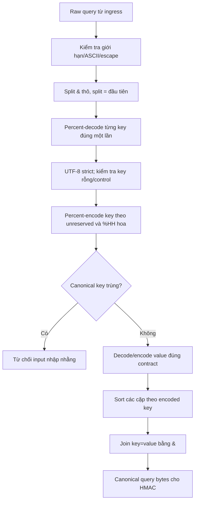

# Encode key trong query canonicalization cho HMAC request authentication

## 1. “Key” ở đây là tên tham số query, không phải shared secret

Trong module `SECURITY_AUTHENTICATION_HMAC_REQUEST_AUTHENTICATION`, HTTP client và server dùng **shared secret** để tính/xác minh HMAC trên **canonical request**: method, URI, header và/hoặc hash của raw body theo hợp đồng ký. Khi URI có query string, server phải quyết định **cách biểu diễn các tham số thành byte trước khi ký**. Đề mục **“Encode key”**, thuộc chương **“Query canonicalization”**, nói riêng về **mã hóa tên tham số query** (query parameter key/name), ví dụ `tenantId`, `page`, `filter[name]` — không nói về cách mã hóa khóa bí mật HMAC.

Ba thứ cùng có chữ “key” nhưng khác bản chất:

| Khái niệm | Ví dụ | Vai trò |
| --- | --- | --- |
| **Query key** / parameter name | `tenantId`, `sort`, `tên` | Dữ liệu client chọn trong URI; cần parse/encode đúng quy tắc trước khi ký và xử lý nghiệp vụ. |
| **HMAC key ID** | `partner-17:v4` | Định danh để server tìm bản ghi secret/algorithm/version đang được phép xác minh; bản thân header này chưa chứng minh danh tính. |
| **HMAC shared secret** | 32 byte ngẫu nhiên được cấp an toàn | Bí mật dùng tính MAC; **không** đặt trong URL, query, source code hoặc log. |

Một request có thể như sau:

```http
GET /v1/orders?z=2&na%6De=An%20B%C3%ACnh&flag=a+b HTTP/1.1
Host: api.example.test
X-HMAC-Key-Id: partner-17:v4
X-HMAC-Timestamp: 1795838400
X-HMAC-Nonce: 39e219abdf954bf0bfeadfc14986ba02
X-HMAC-Signature: <base64-full-hmac-tag>
```

Trong ví dụ, query có ba **key thô**: `z`, `na%6De`, `flag`. Để làm canonicalization, một giao thức có thể yêu cầu:

1. Parse query thành các cặp tên/giá trị theo đúng hợp đồng.
2. Percent-decode tên **một lần**, với charset UTF-8 và lỗi parse nghiêm ngặt.
3. Percent-encode lại tên theo đúng **RFC 3986 unreserved**.
4. Sắp xếp các cặp theo **encoded key**, rồi ghép thành canonical query.
5. Đưa canonical query (cùng method/path/header/body được chọn) vào dữ liệu HMAC.

Kết quả cho ví dụ:

```text
flag=a%2Bb&name=An%20B%C3%ACnh&z=2
```

Hệ thống chỉ an toàn khi **server tạo cùng canonical query** và **router/authorizer hiểu cùng các key/giá trị**. Nếu verifier dùng một kiểu decode tên `tenant` còn service dùng kiểu khác, chữ ký HMAC đúng vẫn có thể đi kèm quyết định quyền sai.

### Sau bài này, bạn cần làm được

- Phân biệt **raw query**, **decoded query key** và **percent-encoded canonical key**.
- Encode tên query bằng **UTF-8** và quy tắc percent-encoding thống nhất; tránh nhầm dấu `+` và dấu cách.
- Nhận diện trùng tên sau decode/normalize, key rỗng, escape sai, double encoding và Unicode nhập nhằng.
- Chọn thứ tự sắp xếp theo **encoded key**, không dùng map mất duplicate hay parser form một cách ngầm định.
- Triển khai Java 17+ có kiểm tra lỗi chặt và nối canonical query vào HMAC request.
- Kiểm thử proxy/gateway, chống replay bằng timestamp/nonce, key rotation và authorization cho tenant/resource.

## 2. Raw, decoded và encoded key là ba trạng thái khác nhau

Xét raw query:

```text
?na%6De=An%20B%C3%ACnh&flag=a+b
```

Dấu `?` chỉ phân cách path và query; **không phải nội dung của raw query** mà parser nhận. Các trạng thái của tên:

| Raw key trên request target | Sau percent-decode đúng một lần | Canonical encoded key |
| --- | --- | --- |
| `na%6De` | `name` | `name` |
| `flag` | `flag` | `flag` |
| `t%C3%AAn` | `tên` | `t%C3%AAn` |
| `filter%5Bname%5D` | `filter[name]` | `filter%5Bname%5D` |
| `user+name` | `user+name` (không phải `user name`) | `user%2Bname` |
| `user%20name` | `user name` | `user%20name` |
| `percent%25` | `percent%` | `percent%25` |
| `a%2Fb` | `a/b` | `a%2Fb` |

**Raw key** là các ký tự/byte đang được truyền trong request target, ví dụ `na%6De`. **Decoded key** là giá trị logic dùng để định danh tham số, ví dụ `name`. **Canonical encoded key** là cách biểu diễn duy nhất theo hợp đồng, ví dụ `name`. Không phải cứ giữ nguyên raw input là có được canonical key.

### 2.1 Percent-encoding hoạt động ở mức byte UTF-8

Trong quy tắc thường dùng theo RFC 3986, nhóm ký tự **unreserved** được để nguyên:

```text
ALPHA    A-Z a-z
DIGIT    0-9
- . _ ~
```

Các byte khác được biểu diễn thành `%HH`, với `HH` là **hai chữ số hex viết hoa** trong hợp đồng của bài. Các bước encode cho một key logic:

```text
Unicode String
  -> UTF-8 bytes
  -> byte nào thuộc unreserved thì giữ nguyên ASCII
  -> byte khác thì %HH (hex chữ hoa)
```

Ví dụ key `tên`:

```text
String:        tên
UTF-8 bytes:   74 C3 AA 6E
Encoded key:   t%C3%AAn
```

Một ký tự Unicode có thể gồm nhiều byte UTF-8, vì vậy không được percent-encode trực tiếp số thứ tự UTF-16 của Java `char`. Nếu biến ký tự `ê` thành `%EA` theo một encoding khác UTF-8, client và server có thể giải mã khác nhau.

### 2.2 Những ký tự dễ gây bất đồng

| Key logic cần encode | Canonical key của hợp đồng mẫu | Lý do |
| --- | --- | --- |
| `client_id` | `client_id` | Dấu gạch dưới thuộc unreserved. |
| `sort~by` | `sort~by` | Dấu `~` thuộc unreserved. |
| `a-b.c` | `a-b.c` | `-` và `.` thuộc unreserved. |
| `user name` | `user%20name` | Space là byte `0x20`, **không đổi thành `+`**. |
| `a+b` | `a%2Bb` | Dấu cộng mang nghĩa ký tự cộng trong URI query. |
| `a&b` | `a%26b` | Dấu `&` thô thường phân cách hai tham số. |
| `x=y` | `x%3Dy` | `=` thô phân cách tên và giá trị theo hợp đồng mẫu. |
| `a/b` | `a%2Fb` | Slash không thuộc unreserved; encode trong **query key**. |
| `filter[name]` | `filter%5Bname%5D` | Hai dấu ngoặc vuông không thuộc unreserved. |
| `a:b` | `a%3Ab` | Dấu hai chấm được encode khi không thuộc unreserved. |
| `a%v` | `a%25v` | Dấu phần trăm phải encode để không tạo escape mơ hồ. |
| `mã` | `m%C3%A3` | Chữ `ã` được encode theo byte UTF-8. |

Đây là **quy tắc chuẩn hóa của giao thức ví dụ**, không phải khẳng định rằng mọi URI bắt buộc percent-encode tất cả ký tự reserved trong mọi vị trí. Điều quan trọng là **client và server dùng đúng một contract** và phân biệt query key với path, authority hoặc dữ liệu form.

### 2.3 Tại sao không dùng `URLEncoder` / `URLDecoder` trực tiếp?

Java `java.net.URLEncoder` và `URLDecoder` được thiết kế cho **HTML form encoding**, trong đó space thường được biểu diễn bằng `+`, và `+` thô khi decode thành space. Đó **không** phải là cùng quy tắc với **RFC 3986 percent-encoding key** trong hợp đồng mẫu.

Ví dụ:

```text
Tên logic:       user name
RFC3986 encode:  user%20name
Form encode:     user+name

Tên logic:       a+b
RFC3986 encode:  a%2Bb
Form encode:     a%2Bb
```

Nếu server dùng `URLDecoder.decode(rawKey, UTF_8)` trên query key `user+name`, nó có thể hiểu thành `user name`. Nhưng contract của bài quy định `+` **chỉ là plus**, không phải space. Bởi vậy **không dùng form decoder làm bộ chuẩn hóa URI tổng quát**. Có thể sử dụng `URLEncoder`/`URLDecoder` cho một protocol form được **đặc tả riêng**, nhưng không được lẫn hai hợp đồng.

## 3. Định nghĩa contract QK-V1: Encode key chính xác

Để tránh những quy tắc mơ hồ, ta tạo **hợp đồng minh họa `HMAC-REQUEST/QK-V1`** cho query canonicalization. QK-V1 **không phải tiêu chuẩn tự động của mọi hệ thống HMAC**, mà là một thiết kế tự chứa để học và thực hành.

### 3.1 Input và các quy tắc parse

| Thành phần | Quy tắc QK-V1 |
| --- | --- |
| Request target | HTTP **origin-form**: raw path và raw query; adapter lấy chúng trước mọi proxy rewrite ngoài hợp đồng. |
| Dấu `?` | Phân chia path/query. Raw query truyền vào parser **không gồm `?`**. |
| Query không tồn tại | `/v1/orders` ⇒ canonical query là chuỗi rỗng. |
| Query có `?` nhưng rỗng | `/v1/orders?` ⇒ **từ chối** để không nhập nhằng với query không tồn tại. |
| Phân tách các cặp | Chỉ dấu `&` thô; không dùng `;` làm delimiter thứ hai. |
| Tách tên và value | Bắt buộc ít nhất một `=` thô; tách theo **dấu `=` đầu tiên**. Value có thể rỗng. |
| Tên key | Không rỗng sau decode; có thể chứa UTF-8 hợp lệ nếu policy nghiệp vụ cho phép. |
| Percent decoding | Mỗi escape đúng `%` + 2 hex ASCII; decode **đúng một lần** thành bytes rồi UTF-8 nghiêm ngặt. |
| Dấu `+` thô | Diễn giải như **ký tự plus**, không thay bằng space. |
| Charset/Unicode | UTF-8; không âm thầm NFC/NFD, lowercase hay case-fold tên key. |
| Encode key | RFC 3986 unreserved giữ nguyên; mọi byte khác thành `%HH` hex **chữ hoa**. |
| Encode value | Trong mẫu này dùng **cùng** bộ percent-encode để tạo canonical value. |
| Duplicate keys | **Từ chối** nếu hai raw key sau decode + encode tạo **cùng canonical key**. |
| Sắp xếp | Sort **theo canonical encoded key**, thứ tự ASCII tăng dần; key đã được encode chỉ chứa ASCII. |
| Giới hạn | Ví dụ: raw query tối đa 4096 ký tự ASCII, tối đa 64 cặp, key/value bị giới hạn theo ứng dụng. |

QK-V1 cố tình **không cho phép duplicate keys**, vì một backend có thể đọc giá trị đầu còn lớp khác lấy giá trị cuối. Với API thật cần `tag=one&tag=two` thì cần một **hợp đồng version khác**, quy định rõ sorting theo key và value, multimap và cách authorizer hiểu tham số lặp. Không chỉ thêm `List` vào code rồi giữ nguyên ngầm định.

### 3.2 Một pipeline canon hóa tên



Nếu nhận raw key `%74enant`, percent-decoding cho ra `tenant` và canonical encoder cho ra `tenant`. Một raw key khác `tenant` cũng cho cùng tên canonical. Khi cả hai cùng xuất hiện, **phải từ chối** trước khi vào router/service; không cho phép một tầng dùng `%74enant` còn tầng khác dùng `tenant` với nghĩa khác nhau.

### 3.3 Ký raw query hay ký canonical query?

Đây là hai chiến lược khác nhau:

- **Ký raw query:** thứ tự, cách escape `%2f`/`%2F` và biểu diễn `na%6De`/`name` đều trở thành byte cần bảo toàn. Proxy rewrite dù giữ nghĩa cũng có thể làm MAC sai.
- **Ký canonical query:** nhiều biểu diễn raw có thể dẫn đến **cùng canonical bytes** (ví dụ `na%6De` và `name` khi chỉ xuất hiện riêng). Điều này là **chủ ý của normalization**, miễn là verifier, router và authorizer đều dùng cùng giá trị đã parse và không có parser differential.

Nếu mục tiêu là chứng minh **chính xác raw request target ban đầu** đã đi qua mạng mà không đổi một byte, phải chọn raw-target signing thay vì giả định canonical query giữ mọi khác biệt. Nếu chọn canonical query, tất cả cách biểu diễn được chuẩn hóa về cùng nghĩa phải có **quy tắc xác định, audit được**.

## 4. Thực hành từng bước với raw query

Input:

```text
z=2&na%6De=An%20B%C3%ACnh&flag=a+b
```

Tách các cặp:

| Raw key | Raw value | Decoded key | Decoded value |
| --- | --- | --- | --- |
| `z` | `2` | `z` | `2` |
| `na%6De` | `An%20B%C3%ACnh` | `name` | `An Bình` |
| `flag` | `a+b` | `flag` | `a+b` |

Encode key và value:

| Encoded key | Encoded value | Cặp canonical |
| --- | --- | --- |
| `z` | `2` | `z=2` |
| `name` | `An%20B%C3%ACnh` | `name=An%20B%C3%ACnh` |
| `flag` | `a%2Bb` | `flag=a%2Bb` |

Sort theo **encoded key ASCII**: `flag`, `name`, `z`.

Kết quả:

```text
flag=a%2Bb&name=An%20B%C3%ACnh&z=2
```

Điều cần chú ý: client đã gửi `flag=a+b` và server ký **`flag=a%2Bb`** theo QK-V1. Nếu controller lại dùng form decoder trên raw URL rồi coi `flag` là `a b`, dữ liệu nghiệp vụ **khác** với dữ liệu verifier đã xác thực. Đó là lý do nên **đưa các decoded values đã được canonicalizer chấp nhận** vào logic authorization, không để controller parse lại bằng thư viện khác.

### 4.1 Canonical key có thứ tự phân biệt hoa/thường

Giả sử các key `A`, `a`, `z`, `%5Fid` xuất hiện. Sau decode/encode:

```text
A
a
z
_id
```

Thứ tự ASCII tăng dần: `A`, `_id`, `a`, `z` (vì ký tự `A` có mã 65, `_` là 95, `a` là 97). **Không lower-case key** nếu contract không cho phép; một tầng coi `Tenant` và `tenant` giống nhau còn verifier coi khác nhau sẽ tạo bất đồng về quyền.

**Sort theo encoded key, không sort theo raw key.** Ví dụ `na%6De` được chuẩn hóa thành `name`, nên vị trí sắp xếp phải dựa trên `name`. Hợp đồng QK-V1 dùng thứ tự ASCII tăng dần của chuỗi encoded; với tập unreserved và `%HH`, encoded key chỉ có ký tự ASCII, nên Java `String.compareTo` tương thích với thứ tự ASCII này.

### 4.2 Những cặp input không được tự hợp nhất

| Raw input | Xử lý QK-V1 | Lý do |
| --- | --- | --- |
| `tenant=t42&%74enant=t99` | **Từ chối** | Hai key cùng canonical `tenant`. |
| `a+b=1&a%2Bb=2` | **Từ chối** | `+` raw giữ nghĩa plus, nên hai key cùng `a%2Bb`. |
| `x=1&x=2` | **Từ chối** | Duplicate key rõ ràng. |
| `=empty-key` | **Từ chối** | Key rỗng. |
| `flag` | **Từ chối** | Thiếu `=` thô theo QK-V1. |
| `flag=` | **Chấp nhận** | Value rỗng được biểu diễn tường minh. |
| `a=%GG` | **Từ chối** | Escape sai, không có hex hợp lệ. |
| `name=%FF` | **Từ chối** | Percent byte không tạo chuỗi UTF-8 hợp lệ. |
| `q=%252F` | **Chấp nhận** nếu value được phép | Decode đúng một lần thành `%2F` rồi encode thành `%252F`; **không decode lần hai thành slash**. |
| `x=1&&y=2` | **Từ chối** | Cặp rỗng giữa hai dấu `&`. |
| `x=1;admin=1` | Giá trị của `x` chứa dấu `;`, được encode `%3B` | Không coi `;` là delimiter; tầng nghiệp vụ cũng phải giữ quy tắc đó. |

Đây là ranh giới **bảo mật ứng dụng**: nếu controller hoặc gateway tự decode hai lần, coi `;` là delimiter, hoặc chấp nhận duplicate theo “last wins”, việc MAC khớp không có nghĩa policy được áp dụng cho đúng tài nguyên.

## 5. Unicode, chuẩn hóa ký tự và các tên giống nhau trên giao diện

### 5.1 Hai chuỗi nhìn giống chưa chắc có cùng UTF-8 bytes

Một tên hiển thị “é” có thể có ít nhất hai biểu diễn Unicode:

- **NFC/precomposed:** `é` là code point U+00E9, UTF-8 `C3 A9`, encode thành `%C3%A9`.
- **Decomposed:** `e` + U+0301, UTF-8 `65 CC 81`, encode thành `e%CC%81`.

QK-V1 **không áp dụng Unicode normalization ngầm**. Do vậy hai key có thể nhìn giống người đọc nhưng có hai encoded key khác nhau. Nếu framework, database hoặc service lại áp dụng NFC, lowercasing hay accent-folding khi lookup, chúng có thể bị hợp nhất sau bước verifier.

**Hai phương án an toàn:**

1. Giữ QK-V1 không normalize Unicode, nhưng yêu cầu các lớp xử lý key có ý nghĩa bảo mật sử dụng **cùng chuỗi đã decode** và không tự đổi cách so sánh; cân nhắc giới hạn **ASCII allowlist** đối với tên như `tenantId`, `role`, `resourceId`.
2. Định nghĩa phiên bản canonical khác **có Unicode normalization xác định** (ví dụ NFC trước encode), kèm duplicate detection **sau normalize**, golden vectors và quy tắc đồng nhất từ client đến database.

Không được thêm `Normalizer.normalize(...)` vào bản V1 đã phát hành mà không đổi version nếu thay đổi đó làm biến đổi canonical bytes. Cách viết “Unicode thường được chuẩn hóa” là chưa đủ đặc tả.

### 5.2 Giới hạn key có ý nghĩa phân quyền

Một API có thể cho phép tên query Unicode trong tìm kiếm, nhưng các tham số điều khiển quyền như `tenantId`, `scope`, `userId`, `action` thường không cần Unicode tùy ý. Hãy quy định allowlist key **được công bố** theo endpoint, ví dụ `tenantId` hoặc `limit`, và từ chối unknown security-sensitive key nếu chính sách không cho phép.

Ví dụ `TenantId` và `tenantId` được QK-V1 coi là **hai key khác nhau**. Nếu business layer dùng case-insensitive map và xem chúng như nhau, cần từ chối cặp này tại biên hoặc thống nhất case folding **trong một hợp đồng mới**, thay vì để hai lớp bất đồng.

### 5.3 Không dùng “Unicode string” thay cho giao thức byte-level

Java `String` dùng UTF-16; một chuỗi có **unpaired surrogate** không phải Unicode scalar value hợp lệ. Lệnh `getBytes(UTF_8)` trong một số API có thể thay thế ký tự không encode được, tạo ra kết quả khó phát hiện. Với dữ liệu phục vụ chữ ký, hãy dùng UTF-8 encoder/decoder cấu hình **`CodingErrorAction.REPORT`**, không chấp nhận âm thầm thay bằng ký tự `�`.

## 6. Java 17+: percent-encode query key và canonicalize các cặp

Bộ mã sau mô tả đúng **contract QK-V1**: percent-decode raw component thành bytes rồi UTF-8 nghiêm ngặt, encode theo unreserved, reject duplicate **sau canonicalize**, sort theo encoded key. Phần encode được dùng cho **key và value**, nhưng bài tập trung vào **key**.

**Lưu ý giới hạn:** đây là lớp canonical query, không phải HTTP URL parser hoàn chỉnh. HTTP adapter phải lấy **raw query** tại điểm tin cậy, kiểm tra origin-form/path/authority/fragment và giới hạn HTTP headers. Server cũng cần kiểm tra policy key, timestamp/nonce và quyền ở tầng phù hợp.

### 6.1 Lớp Java tự chứa

```java
import java.io.ByteArrayOutputStream;
import java.nio.ByteBuffer;
import java.nio.CharBuffer;
import java.nio.charset.CharacterCodingException;
import java.nio.charset.CodingErrorAction;
import java.nio.charset.StandardCharsets;
import java.util.ArrayList;
import java.util.Collections;
import java.util.Comparator;
import java.util.HashSet;
import java.util.LinkedHashMap;
import java.util.List;
import java.util.Map;
import java.util.Set;
import java.util.StringJoiner;

public final class QueryKeyCanonicalV1 {
    private static final char[] HEX = "0123456789ABCDEF".toCharArray();

    private QueryKeyCanonicalV1() {}

    public record Result(
            String canonicalQuery,
            Map<String, String> decodedParameters) {}

    private record Entry(
            String encodedKey,
            String encodedValue,
            String decodedKey,
            String decodedValue) {}

    // rawQuery KHÔNG bao gồm dấu '?'; null nghĩa là query không tồn tại.
    public static Result canonicalize(String rawQuery) {
        if (rawQuery == null) {
            return new Result("", Map.of());
        }
        if (rawQuery.isEmpty() || rawQuery.length() > 4096) {
            // "/path?" bị cấm; "/path" (null) được cho phép.
            throw new IllegalArgumentException("Invalid raw query size");
        }

        String[] rawPairs = rawQuery.split("&", -1);
        if (rawPairs.length > 64) {
            throw new IllegalArgumentException("Too many query parameters");
        }

        List<Entry> entries = new ArrayList<>();
        Set<String> seenEncodedKeys = new HashSet<>();
        for (String rawPair : rawPairs) {
            int separator = rawPair.indexOf('=');
            if (separator <= 0) {
                // Key rỗng, cặp rỗng hoặc thiếu '=' đều bị cấm.
                throw new IllegalArgumentException("Invalid query pair");
            }

            // Chỉ dấu '=' đầu tiên phân cách tên và value.
            String decodedKey =
                    decodeRawComponent(rawPair.substring(0, separator));
            String decodedValue =
                    decodeRawComponent(rawPair.substring(separator + 1));
            if (decodedKey.isEmpty()) {
                throw new IllegalArgumentException("Empty query key");
            }

            String encodedKey = encodeUtf8(decodedKey);
            String encodedValue = encodeUtf8(decodedValue);
            if (encodedKey.length() > 768 || encodedValue.length() > 6144) {
                throw new IllegalArgumentException("Query field too long");
            }

            // Hai raw key khác nhau nhưng canonical hóa giống nhau:
            // reject, không chọn giá trị đầu/cuối tùy framework.
            if (!seenEncodedKeys.add(encodedKey)) {
                throw new IllegalArgumentException("Duplicate query key");
            }
            entries.add(new Entry(
                    encodedKey, encodedValue, decodedKey, decodedValue));
        }

        // Encoded key chỉ chứa ASCII, String.compareTo = thứ tự ASCII.
        entries.sort(Comparator.comparing(Entry::encodedKey));

        StringJoiner canonical = new StringJoiner("&");
        Map<String, String> decoded = new LinkedHashMap<>();
        for (Entry entry : entries) {
            canonical.add(entry.encodedKey() + "=" + entry.encodedValue());
            decoded.put(entry.decodedKey(), entry.decodedValue());
        }
        return new Result(
                canonical.toString(),
                Collections.unmodifiableMap(decoded));
    }

    // Raw URI query component, KHÔNG dùng form URLDecoder:
    // '+' là plus; %HH tạo byte; raw non-ASCII bị cấm trong contract này.
    private static String decodeRawComponent(String raw) {
        ByteArrayOutputStream bytes = new ByteArrayOutputStream();
        for (int i = 0; i < raw.length(); i++) {
            char ch = raw.charAt(i);
            if (ch == '%') {
                if (i + 2 >= raw.length()) {
                    throw new IllegalArgumentException("Incomplete % escape");
                }
                int hi = hexValue(raw.charAt(i + 1));
                int lo = hexValue(raw.charAt(i + 2));
                if (hi < 0 || lo < 0) {
                    throw new IllegalArgumentException("Invalid % escape");
                }
                bytes.write((hi << 4) | lo);
                i += 2;
            } else {
                if (ch < 0x21 || ch > 0x7E
                        || ch == '#' || ch == '\\') {
                    throw new IllegalArgumentException(
                            "Invalid raw query character");
                }
                bytes.write((byte) ch);
            }
        }

        final String decoded;
        try {
            decoded = StandardCharsets.UTF_8.newDecoder()
                    .onMalformedInput(CodingErrorAction.REPORT)
                    .onUnmappableCharacter(CodingErrorAction.REPORT)
                    .decode(ByteBuffer.wrap(bytes.toByteArray()))
                    .toString();
        } catch (CharacterCodingException ex) {
            throw new IllegalArgumentException("Invalid UTF-8", ex);
        }

        // Không cho ký tự điều khiển xuất hiện trong tên/giá trị logic.
        if (decoded.codePoints().anyMatch(Character::isISOControl)) {
            throw new IllegalArgumentException("Control character in query");
        }
        return decoded;
    }

    // Encode Unicode scalar values qua UTF-8, chỉ giữ RFC3986 unreserved.
    public static String encodeUtf8(String logicalValue) {
        final ByteBuffer buffer;
        try {
            buffer = StandardCharsets.UTF_8.newEncoder()
                    .onMalformedInput(CodingErrorAction.REPORT)
                    .onUnmappableCharacter(CodingErrorAction.REPORT)
                    .encode(CharBuffer.wrap(logicalValue));
        } catch (CharacterCodingException ex) {
            throw new IllegalArgumentException("Invalid Unicode string", ex);
        }

        StringBuilder out = new StringBuilder(buffer.remaining() * 3);
        while (buffer.hasRemaining()) {
            int b = buffer.get() & 0xFF;
            boolean unreserved =
                    (b >= 'A' && b <= 'Z')
                    || (b >= 'a' && b <= 'z')
                    || (b >= '0' && b <= '9')
                    || b == '-' || b == '.' || b == '_' || b == '~';
            if (unreserved) {
                out.append((char) b);
            } else {
                out.append('%');
                out.append(HEX[(b >>> 4) & 0xF]);
                out.append(HEX[b & 0xF]);
            }
        }
        return out.toString();
    }

    private static int hexValue(char c) {
        if (c >= '0' && c <= '9') return c - '0';
        if (c >= 'A' && c <= 'F') return c - 'A' + 10;
        if (c >= 'a' && c <= 'f') return c - 'a' + 10;
        return -1;
    }
}
```

**Những lựa chọn cố ý trong code:**

1. **Không form-decode dấu `+`.** Byte ASCII `+` được giữ khi decode raw component và chuyển thành `%2B` khi encode; space phải được gửi là `%20`.
2. **UTF-8 strict.** Decoder/encoder báo lỗi thay vì thay byte hoặc surrogate không hợp lệ bằng một ký tự khác.
3. **Một canonical key duy nhất.** Sau decode + encode, key trùng bị từ chối, kể cả `tenant`/`%74enant` và `a+b`/`a%2Bb`.
4. **Không normalize Unicode hoặc case.** Đây là hợp đồng QK-V1; các lớp bên dưới không được tự thực hiện case-fold/NFC khác với verifier.
5. **Tách theo dấu `=` đầu tiên.** `x=a=b` được diễn giải là value `a=b` rồi encode thành `x=a%3Db`. Tên key có dấu `=` phải được gửi encoded là `%3D`.
6. **Không có `?` và query rỗng là khác nhau.** `rawQuery == null` có canonical query rỗng; `rawQuery.isEmpty()` bị từ chối.
7. **Tài nguyên:** giới hạn độ dài query và số cặp để tránh các request gây tốn bộ nhớ/CPU; API thật cần giới hạn body/header/URL ở gateway đồng bộ với backend.

Phần code **không tự chặn key chứa bidi-control hoặc các confusable Unicode không thuộc nhóm ISO control**. Đối với tham số quyết định quyền, nên áp dụng **allowlist tên** riêng (thường ASCII) ở lớp endpoint sau khi canonicalize; nếu mở rộng hỗ trợ tên Unicode, cần policy chống tên nhìn giống nhau và đồng nhất với datastore.

### 6.2 Kiểm tra bằng ví dụ Java

```java
QueryKeyCanonicalV1.Result result =
        QueryKeyCanonicalV1.canonicalize(
            "z=2&na%6De=An%20B%C3%ACnh&flag=a+b");

String expected = "flag=a%2Bb&name=An%20B%C3%ACnh&z=2";
if (!expected.equals(result.canonicalQuery())) {
    throw new AssertionError("Canonical query mismatch");
}
if (!"An Bình".equals(result.decodedParameters().get("name"))) {
    throw new AssertionError("Decoded query value mismatch");
}

String unicodeName = QueryKeyCanonicalV1.encodeUtf8("tên");
if (!"t%C3%AAn".equals(unicodeName)) {
    throw new AssertionError("RFC3986 UTF-8 encoding mismatch");
}

// Duplicate key đã qua normalize phải bị từ chối.
try {
    QueryKeyCanonicalV1.canonicalize(
            "tenant=t42&%74enant=t99");
    throw new AssertionError("Duplicate query key was accepted");
} catch (IllegalArgumentException expectedRejection) {
    // PASS: contract QK-V1 reject duplicate encoded key.
}
```

Ví dụ test `try/catch` trên mô tả ý định; trong test suite thực tế, nên dùng `assertThrows` hoặc helper không bắt nhầm `AssertionError` và tách từng trường hợp thành một test độc lập. Cần thêm golden vectors đa ngôn ngữ để phát hiện việc Java, Go, Node hoặc Python hiểu `+`, percent bytes hoặc UTF-8 khác nhau.

## 7. Đưa canonical query vào HMAC request một cách có version

Giả sử hợp đồng `HMAC-REQUEST/QK-V1` đã định nghĩa **canonical query** như phần trước, còn method, path, audience, header và body được canonicalize theo các quy tắc độc lập. Client dùng:

```http
GET /v1/orders?z=2&na%6De=An%20B%C3%ACnh&flag=a+b HTTP/1.1
Accept: application/json
X-HMAC-Key-Id: partner-17:v4
X-HMAC-Timestamp: 1795838400
X-HMAC-Nonce: 39e219abdf954bf0bfeadfc14986ba02
X-HMAC-Signature: <base64-full-tag>
```

Ví dụ này dùng HMAC-SHA256 và **body rỗng**. Canonical request quy định **10 dòng**, thứ tự và dấu `LF` chính xác, không có LF cuối:

```text
HMAC-REQUEST/QK-V1
HMAC-SHA256
GET
/v1/orders
canonical-query:flag=a%2Bb&name=An%20B%C3%ACnh&z=2
audience:orders-api/prod
x-hmac-key-id:partner-17:v4
x-hmac-timestamp:1795838400
x-hmac-nonce:39e219abdf954bf0bfeadfc14986ba02
body-sha256:e3b0c44298fc1c149afbf4c8996fb92427ae41e4649b934ca495991b7852b855
```

Dòng cuối là hex SHA-256 của **mảng raw body rỗng**. Nếu request có body, dùng SHA-256 trên **raw body bytes**, không stringify/serialize lại JSON. Chữ ký:

```text
canonicalBytes = UTF8(10_dong_LF_khong_co_LF_cuoi)
macBytes       = HMAC_SHA256(secretBytes, canonicalBytes) // 32 bytes
signature      = Base64_Standard_Padded(macBytes)         // 44 chars
```

Trong Java có thể nối các thành phần đã kiểm tra như sau:

```java
import java.nio.charset.StandardCharsets;
import java.util.List;

String canonicalQuery =
        QueryKeyCanonicalV1.canonicalize(rawQuery).canonicalQuery();

String canonicalText = String.join("\n",
        "HMAC-REQUEST/QK-V1",
        "HMAC-SHA256",
        "GET",
        rawPath, // path được validate riêng, không phải decoded path
        "canonical-query:" + canonicalQuery,
        "audience:orders-api/prod",
        "x-hmac-key-id:" + keyId,
        "x-hmac-timestamp:" + epochSeconds,
        "x-hmac-nonce:" + nonce,
        "body-sha256:" + bodyHashHex);

byte[] canonicalBytes =
        canonicalText.getBytes(StandardCharsets.UTF_8);
// Phía client: HmacSHA256(secretBytes, canonicalBytes) rồi Base64 tag.
// Phía server: tự dựng lại từ raw HTTP request và so MAC bytes.
```

Bộ ví dụ trên chỉ mô tả **ghép các trường**; `rawPath` phải được lấy từ ingress tin cậy và validate theo **hợp đồng path**, không được chứa CR/LF để chèn dòng canonical. `keyId`, timestamp, nonce, digest và các signed headers cũng phải được adapter kiểm tra format/duplicate trước khi ghép; `bodyHashHex` phải được tính từ byte body thực tế, không nhận sẵn từ client làm giá trị đáng tin.

**Chú ý:** HMAC ở đây bảo vệ **canonical query**, không bảo vệ từng byte raw query ban đầu. Ví dụ với key `na%6De` hoặc `name` đứng một mình, cả hai tạo cùng canonical `name`, nên có thể tạo **cùng MAC** nếu mọi thành phần khác không đổi. Đó là semantics của QK-V1, không phải lỗi mật mã. Vì vậy application **bắt buộc dùng mô hình query đã chuẩn hóa giống verifier** để tránh chính sách tài nguyên bị bypass.

### 7.1 Tại sao phải ký timestamp và nonce cùng query?

Nếu request cũ bị ghi lại rồi gửi lại nguyên bản, HMAC vẫn khớp, bất kể query được encode đúng đến đâu. Hợp đồng phải có **timestamp + nonce nằm trong canonical bytes**. Server:

- Kiểm tra timestamp epoch seconds theo cửa sổ từ một đồng hồ đáng tin cậy.
- Verify key/algorithm/version và HMAC trên đúng canonical bytes.
- Reserve nonce **nguyên tử** trong kho dùng chung, ví dụ `SET ... NX EX ...` với TTL phủ toàn thời gian timestamp còn hợp lệ; fail-closed nếu kho lỗi.
- Tạo principal từ key metadata đã xác minh; **authorization** theo action, tenant/resource và policy server-side.
- Dùng idempotency riêng nếu endpoint có side effect, bởi hai request hợp lệ khác nonce vẫn có thể trùng ý định nghiệp vụ.

### 7.2 QK-V1 và key rotation

Canonical query version không đồng nghĩa với key version. Một client có thể xoay secret `partner-17:v4` → `partner-17:v5` mà vẫn dùng QK-V1, nếu server đã ghim **algorithm = HmacSHA256, canonicalVersion = QK-V1, audience = orders-api/prod** theo từng key metadata.

Khi thay đổi quy tắc encode (ví dụ chuyển từ `%20` sang `+`, thêm NFC normalization hoặc cho phép duplicate key), cần **phiên bản canonical mới và golden vectors mới**. Không cho client tự gửi `X-Canonical-Version: v0` để ép server dùng quy tắc yếu; server chọn version theo key record và chặn fallback không kiểm soát.

## 8. Vì sao gateway và framework làm sai Encode key?

Nhiều thành phần HTTP có thể thay đổi query trước khi ứng dụng nhìn thấy: CDN, WAF, API gateway, load balancer, reverse proxy, HTTP/2-to-HTTP/1.1 bridge, servlet container và SDK client.

| Hiện tượng | Rủi ro | Cách kiểm soát |
| --- | --- | --- |
| Gateway đổi `%6D` thành `m` trong key | Với raw-target signing, HMAC sai; với QK-V1 có thể vẫn cùng canonical key. | Quy định rõ ký raw hay normalized query; đo đúng raw target tại điểm verify. |
| Proxy đổi `+` thành space | Canonical key/value và semantics có thể đổi; URI vs form decoding nhập nhằng. | Không dùng form parser thay RFC3986 parser; reject nếu không bảo toàn semantics. |
| Framework parse query thành `Map<String,String>` | Mất duplicate, thứ tự và dấu `=`; dữ liệu `tenant` có thể bị chọn khác tầng trước. | Canonicalize trước khi mất raw query; reject duplicates và dùng decoded model nhất quán. |
| WAF hoặc proxy lowercase query key | `TenantId` và `tenantId` bị gộp ngoài hợp đồng, có thể ảnh hưởng quyền. | Không âm thầm case-fold; kiểm thử qua thực tế. |
| Trùng key sau percent decode `tenant`/`%74enant` | Verifier có thể xác thực một dạng, backend dùng dạng khác. | Reject sau canonical encode; thống nhất policy với router và authorizer. |
| Tầng A decode `%252F` một lần, tầng B decode tiếp | Giá trị có thể biến từ `%2F` thành slash, đổi đường dẫn/ID trong service. | Quy định decode đúng một lần; không cấp quyền dựa trên giá trị đã decode khác. |
| HTTP/2 pseudo-header `:path` bị rewrite khi chuyển giao | Byte raw query gốc mất; canonical query có thể bị đổi. | Xác minh tại ingress hoặc truyền thông tin gốc qua kênh tin cậy. |
| Query `?x` và `?x=` bị gộp | Trong QK-V1, `?x` phải bị từ chối nhưng parser khác có thể cho qua. | Một parser canonical kiểm tra input trước nghiệp vụ. |
| Header `X-Original-URI` được client tự gửi | Kẻ tấn công có thể giả raw target để bypass kiểm tra nếu backend tin header. | Gateway strip/overwrite, bảo vệ kênh và không cho truy cập backend bypass. |

### 8.1 Hai kiến trúc xác minh

**Gateway xác minh HMAC:** Gateway lấy raw target từ ingress trước rewrite, áp dụng QK-V1, key status, timestamp/nonce; sau đó truyền **authenticated principal** cho backend qua kênh tin cậy (mTLS hoặc identity context nội bộ được xác thực). Backend phải dùng **resource/query semantics nhất quán**, làm authorization mức tài nguyên và không tin header “principal” do Internet tự gửi.

**Backend xác minh HMAC:** Gateway phải preserve raw request target và body đã ký, hoặc chuyển metadata gốc qua kênh bảo vệ, rồi backend áp dụng parser chuẩn. Không để gateway dùng **last-wins** trên duplicate query key còn backend dùng **first-wins**, đặc biệt với `tenantId`/`resourceId`.

Một HMAC đúng không có nghĩa client có quyền thao tác mọi giá trị query. Ví dụ client có secret hợp lệ của `partner-17` có thể tự ký `tenantId=t-99` bằng QK-V1. **Authorization phải đối chiếu principal với tenant thực được truy vấn**, không tin giá trị được ký như một chứng nhận quyền.

## 9. Kiểm thử encode key theo byte và theo hành vi

Hãy chạy ít nhất hai lớp test: **unit test canonical query** và **integration test toàn tuyến client → proxy/gateway → verifier → router → authorizer**. Test vector phải có raw input, decoded key/value, canonical encoded string, canonical request bytes và HMAC tag với **secret thử nghiệm**. “Client tự ký rồi tự verify” chưa chứng minh tương thích nếu cả hai cùng sai quy tắc.

| Case | Input/tình huống | Kết quả theo QK-V1 |
| --- | --- | --- |
| Q01 | `na%6De=An%20B%C3%ACnh` | Canonical `name=An%20B%C3%ACnh`. |
| Q02 | `flag=a+b` | Canonical `flag=a%2Bb`; `+` không phải space. |
| Q03 | `user%20name=a` | Canonical `user%20name=a`. |
| Q04 | `user+name=a` | Canonical `user%2Bname=a`; khác case Q03. |
| Q05 | `a%2Fb=1` | Key logic `a/b`; canonical key `a%2Fb`. |
| Q06 | `filter%5Bname%5D=v` | Canonical `filter%5Bname%5D=v`. |
| Q07 | `t%C3%AAn=Vi%E1%BB%87t` | Canonical giữ UTF-8 percent-encoding chữ hoa; decoded key `tên`. |
| Q08 | `a%2fb=1` | Canonical escape chữ hoa `a%2Fb=1`. |
| Q09 | `%74enant=t42&tenant=t99` | Reject: duplicate sau decode/encode. |
| Q10 | `a+b=1&a%2Bb=2` | Reject: duplicate canonical key. |
| Q11 | `x=1&x=2` | Reject: duplicate raw key. |
| Q12 | `=value` | Reject: key rỗng. |
| Q13 | `flag` | Reject: thiếu dấu `=`. |
| Q14 | `flag=` | Accept: value rỗng, canonical `flag=`. |
| Q15 | `name=%GG` hoặc `name=%C3` | Reject: escape sai hoặc UTF-8 không hoàn chỉnh. |
| Q16 | `name=%FF` | Reject: byte UTF-8 không hợp lệ. |
| Q17 | `x=%252F` | Canonical `x=%252F`; không decode lần hai. |
| Q18 | `x=1&&y=2` | Reject cặp trống. |
| Q19 | `x=1;y=2` | Canonical `x=1%3By%3D2`; không coi `;` là dấu tách. |
| Q20 | `z=2&na%6De=An%20B%C3%ACnh&flag=a+b` | Sort thành `flag=a%2Bb&name=An%20B%C3%ACnh&z=2`. |
| Q21 | `A=1&a=2&_id=3` | Sort ASCII `A=1&_id=3&a=2`; phân biệt case. |
| Q22 | Raw query không có (không có `?`) | Canonical query là chuỗi rỗng. |
| Q23 | Có dấu `?` nhưng query rỗng | Reject theo contract QK-V1. |
| Q24 | Raw query dài hơn 4096 ký tự hoặc trên 64 cặp | Reject theo resource limit. |
| Q25 | Tên Unicode NFC và dạng decomposed có hình thức giống nhau | Encode thành **hai chuỗi khác** theo QK-V1; policy ứng dụng không được normalize ngầm. |
| Q26 | Gateway đổi raw `%6D` thành `m` trong tên | QK-V1 cùng canonical key nếu decoded semantics không đổi; app cũng phải hiểu cùng một key. |
| Q27 | Gateway đổi plus thành space | Phát hiện canonical/query semantics mismatch hoặc reject; không tự cho qua. |
| Q28 | HTTP/2-to-HTTP/1.1 chuyển raw `:path` qua proxy | Canonical query ở điểm verify phải theo đúng QK-V1; route/resource nhất quán. |
| Q29 | Timestamp trong cửa sổ, MAC đúng, nonce đã dùng | Replay bị chặn dù query encode chuẩn. |
| Q30 | Key HMAC bị revoked dù canonical query đúng | Từ chối authentication. |
| Q31 | HMAC/nonce hợp lệ nhưng `tenantId=t-99` ngoài grant | Authentication pass; authorization từ chối. |
| Q32 | Hai request nonce khác nhau cùng `Idempotency-Key` và business intent | Idempotency nghiệp vụ ngăn side effect trùng. |

### 9.1 Test vector đa ngôn ngữ

Tối thiểu một bộ golden vector nên chứa:

- **Raw URI**, gồm `?` và raw query trong chuỗi request target gốc.
- Danh sách key/value **đã percent-decode** (bao gồm case `+`, Unicode, dấu `%`).
- Danh sách encoded key/value **sau chuẩn hóa** và thứ tự sort.
- **Canonical query string** và **canonical request bytes** có UTF-8/LF chính xác.
- Secret thử nghiệm, algorithm, full HMAC bytes và Base64 signature dự kiến.
- Các trường **phải bị reject**: duplicate sau decode, UTF-8 hỏng, escape thiếu, dấu `?` rỗng.

Nên tạo vectors bằng **hai implementation độc lập** (ví dụ Java và Go), không dùng cùng một hàm encode ở cả hai phía rồi coi round-trip là kiểm chứng chính xác. Với gateway, test cả HTTP/1.1, HTTP/2, query Unicode percent-encoded, duplicate names và raw URI bị rewrite.

## 10. Những lỗi thiết kế thường gặp

| Sai lầm | Vì sao nguy hiểm | Sửa thế nào |
| --- | --- | --- |
| Dùng `URLEncoder` cho toàn bộ URI | Form encoding dùng `+` cho space và không phân biệt ngữ cảnh path/query. | Percent-encode **component** theo hợp đồng; không encode cả URI bằng form rules. |
| So trực tiếp raw key trước decode | `tenant` và `%74enant` có thể bị coi là khác khi backend xem là một. | Decode strict một lần, encode canonical, detect duplicate. |
| Sort theo decoded key nhưng ký encoded key | Thứ tự có thể không giống sorting theo encoded representation đã công bố. | Sort theo **encoded key** chính xác theo QK-V1. |
| Lowercase tên key vì HTTP header không phân biệt case | **Query parameter names không phải HTTP header names**; case semantics tùy API. | Giữ nguyên case theo hợp đồng và policy endpoint. |
| Decode hai lần `%252F` | Có thể biến text `%2F` thành slash, đổi resource ID. | Decode đúng một lần; reject/cấu hình chặt các luồng decode tiếp. |
| Giải mã UTF-8 lỗi bằng ký tự thay thế | Có thể làm hai byte sequence khác nhau hợp nhất thành cùng tên. | Sử dụng UTF-8 decoder/encoder strict. |
| Dùng map query từ framework để dựng MAC | Có thể mất duplicate, thứ tự và khác biệt `x`/`x=`. | Parse từ raw query, dùng model đã xác minh xuyên các lớp. |
| Tự coi `X-Tenant-Id` hoặc `tenantId` đã ký là quyền | Client có secret vẫn tự ký một tenant khác. | Authorization theo principal/grant server-side và resource thực tế. |
| Đổi cách encode giữa các bản deploy mà giữ cùng version | MAC mismatch hoặc hai replica diễn giải khác nhau. | Canonical format immutable, version mới, golden vectors. |
| Thử nhiều canonicalization/algorithm đến khi HMAC khớp | Fallback có thể tạo ambiguity và đường downgrade không được kiểm soát. | Ghim algorithm và canonical version theo key metadata phía server. |

## 11. Tình huống thực hành: cùng một query có hai cách hiểu

Một API chuyển tiền sử dụng HMAC-SHA256 và có tham số query `tenantId`. Client được cấp secret cho `partner-17`, chỉ có quyền thao tác trên `tenantId=t-42`. Request:

```http
POST /v1/transfers?%74enantId=t-42&tenantId=t-99 HTTP/1.1
X-HMAC-Key-Id: partner-17:v4
X-HMAC-Timestamp: <epoch-seconds>
X-HMAC-Nonce: <unique-nonce>
X-HMAC-Signature: <valid-signature-under-some-parser>
```

Giả sử một gateway giữ giá trị **đầu** để phân quyền, còn backend lấy giá trị **cuối** để chọn tài khoản đích.

**Phân tích:**

1. Hai raw key `%74enantId` và `tenantId` đều percent-decode thành **`tenantId`**. QK-V1 phải **từ chối trước khi xác minh nghiệp vụ**, do duplicate canonical key.
2. Không thể dựa vào việc client “đã ký cả query” để kết luận permission đúng. HMAC chứng minh client biết secret và byte canonical tương ứng, **không chứng minh quyền đối với tenant được chọn**.
3. Nếu verifier bỏ qua duplicate và chọn giá trị đầu, còn service chọn giá trị cuối, đây là **parser differential** có nguy cơ BOLA/IDOR. Phải dùng cùng mô hình parse được xác minh và query tài nguyên đúng tenant được cấp phép.
4. Timestamp và nonce đã ký chống sửa/lặp signed request, nhưng **không sửa được** vấn đề hai tầng chọn tenant khác nhau.
5. Với chuyển tiền, sử dụng thêm idempotency theo principal + operation + payload; một client có thể ký **request mới với nonce mới** và vẫn cần cơ chế ngăn side effect trùng.

### Câu hỏi tự kiểm tra

1. Trong “Encode key”, key nào được encode: query parameter key, key ID hay shared secret?
2. Vì sao ký raw query và ký canonical query là hai hợp đồng khác nhau?
3. Key logic `a+b` sẽ được encode thế nào theo QK-V1? Nó khác `a b` ra sao?
4. Vì sao `na%6De` và `name` không được tính là hai key phân biệt sau canonicalization?
5. Java `URLDecoder` có phù hợp để decode **raw URI query key** trong QK-V1 không?
6. Nếu raw query là `user%20name=a&user+name=b`, hai key có trùng canonical không? Vì sao?
7. Khi `tenantId`/`TenantId` được backend xem giống nhau, phải bổ sung kiểm soát nào?
8. Khi key có Unicode kết hợp (NFD) và dựng sẵn (NFC), hai encoded key có mặc nhiên giống không?
9. Vì sao `%252F` chỉ được decode đúng một lần trong QK-V1?
10. Nếu gateway sửa thứ tự query và QK-V1 sort key, MAC có nhất thiết thay đổi không? Điều kiện nào bảo đảm an toàn?
11. Khi rotate key nhưng không đổi canonical query, có cần đổi version QK-V1 không?
12. Vì sao một request HMAC đúng, timestamp/nonce hợp lệ vẫn có thể bị `403 Forbidden`?
13. Những trường nào cần kiểm tra trong integration test để bảo đảm verifier, router và authorizer dùng cùng resource?

**Ghi nhớ:** **Encode key** là bước biến **tên tham số query** thành một biểu diễn **percent-encoding UTF-8 xác định**. Với hợp đồng QK-V1: parse từ raw query, percent-decode một lần và nghiêm ngặt, dùng `%20` cho space, `%2B` cho plus, encode các byte ngoài unreserved thành `%HH` hoa, **reject duplicate sau canonicalization**, rồi **sort theo encoded key**. Đặt canonical query vào thông điệp HMAC có version, bảo vệ timestamp/nonce, xử lý proxy/gateway nhất quán và luôn **phân quyền theo principal + resource thực tế**, không theo vẻ ngoài của một URL đã ký.

