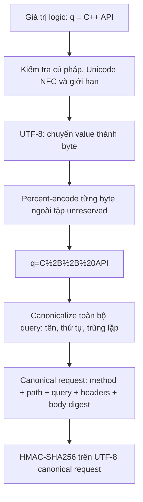

# Encode value: mã hóa giá trị query nhất quán khi ký HTTP request bằng HMAC

## 1. Tại sao việc encode value lại quyết định chữ ký HMAC?

**Query value** là phần giá trị trong một cặp tham số của URL, ví dụ `q=C%2B%2B%20API` có tên `q` và giá trị logic là `C++ API`. Khi xác thực HTTP request bằng HMAC, client và server phải tính MAC trên **cùng một dãy byte**. Nếu hai phía biểu diễn giá trị query khác nhau, cùng một secret và cùng một yêu cầu nghiệp vụ vẫn có thể tạo ra chữ ký khác nhau.

Bài **Encode value** thuộc chương **Query canonicalization** của module `SECURITY_AUTHENTICATION_HMAC_REQUEST_AUTHENTICATION`. Module hướng dẫn thiết kế xác thực HTTP request bằng **shared secret** và **canonical request** gồm method, URI, header hoặc body theo hợp đồng; kiểm tra chữ ký, chống replay bằng timestamp/nonce, quản lý key rotation, kiểm thử proxy/gateway và phân biệt **authentication** với **authorization**. Trong bài này, trọng tâm là xác định **cách chuyển một giá trị query từ dạng logic sang dạng byte có thể ký ổn định**.

Ví dụ một ứng dụng tìm kiếm cần gọi:

```text
GET /v1/search?q=C%2B%2B%20API&tag=a%2Fb&limit=20
```

Từ góc nhìn người dùng:

- `q` là chuỗi `C++ API`, trong đó dấu `+` là **dấu cộng thật**.
- `tag` là chuỗi `a/b`, trong đó dấu `/` thuộc **giá trị của tham số**, không phải dấu phân tách path.
- `limit` là chuỗi `20`.

Nếu client encode space bằng `%20` nhưng server dùng một parser kiểu form coi `+` là space, hoặc một gateway giải mã `%2F` rồi encode lại theo quy tắc khác, HMAC có thể thất bại. Nguy hiểm hơn, nếu filter xác thực ký một query nhưng handler xử lý một query đã bị diễn giải lại, chữ ký hợp lệ **không còn gắn chắc với hành vi thực sự**.

**Mục tiêu an toàn:** client tạo query canonical, server tái tạo hoặc kiểm tra đúng query canonical **từ request nhận được**, và router/handler sử dụng chính tập giá trị đã xác minh. Không được chỉ so sánh một chuỗi query do client tự khai báo rồi bỏ qua URL thực tế.

## 2. Encode value là công đoạn nào trong quá trình canonicalization?

Quá trình tạo chữ ký thường gồm:



**Encode value** là một bước trong chuỗi này, không đồng nghĩa với toàn bộ quá trình canonicalization. Còn phải quy định:

1. **Encode parameter name** bằng quy tắc nào?
2. **Giá trị thiếu và giá trị rỗng** khác nhau ra sao?
3. **Tham số trùng tên** được chấp nhận, sắp xếp hay từ chối?
4. **Thứ tự các cặp** dựa trên tên đã encode, giá trị đã encode hay thứ tự request gửi đến?
5. **Server lấy raw query ở đâu**, và có lớp nào decode hoặc reorder trước bước xác minh?

Thay đổi một quy tắc nhỏ trong các bước trên thường làm thay đổi canonical bytes, vì vậy phải có **signature version** rõ ràng. Đừng coi việc sửa `URLEncoder` là một thay đổi triển khai vô hại nếu client đã phát hành lâu.

## 3. Hợp đồng mã hóa giá trị: UTF-8 và percent-encoding kiểu RFC 3986

Với ví dụ trong bài, ta chọn **một profile ký tự minh họa** dựa trên tập *unreserved* của RFC 3986:

```text
ALPHA / DIGIT / "-" / "." / "_" / "~"
```

Với từng giá trị logic:

1. Giá trị đầu vào phải là một chuỗi Unicode hợp lệ và theo **NFC**. Bài chọn **từ chối giá trị không NFC**, thay vì server âm thầm đổi dữ liệu sau khi xác minh. NFC là **quyết định của hợp đồng này**, không phải nghĩa vụ chung của mọi URL.
2. Chuyển chuỗi Unicode sang **UTF-8 bytes** bằng encoder báo lỗi nếu chuỗi có surrogate không hợp lệ; không dùng platform default charset.
3. Mỗi byte ASCII thuộc tập unreserved được ghi **nguyên dạng một ký tự**.
4. Mỗi byte khác được ghi thành `%HH`, trong đó `HH` là **hai chữ số hex viết hoa**. Ví dụ space byte `0x20` thành `%20`, dấu `+` byte `0x2B` thành `%2B`.
5. Không thêm quote, trim, lowercase hoặc decode thêm sau bước này. Nếu cần kiểm tra ký tự control, giới hạn độ dài hay schema riêng từng tham số, thực hiện tường minh trước khi đưa giá trị vào canonical request.

Với quy tắc này, ký tự `+` **không** được dùng để đại diện cho space. Dấu `+` được encode thành `%2B`, còn space thành `%20`.

| Giá trị logic | UTF-8/ý nghĩa | Giá trị đã encode theo hợp đồng |
| --- | --- | --- |
| `hello world` | Space `0x20`. | `hello%20world` |
| `C++ API` | Hai dấu cộng `+` và một space. | `C%2B%2B%20API` |
| `a/b` | Slash là byte `0x2F`. | `a%2Fb` |
| `a=b&c` | `=` và `&` là dấu phân cách query nếu không encode. | `a%3Db%26c` |
| `a?b#c` | `?` và `#` là reserved characters. | `a%3Fb%23c` |
| `x%2Fy` | Chuỗi logic chứa **dấu phần trăm** và các ký tự `2F`. | `x%252Fy` |
| `a~b_c-d.e` | Chỉ có unreserved. | `a~b_c-d.e` |
| `cà phê` | Unicode được encode theo UTF-8. | `c%C3%A0%20ph%C3%AA` |
| `🧪` | UTF-8 gồm 4 byte `F0 9F A7 AA`. | `%F0%9F%A7%AA` |
| Chuỗi rỗng `""` | Không có byte. | Chuỗi rỗng sau dấu `=`, nếu schema cho phép. |

**Không dùng ký tự `%XX` trong chuỗi logic để giả định nó đã được encode.** Nếu giá trị thực sự là `a/b`, encoder tạo `a%2Fb`; còn nếu giá trị thực sự là sáu ký tự `a%2Fb`, encoder tạo `a%252Fb`. Đây là khác biệt có ý nghĩa: hai giá trị logic không được nhập nhằng.

### Phân biệt percent-encoding với application/x-www-form-urlencoded

Trong Java, `java.net.URLEncoder` có tên dễ gây hiểu nhầm: nó được thiết kế cho **HTML form encoding**, không phải bộ encoder RFC 3986 chung cho mọi thành phần URI.

```java
import java.net.URLEncoder;
import java.nio.charset.StandardCharsets;

System.out.println(URLEncoder.encode("C++ API", StandardCharsets.UTF_8));
// C%2B%2B+API
```

Giá trị `C%2B%2B+API` có thể hợp lệ theo **quy tắc form encoding** nhưng **không đúng** hợp đồng của bài, vốn yêu cầu `C%2B%2B%20API`. Tương tự, `URLDecoder` hiểu `+` là space khi giải mã theo form encoding; không dùng nó trực tiếp để phân tích raw query của profile này.

**Không có một kiểu encode đúng cho mọi giao thức:** ứng dụng có thể chọn form encoding nếu cả client và server đã thống nhất rõ ràng và ký đúng dạng đó. Vấn đề an toàn là **không trộn nhiều quy tắc trong cùng một signature version**.

## 4. Unicode, giá trị rỗng và các trường hợp dễ nhập nhằng

### Unicode NFC và encoding lỗi

Hai chuỗi có thể hiển thị tương tự nhưng chứa những code point khác nhau. Ví dụ chữ `é` có thể dùng một code point hoặc `e` cộng dấu sắc kết hợp. Nếu ký UTF-8 thô, hai cách viết tạo byte khác nhau; nếu một bên tự NFC hóa còn bên kia không, request dễ bị signature mismatch.

Hợp đồng minh họa trong bài **bắt buộc NFC** ở cả phía tạo request và phía xác minh. Client được yêu cầu chuẩn bị giá trị NFC **trước khi ký**, server kiểm tra giá trị sau strict UTF-8 decoding là NFC rồi mới xác minh. Không dùng `String.getBytes(UTF_8)` một cách bất cẩn với chuỗi chứa surrogate lỗi vì mặc định có thể thay ký tự không hợp lệ; encoder/decoder nghiêm ngặt phải **từ chối** đầu vào lỗi.

### Missing, empty và null

Ba dạng raw query sau có thể được những framework diễn giải khác nhau:

```text
?q
?q=
?               # không có cặp q
```

Ví dụ hợp đồng của bài yêu cầu mọi cặp query đều có **đúng một dấu `=` không encode** phân tách key/value:

- `q` bị từ chối vì **không có dấu `=`**.
- `q=` là **có cặp q với giá trị rỗng**; chỉ chấp nhận nếu schema của endpoint cho phép.
- Không có `q` là **tham số bị thiếu**, không đồng nghĩa với `q=`.
- `q=null` là chuỗi có bốn chữ `null`, không phải giá trị null của Java.

Trong endpoint tìm kiếm minh họa ở mục sau, `q` là bắt buộc **không rỗng**; khác với quy tắc encode chung có thể encode giá trị rỗng. Sự phân biệt này phải được kiểm tra **trước HMAC** hoặc tại tầng validation cùng dữ liệu đã xác minh.

### Dấu phân cách nằm trong giá trị

Giá trị `a=b&c` phải được encode thành `a%3Db%26c`. Nếu client nối raw value vào URL:

```text
?filter=a=b&c
```

thì parser có thể coi đó là nhiều tham số, hoặc diễn giải `filter` thành `a=b`. Điều quan trọng không chỉ là chữ ký sai mà là **parser có thể nhận một cấu trúc query khác với ý định ban đầu**. Vì vậy phải encode **từng tên và từng giá trị trước**, rồi mới ghép `name=value` và nối các cặp bằng `&`.

## 5. Canonical query minh họa: encode trước, sort sau

Giả sử endpoint `GET /v1/search` cho phép chính xác ba tham số **đơn trị**:

```text
limit = "20"
q     = "C++ API"
tag   = "a/b"
```

Hợp đồng `hmac-query-v1` đặt ra quy tắc:

1. Có **đúng ba tên** `limit`, `q`, `tag`; không có tham số ngoài schema hoặc tên trùng.
2. Mỗi tên và giá trị được **encode riêng theo UTF-8 + percent-encoding** đã mô tả. Cả tên và giá trị phải theo NFC; trong ví dụ, các tên chỉ dùng ASCII unreserved.
3. Tạo từng cặp `encodedName=encodedValue`. Sắp xếp các cặp **theo encodedName dạng ASCII tăng dần**; vì tên không trùng, không cần quy tắc sắp xếp giá trị lặp.
4. Nối cặp bằng `&`, không thêm ký tự `?` vào chính canonical query string. Ký tự `?` chỉ được dùng khi ghép query với path trong URL.
5. Server yêu cầu **raw query nhận được đúng bằng chuỗi canonical được dựng lại**. Các dạng hợp lệ về mặt HTTP nhưng không canonical, như thứ tự khác, `+`, hex thường trong `%xx` hoặc percent-encode ký tự unreserved, đều bị từ chối.
6. Giá trị nghiệp vụ được đưa cho handler là **các giá trị decoded đã được kiểm tra**. Không giải mã lần nữa trong controller, mapper hoặc database adapter.

Kết quả:

```text
limit=20&q=C%2B%2B%20API&tag=a%2Fb
```

Request gửi đi:

```http
GET /v1/search?limit=20&q=C%2B%2B%20API&tag=a%2Fb HTTP/1.1
Host: api.example.test
Accept: application/json
```

**Thứ tự quan trọng:** với một hợp đồng khác cho phép nhiều giá trị cùng tên, phải công bố thêm quy tắc về duplicate và thứ tự giá trị, hoặc xác định thứ tự là một phần ngữ nghĩa. **Không âm thầm gom tham số trùng thành `Map<String,String>`** khi API vẫn cần phân biệt `tag=a&tag=b` với `tag=b&tag=a`. Hợp đồng ví dụ chọn **từ chối duplicate**, an toàn và dễ kiểm thử hơn.

### Tại sao chọn strict canonical raw query thay vì chấp nhận mọi cách viết tương đương?

Ví dụ cùng một giá trị logic `C++ API` có thể được gửi dưới nhiều chuỗi tùy parser:

```text
q=C%2B%2B%20API   # canonical theo hợp đồng
q=C%2b%2b%20API   # khác chữ hoa/thường của hex escape
q=C%2B%2B+API     # form encoding dùng + cho space
q=C%2B%2B%20%41PI # percent-encode A dù A thuộc unreserved
```

Nếu verifier tự chuẩn hóa mọi dạng thành một chuỗi, nhưng gateway hoặc ứng dụng downstream không đồng nhất cách decode, có thể xuất hiện **signature wrapping/canonicalization confusion**. Việc yêu cầu raw query đúng một dạng làm giảm bề mặt mơ hồ. Đây là **một lựa chọn giao thức**, không phải yêu cầu bắt buộc cho mọi giải pháp HMAC; nếu muốn nhận nhiều dạng đầu vào, phải chứng minh **parser, verifier và handler diễn giải tương đương** và có test xuyên gateway.

## 6. Java 17+: encode giá trị, strict decode và dựng canonical query

Đoạn Java sau tập trung vào **Encode value** nhưng đủ để người học kiểm tra cả đường đi *decoded value → canonical query → raw query received → decoded value*. Các quyết định bảo mật của profile:

- UTF-8 có **report lỗi** với malformed Unicode/byte, không im lặng thay bằng `U+FFFD`.
- Unicode phải là **NFC**, không chứa ký tự điều khiển ISO và giới hạn độ dài.
- Unreserved ASCII giữ nguyên; mọi byte khác thành `%HH` với hex **viết hoa**.
- Parser chỉ cho phép raw unreserved hoặc `%HH`, không nhận raw `+`, `/`, space, `#`, ký tự non-ASCII hay `=` không encode nằm trong value.
- Raw query phải **khớp tuyệt đối** với query được canonicalize từ các cặp decoded. Duplicate name bị từ chối.

```java
import java.io.ByteArrayOutputStream;
import java.nio.ByteBuffer;
import java.nio.CharBuffer;
import java.nio.charset.CharacterCodingException;
import java.nio.charset.CodingErrorAction;
import java.nio.charset.StandardCharsets;
import java.text.Normalizer;
import java.util.ArrayList;
import java.util.Collections;
import java.util.HashMap;
import java.util.List;
import java.util.Map;
import java.util.Set;

public final class CanonicalQueryValueDemo {
    private static final char[] HEX = "0123456789ABCDEF".toCharArray();
    private static final Set<String> REQUIRED_KEYS =
            Set.of("limit", "q", "tag");

    private static boolean unreserved(int b) {
        return (b >= 'A' && b <= 'Z')
                || (b >= 'a' && b <= 'z')
                || (b >= '0' && b <= '9')
                || b == '-' || b == '.' || b == '_' || b == '~';
    }

    private static void validateDecoded(String value) {
        if (value == null || !Normalizer.isNormalized(
                value, Normalizer.Form.NFC)) {
            throw new IllegalArgumentException("Value must be NFC");
        }
        if (value.codePointCount(0, value.length()) > 256) {
            throw new IllegalArgumentException("Value too long");
        }
        for (int i = 0; i < value.length();) {
            int cp = value.codePointAt(i);
            if (Character.isISOControl(cp)) {
                throw new IllegalArgumentException("Control character");
            }
            i += Character.charCount(cp);
        }
    }

    // Dùng strict UTF-8: surrogate lỗi không được thay thế âm thầm.
    private static byte[] strictUtf8(String value)
            throws CharacterCodingException {
        ByteBuffer buffer = StandardCharsets.UTF_8.newEncoder()
                .onMalformedInput(CodingErrorAction.REPORT)
                .onUnmappableCharacter(CodingErrorAction.REPORT)
                .encode(CharBuffer.wrap(value));
        byte[] bytes = new byte[buffer.remaining()];
        buffer.get(bytes);
        return bytes;
    }

    public static String encodeValue(String decoded)
            throws CharacterCodingException {
        validateDecoded(decoded);
        byte[] bytes = strictUtf8(decoded);
        StringBuilder encoded = new StringBuilder(bytes.length * 3);
        for (byte raw : bytes) {
            int b = raw & 0xFF; // byte Java là signed: cần chuyển 0..255.
            if (unreserved(b)) {
                encoded.append((char) b);
            } else {
                encoded.append('%');
                encoded.append(HEX[b >>> 4]);
                encoded.append(HEX[b & 0x0F]);
            }
        }
        return encoded.toString();
    }

    private static int nibble(char c) {
        if (c >= '0' && c <= '9') return c - '0';
        if (c >= 'A' && c <= 'F') return c - 'A' + 10;
        if (c >= 'a' && c <= 'f') return c - 'a' + 10;
        return -1;
    }

    public static String decodeValue(String raw)
            throws CharacterCodingException {
        if (raw == null) throw new IllegalArgumentException("Null raw");
        ByteArrayOutputStream bytes = new ByteArrayOutputStream();
        for (int i = 0; i < raw.length(); i++) {
            char c = raw.charAt(i);
            if (c == '%') {
                if (i + 2 >= raw.length()) {
                    throw new IllegalArgumentException("Incomplete %XX");
                }
                int high = nibble(raw.charAt(i + 1));
                int low = nibble(raw.charAt(i + 2));
                if (high < 0 || low < 0) {
                    throw new IllegalArgumentException("Bad %XX");
                }
                bytes.write((high << 4) | low);
                i += 2;
            } else if (c < 128 && unreserved(c)) {
                bytes.write((int) c);
            } else {
                // Raw '+', '/', '&', '=', '#', space và Unicode đều bị từ chối.
                throw new IllegalArgumentException("Noncanonical raw byte");
            }
        }

        String decoded = StandardCharsets.UTF_8.newDecoder()
                .onMalformedInput(CodingErrorAction.REPORT)
                .onUnmappableCharacter(CodingErrorAction.REPORT)
                .decode(ByteBuffer.wrap(bytes.toByteArray()))
                .toString();
        validateDecoded(decoded);
        return decoded;
    }

    private static void validateQuerySchema(Map<String, String> values) {
        if (!values.keySet().equals(REQUIRED_KEYS)) {
            throw new IllegalArgumentException("Wrong query parameters");
        }
        String limit = values.get("limit");
        if (!limit.matches("[1-9][0-9]{0,2}")
                || Integer.parseInt(limit) > 100
                || values.get("q").isEmpty()
                || values.get("tag").isEmpty()) {
            throw new IllegalArgumentException("Invalid parameter value");
        }
    }

    public static String canonicalQuery(Map<String, String> values)
            throws CharacterCodingException {
        validateQuerySchema(values);
        List<String> pairs = new ArrayList<>();
        for (Map.Entry<String, String> entry : values.entrySet()) {
            pairs.add(encodeValue(entry.getKey())
                    + "=" + encodeValue(entry.getValue()));
        }
        // Tên không trùng; sort theo encoded name, đều là ASCII.
        Collections.sort(pairs);
        return String.join("&", pairs);
    }

    public static Map<String, String> parseCanonicalQuery(String rawQuery)
            throws CharacterCodingException {
        if (rawQuery == null || rawQuery.isEmpty()
                || rawQuery.length() > 4096) {
            throw new IllegalArgumentException("Missing/oversized query");
        }
        String[] parts = rawQuery.split("&", -1);
        if (parts.length != REQUIRED_KEYS.size()) {
            throw new IllegalArgumentException("Wrong pair count");
        }
        Map<String, String> parsed = new HashMap<>();
        for (String pair : parts) {
            int equals = pair.indexOf('=');
            if (equals <= 0 || pair.indexOf('=', equals + 1) >= 0) {
                throw new IllegalArgumentException("Invalid key=value");
            }
            String name = decodeValue(pair.substring(0, equals));
            String value = decodeValue(pair.substring(equals + 1));
            if (parsed.putIfAbsent(name, value) != null) {
                throw new IllegalArgumentException("Duplicate parameter");
            }
        }
        validateQuerySchema(parsed);
        if (!rawQuery.equals(canonicalQuery(parsed))) {
            throw new IllegalArgumentException("Query not canonical");
        }
        return Map.copyOf(parsed);
    }

    public static void main(String[] args) throws Exception {
        Map<String, String> values = Map.of(
                "q", "C++ API", "tag", "a/b", "limit", "20");
        String canonical = canonicalQuery(values);
        System.out.println(canonical);
        // limit=20&q=C%2B%2B%20API&tag=a%2Fb

        Map<String, String> received = parseCanonicalQuery(canonical);
        System.out.println(received.get("q"));   // C++ API
        System.out.println(received.get("tag")); // a/b

        System.out.println(encodeValue("hello world")); // hello%20world
        System.out.println(encodeValue("x%2Fy"));       // x%252Fy
        System.out.println(encodeValue("🧪"));          // %F0%9F%A7%AA

        try {
            parseCanonicalQuery(
                    "q=C%2B%2B+API&tag=a%2Fb&limit=20");
            throw new AssertionError("Must reject noncanonical query");
        } catch (IllegalArgumentException expected) {
            System.out.println("Rejected raw plus/unsorted query");
        }
    }
}
```

**Lưu ý về code mẫu:**

- `encodeValue` dùng được cho **tên hoặc giá trị** vì hợp đồng đã chọn cùng percent-encoding cho cả hai; validation nghiệp vụ theo từng tên tham số nằm trong `validateQuerySchema`.
- `decodeValue` nhận cả hex thường và hex hoa để có thể phân tích cú pháp, nhưng **raw query sẽ bị từ chối** nếu khác chuỗi sau khi re-encode với hex hoa. Vì vậy `%2f` và `%2F` có thể decode giống nhau, nhưng chỉ `%2F` là dạng canonical.
- `%61` decode thành `a`, song khi re-encode ký tự unreserved thì thành `a`; raw `%61` bị từ chối.
- `%252F` decode **một lần** thành chuỗi logic `%2F`; handler phải dùng đúng chuỗi đó, **không decode tiếp** thành `/`.
- `Map<String,String>` chỉ phù hợp vì schema **cấm trùng tên**. Nếu API cho phép list/multi-value, cần một dữ liệu và canonicalizer khác, không được âm thầm mất phần tử.
- Code này minh họa **query canonicalization**, chưa triển khai HTTP parser, HMAC verifier, kho khóa, chống replay, authorization và giới hạn toàn bộ request. Trong production, các phần đó phải được nối lại bằng một ranh giới tin cậy.

### Kiểm thử nhanh riêng encoder

Ngoài ví dụ `main`, hãy dùng các vector sau:

```text
value                  expected encoded
-----------------------------------------------------
"a+b"                  "a%2Bb"
"a b"                  "a%20b"
"a/b"                  "a%2Fb"
"a=b&c"                "a%3Db%26c"
"100%"                 "100%25"
"~._-"                 "~._-"
"cà phê"               "c%C3%A0%20ph%C3%AA"
"🧪"                    "%F0%9F%A7%AA"
```

Với Unicode không NFC, malformed surrogate hoặc percent-encoded UTF-8 không hợp lệ như `%C3%28`, **phải từ chối** thay vì lặng lẽ thay thế ký tự hay ký một chuỗi mới.

## 7. Đưa canonical query vào HMAC request signature

Sau khi có query canonical, client tạo request target:

```text
method       = GET
origin       = https://api.example.test
rawPath      = /v1/search
rawQuery     = limit=20&q=C%2B%2B%20API&tag=a%2Fb
requestTarget= /v1/search?limit=20&q=C%2B%2B%20API&tag=a%2Fb
```

Ví dụ **hợp đồng ký `hmac-query-v1` tự định nghĩa**:

```http
GET /v1/search?limit=20&q=C%2B%2B%20API&tag=a%2Fb HTTP/1.1
Host: api.example.test
Accept: application/json
X-Key-Id: client-search-2026-11
X-Signature-Version: hmac-query-v1
X-Timestamp: 2026-11-28T02:05:00Z
X-Nonce: wJ0Npw6W_Q7tWbX8Fkp0Sg
X-Signature: <64 lowercase hex characters>
```

Canonical request gồm các dòng theo thứ tự cố định:

```text
HMAC-QUERY-V1
GET
https://api.example.test
/v1/search
limit=20&q=C%2B%2B%20API&tag=a%2Fb
accept:application/json
x-key-id:client-search-2026-11
x-signature-version:hmac-query-v1
x-timestamp:2026-11-28T02:05:00Z
x-nonce:wJ0Npw6W_Q7tWbX8Fkp0Sg
e3b0c44298fc1c149afbf4c8996fb92427ae41e4649b934ca495991b7852b855
```

Hợp đồng này yêu cầu:

- Mỗi dòng nối bằng **LF** (`0A`), encode toàn bộ canonical message bằng **UTF-8**, **không có LF cuối**.
- `GET` **không có body**; dòng cuối là hex thường của `SHA-256(empty)`, không phải hash của `"{}"` hoặc một newline.
- `Accept` và các header `X-Key-Id`, `X-Signature-Version`, `X-Timestamp`, `X-Nonce`, `X-Signature` phải có **đúng một giá trị hợp lệ**; từ chối header trùng hoặc chứa CR/LF.
- `https://api.example.test` là **audience đã xác nhận từ routing cấu hình tin cậy**, không chỉ tin `Host` hoặc `X-Forwarded-Host` do client đặt.
- `rawPath` phải là `/v1/search`; raw query phải đúng **dạng canonical** được `parseCanonicalQuery` chấp nhận.
- Key ID phải được tra từ kho secret tin cậy, key còn active và được phép dùng `hmac-query-v1` cho đúng service/tenant.
- Signature là `lowercaseHex(HMAC-SHA256(secretBytes, UTF8(canonical)))`: MAC đầy đủ 32 byte, tức 64 ký tự hex thường. **Không đưa `X-Signature` vào message được ký.**

Java 17 tính MAC sau khi đã có `canonicalQuery`:

```java
import java.nio.charset.StandardCharsets;
import java.util.HexFormat;
import javax.crypto.Mac;
import javax.crypto.spec.SecretKeySpec;

// canonical là chuỗi UTF-8 chuẩn bị chính xác như sơ đồ bên trên.
// secret lấy từ secret manager, không gửi trên HTTP.
Mac mac = Mac.getInstance("HmacSHA256");
mac.init(new SecretKeySpec(secret, "HmacSHA256"));
String signatureHex = HexFormat.of().formatHex(
        mac.doFinal(canonical.getBytes(StandardCharsets.UTF_8)));
```

Ở server, không nhận một `canonical` do client tự khai báo rồi cho rằng request được bảo vệ. Hãy lấy **method, raw path, raw query, signed headers và body bytes thực nhận**, kiểm tra HTTP parser, tái tạo canonical bytes theo `hmac-query-v1`, tính HMAC từ **secret do server quản lý**, so sánh MAC bằng `MessageDigest.isEqual`, rồi kiểm tra timestamp, nonce và authorization.

**Lưu ý:** timestamp và nonce đã nằm trong message được ký nhưng điều đó **không tự chống replay**. Timestamp phải ở trong cửa sổ chấp nhận (ví dụ ±5 phút); nonce phải được lưu bằng thao tác **insert-if-absent nguyên tử** trên storage dùng chung giữa các instance, với TTL đủ dài. Chỉ nên claim nonce sau khi MAC đã hợp lệ để hạn chế kẻ tấn công chiếm nonce bằng request giả.

## 8. Proxy/gateway có thể thay đổi query value theo những cách nào?

Trong hệ thống thực, request có thể đi qua CDN, load balancer, API gateway, reverse proxy và servlet/web framework:

```text
Client:
  /v1/search?limit=20&q=C%2B%2B%20API&tag=a%2Fb
          |
          v
Gateway: có decode %XX? sort tham số? thay '+'? gom trùng?
          |
          v
Backend verifier: rawQuery thật sự còn nguyên hay đã đổi?
          |
          v
Handler: sử dụng đúng decoded values đã xác minh?
```

Những lỗi điển hình:

| Biến đổi | Hậu quả | Cách phòng tránh |
| --- | --- | --- |
| Gateway đổi `%20` thành `+`. | Raw query khác contract; parser kiểu form có thể làm lệch ngữ nghĩa. | Không normalize ngầm; verify tại ingress trước rewrite hoặc dùng contract chung rõ ràng. |
| Chuyển `%2F` thành `/`. | Giá trị logic có thể giữ nghĩa ở một lớp nhưng byte chữ ký thay đổi; lớp khác có thể hiểu khác. | Giữ một representation được ký và không decode lại trong handler. |
| Thay `%2b` bằng `%2B`. | MAC ký raw bytes có thể khác; strict query có thể từ chối dạng đầu vào cũ. | Thống nhất hex case, kiểm thử qua mọi hop. |
| Sort `tag=a&tag=b` theo giá trị. | Có thể đổi semantics của một tham số lặp. | Cấm duplicate hoặc định nghĩa thứ tự/array semantics rõ ràng. |
| Bỏ `q=` hoặc thêm tham số rỗng. | Thay đổi tập tham số, đôi khi cả logic mặc định. | Quy định present/absent/empty và schema bắt buộc. |
| Decode hai lần `%252F`. | `%2F` ở bước đầu trở thành `/` ở bước hai. | Decode đúng một lần, cấm decode phía sau sau khi verify. |
| Decode UTF-8 lỗi thành ký tự thay thế. | Có thể hợp nhất hai input khác nhau thành cùng giá trị logic. | Strict UTF-8 decoder báo lỗi; không chấp nhận malformed bytes. |
| Framework parse query thành `Map` và mất duplicate. | Validator nhìn một value, handler có thể dùng value khác. | Parse nhất quán một lần; reject duplicate hoặc biểu diễn list đúng contract. |
| CDN lưu response theo query đã normalize khác. | Cache key có thể không còn ràng buộc với người gọi hay nội dung được phép. | Với dữ liệu riêng tư, chống cache bypass auth, cân nhắc `Cache-Control: no-store`. |

Nếu gateway **đã** sửa query trước khi backend xác minh, backend có thể không còn dữ liệu đủ để tái tạo chữ ký gốc. Có hai kiến trúc phổ biến:

1. **Gateway xác minh HMAC tại ingress**, trước bất kỳ rewrite ảnh hưởng canonical, rồi chuyển caller identity, route và các field đã xác minh qua kênh được bảo vệ tới backend. Backend phải chặn truy cập trực tiếp hoặc header giả mạo.
2. **Backend xác minh theo logical canonical query** mà gateway và backend cùng tạo đúng theo hợp đồng. Khi cần metadata original URI, gateway phải xóa header do caller tự đặt và truyền metadata mới qua kênh tin cậy; backend không được tin `X-Original-URI` từ client công khai.

Giải pháp không phải là **bỏ query khỏi chữ ký** để giảm mismatch. Query chứa filter, cursor, account ID hoặc giá trị giao dịch có thể quyết định hành vi API. Cần sửa ranh giới xác minh và hợp đồng canonical.

## 9. Các lỗi triển khai cần tránh

### Lỗi 1 — Encode toàn bộ query string như một value

```text
Sai:
  encode("q=C++ API&tag=a/b")
  => q%3DC%2B%2B%20API%26tag%3Da%2Fb

Đúng:
  encode("q") + "=" + encode("C++ API")
    + "&" + encode("tag") + "=" + encode("a/b")
  => q=C%2B%2B%20API&tag=a%2Fb
```

Cần encode **từng component** chứ không encode cả chuỗi chứa các dấu phân cách cú pháp.

### Lỗi 2 — Encode hai lần

```text
value logic = "a/b"
encode lần 1 => a%2Fb
encode lần 2 => a%252Fb   # giá trị logic đã khác
```

Hàm `encodeValue` nhận **decoded logical value**. Không gọi lại hàm này với chuỗi đã encode mà tưởng vẫn cùng một value.

### Lỗi 3 — Dùng parser không khớp contract

`URLDecoder.decode("C++ API", UTF_8)` sẽ xem `+` như space theo form encoding. Trong hợp đồng này, raw dấu `+` phải bị từ chối; dấu cộng logic chỉ được gửi dưới dạng `%2B`.

### Lỗi 4 — Bỏ field trùng hoặc tự chọn giá trị đầu/cuối

```text
?role=user&role=admin
```

Nếu verifier tính chữ ký dựa trên `role=user` nhưng ứng dụng lấy `role=admin`, HMAC không bảo vệ hành vi thực sự. **Từ chối duplicate**, hoặc dùng một canonical schema có danh sách giá trị và cùng cách parse ở mọi lớp.

### Lỗi 5 — Dùng giá trị chưa kiểm tra làm authority/route

Query canonical không cho phép client tự chọn service. Nếu `Host`/audience, path, version hoặc key scope chưa được ràng buộc, một request có query MAC hợp lệ vẫn có thể đi tới nhầm dịch vụ. Phải ký/ràng buộc **method, path, audience, signed headers, body digest** theo contract, không chỉ query.

## 10. Ma trận kiểm thử Encode value

Một bộ **golden fixtures** nên chứa cả giá trị logic, encoded value, raw query canonical, canonical UTF-8 request bytes, secret test và MAC dự kiến; dùng cùng bộ dữ liệu ở client, gateway, server và handler.

| Tình huống | Kỳ vọng |
| --- | --- |
| `C++ API` | `C%2B%2B%20API` |
| `hello world` | `hello%20world`, không dùng `hello+world`. |
| `a/b` | `a%2Fb`; dấu `/` không được để raw trong value theo profile. |
| `x%2Fy` là **giá trị logic** | `x%252Fy`; không được decode nhầm thành `x/y`. |
| `a=b&c` | `a%3Db%26c`; không làm thay đổi số cặp query. |
| Value chứa Unicode tiếng Việt hoặc emoji | Percent-encode bytes UTF-8, uppercase hex, strict decoding. |
| UTF-8 byte sequence không hợp lệ `%C3%28` | Từ chối; không thay bằng ký tự `U+FFFD`. |
| Unicode không NFC | Từ chối theo hợp đồng của bài. |
| Raw `+`, space, `/`, `#`, `&` hoặc dấu `=` thừa trong value | Từ chối raw input không canonical. |
| `%2f`, `%61` hoặc `%20%41` | Từ chối do raw query không đúng dạng canonical sau round-trip. |
| `q` thiếu dấu `=`, `q=` rỗng, hoặc thiếu `q` | Từ chối theo schema endpoint minh họa. |
| `q=a&q=b` hoặc `limit=20&limit=30` | Từ chối duplicate, không chọn value theo thứ tự tùy framework. |
| `q=C%2B%2B%20API&tag=a%2Fb&limit=20` | Từ chối vì không đúng thứ tự canonical (dù các value riêng đúng). |
| `limit=20&q=C%2B%2B%20API&tag=a%2Fb` | Query canonical được chấp nhận; tiếp tục HMAC, replay, authorization. |
| Đổi một byte encoded value nhưng giữ chữ ký cũ | MAC không khớp hoặc parser từ chối. |
| Timestamp ngoài cửa sổ hoặc nonce đã claim | Chữ ký có thể đúng, nhưng replay protection từ chối. |
| Key ID revoked, version sai hoặc caller thiếu quyền | Từ chối theo key policy/authorization dù query và MAC đúng. |
| Gateway reorder/decode/re-encode query | Fixture xuyên proxy phát hiện mismatch hoặc semantics không nhất quán. |

### Bài tập

1. Sử dụng `CanonicalQueryValueDemo` để encode `C++ API`, `a/b`, `100%`, `cà phê` và `🧪`; ghi rõ từng byte UTF-8 và `%HH` tương ứng.
2. Cho raw query `q=C%2B%2B+API`, chỉ ra **ký tự nào** vi phạm hợp đồng và lý do không nên dùng `URLDecoder` để “sửa hộ”.
3. Thử `q=a%252Fb` rồi giải mã **một lần**; kiểm tra giá trị logic khác gì `q=a%2Fb`.
4. Thêm `tag=b` vào query mẫu và giải thích tại sao parser từ chối trước khi tính HMAC.
5. So sánh canonical bytes và chữ ký của hai request chỉ khác `%2F` / `%2f`. Theo strict profile, request nào được chấp nhận?
6. Chạy fixture qua gateway có chế độ sort query hoặc decode percent-encoding; ghi nhận raw query tại ingress, verifier và handler.
7. Gửi lại một request HMAC hợp lệ hai lần với cùng nonce; giải thích vì sao **Encode value đúng** và **MAC hợp lệ** vẫn chưa bảo đảm freshness hoặc quyền truy cập.

## 11. Checklist khi triển khai

- [ ] Có signature version mô tả chính xác **UTF-8, tập unreserved, `%HH` viết hoa, space `%20`, xử lý `+`**.
- [ ] Chỉ encode từng **name/value logic**, không encode cả query đã ghép; không double encode chuỗi đã percent-encoded.
- [ ] Quy định Unicode normalization, xử lý malformed UTF-8, ký tự điều khiển và giới hạn kích thước/độ dài giá trị.
- [ ] Phân biệt tham số thiếu, tham số có value rỗng và chuỗi `null`; định nghĩa duplicate/array semantics hoặc từ chối.
- [ ] Sắp xếp các cặp theo quy tắc cố định sau encode, không phụ thuộc thứ tự `Map`, thứ tự parser hoặc library.
- [ ] Verifier chỉ dùng **raw query thực nhận**, strict decode và re-encode; từ chối raw query không khớp canonical thay vì tự sửa không kiểm soát.
- [ ] Handler sử dụng **cùng giá trị decoded đã xác minh**, không decode lại và không chọn khác giá trị trùng.
- [ ] Ký/ràng buộc method, path, query, audience, signed headers và body/digest; server tra secret/key scope đáng tin cậy.
- [ ] Signature version chỉ chọn algorithm/canonicalizer trong allowlist; không fallback nếu MAC sai, có key rotation/sunset rõ ràng.
- [ ] Timestamp/nonce đều nằm trong chữ ký và được kiểm tra chống replay bằng nonce store nguyên tử chia sẻ.
- [ ] Kiểm thử proxy/gateway/CDN, query rewrite, encoding, HTTP versions, golden fixtures và authorization.
- [ ] Tiếp tục dùng HTTPS/TLS xác minh server; HMAC không mã hóa request hoặc thay thế quyền truy cập.

**Điểm cần nhớ:** *Encode value* an toàn trong HMAC HTTP request không chỉ là “đưa dấu cách thành `%20`”. Đó là **một quy tắc biểu diễn byte duy nhất cho mỗi giá trị query**, được áp dụng trước khi ghép/sắp xếp query và phải được server đối chiếu với URL thực nhận. Khi client, verifier và handler cùng thống nhất UTF-8, percent-encoding, Unicode, duplicate và thứ tự tham số, chữ ký HMAC mới bảo vệ đúng hành vi request. Timestamp/nonce, key policy, TLS và authorization vẫn là những lớp kiểm tra riêng bắt buộc.
