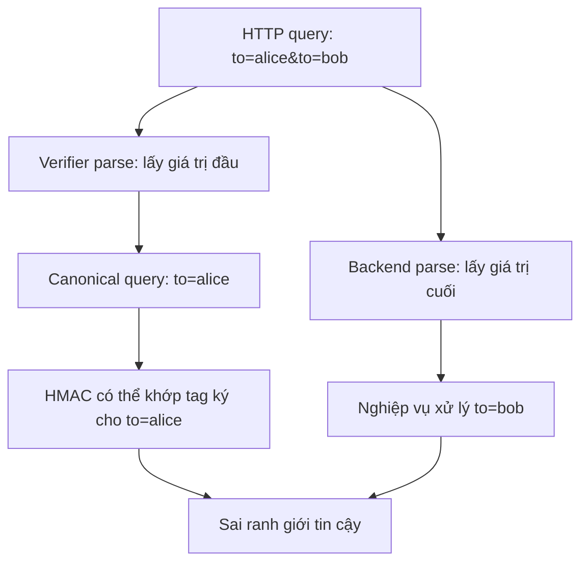
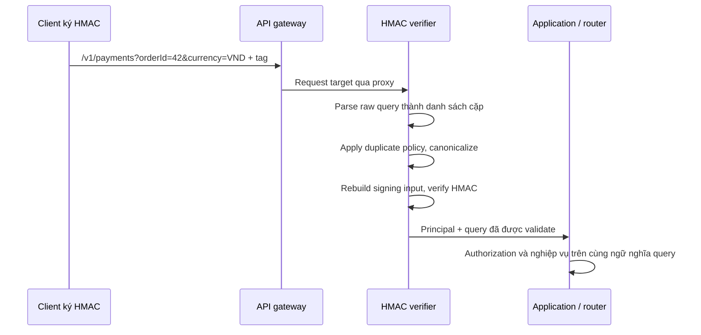

# Parameter lặp trong query canonicalization: giữ đúng ngữ nghĩa khi ký HMAC

> **Chương:** Query canonicalization  
> **Bài học:** Parameter lặp  
> **Phạm vi:** Xác thực HTTP request bằng HMAC và shared secret. Client và server dựng canonical request từ method, URI, signed headers và/hoặc body theo hợp đồng ký. Bài này đi sâu vào **query parameter xuất hiện nhiều lần**, cách biểu diễn multivalue, rủi ro parser mismatch, các chính sách chuẩn hóa an toàn, ví dụ Java 17+, kiểm thử proxy/gateway, replay, key rotation và phân biệt xác thực với phân quyền.

## 1. Parameter lặp là gì?

Một URL query có thể chứa **cùng một tên tham số nhiều lần**:

```http
GET /v1/products?tag=java&tag=security HTTP/1.1
Host: api.example.test
```

Ở đây có hai cặp tên–giá trị:

```text
("tag", "java")
("tag", "security")
```

Đây là **parameter lặp** (*repeated/duplicate query parameter*). Không nên tự kết luận rằng giá trị cuối ghi đè giá trị đầu, hai giá trị được gộp thành danh sách, hay request luôn phải bị từ chối. Ngữ nghĩa thực tế do **hợp đồng API, parser, framework và tầng nghiệp vụ** quyết định.

Trong xác thực HMAC, câu hỏi thiết kế không đơn giản là “sắp xếp query ra sao?”, mà là:

> **Một canonical query được ký có đại diện đúng và đầy đủ cho query mà backend cuối cùng sẽ thực thi không?**

Nếu verifier ký một biểu diễn đã bỏ mất parameter lặp, trong khi backend dùng parameter bị bỏ, **chữ ký có thể hợp lệ cho một hành động khác với hành động được thực hiện**.

### Hai ví dụ thường gặp

**Ví dụ A – Giá trị lặp có ý nghĩa hợp lệ:**

```text
GET /v1/products?tag=java&tag=security
```

Nếu API quy định `tag` là danh sách bộ lọc, cả `java` và `security` đều có ý nghĩa.

**Ví dụ B – Parameter lặp gây mơ hồ:**

```text
POST /v1/transfers?to=alice&to=bob
```

Nếu `to` phải xác định **duy nhất một người nhận**, query trên là mơ hồ. Việc tự lấy giá trị đầu hay cuối ở các tầng khác nhau là nguy hiểm; **từ chối request** là lựa chọn rõ ràng nhất.

## 2. Vì sao parameter lặp là vấn đề bảo mật đối với HMAC?

Giả sử client hợp lệ ký request:

```http
POST /v1/transfers?to=alice HTTP/1.1
X-Key-Id: client-a-k2
X-Timestamp: 1795800000
X-Nonce: 13bcd5f418fd494b94b040041249ab61
X-Signature: v1=<VALID_TAG>
```

Một lỗi thiết kế có thể xảy ra nếu:

1. Verifier đọc query thành `Map<String, String>` và chỉ giữ **giá trị đầu tiên** của mỗi key.
2. Backend lại lấy **giá trị cuối cùng** hoặc xử lý một danh sách theo quy tắc khác.
3. Một request tới server chứa `?to=alice&to=bob` nhưng verifier vẫn tạo canonical query `to=alice`.
4. Signature cũ vẫn có thể khớp canonical request do verifier tạo, trong khi backend thực thi thao tác với `to=bob`.

Đây là một dạng **HTTP Parameter Pollution (HPP) / parser differential**. Lỗi không nằm ở thuật toán HMAC-SHA256: nó nằm ở việc **hai tầng không cùng hiểu dữ liệu được ký**.



**Mục tiêu bảo mật:** Nếu hai request tạo **cùng canonical query**, chúng không được dẫn tới hai hành động có ý nghĩa bảo mật khác nhau ở backend. Khi không thể chứng minh điều đó, nên **reject ambiguity** thay vì cố đoán.

## 3. Query string không tự định nghĩa một kiểu dữ liệu multimap chuẩn

Theo cú pháp URI chung (RFC 3986), **query** là một thành phần của URI. Cách diễn giải thành `name=value` và việc dùng `&` để tách cặp là **quy ước của ứng dụng/giao thức**, không phải quy tắc chung có thể áp đặt cho mọi URI.

Ví dụ:

```text
?tag=java&tag=security
```

Một số kiểu parser có thể chuyển thành:

| Mô hình parser | Kết quả minh họa | Rủi ro |
| --- | --- | --- |
| **First value wins** | `tag = "java"` | Bỏ `security` nếu tầng khác dùng nó. |
| **Last value wins** | `tag = "security"` | Bỏ `java` nếu tầng khác dùng nó. |
| **List/multimap** | `tag = ["java", "security"]` | Phải biết **thứ tự và số lần xuất hiện** có ý nghĩa không. |
| **Comma join** | `tag = "java,security"` | Có thể nhầm với một giá trị literal chứa dấu phẩy. |
| **Reject duplicate** | HTTP 400/4xx | Phù hợp với parameter chỉ cho một giá trị. |
| **Set** | `tag = {"java", "security"}` | Có thể mất thứ tự hoặc mất số lần giá trị giống nhau. |

Không được mặc định một framework Java, JavaScript, Go hay proxy luôn theo cùng một hàng trong bảng. Cách gọi API, version và cấu hình parser đều có thể làm khác kết quả.

Đặc biệt:

- `Map<String, String>` **không chứa đủ thông tin** để biểu diễn parameter lặp.
- `Map<String, List<String>>` giữ được nhiều giá trị nếu parser không làm mất dữ liệu trước đó.
- Một **danh sách các cặp theo thứ tự gốc** `List<(name, value)>` mới biểu diễn được cả thứ tự giữa **những key khác nhau** khi API cần.
- `Set` có thể làm `tag=a&tag=a` trở nên không phân biệt với `tag=a`. Đây là một **thay đổi ngữ nghĩa** nếu số lần xuất hiện có ý nghĩa.

**Nguyên tắc:** Không convert query sang cấu trúc mất thông tin **trước khi** kiểm chính sách parameter lặp và dựng signing input.

## 4. Ba chính sách canonicalization cho parameter lặp

Không có một phương pháp thích hợp cho mọi endpoint. Hợp đồng ký cần chọn và **ràng buộc chính xác một chính sách**.

### 4.1. Chính sách A: từ chối parameter lặp

Ví dụ API thanh toán chỉ hỗ trợ mỗi tham số `orderId`, `currency`, `amount` **một lần**:

```text
Chấp nhận:
  ?currency=VND&orderId=42

Từ chối:
  ?currency=VND&currency=USD&orderId=42
  ?orderId=42&orderId=42
```

Các bước:

1. Lấy **raw query** tại điểm xác minh đã định nghĩa.
2. Parse các cặp mà **chưa bỏ duplicate**.
3. Decode/canonicalize tên tham số theo chính sách.
4. Nếu có hai cặp cùng tên logical sau canonicalization → **reject**.
5. Chỉ sau đó mới sort tên tham số (nếu hợp đồng quy định thứ tự không quan trọng) để tạo canonical query.

**Điểm mạnh:** loại một lớp lớn parser mismatch và dễ kiểm thử. **Giới hạn:** không dùng được cho API cố ý nhận danh sách nhiều giá trị cùng tên.

### 4.2. Chính sách B: cho phép lặp và **giữ nguyên thứ tự cặp**

Ví dụ API định nghĩa danh sách thao tác có thứ tự:

```text
?step=validate&step=charge&step=notify
```

Canonical query giữ nguyên **toàn bộ cặp, đúng thứ tự**:

```text
step=validate&step=charge&step=notify
```

```text
?step=notify&step=charge&step=validate
```

là **một signing input khác**. Backend phải sử dụng chính danh sách cặp đã xác minh và bảo toàn thứ tự; không chuyển sang một `Map` hoặc sort lại sau xác thực.

**Phù hợp khi:** danh sách lặp có thứ tự mang ý nghĩa nghiệp vụ, hoặc thứ tự giữa các cặp khác key cũng quan trọng.

### 4.3. Chính sách C: cho phép lặp như **multiset không quan tâm thứ tự**

Ví dụ một API tìm kiếm tuyên bố `tag` là tập lọc mà thứ tự xuất hiện không ảnh hưởng kết quả:

```text
?tag=security&tag=java
?tag=java&tag=security
```

Có thể định nghĩa cả hai canonical thành:

```text
tag=java&tag=security
```

Quy tắc sẽ sắp theo **encoded name**, rồi **encoded value**, nhưng vẫn giữ **mọi lần xuất hiện**:

```text
?tag=a&tag=a
  -> tag=a&tag=a      // Hai lần, không rút về tag=a.
```

Tuy nhiên, nếu backend coi danh sách tag là **ordered list** hoặc parser ghi đè duplicate, sort sẽ khiến verifier và nghiệp vụ hiểu khác nhau. Chỉ chọn multiset khi chính hợp đồng API xác nhận **thứ tự hoàn toàn không mang ý nghĩa** và backend được kiểm thử tuân thủ điều đó.

**Phân biệt set và multiset:** *set* bỏ các giá trị giống nhau; *multiset* giữ **bội số** của mỗi giá trị. Khi ký HMAC, không được chuyển multiset thành set trừ khi đó chính là ngữ nghĩa đã được chứng minh và quy định rõ ràng.

### Bảng lựa chọn

| Câu hỏi | Reject duplicates | Preserve order | Sort multiset |
| --- | --- | --- | --- |
| API có cho cùng key lặp không? | Không | Có | Có |
| Thứ tự các cặp có ảnh hưởng không? | Không, sau khi xác nhận | **Có** | **Không** |
| Giữ số lần xuất hiện cùng một giá trị? | Không có duplicate | **Có** | **Có** |
| Cần cùng parser/verifier/backend? | Có | Có | Có |
| Rủi ro nếu cấu hình nhầm | Từ chối request hợp lệ | Sai HMAC khi proxy reorder | Signature có thể bảo vệ sai ý nghĩa nếu backend dùng thứ tự |
| Trường hợp phù hợp | Đơn hàng, thanh toán, tenantId | Bộ thao tác có thứ tự | Tag/filter không nhạy thứ tự |

**Khuyến nghị khởi đầu:** nếu API không có nhu cầu thật sự nhận parameter lặp, **reject duplicates**. Nếu cần lặp, **ưu tiên giữ thứ tự** trừ khi đã có lý do và kiểm thử chứng minh multiset là đúng.

## 5. “Parameter giống nhau” phải được xác định **sau canonicalization**

Chỉ so sánh chuỗi raw `name` có thể bỏ sót alias.

Ví dụ:

```text
?role=user&%72ole=admin
```

`%72` là byte ASCII `r`, nên `role` và `%72ole` có thể được parser giải mã thành **cùng tên `role`**. Nếu verifier chỉ kiểm raw key thì tưởng có hai key khác nhau; backend có thể gộp thành một.

Tương tự:

```text
?name=a+b
?name=a%20b
?name=a%2Bb
```

Có thể được hiểu khác nhau tùy parser:

- Trong một số cách parse **form-urlencoded**, `+` biểu thị khoảng trắng.
- Trong generic URI query, `+` không mặc nhiên có nghĩa là khoảng trắng.
- `%2B` biểu diễn byte dấu cộng `+`.

Vì vậy, một hợp đồng ký cần quy định **chính xác** cách xử lý:

1. Phân tách raw query bằng **ký tự delimiter `&` chưa percent-decode**, nếu contract quy định `&` là separator.
2. Với từng cặp, tách tại **dấu `=` literal đầu tiên**; hoặc từ chối mọi dấu `=` literal bổ sung theo chính sách nghiêm ngặt.
3. Decode percent-triplet theo UTF-8 nghiêm ngặt **một lần**; không decode toàn bộ query rồi mới tách.
4. Quyết định có chấp nhận dấu `+` literal hay không; không tự dùng form-decoder cho query nếu hợp đồng không nói vậy.
5. Chuẩn hóa cách biểu diễn hex (`%2B` hay `%2b`), ký tự unreserved và Unicode theo một quy tắc nhất quán.
6. Phát hiện duplicate theo **tên logical sau giải mã/chuẩn hóa**, không chỉ theo raw spelling.
7. Bảo toàn **bội số và thứ tự** nếu hợp đồng cho duplicate.

### Tách delimiter **trước** khi percent-decode

Ví dụ:

```text
?note=red%26blue&mode=fast
```

Phải hiểu thành hai cặp:

```text
("note", "red&blue")
("mode", "fast")
```

Nếu decode toàn bộ trước:

```text
note=red&blue&mode=fast
```

rồi split `&`, hệ thống có thể tự tạo thêm một parameter `blue`. Tương tự `%3D` biểu diễn dấu `=` nằm trong value; decode toàn bộ trước khi tách cặp cũng có thể làm sai cấu trúc.

**Bất biến:** các ký tự delimiter xuất hiện **sau giải mã** chỉ là dữ liệu bên trong component đã parse, không được trở thành delimiter mới ở tầng kế tiếp.

## 6. Các ca mơ hồ mà contract phải giải quyết

| Raw query | Hai cách hiểu có thể gặp | Hướng xử lý rõ ràng |
| --- | --- | --- |
| `?x=1&x=2` | Lấy giá trị đầu/cuối hoặc danh sách. | Reject hoặc giữ hai cặp tùy endpoint. |
| `?x=1&x=1` | Hai lần xuất hiện hay một giá trị. | Không tự deduplicate. |
| `?x=1&%78=2` | Hai raw key khác nhau, cùng logical key `x`. | Decode canonical trước khi phát hiện duplicate; contract nghiêm ngặt có thể reject `%78`. |
| `?x` | Flag không có dấu `=`. | Phân biệt với `x=` hoặc reject theo grammar. |
| `?x=` | Key có giá trị rỗng. | Có thể chấp nhận nếu endpoint hỗ trợ empty value. |
| `?x=1&&y=2` | Cặp rỗng ở giữa. | Reject thay vì âm thầm bỏ. |
| `?x=1&` | Cặp rỗng ở cuối. | Reject theo grammar minh họa. |
| `?=value` | Tên rỗng. | Reject với API không hỗ trợ empty key. |
| `?x=a=b` | Dấu bằng nằm trong value. | Chỉ cho nếu grammar quy định; ví dụ nghiêm ngặt yêu cầu `a%3Db`. |
| `?x=a%26y%3D1` | Value có `&` và `=` đã mã hóa. | Parse raw trước; nếu backend dùng parsed values, không được parse lại thành query mới. |
| `?x=a+b` vs `?x=a%20b` | Plus có thể là literal hoặc space. | Chọn một quy tắc; không trộn URI và form semantics. |
| `?x=%2526admin%3Dtrue` | Double decode có thể biến `%26` thành `&`. | Decode đúng một lần; contract nghiêm ngặt có thể reject literal `%` sau decode. |
| `?tag=%C3%A9` vs `?tag=e%CC%81` | Unicode composed/decomposed. | Định nghĩa NFC hoặc phân biệt byte nhất quán. |
| `?x=%C0%AF` | UTF-8 overlong/malformed. | Reject invalid UTF-8. |
| `?x=%0Aadmin` | Control character sau decode. | Reject hoặc kiểm soát chặt; không cho CR/LF injection. |
| `?x=1;y=2` | Legacy parser có thể coi `;` là separator. | Nếu không hỗ trợ, reject `;` để tránh parser differential. |

**Không “sửa lỗi” bằng cách lấy giá trị cuối để ký.** Nếu backend dùng giá trị đầu, lỗi chỉ đổi chiều. Giải pháp là **chọn một hợp đồng duy nhất và kiểm end-to-end**.

## 7. Thiết kế hợp đồng minh họa `QUERY-V1` cho HMAC

Bài học sử dụng một contract minh họa **chặt hơn URI tổng quát**. Nó không phải quy chuẩn cho mọi API:

1. Query được lấy dưới dạng **raw query không kèm dấu `?`** từ request target **đáng tin** tại điểm xác minh.
2. Query vắng mặt hoặc rỗng có canonical value `""` **chỉ khi API coi hai dạng tương đương**. Nếu backend phân biệt `/path` và `/path?` thì phải reject hoặc ký sự khác biệt riêng.
3. Có tối đa **50 cặp**, raw query dài tối đa **4096 ký tự ASCII**, tên encoded tối đa 128 ký tự, value encoded tối đa 2048 ký tự; production cần giới hạn cả toàn request và URL ở ingress.
4. Mỗi cặp có dạng `name=value`; bắt buộc đúng **một dấu `=` literal** tại vị trí ngăn cách; `name` không rỗng, `value` được rỗng.
5. Chỉ chấp nhận dấu `&` literal làm cặp separator. Cặp rỗng, trailing `&` hoặc tên rỗng bị reject.
6. Name là ASCII **unreserved** (`A–Z a–z 0–9 - . _ ~`), tránh các tên có `[ ]` hoặc separator phụ; endpoint thực tế nên có allowlist các tên được phép.
7. Value được percent-encode từ **UTF-8**. Chỉ ASCII unreserved xuất hiện trực tiếp; các byte khác thành `%HH` hex **chữ hoa**. Dấu cách phải là `%20`, dấu cộng literal phải thành `%2B`.
8. Percent-encoding được decode **đúng một lần**; reject `%` sai cú pháp, UTF-8 malformed, control characters và Unicode không ở **NFC**. Contract minh họa còn reject decoded `%` và `;` để giảm nguy cơ double-decode/legacy separator ở downstream.
9. Nếu policy là `REJECT_DUPLICATES`: phát hiện duplicate theo **decoded name**, reject; sau đó sort theo encoded name (vì endpoint tuyên bố thứ tự các key khác nhau không có ý nghĩa).
10. Nếu policy là `PRESERVE_ORDER`: chấp nhận repeated name, **giữ nguyên mỗi cặp và thứ tự gốc**; business layer bắt buộc sử dụng danh sách đã được validate.
11. Mọi query sau kiểm tra phải **trùng đúng dạng encoded canonical**; không âm thầm chấp nhận `%61` thay `a` hoặc `%2b` thay `%2B`.
12. Không tự fallback từ `REJECT_DUPLICATES` sang `PRESERVE_ORDER` vì server/framework nhận parameter trùng.

Lý do của mục 8: API này cố ý hẹp. Nếu nghiệp vụ cần giá trị chứa dấu `%` hoặc `;` thực sự, phải nới contract **có chủ đích**, đồng bộ parser backend/gateway và thêm test. Không suy diễn rằng mọi giá trị percent-encoded đều nguy hiểm theo RFC 3986.

### Ví dụ canonical query theo `QUERY-V1`

| Input (raw query, không có `?`) | `REJECT_DUPLICATES` | `PRESERVE_ORDER` |
| --- | --- | --- |
| `z=9&a=1` | `a=1&z=9` | `z=9&a=1` |
| `a=1&z=9` | `a=1&z=9` | `a=1&z=9` |
| `tag=java&tag=security` | Reject duplicate | `tag=java&tag=security` |
| `tag=security&tag=java` | Reject duplicate | `tag=security&tag=java` |
| `tag=java&tag=java` | Reject duplicate | `tag=java&tag=java` |
| `q=h%E1%BB%93%20s%C6%A1` | Giữ nguyên dạng hợp lệ | Giữ nguyên dạng hợp lệ |
| `q=a+b` | Reject raw `+` | Reject raw `+` |
| `q=a%2Bb` | Chấp nhận | Chấp nhận |
| `role=user&%72ole=admin` | Reject noncanonical `%72` | Reject noncanonical `%72` |
| `x=1&&y=2` | Reject cặp rỗng | Reject cặp rỗng |

**Đừng đánh đồng `QUERY-V1` với canonical query của Amazon SigV4, OAuth 1.0 hay RFC 9421.** Mỗi giao thức có cách dựng byte ký và quy tắc covered components riêng. Khi dùng một chuẩn, phải tuân theo chuẩn đó thay vì ghép lẫn các quy tắc “trông hợp lý”.

## 8. Java 17+: canonicalize query mà không làm mất parameter lặp

Đoạn mã sau thực thi **hai policy minh họa `QUERY-V1`**: từ chối duplicate hoặc bảo toàn thứ tự. Mã nhận **raw query string đã lấy đúng tại trust boundary**; không lấy một `Map<String, String>` đã parse và mất duplicate.

```java
import java.io.ByteArrayOutputStream;
import java.nio.ByteBuffer;
import java.nio.charset.CharacterCodingException;
import java.nio.charset.CodingErrorAction;
import java.nio.charset.StandardCharsets;
import java.text.Normalizer;
import java.util.ArrayList;
import java.util.Comparator;
import java.util.HashSet;
import java.util.List;
import java.util.Objects;
import java.util.Set;

public final class HmacQueryParametersV1 {
    public enum Policy {
        REJECT_DUPLICATES,
        PRESERVE_ORDER
    }

    public record Parameter(String name, String value) {}
    public record CanonicalQuery(String encoded, List<Parameter> parameters) {}

    private record Entry(
            String encodedName, String encodedValue, Parameter value) {}

    private static final char[] HEX = "0123456789ABCDEF".toCharArray();

    private HmacQueryParametersV1() {}

    private static boolean unreserved(int b) {
        return (b >= 'A' && b <= 'Z')
                || (b >= 'a' && b <= 'z')
                || (b >= '0' && b <= '9')
                || b == '-' || b == '.' || b == '_' || b == '~';
    }

    private static int hex(char c) {
        if (c >= '0' && c <= '9') return c - '0';
        if (c >= 'a' && c <= 'f') return c - 'a' + 10;
        if (c >= 'A' && c <= 'F') return c - 'A' + 10;
        return -1;
    }

    private static String encodeCanonical(String decoded) {
        byte[] bytes = decoded.getBytes(StandardCharsets.UTF_8);
        StringBuilder out = new StringBuilder();
        for (byte value : bytes) {
            int b = value & 0xFF;
            if (unreserved(b)) {
                out.append((char) b);
            } else {
                out.append('%')
                        .append(HEX[b >>> 4])
                        .append(HEX[b & 0x0F]);
            }
        }
        return out.toString();
    }

    private static String decodeCanonical(String raw)
            throws CharacterCodingException {
        ByteArrayOutputStream bytes = new ByteArrayOutputStream();

        for (int i = 0; i < raw.length();) {
            char ch = raw.charAt(i);
            if (ch == '%') {
                if (i + 2 >= raw.length()) {
                    throw new IllegalArgumentException("Truncated %HH");
                }
                int high = hex(raw.charAt(i + 1));
                int low = hex(raw.charAt(i + 2));
                if (high < 0 || low < 0) {
                    throw new IllegalArgumentException("Invalid %HH");
                }
                bytes.write((high << 4) | low);
                i += 3;
            } else {
                // Không nhận '+', '&', '=', ';', non-ASCII literal...
                if (ch > 0x7F || !unreserved(ch)) {
                    throw new IllegalArgumentException(
                            "Noncanonical literal query byte");
                }
                bytes.write(ch);
                i++;
            }
        }

        String decoded = StandardCharsets.UTF_8.newDecoder()
                .onMalformedInput(CodingErrorAction.REPORT)
                .onUnmappableCharacter(CodingErrorAction.REPORT)
                .decode(ByteBuffer.wrap(bytes.toByteArray()))
                .toString();

        if (!Normalizer.isNormalized(decoded, Normalizer.Form.NFC)) {
            throw new IllegalArgumentException("Non-NFC query component");
        }
        boolean forbidden = decoded.codePoints().anyMatch(
                cp -> Character.isISOControl(cp) || cp == '%'
                        || cp == ';');
        if (forbidden) {
            throw new IllegalArgumentException(
                    "Forbidden decoded query character");
        }

        // Canonical form: direct unreserved, uppercase %HH for other bytes.
        if (!encodeCanonical(decoded).equals(raw)) {
            throw new IllegalArgumentException(
                    "Query component is not in canonical encoding");
        }
        return decoded;
    }

    public static CanonicalQuery canonicalize(
            String rawQuery, Policy policy)
            throws CharacterCodingException {

        Objects.requireNonNull(policy);
        // Hợp đồng ví dụ coi absent query và empty query là tương đương.
        if (rawQuery == null || rawQuery.isEmpty()) {
            return new CanonicalQuery("", List.of());
        }
        if (rawQuery.length() > 4096 || rawQuery.startsWith("?")) {
            throw new IllegalArgumentException("Invalid raw query input");
        }

        String[] fields = rawQuery.split("&", -1);
        if (fields.length > 50) {
            throw new IllegalArgumentException("Too many query pairs");
        }

        List<Entry> entries = new ArrayList<>();
        Set<String> seenNames = new HashSet<>();
        for (String field : fields) {
            int equal = field.indexOf('=');
            if (equal <= 0) {
                // Không có '=', tên rỗng hoặc cặp rỗng.
                throw new IllegalArgumentException("Expected name=value");
            }
            String encodedName = field.substring(0, equal);
            String encodedValue = field.substring(equal + 1);
            if (encodedName.length() > 128 || encodedValue.length() > 2048) {
                throw new IllegalArgumentException("Query component too long");
            }

            String name = decodeCanonical(encodedName);
            String value = decodeCanonical(encodedValue);
            if (!name.matches("[A-Za-z0-9._~-]+")) {
                throw new IllegalArgumentException("Invalid query key");
            }
            if (policy == Policy.REJECT_DUPLICATES
                    && !seenNames.add(name)) {
                throw new IllegalArgumentException(
                        "Repeated query parameter: " + name);
            }

            entries.add(new Entry(
                    encodedName, encodedValue, new Parameter(name, value)));
        }

        List<Entry> forSignature = new ArrayList<>(entries);
        if (policy == Policy.REJECT_DUPLICATES) {
            // Contract: thứ tự khác key không ảnh hưởng nghiệp vụ.
            forSignature.sort(Comparator
                    .comparing(Entry::encodedName)
                    .thenComparing(Entry::encodedValue));
        } // PRESERVE_ORDER giữ nguyên mọi cặp và thứ tự gốc.

        List<String> canonicalPairs = new ArrayList<>();
        for (Entry e : forSignature) {
            canonicalPairs.add(e.encodedName() + "=" + e.encodedValue());
        }

        // Giữ danh sách đã validate ở thứ tự request để backend có thể dùng
        // trực tiếp; KHÔNG reparsing bằng parser có semantics khác.
        List<Parameter> parameters = new ArrayList<>();
        for (Entry e : entries) {
            parameters.add(e.value());
        }
        return new CanonicalQuery(
                String.join("&", canonicalPairs),
                List.copyOf(parameters));
    }

    private static void expectRejected(String raw, Policy policy)
            throws Exception {
        try {
            canonicalize(raw, policy);
            throw new AssertionError("Must reject: " + raw);
        } catch (IllegalArgumentException
                 | CharacterCodingException expected) {
            // Chỉ ca đầu vào cố ý sai mới chạy tới đây.
        }
    }

    public static void main(String[] args) throws Exception {
        CanonicalQuery unique = canonicalize(
                "z=9&a=1", Policy.REJECT_DUPLICATES);
        if (!unique.encoded().equals("a=1&z=9")) {
            throw new AssertionError("Unexpected sorting");
        }

        CanonicalQuery ordered = canonicalize(
                "tag=java&tag=security", Policy.PRESERVE_ORDER);
        if (!ordered.encoded().equals("tag=java&tag=security")
                || ordered.parameters().size() != 2) {
            throw new AssertionError("Lost duplicate values/order");
        }

        expectRejected("amount=100&amount=999",
                Policy.REJECT_DUPLICATES);
        expectRejected("role=user&%72ole=admin",
                Policy.REJECT_DUPLICATES);
        expectRejected("x=1&&y=2", Policy.PRESERVE_ORDER);
        expectRejected("q=a+b", Policy.REJECT_DUPLICATES);
        expectRejected("q=%C0%AF", Policy.REJECT_DUPLICATES);
        expectRejected("x=%2526admin%3Dtrue", Policy.REJECT_DUPLICATES);

        CanonicalQuery utf8 = canonicalize(
                "q=h%E1%BB%93%20s%C6%A1", Policy.REJECT_DUPLICATES);
        if (!utf8.parameters().get(0).value().equals("hồ sơ")) {
            throw new AssertionError("Invalid UTF-8 decoding");
        }

        System.out.println("PASS: repeated query parameter policies");
        System.out.println("Canonical unique: " + unique.encoded());
        System.out.println("Canonical ordered: " + ordered.encoded());
    }
}
```

### Phân tích thiết kế của ví dụ

- `canonicalize(...)` **không** đọc request HTTP; adapter phải cung cấp **raw query tại đúng điểm xác minh**, chưa bị parser bỏ duplicate.
- `REJECT_DUPLICATES` phát hiện tên lặp theo logical name, rồi sort **encoded name**; việc sort chỉ đúng nếu backend không quan tâm thứ tự các key khác nhau.
- `PRESERVE_ORDER` bảo toàn số cặp và thứ tự; `tag=java&tag=security` khác `tag=security&tag=java` khi ký.
- `CanonicalQuery.parameters` lưu danh sách giá trị đã decode/validate; tầng nghiệp vụ nên **dùng cùng biểu diễn được kiểm tra**, không tự parse lại query bằng một bộ parser khác.
- Code chấp nhận `x=` là giá trị rỗng, nhưng từ chối `x` không có `=`. Đây là **lựa chọn của hợp đồng**, không phải luật chung của URI.
- Code từ chối `%61` khi nó là cách encode thay thế chữ `a`, và từ chối `%2b` khi hợp đồng đòi hex chữ hoa. Điều này giúp request chỉ có **một cách biểu diễn hợp lệ**.
- Giá trị chứa `%` hoặc `;` sau decode bị từ chối một cách **cố ý nghiêm ngặt**; ứng dụng cần các ký tự này phải thiết kế chính sách khác và kiểm soát downstream decode.
- `Normalizer.Form.NFC` yêu cầu Unicode thống nhất ở **cả verifier lẫn business parser**. Nếu API không cần Unicode query keys, giới hạn key ASCII như ví dụ giúp giảm ambiguity.
- `CharacterCodingException` và `IllegalArgumentException` ở request không hợp lệ cần được map thành **lỗi client 4xx**, không tiết lộ chi tiết nhạy cảm.
- Chưa tích hợp HMAC key lookup, replay store, hạn mức HTTP request, routing, proxy hoặc authorization; cần xây những phần đó ở tầng xác thực.

**Lưu ý về method Java:** `java.net.URLDecoder` dùng semantics của `application/x-www-form-urlencoded`; nó có thể biến `+` thành khoảng trắng. Không tự dùng nó để decode generic URI query khi `QUERY-V1` đòi `+` literal bị reject và space chỉ dùng `%20`. Tương tự, `URI.getRawQuery()` vẫn không chứng minh bạn đang thấy raw request ban đầu **nếu gateway/framework đã sửa trước đó**.

## 9. Tích hợp canonical query vào HMAC request authentication

Giả sử một API sử dụng `REJECT_DUPLICATES` và client gửi request:

```http
POST /v1/payments?orderId=42&currency=VND HTTP/1.1
Host: api.example.test
Content-Type: application/json
X-Key-Id: merchant-42-k2
X-Timestamp: 1795800000
X-Nonce: 0d3792b31f624c59a5e7f8dba6c95102
X-Signature: v1=<BASE64URL_HMAC_TAG>

{"amount":100000}
```

**Quy ước minh họa** `HMAC-SHA256/v1`:

```text
canonicalQuery =
    QUERY-V1(rawQuery, REJECT_DUPLICATES)
    = "currency=VND&orderId=42"

bodyHash = lowercaseHex(SHA256(rawBodyBytes))

canonicalRequest =
    METHOD + "\n"
    + CANONICAL_AUTHORITY + "\n"
    + CANONICAL_PATH + "\n"
    + canonicalQuery + "\n"
    + CANONICAL_SIGNED_HEADERS + "\n"
    + SIGNED_HEADER_NAMES + "\n"
    + bodyHash

bytesToSign = UTF8("HMAC-SHA256/v1\n" + canonicalRequest)
signatureTag = HMAC-SHA256(sharedSecretBytes, bytesToSign)
```

Dòng canonical query trong signing input là:

```text
currency=VND&orderId=42
```

Nếu attacker thêm `&currency=USD`, `QUERY-V1` phát hiện lặp `currency` và **từ chối trước khi dùng HMAC**; không có chuyện verifier ký một giá trị còn backend thực thi giá trị kia.

Nếu sử dụng `PRESERVE_ORDER` cho endpoint có list query, raw `tag=blue&tag=red` phải được giữ nguyên trong canonical request. Thay thứ tự thành `tag=red&tag=blue` sẽ thay signing bytes và tag dù client vẫn có cùng secret.

### Java: đưa canonical query vào signing input

```java
// HTTP adapter phải lấy raw query từ request target đáng tin cậy.
String rawQuery = "orderId=42&currency=VND";

HmacQueryParametersV1.CanonicalQuery query =
        HmacQueryParametersV1.canonicalize(
                rawQuery,
                HmacQueryParametersV1.Policy.REJECT_DUPLICATES);

String canonicalQuery = query.encoded(); // currency=VND&orderId=42

// Những phần còn lại do canonicalizer tương ứng tạo theo hợp đồng:
// method, authority, canonicalPath, signedHeaders, bodyHash.
// Không đưa signature header đầu ra vào signing input.
String canonicalRequest = String.join("\n",
        "POST",
        "api.example.test",
        "/v1/payments",
        canonicalQuery,
        signedHeaders,
        signedHeaderNames,
        bodySha256Hex);

String signingInput = "HMAC-SHA256/v1\n" + canonicalRequest;
Mac mac = Mac.getInstance("HmacSHA256");
mac.init(new SecretKeySpec(secretBytes, "HmacSHA256"));
byte[] tag = mac.doFinal(
        signingInput.getBytes(StandardCharsets.UTF_8));
```

Các biến `signedHeaders`, `signedHeaderNames`, `bodySha256Hex` và `secretBytes` được cung cấp bởi những phần của ứng dụng đã chuẩn bị/kiểm tra trước. Mã chỉ minh họa **cách dùng canonical query trong signing input**, không phải một verifier HTTP hoàn chỉnh.

HMAC-SHA256 cho tag 32 byte. Có thể vận chuyển dạng Base64URL không padding trong header; server phải decode đúng định dạng, kiểm độ dài và so sánh tag byte với `MessageDigest.isEqual(expected, received)`. **Không gửi shared secret qua HTTP**.

### Hợp đồng ký cần bao gồm nhiều hơn query

Nếu chỉ ký query mà **không ký method, path hoặc body**, attacker có thể sửa những trường đó mà tag vẫn được chấp nhận. Với thao tác thanh toán, tối thiểu nên đánh giá:

- Method (ví dụ chính xác `POST`).
- Authority/host nếu dùng để định tuyến tenant hoặc service.
- Canonical path/endpoint và canonical query.
- Signed headers có tác động, ví dụ `content-type`, `x-key-id`, `x-timestamp`, `x-nonce`.
- SHA-256 của **raw body bytes** (sau đó được HMAC bao phủ), hoặc body theo một cách ký đã định nghĩa.
- Phiên bản hợp đồng ký để tránh nhầm lẫn/downgrade.

**HMAC kiểm chứng nội dung đã ký, không phải quyền truy cập.** Sau khi signature hợp lệ, server xác định principal từ credential registry rồi phải kiểm authorization với tài nguyên và hành động thực tế.

## 10. Proxy và gateway: tránh query parser differential

Một request có thể đi qua nhiều hop:



### Thay đổi ở hop trung gian và hậu quả

| Hành vi gateway/proxy | Ảnh hưởng đến parameter lặp | Cần kiểm thử/khắc phục |
| --- | --- | --- |
| Giữ nguyên raw query | Verifier có cơ hội phát hiện đầy đủ duplicate. | Xác định rõ byte stream và parser tương ứng. |
| Parse query thành map đơn trị | Có thể mất toàn bộ lần lặp trừ một giá trị. | Không dùng map đã mất thông tin làm input ký. |
| Sort lại query params | Thay thứ tự, có thể phá hợp đồng `PRESERVE_ORDER`. | Tắt rewrite hoặc xác minh trước rewrite / định nghĩa contract rõ. |
| Decode/re-encode `%HH` | Có thể đổi `%2B`, `+`, `%20` hoặc tên alias. | Áp dụng cùng canonical encoding và kiểm thử URI thực qua gateway. |
| Chuẩn hóa `;` thành separator | Có thể tạo thêm cặp so với client. | Contract nghiêm ngặt từ chối hoặc quản lý parser cụ thể. |
| Gộp/loại duplicate | Có thể biến request mơ hồ thành request có một key. | Reject sớm trước khi dữ liệu duplicate bị mất. |
| Rewrite path/host | Thay các trường ký khác dù query được giữ. | Thống nhất điểm xác minh và nguồn request target đáng tin. |
| Thêm `X-Original-URI` do client tự khai | Có thể tạo một “raw query” giả nếu backend tin header đó. | Gateway xóa header client gửi và chỉ tạo giá trị đáng tin qua kênh nội bộ bảo vệ. |
| HTTP/1.1 sang HTTP/2 | `:path` có thể chứa path+query theo dạng khác request-line. | Rút ra query đúng theo contract, không dựa vào serialization tùy tiện. |

**Lỗ hổng đáng chú ý:** Nếu gateway xác thực HMAC nhưng backend nhận raw query và **parse lại với semantics khác**, gateway có thể chấp nhận một nội dung, backend thực thi nội dung khác. Đầu ra từ verifier nên là **cấu trúc các parameter đã được validate và gắn với principal**, hoặc toàn bộ đường nội bộ phải áp dụng cùng parser/contract được kiểm chứng.

### Gateway xác minh trước hay sau rewrite?

- **Xác minh tại gateway:** có thể kiểm duplicate/encoding trước khi proxy thay dữ liệu. Gateway phải gỡ header danh tính do client tự gửi, tạo principal tin cậy và ngăn bypass vào backend.
- **Xác minh tại service:** chỉ an toàn khi service nhận đúng raw query hoặc một dạng canonical/logical query **đáng tin** và backend hiểu như nhau. Không dùng `X-Forwarded-*`/`X-Original-URI` chưa được gateway kiểm soát.

Không “chữa” mismatch bằng cách **bỏ query khỏi signing input** nếu query quyết định resource, tenant, quyền hoặc kết quả nghiệp vụ.

## 11. Replay, key rotation và authorization vẫn phải tách riêng

Canonicalization chỉ bảo đảm **cùng chuỗi byte ký cho những query được hợp đồng xem là tương đương**. Nó không chống replay và không thay credential policy.

### 11.1. Replay protection

Một attacker có thể sao chép nguyên request với query canonical và HMAC tag hợp lệ. Khi đó verifier vẫn có thể tính đúng HMAC. Để chống phát lại:

1. Client thêm **timestamp** và **nonce ngẫu nhiên, dùng một lần**, cả hai **được ký**.
2. Server kiểm timestamp trong freshness window, ví dụ `abs(now - timestamp) <= 300` giây.
3. Server xây canonical request từ request nhận và **xác minh HMAC**.
4. Chỉ sau khi tag hợp lệ mới **atomic claim `(keyId, nonce)`** trong kho dùng chung các instance.
5. Từ chối nonce đã dùng. TTL nonce cần bao phủ toàn bộ thời gian timestamp còn hợp lệ; cửa sổ đối xứng ±300 giây có thể yêu cầu giữ nonce tới gần 600 giây từ lần nhận sớm nhất.
6. Khi kho replay lỗi tại endpoint nhạy cảm, **fail closed** theo chính sách.

Một `Idempotency-Key` cho POST giúp ngăn **tác động nghiệp vụ lặp** khi retry hợp lệ bằng nonce mới; không thay thế nonce/replay control.

### 11.2. Key rotation

Key ID như `merchant-42-k2` là **định danh credential để tra secret** chứ không phải bằng chứng xác thực. Khi rotation:

- Server tra đúng `keyId → secretRef, principal, trạng thái, thời hạn` theo registry đáng tin.
- Credential cũ `REVOKED`/`EXPIRED` phải bị từ chối dù HMAC bằng khóa cũ vẫn khớp.
- Client ký request mới với secret của key mới; không thử mọi secret cho tới khi tìm thấy tag khớp.
- Java `Mac.reset()` **không đổi khóa**; khi chuyển credential phải `Mac.init(newKey)` hoặc dùng một `Mac` mới.
- Contract query `QUERY-V1` và signature version `v1` có thể giữ nguyên nếu chỉ thay credential.

### 11.3. Authorization

Sau khi HMAC hợp lệ, verifier xác định principal từ credential đã xác minh. Ví dụ client A ký một request hợp lệ nhưng đưa query `tenantId=B`:

```text
POST /v1/orders?tenantId=B
Authenticated principal: tenant-A
```

Dù `tenantId=B` đã nằm trong canonical query, điều đó **không cấp quyền** cho A truy cập tài nguyên của B. Authorization phải so principal, tenant/resource thực và hành động. Đặc biệt, tầng authorization phải dùng **đúng giá trị query đã được xác minh**; không được parse lại và nhận một duplicate bị verifier bỏ sót.

## 12. Bộ kiểm thử parameter lặp cho HMAC request

Nên có cả test trực tiếp vào verifier và test qua gateway/load balancer thực tế, trong môi trường được phép. Cố định một request HMAC hợp lệ, sau đó thay **một yếu tố** để cô lập lỗi.

| # | Ca kiểm thử | Kết quả mong đợi |
| --- | --- | --- |
| 1 | `?currency=VND&orderId=42` (REJECT_DUPLICATES). | Canonical thành `currency=VND&orderId=42`; chữ ký hợp lệ khi mọi trường khác khớp. |
| 2 | `?orderId=42&currency=VND` (REJECT_DUPLICATES). | Canonical như ca 1 nếu backend coi thứ tự hai key không quan trọng. |
| 3 | `?orderId=42&orderId=99`. | Reject duplicate; không chọn đầu hoặc cuối. |
| 4 | `?orderId=42&orderId=42`. | Vẫn reject duplicate dù hai value giống nhau. |
| 5 | `?role=user&%72ole=admin`. | Reject noncanonical name alias; không bỏ qua logical duplicate. |
| 6 | `?tag=java&tag=security` (PRESERVE_ORDER). | Giữ đủ hai cặp và đúng thứ tự. |
| 7 | Đảo `tag=security&tag=java`, giữ tag HMAC cũ. | HMAC mismatch nếu order là phần ký. |
| 8 | `?tag=java&tag=java`. | Giữ **hai lần** nếu policy cho duplicate; không dùng `Set`. |
| 9 | `?flag` so với `?flag=`. | `flag` reject theo contract; `flag=` hợp lệ nếu endpoint cho empty. |
| 10 | `?x=1&&y=2` hoặc `?x=1&`. | Reject cặp rỗng. |
| 11 | `?=v` hoặc `?x=a=b`. | Reject cú pháp ngoài grammar `QUERY-V1`. |
| 12 | `?note=a%26b`. | Một cặp với value `a&b`, không tách thành cặp mới sau decode. |
| 13 | `?note=a%3Db`. | Một cặp với value `a=b`, không tạo key mới. |
| 14 | `?q=a+b` và `?q=a%20b`. | Raw `+` reject; space encoded `%20` được phép. |
| 15 | `?q=a%2Bb` và `?q=a%2bb`. | Chỉ dạng hex uppercase được chấp nhận theo contract. |
| 16 | `?q=%61` so với `?q=a`. | `%61` reject vì encoded unreserved không canonical. |
| 17 | `?q=%C0%AF` hoặc `?q=%FF`. | Reject UTF-8 malformed/overlong. |
| 18 | `?q=%0Aadmin`. | Reject control character; không đưa LF vào parser/log. |
| 19 | `?q=%2526admin%3Dtrue`. | Reject literal percent sau decode trong contract nghiêm ngặt. |
| 20 | `?q=caf%C3%A9` so với `?q=cafe%CC%81`. | Chỉ dữ liệu NFC được phép, không âm thầm gộp hai Unicode representations. |
| 21 | `?x=1;y=2` hoặc `?x=1%3By%3D2`. | Reject semicolon theo contract, không đổi separator qua legacy parser. |
| 22 | Query vượt giới hạn độ dài/số cặp. | Reject 4xx, không băm/parse input quá lớn vô hạn. |
| 23 | Gateway chuyển query thành map và làm mất duplicate. | Không được âm thầm chấp nhận; sửa ingress/cấu hình hoặc xác minh trước transform. |
| 24 | Proxy sort lại `tag=a&tag=b`. | Hợp đồng PRESERVE_ORDER phát hiện thay đổi; không tự bỏ qua. |
| 25 | Thay method, path hoặc body nhưng giữ canonical query và signature. | HMAC mismatch nếu các trường đó đã ký. |
| 26 | Thay timestamp hoặc nonce, giữ signature. | HMAC mismatch vì metadata được ký. |
| 27 | Phát lại nguyên request và nonce. | Nonce store atomic từ chối replay dù HMAC đúng. |
| 28 | Key ID của A nhưng tag tính bằng secret B. | Authentication thất bại, không gán principal A. |
| 29 | Dùng key đã revoke sau rotation. | Từ chối dù signature toán học đúng với key cũ. |
| 30 | Client A ký hợp lệ `?tenantId=B`. | Authentication có thể thành công; authorization phải từ chối nếu A không có quyền. |

### Checklist trước khi đưa vào production

- **Hợp đồng API:** mỗi query key có được lặp không? Nếu có, **thứ tự và bội số** có ý nghĩa không?
- **Đầu vào ký:** có còn raw query với **đầy đủ cặp** trước khi framework/gateway chuyển sang map không?
- **Encoding:** quy định rõ percent-encoding, UTF-8, dấu `+`, dấu `=`, empty value, NFC và parser policy.
- **Canonicalization:** cùng chính sách reject/ordered/multiset ở client, gateway, verifier và backend; không deduplicate ngoài ý muốn.
- **Bất biến:** request được xác minh và request được thực thi phải có **cùng ngữ nghĩa query**.
- **HMAC:** query là một phần của signing input cùng method, URI, signed headers, body digest, version và metadata phù hợp.
- **Replay:** timestamp/nonce được ký; nonce được claim atomically với TTL đủ dài.
- **Credential:** dùng đúng secret theo key ID, hỗ trợ revoke/rotation.
- **Authorization:** kiểm quyền theo principal và đúng resource đã được xác minh, không chỉ “HMAC tag match”.

## 13. Câu hỏi tự kiểm tra

**Câu 1.** Query `?role=user&role=admin` là một tham số hay hai tham số?

*Đáp án:* Theo quy ước `name=value` với dấu `&` phân tách, đó là **hai cặp** có cùng tên `role`. API phải định nghĩa cho phép lặp, giữ thứ tự, hoặc reject; không tự giả định giá trị đầu/cuối.

**Câu 2.** Vì sao dùng `Map<String, String>` trước khi kiểm HMAC có thể nguy hiểm?

*Đáp án:* Vì map đơn trị thường không giữ tất cả lần xuất hiện của key. Nếu verifier ký một giá trị còn backend thực thi giá trị khác, HMAC không bảo vệ đúng request thực tế.

**Câu 3.** Trong API thanh toán chỉ cho một `amount`, nên làm gì với `?amount=100&amount=900`?

*Đáp án:* **Từ chối parameter lặp**, không chọn một giá trị rồi ký. Phải phát hiện duplicate sau quy tắc canonicalize tên tham số.

**Câu 4.** Nếu thứ tự `tag=java&tag=security` có ý nghĩa, có được sort theo value cho đẹp không?

*Đáp án:* Không. Phải giữ thứ tự khi dựng canonical query và khi business thực thi; sort có thể làm hai request khác nghĩa có cùng signing input.

**Câu 5.** Nếu API coi tag là multiset không quan tâm thứ tự, có được bỏ `tag=a` thứ hai trong `tag=a&tag=a` không?

*Đáp án:* Không, nếu đã chọn ngữ nghĩa **multiset**. Multiset giữ số lần xuất hiện; bỏ giá trị lặp là chuyển thành set và làm thay đổi nội dung được ký.

**Câu 6.** Tại sao `role` và `%72ole` cần được xử lý trước khi kiểm duplicate?

*Đáp án:* Vì `%72` biểu diễn byte `r`. Sau percent-decode, cả hai có thể có cùng logical name. Contract nghiêm ngặt còn có thể từ chối `%72` vì unreserved không cần encode.

**Câu 7.** Vì sao phải split raw query trước khi percent-decode `%26`?

*Đáp án:* Vì `%26` là dấu `&` **bên trong một component**. Decode toàn bộ trước khi split có thể tạo separator mới và làm sai danh sách query parameter.

**Câu 8.** Server ký query theo PRESERVE_ORDER nhưng gateway tự sort lại tham số. Cần sửa thế nào?

*Đáp án:* Cần bảo toàn raw query/order qua gateway hoặc xác minh tại một điểm có dữ liệu nguyên bản đáng tin; không tự bỏ query khỏi signing input hay đổi sang sort nếu backend có ngữ nghĩa order-sensitive.

**Câu 9.** Một query canonical và HMAC hợp lệ có tự chống phát lại không?

*Đáp án:* Không. Cần timestamp và nonce được ký, freshness check và nonce store atomic; idempotency cho POST là trách nhiệm nghiệp vụ riêng.

**Câu 10.** Client A có HMAC hợp lệ trên `?tenantId=B` thì A có quyền truy cập tenant B không?

*Đáp án:* Không mặc định. HMAC chỉ xác thực việc client có khả năng sử dụng secret và request đã ký; **authorization** phải kiểm quyền trên tenant/tài nguyên thực tế.

---

## Tài liệu tham khảo

- [RFC 3986 – Uniform Resource Identifier: Generic Syntax](https://www.rfc-editor.org/rfc/rfc3986): URI query component, percent-encoding và unreserved/reserved characters.
- [RFC 9110 – HTTP Semantics](https://www.rfc-editor.org/rfc/rfc9110): request target, HTTP methods và các ranh giới biểu diễn.
- [RFC 9421 – HTTP Message Signatures](https://www.rfc-editor.org/rfc/rfc9421): quy tắc chuẩn về covered components và signature base nếu triển khai HTTP Message Signatures thay vì custom HMAC.
- [Oracle Java SE 17 – `java.net.URI`](https://docs.oracle.com/en/java/javase/17/docs/api/java.base/java/net/URI.html): `getRawQuery` và các thành phần URI.
- [Oracle Java SE 17 – `java.net.URLDecoder`](https://docs.oracle.com/en/java/javase/17/docs/api/java.base/java/net/URLDecoder.html): form-urlencoding khác generic URI decoding.
- [Oracle Java SE 17 – `javax.crypto.Mac`](https://docs.oracle.com/en/java/javase/17/docs/api/java.base/javax/crypto/Mac.html): tạo HMAC tag trên signing input bytes.

**Ghi nhớ:** Parameter lặp là **vấn đề về ngữ nghĩa và ranh giới tin cậy**, không chỉ là chuyện sort query. Trước khi ký HMAC phải giữ nguyên tất cả cặp `name=value`, chọn rõ chính sách **reject duplicates / preserve order / sort multiset**, áp dụng percent-encoding và UTF-8 nhất quán, đồng thời bảo đảm verifier và backend hiểu **cùng một request**. Chữ ký phải còn ràng buộc method, URI, signed headers/body, timestamp/nonce và credential; key rotation, kiểm thử gateway/proxy và **authorization** vẫn là trách nhiệm riêng.
