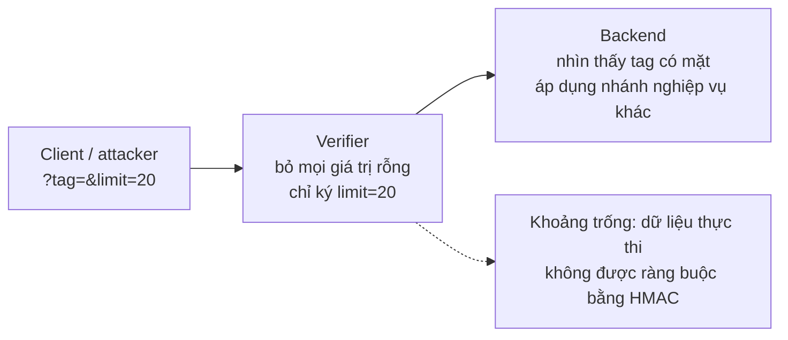
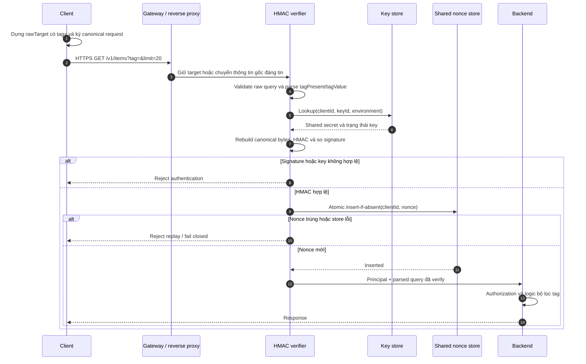

# Parameter rỗng trong Query Canonicalization cho HMAC Request Authentication

## Mục tiêu học tập

Sau bài học này, bạn có thể:

- Phân biệt **query parameter không xuất hiện**, **parameter có giá trị rỗng**, **parameter không có dấu `=`**, **tên parameter rỗng** và **query string rỗng**.
- Giải thích tại sao các trường hợp trên phải có **ngữ nghĩa và cách biểu diễn byte-level rõ ràng** khi đưa query vào canonical request.
- Nhận biết những khác biệt giữa HTTP client, reverse proxy, API gateway, URL parser và backend khi xử lý `?tag`, `?tag=`, `?tag=&limit=20`, `?=value`, các giá trị trùng hay percent-encoding.
- Thiết kế một hợp đồng ký HMAC-SHA256 chủ động cho phép **giá trị rỗng** nhưng từ chối những cú pháp nhập nhằng.
- Viết Java kiểm tra raw request-target, parse query nghiêm ngặt, giữ sự khác biệt **absent vs present-empty** và đưa query vào phép ký `javax.crypto.Mac`.
- Kiểm thử trường hợp query bị xóa, thêm dấu `=`, thay thứ tự, thêm duplicate parameter hoặc bị proxy chuẩn hóa sau khi client ký.
- Kết hợp query canonicalization với timestamp/nonce chống replay, quản lý key rotation và authorization theo đúng tài nguyên/điều kiện nghiệp vụ.

**Bối cảnh:** Đây là bài thuộc chương **Query canonicalization** của module `SECURITY_AUTHENTICATION_HMAC_REQUEST_AUTHENTICATION`. Module xây dựng xác thực HTTP request bằng HMAC với shared secret và canonical request chứa method, URI, header hoặc body theo hợp đồng ký. Chủ đề trọng tâm của bài là **parameter rỗng**, một chi tiết có thể làm chữ ký sai hoặc tạo khác biệt giữa phần request được xác minh và phần backend thực sự xử lý.

## 1. Parameter rỗng là gì, và vì sao dễ nhầm?

Xét endpoint đọc danh sách hàng hóa:

```http
GET /v1/items?tag=&limit=20 HTTP/1.1
Host: api.example.test
```

Ở đây `tag` **có xuất hiện** trong query nhưng giá trị là chuỗi rỗng (`""`), còn `limit` có giá trị `20`. Backend có thể quy định `tag=` nghĩa là “lọc theo tag trống”, hoặc “tắt bộ lọc tag”; nhưng đó là **quy tắc nghiệp vụ của API**, không phải ý nghĩa tự động giống nhau ở mọi framework.

Có ít nhất năm dạng cần phân biệt:

| Request-target | Quan sát ở mức raw query | Diễn giải cần quyết định |
|---|---|---|
| `/v1/items` | Không có dấu `?` | Không có query; `tag` **vắng mặt** |
| `/v1/items?tag=` | Có `tag`, có `=`, giá trị dài 0 byte | `tag` **present-empty** |
| `/v1/items?tag` | Có `tag` nhưng **không có `=`** | `tag` là bare/flag parameter; có thể được parser hiểu như empty hoặc null |
| `/v1/items?` | Có dấu `?` nhưng query dài 0 byte | Empty query string; có thể bị client/proxy loại bỏ dấu `?` |
| `/v1/items?=value` | Tên parameter dài 0 byte | Empty name; API có thể từ chối hoặc xử lý riêng |

Trong HMAC request authentication, **không được ngầm coi mọi trường hợp trên là một**. Dữ liệu vào chữ ký phải là một biểu diễn đã được hai phía thống nhất; đồng thời backend phải thực thi ngữ nghĩa **tương ứng với biểu diễn đã xác minh**.

### Những nhầm lẫn về giá trị

- `""`: chuỗi rỗng; có mặt nhưng dài 0.
- `null`: giá trị “không có dữ liệu” trong một API lập trình; HTTP query không trực tiếp mang kiểu null.
- **Absent**: tên tham số không xuất hiện trong query.
- `"null"`: bốn ký tự ASCII `n-u-l-l`, **không phải null**.
- `" "`: một dấu cách; nếu biểu diễn bằng encoding trên URL, nó **không phải giá trị rỗng**.
- `"0"` hoặc `"false"`: các chuỗi không rỗng; không nên tự đổi chúng thành empty khi canonicalize.

Ví dụ Java, nếu `Map<String,String>` có `tag → ""` thì `map.containsKey("tag")` là `true`, trong khi khi `tag` vắng mặt thì `containsKey("tag")` là `false`. Chỉ dùng `get("tag")` rồi xử lý chung mọi trường hợp có thể làm mất phân biệt khi một parser cho phép null.

## 2. Vì sao đây là vấn đề bảo mật trong HMAC?

Giả sử client ký request:

```text
GET /v1/items?tag=&limit=20
```

Nhưng gateway hoặc client library chuẩn hóa thành:

```text
GET /v1/items?limit=20
```

Nếu **raw request-target** là phần được ký, HMAC của hai chuỗi này khác nhau. Trường hợp này thường gây lỗi xác thực, dù hai tầng nghiệp vụ có thể cho rằng chúng tương đương.

Nguy hiểm hơn: verifier có thể **bỏ qua parameter rỗng trước khi ký**, trong khi backend **vẫn sử dụng nó**. Khi đó attacker có thể sửa, thêm hoặc xóa `tag=` mà không khiến thông điệp được verifier ký lại thay đổi, nhưng logic backend lại thay đổi.



**Bất biến cốt lõi:** tất cả tham số mà backend dùng để chọn tài nguyên, tenant, quyền, bộ lọc hay hành động phải được **ký với một cách diễn giải thống nhất** hoặc được kiểm soát bằng nguồn đáng tin cậy tương đương.

HMAC hợp lệ trên dữ liệu thiếu parameter quan trọng **không bảo đảm** request thực thi là request mà người ký đã chủ định. Tương tự, một request có HMAC hợp lệ không tự cấp quyền truy cập tenant khác: backend vẫn phải thực hiện **authorization**.

## 3. Các tình huống query rỗng và nhập nhằng cần quyết định trước

| Input | Đặc điểm | Rủi ro khi canonical hóa mơ hồ | Policy ví dụ |
|---|---|---|---|
| `?tag=` | Tên có giá trị rỗng sau `=` | Bị coi như absent | **Cho phép**, giữ `tag=` |
| `?tag` | Tên không có dấu `=` | Một parser cho `""`, parser khác cho null/flag | **Từ chối** |
| `?tag=&limit=20` | Empty value xen giữa các pair | Lọc mất pair rỗng | **Cho phép**, giữ nguyên |
| `?tag=&` | Dấu `&` cuối tạo một segment rỗng | Parser có thể lờ segment | **Từ chối** |
| `?&tag=` | Segment đầu rỗng | Parser có thể bỏ qua | **Từ chối** |
| `?tag=&&limit=20` | Có segment giữa rỗng | Khác biệt giữa parser | **Từ chối** |
| `?=value` | Tên parameter rỗng | Backend có thể cho phép tên trống | **Từ chối** |
| `?=` | Tên và giá trị rỗng | Có thể bị xem là query không có pair | **Từ chối** |
| `?tag=&tag=red` | Duplicate name | Backend dùng first/last/all | **Từ chối** trong profile không hỗ trợ duplicate |
| `?tag==` | Có hai dấu `=` | Split theo dấu đầu khác split toàn bộ | **Từ chối** trong profile hẹp |
| `?tag=%20` | Percent-encoded dấu cách | `" "` khác `""`; trim có thể đổi nghĩa | **Từ chối** trong profile ASCII-unreserved của bài |
| `?tag=+` | `+` có thể là literal plus hoặc dấu cách kiểu form | Hai parser có thể cho hai kết quả | **Từ chối** trong profile này |
| `?tag=%00` | Byte NUL qua percent-encoding | Truncation/logic lỗi trong các tầng | **Từ chối** trong profile này |
| `?` | Query rỗng, có dấu hỏi | Có thể bị đồng nhất với không có query | **Từ chối**; dùng URL không có `?` |
| Không có `?` | Query vắng mặt | Dễ bị coi là empty query có mặt | **Cho phép**, giữ đúng trạng thái absent |

Cột cuối là **chính sách cụ thể dùng xuyên suốt bài**, không phải tiêu chuẩn áp đặt cho mọi HTTP API. API khác có thể hỗ trợ bare parameter, empty name, `;` separator hoặc duplicate name, nhưng phải có **grammar, canonicalization và semantics** nhất quán giữa client, verifier, gateway và backend.

### Không áp dụng “bỏ parameter rỗng” như bước dọn dữ liệu

Mẫu sai:

```text
queryPairs = parse(rawQuery)
queryPairs = queryPairs.filter(pair -> pair.value is not empty)
canonicalQuery = serialize(queryPairs)
```

Cách này khiến:

```text
?tag=&limit=20      -> ?limit=20
?limit=20           -> ?limit=20
```

Hai request khác nhau tạo **cùng một thông điệp để ký**. Nếu backend phân biệt “có tag nhưng rỗng” với “không có tag”, chính sách xác thực bị lệch so với nghiệp vụ.

## 4. Percent-encoding, `+` và khoảng trắng: rỗng không giống dấu cách

Một số URL parser dùng quy tắc `application/x-www-form-urlencoded` cho query: dấu `+` được giải mã như space. Nhưng **URL generic query syntax** và URL parser khác không bắt buộc phải diễn giải `+` giống vậy. Các trường hợp sau có thể có nhiều diễn giải:

```text
?tag=        -> tag là empty
?tag=%20     -> tag chứa một dấu cách sau percent-decoding
?tag=+       -> literal "+" hoặc dấu cách theo parser
?tag=%2B     -> dấu "+" sau percent-decoding
?tag=%2520   -> chuỗi "%20" sau decode một lần; space nếu decode hai lần
```

Nếu client dùng `URLEncoder` của Java cho query, hãy nhớ nó thiên về **HTML form encoding** (`space → +`), không mặc nhiên là một canonicalizer RFC 3986 cho mọi giao thức ký. Tương tự, `URI.getQuery()` và `URI.getRawQuery()` không trả cùng một biểu diễn khi có percent-encoding.

Có hai chiến lược đúng về nguyên tắc:

1. **Ký raw query đã ràng buộc grammar:** chọn các ký tự được phép, yêu cầu một cách viết duy nhất, giữ nguyên byte và thứ tự; từ chối những biểu diễn ngoài grammar. Đây là cách dùng trong bài thực hành.
2. **Ký query đã canonical hóa theo hợp đồng đầy đủ:** parse và decode **đúng một lần**, định nghĩa Unicode/UTF-8, cách biểu diễn space/plus, percent-escape hex case, empty vs absent, duplicate, sort và re-encode bằng một thuật toán cụ thể. Client và verifier phải dùng cùng thuật toán; backend cũng phải áp dụng cùng semantics.

**Không trộn hai chiến lược:** ký raw query ở client nhưng decode rồi serialize theo `URLEncoder` ở verifier là một công thức tạo mismatch. Một lược đồ “sort tên rồi nối `key=value`” cũng không đủ nếu chưa định nghĩa cách xử lý tên trùng, giá trị rỗng và dấu phân cách bên trong giá trị.

## 5. Hợp đồng `query-empty-v1`: cho phép empty value nhưng không nhập nhằng

Để có một bài toán có thể kiểm thử byte-for-byte, ta chọn **profile hẹp** cho endpoint:

```text
GET /v1/items
GET /v1/items?tag=
GET /v1/items?tag=&limit=20
GET /v1/items?limit=20&tag=
```

API chỉ có hai tham số tùy chọn:

- `tag`: có thể **không xuất hiện** hoặc xuất hiện với **giá trị rỗng/không rỗng** theo grammar. Backend có thể định nghĩa “`tag` có mặt nhưng rỗng” là một bộ lọc khác với absent.
- `limit`: nếu có mặt, bắt buộc là số nguyên thập phân từ **1 đến 100**, không có số 0 ở đầu. `limit=` là **sai ngữ nghĩa**, dù cú pháp `name=` có thể được parser tổng quát nhận.

### 5.1. Grammar cụ thể

| Thành phần | Quy tắc `query-empty-v1` |
|---|---|
| Path | Chính xác `/v1/items` |
| Query vắng mặt | Chấp nhận `/v1/items` |
| Query có dấu `?` | Phải có ít nhất một `name=value` không có segment rỗng |
| Tên parameter | Chỉ `tag` hoặc `limit`, viết thường và phân biệt case |
| Dấu gán | Mỗi pair **chính xác một** dấu `=`; `?tag` bị từ chối |
| Empty value | Chấp nhận `tag=`; `limit=` bị từ chối bởi schema |
| Value ký tự | ASCII unreserved `A-Z a-z 0-9 . _ ~ -`, có thể dài 0 đến 64 ký tự |
| Separator | Chỉ một dấu `&` giữa hai pair |
| Duplicate | Từ chối duplicate name, kể cả nếu giá trị giống nhau |
| Percent-encoding, `+`, space, `;` | Không hỗ trợ và từ chối trong version này |
| Thứ tự pair | **Giữ nguyên thứ tự trên wire**, không sort |
| Query rỗng đơn thuần | `/v1/items?` bị từ chối |
| HTTP method | Chính xác `GET`, không method override |
| Body | Không có body; canonical hóa hash SHA-256 của **0 byte** |
| Giới hạn tổng raw query | Ví dụ tối đa 512 ký tự ASCII; ingress có thể có giới hạn chặt hơn |

Profile này cho phép một empty value **có chủ đích** nhưng loại bỏ những trường hợp cần quyết định thêm. Nó không phù hợp nếu endpoint cần tìm kiếm Unicode, ký tự space hoặc nhiều giá trị cùng tên; trường hợp đó hãy phát hành **profile khác có encoding/duplicate rules đầy đủ**.

### 5.2. Giữ absent và present-empty khác nhau

```text
/v1/items
   -> tagPresent = false, tagValue = không có

/v1/items?tag=
   -> tagPresent = true,  tagValue = ""

/v1/items?tag=&limit=20
   -> tagPresent = true,  tagValue = "", limit = 20
```

Nếu backend cần biết “có tham số hay không”, hãy dùng một cấu trúc mang **presence flag** hoặc `Map.containsKey`, không thay đổi semantic bằng cách mặc định `tag=""` cho cả trường hợp absent. Ngay cả khi endpoint **cố ý** cho hai trường hợp cùng ý nghĩa, sự tương đương đó cũng phải là quyết định được ghi rõ trong hợp đồng và phép canonicalization.

### 5.3. Giữ nguyên thứ tự là một lựa chọn, không phải chân lý chung

Hai request:

```text
/v1/items?tag=&limit=20
/v1/items?limit=20&tag=
```

đều được **parse** thành cùng tập giá trị đối với profile hai tham số này, nhưng có **raw request-target khác nhau**, nên tạo HMAC khác nhau. Điều đó là hợp lệ: chữ ký ràng buộc từng biểu diễn wire thay vì cố gộp các request tương đương về ngữ nghĩa.

Nếu sản phẩm muốn thứ tự query **không ảnh hưởng chữ ký**, có thể quy định sort theo tên/giá trị trên một tập các cặp **đã decode chuẩn**, nhưng phải định nghĩa chính xác cả empty, duplicate và re-encoding. Đừng tự bật sort tại gateway mà chưa chuyển đổi đồng bộ client và verifier.

## 6. Hợp đồng canonical request gắn query rỗng với HMAC

Giả sử client `catalog-client` đã được cấp khóa HMAC-SHA256 với `keyId=k2`. Hợp đồng ký `hmac-query-empty-v1` quy định các dòng:

| Dòng | Giá trị trong canonical string |
|---|---|
| 1 | `GET` |
| 2 | **Raw request-target hợp lệ**, ví dụ `/v1/items?tag=&limit=20` |
| 3 | `host:api.example.test` |
| 4 | `x-client-id:catalog-client` |
| 5 | `x-key-id:k2` |
| 6 | `x-timestamp:<unix-seconds>` |
| 7 | `x-nonce:<random-nonce>` |
| 8 | `body-sha256:<base64url-sha256-of-empty-body>` |

Các dòng được ghép bằng **LF** (byte `0x0a`), **không có LF cuối**, mã hóa **UTF-8**, rồi tính:

```text
tagBytes = HMAC-SHA256(secretK, UTF8(canonicalString))
signatureText = Base64URL_NoPadding(tagBytes)
```

HMAC-SHA256 đầy đủ dài **32 byte**, encode Base64URL không padding thành **43 ký tự ASCII**. Header `X-Signature` không nằm trong chuỗi cần ký. `clientId`, `keyId`, timestamp và nonce đều được ký để tránh sửa metadata mà vẫn dùng được tag cũ.

Request mẫu:

```http
GET /v1/items?tag=&limit=20 HTTP/1.1
Host: api.example.test
X-Client-Id: catalog-client
X-Key-Id: k2
X-Timestamp: <unix-seconds-hien-tai>
X-Nonce: <nonce-ngau-nhien>
X-Signature: <base64url-hmac-tag>

```

Những mục `<...>` là **placeholder**, cần thay bằng dữ liệu hợp lệ. Body ở request ví dụ là **0 byte**, không phải một newline rỗng hay chuỗi JSON `null`.

Canonical string (minh họa):

```text
GET
/v1/items?tag=&limit=20
host:api.example.test
x-client-id:catalog-client
x-key-id:k2
x-timestamp:<unix-seconds-hien-tai>
x-nonce:<nonce-ngau-nhien>
body-sha256:<base64url-sha256-cua-chuoi-byte-rong>
```

Nếu attacker xóa `tag=` khỏi target mà giữ nguyên signature, dòng 2 sẽ khác và **HMAC không khớp**. Đây là mục đích chính của việc đưa **raw request-target có cả parameter rỗng** vào hợp đồng ký.

## 7. Mã Java 17+: parse nghiêm ngặt và ký query có giá trị rỗng

Ví dụ dưới đây minh họa chính xác `query-empty-v1`. Code nhận **raw request-target** ở dạng `/v1/items?tag=&limit=20`, không dùng parser đã loại parameter rỗng. Trong production, server phải lấy giá trị này từ HTTP request **thực nhận tại điểm xác minh** và kiểm soát proxy rewrite.

```java
import java.nio.charset.StandardCharsets;
import java.security.GeneralSecurityException;
import java.security.MessageDigest;
import java.security.SecureRandom;
import java.time.Instant;
import java.util.Base64;
import java.util.LinkedHashMap;
import java.util.Map;
import java.util.regex.Pattern;
import javax.crypto.Mac;
import javax.crypto.spec.SecretKeySpec;

public final class SignedEmptyQueryV1 {
    private static final String PATH = "/v1/items";
    private static final String HOST = "api.example.test";
    private static final Pattern NAME =
            Pattern.compile("[A-Za-z][A-Za-z0-9_-]{0,31}");
    private static final Pattern VALUE =
            Pattern.compile("[A-Za-z0-9._~-]{0,64}");
    private static final Pattern ID =
            Pattern.compile("[A-Za-z0-9][A-Za-z0-9_-]{0,63}");
    private static final Pattern SIGNATURE =
            Pattern.compile("[A-Za-z0-9_-]{43}");
    private static final Base64.Encoder B64 =
            Base64.getUrlEncoder().withoutPadding();

    private SignedEmptyQueryV1() {}

    public record QueryValues(
            boolean tagPresent, String tagValue, Integer limitValue) {}

    public record RequestParts(
            String method, String rawTarget, String publicHost,
            String clientId, String keyId, String timestamp,
            String nonce, byte[] rawBody) {}

    // Parser profile hẹp: luôn giữ "tag=" khác với "không có tag".
    public static QueryValues parseTarget(String rawTarget) {
        if (PATH.equals(rawTarget)) {
            return new QueryValues(false, null, null);
        }
        if (rawTarget == null || !rawTarget.startsWith(PATH + "?")) {
            throw new IllegalArgumentException("Unsupported request-target");
        }
        String query = rawTarget.substring(PATH.length() + 1);

        // Reject bare '?', query quá dài, segment rỗng và input
        // mà một URL parser khác có thể vô tình loại bỏ.
        if (query.isEmpty() || query.length() > 512) {
            throw new IllegalArgumentException("Invalid query length");
        }

        Map<String, String> pairs = new LinkedHashMap<>();
        for (String pair : query.split("&", -1)) {
            int equal = pair.indexOf('=');
            if (pair.isEmpty() || equal <= 0 ||
                    pair.indexOf('=', equal + 1) >= 0) {
                throw new IllegalArgumentException("Invalid query pair");
            }

            String name = pair.substring(0, equal);
            String value = pair.substring(equal + 1);
            if (!NAME.matcher(name).matches() ||
                    !VALUE.matcher(value).matches() ||
                    (!"tag".equals(name) && !"limit".equals(name))) {
                throw new IllegalArgumentException("Unsupported query field");
            }

            // Kiểm tra duplicate trước khi đưa vào map.
            if (pairs.containsKey(name)) {
                throw new IllegalArgumentException("Duplicate query field");
            }
            pairs.put(name, value);
        }

        Integer limit = null;
        if (pairs.containsKey("limit")) {
            String rawLimit = pairs.get("limit");
            // Chỉ 1..100, không leading zero, không chấp nhận "limit=".
            if (!rawLimit.matches("(?:[1-9]|[1-9][0-9]|100)")) {
                throw new IllegalArgumentException("Invalid limit");
            }
            limit = Integer.parseInt(rawLimit);
        }

        return new QueryValues(
                pairs.containsKey("tag"), pairs.get("tag"), limit);
    }

    public static String canonical(RequestParts p)
            throws GeneralSecurityException {
        if (p == null || !"GET".equals(p.method()) ||
                !HOST.equals(p.publicHost()) ||
                p.rawBody() == null || p.rawBody().length != 0 ||
                p.clientId() == null || !ID.matcher(p.clientId()).matches() ||
                p.keyId() == null || !ID.matcher(p.keyId()).matches() ||
                p.timestamp() == null ||
                !p.timestamp().matches("(?:0|[1-9][0-9]{0,11})") ||
                p.nonce() == null ||
                !p.nonce().matches("[A-Za-z0-9_-]{22}")) {
            throw new IllegalArgumentException("Invalid signed fields");
        }

        parseTarget(p.rawTarget()); // Reject cú pháp query nhập nhằng.
        byte[] emptyBodyDigest = MessageDigest.getInstance("SHA-256")
                .digest(p.rawBody());

        return String.join("\n",
                "GET",
                p.rawTarget(), // Ký nguyên raw target đã validate.
                "host:" + p.publicHost(),
                "x-client-id:" + p.clientId(),
                "x-key-id:" + p.keyId(),
                "x-timestamp:" + p.timestamp(),
                "x-nonce:" + p.nonce(),
                "body-sha256:" + B64.encodeToString(emptyBodyDigest));
    }

    private static byte[] mac(byte[] secret, RequestParts p)
            throws GeneralSecurityException {
        Mac m = Mac.getInstance("HmacSHA256");
        m.init(new SecretKeySpec(secret, "HmacSHA256"));
        return m.doFinal(canonical(p).getBytes(StandardCharsets.UTF_8));
    }

    public static String sign(byte[] secret, RequestParts p)
            throws GeneralSecurityException {
        return B64.encodeToString(mac(secret, p));
    }

    public static boolean verify(
            byte[] secret, RequestParts p, String signature)
            throws GeneralSecurityException {
        if (signature == null ||
                !SIGNATURE.matcher(signature).matches()) {
            return false;
        }
        final byte[] received;
        try {
            received = Base64.getUrlDecoder().decode(signature);
        } catch (IllegalArgumentException invalidEncoding) {
            return false;
        }
        if (received.length != 32 ||
                !B64.encodeToString(received).equals(signature)) {
            return false;
        }
        return MessageDigest.isEqual(mac(secret, p), received);
    }

    public static void main(String[] args)
            throws GeneralSecurityException {
        // CSPRNG chỉ để mô phỏng provisioning; không sinh lại
        // shared secret ở verifier cho mỗi HTTP request.
        byte[] secret = new byte[32];
        new SecureRandom().nextBytes(secret);
        byte[] nonceBytes = new byte[16];
        new SecureRandom().nextBytes(nonceBytes);
        String nonce = B64.encodeToString(nonceBytes);

        RequestParts withEmptyTag = new RequestParts(
                "GET", "/v1/items?tag=&limit=20", HOST,
                "catalog-client", "k2",
                Long.toString(Instant.now().getEpochSecond()),
                nonce, new byte[0]);

        String signature = sign(secret, withEmptyTag);
        if (!verify(secret, withEmptyTag, signature)) {
            throw new AssertionError("Valid query rejected");
        }
        if (!parseTarget(withEmptyTag.rawTarget()).tagPresent() ||
                !parseTarget(withEmptyTag.rawTarget()).tagValue().isEmpty()) {
            throw new AssertionError("Empty value was lost");
        }

        RequestParts withoutTag = new RequestParts(
                withEmptyTag.method(), "/v1/items?limit=20", HOST,
                withEmptyTag.clientId(), withEmptyTag.keyId(),
                withEmptyTag.timestamp(), withEmptyTag.nonce(), new byte[0]);

        if (verify(secret, withoutTag, signature)) {
            throw new AssertionError("Removed empty field was accepted");
        }
        if (parseTarget(withoutTag.rawTarget()).tagPresent()) {
            throw new AssertionError("Absent value was changed");
        }

        try {
            parseTarget("/v1/items?tag&limit=20");
            throw new AssertionError("Bare parameter was accepted");
        } catch (IllegalArgumentException expected) {
            // PASS: hợp đồng yêu cầu dấu '='.
        }

        System.out.println("Empty-query HMAC checks: PASS");
    }
}
```

### Giải thích những quyết định trong mã

1. `PATH + "?"` là tiền tố phải khớp; `/v1/items` (không query) được phân biệt với `/v1/items?` (query rỗng, bị reject).
2. `split("&", -1)` giữ lại segment rỗng ở cuối hoặc giữa. Không bỏ qua `&&`, dấu `&` đầu/cuối.
3. Mỗi pair phải có **chính xác một** dấu `=`. Vì vậy `tag=` hợp lệ còn `tag`, `=value` và `tag==` bị từ chối.
4. `Map.containsKey("tag")` bảo toàn **present-empty** so với **absent**, không tự chuyển cả hai thành `""`.
5. `VALUE` chỉ nhận ASCII unreserved theo profile, nên các ký tự `%`, `+`, `;`, khoảng trắng, CR/LF và Unicode phải bị từ chối. Mọi dấu `=` khác và delimiter đã được kiểm tra riêng.
6. Code **giữ nguyên thứ tự pair trong raw target**, không tự sort hoặc encode lại.
7. `canonical()` đưa **chính raw target đã validate** vào HMAC; đổi `?tag=&limit=20` thành `?limit=20` sẽ làm signature khác.
8. `verify()` kiểm tra Base64URL không padding, decode 32 byte, re-encode canonical rồi so HMAC tag bằng `MessageDigest.isEqual`.
9. Phần `main` là ví dụ mô phỏng; nó cố ý dùng cùng timestamp/nonce trong **unit test tính chữ ký** để so trường hợp thay query, không phải quy trình retry được phép trong production.

**Giới hạn:** Mã không phải full HTTP filter. Nó chưa kiểm tra thời gian `timestamp` theo đồng hồ server, giải mã/kiểm tra entropy thực của nonce, ghi nonce vào store, tra secret theo client/key ID, xử lý key state, duplicate HTTP headers, authorization hay giới hạn rate. Những bước đó thuộc pipeline bảo mật bao quanh class. `publicHost` trong ví dụ buộc bằng hằng để tránh nhập nhằng; trong sản phẩm có nhiều host cần một quy tắc host đáng tin rõ ràng.

## 8. Parse giống nhau từ verifier đến backend

Một bước quan trọng thường bị bỏ qua: nếu verifier ký raw target chính xác, nhưng backend lại dùng một parser khác để xác định `tag`, **hai tầng vẫn có thể khác nhau về ngữ nghĩa**.

### Mẫu xử lý an toàn



Để tránh **parser differential**, có thể chuyển **query đã parse theo đúng profile** từ tầng xác minh tới handler qua một context nội bộ đáng tin (thay vì mỗi tầng tự parse raw URI theo quy tắc khác). Phải bảo vệ đường nối verifier→backend và chặn việc client tự đặt header như `X-Verified-Tag` hoặc `X-Authenticated-Principal` để giả mạo context.

Nếu buộc backend parse lại URI, dùng **cùng parser/contract** và kiểm thử rằng **cùng tập giá trị, cùng presence flags** được trả về ở mọi hop. Không chỉ kiểm tra tag đúng; phải kiểm tra backend thực sự nhận `tagPresent=true, tagValue=""` khi client ký `tag=`.

## 9. Reverse proxy, URL libraries và trường hợp dấu `?` biến mất

Một số thành phần có thể:

- Xóa `?` cuối khi query rỗng; biến `/v1/items?` thành `/v1/items`.
- Bỏ `tag=` vì cho rằng tham số rỗng không có tác dụng.
- Biến `?tag` thành `?tag=`, hoặc chuyển `?tag=+` thành dấu cách.
- Decode `%20`, `%2B`, `%26` rồi encode theo kiểu khác.
- Sort query parameter, gộp duplicate, hoặc áp dụng quy tắc `;` làm dấu phân cách.
- Rewrite path/host trước khi verifier đọc request-target.

### Hai cách bố trí verifier

**Xác minh tại edge trước rewrite:** verifier thấy request-target công khai, áp dụng grammar và HMAC trước khi chuyển sang backend. Gateway có thể chuyển kết quả parse cùng principal qua kênh nội bộ đã bảo vệ; backend không được nhận đường đi trực tiếp bỏ qua xác minh.

**Xác minh sau proxy:** phải cung cấp nguyên request-target hoặc bản canonical tương đương qua nguồn **đáng tin**. Các header như `X-Original-URI` hay `X-Forwarded-*` do client tự gửi không mặc nhiên có giá trị bảo mật; proxy được ủy quyền phải xóa/ghi đè và bảo vệ đường truyền nội bộ.

**Phải test trên đúng hạ tầng thật.** Java `URI`, framework router, HTTP client và reverse proxy có thể có chính sách normalize khác nhau. Unit test parser có thể pass nhưng request `?tag=` vẫn bị mất trước khi tới verifier.

## 10. Replay, key rotation và authorization liên quan thế nào?

### Timestamp và nonce

HMAC trên query, kể cả parameter rỗng, **không tự chống replay**. Attacker có thể gửi lại nguyên request với signature đúng. Cần:

- Ký `timestamp` (ví dụ Unix seconds) và `nonce` vào canonical request.
- Giới hạn timestamp trong cửa sổ server quy định (ví dụ ±300 giây).
- Chỉ **sau khi HMAC khớp**, ghi `(clientId, nonce)` vào kho dùng chung bằng thao tác **insert-if-absent nguyên tử**; không dùng `GET` rồi `SET` và không giữ nonce trong RAM từng replica.
- TTL nonce phải đủ phủ cho tới thời điểm timestamp tương ứng không còn được chấp nhận.
- Khi nonce store lỗi, endpoint nhạy cảm nên **fail closed**.

Trong production mỗi request mới cần một nonce mới. Retry với nonce mới có thể được coi là request khác; các thao tác gây side effect cần cơ chế **idempotency** riêng khi phù hợp.

### Key ID và rotation

`keyId=k2` chỉ xác định phiên bản secret, không phải secret. Verifier tra đúng `(environment, clientId, keyId)`, kiểm tra trạng thái được phép verify; trong giai đoạn rotation có thể tạm chấp nhận `k1` và `k2`, rồi thu hồi `k1`. Không thử mọi key của mọi tenant để tìm một chữ ký khớp. Key bị thu hồi phải bị từ chối kể cả khi replica còn cache cũ.

Nếu shared secret bị lộ, attacker có thể **ký một raw query mới có `tag=` hoặc không có `tag`** với timestamp/nonce mới. Replay store không cứu được; phải thu hồi secret, rotation và kiểm soát phạm vi quyền.

### Authentication không phải authorization

Verifier chỉ chứng minh request được ký bằng khóa thuộc principal đã xác định. Nếu query chứa `tenant=other`, `scope=admin`, hoặc tên parameter ảnh hưởng tài nguyên (ở một API khác cho phép chúng), backend **phải kiểm tra quyền** trước khi hành động. Không dùng `query parameter` để tự cấp tenant/role cho một principal có HMAC hợp lệ.

Trong endpoint minh họa chỉ có `tag`/`limit`, backend vẫn phải áp dụng hạn mức và quyền truy xuất danh mục theo principal; giá trị `tag=` chỉ điều khiển bộ lọc theo hợp đồng, không được biến thành “bỏ qua mọi permission”.

## 11. Ma trận kiểm thử parameter rỗng

| Test | Input/thao tác | Kết quả kỳ vọng trong `query-empty-v1` |
|---|---|---|
| Không query | `/v1/items` | Hợp lệ; `tagPresent=false` |
| Tag present-empty | `/v1/items?tag=` | Hợp lệ; `tagPresent=true`, `tagValue=""` |
| Tag present-empty với limit | `/v1/items?tag=&limit=20` | Hợp lệ; tag vẫn có mặt và rỗng |
| Thứ tự đảo | `/v1/items?limit=20&tag=` | Hợp lệ nhưng **canonical bytes khác** và cần ký lại |
| Xóa empty param sau ký | Ký `?tag=&limit=20`, gửi `?limit=20` | HMAC mismatch |
| Thêm empty param sau ký | Ký `?limit=20`, gửi `?tag=&limit=20` | HMAC mismatch |
| Bare param | `/v1/items?tag` | Reject |
| Query rỗng | `/v1/items?` | Reject |
| Tên param rỗng | `/v1/items?=value` hoặc `?=` | Reject |
| Segment rỗng | `?tag=&`, `?&tag=`, `?tag=&&limit=20` | Reject |
| Duplicate name | `?tag=&tag=red` hoặc `?tag=&tag=` | Reject |
| Nhiều dấu `=` | `?tag==` | Reject |
| Giá trị limit rỗng | `?limit=` | Reject; numeric schema |
| Giá trị limit có leading zero | `?limit=020` | Reject |
| Phần trăm/số hóa dấu cách | `?tag=%20`, `?tag=%2B` | Reject trong profile ASCII hẹp |
| Dấu cộng literal | `?tag=+` | Reject |
| Tham số không khai báo | `?debug=` | Reject |
| Kiểu encoding không hợp lệ | `?tag=%ZZ`, control char | Reject |
| Query bị proxy loại bỏ | Client gửi `?tag=` nhưng verifier chỉ thấy path | Không được xử lý như request hợp lệ của chữ ký gốc |
| Signature đúng với key đã thu hồi | Key state DISABLED | Reject |
| Replay nonce | Gửi lại request/tag lần hai, nhiều replica | Tối đa một request qua replay gate |
| Signature đúng, vượt quyền | Client tự ký truy vấn thuộc tenant khác (API khác) | Authn có thể pass; authz deny |

**Test quan trọng nhất** không chỉ là “`?tag=` có parse được không”, mà là **client ký `?tag=`, verifier thấy đúng `?tag=` và backend xử lý `tagPresent=true`**. Đây là sự trùng khớp giữa wire representation, canonical signature và semantics.

## 12. Những lỗi thiết kế thường gặp

1. **Coi empty value như absent:** dùng `if (value.isBlank()) skip` trước khi ký. Nếu backend phân biệt trường có mặt, chữ ký không còn bảo vệ đầy đủ request.
2. **Coi bare parameter như empty mà không có hợp đồng:** `?tag` có thể được parser chuẩn hóa thành `?tag=`; phải chốt equivalence hoặc reject.
3. **Dùng `Map.get` để phân biệt presence:** có thể làm mất thông tin giữa null/absent, nhất là nếu parser đưa null cho bare parameter. Dùng `containsKey` hoặc record có flag.
4. **Vô tình làm mất segment rỗng:** dùng `split("&")` mặc định Java có thể bỏ trailing empty segment, nên `?tag=&` biến thành một pair hợp lệ. Dùng `split("&", -1)` rồi reject.
5. **Dùng `URLEncoder` ở một phía, raw query ở phía kia:** dấu `+` và percent-encoding có thể bị diễn giải khác.
6. **Sort query ở verifier nhưng không ở client:** cùng semantics có thể có chữ ký khác, hoặc các duplicate quan trọng bị làm mất.
7. **Cho phép duplicate nhưng lấy một giá trị tùy ý:** verifier dùng first, backend dùng last, dẫn tới khác biệt trong lựa chọn tài nguyên/tenant.
8. **Bỏ query khỏi canonical request:** attacker sửa query rỗng/không rỗng mà HMAC vẫn đúng nếu backend dùng query để quyết định hành động.
9. **Chỉ chạy unit test không qua proxy:** ingress có thể tự bỏ `?`, xóa empty param hoặc sửa host/path.
10. **Cho HMAC hợp lệ mặc nhiên vượt quyền:** query được ký không tạo quyền với tài nguyên khác; backend vẫn phải authorize.
11. **Dùng timestamp mà không có nonce store:** request có tag hợp lệ vẫn có thể bị replay trong cửa sổ thời gian.
12. **Thay secret nhưng giữ key ID/cache cũ không rõ:** key rotation phải có phiên bản khóa, trạng thái và cơ chế thu hồi nhất quán.

## 13. Bài tập thực hành: empty query parameter qua gateway

Hệ thống `catalog-api` có endpoint:

```text
GET /v1/items?tag=&limit=20
```

Client dùng HMAC-SHA256 với `clientId=catalog-client`, `keyId=k2`. API chạy sau reverse proxy, verifier có hai replica và lưu nonce trong Redis/database hỗ trợ thao tác nguyên tử.

Hãy thực hiện:

1. **Đặc tả semantics:** xác định rõ `tag` không có mặt, `tag=`, `tag` không có `=` và `tag=%20` có được chấp nhận không, nếu có thì nghĩa là gì. Đừng mặc định tất cả giống nhau.
2. **Định nghĩa grammar:** quy tắc name/value, dấu `=`, duplicate, segment rỗng, thứ tự query, encoding, maximum length; ghi rõ khi nào được reject.
3. **Viết client Java:** chốt raw request-target và header, sinh timestamp/nonce, tính HMAC trên canonical bytes bằng `javax.crypto.Mac` rồi gửi **đúng request đã ký**.
4. **Viết verifier:** lấy raw target đáng tin, parse `tagPresent`/`tagValue`, tra đúng key theo `(env, clientId, keyId)`, kiểm tra tag HMAC, timestamp và nonce.
5. **Đồng nhất backend:** sử dụng parsed query do verifier đã xác nhận hoặc parser chung, chứng minh `tag=` không bị mất ở bước routing.
6. **Chạy test âm tính:** `?tag`, `?tag=&`, `?=value`, `?tag=&tag=red`, `?tag=+`, `?limit=`, sửa/xóa `tag=` sau ký.
7. **Thử proxy:** đặt gateway loại query rỗng, thay thứ tự query hoặc decode percent-encoding trong môi trường thử, quan sát chữ ký và xử lý khi không còn bảo toàn contract.
8. **Bảo mật luồng:** mô tả replay qua hai replica, rotation từ `k1` sang `k2` và trường hợp client có HMAC đúng nhưng không có quyền truy xuất dữ liệu một tenant.

**Tiêu chí hoàn thành:** Bạn chứng minh được **absent ≠ present-empty** ở cả parser, canonical request và backend; mọi thay đổi ngoài hợp đồng bị từ chối hoặc làm chữ ký không khớp; verifier không tự bỏ parameter rỗng; replay và authorization vẫn được xử lý riêng.

---

## Ghi nhớ

Trong `SECURITY_AUTHENTICATION_HMAC_REQUEST_AUTHENTICATION`, **parameter rỗng** không phải chi tiết “vô hại” có thể xóa khi tạo chữ ký. `?tag=`, `?tag`, query vắng mặt, query trống và tên parameter trống có thể tạo **những biểu diễn hoặc ngữ nghĩa khác nhau**. Hãy thiết kế **query canonicalization có hợp đồng byte-level**, giữ được sự khác biệt giữa **absent** và **present-empty**, kiểm thử nhất quán qua proxy/gateway rồi mới tính HMAC-SHA256. Chữ ký đúng vẫn cần **timestamp/nonce chống replay**, **key rotation** và **authorization** ở tầng xử lý nghiệp vụ.
