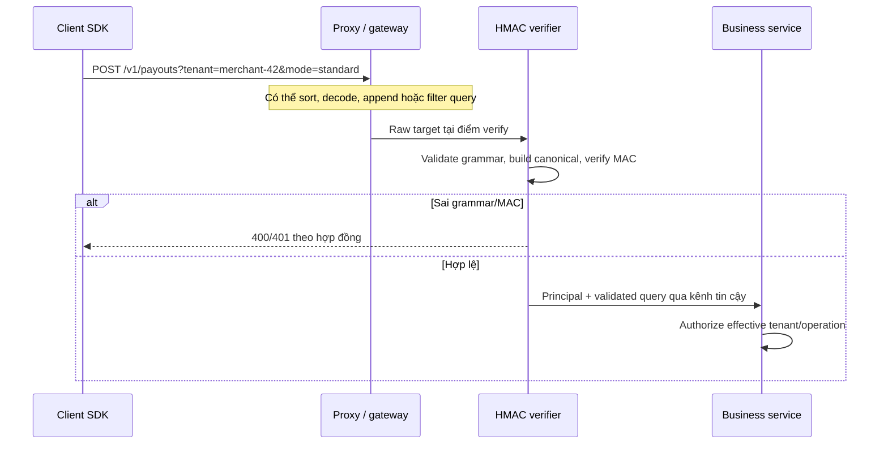

# Query injection trong HMAC request authentication

## Mục tiêu bài học

Trong chương **Query canonicalization**, **query injection** là tình huống dữ liệu không đáng tin làm thay đổi **cấu trúc hoặc cách hiểu** của phần query trong URL. Một chuỗi vốn được dự định là giá trị của một tham số có thể bị diễn giải thành tham số mới, giá trị trùng tên hoặc chỉ dẫn nghiệp vụ khác. Rủi ro đặc biệt cao khi HTTP client, gateway, bộ xác minh HMAC và handler **phân tích query bằng những quy tắc không giống nhau**.

Bài thuộc module `SECURITY_AUTHENTICATION_HMAC_REQUEST_AUTHENTICATION`. Mục tiêu của module là thiết kế xác thực HTTP request bằng HMAC với **shared secret** và canonical request có phương thức, URI, header hoặc body theo hợp đồng ký; thực hành xác minh MAC, chống replay bằng timestamp/nonce, key rotation, kiểm thử proxy/gateway và tách biệt **authentication** với **authorization**.

Học xong bài này, bạn có thể:

- Phân biệt **query injection**, HTTP parameter pollution (HPP) và những dạng injection khác như SQL injection.
- Giải thích các tình huống liên quan `&`, `=`, `?`, `+`, `%26`, `%3D`, `%2526` và thứ tự percent-decoding.
- Nhận diện các bước **ký một biểu diễn nhưng xử lý một biểu diễn khác**, dù chữ ký HMAC có thể vẫn hợp lệ.
- Chọn hợp đồng canonical query rõ ràng về tham số trùng, tham số không được công bố, thứ tự, encoding, giá trị rỗng và nguồn sự thật.
- Cài đặt ví dụ Java 17 với strict query grammar, HMAC-SHA256, các test sửa query và chỉ ra phần cần bổ sung trong HTTP server thật.
- Kết hợp query validation với credential registry, timestamp/nonce, proxy/gateway, key rotation, phân quyền theo tenant và tính idempotent của nghiệp vụ.

## 1. Query injection là gì?

Trong HTTP request-target, query là phần xuất hiện sau dấu `?`:

```http
POST /v1/payouts?tenant=merchant-42&mode=standard HTTP/1.1
Host: payments.example.test
Content-Type: application/json

{"amount":120000,"currency":"VND"}
```

Trong API minh họa này, server quy định đúng hai tham số: `tenant` (đích nghiệp vụ) và `mode` (chế độ thao tác). Nhưng **cú pháp URI tổng quát không bắt buộc mọi hệ thống dùng `&` để tách parameter hoặc `=` để tách name/value**. Đó là quy ước được ứng dụng chọn. Do đó, hợp đồng ký phải công bố **quy tắc parser**, không chỉ ghi “ký query”.

### 1.1. Khi dữ liệu trở thành cú pháp

Ví dụ code xây URL không an toàn:

```java
String tenantInput = "merchant-42&mode=urgent";
String target = "/v1/payouts?tenant=" + tenantInput
        + "&mode=standard";

// /v1/payouts?tenant=merchant-42&mode=urgent&mode=standard
```

Ý định ban đầu là đặt `tenantInput` thành **giá trị duy nhất của tenant**. Nối chuỗi trực tiếp làm `&mode=urgent` trở thành **cặp tham số mới**. Có hai tham số `mode`, mỗi parser có thể:

- chọn giá trị đầu tiên (`urgent`);
- chọn giá trị cuối cùng (`standard`);
- trả danh sách cả hai;
- hoặc từ chối request.

Nếu gateway/HMAC verifier chọn **cuối cùng** nhưng handler chọn **đầu tiên**, có nguy cơ xác minh và phân quyền theo một giá trị trong khi xử lý theo giá trị còn lại.

### 1.2. Query injection khác SQL injection

**Query injection** ở đây liên quan đến cấu trúc **HTTP query parameters**, không mặc nhiên là SQL injection. Prepared statement phòng SQL injection tại database **không giải quyết** sự bất đồng về cách parse URL. Ngược lại, dù URL đã được chuẩn hóa và ký HMAC, truy vấn SQL vẫn phải dùng **parameterized query**.

HMAC ký các byte theo hợp đồng. Nó không phải validator nghiệp vụ toàn năng và không có chức năng tự loại bỏ query injection.

## 2. Những biểu diễn query dễ bị hiểu khác nhau

### 2.1. Duplicate keys — HTTP parameter pollution

```text
?tenant=merchant-42&mode=urgent&mode=standard
?tenant=merchant-42&tenant=merchant-99&mode=standard
?mode=standard&tenant=merchant-42&mode=urgent
```

HTTP URI không định nghĩa quy tắc toàn cục “first value wins” hay “last value wins”. Từng framework, thư viện và cấu hình có thể xử lý khác. Nếu một tham số có ý nghĩa **tenant, quyền, số tiền hoặc chế độ thao tác** là đơn trị, cách làm an toàn là **từ chối trùng tên**.

Tham số đa trị như `tag=a&tag=b` vẫn có thể hợp lệ, nhưng API phải quy định rõ có cho trùng tên không, có giữ thứ tự không, giá trị rỗng có hợp lệ không và canonicalization có bảo toàn tất cả phần tử không.

### 2.2. Delimiter `&`, `=` và dấu `?` thứ hai

```text
?tenant=merchant-42&mode=standard
?tenant=merchant-42=extra&mode=standard
?tenant=merchant-42&&mode=standard
?tenant=merchant-42;mode=urgent
?tenant=merchant-42?mode=urgent
```

Trong nhiều API, `&` ngăn cặp tham số và dấu `=` đầu tiên tách tên/giá trị. Một số parser di sản lại coi `;` là separator, số khác coi nó là dữ liệu. Dấu `?` thứ hai có thể nằm trong query, không mặc nhiên tạo một query mới.

Điểm quyết định không phải ký tự “nên có ý nghĩa gì” trong trí nhớ lập trình viên, mà là **parser của verifier và parser của handler có dùng cùng hợp đồng hay không**.

### 2.3. Percent-encoding và thứ tự decode

```text
%26 -> &        %3D -> =
%3F -> ?        %25 -> %
%2B -> +        %20 -> space
```

Ví dụ:

```text
?tenant=merchant-42%26mode%3Durgent&mode=standard
```

Nếu parser tách thành cặp tham số **trước**, rồi percent-decode **từng value**, `%26mode%3Durgent` là một phần dữ liệu trong `tenant`. Nhưng nếu middleware percent-decode **toàn bộ query trước khi split**, dữ liệu có thể thành:

```text
?tenant=merchant-42&mode=urgent&mode=standard
```

và sinh ra tham số `mode` mới. Một bước decode không đúng chỗ có thể thay đổi **cấu trúc** thay vì chỉ thay cách biểu diễn value.

### 2.4. Double encoding — giải mã qua nhiều hop

```text
%2526 --decode 1--> %26 --decode 2--> &
%253D --decode 1--> %3D --decode 2--> =
```

Nếu gateway decode trước khi forward và backend lại decode thêm, chuỗi không chứa dấu `&` ban đầu có thể biến thành separator. Cần định nghĩa điểm và số lần decode trong hợp đồng, tránh tự xử lý khác nhau qua nhiều lớp.

### 2.5. `+`, `%20` và form encoding

Trong URI tổng quát, `+` là ký tự cộng. Trong quy tắc `application/x-www-form-urlencoded`, `+` thường biểu diễn **dấu cách**, còn `%2B` biểu diễn **dấu cộng**:

```text
?q=hello+world
?q=hello%20world
?q=hello%2Bworld
```

Những chuỗi đó **khác raw bytes**, và kết quả parse tùy cách encoding mà API công bố. Java `URLEncoder` sử dụng quy tắc **form encoding**, không phải bộ canonicalization URI phổ quát.

### 2.6. Tên tham số, giá trị rỗng và khác biệt parser

```text
?tenant=merchant-42
?Tenant=merchant-42
?tenant=
?tenant
?tenant=merchant-42&
?tenant=merchant-42&&mode=standard
```

Các input trên có cấu trúc khác nhau. Một số parser sẽ đối xử `tenant` và `Tenant` giống nhau; số khác phân biệt. Có hệ thống phân biệt “không có `=`” với “có `=` nhưng value rỗng”, số khác nhập chúng lại thành một trường.

Với API yêu cầu tính chính xác bảo mật, hãy chọn **cú pháp duy nhất hoặc một số biểu diễn được công bố**; từ chối những trường hợp ngoài hợp đồng thay vì lặng lẽ đoán.

### 2.7. Xung đột giữa query, header và body

```text
Query:  ?tenant=merchant-42
Header: X-Tenant-Id: merchant-99
Body:   {"tenant":"merchant-99"}
```

Nếu verifier lấy tenant từ query nhưng handler lại lấy từ header/body, nguy cơ không chỉ nằm ở encoding mà là **nguồn sự thật khác nhau**. API cần chỉ định trường **có hiệu lực**, ký các trường có ảnh hưởng đến semantics theo hợp đồng và kiểm tra tenant đã chọn với quyền server-side. Không tin `X-Role`/`X-Scope`/`X-Tenant-Id` chỉ vì request có chữ ký đúng trên **một phần khác**.

## 3. Vì sao HMAC đúng vẫn chưa đủ?

HMAC bảo vệ những byte **được chọn để ký**, không tự chứng minh những byte đó có ý nghĩa hợp lệ.

**Trường hợp A — Bên tấn công sửa raw query sau khi ký.** Nếu `tenant=merchant-42` đã được HMAC bao phủ và bị đổi thành `merchant-99`, verifier dựng canonical request từ raw target thực nhận sẽ cho MAC khác. Đây là tác dụng của HMAC.

**Trường hợp B — Client có secret tự ký query nhập nhằng.** Một client hợp lệ vẫn có thể ký `?tenant=merchant-42&mode=urgent&mode=standard`. MAC khớp **không** làm duplicate key trở nên hợp lệ. Server vẫn phải kiểm tra query schema và quyền.

**Trường hợp C — Verifier ký subset nhưng handler đọc cả query.** Nếu verifier chỉ giữ `mode=standard`, bỏ một `mode=urgent` trùng tên, MAC có thể kiểm chứng dữ liệu đã bị **lọc mất thông tin** trong khi business handler thực thi giá trị khác.

**Trường hợp D — Gateway biến đổi trước/sau xác minh.** Sắp xếp query, decode separator hoặc append tham số có thể làm MAC sai, hoặc làm backend xử lý request khác với request đã được xác minh.

### 3.1. Ba chiến lược canonical query

| Chiến lược | Canonical bytes | Rủi ro cần kiểm soát |
| --- | --- | --- |
| **Raw target** | Ký đúng path + `?` + raw query tại điểm xác minh. | Gateway phải bảo toàn representation; vẫn phải validate parser và authorization. |
| **Parsed/canonical query** | Parse tất cả cặp name/value, áp dụng thứ tự và encoding chuẩn, serialize lại. | Key trùng, multi-value, empty, plus/space, Unicode, percent-decoding, sort theo byte nào. |
| **Subset tham số** | Chỉ ký trường được chỉ định. | Mọi trường không ký **không được** ảnh hưởng đến route, quyền hay nghiệp vụ; nếu có, phải từ chối hoặc ký thêm. |

Không có một canonical query chung cho mọi dịch vụ HMAC. Bài này chọn mô hình **raw target với schema chặt**, thích hợp để minh họa kiểm soát query injection.

## 4. Hợp đồng ký `query-strict-v1`

Giả sử API công bố:

```text
POST /v1/payouts?tenant=<tenantId>&mode=<mode>
```

Quy tắc của **hợp đồng giáo dục** này:

1. Method exact `POST`, path exact `/v1/payouts`; không hỗ trợ method override.
2. Raw query phải có **đúng hai cặp, đúng thứ tự**: `tenant` trước, `mode` sau. Không unknown parameter, duplicate, cặp rỗng hoặc dấu `?` bổ sung.
3. `tenantId` dài 1–64 ký tự, chỉ `[A-Za-z0-9_-]`. `mode` thuộc `standard` hoặc `urgent`. Đây là chính sách API mẫu, không phải hạn chế phổ quát của HTTP.
4. Không chấp nhận percent-encoding, `;`, space, `+` hay fragment. Vì giá trị hợp lệ chỉ có ASCII an toàn, không cần decode để tạo tenant ID.
5. Content-Type exact `application/json`. Body hash tính từ **byte HTTP payload thực nhận** trước JSON parse/serialize. Hợp đồng này chỉ nhận Content-Encoding vắng mặt hoặc `identity`.
6. `clientId`, `keyId`, timestamp/nonce, audience, method, raw target và body hash nằm trong chữ ký.
7. Header liên quan đến ký phải là **một giá trị duy nhất**, không có CR/LF hoặc duplicate mơ hồ.
8. Verifier và handler phải dùng **cùng một giá trị validated tenant/mode**; không parse lại query bằng quy tắc khác sau khi xác minh.

Request minh họa:

```http
POST /v1/payouts?tenant=merchant-42&mode=standard HTTP/1.1
Host: payments.example.test
Content-Type: application/json
X-Client-Id: payout-worker-prod
X-Key-Id: key-2026-11
X-Timestamp: 1795800000
X-Nonce: BVLOV3evw9S3Zewpz5JgYQ
X-Content-SHA256: <base64url-sha256-body>
X-Signature: <base64url-hmac-sha256>

{"amount":120000,"currency":"VND"}
```

Timestamp cố định và chuỗi `<...>` chỉ là placeholder để giải thích; request thực phải dùng thời gian hiện tại và chữ ký tính từ shared secret.

### 4.1. Canonical request 11 dòng

```text
HMAC-SHA256
query-strict-v1
payments-api-prod
payout-worker-prod
key-2026-11
POST
/v1/payouts?tenant=merchant-42&mode=standard
application/json
<base64url-sha256-body>
1795800000
BVLOV3evw9S3Zewpz5JgYQ
```

| Dòng | Trường | Quy tắc |
| --- | --- | --- |
| 1 | `HMAC-SHA256` | Nhãn thuật toán; Java JCA dùng `HmacSHA256`. |
| 2 | `query-strict-v1` | Phiên bản chốt grammar và encoding. |
| 3 | `payments-api-prod` | Audience đáng tin từ cấu hình server/registry. |
| 4–5 | Client ID, key ID | Được ký và tra đúng credential; chưa xác thực trước MAC. |
| 6 | `POST` | Method được ký, không chấp nhận override. |
| **7** | Raw target | Toàn bộ `/v1/payouts?...` đúng grammar, **không bỏ query parameter**. |
| 8 | `application/json` | Header Content-Type đã kiểm tra. |
| 9 | Base64URL(SHA-256(exact body)) | Băm byte payload, không tái serialize JSON. |
| 10 | Unix epoch seconds | Timestamp ký kèm để kiểm soát tuổi request. |
| 11 | Nonce | Base64URL không padding của 16 byte ngẫu nhiên. |

Hợp đồng nối các trường bằng **một LF (`\n`)**, UTF-8, **không có LF cuối** và cấm CR/LF trong trường ký. MAC HMAC-SHA256 có 32 byte, biểu diễn Base64URL không padding dài 43 ký tự.

**Lưu ý:** raw query được ký nguyên vẹn không có nghĩa backend được tùy tiện diễn giải nó. Backend chỉ được xử lý một **ValidatedQuery** đã qua grammar và kiểm tra HMAC/authorization.

### 4.2. Vì sao không sort query trong ví dụ?

Có các giao thức chọn **sắp xếp name/value** khi canonicalize. Điều đó có thể hợp lệ nếu công bố rõ sort trước/sau encoding, xử lý duplicate, multivalue, empty/null, `+`, Unicode, percent-encoding. Ở đây thứ tự cố định giúp loại bỏ nhập nhằng. Đổi sang cơ chế sort cần phiên bản/test vector mới; server không được tự sắp query của client đã ký raw target.

## 5. Xây query từ dữ liệu không đáng tin

### 5.1. Không nối trực tiếp giá trị tùy ý

```java
String target = "/v1/search?q=" + searchInput;
// searchInput = "hello&admin=true" tạo thêm query parameter.
```

Với API có query value tự do (ví dụ chuỗi tìm kiếm Unicode), nên:

1. Lấy input như **giá trị** theo schema, không như một đoạn query string đã được kiểm tra.
2. Sử dụng URI builder có API thêm **tên và giá trị riêng rẽ**; chọn rõ cách percent-encode, UTF-8 và quy tắc form encoding hay URI encoding.
3. Tạo raw request-target cuối cùng rồi ký **chính xác byte sẽ gửi**, không ký một chuỗi Map trước khi HTTP client tự biến đổi.
4. Ở phía nhận, kiểm tra mọi tham số, duplicate và encoding theo **cùng hợp đồng** rồi mới dùng giá trị.
5. Nếu có proxy/gateway biến đổi query, chọn điểm xác minh đảm bảo **effective query không thể đổi nghĩa sau verify**.

Ví dụ Java `URLEncoder` cho quy tắc **application/x-www-form-urlencoded**:

```java
import java.net.URLEncoder;
import java.nio.charset.StandardCharsets;

String input = "trà & bánh";
String encoded = URLEncoder.encode(input, StandardCharsets.UTF_8);
String target = "/v1/search?q=" + encoded;
// URLEncoder dùng '+' cho dấu cách. Server phải giải mã theo cùng hợp đồng.
```

**Không encode toàn bộ URL** bằng `URLEncoder`: nó không phải bộ chuẩn hóa mọi URI, có thể biến dấu `/`, `?` hoặc `&` cấu trúc thành dữ liệu. Với hợp đồng `query-strict-v1`, tenant và mode chỉ có ASCII theo allowlist nên không cần percent-encoding; input có `&`, `%` hoặc dấu cách bị từ chối.

### 5.2. Parse một lần và chuyển validated query xuyên các lớp

```text
Raw request-target + method + body
            |
            v
Strict parser -> ValidatedQuery(tenant, mode)
            |
            +----> canonical request + HMAC verify
            |
            +----> authenticated principal / tenant authorization
            |
            +----> handler dùng cùng ValidatedQuery
```

Cách này tránh verifier dùng `getParameter("tenant")` từ parser A nhưng handler lại đọc từ parser B với quy tắc khác. Nếu các lớp buộc phải parse lại, cần chứng minh chúng tương thích bằng test vector và kiểm tra route/effective resource cuối cùng.

### 5.3. Chữ ký trong query hay trong header?

Ví dụ đặt chữ ký ở **`X-Signature`**, không đặt trong query. Nếu API thật sử dụng `?sig=...`, phải quy định cách loại chính xác **một** `sig` khỏi canonical input, xử lý duplicate `sig`, thứ tự và encoding; không xóa tất cả tham số không rõ tên. Ký query mà chứa chính signature gây vòng tự tham chiếu nếu không có quy tắc loại trừ cụ thể.

Đặt MAC trong header thường đơn giản hơn và giảm nguy cơ chữ ký xuất hiện trong URL log, history, telemetry hoặc các nơi lưu URL.

## 6. Java 17: từ chối query injection trước khi xử lý

Ví dụ này sử dụng JDK 17+ và chỉ các API chuẩn. Nó **không phải HTTP server hoàn chỉnh**: mô phỏng dữ liệu request đã được lấy tại một ranh giới tin cậy và hai phía có cùng secret. Trọng tâm là bộ parser chỉ chấp nhận đúng raw target đã công bố, không bỏ tham số lạ hoặc lựa chọn giá trị đầu/cuối của duplicate key.

### 6.1. Chương trình đầy đủ

```java
import java.nio.charset.StandardCharsets;
import java.security.GeneralSecurityException;
import java.security.MessageDigest;
import java.security.SecureRandom;
import java.time.Instant;
import java.util.Arrays;
import java.util.Base64;
import java.util.Objects;
import java.util.regex.Matcher;
import java.util.regex.Pattern;
import javax.crypto.Mac;
import javax.crypto.spec.SecretKeySpec;

public final class QueryInjectionHmacDemo {
    private static final String AUDIENCE = "payments-api-prod";
    private static final Pattern TARGET = Pattern.compile(
            "/v1/payouts\\?tenant=([A-Za-z0-9_-]{1,64})&mode=(standard|urgent)");
    private static final Pattern ID =
            Pattern.compile("[A-Za-z0-9_-]{1,64}");
    private static final Pattern TIMESTAMP =
            Pattern.compile("[1-9][0-9]{0,18}");
    private static final Pattern NONCE =
            Pattern.compile("[A-Za-z0-9_-]{22}");
    private static final Base64.Encoder B64 =
            Base64.getUrlEncoder().withoutPadding();
    private static final Base64.Decoder B64_DECODER =
            Base64.getUrlDecoder();

    private QueryInjectionHmacDemo() {}

    record RequestData(
            String method, String rawTarget, String contentType,
            byte[] body, String clientId, String keyId,
            String timestamp, String nonce) {
        RequestData {
            body = Objects.requireNonNull(body, "body").clone();
        }
        @Override public byte[] body() {
            return body.clone();
        }
    }

    record ValidatedQuery(String tenant, String mode) {}
    record SignedHeaders(String bodyHash, String signature) {}

    static ValidatedQuery parseStrict(RequestData r) {
        if (!"POST".equals(r.method())
                || !"application/json".equals(r.contentType())) {
            throw new IllegalArgumentException("Invalid method/content-type");
        }
        String rawTarget = r.rawTarget();
        if (rawTarget == null || rawTarget.length() > 2048) {
            throw new IllegalArgumentException("Invalid raw target");
        }

        // matches() kiểm tra TOÀN BỘ target. Mọi key trùng, unknown
        // param, percent-encoded delimiter đều bị từ chối.
        Matcher matcher = TARGET.matcher(rawTarget);
        if (!matcher.matches()) {
            throw new IllegalArgumentException("Invalid query grammar");
        }
        if (r.body().length > 1_048_576) {
            throw new IllegalArgumentException("Body too large");
        }
        if (r.clientId() == null || !ID.matcher(r.clientId()).matches()
                || r.keyId() == null || !ID.matcher(r.keyId()).matches()) {
            throw new IllegalArgumentException("Invalid client/key ID");
        }
        if (r.timestamp() == null ||
                !TIMESTAMP.matcher(r.timestamp()).matches()) {
            throw new IllegalArgumentException("Invalid timestamp");
        }
        String nonce = r.nonce();
        if (nonce == null || !NONCE.matcher(nonce).matches()) {
            throw new IllegalArgumentException("Invalid nonce syntax");
        }
        byte[] decoded = B64_DECODER.decode(nonce);
        if (decoded.length != 16
                || !B64.encodeToString(decoded).equals(nonce)) {
            throw new IllegalArgumentException("Noncanonical nonce");
        }
        return new ValidatedQuery(matcher.group(1), matcher.group(2));
    }

    static String sha256Body(byte[] body)
            throws GeneralSecurityException {
        return B64.encodeToString(
                MessageDigest.getInstance("SHA-256").digest(body));
    }

    static String canonical(RequestData request, String hash) {
        parseStrict(request);
        // Chính xác 11 trường, nối LF, không có LF ở cuối.
        return String.join("\n",
                "HMAC-SHA256", "query-strict-v1", AUDIENCE,
                request.clientId(), request.keyId(), request.method(),
                request.rawTarget(), request.contentType(),
                hash, request.timestamp(), request.nonce());
    }

    static byte[] hmac(byte[] secret, String canonical)
            throws GeneralSecurityException {
        Mac mac = Mac.getInstance("HmacSHA256");
        mac.init(new SecretKeySpec(secret, "HmacSHA256"));
        return mac.doFinal(canonical.getBytes(StandardCharsets.UTF_8));
    }

    static SignedHeaders sign(RequestData request, byte[] secret)
            throws GeneralSecurityException {
        String hash = sha256Body(request.body());
        return new SignedHeaders(
                hash, B64.encodeToString(hmac(secret, canonical(request, hash))));
    }

    static boolean verifyMac(RequestData received, SignedHeaders headers,
                             byte[] secret)
            throws GeneralSecurityException {
        if (headers == null || headers.bodyHash() == null
                || headers.signature() == null) {
            return false;
        }
        try {
            String actualHash = sha256Body(received.body());
            if (!actualHash.equals(headers.bodyHash())) {
                return false;
            }
            String encoded = headers.signature();
            if (!encoded.matches("[A-Za-z0-9_-]{43}")) {
                return false;
            }
            byte[] supplied = B64_DECODER.decode(encoded);
            if (supplied.length != 32
                    || !B64.encodeToString(supplied).equals(encoded)) {
                return false;
            }
            byte[] expected = hmac(secret, canonical(received, actualHash));
            return MessageDigest.isEqual(expected, supplied);
        } catch (IllegalArgumentException ex) {
            return false;
        }
    }

    static RequestData withTarget(RequestData r, String newTarget) {
        return new RequestData(r.method(), newTarget, r.contentType(),
                r.body(), r.clientId(), r.keyId(), r.timestamp(), r.nonce());
    }

    static boolean grammarRejects(RequestData r) {
        try {
            parseStrict(r);
            return false;
        } catch (IllegalArgumentException ex) {
            return true;
        }
    }

    public static void main(String[] args)
            throws GeneralSecurityException {
        SecureRandom random = new SecureRandom();
        byte[] secret = new byte[32]; // Chỉ mô phỏng cấp phát.
        random.nextBytes(secret);
        byte[] nonceBytes = new byte[16];
        random.nextBytes(nonceBytes);

        RequestData original = new RequestData(
                "POST", "/v1/payouts?tenant=merchant-42&mode=standard",
                "application/json",
                "{\"amount\":120000,\"currency\":\"VND\"}"
                        .getBytes(StandardCharsets.UTF_8),
                "payout-worker-prod", "key-2026-11",
                Long.toString(Instant.now().getEpochSecond()),
                B64.encodeToString(nonceBytes));

        SignedHeaders signed = sign(original, secret);
        System.out.println("Original signature valid: "
                + verifyMac(original, signed, secret));

        RequestData changedTenant = withTarget(original,
                "/v1/payouts?tenant=merchant-99&mode=standard");
        System.out.println("Changed tenant accepted: "
                + verifyMac(changedTenant, signed, secret));

        RequestData duplicateMode = withTarget(original,
                "/v1/payouts?tenant=merchant-42&mode=urgent&mode=standard");
        System.out.println("Duplicate mode rejected: "
                + grammarRejects(duplicateMode));

        RequestData encodedSeparator = withTarget(original,
                "/v1/payouts?tenant=merchant-42%26mode%3Durgent&mode=standard");
        System.out.println("Encoded separator rejected: "
                + grammarRejects(encodedSeparator));

        RequestData unknownParam = withTarget(original,
                "/v1/payouts?tenant=merchant-42&mode=standard&debug=true");
        System.out.println("Unknown parameter rejected: "
                + grammarRejects(unknownParam));

        Arrays.fill(secret, (byte) 0);
    }
}
```

Kết quả kỳ vọng:

```text
Original signature valid: true
Changed tenant accepted: false
Duplicate mode rejected: true
Encoded separator rejected: true
Unknown parameter rejected: true
```

**Phân tích:** Khi `tenant` đổi từ `merchant-42` sang `merchant-99`, cú pháp vẫn hợp lệ nhưng **MAC cũ sai**. Khi có duplicate `mode`, encoded separator hoặc unknown `debug`, `parseStrict` từ chối **toàn bộ raw target** trước khi có thể thực thi thao tác. Hàm `verifyMac` tính MAC từ raw target **thực nhận**, không từ một Map đã mất thông tin thứ tự hoặc duplicate.

**Giới hạn có chủ đích:** Code không đọc trực tiếp HTTP headers, không kiểm tra Content-Encoding, duplicate header, timestamp có trong cửa sổ, nonce store, trạng thái key trong registry hoặc quyền theo tenant. Phía server thật phải đọc byte request tại điểm kiểm tra đáng tin cậy, tra secret theo `(clientId, keyId)`, chống replay và phân quyền; không nhận canonical string do client gửi làm nguồn dữ liệu chính.

### 6.2. Schema hợp lệ, MAC hợp lệ và quyền hợp lệ là ba điều kiện riêng

```text
Query syntax valid
    AND registered credential + signature valid
    AND timestamp fresh + nonce unused
    AND authorized principal for tenant/mode/action
    => request có thể được xử lý
```

Một client có shared secret đúng vẫn có thể **tự ký** request `tenant=merchant-99`. Vì thế MAC hợp lệ không có nghĩa `merchant-99` thuộc quyền của client.

## 7. Proxy/gateway: query nào đã được ký?



| Thao tác trung gian | Ví dụ trước/sau | Hậu quả |
| --- | --- | --- |
| Đổi thứ tự | `tenant=m42&mode=standard` → `mode=standard&tenant=m42` | Query không đúng grammar v1 và khác byte đã ký. |
| Thêm key | `...&mode=standard` → `...&mode=standard&debug=true` | Không được lọc key lạ rồi tiếp tục verify bản rút gọn. |
| Decode separator | `%26mode%3Durgent` → `&mode=urgent` | Value biến thành cú pháp mới nếu decode toàn query trước split. |
| Gộp duplicate | `mode=urgent&mode=standard` → `mode=standard` | Mất thông tin request gốc có hai giá trị. |
| Form encoding | `q=a+b` → `q=a%20b` | Khác raw bytes dù có thể tương đương với parser form. |
| Rewrite path | `/public/v1/payouts` → `/v1/payouts` | Client và verifier có raw target khác nhau. |
| Chuyển HTTP version | HTTP/1.1 request-target → HTTP/2 `:path` | Cần mapping chính xác method và raw target ở trust boundary. |

**Xác minh tại gateway:** gateway kiểm tra trước rewrite/parse làm mất thông tin, claim nonce và truyền authenticated principal cùng validated operation tới backend qua kênh đáng tin có bảo vệ. Edge phải xóa header principal do internet tự gửi.

**Xác minh tại backend:** gateway phải giữ được raw target đã ký hoặc cung cấp metadata gốc được thiết lập lại theo cơ chế nội bộ chống giả mạo. Backend không tự tin `X-Original-URI` do client có thể gửi vào từ internet.

Nếu gateway xóa tham số trước verifier, verifier **không thể tự suy ra** rằng request nguyên gốc không có nó. Hợp đồng phải chọn rõ ai là bên nhận/kiểm tra query có thẩm quyền và cách chuyển dữ liệu sau verify đến handler.

### 7.1. HTTP client cũng có thể tự thay raw query

Một SDK có thể nhận Map tham số rồi tự sắp xếp, percent-encode hoặc chuyển dấu `+` khi phát request. **Ký Map trước khi builder tạo URL cuối cùng** có thể cho signature không khớp.

Đối với SDK HMAC, cần ký **request-target thực sự được gửi**, hoặc cung cấp một component duy nhất chịu trách nhiệm cả canonicalization lẫn HTTP transport. Kiểm thử nên quan sát raw request ở đầu ra HTTP client, không chỉ unit test hàm build query.

## 8. Quy trình xác thực và chống replay đầy đủ

HMAC chỉ có ý nghĩa khi được đặt trong **một chuỗi kiểm soát đầy đủ**. Với API `POST /v1/payouts`, server có thể thực hiện:

1. **Tiếp nhận và giới hạn:** kiểm tra cú pháp HTTP, kích thước request/query/body, framing, header ký trùng, method và Content-Type; bảo vệ parser khỏi trường mơ hồ. Không cho business handler xử lý trước.
2. **Validate query theo hợp đồng:** lấy raw request-target tại ranh giới xác minh đã chọn; kiểm tra toàn bộ query đúng schema. Dùng một `ValidatedQuery` bất biến cho các bước sau.
3. **Tra credential:** đọc `clientId`, `keyId` như **lời khai chưa được xác thực**; tra registry theo **cặp (clientId, keyId)**, đối chiếu audience `payments-api-prod`, tình trạng key, thời hạn và thuật toán `HmacSHA256`. Secret lấy từ kho server, không lấy từ request.
4. **Kiểm tra timestamp:** cho phép chênh lệch, ví dụ **±300 giây**, với đồng hồ server đã được đồng bộ. Timestamp phải nằm trong MAC; trước khi HMAC đúng chưa được coi là đáng tin.
5. **Dựng lại canonical và tính HMAC:** hash exact body bytes, kiểm tra `X-Content-SHA256`, dùng method/raw target/content-type/client/key/timestamp/nonce đúng hợp đồng; tính MAC với secret đã đăng ký. Decode Base64URL signature và so sánh **byte MAC** bằng `MessageDigest.isEqual`.
6. **Chống replay:** sau khi MAC đúng, ghi nonce một lần qua kho dùng chung với thao tác **put-if-absent nguyên tử**. Từ chối nonce đã dùng hoặc khi không thể đảm bảo uniqueness.
7. **Tạo authenticated client principal:** scopes/tenants/owner/audience lấy từ registry quản lý server-side, không phải header `X-Role` hay query do client tự khai.
8. **Authorization:** kiểm tra `payouts:create`, tenant được phép, mode được phép và business state của tài nguyên; sử dụng **chính validated query đã ký**.
9. **Xử lý nghiệp vụ:** với payout/transfer, thực thi transaction và idempotency theo yêu cầu để tránh tạo trùng giao dịch.

Ví dụ pseudocode:

```text
received = parseHttpRequestWithLimits()
validated = strictQueryParser(received.rawTarget)
if !validSyntax(received.signedHeaders, received.contentEncoding):
    reject 400

credential = registry.find(received.clientId, received.keyId)
if credential not eligible for audience/algorithm: reject 401
if abs(nowSeconds - signedTimestampSeconds) > 300: reject 401

canonical = buildFromActualReceivedRequest(received, validated)
if !constantTimeHmacVerify(credential.secret, canonical, received.signature):
    reject 401

if !nonceStore.claimOnce(audience, clientId, keyId, nonce, ttl=610s):
    reject 401

principal = createPrincipalFromTrustedRegistry(credential.client)
if !authorize(principal, validated.tenant, validated.mode, "payouts:create"):
    reject 403

createPayoutWithIdempotency(principal, validated, received.body)
```

Khi chấp nhận timestamp lệch ±300 giây, request được nhận ở ranh giới sớm nhất có thể còn hợp lệ gần **600 giây** sau đó; TTL nonce ví dụ **610 giây kể từ lúc claim** có một biên nhỏ. Kho nonce phải dùng chung cho nhiều instance và thao tác claim nguyên tử (`SET ... NX EX` trong Redis là một ví dụ), không được dùng `GET` rồi `SET` tách rời.

### 8.1. Ba lớp bảo vệ khác nhau

| Lớp | Câu hỏi được trả lời | Không giải quyết |
| --- | --- | --- |
| **Schema/query validation** | Query có cấu trúc và giá trị được phép hay không? | Người gửi có biết secret không. |
| **HMAC authentication + freshness** | Credential nào đã ký những byte này và request có bị replay không? | Người gửi có quyền trên tenant hay mode cụ thể không. |
| **Authorization + business idempotency** | Client có quyền thực thi và thao tác đã xử lý trùng chưa? | Không tự kiểm tra chữ ký hoặc raw query integrity. |

Nếu client hợp lệ dùng chính secret của mình để ký `tenant=merchant-99`, MAC có thể đúng nhưng authorization vẫn phải từ chối nếu client chỉ được `merchant-42`.

### 8.2. Replay, retry và idempotency

**Replay** là gửi lại cùng request đã ký với timestamp/nonce cũ; HMAC vẫn có thể đúng. Nonce store dùng chung ngăn lần tiếp theo.

**Retry có nonce mới** có HMAC đúng và vượt kiểm tra replay, nhưng cùng payload payout vẫn có thể tạo **hai lần chuyển tiền** nếu nghiệp vụ không có cơ chế idempotency riêng. Cần một `Idempotency-Key` được bảo vệ theo hợp đồng ký hoặc ràng buộc chặt với principal/operation, lưu kết quả và điều phối đồng thời ở tầng giao dịch.

### 8.3. Key rotation và thay đổi query contract

**Key rotation:** cùng `clientId` nhưng `keyId`/secret khác; server có thể chấp nhận key cũ ở trạng thái `RETIRING` trong cửa sổ chuyển tiếp hữu hạn. Sau khi `REVOKED`, từ chối ngay cả khi MAC toán học còn khớp. Sinh key **mới độc lập**, không chỉ đổi tên key ID.

**Contract migration:** thêm parameter mới, đổi sort order, cho phép duplicate/multivalue hoặc encoded Unicode là thay đổi **canonicalization và semantics**. Nên phát hành `query-v2` với quy tắc rõ và test vector mới. Không tự động thử nhiều cách parse query cho đến khi một signature khớp: dễ tạo vùng nhập nhằng giữa các phiên bản.

## 9. Ma trận kiểm thử query injection trong HMAC

Các test nên đối chiếu **raw target ở client**, **raw target tại verifier**, **validated tenant/mode**, **operation thật tại handler** và kết quả authorization. Chỉ kiểm tra một status `401` không chỉ ra lỗi là key, body hash, query grammar hay nonce.

| Tình huống | Input/biến thể | Kết quả mong đợi của `query-strict-v1` |
| --- | --- | --- |
| Request hợp lệ | `?tenant=merchant-42&mode=standard` | Grammar đạt; chữ ký khớp nếu toàn bộ điều kiện khác hợp lệ. |
| Duplicate mode | `?tenant=merchant-42&mode=urgent&mode=standard` | **Từ chối**; không lấy giá trị đầu/cuối. |
| Duplicate tenant | `?tenant=merchant-42&tenant=merchant-99&mode=standard` | Từ chối, không chọn tenant tùy ý. |
| Tham số lạ | `?tenant=merchant-42&mode=standard&debug=true` | Từ chối, không lọc bỏ `debug` rồi xác minh bản rút gọn. |
| Đảo thứ tự | `?mode=standard&tenant=merchant-42` | Từ chối vì không đúng grammar hợp đồng. |
| Giá trị rỗng | `?tenant=&mode=standard` | Từ chối. |
| Thiếu dấu bằng | `?tenant&mode=standard` | Từ chối. |
| Cặp rỗng | `?tenant=merchant-42&&mode=standard` | Từ chối. |
| Encoded ampersand | `tenant=merchant-42%26mode%3Durgent` | Từ chối theo grammar ASCII không cho `%`. |
| Double encoded delimiter | `%2526` hoặc `%253D` trong value | Từ chối, không decode qua nhiều lớp. |
| Semicolon | `tenant=merchant-42;mode=urgent` | Từ chối, không suy diễn `;` là separator. |
| Dấu `+`/space | `tenant=merchant+42` / `merchant%2042` | Từ chối theo grammar minh họa. |
| Tên tham số khác case | `Tenant=merchant-42` | Từ chối. |
| Query vắng mặt hoặc chỉ có `?` | `/v1/payouts` hoặc `/v1/payouts?` | Từ chối, không gán giá trị mặc định. |
| Đổi tenant sau ký | `merchant-42` → `merchant-99` giữ MAC cũ | Grammar đúng nhưng **HMAC sai**. |
| Đổi mode sau ký | `standard` → `urgent` giữ MAC cũ | Grammar đúng nhưng **HMAC sai**. |
| Client ký tenant ngoài quyền | MAC đúng cho `merchant-99` | Authentication có thể đạt; authorization từ chối, thường `403`. |
| Gateway thêm hoặc sort tham số | Query tại verifier khác signer | Từ chối/mismatch, không tự normalize ngoài hợp đồng. |
| Gateway verify rồi rewrite | Backend dùng tenant/action khác | Từ chối hoặc ràng buộc handler vào dữ liệu đã verify. |
| Body JSON bị biến đổi | Parse rồi serialize lại sau client ký | SHA-256 body/MAC không khớp. |
| Header trùng | Hai `X-Signature` hoặc hai `X-Client-Id` | Từ chối trước khi xác thực. |
| Timestamp quá hạn | Quá cũ hoặc quá xa tương lai | Từ chối. |
| Replay hai node | Gửi cùng nonce đồng thời | Tối đa một lần claim nonce thành công. |
| Key bị thu hồi | MAC ký bằng key đã `REVOKED` | Từ chối trước khi tạo principal. |
| Retry nghiệp vụ | Cùng payout nhưng nonce/chữ ký mới | HMAC có thể đúng, **idempotency nghiệp vụ** quyết định có tạo thêm payout không. |

### 9.1. Test vector liên ngôn ngữ

Nên phát hành dữ liệu cố định, chỉ dùng secret **giả cho test**:

- Method, raw path+query nguyên vẹn và Content-Type.
- Body byte (hex/Base64), SHA-256 body Base64URL.
- `clientId`, `keyId`, audience, timestamp và nonce.
- Canonical string **11 dòng UTF-8**, LF, không LF cuối; có thể kèm hex của canonical bytes.
- HMAC-SHA256 MAC bytes và signature Base64URL.
- Test vector **reject** cho duplicate, encoded delimiter, dấu `+`, unknown parameter, đảo thứ tự, query vắng mặt.

Một SDK Java có thể tạo URL khác SDK Go/Node do encoding và thứ tự query. So sánh **raw request-target thực gửi** chứ không chỉ các Map tham số trong unit test.

## 10. Những lỗi thường gặp khi triển khai

| Lỗi | Rủi ro | Cách khắc phục |
| --- | --- | --- |
| Ghép query value bằng nối chuỗi | Input chứa `&name=value` thêm tham số. | URI builder đúng hợp đồng, validate/encode **value**. |
| Verifier chỉ gọi `getParameter("tenant")` | Bỏ sót duplicate và parser mismatch. | Validate toàn bộ raw target trước khi tạo principal. |
| Bỏ tham số lạ khỏi canonical | Handler vẫn có thể dùng tham số không ký. | Không drop im lặng; từ chối unknown có ảnh hưởng. |
| Gateway first-value, backend last-value | Xác minh tenant A nhưng dùng tenant B. | Một validated representation, test xuyên các lớp. |
| Decode toàn query trước split | `%26` thành separator. | Thống nhất thứ tự parse/decode hoặc grammar chặt. |
| Decode hai lần | `%2526` thành `&` sau hai hop. | Xác định đúng một ranh giới decode. |
| `URLEncoder` áp lên cả URI | Dấu phân cách và raw target bị thay đổi. | Chỉ encode giá trị theo quy tắc công bố. |
| Server tự sort query | MAC sai hoặc canonicalization không khớp SDK. | Không sort nếu ký raw target; migration cần version. |
| Signature trong query có `sig` trùng | Không rõ MAC nào được xác minh và loại trừ. | Chọn header hoặc định nghĩa một `sig` duy nhất. |
| Có HMAC thì bỏ authorization | Client hợp lệ yêu cầu tenant/mode ngoài quyền. | Phân quyền theo principal và effective resource. |
| Không có nonce store | Request đã ký vẫn có thể replay. | Timestamp/nonce được ký và atomic claim. |
| Đổi key ID nhưng giữ byte secret cũ | Key lộ vẫn dùng được với ID mới. | Rotation với secret mới, revoke key cũ. |

Không chữa query injection bằng cách tăng độ dài HMAC key hoặc chuyển sang thuật toán hash khác. Cốt lõi là **ràng buộc cùng một tập tham số đã kiểm tra vào cả chữ ký và xử lý nghiệp vụ**.

## 11. Bài thực hành

Xây dựng ứng dụng giả lập `POST /v1/payouts` với HMAC-SHA256:

1. **Định nghĩa grammar query**: chỉ `tenant` và `mode`, thứ tự cố định, tên và value đúng allowlist. Không nhận duplicate, unknown, encoded delimiter, query rỗng.
2. **Thử tạo URL từ đầu vào:** nhập `merchant-42&mode=urgent` như tenant và quan sát tác dụng của phép nối chuỗi thô. Sau đó thay bằng builder/validation theo hợp đồng.
3. **Sinh secret/nonce:** `SecureRandom` tạo shared secret 32 byte và nonce 16 byte. Secret được cấp qua kênh an toàn, không đưa vào header hoặc log.
4. **Viết signer:** SHA-256 trên exact body bytes, HMAC-SHA256 trên canonical request 11 dòng, gửi signature Base64URL không padding.
5. **Viết verifier:** lấy method, raw target, header và byte body thực nhận; validate query trước khi thực thi; tra đúng `(clientId, keyId)`/audience; so sánh MAC theo byte.
6. **Kiểm thử input mơ hồ:** duplicate name, encoded/double-encoded delimiter, `+`/`%20`, `;`, empty/unknown parameter và reordered query. Chứng minh không có trường hợp nào bị bỏ tham số rồi cho phép.
7. **Kiểm thử proxy:** dùng gateway thử sort/decode/append query, xác định trust boundary và so sánh raw target, validated query và effective tenant ở handler.
8. **Thêm chống replay:** timestamp ±300 giây, nonce store nguyên tử dùng chung; gửi request trùng nonce đồng thời đến hai instance.
9. **Rotation và authorization:** cấp key mới trong khoảng overlap hữu hạn rồi revoke key cũ; ký đúng request cho tenant ngoài quyền và kiểm tra từ chối `403`.
10. **Idempotency:** giả lập request payout được retry với nonce/chữ ký mới sau timeout; sử dụng idempotency key đã được ràng buộc và kho giao dịch để không xử lý hai lần.

**Câu hỏi tự đánh giá:**

- Vì sao `?mode=urgent&mode=standard` vẫn nguy hiểm khi client đã ký toàn bộ raw query?
- Tại sao decode `%26` trước khi tách tham số khác với tách tham số rồi decode từng value?
- Nếu verifier dùng tenant đầu tiên và handler dùng tenant cuối cùng, HMAC đúng có giải quyết được sự khác biệt đó không?
- `URLEncoder` có phải bộ canonicalization cho mọi URL không? Vì sao `+` và `%20` cần hợp đồng rõ?
- Ký `tenant=merchant-99` có chứng minh client được quyền truy cập tenant đó không?
- Đổi secret, thay đổi hợp đồng query và lưu nonce là ba công việc khác nhau như thế nào?
- Nếu API v2 cần multi-value `tag`, có nên âm thầm đổi cách parse v1 không?

## 12. Tài liệu tham khảo

- **RFC 3986 — Uniform Resource Identifier: Generic Syntax:** cấu trúc query và percent-encoding của URI.
- **RFC 9110 — HTTP Semantics:** request target, method và semantics của các thành phần HTTP.
- **HTML Living Standard — application/x-www-form-urlencoded:** quy tắc form encoding, đặc biệt `+` và space.
- **RFC 2104 — HMAC: Keyed-Hashing for Message Authentication:** MAC sử dụng secret và hàm băm.
- **RFC 4648 — Base Encodings:** biểu diễn Base64URL cho digest và chữ ký.
- **Java SE API — `java.net.URI`, `java.net.URLEncoder`, `javax.crypto.Mac`, `javax.crypto.spec.SecretKeySpec`, `java.security.MessageDigest`:** encoding URI và phép HMAC trong Java.

**Kết luận:** Query injection là vấn đề **dữ liệu được dựng thành query, parser, canonicalization và handler không thống nhất ngữ nghĩa**. HMAC bảo vệ byte đã ký, nhưng không tự loại bỏ tham số trùng hoặc cấp quyền cho mọi giá trị mà client ký. Thiết kế an toàn cần hợp đồng query rõ, validation toàn bộ input, một representation đã xác minh xuyên trust boundary, chống replay và phân quyền theo tenant, action và tài nguyên thực tế.


