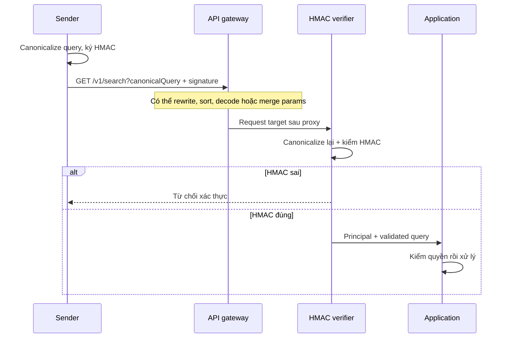
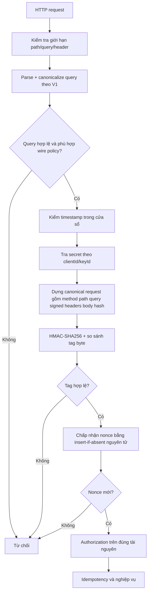

# Kiểm thử canonical query

## 1. Vì sao kiểm thử canonical query là một phần của bảo mật HMAC?

Trong xác thực HTTP request bằng **HMAC và shared secret**, client tạo **canonical request** từ phương thức HTTP, URI, header và/hoặc body theo một hợp đồng ký. Sau đó client tính HMAC; server dựng lại canonical request và xác minh chữ ký bằng khóa tương ứng. Với query string, những cách biểu diễn sau có thể tạo ra các byte khác nhau:

```text
?a=1&b=2
?b=2&a=1
?q=a%20b
?q=a+b
?path=a%2Fb
?path=a/b
```

Nếu sender và verifier **không có cùng quy tắc** về thứ tự tham số, dấu phân cách, percent-encoding, UTF-8 và khóa lặp, HMAC có thể sai dù request hợp lệ. Nguy hiểm hơn, nếu **cách hiểu query của verifier khác cách hiểu ở router hoặc tầng nghiệp vụ**, một chữ ký hợp lệ có thể bảo vệ dữ liệu **không đúng với tài nguyên hoặc thao tác mà server thực hiện**.

Bài thuộc chương **Query canonicalization** của mô-đun **`SECURITY_AUTHENTICATION_HMAC_REQUEST_AUTHENTICATION`**. Mô-đun thiết kế xác thực HTTP bằng HMAC trên canonical request, thực hành xác minh chữ ký, chống replay bằng timestamp/nonce, quản lý key rotation, kiểm thử proxy/gateway và phân biệt xác thực với phân quyền. Trọng tâm bài này không phải chỉ mô tả thuật toán canonicalization, mà là **xây dựng chiến lược kiểm thử để chứng minh nhiều implementation tạo cùng byte ký và không mở ra cách diễn giải query mơ hồ**.

Sau bài học, người học có thể:

- Viết test vector có **raw query → canonical query → canonical request bytes → HMAC** dự kiến.
- Kiểm thử **thứ tự**, **percent triplets**, dấu `+`, Unicode UTF-8, giá trị rỗng và **duplicate keys**.
- Tách **test tính đúng của canonicalizer** khỏi **test xác thực HMAC**, anti-replay và authorization.
- Áp dụng **metamorphic/property-based tests**, mutation tests và fuzzing.
- Kiểm thử qua HTTP client, reverse proxy/API gateway và Java web framework.
- Chẩn đoán sai khác theo từng byte mà không làm lộ shared secret trong production.

## 2. Phải có hợp đồng chuẩn hóa cụ thể trước khi viết test

Không tồn tại một thuật toán **canonical query duy nhất** áp dụng tự động cho mọi HMAC API. Có hệ thống ký nguyên **raw query string** đúng như truyền trên HTTP; có hệ thống parse các cặp name/value rồi chuẩn hóa và sắp xếp. Các lựa chọn đó cho kết quả khác nhau.

Để kiểm thử một cách có thể tái lập, bài này chọn hợp đồng **`HMAC-SHA256-V1`** dùng chiến lược **normalize-and-sort**, với các điều kiện rõ ràng dưới đây. Đây là **hợp đồng minh họa của bài học**, không phải chuẩn ký HTTP bắt buộc.

| Thuộc tính | Quy tắc V1 |
| --- | --- |
| Đầu vào | **Raw query** không chứa dấu `?`, lấy từ public request target |
| Không có query | `null` hoặc chuỗi rỗng được canonicalize thành `""` |
| Cặp tham số | Phân tách raw query theo `&`, **giữ** các thành phần rỗng để phát hiện lỗi |
| Dấu `=` | Mỗi thành phần phải chứa `=`; dấu đầu tiên tách name và value |
| Name | Bắt buộc khác rỗng sau khi giải mã |
| Value | Được phép rỗng, ví dụ `a=` |
| Ký tự trong raw component | Chỉ nhận ASCII **unreserved** (`A-Z a-z 0-9 - . _ ~`) hoặc percent triplet `%HH` |
| Percent encoding | Giải mã đúng **một lần**; hex đầu vào không phân biệt hoa/thường; encoder đầu ra dùng **hex uppercase** |
| Byte và Unicode | Dãy byte sau percent-decoding phải là **UTF-8 hợp lệ**, decoder báo lỗi thay vì thay ký tự hỏng |
| Ký tự điều khiển | Từ chối ký tự điều khiển đã decode, gồm `NUL`, `CR` và `LF` |
| Dấu cách | Biểu diễn là `%20`, không phải `+` |
| Dấu cộng literal | Biểu diễn là `%2B`; raw `+` không hợp lệ trong V1 |
| Thứ tự | Sắp xếp **encoded name**, rồi **encoded value**, theo thứ tự byte ASCII tăng dần |
| Khóa trùng | **Từ chối** các name trùng nhau **sau khi chuẩn hóa**, kể cả `x` và `%78` |
| Empty segment | Từ chối `a=1&&b=2` hoặc dấu `&` cuối |
| Giới hạn minh họa | Raw query không quá 8.192 ký tự; tối đa 64 cặp |
| Canonical output | `name=value` nối bằng `&`, không có dấu `?` |

**Vì sao chọn chính sách từ chối khóa trùng?** Các framework có thể lấy giá trị đầu, cuối hoặc cả danh sách khi gặp `merchantId=m-42&merchantId=m-99`. Nếu canonicalizer sắp xếp nhưng ứng dụng lại dùng vị trí để quyết định merchant, **hai raw requests khác nhau có thể dùng cùng chữ ký nhưng dẫn đến hiệu ứng nghiệp vụ khác nhau**. Một hợp đồng cấm duplicate giúp tránh loại mâu thuẫn ấy. Các API thực sự cần multi-value query phải thiết kế **phiên bản khác** cho phép duplicate theo chính sách ngữ nghĩa, thứ tự và phân quyền được thống nhất.

### 2.1. Cần phân biệt ba khái niệm

1. **Raw query**: dãy ký tự escape trong request target, ví dụ `z=%7e&path=a%2fb`.
2. **Canonical query**: biểu diễn chuẩn theo V1, ví dụ `path=a%2Fb&z=~`.
3. **Parsed business parameters**: dữ liệu ứng dụng dùng để tìm merchant, thực hiện tìm kiếm hoặc phân quyền; chỉ đáng tin khi parser và validator tương thích với hợp đồng ký.

Chuẩn hóa có thể biến nhiều raw strings thành **cùng một** canonical string. Điều đó chỉ an toàn nếu các tầng dùng **cùng ngữ nghĩa query**. Một lựa chọn phòng thủ bổ sung là yêu cầu **query truyền trên wire đã ở dạng canonical**, tức từ chối request khi `rawQuery != canonicalQuery`. Khi áp dụng chính sách nghiêm này, sender phải chuẩn hóa và gửi **đúng canonical query**; verifier kiểm tra tính canonical trước khi xác thực.

## 3. Bộ test vector cấp query: đầu vào và kết quả kỳ vọng

Trước khi ký HMAC, cần kiểm thử hàm canonicalization **độc lập**. Bảng dưới đây là các cặp input/output dựa trên hợp đồng V1:

| Raw query | Canonical query kỳ vọng | Lý do |
| --- | --- | --- |
| `b=2&a=1` | `a=1&b=2` | Sắp xếp theo name |
| `a=1&b=2` | `a=1&b=2` | Đã canonical |
| `z=%7e&x=%41` | `x=A&z=~` | Decode unreserved và re-encode chuẩn |
| `path=a%2fb` | `path=a%2Fb` | Uppercase hex |
| `q=caf%c3%a9` | `q=caf%C3%A9` | UTF-8 hợp lệ, hex uppercase |
| `q=a%20b` | `q=a%20b` | Dấu cách phải là `%20` |
| `q=a%2bb` | `q=a%2Bb` | Dấu `+` literal phải được escape |
| `q=a%26b%3Dc` | `q=a%26b%3Dc` | `&`, `=` nằm trong value, không phải separator |
| `a=` | `a=` | Value rỗng hợp lệ |
| `null` hoặc `""` | `""` | Không có cặp tham số |
| `X=1&x=2` | `X=1&x=2` | Tên tham số phân biệt hoa/thường |
| `x=%252F` | `x=%252F` | Giải mã đúng một lần rồi encode lại |
| `x=%2F` | `x=%2F` | Khác `%252F` |
| `q=e%CC%81` | `q=e%CC%81` | Không tự chuẩn hóa Unicode NFC |
| `q=%C3%A9` | `q=%C3%A9` | Khác dãy code point ở hàng trước |

**Chú ý về encoding:** ví dụ `q=e%CC%81` gồm chữ `e` và **combining acute accent**, còn `q=%C3%A9` là ký tự `é` ở dạng precomposed. Chúng có thể trông giống nhau khi hiển thị nhưng là các chuỗi Unicode khác nhau. Hợp đồng V1 không thực hiện Unicode normalization, vì vậy **không** yêu cầu hai canonical outputs bằng nhau.

### 3.1. Bộ test trường hợp bị từ chối

| Raw query | Phải từ chối vì |
| --- | --- |
| `a=1&a=2` | Name trùng |
| `a=1&%61=2` | Name trùng **sau chuẩn hóa** |
| `merchantId=m-42&merchantId=m-99` | Duplicate business-critical parameter |
| `flag` | Thiếu dấu `=` |
| `=value` | Name rỗng |
| `a=1&&b=2` | Thành phần query rỗng |
| `a=1&` | Dấu `&` cuối tạo thành phần rỗng |
| `x=%` hoặc `x=%2` | Percent triplet thiếu chữ số |
| `x=%GG` | Hex không hợp lệ |
| `x=%FF` hoặc `x=%C3` | Byte sequence không hợp lệ theo UTF-8 |
| `x=%ED%A0%80` | UTF-8 mã hóa surrogate không hợp lệ |
| `x=%00` hoặc `x=%0D%0A` | Ký tự điều khiển sau decode |
| `q=a+b` | Raw dấu `+` không nằm trong profile V1 |
| `q=a/b` | Slash là reserved, phải encode trong component |
| `q=a%20b#part` | Fragment không thuộc raw query của HTTP request target |
| `?a=1` | Hàm nhận **raw query không có dấu `?`**, nên dấu hỏi không hợp lệ |

**Điểm quan trọng:** từ chối ở **cấp canonicalizer** không có nghĩa mọi URI như trên là sai theo cú pháp URI tổng quát. Đây là giới hạn được chọn cho **giao thức ký V1**. Đừng mô tả một quy tắc nội bộ thành yêu cầu của toàn bộ HTTP hoặc RFC 3986.

## 4. Test vector HMAC độc lập: từ raw query tới chữ ký

Sau khi test từng cặp query, ta cần một **vector hoàn chỉnh** để xác minh rằng client và server ghép canonical query vào đúng vị trí, đúng encoding và cùng thuật toán.

Raw query dùng làm **đầu vào test của canonicalizer**:

```text
z=%7e&merchantId=m-42&tag=b&space=x%20y&path=a%2fb&plus=%2b
```

Canonical query kỳ vọng:

```text
merchantId=m-42&path=a%2Fb&plus=%2B&space=x%20y&tag=b&z=~
```

Trong **request HTTP thực sự**, sender theo chế độ nghiêm nên gửi **canonical query** ở dòng request target:

```http
GET /v1/search?merchantId=m-42&path=a%2Fb&plus=%2B&space=x%20y&tag=b&z=~ HTTP/1.1
Host: api.example.test
X-Client-Id: client-42
X-Key-Id: key-demo-01
X-Timestamp: 1795856400
X-Nonce: AAAAAAAAAAAAAAAAAAAAAA
X-Signature: <base64-hmac-sha256>
```

Hợp đồng request-signature test:

| Trường | Giá trị |
| --- | --- |
| Algorithm | HMAC-SHA-256, **32-byte full tag** |
| Version | `HMAC-SHA256-V1` |
| Method | `GET` |
| Raw public path | `/v1/search` |
| Canonical query | Chuỗi đã sort/encode ở trên |
| Headers được ký | `x-client-id`, `x-key-id`, `x-timestamp`, `x-nonce` |
| Body | Đúng 0 byte, SHA-256 của empty input |
| Canonical encoding | UTF-8, **9 dòng nối bằng LF**, không LF cuối |
| Signature encoding | Base64 chuẩn có padding |
| Secret dùng để test | 32 byte ASCII `0123456789abcdef0123456789abcdef` |

Canonical request chính xác:

```text
HMAC-SHA256-V1
GET
/v1/search
merchantId=m-42&path=a%2Fb&plus=%2B&space=x%20y&tag=b&z=~
x-client-id:client-42
x-key-id:key-demo-01
x-timestamp:1795856400
x-nonce:AAAAAAAAAAAAAAAAAAAAAA
e3b0c44298fc1c149afbf4c8996fb92427ae41e4649b934ca495991b7852b855
```

Toàn bộ canonical request trên dài **249 byte UTF-8**. Với secret test đã nêu:

```text
HMAC-SHA256 tag (hex, 32 bytes):
18c8acde8dec86f091902585c9cfcc9c4068c54f0c1c0065c36192cca6f8e81e

X-Signature (Base64):
GMis3o3shvCRkCWFyc/MnEBoxU8MHABlw2GSzKb46B4=
```

Các giá trị **secret, timestamp và nonce** này chỉ dùng làm vector để hai SDK đối chiếu. Không sử dụng secret public, nonce toàn `A` hoặc timestamp tĩnh trong sản phẩm. Trong production phải dùng secret có entropy cao trong secret manager, Unix timestamp hiện tại và nonce khó đoán, mới ở mỗi lần ký.

**Mục đích của vector:** nếu sender và server không cho ra đúng **cùng canonical query, cùng 249 byte và cùng signature**, có thể khoanh vùng sai khác ở bước canonicalization, ghép request, encoding hoặc HMAC.

## 5. Java 17: một canonicalizer có hành vi kiểm thử được

Ví dụ dưới đây là **implementation tham khảo của hợp đồng V1**. Nó:

- Parse raw query bằng dấu `&` và dấu `=` đầu tiên.
- Chỉ chấp nhận raw component chứa unreserved ASCII hoặc `%HH`.
- Percent-decode thành byte, giải mã UTF-8 **strict** và từ chối control characters.
- Percent-encode trở lại theo profile unreserved + **hex uppercase**.
- **Từ chối duplicate parameter names sau normalize**.
- Sort tên/và giá trị đã encode, trả chuỗi canonical.
- Giới hạn minh họa độ dài query và số lượng tham số để tránh xử lý input vô hạn.

```java
import java.io.ByteArrayOutputStream;
import java.nio.ByteBuffer;
import java.nio.charset.CharacterCodingException;
import java.nio.charset.CodingErrorAction;
import java.nio.charset.StandardCharsets;
import java.util.ArrayList;
import java.util.Comparator;
import java.util.HashSet;
import java.util.List;
import java.util.Set;
import java.util.StringJoiner;

public final class CanonicalQueryV1 {
    private static final char[] HEX =
            "0123456789ABCDEF".toCharArray();
    private static final int MAX_RAW_CHARS = 8192;
    private static final int MAX_PAIRS = 64;

    private record Pair(String name, String value) {}

    private CanonicalQueryV1() {}

    public static String canonicalize(String rawQuery) {
        // Hợp đồng V1 coi thiếu query và query rỗng như nhau.
        if (rawQuery == null || rawQuery.isEmpty()) {
            return "";
        }
        if (rawQuery.length() > MAX_RAW_CHARS) {
            throw new IllegalArgumentException("Query is too long");
        }

        String[] parts = rawQuery.split("&", -1);
        if (parts.length > MAX_PAIRS) {
            throw new IllegalArgumentException("Too many parameters");
        }

        List<Pair> pairs = new ArrayList<>(parts.length);
        Set<String> usedNames = new HashSet<>();
        for (String part : parts) {
            // Bắt buộc "name=value"; value có thể rỗng.
            int eq = part.indexOf('=');
            if (eq <= 0) {
                throw new IllegalArgumentException(
                        "Expected non-empty name=value");
            }

            String name = normalizeComponent(part.substring(0, eq));
            String value = normalizeComponent(part.substring(eq + 1));
            if (name.isEmpty() || !usedNames.add(name)) {
                throw new IllegalArgumentException(
                        "Empty or duplicate parameter name");
            }
            pairs.add(new Pair(name, value));
        }

        // Sau normalize, name/value chỉ gồm ASCII, nên thứ tự
        // String.compareTo ở đây đồng nhất với thứ tự byte ASCII.
        pairs.sort(Comparator.comparing(Pair::name)
                .thenComparing(Pair::value));

        StringJoiner result = new StringJoiner("&");
        for (Pair pair : pairs) {
            result.add(pair.name() + "=" + pair.value());
        }
        return result.toString();
    }

    private static String normalizeComponent(String raw) {
        ByteArrayOutputStream bytes = new ByteArrayOutputStream();

        for (int i = 0; i < raw.length(); i++) {
            char c = raw.charAt(i);
            if (c == '%') {
                if (i + 2 >= raw.length()) {
                    throw new IllegalArgumentException(
                            "Incomplete percent triplet");
                }
                int high = hexValue(raw.charAt(i + 1));
                int low = hexValue(raw.charAt(i + 2));
                if (high < 0 || low < 0) {
                    throw new IllegalArgumentException(
                            "Invalid percent triplet");
                }
                bytes.write((high << 4) | low);
                i += 2;
            } else if (isUnreserved(c)) {
                bytes.write((int) c);
            } else {
                throw new IllegalArgumentException(
                        "Noncanonical raw query character");
            }
        }

        final String decoded;
        try {
            decoded = StandardCharsets.UTF_8.newDecoder()
                    .onMalformedInput(CodingErrorAction.REPORT)
                    .onUnmappableCharacter(CodingErrorAction.REPORT)
                    .decode(ByteBuffer.wrap(bytes.toByteArray()))
                    .toString();
        } catch (CharacterCodingException invalidUtf8) {
            throw new IllegalArgumentException(
                    "Invalid UTF-8 in query", invalidUtf8);
        }

        // Cấm NUL, CR, LF và các Unicode control khác.
        if (decoded.codePoints().anyMatch(Character::isISOControl)) {
            throw new IllegalArgumentException(
                    "Control character in query");
        }

        byte[] normalized = decoded.getBytes(StandardCharsets.UTF_8);
        StringBuilder result = new StringBuilder(normalized.length * 3);

        for (byte b : normalized) {
            int value = b & 0xff;
            if (isUnreserved(value)) {
                result.append((char) value);
            } else {
                result.append('%')
                      .append(HEX[value >>> 4])
                      .append(HEX[value & 0x0f]);
            }
        }
        return result.toString();
    }

    private static boolean isUnreserved(int value) {
        return (value >= 'A' && value <= 'Z')
                || (value >= 'a' && value <= 'z')
                || (value >= '0' && value <= '9')
                || value == '-' || value == '.'
                || value == '_' || value == '~';
    }

    private static int hexValue(char c) {
        if (c >= '0' && c <= '9') return c - '0';
        if (c >= 'a' && c <= 'f') return c - 'a' + 10;
        if (c >= 'A' && c <= 'F') return c - 'A' + 10;
        return -1;
    }
}
```

**Lưu ý giới hạn:** class nhận **raw query đã được HTTP stack cung cấp**, không tự chứng minh request target trên mạng được bảo toàn qua gateway. Nó không phải parser HTTP, không triển khai key management, HMAC verification hay anti-replay. Những giới hạn `8192`/`64` là tham số minh họa, cần đồng bộ với giới hạn URI của gateway/server, mô hình tải và chính sách endpoint.

### 5.1. Kiểm tra query truyền trên wire đã canonical

Nếu API yêu cầu byte query trên mạng **phải chính là canonical string**, có thể thêm ràng buộc:

```java
String rawQuery = requestUri.getRawQuery();
String canonical = CanonicalQueryV1.canonicalize(rawQuery);

String actualRaw = rawQuery == null ? "" : rawQuery;
if (!actualRaw.equals(canonical)) {
    throw new IllegalArgumentException("Noncanonical query on wire");
}
```

Đoạn minh họa giả sử `requestUri` là URI **đúng public request target thực nhận**. Trong Java Servlet hoặc Spring, cần xác minh API nào của container cung cấp raw query và liệu proxy đã thay đổi nó trước đó hay không.

Chế độ nghiêm giúp ngăn trường hợp verifier chuẩn hóa hai raw URLs thành cùng MAC nhưng downstream xử lý khác nhau. Tuy vậy, nó **không tự giải quyết** các sai khác về phân quyền hoặc routing; ứng dụng vẫn phải parse query theo đúng chính sách khi chọn tài nguyên.

## 6. Unit tests cho kết quả canonical query

Với JUnit 5, nên đặt test thành các nhóm rõ ràng: **positive vectors**, **normalization equivalence**, **negative inputs** và **resource limits**. Mỗi test phải so sánh **chuỗi canonical kỳ vọng được khai báo độc lập**, không chỉ so kết quả của hai hàm cùng implementation.

```java
import static org.junit.jupiter.api.Assertions.*;
import org.junit.jupiter.api.Test;

class CanonicalQueryV1Test {

    @Test
    void sortsNamesAndNormalizesPercentEncoding() {
        assertEquals("a=1&b=2",
                CanonicalQueryV1.canonicalize("b=2&a=1"));

        assertEquals("path=a%2Fb&z=~",
                CanonicalQueryV1.canonicalize("z=%7e&path=a%2fb"));
    }

    @Test
    void encodesUnicodeAndReservedCharacters() {
        assertEquals("q=caf%C3%A9",
                CanonicalQueryV1.canonicalize("q=caf%c3%a9"));

        assertEquals("q=a%26b%3Dc",
                CanonicalQueryV1.canonicalize("q=a%26b%3Dc"));

        assertEquals("q=a%2Bb",
                CanonicalQueryV1.canonicalize("q=a%2bb"));
    }

    @Test
    void preservesEmptyValueButNotMissingEquals() {
        assertEquals("a=", CanonicalQueryV1.canonicalize("a="));
        assertEquals("", CanonicalQueryV1.canonicalize(null));
        assertEquals("", CanonicalQueryV1.canonicalize(""));

        assertThrows(IllegalArgumentException.class,
                () -> CanonicalQueryV1.canonicalize("flag"));
        assertThrows(IllegalArgumentException.class,
                () -> CanonicalQueryV1.canonicalize("=value"));
    }

    @Test
    void rejectsDuplicateNamesEvenAfterDecoding() {
        assertThrows(IllegalArgumentException.class,
                () -> CanonicalQueryV1.canonicalize("a=1&a=2"));
        assertThrows(IllegalArgumentException.class,
                () -> CanonicalQueryV1.canonicalize("a=1&%61=2"));
    }

    @Test
    void rejectsInvalidEncodingAndAmbiguousSeparators() {
        String[] invalid = {
                "x=%", "x=%2", "x=%GG", "x=%FF", "x=%C3",
                "x=%ED%A0%80", "x=%00", "x=%0D%0A",
                "a=1&&b=2", "a=1&", "q=a+b", "q=a/b"
        };
        for (String query : invalid) {
            assertThrows(IllegalArgumentException.class,
                    () -> CanonicalQueryV1.canonicalize(query),
                    "Should reject: " + query);
        }
    }

    @Test
    void distinguishesSingleAndDoubleEncoding() {
        assertEquals("x=%2F",
                CanonicalQueryV1.canonicalize("x=%2F"));
        assertEquals("x=%252F",
                CanonicalQueryV1.canonicalize("x=%252F"));
        assertNotEquals(CanonicalQueryV1.canonicalize("x=%2F"),
                CanonicalQueryV1.canonicalize("x=%252F"));
    }
}
```

Các test trên là **minh họa JUnit 5**; dự án cần khai báo JUnit phù hợp để chạy chúng. Trong tài liệu này chưa thực hiện vòng QA/refactor hay chạy Gradle theo quy trình của bài học.

### 6.1. Kiểm tra giới hạn độ dài và số cặp

Input quá dài cũng là case bảo mật, vì canonicalization có thể xảy ra **trước** khi HMAC xác thực. Fuzz hoặc traffic xấu có thể cố ép server allocate và sort lượng lớn dữ liệu:

```java
@Test
void boundsInputBeforeHeavyParsing() {
    assertThrows(IllegalArgumentException.class,
            () -> CanonicalQueryV1.canonicalize(
                    "a=" + "x".repeat(8192)));

    StringBuilder many = new StringBuilder();
    for (int i = 0; i < 65; i++) {
        if (i > 0) many.append('&');
        many.append('k').append(i).append("=v");
    }
    assertThrows(IllegalArgumentException.class,
            () -> CanonicalQueryV1.canonicalize(many.toString()));
}
```

Với production, cần kiểm tra cả tổng request-target length, kích thước header, body và giới hạn concurrency tại HTTP server/API gateway, thay vì chỉ trông vào hàm canonicalize.

## 7. Property-based và metamorphic tests

**Example-based tests** chỉ bao phủ các ví dụ biết trước. Với canonical query, các **tính chất bất biến** mới giúp phát hiện lỗi ở những tổ hợp ít người nghĩ tới.

### 7.1. Tính idempotent

Với một input hợp lệ:

```text
C(q) = canonicalize(q)
C(C(q)) == C(q)
```

Nếu canonical output lại thay đổi khi canonicalize lần nữa, thuật toán **không tạo ra dạng chuẩn ổn định**. Đây là một thuộc tính rất mạnh cho bộ sinh query.

### 7.2. Bất biến theo hoán vị tham số khác tên

Với V1, khi tên không trùng và giá trị không đổi:

```text
C("b=2&a=1&c=3") == C("c=3&b=2&a=1")
```

Tính chất này **không áp dụng** cho giao thức ký raw query nguyên thứ tự. Vì vậy, test phải được gắn đúng **contract version**; dùng property sai hợp đồng có thể khiến người học “sửa” một implementation vốn đúng.

### 7.3. Chuẩn hóa những biểu diễn tương đương

```text
C("x=%7e") == C("x=~")
C("x=%2f") == C("x=%2F")
C("q=caf%c3%a9") == C("q=caf%C3%A9")
```

Nhưng không được coi `%2F` và `%252F` tương đương, vì decode một lần cho hai giá trị khác nhau. Cũng không tự coi hai dạng Unicode nhìn giống nhau là một khi V1 không có Unicode normalization.

### 7.4. Tính phân biệt khi một giá trị thực sự thay đổi

```text
C("amount=100") != C("amount=101")
C("path=a%2Fb") != C("path=a%252Fb")
```

Nếu hai giá trị khác ngữ nghĩa nhưng được chuẩn hóa thành một chuỗi, phải xem lại thuật toán hoặc **từ chối kiểu đầu vào mơ hồ**. Không được dùng property “mọi input khác nhau phải có canonical khác nhau”, vì bản chất canonicalization **cố ý** hợp nhất các raw biểu diễn tương đương.

### 7.5. Một test ngẫu nhiên có seed cố định

Ví dụ minh họa unit test đơn giản, chưa cần thêm thư viện property-based:

```java
import static org.junit.jupiter.api.Assertions.*;
import java.util.ArrayList;
import java.util.Collections;
import java.util.List;
import java.util.Random;
import org.junit.jupiter.api.Test;

class CanonicalQueryPropertyTest {
    @Test
    void orderDoesNotMatterForUniqueNames() {
        Random random = new Random(20261128L);
        for (int iteration = 0; iteration < 1000; iteration++) {
            List<String> parts = new ArrayList<>();
            for (int k = 0; k < 10; k++) {
                parts.add("k" + k + "=" + random.nextInt(100000));
            }

            String expected = CanonicalQueryV1.canonicalize(
                    String.join("&", parts));

            Collections.shuffle(parts, random);
            String actual = CanonicalQueryV1.canonicalize(
                    String.join("&", parts));

            assertEquals(expected, actual);
            assertEquals(actual,
                    CanonicalQueryV1.canonicalize(actual));
        }
    }
}
```

Khi hệ thống lớn hơn, có thể dùng thư viện property-based phù hợp với Java, sinh các giá trị gồm dấu phân cách đã percent-encode, Unicode hợp lệ, input bất hợp lệ và shrink testcase khi thất bại. **Seed cố định** giúp tái lập lỗi; không thay thế các vector cố định, vì property test có thể bỏ sót một nhánh chưa được mô hình hóa.

## 8. Mutation tests: sửa từng thành phần sau khi đã ký

Một canonicalizer cho ra đúng string chưa chứng minh được **hệ thống xác thực HTTP hoàn chỉnh** an toàn. HMAC phải ký chính chuỗi mà server **thực sự dùng** khi xử lý request.

Giữ nguyên secret, signature, timestamp và nonce hợp lệ; tạo các biến thể của request đã được ký:

| Biến thể | Canonical query V1 | HMAC được mong đợi |
| --- | --- | --- |
| Hoán vị thứ tự tham số khác tên | Giống nhau | **Có thể cùng chữ ký** khi server chấp nhận normalize-and-sort |
| Đổi `%2F` thành `%2f` | Giống nhau | **Có thể cùng chữ ký** do uppercase canonical |
| Đổi `%7E` thành `~` | Giống nhau | **Có thể cùng chữ ký** do unreserved normalization |
| Đổi `amount=100` thành `amount=101` | Khác nhau | Chữ ký cũ **không khớp** |
| Đổi `a%2Fb` thành `a%252Fb` | Khác nhau | Chữ ký cũ **không khớp** |
| Thêm tham số mới | Khác nhau | Chữ ký cũ **không khớp** |
| Xóa tham số đã ký | Khác nhau | Chữ ký cũ **không khớp** |
| Thêm duplicate name | Không hợp lệ | **Từ chối trước khi chấp nhận request** |
| Đưa malformed UTF-8 | Không hợp lệ | **Từ chối** |
| Đổi method `GET` thành `POST` | Query có thể giống | Chữ ký cũ **không khớp** khi method được ký |
| Đổi public path | Query có thể giống | Chữ ký cũ **không khớp** khi path được ký |
| Đổi nonce đã ký | Query không đổi | Chữ ký cũ **không khớp** |
| Đổi body bytes đã ký | Query không đổi | Body hash/HMAC **không khớp** |

Khi **chế độ strict canonical-on-wire** được bật, cả những biến thể như `%2f` hoặc hoán vị raw parameters cũng bị **từ chối vì không canonical trên wire**, dù canonicalizer thuần túy có thể tạo cùng chuỗi. Hãy ghi rõ **bài kiểm thử đang đánh giá normalization library hay HTTP gateway policy**, tránh kỳ vọng mâu thuẫn.

### 8.1. Không đánh giá an toàn chỉ bằng số lượng ca HMAC “fail”

Một hệ thống cho phép `b=2&a=1` và `a=1&b=2` cùng signature có thể **đúng** theo hợp đồng normalize-and-sort. Tiêu chí bảo mật thực sự là:

- Những biểu diễn được coi tương đương **có cùng cách hiểu ở downstream**.
- Những biểu diễn khác nghĩa hoặc mơ hồ **khác canonical bytes** hoặc bị từ chối.
- Method, URI, headers quan trọng và body đều được ràng buộc đúng theo **hợp đồng ký**.
- Không có bước decode/route sau xác minh làm thay đổi tài nguyên đã được kiểm tra quyền.

## 9. Kiểm thử semantic consistency với query parser của ứng dụng

**Đây là lớp kiểm thử rất dễ bị bỏ qua.** Một verifier HMAC có thể canonicalize đúng nhưng application đọc query bằng một API khác.

Ví dụ:

```http
GET /v1/payments?merchantId=m-42&merchantId=m-99 HTTP/1.1
```

Nếu verifier sắp xếp và bỏ duplicate còn controller chọn `merchantId` cuối, attacker có thể tạo **mâu thuẫn giữa dữ liệu được bảo vệ và dữ liệu nghiệp vụ**. Hợp đồng V1 chọn **từ chối duplicate names**, kể cả khi tên bị che bằng percent encoding:

```text
merchantId=m-42&merchantId=m-99
merchantId=m-42&%6DerchantId=m-99
%6DerchantId=m-42&merchantId=m-99
```

Cần kiểm thử ít nhất các trường hợp:

1. **Parser và verifier cùng thấy một tập name/value** sau decode; không bỏ rơi tham số.
2. **Duplicate decoded names bị từ chối** ở mọi endpoint có V1.
3. Query parameter được dùng cho **routing, tenant hoặc merchant** phải được validate từ principal đã xác thực.
4. **Dấu `+`** không bị một bên hiểu là cộng và bên kia hiểu là dấu cách.
5. **Encoded `&` và `=`** không bị giải mã quá sớm rồi split sai.
6. **Case của tên tham số** có phân biệt: `merchantId` và `MerchantId` là hai tên khác nhau theo V1. Nếu tầng nghiệp vụ coi chúng như một tên, cần thêm policy reject/normalize khớp.
7. **Missing `=` và empty value** không bị framework chuyển thành cùng một giá trị nếu hợp đồng phân biệt chúng.
8. **Unicode normalization** không được một tầng tự thêm vào khi tầng kia không có quy tắc đó.

**Biện pháp mạnh:** dùng cùng một parser/query-validation contract cho lớp xác thực và tầng business, hoặc từ chối request nếu normalized query không thể ánh xạ một-một sang dữ liệu nghiệp vụ được xử lý.

## 10. Cross-language compatibility và golden fixtures

Client có thể viết bằng Java, Go, JavaScript, Python hoặc ngôn ngữ khác; backend verifier có thể dùng Java/Spring. Những thư viện standard URL thường **khác nhau** về sắp xếp query, default encoder, duplicate keys, dấu `+` và percent-encoding.

Một golden fixture nên chứa:

```json
{
  "contract": "HMAC-SHA256-V1",
  "method": "GET",
  "publicPath": "/v1/search",
  "rawQueryInput": "z=%7e&merchantId=m-42&tag=b&space=x%20y&path=a%2fb&plus=%2b",
  "canonicalQuery": "merchantId=m-42&path=a%2Fb&plus=%2B&space=x%20y&tag=b&z=~",
  "canonicalRequestUtf8ByteLength": 249,
  "tagHex": "18c8acde8dec86f091902585c9cfcc9c4068c54f0c1c0065c36192cca6f8e81e",
  "signatureBase64": "GMis3o3shvCRkCWFyc/MnEBoxU8MHABlw2GSzKb46B4="
}
```

Fixture công khai này dùng **khóa test trong mục 4**, không chứa thông tin sản phẩm hay secret thật.

Bên cạnh JSON fixture, test suite nên lưu **byte canonical request dưới dạng hex hoặc Base64** và so sánh byte-by-byte. Có thể thêm `SHA-256(canonicalRequestBytes)` làm checksum phụ để tránh file diff dài; nhưng khi test thất bại, vẫn cần xem byte thật trong môi trường an toàn để biết chính xác vị trí sai.

**Quy tắc kiểm thử đa ngôn ngữ:** **không** bắt Java, Go và JavaScript gọi cùng một implementation để xác minh nhau. Mỗi bên phải tự sản xuất output từ **input fixture độc lập** và so kết quả với **expected canonical bytes** đã thẩm định. Nếu mọi implementation chỉ “ký và tự xác minh”, cùng một lỗi encoding ở cả sender/verifier sẽ không bị phát hiện.

### 10.1. Vì sao không dùng `URLEncoder` tùy tiện?

Trong Java, `java.net.URLEncoder` phục vụ `application/x-www-form-urlencoded`, ở đó dấu cách thành `+`. Nhưng hợp đồng V1 yêu cầu `%20`:

```java
import java.net.URLEncoder;
import java.nio.charset.StandardCharsets;

String form = URLEncoder.encode("a b", StandardCharsets.UTF_8);
// "a+b" -- KHÔNG PHẢI canonical query value theo V1.
```

Trên môi trường Java, `URI.getRawQuery()` khác `URI.getQuery()`; API đã decode có thể làm mất thông tin `%2B` hay `%26` cần thiết. Test phải kiểm tra **raw request target được gửi thật**, không chỉ một object `Map` đã được framework parse.

## 11. Kiểm thử end-to-end qua proxy, load balancer và gateway

Canonical query là một hợp đồng xuyên tầng. Kiểm thử unit có thể pass nhưng request vẫn thất bại khi qua proxy:



Test ở nhiều ranh giới phải trả lời:

- Client gửi **request-target chính xác** là gì? HTTP client có tự encode `%` lần nữa không?
- Gateway có đổi **`%2F` thành `/`**, `%7E` thành `~`, `%20` thành `+` hay đảo query không?
- Reverse proxy có bỏ **query parameter trùng**, thay tham số rỗng hoặc làm mất cặp name/value không?
- Backend verifier nhận **raw query** hay chuỗi đã parse/decoded? Có thể tin metadata `X-Original-URI` do client tự khai báo không? **Không**, trừ khi chỉ có gateway tin cậy được phép thiết lập header ấy và kênh được bảo vệ.
- Tầng authorization và controller dùng **cùng tham số được xác thực**, hay lại đọc từ một nguồn khác?
- Gateway có kiểm soát kích thước URL/query trước khi canonicalizer cấp phát bộ nhớ không?

### 11.1. Hai phương án đặt điểm xác minh

**A. Verifier ở gateway trước rewrite.** Gateway đọc public request target, kiểm tra HMAC và chuyển principal đáng tin qua kênh nội bộ; backend không tin header principal do client Internet tự đặt. Phương án này giúp so raw query với những gì client đã ký trước khi bị thay đổi.

**B. Verifier ở backend.** Gateway phải bảo toàn original public target hoặc truyền metadata tin cậy có chống giả mạo. Backend không được dựng lại raw query bằng cách tùy ý join map query parameters sau khi gateway đã parse/normalize.

Cả hai cần kiểm thử **route mà backend thực sự xử lý**. Việc chữ ký khớp chưa đủ nếu router giải mã encoded separator/dot segment thêm lần nữa và quyết định một tài nguyên khác với tài nguyên mà authorization đã kiểm tra.

### 11.2. Test proxy với chế độ chuẩn hóa và chế độ nghiêm

| Tình huống | Normalize-and-sort | Strict canonical-on-wire |
| --- | --- | --- |
| Gateway đảo thứ tự hai param khác tên | Canonicalizer có thể cho cùng chữ ký | Từ chối nếu raw query sau gateway không canonical |
| Gateway đổi `%2f` thành `%2F` | Canonicalizer có thể cho cùng chữ ký | Từ chối biến thể không canonical ở điểm tiếp nhận |
| Gateway decode `%252F` hai lần | Có thể thay đổi decoded value | **Phải từ chối/sửa gateway**, không được cố hợp thức hóa |
| Gateway bỏ một duplicate | Không được chấp nhận; bản gốc đã không hợp lệ | Cần từ chối duplicate trước khi bị mất thông tin |
| Gateway thay body nhưng query không đổi | Body hash thay đổi nếu được ký | HMAC phải phát hiện body bị sửa |
| Gateway đổi method/path | Canonical request thay đổi | HMAC phải từ chối trừ khi có contract rõ và điểm xác minh phù hợp |

Với bất kỳ chế độ nào, **không sử dụng cơ chế tự thử nhiều bộ decoder/canonicalizer đến khi HMAC khớp**. Đó là cách tạo đường fallback mơ hồ và có thể vô tình chấp nhận một request mà các lớp khác diễn giải khác nhau.

## 12. Từ canonical query tới xác minh HMAC hoàn chỉnh

Đúng canonical query là điều kiện cần, **không phải toàn bộ xác thực**. Với ví dụ `GET /v1/search`:



Một số ràng buộc cần có:

- **Timestamp và nonce phải được ký**, nếu không đối thủ có thể sửa chúng trên một request có chữ ký cũ.
- Nonce phải được kiểm tra trong **kho chia sẻ đủ nhất quán** giữa các API instance, chỉ sau khi HMAC hợp lệ; TTL phải bao trùm khoảng thời gian timestamp còn được chấp nhận.
- **Key rotation:** `clientId` và `keyId` ban đầu chỉ là gợi ý tra khóa; verifier phải dùng đúng secret còn hiệu lực và ràng buộc key ID vào chữ ký.
- **Fixed tag length:** HMAC-SHA-256 đầy đủ có 32 byte tag; Base64 chuẩn có 44 ký tự. Server không để client tự quyết định số byte cần so sánh.
- **Authorization:** HMAC cho biết client nắm secret và dữ liệu đã ký không bị sửa; nó **không tự cho phép** truy cập merchant, tenant hoặc file cụ thể.
- **Idempotency:** với POST/PUT có hiệu ứng nghiệp vụ, retry có nonce mới vẫn có thể lặp lại hành động; cần idempotency key ổn định và được bảo vệ theo hợp đồng.

### 12.1. Không tự quyết định query từ header chưa ký

Nếu endpoint xử lý resource thông qua một header khác như `X-Merchant-Id`, dù query đã canonical, kẻ tấn công có thể sửa header **không được ký**. Hợp đồng tổng thể phải bảo vệ **mọi trường ảnh hưởng đến ý nghĩa request** hoặc suy những giá trị ấy từ principal/server-side configuration đáng tin cậy.

## 13. Kiểm thử lỗi và quan sát kết quả an toàn

Khi test thất bại, nên phân loại nguyên nhân thay vì chỉ ghi “401 HMAC failed”:

| Nhóm lỗi | Tín hiệu trong test | Hướng điều tra |
| --- | --- | --- |
| Query parser | Missing `=`, empty segment, duplicate | Parser split, strict validation, framework duplicate handling |
| Percent encoding | `%` sai, `%2f`/`%2F` hoặc `+` | Component encoding, form decoder, hex normalization |
| Unicode | Malformed UTF-8 hoặc normalization khác nhau | Charset decoder strict, code points, NFC/NFD |
| Sắp xếp | Output khác với tham số đảo thứ tự | Sort key/value, thứ tự ASCII sau encode |
| Byte canonical | HMAC khác dù query giống | LF/CRLF, method/path, header canonical, body hash |
| Secret/key | Key ID không khớp secret | Resolver, rotation, thu hồi, quyền truy cập secret |
| Anti-replay | Signature đúng nhưng request bị chặn | Timestamp cửa sổ, nonce đã dùng, replay store |
| Phân quyền | Xác thực đúng nhưng HTTP 403 | Client scope/merchant/tài nguyên |
| Gateway | Chỉ lỗi khi qua proxy | Raw request target trước/sau rewrite, duplicate query |
| Performance | Input query lớn gây spike CPU/RAM | Giới hạn URL/param, parse cost, rate limiting |

Trong **sandbox/test**, có thể lưu byte canonical dưới dạng hex để diff vị trí sai. Trong **production**, tránh ghi nguyên URL chứa thông tin nhạy cảm, secret, HMAC tag đầy đủ, timestamp/nonce kết hợp với request có thể bị phát lại. Nên ghi **request ID, mã lỗi, phiên bản hợp đồng, vị trí xử lý và fingerprint không nhạy cảm** theo chính sách bảo mật.

**Lỗi input** như query malformed nên được từ chối trước khi phân quyền và trước khi xử lý nghiệp vụ. Phản hồi lỗi cho client không nên tiết lộ secret hay thông tin chi tiết về oracle HMAC; không cần phân biệt quá nhiều loại lỗi mật mã bằng thông báo công khai.

## 14. Kế hoạch kiểm thử theo lớp

Một kế hoạch có thể dùng trong CI:

| Lớp | Mục tiêu | Những ca quan trọng |
| --- | --- | --- |
| **Unit canonicalizer** | Từ raw input đến canonical output | Sort, percent hex, UTF-8, empty, duplicate, invalid |
| **Golden vectors** | Tương thích byte giữa SDK/verifier | Canonical query, 249 bytes, HMAC Base64 |
| **Property-based** | Các bất biến trên nhiều input | Idempotence, permutation invariance, normalization |
| **Fuzz negative** | Chống dữ liệu mơ hồ và quá tải | Truncated `%`, invalid UTF-8, encoded control, long query |
| **Request-signature tests** | HMAC bảo vệ query cùng method/path/header/body | Tamper name/value, key ID, timestamp, nonce |
| **Framework integration** | Servlet/Spring/JAX-RS đọc đúng raw target | Query duplicate, `+`, percent escapes, empty query |
| **Proxy/gateway E2E** | Giữ đúng contract trên đường truyền | Rewrite, decode, reorder, HTTP/2→HTTP/1.1 |
| **Replay/rotation/authz** | Chặn dùng lại request, key cũ, vượt quyền | Atomic nonce, key expiry, merchant isolation |
| **Load/regression** | Cưỡng chế giới hạn và giữ latency ổn | URL length, số cặp, concurrency, rate limits |

Nên chạy các nhóm **unit/golden** nhanh trên mọi thay đổi canonicalizer; chạy **proxy E2E** khi nâng gateway, framework, HTTP client hoặc cấu hình routing; chạy **security regression** khi cập nhật xác thực, key resolver và business authorization. Với mỗi thay đổi thuật toán canonicalization, phải nâng hoặc quản lý **phiên bản hợp đồng ký** để tránh âm thầm làm client cũ không tương thích.

### 14.1. Tiêu chí nghiệm thu

Một triển khai được xem là đạt ở mức kỹ thuật khi:

1. Golden fixtures có **canonical query và signature khớp chính xác** giữa các triển khai.
2. Mọi input lỗi theo V1 **bị từ chối**, không bị “tự sửa” mà không báo.
3. Input hợp lệ thỏa các tính chất idempotent và permutation đã chọn.
4. Không có đường truyền qua gateway nào làm thay đổi resource/merchant mà HMAC/authorization vẫn hiểu một nội dung khác.
5. Bất kỳ thay đổi nào đối với thành phần đã ký nhưng không tương đương theo contract đều làm HMAC cũ không hợp lệ.
6. Replay, key thu hồi và thiếu quyền **được chặn**, bất kể query hợp lệ.
7. Giới hạn resource được áp dụng trước các thao tác parse/allocate/sort tốn kém.

Đạt các tiêu chí này **không có nghĩa đã chứng minh an toàn tuyệt đối**; vẫn cần threat modeling, review triển khai và theo dõi vận hành.

## 15. Bài tập thực hành: xây bộ test cho API thanh toán

Một API nhận:

```http
POST /v1/payments?merchantId=m-42&currency=VND HTTP/1.1
Content-Type: application/json
X-Client-Id: client-42
X-Key-Id: key-demo-01
X-Timestamp: <unix-seconds>
X-Nonce: <fresh-nonce>
X-Signature: <base64-hmac>
```

Hợp đồng ký dùng cùng canonical query V1, HMAC-SHA-256 và hash raw body bytes.

**Yêu cầu thực hành:**

1. Viết ít nhất 10 **positive/negative unit tests** cho query, bao gồm order, percent-encoding, Unicode, duplicate và missing `=`.
2. Tạo golden fixture: raw query, canonical query, byte canonical request và expected HMAC với test secret giả.
3. Chứng minh `currency=VND&merchantId=m-42` và `merchantId=m-42&currency=VND` tạo cùng canonical query; quyết định có bật strict canonical-on-wire hay không.
4. Kiểm tra `merchantId=m-42&%6DerchantId=m-99`. Vì sao chỉ kiểm tra duplicate **trước** percent-decoding là chưa đủ?
5. Kiểm tra `note=a%26b%3Dc`. Nếu một parser decode trước rồi split `&`, điều gì có thể xảy ra?
6. Viết property test về **idempotence** và **permutation invariance**.
7. Gửi request qua gateway có thể thay `%2F` thành `/` hoặc đảo query; ghi nhận nơi sai khác đầu tiên.
8. Thay `amount` trong JSON body nhưng giữ nguyên query và chữ ký; verifier phải phản ứng thế nào?
9. Gửi request có HMAC đúng nhưng nonce đã dùng; tầng nào chặn?
10. Gửi query hợp lệ cho `merchantId=m-99` nhưng client chỉ có quyền với `m-42`; HMAC đúng có đủ để chấp nhận không?
11. Xoay từ `key-demo-01` sang `key-demo-02`; expected canonical query có đổi không? Chữ ký thay đổi thế nào?
12. Khi test thấy chữ ký sai, bạn kiểm tra các lớp nào trước khi kết luận lỗi thuộc về HMAC algorithm?

**Gợi ý đáp án:** (1) Dùng bảng mục 3; (2) so cả byte, không chỉ chuỗi tag; (3) cùng canonical output, nhưng strict wire có thể từ chối biến thể không canonical; (4) `%6D` được decode thành `m`, nên trùng name; (5) `%26` thành dấu `&` bên trong value, split sai tạo tham số giả; (6) `C(C(q))=C(q)` và bất biến hoán vị tên khác nhau; (7) kiểm sender→gateway→verifier, raw target và routing; (8) body hash/HMAC sai; (9) replay store nguyên tử; (10) không, authorization phải từ chối; (11) query không đổi, HMAC đổi theo secret/key ID; (12) query canonical, method/path/header/body byte, keyId/secret, encoding/tag và gateway trước khi nghi ngờ JCA `Mac`.

## 16. Tổng kết

**Kiểm thử canonical query không dừng ở việc so hai query strings.** Nó phải chứng minh rằng bên gửi, gateway, verifier và tầng nghiệp vụ **cùng hiểu một request**. Trước tiên phải khóa một **hợp đồng canonicalization có phiên bản**, sau đó kiểm thử output bằng golden vectors, trường hợp malformed, property-based tests, mutation tests và end-to-end qua hạ tầng thật.

Với V1 minh họa, query được percent-decode đúng một lần bằng UTF-8 strict, encode theo unreserved và `%HH` uppercase, sắp xếp tên/và giá trị, đồng thời **từ chối duplicate parameter names** để tránh diễn giải mơ hồ. HMAC tiếp tục bảo vệ method, URI, headers và body theo hợp đồng; timestamp/nonce chống replay, key rotation quản lý secret, còn **authorization** bảo vệ quyền trên tài nguyên thực sự được xử lý. Chính việc kiểm thử đồng thời **byte ký, ngữ nghĩa query và chính sách quyền** làm cơ chế HMAC đáng tin cậy trong hệ thống thực tế.

