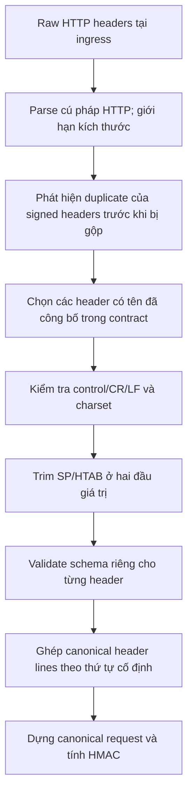
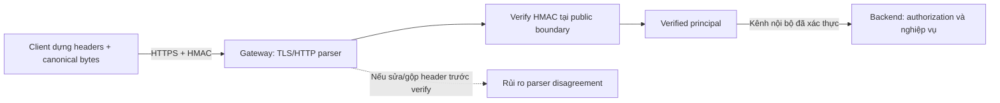
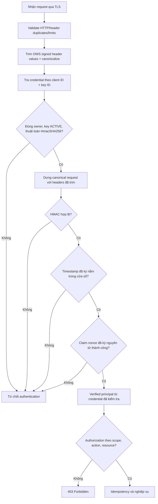

# Trim whitespace

## 1. Bài toán: khoảng trắng trong HTTP header ảnh hưởng chữ ký HMAC như thế nào?

Trong mô hình client–server, HTTP request có thể đi qua HTTP client, load balancer, reverse proxy, API gateway và framework trước khi đến bộ xác minh HMAC. Mỗi tầng có thể biểu diễn **khoảng trắng xung quanh giá trị HTTP header** khác nhau. Nếu client ký trực tiếp một giá trị có khoảng trắng đầu/cuối nhưng server đã loại khoảng trắng đó trước khi tính lại HMAC, hai bên tạo ra **signature input khác byte**, dù nhìn vào nghiệp vụ dường như cùng một header.

Ví dụ, ba cách viết giá trị dưới đây có thể được ứng dụng hiểu là cùng `merchant-42`:

```http
X-Client-Id: merchant-42
X-Client-Id:   merchant-42
X-Client-Id: merchant-42  
```

Ở mức chuỗi, chúng không giống nhau nếu lấy nguyên phần sau dấu hai chấm. Trong module `SECURITY_AUTHENTICATION_HMAC_REQUEST_AUTHENTICATION`, client và server dùng **shared secret** để xác thực HTTP request bằng **HMAC trên canonical request**. Vì vậy, hợp đồng ký phải định nghĩa chính xác **có trim whitespace hay không, trim ký tự gì, ở vị trí nào, tại tầng nào**.

Bài *Trim whitespace* thuộc chương **Header canonicalization**. Sau bài học, bạn cần:

- Hiểu *optional whitespace* (**OWS**) trong HTTP và phân biệt whitespace đầu/cuối với whitespace nằm bên trong giá trị.
- Xây dựng quy tắc trim **cụ thể ở cấp byte** cho các header được ký.
- Biết vì sao `String.trim()`, `String.strip()`, `replaceAll("\\s+", " ")` và việc chọn giá trị từ map header có thể làm sai hợp đồng hoặc che dữ liệu độc hại.
- Kiểm tra header thiếu, header trùng không phân biệt hoa/thường, ký tự điều khiển, CR/LF và obs-fold.
- Viết Java 17 canonicalize signed headers, tạo canonical request và xác minh HMAC-SHA256.
- Kiểm thử proxy/gateway, timestamp/nonce, key rotation và phân biệt **authentication** với **authorization**.

**Thông điệp chính:** trim không chỉ là xử lý định dạng. Đó là **một phần của giao thức mật mã**: nếu hai phía không thống nhất, chữ ký thất bại; nếu trim quá mức, có thể vô tình biến hai thông điệp có ý nghĩa khác nhau thành cùng một thông điệp được ký.

## 2. OWS là gì? Trim ở đâu?

Trong các quy tắc cú pháp HTTP, **OWS** viết tắt của *optional whitespace*, dùng hai loại ký tự:

| Ký tự | Tên | Mã byte ASCII | Biểu diễn trong Java |
| --- | --- | --- | --- |
| Dấu cách | **SP** | `0x20` | `' '` |
| Tab ngang | **HTAB** | `0x09` | `'\t'` |

Điểm quan trọng là **OWS không đồng nghĩa mọi ký tự Unicode có khả năng hiển thị như khoảng trắng**. Ví dụ, non-breaking space (NBSP, U+00A0), em space (U+2003), xuống dòng `CR` (`\r`) hoặc `LF` (`\n`) **không được tự động coi là OWS** trong hợp đồng bài này.

Một trường header HTTP/1.1 minh họa:

```text
X-Client-Id:  merchant-42  \t
           ^^^^^^^^^^^^^^^^
           Giá trị phía parser có thể có SP/HTAB hai đầu
```

Trong văn bản có escape `\t` là **một ký tự HTAB thực** khi gửi trên wire, không phải hai ký tự `\` và `t`.

### 2.1. Leading/trailing OWS khác internal whitespace

Giả sử parser cung cấp chuỗi value:

```text
" \tmerchant-42 \t"
```

Theo hợp đồng **trim hai đầu**, canonical value là:

```text
"merchant-42"
```

Nhưng:

```text
"monthly  settlement"
```

có **hai dấu SP ở giữa**. Thuật toán chỉ trim ở hai đầu **phải giữ nguyên** chúng. Không được âm thầm gộp thành `"monthly settlement"` nếu hợp đồng không yêu cầu.

| Input value từ parser | Trim OWS ở hai đầu | Vì sao? |
| --- | --- | --- |
| `"merchant-42"` | `"merchant-42"` | Không có OWS dư |
| `"  merchant-42  "` | `"merchant-42"` | Bỏ SP đầu/cuối |
| `"\t merchant-42 \t"` | `"merchant-42"` | Bỏ HTAB/SP đầu/cuối |
| `"monthly  settlement"` | `"monthly  settlement"` | Hai SP ở giữa **không bị collapse** |
| `"monthly \t settlement"` | **Từ chối trong hợp đồng v1** | V1 không hỗ trợ HTAB nằm giữa giá trị |
| `"merchant-42\r\nX-Role: admin"` | **Từ chối** | Chứa CR/LF, không phải trim hợp lệ |
| `"merchant-42\u00A0"` | **Từ chối trong v1** | Có ký tự Unicode ngoài tập ASCII |
| `"\t \t"` | Chuỗi rỗng, sau đó **từ chối với header bắt buộc** | Có tên header nhưng không có giá trị hữu ích |

Hai kết quả **trim thành công** và **header hợp lệ theo schema** là hai quyết định khác nhau. Ví dụ, một `X-Client-Id` sau trim chứa khoảng trắng nội bộ có thể hợp lệ ở bước trim nhưng phải bị từ chối ở bước kiểm tra định dạng ID.

### 2.2. Trim ở lớp nào?

Một pipeline hợp lý:



Nếu gateway đã **gộp hai header cùng tên** hoặc **chuyển đổi nội dung giá trị** trước khi bộ xác minh được đọc, không thể luôn tái dựng lại chính xác input ban đầu. Do đó, hợp đồng cần nói rõ verifier đặt **ở đâu** trong đường đi và tầng nào được quyền chuẩn hóa.

## 3. Những điều không nên làm khi trim

### 3.1. Không dùng `String.trim()` thay cho định nghĩa hợp đồng

Trong Java, `String.trim()` loại bỏ các ký tự đầu/cuối có mã không lớn hơn U+0020 theo quy tắc riêng của Java, **rộng hơn** hai ký tự SP/HTAB của OWS. Ví dụ, `\r`, `\n` hoặc một số control characters ở rìa có thể bị `trim()` loại bỏ thay vì khiến input bị từ chối.

```java
String dangerous = "\r\nmerchant-42\r\n";

// SAI nếu hợp đồng yêu cầu reject CR/LF:
String value = dangerous.trim(); // Có thể trở thành "merchant-42".
```

Một input chứa dấu xuống dòng phải **bị từ chối**, không được làm sạch thành một identity có vẻ hợp lệ. Đặc biệt với dữ liệu đi qua các HTTP parser khác nhau, nhận và sửa CR/LF có thể che một tình huống header injection hoặc parser disagreement.

### 3.2. Không dùng `String.strip()` một cách vô thức

`String.strip()` dựa trên định nghĩa Unicode whitespace của Java; điều đó **không đồng nhất** với OWS. Hai nền tảng/language runtime khác nhau cũng có thể xử lý Unicode whitespace khác nhau.

Hợp đồng ký nên chỉ định byte được trim, ví dụ **SP/HTAB ASCII ở rìa**, thay vì chỉ ghi “strip whitespace” mà không định nghĩa chữ “whitespace”.

### 3.3. Không collapse whitespace nội bộ khi contract chỉ yêu cầu trim

Đoạn code sau thay đổi **cả khoảng trắng ở giữa**:

```java
// SAI với contract chỉ trim OWS ở rìa.
String normalized = value.trim().replaceAll("\\s+", " ");
```

`"monthly  settlement"` sẽ khác `"monthly settlement"` trên wire, nhưng phép thay thế làm chúng tạo ra cùng canonical value. Điều này có thể vô hại với một header dạng nhãn hiển thị, nhưng rất nguy hiểm với header chứa token, giá trị phân cách hoặc string được handler hiểu theo quy tắc riêng.

### 3.4. Không trim cả những thành phần không có quy tắc đó

Header field name, HTTP method, path, raw query, authority và body là **những loại dữ liệu khác nhau**. Ví dụ:

- Header name được xác minh là HTTP token, không có nghĩa “trim tùy ý tên field” và chấp nhận cú pháp sai.
- HTTP method `POST` là token phân biệt chữ hoa/thường, không phải string cần `strip()` hoặc uppercase vô điều kiện.
- URI path `/v1/items/%20` chứa byte percent encoding có ý nghĩa; trim string path có thể làm thay đổi hoặc che lỗi.
- Body JSON `{"note":"a  b"}` có hai SP trong giá trị; hash **exact body bytes** không cho phép trim hoặc serialize lại tùy tiện.
- Chữ ký Base64url và nonce/key ID có schema riêng; trim tùy ý header chữ ký có thể tạo một encoding được chấp nhận khác với protocol đã công bố.

**Tư duy đúng:** mỗi thành phần của canonical request phải có **canonicalization rule riêng**, được ghi trong một protocol version cụ thể.

## 4. Trường hợp tấn công: trim và parser disagreement

### 4.1. Header trùng tên nhưng khác chữ hoa/thường

```http
X-Client-Id: merchant-42
x-client-id: admin
```

Nếu gateway ký/xác minh giá trị đầu còn backend đọc giá trị cuối, attacker có thể gây nhầm identity. Hợp đồng phải xem hai tên header này là **cùng một field** do tên HTTP không phân biệt hoa/thường, và từ chối khi field bắt buộc có nhiều occurrence.

Ngay cả khi hai value giống nhau:

```http
X-Nonce: abcdefghijklmnop
x-nonce: abcdefghijklmnop
```

v1 vẫn từ chối. Cho phép duplicate gây phụ thuộc vào cách parser gộp và làm việc phát hiện/kiểm toán khó hơn. Hãy đếm occurrence **trước khi** framework biến chúng thành `Map<String,String>`.

### 4.2. Header gộp dấu phẩy

Một intermediary có thể biến:

```http
X-Client-Id: merchant-42
X-Client-Id: admin
```

thành:

```http
X-Client-Id: merchant-42, admin
```

Đừng cố tách chuỗi này rồi chọn một giá trị để tính HMAC. `X-Client-Id` là header singleton trong hợp đồng và dấu phẩy **không thuộc schema**; kết quả phải bị từ chối. Những HTTP field có cú pháp danh sách thật sự cần **quy tắc riêng**, không dùng một hàm gộp chung.

### 4.3. Obs-fold, CRLF và request/header smuggling

Cú pháp HTTP cũ từng có *obs-fold* (header folding bằng xuống dòng rồi whitespace). Trong các triển khai HTTP hiện đại, không nên dùng nó để truyền signed headers, vì các parser có thể **từ chối, gộp hoặc thay thế** theo cách không nhất quán.

```text
X-Client-Id: merchant-42\r\n
 \tX-Role: admin
```

Đây là biểu diễn *minh họa ký tự escape*, không phải header hợp lệ trong hợp đồng v1. Nếu thấy CR, LF, ký tự điều khiển, obs-fold hoặc các dạng phân tích header không thống nhất, **từ chối tại ingress**. Không dùng trim/replace để “cứu” dữ liệu rồi cấp danh tính.

### 4.4. Cùng hiển thị, khác mã Unicode

Một dấu cách ASCII, NBSP và các ký tự Unicode trông giống khoảng trắng có thể hiển thị tương tự:

```text
"merchant-42 "       (ASCII SP ở cuối)
"merchant-42\u00A0"  (NBSP ở cuối)
```

Hợp đồng `HTTP-HMAC-TRIM-V1` dưới đây **chỉ cho phép byte ASCII** trong signed header values; NBSP bị từ chối. Đây là lựa chọn cố ý để không xảy ra mơ hồ giữa byte và cách hiển thị.

Nếu sau này phải hỗ trợ Unicode trong header, cần định nghĩa rõ encoding, normalization, ký tự được phép và version hợp đồng mới. **Không** mở rộng tập whitespace được trim chỉ vì một thư viện cho kết quả tiện hơn.

## 5. Chốt hợp đồng HTTP-HMAC-TRIM-V1

Hợp đồng sau là **ví dụ cụ thể cho bài học**, không phải một chuẩn mặc định áp dụng cho mọi sản phẩm. Client, API gateway và verifier phải dùng **đúng một phiên bản hợp đồng**. Mục tiêu là cho phép OWS ở hai đầu một số signed header values mà vẫn ràng buộc chặt nội dung có ý nghĩa.

### 5.1. Quy tắc header

1. Tập signed header bắt buộc gồm **bảy** tên: `content-type`, `x-client-id`, `x-idempotency-key`, `x-key-id`, `x-nonce`, `x-purpose`, `x-timestamp`.
2. Tên được đọc theo HTTP field-name token và chuẩn hóa thành **ASCII lowercase**. Mỗi signed header phải xuất hiện **đúng một lần**, kể cả nếu có nhiều bản viết hoa/thường.
3. Mỗi value trước trim dài tối đa 1024 ký tự. Chỉ cho phép ASCII SP (`0x20`), ASCII hiển thị (`0x21–0x7E`) và HTAB (`0x09`). Mọi ký tự control khác, CR/LF, DEL và non-ASCII đều bị từ chối.
4. **Trim toàn bộ SP/HTAB liên tiếp ở hai đầu**. Sau trim, **từ chối HTAB còn nằm ở giữa** value. Dấu SP ở giữa được giữ nguyên, không collapse.
5. Kiểm tra schema sau trim: `Content-Type` đúng `application/json`; client ID, key ID và idempotency key chỉ gồm ký tự cho phép; timestamp là Unix seconds thập phân chuẩn; nonce đủ dài và đúng alphabet; purpose là chuỗi ASCII có thể chứa khoảng trắng nội bộ.
6. Chỉ những value đã chuẩn hóa và hợp lệ mới vào canonical header lines, mỗi dòng dạng `lowercase-name:trimmed-value`.
7. Sắp xếp header theo **danh sách tên cố định** ở mục 5.2, không theo thứ tự trên wire.
8. Header `X-Signature` **không** nằm trong signed header lines (nó chở HMAC result), nhưng phải có đúng một value đúng encoding và độ dài theo protocol. Việc duplicate signature phải bị từ chối ở HTTP adapter.

Đối với `X-Purpose`, ví dụ quy định giá trị từ 1–64 ký tự trong tập chữ, số, dấu `.`, `_`, `-`, và ASCII SP; giá trị `"monthly  settlement"` hợp lệ và **giữ hai SP ở giữa**. Nếu một service khác quyết định collapse chúng khi xử lý nghiệp vụ, cần xử lý bất nhất đó trước khi dùng header để ra quyết định bảo mật.

### 5.2. Ví dụ header trước và sau trim

Request ở public ingress:

```http
POST /v1/settlements?currency=VND HTTP/1.1
Host: api.example.test
Content-Type:   application/json
X-Client-Id:  merchant-42
X-Key-Id: k-2026-11
X-Idempotency-Key:  st-101
X-Purpose:  monthly  settlement
X-Timestamp: 1790000000
X-Nonce: Rk8t15Yv0jOa8Pn6
X-Signature: <base64url-hmac-sha256>

{"settlementId":"st-101","amount":250000}
```

Parser tại ingress cung cấp các occurrence của signed headers. Sau khi **kiểm tra cấu trúc, từ chối duplicate và trim OWS**, canonical lines theo đúng thứ tự:

```text
content-type:application/json
x-client-id:merchant-42
x-idempotency-key:st-101
x-key-id:k-2026-11
x-nonce:Rk8t15Yv0jOa8Pn6
x-purpose:monthly  settlement
x-timestamp:1790000000
```

Dòng danh sách signed-header names:

```text
content-type;x-client-id;x-idempotency-key;x-key-id;x-nonce;x-purpose;x-timestamp
```

**Các dấu cách giữa `monthly` và `settlement` phải giữ nguyên**. Dấu cách đầu/cuối chỉ được bỏ theo quy tắc trim OWS đã công bố. Các giá trị timestamp, nonce, key ID và purpose ở đây là dữ liệu minh họa; khi gửi request thật chúng phải hợp lệ theo policy runtime.

### 5.3. Đưa canonical headers vào canonical request

Hợp đồng `HTTP-HMAC-TRIM-V1` chọn **14 dòng** (mỗi dòng nối bằng LF `\n`, không thêm LF cuối; encode UTF-8):

```text
HTTP-HMAC-TRIM-V1
POST
/v1/settlements
currency=VND
api.example.test
content-type:application/json
x-client-id:merchant-42
x-idempotency-key:st-101
x-key-id:k-2026-11
x-nonce:Rk8t15Yv0jOa8Pn6
x-purpose:monthly  settlement
x-timestamp:1790000000
content-type;x-client-id;x-idempotency-key;x-key-id;x-nonce;x-purpose;x-timestamp
<lowercase-hex-sha256-of-exact-body-bytes>
```

| Dòng | Thành phần |
| --- | --- |
| 1 | Domain separation / protocol version: `HTTP-HMAC-TRIM-V1` |
| 2–4 | HTTP method, raw URI path, raw query |
| 5 | Canonical authority |
| 6–12 | Bảy canonical signed-header lines |
| 13 | Danh sách bảy tên đã ký, phân cách `;` |
| 14 | SHA-256 lowercase hex của **đúng byte body** |

Dòng cuối là placeholder mô tả, không phải SHA-256 thực. Việc ký thật phải dùng digest 64 hex của exact body bytes. Với phần còn lại của request, v1 quy định:

- Method **`POST`** và path **`/v1/settlements`** là giá trị thực nhận theo endpoint cho phép.
- Raw query giữ nguyên dạng `currency=VND` tại ingress; nếu không có query, dùng dòng rỗng. Adapter phải validate query và request target trước khi ký; v1 không tự canonicalize query theo map.
- Authority là `api.example.test` đã được ingress kiểm tra; không dùng `X-Forwarded-Host` tự khai để thay thế.
- Body digest tính từ byte body sau HTTP transfer decoding, trước khi JSON parser hoặc proxy biến đổi nội dung. V1 chỉ nhận không có content coding hoặc identity.
- Shared secret được lấy theo `(clientId, keyId)` từ credential store, không lấy từ HTTP request. Thuật toán cố định **HmacSHA256** theo server policy.
- Chữ ký truyền trong `X-Signature` dưới dạng Base64url không padding (HMAC-SHA256 32 bytes → 43 ký tự). Header này không được đưa vào input vì tạo phụ thuộc vòng tròn.

**Hợp đồng không được phép “thử nhiều cách trim” cho đến khi HMAC khớp.** Chỉ một cách canonicalization được công bố cho mỗi protocol version. Nếu một client chưa tương thích, sửa client hoặc ban hành protocol version mới, thay vì nới lỏng verifier theo nhiều cách đoán.

## 6. Java 17: triển khai trim OWS và canonical headers

Mã dưới đây minh họa **một helper chỉ trim hai đầu** và một builder cho hợp đồng `HTTP-HMAC-TRIM-V1`. Đầu vào `List<Header>` phải giữ đủ occurrences từ HTTP adapter, **trước khi middleware coalesce duplicate**. Không dùng `Map<String,String>` thay thế nếu nguồn map đã làm mất các header lặp.

### 6.1. Thuật toán trim OWS có kiểm tra

```java
public final class HttpSignedHeaderWhitespace {
    private HttpSignedHeaderWhitespace() {}

    private static boolean ows(char ch) {
        return ch == ' ' || ch == '\t';
    }

    public static String trimOwsV1(String value) {
        if (value == null || value.length() > 1024) {
            throw new IllegalArgumentException("Signed header length");
        }

        // Reject CR/LF, controls, DEL và Unicode ngoài ASCII trước khi trim.
        for (int i = 0; i < value.length(); i++) {
            char c = value.charAt(i);
            boolean printableAscii = c >= 0x20 && c <= 0x7E;
            if (!printableAscii && c != '\t') {
                throw new IllegalArgumentException(
                    "Invalid signed header character");
            }
        }

        int start = 0;
        int end = value.length();
        while (start < end && ows(value.charAt(start))) start++;
        while (end > start && ows(value.charAt(end - 1))) end--;

        // V1 chấp nhận HTAB ở rìa, không chấp nhận HTAB ở giữa.
        for (int i = start; i < end; i++) {
            if (value.charAt(i) == '\t') {
                throw new IllegalArgumentException(
                    "Interior HTAB unsupported by v1");
            }
        }
        return value.substring(start, end);
    }
}
```

Bằng cách **validate trước rồi trim**, input chứa `\r\n` bị từ chối ngay, không thể được “làm sạch” thành giá trị có vẻ hợp lệ. Thuật toán cũng không collapse dấu cách SP ở giữa.

Lưu ý về **HTTP/2 và HTTP/3**: các adapter/framework có thể có quy tắc riêng về giá trị bắt đầu/kết thúc bằng khoảng trắng và từ chối input từ trước. Hợp đồng canonicalization không có nghĩa mọi giao thức hoặc proxy **buộc phải chấp nhận** mọi biến thể OWS trên wire. Cần kiểm thử với đúng HTTP stack và cấu hình production.

### 6.2. Builder và HMAC verifier

```java
import java.nio.charset.StandardCharsets;
import java.security.GeneralSecurityException;
import java.security.MessageDigest;
import java.util.ArrayList;
import java.util.Base64;
import java.util.HashMap;
import java.util.HexFormat;
import java.util.List;
import java.util.Map;
import javax.crypto.Mac;
import javax.crypto.spec.SecretKeySpec;

public final class HmacTrimHeadersV1 {
    private static final String VERSION = "HTTP-HMAC-TRIM-V1";
    private static final String ALGORITHM = "HmacSHA256";

    // Bảy header bắt buộc, thứ tự ASCII lowercase cố định.
    private static final List<String> SIGNED_NAMES = List.of(
        "content-type",
        "x-client-id",
        "x-idempotency-key",
        "x-key-id",
        "x-nonce",
        "x-purpose",
        "x-timestamp"
    );

    public record Header(String name, String value) {}

    public record RequestParts(
        String method,
        String rawPath,
        String rawQuery,
        String authority,
        List<Header> rawHeaders,
        byte[] body
    ) {}

    private HmacTrimHeadersV1() {}

    private static String lowercaseHttpName(String name) {
        if (name == null || name.isEmpty() || name.length() > 128) {
            throw new IllegalArgumentException("Invalid header name length");
        }
        StringBuilder result = new StringBuilder();
        String symbols = "!#$%&'*+-.^_`|~";
        for (int i = 0; i < name.length(); i++) {
            char c = name.charAt(i);
            boolean upper = c >= 'A' && c <= 'Z';
            boolean lower = c >= 'a' && c <= 'z';
            boolean digit = c >= '0' && c <= '9';
            if (!upper && !lower && !digit && symbols.indexOf(c) < 0) {
                throw new IllegalArgumentException("Invalid HTTP field name");
            }
            result.append(upper ? (char) (c + ('a' - 'A')) : c);
        }
        return result.toString();
    }

    private static Map<String, String> normalizedSignedHeaders(
            List<Header> occurrences) {
        if (occurrences == null || occurrences.size() > 100) {
            throw new IllegalArgumentException("Invalid header list");
        }
        Map<String, String> values = new HashMap<>();

        for (Header header : occurrences) {
            if (header == null) {
                throw new IllegalArgumentException("Null header");
            }
            String name = lowercaseHttpName(header.name());
            if (!SIGNED_NAMES.contains(name)) {
                continue;
            }
            String value = HttpSignedHeaderWhitespace.trimOwsV1(
                    header.value());
            if (values.putIfAbsent(name, value) != null) {
                throw new IllegalArgumentException(
                    "Duplicate signed header: " + name);
            }
        }

        for (String required : SIGNED_NAMES) {
            if (!values.containsKey(required)) {
                throw new IllegalArgumentException(
                    "Missing signed header: " + required);
            }
        }

        if (!"application/json".equals(values.get("content-type"))) {
            throw new IllegalArgumentException("Unsupported Content-Type");
        }

        for (String name : List.of(
                "x-client-id", "x-key-id", "x-idempotency-key")) {
            if (!values.get(name).matches("[A-Za-z0-9._-]{1,64}")) {
                throw new IllegalArgumentException("Invalid identifier");
            }
        }

        if (!values.get("x-nonce").matches("[A-Za-z0-9_-]{16,64}")) {
            throw new IllegalArgumentException("Invalid nonce format");
        }

        String ts = values.get("x-timestamp");
        if (!ts.matches("[1-9][0-9]{0,18}")) {
            throw new IllegalArgumentException("Invalid timestamp format");
        }
        try {
            Long.parseLong(ts);
        } catch (NumberFormatException e) {
            throw new IllegalArgumentException("Timestamp out of range", e);
        }

        String purpose = values.get("x-purpose");
        if (!purpose.matches("[A-Za-z0-9._ -]{1,64}")
                || purpose.isBlank()) {
            throw new IllegalArgumentException("Invalid purpose");
        }
        return values;
    }

    public static byte[] canonicalBytes(RequestParts p)
            throws GeneralSecurityException {
        if (p == null || p.body() == null) {
            throw new IllegalArgumentException("Missing request/body");
        }

        // Endpoint lab: method, path, raw query, authority cố định.
        // Production phải có parser/validator tương ứng với contract.
        if (!"POST".equals(p.method())
                || !"/v1/settlements".equals(p.rawPath())
                || !"currency=VND".equals(p.rawQuery())
                || !"api.example.test".equals(p.authority())) {
            throw new IllegalArgumentException(
                    "Unsupported method/target/authority");
        }

        Map<String, String> values =
                normalizedSignedHeaders(p.rawHeaders());
        String bodySha256 = HexFormat.of().formatHex(
            MessageDigest.getInstance("SHA-256").digest(p.body())
        );

        List<String> lines = new ArrayList<>();
        lines.add(VERSION);
        lines.add(p.method());
        lines.add(p.rawPath());
        lines.add(p.rawQuery());
        lines.add(p.authority());

        for (String name : SIGNED_NAMES) {
            lines.add(name + ":" + values.get(name));
        }
        lines.add(String.join(";", SIGNED_NAMES));
        lines.add(bodySha256);
        return String.join("\n", lines).getBytes(StandardCharsets.UTF_8);
    }

    public static byte[] computeMac(byte[] secret, byte[] input)
            throws GeneralSecurityException {
        if (secret == null || secret.length < 32) {
            throw new IllegalArgumentException("Invalid HMAC secret");
        }
        Mac mac = Mac.getInstance(ALGORITHM);
        mac.init(new SecretKeySpec(secret, ALGORITHM));
        return mac.doFinal(input);
    }

    public static String sign(RequestParts request, byte[] secret)
            throws GeneralSecurityException {
        byte[] tag = computeMac(secret, canonicalBytes(request));
        return Base64.getUrlEncoder().withoutPadding()
                .encodeToString(tag);
    }

    public static boolean verify(
            RequestParts request, byte[] secret, String signedValue)
            throws GeneralSecurityException {
        if (signedValue == null
                || !signedValue.matches("[A-Za-z0-9_-]{43}")) {
            return false;
        }
        final byte[] received;
        try {
            received = Base64.getUrlDecoder().decode(signedValue);
        } catch (IllegalArgumentException malformed) {
            return false;
        }
        if (received.length != 32) return false;

        // Không chấp nhận nhiều encoding Base64url cho cùng tag.
        String encoded = Base64.getUrlEncoder().withoutPadding()
                .encodeToString(received);
        if (!encoded.equals(signedValue)) return false;

        byte[] expected = computeMac(secret, canonicalBytes(request));
        return MessageDigest.isEqual(expected, received);
    }
}
```

Giải thích:

- Header names được kiểm tra cú pháp token ASCII và chuyển chữ hoa thành chữ thường **không phụ thuộc locale**.
- `rawHeaders` phải chứa **từng occurrence** của các header từ request ở boundary; nếu gateway đã gộp chúng trước đó, helper không thể phát hiện được duplicate ban đầu. Cần phối hợp giữa parser và verifier.
- Giá trị của các signed headers được **validate control chars trước**, trim SP/HTAB hai đầu, giữ SP nội bộ và validate schema từng field.
- Header thiếu hoặc trùng bị từ chối. Các trường xác thực như `X-Client-Id` và `X-Key-Id` **chưa được tin** chỉ vì pass schema; cần tra credential và xác minh HMAC sau đó.
- Canonical request gồm đúng **14 dòng**; digest body tính trên **exact body bytes**. Chữ ký HMAC được so sánh bằng `MessageDigest.isEqual`.
- Mỗi phép tính tạo `Mac` instance riêng. Không chia sẻ một `Mac` có trạng thái giữa các request đồng thời. `NoSuchAlgorithmException` hay `InvalidKeyException` của JCA phải khiến verifier fail-closed.
- Builder chỉ hỗ trợ đúng endpoint `POST /v1/settlements?currency=VND` tại `api.example.test` nhằm tránh che giấu phần validation HTTP phức tạp. Khi mở rộng route, phải xây dựng policy URI/query/authority đáng tin, kiểm thử proxy/gateway và giữ hợp đồng versioned.
- Đoạn mã chỉ tính/kiểm tra HMAC; chưa có credential lookup, timestamp freshness, atomic nonce store, key state, authorization hay idempotency nghiệp vụ.

### 6.3. Ví dụ sử dụng và điều bất biến cần kiểm thử

```java
import java.nio.charset.StandardCharsets;
import java.security.SecureRandom;
import java.util.List;

byte[] secret = new byte[32];
new SecureRandom().nextBytes(secret); // Secret lab, không dùng production.

HmacTrimHeadersV1.RequestParts req =
    new HmacTrimHeadersV1.RequestParts(
        "POST",
        "/v1/settlements",
        "currency=VND",
        "api.example.test",
        List.of(
            new HmacTrimHeadersV1.Header("X-Timestamp", " 1790000000 "),
            new HmacTrimHeadersV1.Header("X-Purpose",
                                         "\t monthly  settlement \t"),
            new HmacTrimHeadersV1.Header("X-Nonce",
                                         "Rk8t15Yv0jOa8Pn6"),
            new HmacTrimHeadersV1.Header("X-Key-Id", " k-2026-11"),
            new HmacTrimHeadersV1.Header("X-Client-Id",
                                         " merchant-42 \t"),
            new HmacTrimHeadersV1.Header("Content-Type",
                                         " \tapplication/json \t"),
            new HmacTrimHeadersV1.Header("X-Idempotency-Key",
                                         "st-101")
        ),
        "{\"settlementId\":\"st-101\",\"amount\":250000}"
            .getBytes(StandardCharsets.UTF_8)
    );

String tag = HmacTrimHeadersV1.sign(req, secret);
boolean cryptoOk = HmacTrimHeadersV1.verify(req, secret, tag);
// cryptoOk == true; test chỉ về mật mã, không về replay/quyền.
```

Với yêu cầu lab trên, thay giá trị `" \tapplication/json \t"` bằng `"application/json"` **không** làm thay canonical bytes; đảo thứ tự header và đổi case tên header cũng vậy. Nhưng thay `"monthly  settlement"` thành `"monthly settlement"` sẽ làm canonical bytes/HMAC khác vì **hai SP nội bộ là dữ liệu được bảo vệ**.

**Lưu ý về test vector:** không chỉ kiểm tra `sign` rồi `verify` cùng một implementation. Hãy cố định **secret thử nghiệm**, full canonical bytes hex, body digest và expected HMAC do **implementation độc lập** tính. Nếu client/server cùng sai cùng một cách trim, test round-trip tự thân vẫn có thể pass.

## 7. Tương tác với gateway/proxy và các phiên bản HTTP

### 7.1. Chuỗi biến đổi thường gặp



Một gateway có thể thay tên field thành lowercase hoặc loại OWS ở hai đầu. Theo **hợp đồng trim v1**, hai biến đổi này **không làm khác canonical value**, nếu mọi điều kiện validation khác vẫn giữ nguyên. Nhưng các biến đổi sau nguy hiểm:

| Biến đổi | Điều xảy ra | Quy tắc bảo vệ |
| --- | --- | --- |
| Thêm/bớt SP/HTAB **ở rìa** | Canonical value giống nhau theo v1 | Chấp nhận chỉ khi parser/HTTP version hợp lệ và không có ambiguity |
| Đổi dấu SP ở **giữa** | Canonical value khác | Không collapse; nếu thay sau khi ký HMAC phải fail |
| HTAB chuyển thành SP **ở giữa** | Có thể khiến giá trị bị hiểu lại | Trong v1, HTAB nội bộ phải bị từ chối, không chuyển thành SP |
| Gộp duplicate header | Có thể mất thông tin occurrence | Reject duplicate trước khi bị gộp |
| Obs-fold `CRLF SP` | Có thể bị fold/unfold khác nhau | Từ chối tại parser/ingress, không normalize tùy ý |
| Tự thêm `Content-Type` | Thay đổi trường được ký hoặc bù trường thiếu | Header thiếu phải bị reject, không tự mặc định trước verify |
| Đổi hostname, port hoặc protocol | Authority có thể khác | Xác minh tại ingress hoặc truyền trusted authority đến verifier |
| Gzip decompress hoặc JSON reserialize | Body digest thay đổi | Ký đúng body representation đã định nghĩa |
| HTTP/1.1 → HTTP/2/3 | Cách biểu diễn header và OWS có thể thay đổi | Contract trên semantic components; test bằng protocol/stack thực |
| Chèn `X-Verified-Client` | Backend có thể tin sai identity | Strip header ngoài; chỉ gateway đáng tin được cấp principal |

### 7.2. Nên verify trước hay sau proxy?

**Phương án dễ kiểm soát:** xác minh HMAC tại gateway/public ingress **trước khi** body, URI hoặc header có ý nghĩa bị rewrite. Gateway có khả năng kiểm tra duplicate, chuẩn hóa các signed headers và tạo verified principal.

Nếu verifier nằm ở backend, proxy phải bảo toàn **đúng representation theo hợp đồng** hoặc cung cấp dữ liệu gốc qua một cơ chế **đã xác thực nguồn, chống spoofing**. Không tin `X-Original-URI`, `X-Forwarded-Host` hoặc `X-Verified-Client` do caller tự gửi.

**Không** để hai tầng dùng hai quy tắc trim khác nhau hoặc thử nhiều canonical forms khi một form không khớp. Ví dụ gateway trim SP/HTAB còn backend dùng `String.strip()` sẽ tạo tập request được chấp nhận khác nhau. Hợp đồng chỉ có ý nghĩa khi tất cả verifier thực thi đúng một algorithm.

### 7.3. HTTP/1.1, HTTP/2 và HTTP/3

Tên HTTP header là **case-insensitive** về mặt ngữ nghĩa; ở HTTP/2/3, field names được truyền ở dạng lowercase theo quy tắc protocol. Không ký toàn bộ text framing của HTTP/1.1 vì chuyển sang HTTP/2/3 sẽ làm representation khác.

Field `Host` trong HTTP/1.1 và pseudo-header `:authority` trong HTTP/2/3 phải được xử lý theo **quy tắc authority riêng**, không đơn thuần coi `:authority` là một signed header tên tùy ý. Khi authority quyết định tenant/route, nó phải nằm trong canonical request theo chuẩn hóa đã thống nhất hoặc được bảo vệ bởi cơ chế tin cậy khác.

## 8. Trim đúng vẫn chưa đủ để xác thực và phân quyền



**Credential:** `X-Client-Id` và `X-Key-Id` sau trim vẫn là **dữ liệu caller tự khai** cho tới khi HMAC được xác minh. Server tra shared secret đúng với client/key ID, môi trường, thuật toán và trạng thái khóa. Tránh dùng header value sau trim làm quyền trực tiếp.

**Replay:** `X-Timestamp` và `X-Nonce` phải nằm trong dữ liệu đã ký. Server kiểm tra cửa sổ thời gian (chẳng hạn ±300 giây) rồi claim nonce bằng thao tác **nguyên tử trong kho chia sẻ** theo client; TTL bao phủ thời gian request còn được chấp nhận. Không claim nonce trước khi HMAC đúng, vì caller không có key có thể chiếm nonce của client hợp pháp.

**Rotation:** key ID được ký và được tra với secret tương ứng. Trong rotation định kỳ có thể có giai đoạn chuyển đổi được giới hạn. Nếu key bị lộ phải thu hồi ngay, phân phối trạng thái `REVOKED` tới mọi instance; **không giữ chấp nhận secret đã lộ** chỉ để tránh gián đoạn.

**Phân quyền:** một request hợp lệ do `merchant-42` gửi có thể chỉ được tạo settlement cho account thuộc sở hữu của merchant đó. HMAC chứng minh sở hữu credential, không cấp quyền mọi tài nguyên. Sau authentication, kiểm tra principal/permissions, scope, account owner và hạn mức nghiệp vụ. Thiếu chữ ký hoặc signature sai thường cho `401`; xác thực thành công nhưng thiếu quyền thường cho `403`.

**Idempotency:** `X-Idempotency-Key` đã ký giúp không bị sửa định danh retry, nhưng hệ thống vẫn cần kho idempotency và xử lý xung đột phù hợp. Nó không thay thế nonce và không tự bảo đảm thao tác nghiệp vụ chỉ thực hiện một lần.

**Lỗi hạ tầng:** khi verifier không có `HmacSHA256` provider hoặc kho nonce không hoạt động, endpoint nhạy cảm phải **fail-closed**. Không biến một lỗi hệ thống thành “xác thực thành công”.

## 9. Thực hành: thiết kế bộ test cho Trim whitespace

### 9.1. Test vector nên có gì?

Bộ test không nên chỉ chứa expected HTTP status. Để phát hiện mismatch, cần ít nhất:

```yaml
contract: HTTP-HMAC-TRIM-V1
method: POST
rawPath: /v1/settlements
rawQuery: currency=VND
authority: api.example.test
headers:
  Content-Type: "  application/json  "
  X-Client-Id: " merchant-42 "
  X-Idempotency-Key: " st-101 "
  X-Key-Id: " k-2026-11 "
  X-Nonce: " Rk8t15Yv0jOa8Pn6 "
  X-Purpose: " monthly  settlement "
  X-Timestamp: " 1790000000 "
bodyUtf8: '{"settlementId":"st-101","amount":250000}'
expected:
  canonicalContentType: application/json
  canonicalClientId: merchant-42
  canonicalPurpose: "monthly  settlement"
  bodySha256Hex: <calculate-with-independent-test-tool>
  fullCanonicalBytesHex: <calculate-with-independent-test-tool>
  signatureBase64Url: <calculate-with-a-test-secret-only>
```

Các field `expected` có dấu nhọn ở trên **chưa được tính**, nên đây chỉ là **khung để tự hoàn thiện**, không phải vector mật mã dùng ngay. Dùng secret test riêng, tính canonical bytes/digest/HMAC độc lập và “freeze” kết quả để kiểm thử xuyên Java, JavaScript hoặc một ngôn ngữ client khác.

### 9.2. Ma trận ca thử

| Test | Input / thao tác | Kết quả kỳ vọng |
| --- | --- | --- |
| T01 | Header `X-Client-Id: merchant-42`, không OWS dư | Canonical = `x-client-id:merchant-42` |
| T02 | Leading SP `"  merchant-42"` | Canonical giống T01 |
| T03 | Trailing SP `"merchant-42  "` | Canonical giống T01 |
| T04 | Leading HTAB `"\tmerchant-42"` | Canonical giống T01 nếu HTTP adapter chấp nhận cú pháp đó |
| T05 | Trailing HTAB `"merchant-42\t"` | Canonical giống T01 nếu adapter chấp nhận |
| T06 | Mixed OWS `" \t merchant-42 \t "` | Canonical giống T01 |
| T07 | Giá trị `"monthly  settlement"` | Giữ **hai SP nội bộ**, không collapse |
| T08 | Đổi `"monthly  settlement"` thành `"monthly settlement"` sau ký | HMAC không khớp |
| T09 | HTAB nội bộ trong `"monthly\tsettlement"` | Từ chối theo v1 |
| T10 | CR ở đầu hoặc cuối value | Từ chối, không trim thành hợp lệ |
| T11 | LF ở đầu hoặc cuối value | Từ chối |
| T12 | CRLF/obs-fold trong value | Từ chối tại HTTP parser/adapter |
| T13 | NUL/DEL/control byte | Từ chối |
| T14 | NBSP hoặc Unicode space ở rìa | Từ chối theo ASCII policy |
| T15 | Header value chỉ chứa OWS | Trim thành rỗng rồi từ chối schema bắt buộc |
| T16 | `Content-Type: application/json` và thêm OWS ngoài | Canonical giống nhau |
| T17 | `Content-Type: application/json; charset=utf-8` | Từ chối theo exact Content-Type của v1 |
| T18 | Header name `X-CLIENT-ID` khác case | Cùng canonical name `x-client-id` |
| T19 | Đảo thứ tự bảy signed headers | Canonical input không đổi |
| T20 | Hai `X-Client-Id` khác case và value khác nhau | Từ chối duplicate |
| T21 | Hai `X-Key-Id` cùng giá trị | Vẫn từ chối duplicate |
| T22 | Thiếu `X-Nonce` | Từ chối missing header |
| T23 | Header đã coalesce duplicate trước verifier | Kiểm tra phải ở upstream; test phát hiện thiếu visibility |
| T24 | Thêm `X-Debug` không nằm trong signed list | HMAC không đổi; backend không được dùng nó để thay đổi quyền |
| T25 | Sửa key ID sau ký nhưng không sửa signature | HMAC mismatch hoặc lookup không hợp lệ |
| T26 | Sửa timestamp sau ký | HMAC mismatch |
| T27 | Sửa nonce sau ký | HMAC mismatch |
| T28 | Sửa amount trong body sau ký | Body digest/HMAC thay đổi |
| T29 | Gateway chỉ thay tên header case | Vẫn verify được theo lowercase contract |
| T30 | Gateway chỉ bỏ OWS hợp lệ ở rìa | Vẫn verify được nếu input hợp đồng giống nhau |
| T31 | Gateway collapse SP nội bộ | HMAC mismatch hoặc bị chặn do transform không hợp đồng |
| T32 | Gateway rewrite authority/path trước verifier | Phát hiện canonical mismatch; xác minh đúng boundary |
| T33 | Gửi lại cùng request đã ký, nonce trùng | HMAC đúng về toán học nhưng replay check từ chối |
| T34 | Gửi cùng nonce đồng thời qua hai instance | Tối đa một claim nonce nguyên tử thành công |
| T35 | Key ID đã `REVOKED`, HMAC vẫn đúng với secret cũ | Từ chối credential ở mọi verifier |
| T36 | HMAC đúng, principal thiếu quyền settlement | Authentication pass, authorization trả `403` |
| T37 | Client gửi `X-Verified-Client: admin` tự khai | Không cấp quyền; gateway loại header giả |
| T38 | Signature Base64url malformed hoặc trùng header | Từ chối, không cấp principal |
| T39 | JVM/provider không có `HmacSHA256` | Fail-closed, không fallback sang thuật toán khác |
| T40 | Nonce store không thể ghi/đọc | Fail-closed cho endpoint nhạy cảm |

### 9.3. Tình huống A — “Thêm SP thì chữ ký có cần đổi?”

Một Java client ký `X-Client-Id: merchant-42`, nhưng HTTP library thêm hai dấu cách sau dấu hai chấm trước value. Server vẫn nhận client ID đúng.

**Phân tích:** Theo hợp đồng v1, dấu SP ở **rìa value** bị trim, nên canonical header value giống nhau và HMAC có thể vẫn hợp lệ, miễn các thành phần khác không đổi. Nhưng nếu library thêm SP **vào bên trong** giá trị đã ký, HMAC sẽ khác hoặc schema từ chối.

### 9.4. Tình huống B — “String.trim() sửa được CRLF?”

Gateway chuyển chuỗi `"\r\nmerchant-42"` thành `"merchant-42"` bằng `trim()` rồi xác minh HMAC thành công.

**Phân tích:** Đây là cách xử lý không an toàn. CR/LF là ký tự điều khiển, không thuộc tập OWS được cho phép. Hợp đồng yêu cầu **validate rồi reject**, không để một API trim chung biến input bất thường thành danh tính hợp lệ. Cần xem xét khả năng parser/header injection giữa các tầng.

### 9.5. Tình huống C — “Một header tên, hai giá trị”

Request có `X-Client-Id: merchant-42` và `x-client-id: admin`. Gateway dùng giá trị đầu để verify, service dùng giá trị cuối khi ghi nhận principal.

**Phân tích:** Đây là lỗi **parser disagreement**, không thể sửa chỉ bằng trim. Từ chối mọi duplicate signed header trước khi bị coalesce; backend không tự lấy client ID từ request khi đã có principal do verifier xác thực.

### 9.6. Tình huống D — “HMAC đúng nhưng nghiệp vụ dùng header đã sửa”

Client gửi `X-Purpose: monthly  settlement` với hai SP nội bộ. Gateway tính HMAC đúng trên giá trị này nhưng middleware sau đó collapse thành `monthly settlement`; handler dùng purpose để chọn nhóm xử lý khác.

**Phân tích:** Trường mà handler dùng đã **bị biến đổi sau bước xác minh**, có nguy cơ phá ý nghĩa của chữ ký. Cần bảo đảm handler dùng cùng canonical semantics đã ký hoặc không để middleware sửa giá trị có ý nghĩa bảo mật/nghiệp vụ sau authn.

### 9.7. Tình huống E — “Trim thành công có nghĩa được phép tạo settlement?”

Một client có secret HMAC hợp lệ gửi `X-Client-Id: merchant-42` với OWS hợp lệ và được xác minh. Body yêu cầu tạo settlement cho tài khoản thuộc `merchant-73`.

**Phân tích:** Trim/canonicalization chỉ giúp chữ ký được tính nhất quán; HMAC xác thực credential của `merchant-42`, **không phải quyền đối với tài khoản khác**. Authorization vẫn phải kiểm tra principal, scope và resource ownership, trả `403` khi không có quyền.

## 10. Checklist triển khai Trim whitespace

- [ ] Định nghĩa OWS chính xác là **SP/HTAB** ở rìa và ghi rõ chúng được trim hay bị cấm; không dùng khái niệm “whitespace” chung chung.
- [ ] Validate control/CR/LF/DEL/non-ASCII theo protocol **trước khi trim**, từ chối obs-fold và parser ambiguity.
- [ ] Phân biệt **trim** với **collapse** khoảng trắng nội bộ; giữ đúng byte có ý nghĩa nghiệp vụ.
- [ ] Không dùng `String.trim()`, `String.strip()` hay regex whitespace vô điều kiện làm định nghĩa giao thức.
- [ ] Tên header chuẩn hóa ASCII lowercase; signed header bắt buộc xuất hiện đúng một lần, kể cả case variants.
- [ ] Duplicate signed headers phải bị phát hiện trước khi proxy/framework gộp; header thiếu hoặc giá trị rỗng không được tự điền.
- [ ] Schema từng header được kiểm tra sau trim: content-type, client ID, key ID, timestamp, nonce, idempotency key và các trường nhạy cảm khác.
- [ ] Canonical request có version/domain separation, method, URI/query, authority, canonical headers, danh sách signed names, exact body digest, LF và UTF-8 nhất quán.
- [ ] Chỉ chấp nhận một canonicalization contract/version; không thử nhiều cách trim/collapse để “chữa” signature mismatch.
- [ ] Kiểm thử proxy/gateway, HTTP/1.1→HTTP/2/3, casing, OWS, duplicate, obs-fold, Host rewrite và body transform.
- [ ] Shared secret được tra theo client ID/key ID trong kho tin cậy, kiểm tra trạng thái, rotation/revocation và không ghi vào log.
- [ ] Timestamp/nonce nằm trong input; kiểm tra freshness và claim nonce nguyên tử sau HMAC hợp lệ, fail-closed khi không thể chống replay.
- [ ] Verified principal chỉ được cấp sau khi xác thực thành công; authorization độc lập theo scope/action/resource và idempotency ở nghiệp vụ.
- [ ] Test vector chứa **exact canonical bytes** và expected HMAC độc lập, không chỉ round-trip trong cùng một implementation.

**Kết luận:** *Trim whitespace* trong HMAC request authentication là một quy tắc **byte-level của hợp đồng ký**, không phải thao tác “dọn chuỗi cho đẹp”. Chỉ khi client và verifier cùng thống nhất ký tự OWS nào được bỏ ở hai đầu, ký tự nào phải từ chối, và khoảng trắng nào được giữ nguyên ở giữa thì canonical headers mới ổn định qua các tầng HTTP. Kiểm soát duplicate/parser disagreement, chống replay, thu hồi khóa và phân quyền vẫn là những lớp bảo vệ độc lập không thể thiếu.

