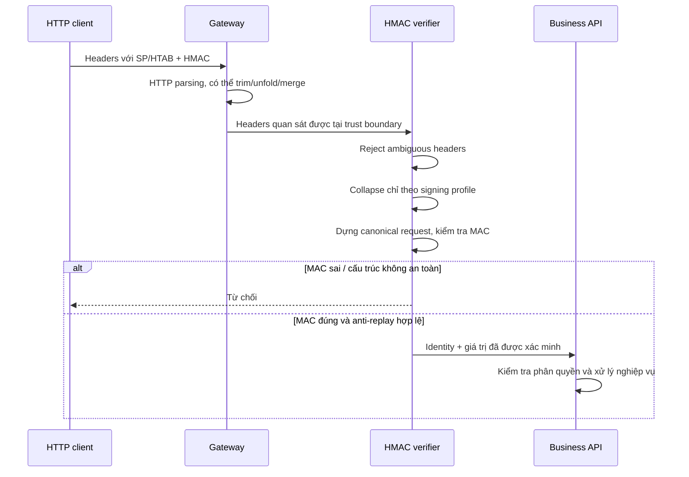

# Collapse whitespace trong Header canonicalization

> **Chương:** Header canonicalization  
> **Bài học:** Collapse whitespace — chuẩn hóa khoảng trắng trong **giá trị HTTP header được ký** để client và server tính cùng canonical request trước khi xác minh HMAC.  
> **Bối cảnh:** Xác thực HTTP request bằng shared secret, ký method, URI, header hoặc body theo hợp đồng. Bài học gắn việc chuẩn hóa header với Java 17/JCA, kiểm thử proxy/gateway, timestamp và nonce chống replay, key rotation, cũng như phân biệt xác thực với phân quyền.

## 1. Vì sao whitespace trong header ảnh hưởng chữ ký HMAC?

Giả sử client ký một HTTP request:

```http
POST /v1/invoices?mode=commit HTTP/1.1
Host: invoices.example.test
Content-Type: application/json
X-Client-Id: partner-01
X-Key-Id: partner-2026-11
X-Timestamp: 1795800000
X-Nonce: Bph1bgR7mMYnUnkY_UY6NA
X-Request-Label: monthly   invoices
X-Signature: <base64url-hmac>

{"invoiceId":"INV-101","amount":100000}
```

Một proxy hoặc HTTP client khác có thể biểu diễn giá trị header này như:

```text
X-Request-Label:   monthly     invoices
x-request-label: monthly<TAB>invoices
X-Request-Label: monthly invoices
```

Ở đây, `<TAB>` minh họa **một ký tự HTAB** (byte `0x09`), không phải năm ký tự chữ cái. Trong một API mà `X-Request-Label` chỉ là nhãn gồm các từ cách nhau bằng khoảng trắng, ba dạng này có thể được quy ước là **cùng ý nghĩa**.

Nếu client ký raw header value nhưng server ký giá trị đã thay đổi whitespace, HMAC sẽ khác dù hành động nghiệp vụ không đổi. **Collapse whitespace** là bước chuẩn hóa giá trị header theo một hợp đồng rõ ràng trước khi tạo chuỗi canonical.

Ví dụ hợp đồng của bài:

```text
raw:        "  monthly \t  invoices  "
canonical:  "monthly invoices"
```

Nhưng đây **không phải phép biến đổi an toàn cho mọi header**. Trong một số header, dấu cách bên trong giá trị trích dẫn hoặc payload có thể có ý nghĩa. Nếu bộ xác minh coi hai chuỗi khác nhau là cùng một giá trị trong khi backend lại xử lý khác nhau, kẻ tấn công có thể lợi dụng chênh lệch đó.

**Mục tiêu học tập:**

1. Phân biệt SP, HTAB, OWS và các dạng whitespace không được phép.
2. Biết chính xác khi nào có thể trim/collapse và khi nào phải giữ nguyên hoặc parse theo grammar của header.
3. Tạo canonical header bytes ổn định: chuẩn hóa tên header, giá trị, thứ tự và signed-header list.
4. Phát hiện duplicate headers, obs-fold, parser differential và các biến đổi proxy/gateway.
5. Dùng Java 17 tính và xác minh HMAC trên canonical request, đồng thời không nhầm HMAC với chống replay hoặc phân quyền.

## 2. Hiểu đúng SP, HTAB, OWS và obs-fold

Không phải mọi ký tự được gọi chung là “khoảng trắng” đều được xử lý giống nhau trong HTTP.

| Khái niệm | Bytes điển hình | Ý nghĩa khi làm canonicalization |
| --- | --- | --- |
| **SP** | `0x20` | Dấu cách ASCII; thường được cho phép trong giá trị một số header |
| **HTAB** | `0x09` | Tab ngang; thường được tính vào optional whitespace ở vị trí được grammar cho phép |
| **OWS** (*optional whitespace*) | Không hoặc nhiều SP/HTAB | Xuất hiện tại một số ranh giới cú pháp HTTP; không có nghĩa được xóa mọi SP/HTAB ở mọi vị trí |
| **BWS** (*bad whitespace*) | SP/HTAB tại vị trí grammar không khuyến khích | Khi có quy tắc chuẩn, recipient có thể phải loại bỏ theo grammar; không dùng quy tắc chung tự suy |
| **CR** | `0x0D` | Không được coi như SP trong thuật toán collapse của bài |
| **LF** | `0x0A` | Không được coi như SP trong thuật toán collapse của bài |
| **obs-fold** | CRLF theo sau bởi SP/HTAB trong cú pháp HTTP/1.x cũ | Cú pháp gập dòng lỗi thời, dễ tạo chênh lệch parser; profile bảo mật nên từ chối tại ranh giới có thể quan sát |
| **NBSP** | Unicode U+00A0 | Không phải SP/HTAB HTTP; không được tự động chuyển thành SP |
| **VT / FF** | `0x0B` / `0x0C` | Control characters, không nằm trong hai ký tự collapse của profile này |

### 2.1 Quy tắc collapse của bài: chỉ SP và HTAB

Đối với một số header đã được **hợp đồng cho phép** (ví dụ `X-Request-Label` trong bài), phép chuẩn hóa gồm hai bước:

1. **Bỏ các SP/HTAB liên tiếp ở đầu và cuối giá trị**.
2. **Thay mỗi dãy liên tiếp gồm một hoặc nhiều SP/HTAB giữa hai ký tự không phải SP/HTAB bằng đúng một SP (`0x20`)**.

Công thức minh họa:

```text
normalizeSignedValue(raw):
    reject CR, LF, NUL, DEL và các control khác ngoài HTAB
    trim only SP/HTAB from both ends
    replace each internal [SP HTAB]+ run with a single SP
```

Không dùng biểu thức chính quy `\s+` một cách mù quáng: ý nghĩa `\s` phụ thuộc ngôn ngữ/chế độ Unicode và có thể bao gồm CR, LF hoặc những ký tự ngoài SP/HTAB. Không dùng `String.trim()` hay `strip()` như một định nghĩa hợp đồng HTTP, vì chúng xử lý tập ký tự khác và không tự collapse các dãy ở giữa.

**Quan trọng:** Động tác *collapse* chỉ nên dùng cho header có grammar và ngữ nghĩa nghiệp vụ cho phép. Tên header `X-Request-Label` của ví dụ là trường tùy chỉnh có format được kiểm soát; nó không phải bằng chứng rằng mọi header HTTP đều có thể collapse.

### 2.2 Ví dụ byte-level

| Raw value (ký hiệu hiển thị) | Canonical theo profile | Quyết định |
| --- | --- | --- |
| `"monthly invoices"` | `"monthly invoices"` | Giữ nguyên |
| `" monthly invoices "` | `"monthly invoices"` | Bỏ SP hai đầu |
| `"\tmonthly\tinvoices\t"` | `"monthly invoices"` | HTAB thành SP, trim hai đầu |
| `"monthly   invoices"` | `"monthly invoices"` | Thu gọn dãy SP |
| `"monthly \t  invoices"` | `"monthly invoices"` | Thu gọn hỗn hợp SP/HTAB |
| `"monthly"` | `"monthly"` | Không có dãy cần collapse |
| `"   "` | Chuỗi rỗng | Từ chối nếu header bắt buộc không được rỗng |
| `"monthly\r\n invoices"` | Không có canonical value | Từ chối CR/LF, không chấp nhận obs-fold |
| `"monthly\ninvoices"` | Không có canonical value | Từ chối LF |
| `"monthly\u00A0invoices"` | Không có canonical value | Từ chối NBSP trong profile ASCII của bài |
| `"month\u0000ly"` | Không có canonical value | Từ chối NUL |
| `"\"a  b\""` | Không collapse theo profile của bài | Dấu nháy và ngữ nghĩa quoted-string cần grammar riêng |

Trong bảng, chuỗi `\t`, `\r` và `\n` chỉ là cách **hiển thị** tab, CR và LF. Trong mã Java, chúng tương ứng ký tự control thực sự. Ví dụ thứ hai về NBSP là ký tự Unicode khác dấu cách ASCII, không được “làm sạch” thành SP.

## 3. Khi nào collapse làm thay đổi ngữ nghĩa?

Nguyên tắc bảo mật không chỉ là “client và server ra cùng HMAC”, mà còn là **những request cho cùng canonical bytes phải được backend hiểu theo cùng ngữ nghĩa của các trường đã ký**.

### 3.1 Header có thể áp dụng collapse khi có grammar riêng

Hãy thiết kế `X-Request-Label` chỉ nhận:

```text
label = token *(SP token)
token = một hoặc nhiều ký tự [A-Za-z0-9._-]
```

Client có thể dùng SP/HTAB không đồng nhất trên wire; sau collapse, verifier kiểm tra giá trị chuẩn có khớp grammar `token *(SP token)` không. Backend sau đó dùng **chính giá trị chuẩn đã xác minh**, không đọc lại bản raw để diễn giải bằng quy tắc khác.

Ví dụ:

```text
"  monthly\t invoices  " --> "monthly invoices"
"  payment  batches  "  --> "payment batches"
"\"payment  batches\""   --> TỪ CHỐI trong profile này
```

Dấu nháy kép bị từ chối vì grammar của label không hỗ trợ quoted-string. Nếu tương lai cần giữ khoảng trắng trong chuỗi trích dẫn, phải tạo parser/phiên bản hợp đồng mới.

### 3.2 Header không được collapse tùy tiện

| Header hoặc nhóm header | Vì sao không thể áp dụng một quy tắc chung? | Hướng xử lý |
| --- | --- | --- |
| `Authorization` | Có cú pháp scheme và credentials riêng; dấu cách có thể nằm trong grammar | Dùng parser của scheme đã chọn; không collapse bí mật/credential tùy ý |
| `Cookie` | Cú pháp cặp cookie và dấu phân cách theo quy tắc riêng | Phân tích theo grammar/chiến lược ký cookie đã đặc tả |
| `Set-Cookie` | Ngữ nghĩa nhiều trường và thuộc tính riêng; thông thường là response header | Không gộp/collapse tùy tiện; tránh dùng logic request-header chung |
| `Content-Type` | Có media type, parameters và có thể có quoted-string | Trong ví dụ chỉ cho đúng `application/json` sau kiểm tra định dạng; profile phức tạp cần parser riêng |
| `Forwarded` và `X-Forwarded-*` | Liên quan proxy chain và trust boundary | Chỉ tin giá trị do gateway tin cậy làm sạch/tái tạo |
| Structured fields | Có cú pháp chuẩn, whitespace theo grammar tương ứng | Dùng parser/serializer theo đúng chuẩn của field thay vì regex chung |
| Header chứa token hoặc MAC bí mật | Encoding có thể không cho SP/HTAB bên trong | Kiểm tra cú pháp chính xác và từ chối format sai |

Ngay cả với header chỉ chứa một token, **thường không cần collapse nội bộ**. Phải giới hạn định dạng được chấp nhận. Chẳng hạn `X-Client-Id: partner-01` hợp lệ, nhưng `X-Client-Id: part ner-01` nên bị từ chối sau bước kiểm tra grammar; không cho khoảng trắng tạo một client ID khác.

### 3.3 Một lỗi nghiêm trọng: verifier chuẩn hóa nhưng backend không chuẩn hóa

Giả sử verifier có hai giá trị:

```text
"tenant-a  admin"
"tenant-a admin"
```

Nếu verifier collapse thành cùng một chuỗi, nhưng backend dùng raw string như một định danh phân quyền riêng, hai request **có thể** trỏ đến hai tài nguyên khác nhau trong khi có cùng chữ ký. Đây là dạng *canonicalization collision*: nhiều đầu vào nghiệp vụ khác nhau bị gộp thành một biểu diễn ký.

Giải pháp:

- Chỉ collapse header đã biết rõ grammar và ngữ nghĩa.
- Kiểm tra giá trị chuẩn **trước** khi dùng làm định danh.
- Backend dùng **giá trị đã được xác minh**, không lấy lại raw value theo parser khác.
- Với field có ngữ nghĩa nhạy cảm/không thể chứng minh tính tương đương, ký biểu diễn chính xác hoặc dùng grammar/parser chính thức.
- Bất kỳ thay đổi nào trong canonicalization phải có version và test vector.

## 4. Header canonicalization đầy đủ: name, value, order, signed-header set

Collapse whitespace là **một bước** trong canonicalization header, không phải toàn bộ quá trình. Một hợp đồng ký cần giải quyết bốn phần.

### 4.1 Tên header: case-insensitive, nhưng giá trị có grammar riêng

HTTP header field names không phân biệt chữ hoa/chữ thường. Ví dụ:

```text
Content-Type
content-type
CONTENT-TYPE
```

được hiểu là cùng tên field. Một canonical profile có thể chuẩn hóa tên bằng cách chuyển **ASCII letters** sang chữ thường:

```text
Content-Type  -> content-type
X-Client-Id   -> x-client-id
X-Key-Id      -> x-key-id
```

Dùng parser HTTP bảo đảm tên field có cú pháp hợp lệ. Khi triển khai Java, có thể dùng `toLowerCase(Locale.ROOT)` sau khi giới hạn tên header đúng ASCII; không dựa vào locale máy chủ.

**Không tự lowercase header value.** `Partner-01` và `partner-01` có thể là hai định danh khác nhau theo giao thức; HMAC phải ràng buộc đúng giá trị của từng field.

### 4.2 Giá trị header: xác nhận quy tắc **theo tên field**

Giả sử signing profile của bài quy định:

| Header được ký | Cách xử lý value | Kiểm tra thêm |
| --- | --- | --- |
| `content-type` | Trim SP/HTAB biên; chỉ cho đúng giá trị quy ước | Phải bằng `application/json` |
| `x-client-id` | Trim SP/HTAB biên; không cho SP ở giữa | `[A-Za-z0-9._-]{1,64}` |
| `x-key-id` | Trim SP/HTAB biên; không cho SP ở giữa | `[A-Za-z0-9._-]{1,64}` |
| `x-nonce` | Trim SP/HTAB biên; không cho SP ở giữa | Base64URL không padding của 16 bytes |
| `x-request-label` | Trim biên và collapse SP/HTAB bên trong | `token *(SP token)` theo hợp đồng minh họa |
| `x-timestamp` | Trim SP/HTAB biên; không cho SP ở giữa | Unix seconds, chữ số thập phân không có dấu cộng |

Hàm collapse có thể dùng chung để tạo **giá trị ứng viên**, nhưng tính hợp lệ và sự tương đương nghiệp vụ phải được kiểm tra **riêng theo từng header**. Trong một profile khác, chính SP/HTAB ở biên có thể bị coi là input không hợp lệ; đừng copy quy tắc này sang mọi API.

### 4.3 Thứ tự header: sắp xếp theo canonical name

Client và server có thể truyền các header theo thứ tự khác nhau mà HTTP handler vẫn xử lý giống nhau. Trong profile của bài, signed headers được sort theo tên ASCII chữ thường:

```text
content-type
x-client-id
x-key-id
x-nonce
x-request-label
x-timestamp
```

Mỗi dòng canonical là `name:value`, nối bằng LF (`0x0A`), không thêm khoảng trắng quanh dấu `:`:

```text
content-type:application/json
x-client-id:partner-01
x-key-id:partner-2026-11
x-nonce:Bph1bgR7mMYnUnkY_UY6NA
x-request-label:monthly invoices
x-timestamp:1795800000
```

Bên cạnh phần value, profile nên ký **danh sách tên field đã chọn**, ví dụ:

```text
content-type;x-client-id;x-key-id;x-nonce;x-request-label;x-timestamp
```

Việc này giúp ràng buộc cấu trúc “đã ký những header nào”. Không cho client âm thầm loại `x-client-id` hoặc `x-timestamp` khỏi signed-header list để HMAC không còn bảo vệ trường quan trọng.

### 4.4 Header trùng tên: reject, không chọn đại một giá trị

Trong nhiều HTTP stack, các dòng:

```http
X-Client-Id: partner-01
x-client-id: attacker
```

có thể trở thành một danh sách giá trị, bị gộp bằng dấu phẩy, hoặc chỉ còn giá trị đầu/cuối tùy proxy và framework. Với những header thuộc profile ký của bài, **duplicate không được phép**. Phải phát hiện sau khi chuẩn hóa **tên** (không phân biệt case) và từ chối trước khi xác minh MAC.

Không nên xử lý bằng:

```java
String clientId = headers.getFirst("X-Client-Id");
// Bỏ qua các header trùng còn lại: không an toàn nếu parser/gateway khác.
```

Nếu một proxy đã gộp header và làm mất thông tin duplicate trước khi đến verifier, ứng dụng có thể không còn phân biệt được request gốc. Cần đặt kiểm tra tại nơi vẫn quan sát được cấu trúc ban đầu, hoặc cấu hình proxy từ chối/gộp theo một chính sách đã kiểm chứng.

**Không gộp máy móc** các header có cú pháp list và các header không cho list. `Set-Cookie` là ví dụ điển hình không thể xử lý bằng phép nối dấu phẩy tổng quát; request signature profile nên giới hạn rõ field được phép ký và cách xử lý đa giá trị.

## 5. Canonical HTTP request chứa phần header đã collapse

Giả sử API hóa đơn ký cả method, path/query, signed headers và body hash bằng HMAC-SHA256. Chuỗi canonical minh họa được định nghĩa:

```text
request-hmac-header-ws-v1
invoices-api-prod
POST
/v1/invoices?mode=commit
content-type;x-client-id;x-key-id;x-nonce;x-request-label;x-timestamp
content-type:application/json
x-client-id:partner-01
x-key-id:partner-2026-11
x-nonce:Bph1bgR7mMYnUnkY_UY6NA
x-request-label:monthly invoices
x-timestamp:1795800000
<sha256-hex-of-raw-body-bytes>
```

Quy tắc byte-level:

1. Encode toàn chuỗi thành UTF-8.
2. Các dòng nối bằng **một byte LF `0x0A`**, không có LF cuối.
3. Dòng đầu `request-hmac-header-ws-v1` phân biệt profile ký; dòng audience `invoices-api-prod` ràng buộc đích/môi trường.
4. Method và request-target lấy từ HTTP request thật tại trust boundary đã thống nhất, không lấy từ một header tùy ý do client tự khai.
5. Signed-header names được xác định bởi **server policy**; chuẩn hóa lowercase và sort; mỗi dòng field có dạng `name:normalized-value`.
6. Hash body là SHA-256 của **raw body bytes** đã được xác định theo hợp đồng, không dùng JSON đã parse rồi serialize lại.
7. Tính `HMAC_SHA256(secret, canonicalBytes)`; encode tag bằng Base64URL không padding.

```text
canonicalBytes = UTF8(canonicalRequest)
tagBytes = HMAC_SHA256(sharedSecret, canonicalBytes)
signature = BASE64URL_NO_PADDING(tagBytes)
```

Trong ví dụ này, tag HMAC-SHA256 đầy đủ dài 32 bytes, biểu diễn Base64URL không padding dài 43 ký tự. Signature **không** được đưa vào chính chuỗi canonical; header chứa signature phải được parse/validate riêng.

**Đây là hợp đồng tự thiết kế để học tập, không phải chuẩn chữ ký HTTP phổ quát.** Đối với API cụ thể, phải rà soát đủ dữ liệu ảnh hưởng đến action, routing, tenant và phân quyền. Nếu Host/authority, Content-Encoding hoặc header khác quyết định cách xử lý mà không được ký, cần bổ sung phạm vi ký hoặc ràng buộc chúng bằng một nguồn đáng tin.

## 6. Java 17: collapse header whitespace và xác minh HMAC

Ví dụ dưới đây dùng duy nhất JDK 17. Chương trình có các điểm an toàn chính:

- Chỉ chấp nhận signed headers có tên ASCII hợp lệ; tên header được lower-case.
- Từ chối giá trị có CR/LF, control characters khác HTAB, DEL hoặc ký tự non-ASCII **theo profile minh họa**.
- Trim SP/HTAB hai đầu và collapse các dãy SP/HTAB giữa các ký tự thành một SP.
- Validate riêng từng header theo grammar của profile; signed headers lặp bị từ chối.
- Sort và ràng buộc danh sách signed headers; ký cả method, URI và SHA-256 raw body.
- Dùng `Mac.getInstance("HmacSHA256")`, `Mac.init(key)`; so sánh bytes tag với `MessageDigest.isEqual`.
- Demo **không** cài replay store, key resolver production, HTTP adapter hoặc authorization. Những việc này phải được thêm bên ngoài lõi HMAC.

Lưu thành `HeaderWhitespaceHmacDemo.java`:

```java
import java.nio.charset.StandardCharsets;
import java.security.GeneralSecurityException;
import java.security.MessageDigest;
import java.security.SecureRandom;
import java.time.Instant;
import java.util.ArrayList;
import java.util.Base64;
import java.util.HashMap;
import java.util.HexFormat;
import java.util.List;
import java.util.Locale;
import java.util.Map;

import javax.crypto.Mac;
import javax.crypto.spec.SecretKeySpec;

public final class HeaderWhitespaceHmacDemo {
    private static final String MAC_ALGO = "HmacSHA256";
    private static final String AUDIENCE = "invoices-api-prod";

    // Cố định/sắp xếp bởi chính sách server, không do client chọn.
    private static final List<String> SIGNED_NAMES = List.of(
            "content-type",
            "x-client-id",
            "x-key-id",
            "x-nonce",
            "x-request-label",
            "x-timestamp");

    private HeaderWhitespaceHmacDemo() {}

    public record Header(String name, String value) {}

    public record Request(
            String method,
            String rawTarget,
            List<Header> headers,
            byte[] rawBody) {

        public Request {
            if (headers == null || rawBody == null) {
                throw new IllegalArgumentException("Missing request data");
            }
            headers = List.copyOf(headers);
            rawBody = rawBody.clone();
        }

        @Override
        public byte[] rawBody() {
            return rawBody.clone();
        }
    }

    // Demo chỉ hỗ trợ tên header chữ ASCII và dấu '-'.
    private static boolean validHeaderName(String name) {
        return name != null
                && name.matches("[A-Za-z0-9-]{1,64}");
    }

    // Chỉ SP và HTAB: không dùng regex \s hoặc trim/strip.
    // Từ chối CR/LF để không tạo hoặc nhận obs-fold.
    private static String collapseOws(String raw) {
        if (raw == null || raw.length() > 1024) {
            throw new IllegalArgumentException("Invalid header value");
        }

        StringBuilder out = new StringBuilder();
        boolean pendingSpace = false;

        for (int i = 0; i < raw.length(); i++) {
            char c = raw.charAt(i);

            if (c == ' ' || c == '\t') {
                if (out.length() > 0) pendingSpace = true;
                continue;
            }
            // Profile ASCII đơn giản; từ chối mọi control/non-ASCII.
            if (c < 0x21 || c > 0x7e) {
                throw new IllegalArgumentException(
                        "Control or non-ASCII header value");
            }

            if (pendingSpace) out.append(' ');
            out.append(c);
            pendingSpace = false;
        }
        // Không append pendingSpace ở cuối => trim SP/HTAB.
        return out.toString();
    }

    private static boolean validNonce(String nonce) {
        if (nonce == null
                || !nonce.matches("[A-Za-z0-9_-]{22}")) {
            return false;
        }
        try {
            byte[] data = Base64.getUrlDecoder().decode(nonce);
            return data.length == 16
                    && Base64.getUrlEncoder().withoutPadding()
                            .encodeToString(data).equals(nonce);
        } catch (IllegalArgumentException invalidBase64) {
            return false;
        }
    }

    private static Map<String, String> signedHeaders(Request req) {
        Map<String, String> result = new HashMap<>();

        for (Header h : req.headers()) {
            if (!validHeaderName(h.name())) {
                throw new IllegalArgumentException("Invalid header name");
            }
            String name = h.name().toLowerCase(Locale.ROOT);
            if (!SIGNED_NAMES.contains(name)) {
                // Header không ký vẫn phải qua HTTP adapter/policy.
                continue;
            }
            if (result.containsKey(name)) {
                throw new IllegalArgumentException(
                        "Duplicate signed header");
            }
            result.put(name, collapseOws(h.value()));
        }

        if (result.size() != SIGNED_NAMES.size()) {
            throw new IllegalArgumentException("Missing signed header");
        }

        if (!"application/json".equals(result.get("content-type"))) {
            throw new IllegalArgumentException("Invalid content-type");
        }
        if (!result.get("x-client-id")
                .matches("[A-Za-z0-9._-]{1,64}")
                || !result.get("x-key-id")
                .matches("[A-Za-z0-9._-]{1,64}")) {
            throw new IllegalArgumentException("Invalid client/key ID");
        }
        if (!result.get("x-timestamp")
                .matches("[1-9][0-9]{9,11}")
                || !validNonce(result.get("x-nonce"))) {
            throw new IllegalArgumentException(
                    "Invalid timestamp or nonce format");
        }
        if (!result.get("x-request-label")
                .matches("[A-Za-z0-9._-]+(?: [A-Za-z0-9._-]+)*")) {
            throw new IllegalArgumentException("Invalid request label");
        }
        return result;
    }

    static byte[] canonicalBytes(Request req)
            throws GeneralSecurityException {
        // Cố định endpoint trong demo để không suy đoán method/URI.
        if (!"POST".equals(req.method())
                || !"/v1/invoices?mode=commit".equals(req.rawTarget())
                || req.rawBody().length > 1_048_576) {
            throw new IllegalArgumentException(
                    "Unexpected method, target or body size");
        }

        Map<String, String> headers = signedHeaders(req);
        byte[] body = req.rawBody();
        String bodyHash = HexFormat.of().formatHex(
                MessageDigest.getInstance("SHA-256").digest(body));

        List<String> lines = new ArrayList<>();
        lines.add("request-hmac-header-ws-v1");
        lines.add(AUDIENCE);
        lines.add(req.method());
        lines.add(req.rawTarget());
        lines.add(String.join(";", SIGNED_NAMES));
        for (String name : SIGNED_NAMES) {
            lines.add(name + ":" + headers.get(name));
        }
        lines.add(bodyHash);

        return String.join("\n", lines)
                .getBytes(StandardCharsets.UTF_8);
    }

    private static byte[] hmac(byte[] secret, byte[] data)
            throws GeneralSecurityException {
        Mac mac = Mac.getInstance(MAC_ALGO);
        mac.init(new SecretKeySpec(secret, MAC_ALGO));
        return mac.doFinal(data);
    }

    static String signForDemo(byte[] secret, Request req)
            throws GeneralSecurityException {
        byte[] tag = hmac(secret, canonicalBytes(req));
        return Base64.getUrlEncoder().withoutPadding()
                .encodeToString(tag);
    }

    static boolean verify(
            byte[] secret, Request actual, String encodedTag)
            throws GeneralSecurityException {
        if (secret == null || secret.length == 0
                || encodedTag == null
                || !encodedTag.matches("[A-Za-z0-9_-]{43}")) {
            return false;
        }

        final byte[] provided;
        try {
            provided = Base64.getUrlDecoder().decode(encodedTag);
        } catch (IllegalArgumentException malformedTag) {
            return false;
        }

        if (provided.length != 32
                || !Base64.getUrlEncoder().withoutPadding()
                        .encodeToString(provided).equals(encodedTag)) {
            return false;
        }

        try {
            byte[] expected = hmac(secret, canonicalBytes(actual));
            return MessageDigest.isEqual(expected, provided);
        } catch (IllegalArgumentException invalidRequest) {
            return false;
        }
    }

    private static String newNonce(SecureRandom rng) {
        byte[] bytes = new byte[16];
        rng.nextBytes(bytes);
        return Base64.getUrlEncoder().withoutPadding()
                .encodeToString(bytes);
    }

    private static Request request(
            String timestamp, String nonce, String label) {

        List<Header> headers = List.of(
                new Header("Content-Type", "  application/json  "),
                new Header("X-Client-Id", "partner-01"),
                new Header("x-Key-Id", "partner-2026-11"),
                new Header("X-Timestamp", timestamp),
                new Header("X-Nonce", nonce),
                new Header("X-Request-Label", label));

        byte[] body = (
                "{\"invoiceId\":\"INV-101\",\"amount\":100000}"
        ).getBytes(StandardCharsets.UTF_8);

        return new Request(
                "POST", "/v1/invoices?mode=commit", headers, body);
    }

    public static void main(String[] args)
            throws GeneralSecurityException {

        SecureRandom rng = new SecureRandom();
        byte[] secret = new byte[32];
        rng.nextBytes(secret);
        String timestamp = Long.toString(
                Instant.now().getEpochSecond());
        String nonce = newNonce(rng);

        Request original = request(
                timestamp, nonce, "  monthly \t  invoices  ");
        Request sameMeaning = request(
                timestamp, nonce, "monthly invoices");
        Request changed = request(
                timestamp, nonce, "monthly refunds");
        Request injected = request(
                timestamp, nonce, "monthly\r\ninvoices");

        String tag = signForDemo(secret, original);

        System.out.println("Collapsed header: "
                + collapseOws("  monthly \t  invoices  "));
        System.out.println("Canonical bytes equal: "
                + MessageDigest.isEqual(
                        canonicalBytes(original),
                        canonicalBytes(sameMeaning)));

        System.out.println("Original valid: "
                + verify(secret, original, tag));
        System.out.println("Changed whitespace valid: "
                + verify(secret, sameMeaning, tag));
        System.out.println("Changed label valid: "
                + verify(secret, changed, tag));
        System.out.println("CRLF injected valid: "
                + verify(secret, injected, tag));
        System.out.println("Exact replay MAC valid: "
                + verify(secret, original, tag));

        List<Header> duplicate =
                new ArrayList<>(original.headers());
        duplicate.add(new Header("x-nonce", nonce));
        Request duplicateNonce = new Request(
                original.method(), original.rawTarget(),
                duplicate, original.rawBody());

        System.out.println("Duplicate nonce header valid: "
                + verify(secret, duplicateNonce, tag));
    }
}
```

Chạy bằng JDK 17 (không cần thư viện ngoài):

```bash
javac HeaderWhitespaceHmacDemo.java
java HeaderWhitespaceHmacDemo
```

Kết quả kỳ vọng:

```text
Collapsed header: monthly invoices
Canonical bytes equal: true
Original valid: true
Changed whitespace valid: true
Changed label valid: false
CRLF injected valid: false
Exact replay MAC valid: true
Duplicate nonce header valid: false
```

**Cách hiểu kết quả:**

- Hai value chỉ khác chuỗi SP/HTAB được hợp đồng cho phép trở thành cùng canonical value nên HMAC khớp.
- Đổi `monthly invoices` thành `monthly refunds` là đổi nội dung, không thể dùng MAC cũ.
- CRLF không được chuyển thành SP; parser từ chối ngay tại bước dựng canonical.
- Duplicate header `X-Nonce` và `x-nonce` là **cùng tên** theo quy tắc HTTP, nên bị từ chối.
- Replay nguyên request vẫn cho HMAC đúng: ví dụ chưa có nonce store nên không được coi là hệ thống chống replay hoàn chỉnh.
- Shared secret được tạo ngẫu nhiên trong demo **chỉ để thử nghiệm**. Production cần key resolver theo client ID, key ID, audience và thời gian hiệu lực.

### 6.1 Giới hạn và trách nhiệm của HTTP adapter

Mã ví dụ nhận một `List<Header>` đã được HTTP adapter trích xuất và giữ nguyên các header. Trong thực tế, một số framework **đã trim, unfold hoặc merge header** trước khi lớp ứng dụng nhìn thấy. Nếu cần phát hiện duplicate hay obs-fold gốc, phải cấu hình parser/gateway từ chối chúng tại ranh giới vẫn còn thông tin. Java code ở tầng business không thể phục hồi những bytes đã mất.

Ví dụ cũng **không phải grammar parser đầy đủ cho mọi HTTP field**: nó cố tình chỉ nhận header ASCII trong signing profile đơn giản. Khi ứng dụng cần header đa giá trị, quoted-string, structured fields hoặc Unicode, hãy thiết kế parser/profile cụ thể thay vì nới lỏng hàm `collapseOws` theo cảm tính.

### 6.2 Vì sao không dùng regex thay mọi whitespace?

Đây là một lỗi dễ mắc:

```java
// KHÔNG dùng cho mọi signed HTTP header:
String canonical = raw.replaceAll("\\s+", " ").trim();
```

Nó có thể xử lý CR, LF, form feed, vertical tab hoặc Unicode whitespace theo những cách không đúng với profile; đồng thời vẫn có thể làm sai giá trị trích dẫn. Trong ví dụ của chúng ta, xử lý thủ công chỉ cho **SP/HTAB** và từ chối ký tự ngoài hợp đồng.

Nếu thực sự dùng regex, cần một regex chặt và các bước kiểm tra input **trước** chuẩn hóa, đồng thời hiểu rõ sự khác nhau giữa biểu thức regular expression, Java string escaping và behavior của HTTP parser. Cách viết thủ công dễ kiểm toán hơn cho bài học này.

## 7. Proxy/gateway: whitespace có thể biến đổi ở đâu?

Một request HTTP thường đi qua client library, CDN, load balancer, API gateway, reverse proxy rồi tới service Java. Mỗi tầng có thể chuẩn hóa hoặc từ chối một số cú pháp header.



### 7.1 HTTP/1.1, HTTP/2 và các biến thể

- HTTP/1.1 có request line và field lines. Một số triển khai cũ có thể xử lý obs-fold theo cách khác nhau. Với signed endpoints nên từ chối field values chứa CR/LF và yêu cầu gateway không tự động “sửa” input mơ hồ.
- HTTP/2 và HTTP/3 biểu diễn method/path/authority qua pseudo-headers và field blocks theo cơ chế khác. Header field names theo HTTP/2 được viết thường; các điều kiện malformed message và whitespace vẫn phải được HTTP stack tuân thủ. Hợp đồng ký nên dựa trên **giá trị hợp lệ tại trust boundary**, không coi wire format HTTP/1.1 và HTTP/2 là chuỗi bytes giống nhau.
- Khi gateway chuyển HTTP/2 → HTTP/1.1, tên header và cách biểu diễn có thể thay đổi. Nếu client và verifier dùng một quy tắc collapse giống nhau trên **giá trị tương đương đã được kiểm tra**, MAC sẽ ổn định; nhưng điều này **không cứu được** trường hợp proxy mất thông tin duplicate, thay đổi nội dung hoặc có parser differential.

### 7.2 Những header proxy có thể khiến trust boundary thay đổi

| Thành phần | Rủi ro | Biện pháp |
| --- | --- | --- |
| `Host` / HTTP/2 `:authority` | Host routing và audience có thể khác nhau | Ràng buộc audience/authority theo hợp đồng, không lấy tùy tiện từ header client |
| `X-Forwarded-For` và `Forwarded` | Client có thể tự khai chuỗi proxy | Gateway xóa và tái tạo trong kênh tin cậy; chỉ tin hop được cho phép |
| `X-Original-URI` / `X-Rewrite-URL` | Có thể được dùng để giả mạo target trước rewrite | Không tin khi chưa do gateway đáng tin tạo; lựa chọn điểm xác minh rõ |
| `Content-Length` và `Transfer-Encoding` | Không đồng bộ framing giữa proxy/backend gây request smuggling | Xử lý ở HTTP parser/gateway theo chuẩn; từ chối framing nhập nhằng, không dựa vào whitespace collapse |
| Header nhiều giá trị | Có thể bị proxy gộp/chọn một giá trị | Định nghĩa duplicate/list semantics; reject trường nhạy cảm trùng |
| `Content-Encoding` | Body có thể được giải nén hoặc biến đổi | Ký raw body bytes theo hợp đồng ở điểm xác minh và bảo đảm backend xử lý đúng payload |

Không thể giải quyết request smuggling hoặc trust-boundary confusion chỉ bằng thay khoảng trắng trước HMAC. Nếu proxy và backend không thống nhất request nào đang được xử lý, **chữ ký đúng trên một biểu diễn vẫn có thể không bảo vệ thao tác thật**.

### 7.3 Hợp đồng ký cần nói rõ việc trim/collapse diễn ra ở đâu

Một lựa chọn là đặt verifier tại API gateway trước khi rewrite URI/headers. Lựa chọn khác là xác minh tại backend với request **sau biến đổi**, nhưng client và gateway phải có hợp đồng về biểu diễn sẽ được ký/xác minh.

Đừng để hai tầng cùng canonicalize theo cách riêng:

```text
Client: collapse HTAB -> SP
Gateway: merge duplicate fields bằng dấu phẩy
Verifier: lấy value đầu tiên
Backend: lấy value cuối cùng
```

Tình huống này có thể làm verifier và backend sử dụng dữ liệu khác nhau. Hãy thiết kế các bước **validation → canonicalization → verification → authorization/processing** với cùng dữ liệu đã được xác minh, không phân tích lại header bằng parser khác ở tầng nghiệp vụ.

## 8. Collapse whitespace, replay protection và key rotation

### 8.1 Collapse không thay thế timestamp và nonce

Một request giữ nguyên HMAC, headers, method, URI và body vẫn có thể được phát lại. Dù whitespace đã chuẩn hóa đúng, tag vẫn khớp.

Để chống replay:

1. Timestamp và nonce phải xuất hiện trong các signed headers/canonical request.
2. Server kiểm tra signed timestamp trong cửa sổ chấp nhận, ví dụ ±300 giây.
3. Nonce phải được sinh từ CSPRNG; server claim một lần trong replay store chia sẻ bằng thao tác nguyên tử.
4. TTL dấu nonce phải bao phủ toàn bộ thời gian request có thể còn hợp lệ; với cửa sổ ±300 giây, trường hợp nhận sớm nhất có thể dẫn đến thời hạn gần 600 giây, cộng margin phù hợp.
5. Nếu replay store timeout, failover hoặc trả kết quả không rõ ràng thì **fail closed**, không chạy nghiệp vụ.

Mọi giá trị timestamp/nonce trước khi dùng phải được xác minh bằng HMAC. Đừng claim nonce dựa trên một header chưa được chứng thực.

### 8.2 Key rotation và phiên bản hợp đồng

Một key resolver trong production cần ánh xạ:

```text
(clientId, keyId, audience, signingProfile)
    -> active shared secret + validity/rotation policy
```

Sau khi chọn đúng secret, tính HMAC trên canonical bytes theo cùng profile whitespace mà client được phép dùng. Không thử mọi key hoặc mọi biến thể collapse cho đến khi gặp MAC khớp.

**Thay đổi quy tắc whitespace** cũng là thay đổi hợp đồng ký. Nếu profile v1 giữ nguyên các SP nội bộ, còn v2 collapse SP/HTAB, phải version hóa và cung cấp test vectors mới. Không âm thầm fallback sang cách ít chặt chẽ hơn khi v2 không xác minh được, vì có thể tạo đường downgrade.

Key rotation có thể đổi `X-Key-Id` mà không cần đổi chính sách collapse nếu hợp đồng ký không thay đổi. Nonce replay store vẫn phải chặn phát lại request cũ trong phạm vi client/audience qua giai đoạn chuyển key.

### 8.3 HMAC hợp lệ không đồng nghĩa có quyền

Header `X-Client-Id: partner-01` được ký đúng nghĩa là verifier có thể chứng thực request theo shared secret gắn với client đó, **không** có nghĩa client được phép tạo hóa đơn ở mọi tenant.

Bước authorization phải kiểm tra action, resource, tenant và các giới hạn nghiệp vụ. Nếu client retry với nonce mới nhưng cùng idempotency key, backend cần bảo đảm không tạo hai hóa đơn hoặc hai giao dịch giống nhau. Nonce ngăn phát lại **một request đã ký**, không tự bảo đảm exactly-once cho nghiệp vụ.

## 9. Ma trận kiểm thử collapse whitespace

Test phải đi từ unit test tới kiểm thử tích hợp với proxy/gateway. Chỉ kiểm tra “Java ký rồi Java tự verify” bằng cùng một hàm collapse có thể che giấu sự khác biệt với client dùng ngôn ngữ khác hoặc HTTP stack thật.

| Ca kiểm thử | Thay đổi | Kỳ vọng |
| --- | --- | --- |
| Baseline | Header theo đúng grammar, key/MAC hợp lệ | Qua bước HMAC |
| SP ngoài value | Thêm/bớt SP ở hai đầu của label được phép | Cùng canonical value |
| HTAB trong label | Đổi một dãy SP thành HTAB | Cùng canonical value theo profile |
| SP/HTAB hỗn hợp | Nhiều dấu cách và tab liên tiếp | Collapse thành một SP |
| Thay chữ trong label | `monthly invoices` → `monthly refunds` | MAC cũ sai |
| Header name casing | `X-Client-Id` → `x-client-id` | Cùng canonical name |
| Header value casing | `partner-01` → `Partner-01` | Không tự lower-case; từ chối/khác MAC |
| Tên field có ký tự sai | Khoảng trắng hoặc control trong tên | Từ chối ở parser/verifier |
| Value chứa CRLF | Obs-fold/line injection | Từ chối trước xác minh |
| Value chứa LF | Newline injection | Từ chối |
| Value chứa NUL/DEL | Control character | Từ chối |
| Value chứa NBSP | Unicode whitespace ngoài profile ASCII | Từ chối |
| Quoted-string có SP | `"a  b"` khi field không hỗ trợ quoted-string | Từ chối, không collapse mù |
| Label toàn SP/HTAB | Sau collapse thành rỗng | Từ chối vì field bắt buộc |
| Header ID có SP bên trong | `partner 01` | Từ chối theo grammar ID |
| Header trùng khác casing | `X-Nonce` và `x-nonce` | Từ chối |
| Header trùng bị proxy gộp | Một value có dấu phẩy | Từ chối nếu field không hỗ trợ list; kiểm thử tại gateway |
| Đổi thứ tự headers | Cùng tập field nhưng thứ tự trên wire khác | Cùng canonical header lines |
| Bỏ signed header | Thiếu `x-timestamp` hoặc `x-client-id` | Từ chối |
| Client chọn signed-header list | Bỏ một field quan trọng khỏi danh sách khai báo | Từ chối theo server policy |
| Đổi method/URI | Thay `POST`/query mà giữ tag | MAC sai |
| Đổi body JSON raw bytes | Thay amount hoặc spacing của raw JSON | Body digest và MAC khác |
| Gateway normalize OWS | Thay đổi SP/HTAB theo grammar đã ký | Cùng canonical khi thực sự tương đương |
| Gateway unfold obs-fold | Tầng đầu đã chấp nhận input lỗi thời | Kiểm tra phải chặn trước khi mất thông tin |
| HTTP/2 → HTTP/1.1 | Tên field được chuyển đổi | Cùng canonical semantics hoặc từ chối rõ ràng |
| Key bị thu hồi | Prefix/headers đúng nhưng key inactive | Từ chối xác thực |
| Replay nguyên request | MAC đúng và nonce đã dùng | Replay store từ chối |
| Replay store timeout | Không chắc nonce mới | Fail closed |
| HMAC đúng nhưng sai quyền | Client dùng resource/tenant không được phép | Authorization từ chối |

### 9.1 Golden test vectors

Tạo bộ vector cố định, dùng **secret thử nghiệm**:

```text
profile: request-hmac-header-ws-v1
mac: HmacSHA256
method: POST
raw_target: /v1/invoices?mode=commit
raw_body_bytes_hex: <test-body-hex>
received_signed_headers:
  Content-Type: "  application/json  "
  X-Client-Id: "partner-01"
  X-Key-Id: "partner-2026-11"
  X-Nonce: <test-nonce>
  X-Request-Label: "  monthly\t  invoices  "
  X-Timestamp: <test-timestamp>
expected_normalized_label: "monthly invoices"
expected_signed_header_names: content-type;x-client-id;x-key-id;x-nonce;x-request-label;x-timestamp
expected_canonical_utf8_hex: <exact-byte-sequence>
expected_hmac_hex: <32-byte-tag-in-hex>
expected_signature_base64url: <43-character-tag>
```

Khi chạy test vector thật, những chỗ placeholder phải được thay bằng bytes/tag **đã tính độc lập**. Các test về CRLF, duplicate, quoted-string và bad Unicode nên được ghi là **expect rejection**, không phải tạo “giá trị canonical” giả để có thể so HMAC.

### 9.2 Checklist code review

1. Có nhận diện **đúng SP/HTAB** thay vì thay mọi Unicode whitespace hoặc `\s` không?
2. Có reject CR/LF, obs-fold và các control characters **trước khi normalize** không?
3. Có chuẩn hóa lowercase cho **header name**, đồng thời giữ value theo grammar riêng không?
4. Có phát hiện duplicate signed headers ngay cả khi tên khác casing không?
5. Có xác định rõ field nào được phép collapse và field nào phải giữ nguyên/parser-specific không?
6. Backend có dùng **đúng giá trị đã được xác minh** thay vì lấy lại raw header không?
7. Signed-header names có được cố định/kiểm soát bởi server policy và xuất hiện trong canonical bytes không?
8. Có ký cả method, path/query, body hash, client/key ID, audience, timestamp/nonce theo hợp đồng không?
9. HMAC có dùng key còn hiệu lực, so sánh tag bytes và chặn replay atomically không?
10. Proxy/gateway có bảo toàn hoặc từ chối duplicate/obs-fold trước khi thông tin bị gộp không?
11. Đổi canonical profile có version mới và kế hoạch migration không?
12. Sau HMAC và nonce, authorization và idempotency nghiệp vụ có vẫn được thực thi không?

## 10. Bài tập thực hành

**Bài 1 — Tự triển khai collapse:** Viết một hàm nhận chuỗi chỉ có ASCII graphic, SP và HTAB, trả chuỗi đã trim biên và collapse dãy SP/HTAB. Dùng các test: `"  a\t b  "`, `"\ta\t\tb\t"`, `"a"`, `"  "`. Giải thích vì sao đầu vào rỗng bị header grammar của API từ chối dù hàm collapse có thể trả chuỗi rỗng.

**Bài 2 — Regex không an toàn:** Thử `replaceAll("\\s+", " ")` với CRLF, VT và NBSP trong các chế độ Java khác nhau. Vì sao không nên dùng nó như định nghĩa chung của HTTP header canonicalization? Đề xuất bước validation trước normalization.

**Bài 3 — Header semantics:** Với một header có quoted-string chứa hai SP liên tiếp, giải thích tại sao collapse có thể làm thay đổi ngữ nghĩa. Thiết kế một grammar cho header tự tạo sao cho việc collapse được phép và chứng minh verifier/backend dùng cùng kết quả.

**Bài 4 — Duplicate headers:** Gửi `X-Client-Id: partner-01` và `x-client-id: attacker` qua gateway. Kiểm thử các tình huống gateway giữ danh sách, gộp bằng dấu phẩy hoặc chỉ giữ giá trị cuối. Trình bày nơi cần reject để không có chênh lệch giữa verifier và backend.

**Bài 5 — HMAC:** Dùng `HeaderWhitespaceHmacDemo` ký request với label chứa tab/khoảng trắng, xác minh với label đã collapse. Sau đó thay một từ trong label và giữ signature cũ. Tại sao ca đầu vẫn hợp lệ còn ca sau bị từ chối?

**Bài 6 — Gateway và replay:** Gửi request HTTP/2 qua proxy sang HTTP/1.1, so sánh canonical header bytes theo test secret. Phát lại nguyên request có signature đúng: chứng minh chỉ collapse/HMAC không phát hiện replay, phải có timestamp/nonce store dùng chung.

**Bài 7 — Version migration:** Giả sử profile v1 ký raw field value và v2 collapse SP/HTAB trong label. Thiết kế version mới, test vectors và policy xác minh sao cho client không tùy chọn fallback về profile cũ để né các field bắt buộc.

## 11. Câu hỏi tự kiểm tra

1. Collapse whitespace trong header của bài xử lý những ký tự nào? Có xử lý CR/LF hoặc NBSP không?
2. Vì sao không thể áp dụng `trim()` hoặc regex `\s+` như quy tắc chung cho mọi HTTP header?
3. Sự khác biệt giữa canonicalize header name và canonicalize header value là gì?
4. Vì sao header như `Authorization`, `Cookie` hoặc header chứa quoted-string cần grammar riêng?
5. Một request có hai `X-Nonce` khác nhau về casing của tên field phải xử lý thế nào?
6. Nếu gateway đã gộp duplicate headers, verifier có thể luôn khôi phục cấu trúc gốc không?
7. Vì sao nên ký danh sách signed-header names và không cho client tự bỏ những field bắt buộc?
8. Nếu verifier collapse giá trị nhưng backend xử lý raw value khác, lỗi bảo mật nào có thể xảy ra?
9. Collapse whitespace có giúp chặn request được phát lại nguyên vẹn không?
10. Khi key rotation hoặc đổi canonical profile, tại sao cần kiểm tra policy và version?
11. HMAC và nonce hợp lệ đã đủ chứng minh client có quyền thực hiện giao dịch chưa?

**Ghi nhớ:** *Collapse whitespace* chỉ là **một phép chuẩn hóa có điều kiện** trong header canonicalization. Với signing profile được kiểm soát, có thể trim SP/HTAB ở biên và thay dãy SP/HTAB ở giữa bằng một SP, nhưng **phải từ chối control characters/obs-fold và kiểm tra grammar theo từng header**. Verifier, gateway và backend phải hiểu cùng header semantics, cùng bộ signed fields và cùng canonical bytes. Sau xác minh HMAC vẫn cần timestamp/nonce chống replay, key management, phân quyền và idempotency nghiệp vụ.
