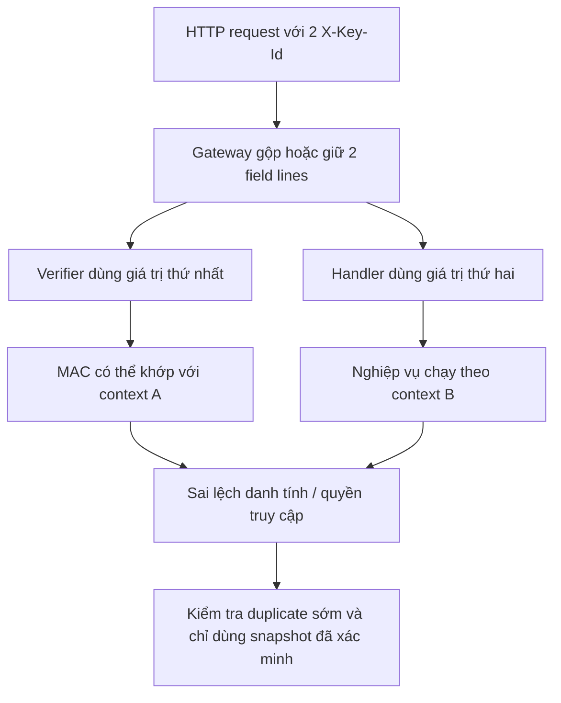
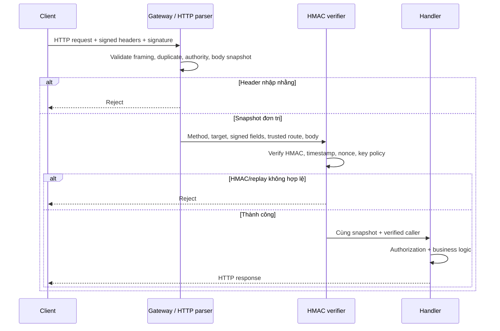

# Header lặp trong HTTP: canonicalization an toàn khi ký request bằng HMAC

## 1. Vấn đề: cùng một header nhưng nhiều giá trị

**Header lặp (duplicate HTTP field lines)** là trường hợp cùng một tên HTTP header xuất hiện hơn một lần trong request. Ví dụ:

```http
POST /v1/payments HTTP/1.1
Host: api.example.test
Content-Type: application/json
content-type: text/plain
X-Key-Id: merchant-A
X-Key-Id: merchant-B
```

Tên HTTP field **không phân biệt chữ hoa/thường**; vì vậy `Content-Type` và `content-type` là **cùng một tên**, dù được viết khác case. Nhiều HTTP stack có thể diễn giải header lặp theo các cách khác nhau: lấy dòng đầu, lấy dòng cuối, trả danh sách, nối bằng dấu phẩy hoặc từ chối. Hệ thống xác thực HMAC không được giả định mọi thành phần đều đọc chúng giống nhau.

Bài **Header lặp** thuộc chương **Header canonicalization**, trong module `SECURITY_AUTHENTICATION_HMAC_REQUEST_AUTHENTICATION`. Module hướng dẫn thiết kế xác thực HTTP request bằng **HMAC với shared secret** và **canonical request** gồm method, URI, header hoặc body theo hợp đồng; xác minh chữ ký, chống replay bằng timestamp/nonce, key rotation, kiểm thử proxy/gateway và phân biệt **authentication** với **authorization**.

Khi **verifier HMAC** lấy `X-Key-Id: merchant-A` để tra secret còn **handler** hoặc middleware sau đó lại nhận `merchant-B`, MAC có thể khớp với dữ liệu verifier sử dụng nhưng **không xác thực đúng context nghiệp vụ thực thi**. Tương tự, nếu verifier tin `Content-Type: application/json` còn framework parse body như `text/plain` hoặc `application/x-www-form-urlencoded`, chữ ký không còn bảo vệ đúng cách diễn giải body.

**Nguyên tắc:** Phải bảo đảm **một giá trị canonical đã được xác minh** là **chính giá trị mà các tầng xử lý phía sau sử dụng**. Với các header bảo mật được định nghĩa là đơn trị, cách bảo vệ dễ kiểm toán là **từ chối mọi trường hợp trùng tên trước khi canonicalize**.

## 2. Phân biệt field line và một value chứa danh sách

Hai cách biểu diễn sau **không tự động tương đương**:

```http
Example-List: alpha
Example-List: beta
```

```http
Example-List: alpha,beta
```

Cách thứ nhất có **hai field lines**, còn cách thứ hai chỉ có **một field line** với dấu phẩy bên trong value. Chỉ có thể gộp nhiều dòng nếu **định nghĩa field đó** cho phép cú pháp danh sách và quy định cách kết hợp.

Các nguyên tắc cần nhớ:

- **Case-insensitive field names:** `X-Key-Id`, `x-key-id`, `X-KEY-ID` đều chỉ cùng field name. Kiểm tra duplicate phải dùng tên đã chuẩn hóa.
- **Không phải mọi field là list-valued:** các field đơn trị không được ghép tự động bằng dấu phẩy.
- **Field có cú pháp danh sách** có thể được kết hợp theo quy tắc HTTP của field đó, nhưng phải giữ đúng **thứ tự và ngữ nghĩa**. Không dùng `split(",")` bừa bãi vì dấu phẩy có thể xuất hiện bên trong quoted-string hoặc giá trị có grammar đặc biệt.
- **`Set-Cookie` ở response** là ví dụ nổi bật về ngoại lệ: không gộp thành một danh sách phân tách bằng dấu phẩy.
- **`Cookie` khi chuyển đổi HTTP/2 và HTTP/1.1** có cách xử lý riêng (HTTP/2 có thể tách thành nhiều field lines, khi gộp thường dùng `"; "`, không phải dấu phẩy). Nếu ký Cookie, phải có contract riêng; bài này **không ký Cookie**.
- **Thứ tự header lines trên wire** không phải cơ sở tốt để canonicalize những field đơn trị. Hợp đồng ký nên công bố thứ tự cố định theo tên; riêng list-valued field cần quy tắc riêng.

| Tình huống | Được tự nối bằng dấu phẩy? | Chính sách trong profile minh họa |
| --- | --- | --- |
| Hai `X-Key-Id` | **Không**. | Từ chối, kể cả hai giá trị giống hệt nhau. |
| Hai `X-Timestamp` | **Không**. | Từ chối; không chọn timestamp đầu/cuối. |
| Hai `X-Nonce` | **Không**. | Từ chối; replay layer phải dùng đúng nonce đã ký. |
| Hai `X-Signature-Version` | **Không**. | Từ chối; không thử nhiều thuật toán/profile. |
| Hai `X-Signature` | **Không**. | Từ chối; không thử nhiều chữ ký cho đến khi một chữ ký khớp. |
| Hai `Content-Type` | Theo profile này: **không**. | Từ chối; không để parser sử dụng kiểu body khác verifier. |
| Hai `Accept` | HTTP có ngữ nghĩa danh sách. | Chỉ canonicalize nếu hợp đồng thực sự định nghĩa quy tắc gộp; bài này không ký Accept. |
| Hai `Cookie` | Không có quy tắc “nối dấu phẩy” chung. | Không ký trong mẫu; tuân quy tắc cookie-specific nếu cần. |
| Nhiều `Set-Cookie` ở response | Không nối thành một danh sách dấu phẩy. | Không thuộc phạm vi ký request. |

## 3. Lỗi parser differential và security impact

Một lỗi thiết kế thường thấy:

```text
HTTP ingress
    |
    +-- HMAC verifier: firstValue("X-Key-Id")  -> merchant-A
    |
    +-- App middleware: lastValue("X-Key-Id")  -> merchant-B
    |
    +-- Business handler: dùng identity B hoặc body parser khác
```

Đây là **parser differential**: hai thành phần quan sát cùng HTTP request nhưng có **hai cách diễn giải khác nhau**. Chữ ký chỉ chứng minh client biết secret tương ứng với dữ liệu được canonicalize, **không tự chứng minh** business handler đọc cùng dữ liệu. Header lặp có thể dẫn đến:

1. **Identity confusion:** verifier chọn key/tenant A, business layer dùng tenant B.
2. **Signature-version confusion:** verifier dùng profile v2, một adapter khác lấy version v1 hoặc fallback ngầm.
3. **Replay bypass:** MAC bao phủ nonce A nhưng nonce store kiểm tra hoặc ghi nonce B.
4. **Body interpretation mismatch:** HMAC ký SHA-256(body bytes), nhưng request parser và handler dùng content type hoặc framing khác nhau.
5. **HTTP request smuggling/desynchronization:** ở tầng thấp hơn, các trường framing không rõ ràng như `Content-Length` và `Transfer-Encoding` có thể khiến proxy và backend xác định ranh giới request khác nhau. **HMAC không sửa được lỗi HTTP parsing**.



Nếu framework đã biến hai dòng thành một chuỗi, ví dụ `merchant-A, merchant-B`, **thông tin số dòng ban đầu có thể mất**. Do đó kiểm tra duplicate phải được thực hiện ở **HTTP adapter hoặc gateway còn nhìn được field lines**, hoặc ingress phải chuyển một snapshot đã được kiểm tra qua kênh tin cậy. Không thể khôi phục chắc chắn số field lines chỉ từ `Map<String,String>`.

## 4. Hai chiến lược canonicalization

### Chiến lược A: từ chối header lặp với signed fields

Đây là chiến lược được dùng trong bài và phù hợp cho các trường bảo mật:

1. Công bố **tập signed header bắt buộc** theo signature version.
2. Đếm số field lines theo **tên đã lowercase**; mỗi signed field phải có **chính xác một dòng**, nếu thiếu hoặc trùng thì từ chối.
3. Kiểm tra giá trị không chứa CR/LF, control, encoding ngoài hợp đồng hoặc định dạng nhập nhằng; quy định cụ thể khoảng trắng đầu/cuối.
4. Canonical hóa **tên thành chữ thường** và **giá trị đã được kiểm tra**, đặt các dòng vào **thứ tự cố định** do hợp đồng ký quy định.
5. Từ chối value có dấu phẩy hoặc cú pháp list nếu signed field được quy định đơn trị, kể cả khi nó chỉ xuất hiện ở **một dòng**.
6. Đảm bảo handler sử dụng chính các giá trị đã được kiểm tra; không gọi lại parser khác với chính sách khác.

**Hai dòng cùng value vẫn bị từ chối.** Ví dụ hai dòng `X-Nonce: same` không được gộp thành một: việc chấp nhận các biểu diễn khác nhau không giúp nghiệp vụ mà tạo thêm bề mặt lệch parser.

### Chiến lược B: hợp nhất có kiểm soát cho một list-valued field

Nếu API thật sự cần ký field có ngữ nghĩa danh sách:

- Phải xác nhận field **cho phép lặp** theo cú pháp HTTP.
- Quy định rõ **separator, thứ tự giá trị, quoting/escaping, khoảng trắng, giá trị rỗng và trường hợp duplicate**.
- Client, gateway, verifier, business handler phải sử dụng **cùng cách hiểu field**; không chỉ thống nhất cách sinh chuỗi MAC.
- Dùng **signature version riêng hoặc nâng version** nếu thay đổi quy tắc canonicalization.

Giả sử hệ thống định nghĩa riêng `Example-List` là danh sách token, và công bố rằng hai field lines `alpha`, `beta` tương đương một value `alpha,beta`. Khi đó mới có thể ký:

```text
example-list:alpha,beta
```

Nhưng đây **chỉ là một ví dụ có định nghĩa riêng**; không áp dụng phép gộp đó cho `X-Key-Id`, `Content-Type`, `X-Nonce` hoặc mọi header khác.

## 5. Quy tắc tên, value, whitespace và thứ tự dòng

### 5.1. Tên header không phân biệt case

Trong canonical HMAC:

```text
Content-Type     -> content-type
X-Key-Id         -> x-key-id
X-Signature-Version -> x-signature-version
```

Java có thể dùng `toLowerCase(Locale.ROOT)` sau khi **kiểm tra tên field là ASCII token**. Hợp đồng demo sẽ dùng tập tên gồm chữ cái ASCII, chữ số và dấu gạch ngang, cố ý hạn chế hơn grammar token tổng quát của HTTP để giữ ví dụ đơn giản. Đừng sử dụng `String.toLowerCase()` theo locale mặc định trên dữ liệu tên field chưa kiểm tra.

### 5.2. Xử lý OWS mà không làm thay đổi ngữ nghĩa

Hợp đồng minh họa quy định chỉ loại bỏ **SP (0x20)** hoặc **HTAB (0x09)** ở **đầu/cuối** giá trị signed field. Sau khi bỏ OWS, những giá trị được ký trong bài chỉ cho phép **visible ASCII và SP nội bộ**, từ chối HTAB nội bộ, CR/LF, control hoặc non-ASCII.

```text
Content-Type:   application/json
  -> canonical value: application/json

Content-Type: application/json,text/plain
  -> reject: không đúng Content-Type đơn trị của profile
```

Việc trim OWS là **quy tắc của profile này**, không phải nghĩa vụ phải làm cho mọi header. Không sử dụng `trim()` hoặc `strip()` tùy tiện khi chúng có thể xử lý những loại khoảng trắng khác với hợp đồng. Không tự lowercase **giá trị** header: phần value có thể phân biệt case.

### 5.3. Thiếu, rỗng, lặp và một dòng có dấu phẩy

Phân biệt bốn dạng:

```http
X-Key-Id: merchant-2026-11
```

```http
X-Key-Id:
```

```http
X-Key-Id: merchant-2026-11
X-Key-Id: merchant-2026-11
```

```http
X-Key-Id: merchant-2026-11,merchant-other
```

Với hợp đồng yêu cầu **một key ID theo regex**, ba ví dụ cuối **đều bị từ chối**. Ví dụ thứ tư không phải hai dòng lặp, nhưng value chứa dấu phẩy khiến nó không hợp lệ. Một field bị thiếu hoàn toàn cũng bị từ chối, không ngầm dùng default key ID.

### 5.4. Thứ tự canonical là cố định

Ngay cả khi client gửi `X-Nonce` trước `Content-Type`, canonical vẫn có thể theo thứ tự đã công bố:

```text
content-type:application/json
x-key-id:merchant-2026-11
x-signature-version:hmac-header-v1
x-timestamp:2026-11-28T02:05:00Z
x-nonce:jSRtkPAw4mJeE0zB0LhlWw
```

Ở đây ta **không sort alphabet** mà dùng **thứ tự schema cố định**. Sort alphabet có thể tạo thứ tự khác; không đúng hay sai tuyệt đối, nhưng không được thay đổi tùy tiện giữa client và server.

## 6. Hợp đồng ký minh họa: HMAC-HEADER-V1

Giả sử service nhận lệnh tạo thanh toán qua `POST /v1/payments` với body JSON:

```http
POST /v1/payments HTTP/1.1
Host: api.example.test
Content-Type: application/json
X-Key-Id: merchant-2026-11
X-Signature-Version: hmac-header-v1
X-Timestamp: 2026-11-28T02:05:00Z
X-Nonce: jSRtkPAw4mJeE0zB0LhlWw
X-Signature: <64 lowercase hex characters>

{"account":"A123","amount":100000}
```

**Đây là hợp đồng tự định nghĩa để thực hành**, không phải một tiêu chuẩn signature được mọi HTTP server hỗ trợ sẵn. Quy tắc gồm:

| Thành phần | Chính sách |
| --- | --- |
| Method/target | `POST` và `/v1/payments` đúng raw target đã cấu hình. |
| Audience | `https://api.example.test` lấy từ route/ingress đáng tin cậy, không chỉ từ `Host`/ `X-Forwarded-Host` do client khai báo. |
| Signed field lines | `Content-Type`, `X-Key-Id`, `X-Signature-Version`, `X-Timestamp`, `X-Nonce`: **mỗi tên đúng một dòng**. |
| Signature carrier | `X-Signature`: **đúng một dòng**, nhưng giá trị chữ ký **không** được đưa vào message ký. |
| Field name/value | Lowercase tên ASCII; trim SP/HTAB rìa value, từ chối control/HTAB nội bộ/non-ASCII trong signed fields. |
| Content-Type | Chính xác `application/json`; không hỗ trợ `Content-Encoding` trong profile này. |
| Key/profile | Key ID duy nhất, key active, allowed audience và signature version `hmac-header-v1`. |
| Timestamp/nonce | Được ký, timestamp UTC chính xác tới giây trong ±5 phút; nonce đủ ngẫu nhiên, chưa sử dụng. |
| Body | SHA-256 của body bytes **thực được handler xử lý**, không tự parse rồi serialize JSON trước khi hash. |
| MAC/encoding | `HmacSHA256` đầy đủ **32 byte**, encode thành **64 ký tự lowercase hex**, không cắt ngắn. |

Canonical request theo **thứ tự dòng cố định**, nối bằng **LF (0A)**, encode UTF-8 và **không có LF cuối**:

```text
HMAC-HEADER-V1
POST
https://api.example.test
/v1/payments
content-type:application/json
x-key-id:merchant-2026-11
x-signature-version:hmac-header-v1
x-timestamp:2026-11-28T02:05:00Z
x-nonce:jSRtkPAw4mJeE0zB0LhlWw
<64 lowercase hex characters of SHA-256(bodyBytes)>
```

Dòng cuối là **placeholder** cho digest thực, không ký các dấu `<` và `>`. HMAC tính:

```text
canonicalBytes = UTF8(canonicalRequest)
macBytes       = HMAC-SHA256(sharedSecret, canonicalBytes)
signatureHex   = lowercaseHex(macBytes)
```

**Quan trọng:** `X-Signature` là đầu ra nên không nằm trong canonical message, nhưng vẫn phải có **đúng một field line**. Signature version và key ID được ký; điều đó **không thay thế** việc server kiểm tra allowlist phiên bản, trạng thái khóa, service/tenant scope hay replay.

## 7. Ví dụ Java 17+: từ chối header lặp trước khi tính HMAC

Ví dụ dùng `List<FieldLine>` để lưu **từng field line riêng biệt**: nếu sử dụng `Map<String,String>` ngay từ đầu, duplicate có thể đã biến mất. Logic gồm kiểm tra tên case-insensitive, từ chối missing/duplicate signed fields, canonicalize OWS và giá trị, xác minh HMAC-SHA256, rồi kiểm tra nonce.

**Tiền điều kiện:** HTTP adapter phải cung cấp field lines trước khi gộp/truncate, raw target, body snapshot và trusted audience. Tầng HTTP phải tự phát hiện malformed request framing, header-name/value trái quy tắc, `Host`/`:authority` không khớp, `Content-Length`/`Transfer-Encoding` mâu thuẫn hoặc request smuggling. Nếu HTTP library đã làm mất duplicate, hãy đặt duplicate check ở gateway/ingress và chỉ chuyển một snapshot **được bảo vệ** cho verifier.

```java
import java.nio.charset.StandardCharsets;
import java.security.GeneralSecurityException;
import java.security.MessageDigest;
import java.time.Clock;
import java.time.Duration;
import java.time.Instant;
import java.time.format.DateTimeParseException;
import java.util.HashMap;
import java.util.HexFormat;
import java.util.List;
import java.util.Locale;
import java.util.Map;
import java.util.Set;
import javax.crypto.Mac;
import javax.crypto.spec.SecretKeySpec;

public final class DuplicateSignedHeaderVerifier {
    private static final String VERSION = "hmac-header-v1";
    private static final String AUDIENCE = "https://api.example.test";
    private static final String TARGET = "/v1/payments";
    private static final HexFormat HEX = HexFormat.of();
    private static final Duration SKEW = Duration.ofMinutes(5);
    private static final Duration NONCE_TTL = Duration.ofMinutes(11);

    private static final Set<String> REQUIRED = Set.of(
            "content-type", "x-key-id", "x-signature-version",
            "x-timestamp", "x-nonce", "x-signature");

    public record FieldLine(String name, String value) {}

    // Phải là raw field lines, chưa bị merge hoặc drop duplicate.
    public record Request(
            String method, String rawTarget, String trustedAudience,
            List<FieldLine> rawLines, byte[] body) {}

    public record Credential(
            byte[] secret, boolean active, String audience,
            Set<String> allowedVersions) {}

    public interface CredentialStore {
        Credential find(String keyId);
    }

    public interface NonceStore {
        // Insert-if-absent nguyên tử trên kho chia sẻ giữa các instance.
        boolean claim(String keyId, String nonce, Duration ttl);
    }

    private static String asciiFieldName(String name) {
        if (name == null || name.isEmpty()) {
            throw new IllegalArgumentException("Missing field name");
        }
        for (int i = 0; i < name.length(); i++) {
            char c = name.charAt(i);
            boolean allowed = (c >= 'A' && c <= 'Z')
                    || (c >= 'a' && c <= 'z')
                    || (c >= '0' && c <= '9') || c == '-';
            if (!allowed) {
                // Demo cố tình hạn chế hơn token grammar của HTTP.
                throw new IllegalArgumentException("Invalid field name");
            }
        }
        return name.toLowerCase(Locale.ROOT);
    }

    private static String canonicalValue(String value) {
        if (value == null) {
            throw new IllegalArgumentException("Null field value");
        }
        int first = 0, last = value.length();
        while (first < last
                && (value.charAt(first) == ' '
                    || value.charAt(first) == '\t')) first++;
        while (last > first
                && (value.charAt(last - 1) == ' '
                    || value.charAt(last - 1) == '\t')) last--;

        String normalized = value.substring(first, last);
        for (int i = 0; i < normalized.length(); i++) {
            char c = normalized.charAt(i);
            // Chỉ visible ASCII và SP nội bộ trong signed values.
            if (c < 0x20 || c > 0x7E) {
                throw new IllegalArgumentException("Unsafe field value");
            }
        }
        return normalized;
    }

    public static Map<String, String> readSignedFields(
            List<FieldLine> rawLines) {
        if (rawLines == null) {
            throw new IllegalArgumentException("Headers unavailable");
        }
        Map<String, String> fields = new HashMap<>();
        for (FieldLine line : rawLines) {
            if (line == null) {
                throw new IllegalArgumentException("Null field line");
            }
            String name = asciiFieldName(line.name());
            if (line.value() == null
                    || line.value().indexOf('\r') >= 0
                    || line.value().indexOf('\n') >= 0) {
                throw new IllegalArgumentException("Malformed field line");
            }
            // Profile không cho phép nén body ở tầng application.
            if ("content-encoding".equals(name)) {
                throw new IllegalArgumentException("Unsupported encoding");
            }
            if (REQUIRED.contains(name)) {
                String value = canonicalValue(line.value());
                if (fields.putIfAbsent(name, value) != null) {
                    throw new IllegalArgumentException(
                            "Duplicate signed header: " + name);
                }
            }
        }
        if (!fields.keySet().equals(REQUIRED)) {
            throw new IllegalArgumentException(
                    "Missing required signed header");
        }
        return Map.copyOf(fields);
    }

    private static byte[] canonicalBytes(Request r,
                                         Map<String, String> fields)
            throws GeneralSecurityException {
        String bodyDigest = HEX.formatHex(
                MessageDigest.getInstance("SHA-256").digest(r.body()));
        String canonical = String.join("\n",
                "HMAC-HEADER-V1",
                r.method(),
                AUDIENCE,
                r.rawTarget(),
                "content-type:" + fields.get("content-type"),
                "x-key-id:" + fields.get("x-key-id"),
                "x-signature-version:"
                    + fields.get("x-signature-version"),
                "x-timestamp:" + fields.get("x-timestamp"),
                "x-nonce:" + fields.get("x-nonce"),
                bodyDigest);
        return canonical.getBytes(StandardCharsets.UTF_8);
    }

    private static byte[] hmacSha256(byte[] secret, byte[] message)
            throws GeneralSecurityException {
        Mac mac = Mac.getInstance("HmacSHA256");
        mac.init(new SecretKeySpec(secret, "HmacSHA256"));
        return mac.doFinal(message);
    }

    public static boolean verify(
            Request r, CredentialStore credentials,
            NonceStore nonces, Clock clock)
            throws GeneralSecurityException {
        if (r == null || r.method() == null || r.rawTarget() == null
                || r.trustedAudience() == null || r.rawLines() == null
                || r.body() == null) return false;
        if (!"POST".equals(r.method())
                || !TARGET.equals(r.rawTarget())
                || !AUDIENCE.equals(r.trustedAudience())
                || r.body().length == 0
                || r.body().length > 1_048_576) return false;

        final Map<String, String> fields;
        try {
            fields = readSignedFields(r.rawLines());
        } catch (IllegalArgumentException ex) {
            return false;
        }

        String keyId = fields.get("x-key-id");
        String version = fields.get("x-signature-version");
        String timestampText = fields.get("x-timestamp");
        String nonce = fields.get("x-nonce");
        String suppliedHex = fields.get("x-signature");
        if (!"application/json".equals(fields.get("content-type"))
                || !keyId.matches("[A-Za-z0-9._-]{1,128}")
                || !VERSION.equals(version)
                || !nonce.matches("[A-Za-z0-9_-]{22,128}")
                || !suppliedHex.matches("[0-9a-f]{64}")) return false;

        Instant timestamp;
        try {
            timestamp = Instant.parse(timestampText);
        } catch (DateTimeParseException ex) {
            return false;
        }
        if (timestamp.getNano() != 0
                || !timestamp.toString().equals(timestampText)
                || Duration.between(clock.instant(), timestamp)
                        .abs().compareTo(SKEW) > 0) return false;

        Credential key = credentials.find(keyId);
        if (key == null || !key.active() || key.secret() == null
                || key.secret().length < 32
                || !AUDIENCE.equals(key.audience())
                || key.allowedVersions() == null
                || !key.allowedVersions().contains(VERSION)) return false;

        byte[] expected = hmacSha256(
                key.secret(), canonicalBytes(r, fields));
        byte[] supplied = HEX.parseHex(suppliedHex);
        if (!MessageDigest.isEqual(expected, supplied)) return false;

        // Chỉ claim nonce sau MAC hợp lệ; authorization là bước riêng.
        return nonces.claim(keyId, nonce, NONCE_TTL);
    }
}
```

### Thử nghiệm trực tiếp trường hợp hai field trùng tên

```java
import java.util.List;

List<DuplicateSignedHeaderVerifier.FieldLine> lines = List.of(
    new DuplicateSignedHeaderVerifier.FieldLine(
        "Content-Type", "application/json"),
    new DuplicateSignedHeaderVerifier.FieldLine(
        "content-type", "application/json"),
    new DuplicateSignedHeaderVerifier.FieldLine(
        "X-Key-Id", "merchant-2026-11")
);

try {
    DuplicateSignedHeaderVerifier.readSignedFields(lines);
    throw new AssertionError("Expected duplicate rejection");
} catch (IllegalArgumentException expected) {
    System.out.println("Rejected duplicate Content-Type");
}
```

Hai field `Content-Type` có **cùng giá trị** vẫn bị từ chối bởi `putIfAbsent` sau khi lowercase tên. Kiểm tra diễn ra **trước khi tra khóa hoặc tính HMAC**. Đoạn code còn từ chối `X-Key-Id: merchant-A, merchant-B` bởi grammar của key ID trong `verify`, dù nó chỉ là một field line.

Code mẫu chủ đích không cho phép `Content-Encoding`; nó cũng **không phải HTTP parser hoàn chỉnh**, không xử lý mọi HTTP token/field grammar hoặc list-valued field. Trong production, tầng ingress nên chặn những header có thể ảnh hưởng cách server diễn giải request nhưng không nằm trong signed contract, hoặc ràng buộc chúng theo chính sách. Lớp xử lý nghiệp vụ phải sử dụng **cùng snapshot** header/body mà verifier đã kiểm tra.

## 8. HTTP/1.1, HTTP/2 và proxy/gateway có thể làm mất duplicate

Chuyển đổi giữa các HTTP version và hop đôi khi thay đổi cách biểu diễn field lines:

| Tình huống | Rủi ro | Yêu cầu phòng vệ |
| --- | --- | --- |
| HTTP/1.1 gửi `X-Nonce` hai lần với case khác nhau. | Verifier và replay layer lấy khác nonce. | Đếm theo tên case-insensitive ở ingress, từ chối. |
| Gateway gộp hai `X-Key-Id` thành `A,B`. | Backend không còn thấy hai dòng ban đầu. | Chặn duplicate trước khi merge và kiểm tra value grammar. |
| HTTP/2 dùng `:authority` thay vì `Host`. | Audience bị xác định từ field không đáng tin hoặc không khớp route. | Adapter xác định trusted audience và kiểm tra authority nhất quán. |
| HTTP/2 tách nhiều field `Cookie`. | Gộp dấu phẩy làm thay đổi cookie semantics. | Không gộp bừa; dùng quy tắc riêng cho Cookie khi cần. |
| Proxy thêm `X-Forwarded-Host`. | Client có thể tự giả mạo header nếu gateway không strip. | Chỉ tin forwarding metadata từ gateway đã được xác thực. |
| Reverse proxy reorder header lines. | MAC sai nếu canonical phụ thuộc thứ tự xuất hiện. | Thứ tự signed fields cố định theo hợp đồng. |
| Proxy trim/merge OWS khác client. | Canonical mismatch hoặc thay đổi value nghiệp vụ. | Quy định OWS rõ và kiểm thử qua mọi hop. |
| Framework chỉ trả về `getHeader(name)`. | Không biết header xuất hiện mấy lần. | Dùng API multi-value hoặc kiểm tra từ tầng HTTP sớm hơn. |
| Framing có `Content-Length` lặp/mâu thuẫn, `Transfer-Encoding` bất thường. | Parser hai phía không nhất quán, nguy cơ request desync. | Validate/reject framing mơ hồ ở HTTP parser trước HMAC. |

Khi HMAC được verify ở gateway, backend phải chỉ nhận caller identity và request context từ **gateway tin cậy** qua kênh bảo vệ, đồng thời chặn truy cập trực tiếp hoặc metadata giả mạo. Không dùng `X-Verified-Client` hay `X-Original-URI` do client Internet tự đặt để bỏ qua xác thực.



## 9. Header lặp có liên quan gì tới replay, key rotation và authorization?

Đối với xác thực HMAC request, một số signed field còn chịu các kiểm tra độc lập:

1. **`X-Key-Id`:** server dùng một key ID để tra secret, kiểm tra key còn active, tenant, service/audience và scope. Trong key rotation có thể có key cũ và mới cùng tồn tại một thời gian, nhưng **mỗi request chỉ chọn một key ID**.
2. **`X-Signature-Version`:** dùng đúng một canonicalizer và MAC algorithm thuộc allowlist của credential. Nếu MAC sai, **không fallback** sang version/algorithm cũ hoặc thử lần lượt nhiều key.
3. **`X-Timestamp`:** được ký và kiểm tra độ mới theo đồng hồ server. Một timestamp khác chưa được ký không thể được dùng để kéo dài thời hạn hợp lệ.
4. **`X-Nonce`:** được ký và được claim bằng thao tác **insert-if-absent nguyên tử** trên kho dùng chung; nếu MAC đúng nhưng nonce đã dùng thì vẫn phải từ chối.
5. **`X-Signature`:** chỉ là carrier của MAC; kiểm tra đúng định dạng/độ dài rồi so sánh byte bằng `MessageDigest.isEqual`. Không thử nhiều giá trị signature trên cùng request.

Một chữ ký đúng vẫn chỉ xác thực **credential và integrity của các bytes đã ký**; handler phải kiểm tra **authorization** trước khi tạo thanh toán hoặc đọc tài nguyên. HMAC cũng không mã hóa request hoặc thay thế **HTTPS/TLS server authentication**.

## 10. Ma trận kiểm thử header lặp

Nên có **golden fixtures** ghi từng HTTP field line và thứ tự, canonical name/value, body bytes, key ID, signature version, expected MAC và verdict. Ngoài unit tests, phải gửi các request malformed qua đúng proxy/gateway mà production sử dụng.

| Tình huống kiểm thử | Kết quả mong đợi |
| --- | --- |
| Một `Content-Type`, đủ các signed headers, HMAC đúng, nonce mới. | Cho phép đi tiếp tới authorization. |
| Hai `Content-Type`, cùng value nhưng khác case. | Từ chối duplicate. |
| Hai `Content-Type`, một JSON và một form. | Từ chối; không chọn parser đầu/cuối. |
| Hai `X-Key-Id` khác nhau. | Từ chối trước khi tra key/verify. |
| Một `X-Key-Id: A,B`. | Từ chối do value grammar, dù không phải nhiều lines. |
| Hai `X-Signature-Version`, một legacy. | Từ chối; không downgrade. |
| Hai timestamp, một hết hạn và một còn hạn. | Từ chối, không chọn timestamp thuận tiện. |
| Hai nonce, một đã dùng. | Từ chối; replay store không sử dụng nonce khác với HMAC. |
| Hai `X-Signature`. | Từ chối; không thử lần lượt hai MAC. |
| Header ký thiếu hoặc rỗng. | Từ chối theo schema. |
| Một signed header viết khác case. | Chấp nhận nếu đúng cú pháp; canonical name lowercase. |
| Value có OWS đầu/cuối. | Trim SP/HTAB theo hợp đồng; vẫn kiểm tra value hợp lệ. |
| Value có CR/LF, HTAB nội bộ hoặc obs-text. | Từ chối. |
| `Content-Type: application/json,text/plain`. | Từ chối do value không thuộc contract. |
| Field `Accept` dạng danh sách được gửi nhiều dòng. | Nếu cần ký trong profile khác, có list-specific contract; mẫu hiện tại không ký. |
| Cookie split qua HTTP/2. | Không tự nối bằng dấu phẩy; xử lý theo quy tắc Cookie. |
| Gateway gộp hai field `X-Nonce` trước backend. | Kiểm thử phát hiện; chuyển duplicate check về ingress. |
| `Content-Length` lặp/mâu thuẫn với `Transfer-Encoding`. | Reject HTTP framing trước HMAC. |
| MAC đúng nhưng key revoked, nonce cũ hoặc timestamp quá hạn. | Từ chối theo credential/replay policy. |
| MAC đúng nhưng caller thiếu quyền tạo thanh toán. | Authorization từ chối. |

### Bài tập thực hành

1. Thêm hai `X-Nonce` giống nhau nhưng khác chữ hoa/thường trong tên. Xác nhận `readSignedFields` từ chối trước khi tính HMAC.
2. Thử một field line `X-Key-Id: merchant-2026-11, another`. Giải thích sự khác nhau giữa **duplicate field line** và **value không hợp lệ**.
3. Hoán đổi thứ tự các signed header hợp lệ nhưng không đổi giá trị. Với thứ tự canonical cố định, MAC có thay đổi không?
4. Thử `Content-Type:   application/json ` và `Content-Type: application/ json`; xác định kết quả sau trim OWS và kiểm tra schema.
5. Gửi request qua một gateway có chế độ merge header, quan sát field lines ở ingress và backend. Chỉ ra bước **bắt buộc phải reject duplicate**.
6. Phát lại nguyên request đã được ký; chứng minh header không lặp và MAC đúng **vẫn chưa đủ** nếu thiếu nonce store.
7. Gửi request với key có quyền truy cập tenant A nhưng body yêu cầu thanh toán cho tenant B; xác nhận authorization vẫn được thực thi.

## 11. Checklist triển khai

- [ ] Liệt kê signed fields và phân biệt **đơn trị** với **list-valued** theo đúng định nghĩa HTTP và signature version.
- [ ] Kiểm tra số field lines theo tên **case-insensitive** tại ranh giới chưa bị merge; reject duplicate đơn trị ngay cả khi cùng value.
- [ ] Không dùng `getHeader`, `firstValue` hoặc `Map<String,String>` như bằng chứng header chỉ xuất hiện một lần.
- [ ] Kiểm tra value grammar, gồm trường hợp **một dòng chứa dấu phẩy**, missing/empty, CR/LF và control.
- [ ] Canonical hóa field names lowercase, OWS và thứ tự dòng theo hợp đồng; không tự gộp các field đơn trị.
- [ ] Nếu ký field dạng danh sách, công bố **quy tắc kết hợp riêng**, thứ tự và quoting; kiểm thử với HTTP/1.1 và HTTP/2.
- [ ] Tầng HTTP xử lý authority, `Content-Length`/`Transfer-Encoding`, body snapshot và malformed framing **trước khi HMAC verify**.
- [ ] Gateway không làm mất duplicate trước bước kiểm tra; backend chỉ tin identity/context từ gateway được bảo vệ.
- [ ] HMAC ràng buộc method, URI, trusted audience, signed headers, body digest, version và key ID đúng schema.
- [ ] Kiểm tra timestamp/nonce, key scope, key rotation/revocation và không fallback khi chữ ký sai.
- [ ] HMAC hợp lệ vẫn phải qua authorization; HTTPS/TLS xác minh server và bảo vệ đường truyền.
- [ ] Có golden fixtures/negative tests cho header lặp, case, whitespace, comma value, gateway merge, parser differential và replay.

**Điểm cần nhớ:** Header lặp nguy hiểm khi **HMAC verifier và tầng xử lý nghiệp vụ đọc cùng request thành hai giá trị khác nhau**. Với các signed header mang danh tính, version, thời gian, nonce hoặc cách parse body, chính sách dễ kiểm chứng là **một field line duy nhất, từ chối duplicate trước canonicalization**. Chỉ áp dụng hợp nhất field lines khi field thật sự có cú pháp danh sách và một hợp đồng ký riêng, thống nhất từ client qua proxy đến handler.
