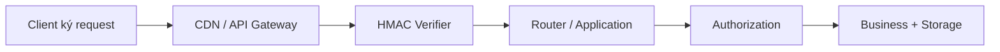

# Signed header list trong HMAC request authentication

## 1. Danh sách header được ký là một phần của hợp đồng bảo mật

Trong module `SECURITY_AUTHENTICATION_HMAC_REQUEST_AUTHENTICATION`, HTTP client và server chia sẻ một secret để tính và xác minh HMAC trên **canonical request**. Hợp đồng ký có thể bao gồm HTTP method, URI/query, một tập header và/hoặc hash của raw body. Tập header được đưa vào HMAC phải được xác định rõ, vì **header xuất hiện trong request không có nghĩa header đó đã được chữ ký bảo vệ**.

**Signed header list** là danh sách tên những HTTP header mà hai phía thống nhất sẽ đưa **cả tên lẫn giá trị đã canonicalize** vào thông điệp HMAC. Ví dụ:

```text
content-type;idempotency-key;x-hmac-key-id;x-hmac-nonce;x-hmac-timestamp
```

Chuỗi trên là một **manifest tên header** được sắp xếp theo quy tắc, không phải giá trị của từng header. Muốn bảo vệ nội dung, canonical request còn phải chứa các dòng:

```text
content-type:application/json
idempotency-key:payment-intent-2026-00017
x-hmac-key-id:merchant-42:k3
x-hmac-nonce:9fc41749ac56ccfd4589b032779f6aee
x-hmac-timestamp:1795838400
```

Một implementation sai chỉ ký dòng `signed-headers:content-type;...` nhưng bỏ các **giá trị** ở trên sẽ không bảo vệ nội dung header. Ngược lại, nếu ký các giá trị mà không khóa chặt **tập tên được ký**, client có thể bỏ một header quan trọng khỏi danh sách rồi tự tạo HMAC mới bằng secret hợp lệ. Vì vậy phải quy định cả **tập header bắt buộc, thuật toán chuẩn hóa, thứ tự, biểu diễn sự vắng mặt và chính sách server**.

> **Quy tắc cốt lõi:** Client có thể công bố danh sách header được ký để hỗ trợ đối chiếu, nhưng **server quyết định danh sách bắt buộc theo key/protocol/endpoint**. Không cho client tự bỏ các header có ý nghĩa bảo mật chỉ vì chữ ký với danh sách ngắn hơn vẫn đúng.

Bài **“Signed header list”** thuộc chương **“Header canonicalization”**, tập trung vào cách chọn danh sách, mã hóa tên, ghép giá trị, xử lý duplicate/whitespace, ngăn header bị loại khỏi chữ ký và tích hợp với HMAC verifier. Những khía cạnh liên quan như timestamp/nonce, proxy/gateway, key rotation và authorization cũng được đặt đúng vị trí để tránh nhầm lẫn.

### Mục tiêu học tập

Sau bài này, bạn có thể:

1. Phân biệt **HTTP headers nhận được**, **signed header names**, **canonical header lines** và **signed-headers manifest**.
2. Chọn tập header bắt buộc có xét **key ID, timestamp, nonce, body interpretation, tenant, idempotency** và các trường nghiệp vụ ảnh hưởng đến quyền.
3. Xây dựng quy tắc **lowercase tên header, sort ổn định, trim OWS có giới hạn, giữ nguyên giá trị có ý nghĩa**.
4. Từ chối duplicate security headers, header folding/CRLF và khác biệt parse giữa gateway/backend.
5. Ràng buộc signed header list với **canonical format version** và chính sách key server-side; không cho bypass bằng cách bỏ header khỏi manifest.
6. Triển khai Java 17+ với input HTTP đã được adapter kiểm tra và test vector byte-for-byte.
7. Giải thích vì sao **HMAC + signed headers** vẫn cần chống replay và authorization riêng.

## 2. Phân biệt bốn lớp dữ liệu liên quan đến header

Ví dụ một HTTP request:

```http
POST /v1/tenants/t-42/payments?mode=online HTTP/1.1
Host: api.example.test
Content-Type: application/json
Idempotency-Key: payment-intent-2026-00017
X-HMAC-Key-Id: merchant-42:k3
X-HMAC-Timestamp: 1795838400
X-HMAC-Nonce: 9fc41749ac56ccfd4589b032779f6aee
X-HMAC-Signed-Headers: content-type;idempotency-key;x-hmac-key-id;x-hmac-nonce;x-hmac-timestamp
X-HMAC-Signature: <base64-cua-full-hmac-tag>
Accept: application/json
User-Agent: partner-sdk/2.3

{"amountMinor":125000,"currency":"VND"}
```

Đây là **request minh họa**, không chứa chữ ký tính toán sẵn. Mọi request thực tế phải dùng timestamp và nonce mới; placeholder `<...>` không được gửi nguyên văn làm chữ ký.

| Lớp | Ví dụ | Ý nghĩa |
| --- | --- | --- |
| **HTTP headers thực tế** | `Content-Type`, `Accept`, `User-Agent`, `X-HMAC-Signature` ... | Tập trường trên wire, có thể gồm trường không liên quan đến xác thực. |
| **Signed header names** | `content-type`, `x-hmac-timestamp` ... | Chỉ tên các trường mà contract bắt buộc ký, viết dạng canonical. |
| **Canonical header lines** | `content-type:application/json` | Tên và **giá trị** đã được chuẩn hóa đúng contract, đưa vào dữ liệu HMAC. |
| **Signed-headers manifest** | `signed-headers:content-type;...` | Một dòng cam kết rằng HMAC bao phủ đúng tập tên và thứ tự đã công bố. |

Trong ví dụ, `Accept` và `User-Agent` là hai header **không ký** vì hợp đồng mẫu không dựa vào chúng để ra quyết định bảo mật. Điều đó chỉ an toàn nếu chúng thực sự không ảnh hưởng đến hành động, lựa chọn tenant/resource hay cách hiểu body. Nếu `Accept` quyết định một biểu diễn dữ liệu nhạy cảm hoặc quyền đặc biệt, bạn phải xem lại policy: ký thêm, ràng buộc server-side hoặc từ chối cách dùng có rủi ro.

**Không tồn tại quy tắc “ký tất cả header luôn an toàn hơn”**. Proxy thường thêm `Via`, `X-Request-ID`, `traceparent` hoặc thay `Host`; một manifest “mọi header đang có” sẽ rất dễ sai chữ ký khi qua hạ tầng. Thiết kế đúng là **ký tập tối thiểu nhưng đầy đủ tất cả trường có tác động an ninh/nghiệp vụ**, rồi định nghĩa rõ trường nào bị cấm hoặc không tham gia quyết định.

### 2.1 Header name không phân biệt hoa/thường, header value không có quy tắc chung như vậy

Trong HTTP, tên field không phân biệt chữ hoa/thường:

```text
Content-Type
content-type
CONTENT-TYPE
```

Chúng cùng tên header ở mức HTTP. Vì vậy trong signed header list của bài, phải chuyển tên về **ASCII lowercase** trước khi sort và ghi canonical line:

```text
Content-Type: application/json
    -> content-type:application/json
```

**Không tự lowercase giá trị**. Ví dụ `X-Request-Token: AbC123` và `X-Request-Token: abc123` có thể là hai token khác nhau. Một số field có ngữ nghĩa riêng (media type, token, date, structured field), nhưng phải có quy tắc đã công bố cho **từng field**, không áp dụng chuyển chữ thường bừa bãi.

### 2.2 Header nào là phần tử của danh sách?

Trong hợp đồng mẫu `SHL-V1`, chỉ có **năm trường bắt buộc**:

| Canonical name | Vì sao ký? | Policy minh họa |
| --- | --- | --- |
| `content-type` | Ràng buộc cách server diễn giải raw body đã ký. | Bắt buộc một giá trị chính xác `application/json`. |
| `idempotency-key` | Ngăn thay idempotency key khi retry nghiệp vụ có side effect. | Bắt buộc một chuỗi ASCII hợp lệ do client tạo. |
| `x-hmac-key-id` | Ràng buộc request với định danh key metadata server dùng verify. | Một key ID, ví dụ `merchant-42:k3`. |
| `x-hmac-nonce` | Ngăn sửa nonce của signed request để né replay detection. | 32 ký tự hex lowercase (16 byte ngẫu nhiên). |
| `x-hmac-timestamp` | Ngăn sửa thời gian của signed request để kéo dài cửa sổ hợp lệ. | Unix epoch seconds, biểu diễn thập phân chuẩn. |

Sắp xếp **lexicographic ASCII tăng dần theo tên đã lowercase**:

```text
content-type
idempotency-key
x-hmac-key-id
x-hmac-nonce
x-hmac-timestamp
```

Manifest được nối bằng đúng dấu `;`, **không thêm space, không phân cách bằng dấu phẩy, không có `;` cuối**:

```text
content-type;idempotency-key;x-hmac-key-id;x-hmac-nonce;x-hmac-timestamp
```

Đây là hợp đồng riêng của bài, không tự mặc định là chuẩn của AWS, HTTP Message Signatures hay bất kỳ dịch vụ cụ thể nào. Nếu tích hợp dịch vụ có chuẩn chữ ký riêng, phải dùng **đúng chuẩn đó**, không trộn cú pháp của hai protocol.

## 3. Chọn trường nào cần ký: bắt buộc, tùy chọn và bị cấm

### 3.1 Header ảnh hưởng bảo mật phải nằm trong hợp đồng

Một tiêu chí thực tế: **nếu kẻ không biết secret có thể đổi header này mà khiến request thực thi ý nghĩa khác, header đó cần được ký hoặc bị ràng buộc/từ chối bằng cách khác**.

Ví dụ:

- **`Content-Type`:** Nếu backend parse `application/json` khác `application/x-www-form-urlencoded`, ký body hash nhưng bỏ `Content-Type` có thể tạo cách hiểu body khác.
- **`X-Tenant-Id` hoặc `X-Account-Id`:** Nếu backend dùng header để chọn tenant/account, không thể để nó ngoài chữ ký. Tốt hơn nữa, **không tin header này là quyền**: authorization kiểm tra tenant thực tế theo principal đã xác thực.
- **`Idempotency-Key`:** Nếu middleware dùng header này để tra kết quả giao dịch cũ, thay đổi header chưa được ký có thể làm request đổi hành vi retry.
- **`X-HTTP-Method-Override`:** Nếu server hỗ trợ thay method, phải ràng buộc hoặc từ chối; đừng ký `POST` nhưng thực thi như `DELETE` sau middleware.
- **`Content-Encoding`:** Nếu gateway hoặc backend giải nén, phải chốt bytes được hash trước/sau biến đổi và xử lý header liên quan. Hợp đồng mẫu cấm compressed body để đơn giản.
- **Header mang scope/actor/role:** Không được chỉ ký rồi tin giá trị như quyền. Scope/role phải xuất phát từ policy server-side hoặc từ assertion đáng tin đã kiểm tra.

Trong `SHL-V1` mẫu, `tenant` nằm trong **raw URI path đã ký** (`/v1/tenants/t-42/...`). API **không chấp nhận `X-Tenant-Id`** do client gửi để thay tenant, và policy server ràng buộc key với audience `payments-api/prod`. Nếu hệ thống thực tế dùng header tenant, cần tạo signed list/version khác và kiểm tra chính sách phân quyền nhất quán.

### 3.2 Header không ký không đồng nghĩa “mặc định được tin”

| Nhóm | Ví dụ | Cách xử lý an toàn |
| --- | --- | --- |
| Bắt buộc ký | `Content-Type`, `Idempotency-Key`, key ID, timestamp, nonce | Header đơn nhất, đúng format, giá trị nằm trong HMAC. |
| Được phép nhưng không ký | `User-Agent`, `Accept` hoặc tracing thuần túy **nếu không ảnh hưởng quyết định bảo mật** | Không dùng để quyết định principal, quyền, resource hoặc body interpretation. |
| Metadata trusted gateway | `X-Verified-Principal`, `X-Original-URI`, `X-Forwarded-*` | Chỉ tin khi gateway chủ động loại header client và đặt lại qua kênh tin cậy. |
| Bị cấm trong contract mẫu | `X-Tenant-Id`, `X-HTTP-Method-Override`, `X-HMAC-Algorithm`, `Content-Encoding` | Từ chối để không phát sinh ngữ nghĩa chưa được ký/đánh giá. |
| Framing/hop-by-hop | `Content-Length`, `Transfer-Encoding`, `Connection`, `TE` | Xử lý đúng ở tầng HTTP; không đưa tùy tiện vào HMAC vì proxy có thể đổi framing. |

Nếu `Accept` được phép không ký, nhưng sau này API dùng giá trị đó để trả về dữ liệu nhạy cảm ở mức quyền khác, phải **đổi policy** và cân nhắc version ký mới. Không dựa vào một allowlist cũ khi sematics của endpoint đã thay đổi.

### 3.3 Required và optional: không dùng dấu “vắng mặt” tùy hứng

Một cách đơn giản là yêu cầu **đủ năm signed headers ở mọi request `SHL-V1`**; nếu thiếu bất kỳ field nào → từ chối. Tránh code kiểu:

```java
String value = request.getHeader("Idempotency-Key");
if (value == null) value = ""; // NGUY HIỂM nếu contract không định nghĩa
```

Trong HTTP, **header không tồn tại** và **header tồn tại với giá trị rỗng** là hai trạng thái khác nhau. Nếu một protocol cho phép optional signed headers, phải định nghĩa chúng có thể vắng mặt khi nào, cách biểu diễn sự vắng mặt, và policy ở từng endpoint. Ví dụ một phiên bản mới có thể yêu cầu signed list của GET khác POST, nhưng **server phải biết trước template đó**; không để client chọn subset tự do.

Đối với mẫu trong bài, dùng **một manifest cố định** giúp phát hiện ngay header thiếu, không cần logic `null → empty` dễ nhập nhằng.

## 4. Canonicalize tên header và thứ tự

### 4.1 Một tập tên phải có một cách biểu diễn

Thuật toán `SHL-V1` cho tên:

1. Lấy tên header từ HTTP adapter có khả năng nhận biết **các field trùng**, không chỉ một `Map<String,String>` đã mất thông tin.
2. Kiểm tra cú pháp tên HTTP field hợp lệ; trong demo, giới hạn tên ở `A–Z, a–z, 0–9, -` để tránh mở rộng không cần thiết.
3. Chuyển tên về ASCII lowercase bằng `Locale.ROOT`.
4. Reject duplicate đối với tất cả header có tác động bảo mật, kể cả hai tên chỉ khác case.
5. Tra tập header bắt buộc từ **metadata contract phía server**; kiểm tra chúng đều có mặt chính xác một lần.
6. Sort tên bằng thứ tự ASCII tăng dần; ghép bằng `;` để tạo manifest và theo đúng thứ tự đó tạo canonical header lines.

**Không sort theo giá trị**, thứ tự header đến trên wire, thứ tự `HashMap` hoặc một danh sách client chọn theo ý muốn. Khi tên đã được lowercase ASCII, việc sort bằng Java `String.compareTo` trên các tên mẫu này cho cùng thứ tự ASCII.

### 4.2 Manifest trong HTTP và manifest trong HMAC

Trong ví dụ có header:

```http
X-HMAC-Signed-Headers: content-type;idempotency-key;x-hmac-key-id;x-hmac-nonce;x-hmac-timestamp
```

Server **không dùng header này để quyết định tên nào phải ký**. Nó lấy manifest kỳ vọng từ `SHL-V1` rồi **so khớp chính xác** giá trị header với manifest đó. Nhờ vậy, client gửi danh sách bị lược bớt sẽ bị từ chối **ngay cả khi client có secret và có thể tự tính một HMAC khác**.

Để ràng buộc chính danh sách vào chữ ký, canonical request có một dòng:

```text
signed-headers:content-type;idempotency-key;x-hmac-key-id;x-hmac-nonce;x-hmac-timestamp
```

Như vậy:

- **Tên và giá trị** của năm header nằm trong các canonical header lines.
- **Danh sách tên** nằm trong dòng `signed-headers:...` đã được HMAC bảo vệ.
- `X-HMAC-Signed-Headers` là **trường khai báo/đối chiếu**: nó phải bằng dòng manifest do server dựng; không cần đưa chính nó lặp lại trong danh sách năm field.
- `X-HMAC-Signature` **không** nằm trong dữ liệu ký để tránh vòng lặp chữ ký phụ thuộc chính nó.

Điều đó **không có nghĩa** header khai báo có thể thiếu hoặc tùy ý đổi: bộ verify phải yêu cầu nó xuất hiện đúng một lần và khớp chính xác với policy. Nếu không cần manifest trên wire, giao thức cũng có thể bỏ header này và đưa manifest cố định theo version vào canonical bytes; đó là **một thiết kế khác** phải công bố.

### 4.3 Vì sao phải bảo vệ chính danh sách?

Giả sử một client có secret hợp lệ gửi:

```text
Content-Type: application/json
X-Tenant-Id: t-99
X-HMAC-Signed-Headers: content-type
```

Nếu server chấp nhận “client khai field nào thì chỉ verify field đó”, client có thể ký thành công nội dung chỉ gồm `Content-Type` dù endpoint thực thi theo `X-Tenant-Id`. MAC vẫn hợp lệ về mặt mật mã nhưng **không ràng buộc đủ ngữ nghĩa request**. Sửa bằng:

- Policy server quy định tập signed headers bắt buộc (theo version/key/endpoint).
- Reject các header có ý nghĩa điều khiển nhưng không được ký/không được phép.
- Authorization dùng **principal server-side + resource thực tế**, không coi header được ký là bằng chứng được phép chọn tenant.

**Ký đủ trường là cần thiết, nhưng không thay thế phân quyền.**

## 5. Canonicalize giá trị header mà không đổi ý nghĩa

Header name là case-insensitive, nhưng header value có cú pháp và semantics riêng. Trong bài, ta chọn **quy tắc đơn giản, bảo thủ**:

- Lấy giá trị header của **một field duy nhất**; nếu duplicate, từ chối.
- Loại bỏ đúng **optional whitespace ở hai đầu**: ASCII space (`0x20`) và horizontal tab (`0x09`), gọi là OWS. **Không** tự trim mọi ký tự Unicode.
- Không thay đổi case của giá trị.
- Không collapse liên tiếp nhiều space ở giữa. Để tránh parser disagreement trong demo, có thể **từ chối tab ở giữa** và ký nguyên các space giữa từ.
- Từ chối CR, LF, NUL, các ký tự điều khiển và byte không nằm trong tập header-value ASCII mà contract đã chọn.
- Áp dụng policy cú pháp **theo từng header** sau normalize, ví dụ `Content-Type` phải đúng `application/json`.

Ví dụ:

| Header đến ingress | Dòng canonical theo SHL-V1 | Ghi chú |
| --- | --- | --- |
| `Content-Type: application/json` | `content-type:application/json` | Lowercase tên, giữ nguyên value. |
| `CONTENT-TYPE:   application/json  ` | `content-type:application/json` | Chỉ bỏ OWS ở hai đầu theo hợp đồng. |
| `Idempotency-Key: payment-001` | `idempotency-key:payment-001` | Giữ case của token và dấu gạch ngang. |
| `Idempotency-Key: Payment-001` | `idempotency-key:Payment-001` | **Khác** `payment-001`, không lowercase value. |
| `X-HMAC-Timestamp: 1795838400` | `x-hmac-timestamp:1795838400` | Không đổi thành ISO datetime hoặc milliseconds. |
| `X-HMAC-Nonce: abcd...` | `x-hmac-nonce:abcd...` | Nonce kiểm tra định dạng cố định. |
| `X-Custom: a  b` | Nếu được ký thì giữ `a  b` | Không collapse internal spaces khi chưa có rule. |
| Hai `Content-Type` khác case | **Từ chối** | Cùng header name; không được tùy chọn đầu/cuối. |

Cách trim này chỉ phù hợp với **contract minh họa**. Một trường mang nội dung có ý nghĩa whitespace đặc biệt (ví dụ giá trị dạng chuỗi được quote hoặc field có grammar phức tạp) cần bộ canonicalizer đã đánh giá riêng. Không áp dụng “strip, split, sort” lên mọi value tùy tiện.

### 5.1 Duplicate header và comma joining

Ví dụ request nguy hiểm:

```http
Content-Type: application/json
content-type: application/x-www-form-urlencoded
```

Nếu gateway lấy field đầu còn backend lấy field cuối, verifier có thể ký `application/json` nhưng controller parse body như form. Một thư viện có thể còn gộp thành `application/json, application/x-www-form-urlencoded`, không phải giá trị mà bên ký đã dự kiến.

Với các **signed singleton headers** trong SHL-V1, quy tắc là **đúng một occurrence**, reject mọi duplicate kể cả khác case. Không lấy `getHeader(name)` tùy ý nếu API chỉ trả phần tử đầu và che mất sự trùng lặp.

Một số HTTP field theo chuẩn có thể được phép lặp/gộp và có semantics danh sách; nếu cần đưa chúng vào chữ ký, phải công bố cách canonicalization **đúng theo field đó**, xử lý thứ tự, dấu phẩy, quote và trường hợp không thể kết hợp. Đừng mượn quy tắc singleton của bài cho `Set-Cookie` hoặc một trường phức tạp.

### 5.2 Header folding, CRLF và whitespace mơ hồ

Legacy HTTP có thể từng sử dụng *obs-fold* (xuống dòng rồi whitespace) trong một số ngữ cảnh. Với signed security headers của API mới, **không hỗ trợ obs-fold**: adapter phải từ chối hoặc bảo đảm parser loại ngay tại ingress, tránh trường hợp gateway unfold còn backend giữ khác.

```text
X-HMAC-Nonce: abcdef...
    more-text
```

Không biến loại giá trị này thành một canonical string “có vẻ hợp lý”. Hãy **từ chối dạng nhập nhằng** để giảm nguy cơ request smuggling, header injection và sai khác signature.

### 5.3 Header binary/Unicode

Đối với field cho phép giá trị ngoài ASCII, việc chuyển đổi Unicode hoặc octet có thể khác nhau giữa thư viện và phiên bản HTTP. SHL-V1 **cố ý yêu cầu các giá trị ký là ASCII hiển thị**, sau bước trim OWS, để golden vector và tính toán HMAC không phụ thuộc một text codec ngầm.

Nếu cần tên hoặc giá trị Unicode, cân nhắc quy định biểu diễn trên wire (ví dụ dạng mã hóa ổn định) và **phiên bản canonical mới**, thay vì gọi `getBytes(UTF_8)` trên String mà framework đã giải mã khác với byte gốc.

## 6. Những header không nên đưa tùy tiện vào danh sách ký

### 6.1 Hop-by-hop và HTTP framing

`Content-Length` và `Transfer-Encoding` là ví dụ điển hình. Một proxy HTTP/1.1 có thể thay đổi framing, còn HTTP/2 có quy tắc framing khác. **Ký trực tiếp chúng** dễ làm MAC mismatch dù nội dung application body giống nhau. Thiết kế thông thường nên:

1. Xác định raw body bytes **ở điểm ký và điểm verify** một cách nhất quán.
2. Hash body thật và đưa digest vào canonical request.
3. Để HTTP ingress đảm bảo tính hợp lệ của framing; từ chối tình huống framing mâu thuẫn/smuggling theo chính sách.
4. Không “cứ bỏ Content-Length khỏi HMAC là xong”: phải chắc chắn không có hai tầng diễn giải độ dài/body khác nhau.

Tương tự, `Connection`, `Keep-Alive`, `TE`, `Trailer` và các header hop-by-hop có thể bị thay đổi, bổ sung hoặc loại bỏ trong quá trình truyền. Nếu dùng trailer field có ý nghĩa bảo mật, cần một **giao thức ký trailer** được thiết kế riêng; không tự coi trailer đã được ký bởi manifest header ban đầu.

### 6.2 Host, :authority và forwarded headers

`Host` là trường quan trọng đối với định tuyến, nhưng có thể được proxy rewrite. HTTP/2 sử dụng `:authority`; khi chuyển sang HTTP/1.1, server/gateway có thể biểu diễn khác. Có hai hướng:

- **Ký authority được canonicalize**: cần quy định hostname/port, IDN, IPv6 literal, host case, default port, proxy trust boundary.
- **Gắn audience theo metadata key**: đưa một dòng `audience:payments-api/prod` vào canonical và kiểm tra request thuộc đúng service. Đây là lựa chọn dùng trong SHL-V1 mẫu.

Không lấy `X-Forwarded-Host`, `X-Forwarded-Proto` hay `X-Original-URI` từ Internet rồi coi đó là authority/URI gốc đáng tin. Gateway phải **strip/overwrite** các trường này tại trust boundary, và backend chỉ tin khi đi qua kênh được kiểm soát.

### 6.3 Content-Type và Content-Encoding

Nếu hợp đồng ký `Content-Type: application/json`, server cũng phải parse body với đúng quy tắc đó. Đổi thành `application/json; charset=utf-8` không mặc nhiên có cùng canonical value: bản mẫu quy định **chính xác** `application/json`. Một giao thức khác có thể quy định canonicalize media type/parameter, nhưng phải version và test riêng.

Nếu client gửi `Content-Encoding: gzip` và gateway giải nén trước backend, hai bên có thể hash những byte body khác nhau. SHL-V1 cấm `Content-Encoding` để tránh mơ hồ. Hệ thống thật nếu hỗ trợ compression phải chỉ rõ hash **encoded hay decoded body**, ký thêm field liên quan khi cần và thống nhất điểm xác minh.

## 7. Ví dụ hoàn chỉnh: signed header list và canonical request SHL-V1

Ta sử dụng request ở phần đầu, giới hạn endpoint `POST` thanh toán và chọn HMAC-SHA256:

```http
POST /v1/tenants/t-42/payments?mode=online HTTP/1.1
Host: api.example.test
Content-Type: application/json
Idempotency-Key: payment-intent-2026-00017
X-HMAC-Key-Id: merchant-42:k3
X-HMAC-Nonce: 9fc41749ac56ccfd4589b032779f6aee
X-HMAC-Timestamp: 1795838400
X-HMAC-Signed-Headers: content-type;idempotency-key;x-hmac-key-id;x-hmac-nonce;x-hmac-timestamp
X-HMAC-Signature: <base64-full-hmac-sha256>

{"amountMinor":125000,"currency":"VND"}
```

**SHL-V1 quy định**:

| Yếu tố | Giá trị/giới hạn |
| --- | --- |
| Canonical version | `HMAC-REQUEST/SHL-V1` là dòng đầu, không có lựa chọn fallback. |
| Algorithm | HMAC-SHA256, secret ngẫu nhiên đủ entropy; algorithm tra từ key metadata phía server. |
| Method và URI | `POST` và **raw origin-form request target**; adapter bảo toàn hoặc xác minh tại ingress trước rewrite. |
| Audience | `payments-api/prod`, lấy từ policy server, không tin Host do client khai. |
| Signed header names | Chính xác năm tên đã lowercase và sort, không thiếu/không thêm. |
| Signed header values | Header singleton, trim ASCII OWS hai đầu, reject control/obs-fold, validate riêng từng field. |
| Signed-headers manifest | Header `X-HMAC-Signed-Headers` phải đúng một giá trị khớp policy; manifest có dòng riêng trong HMAC. |
| Body digest | `SHA256(rawBodyBytes)`, **hex lowercase 64 ký tự**. |
| Canonical bytes | UTF-8, **12 dòng**, cách nhau bởi LF `0x0A`, không thêm LF cuối. |
| Signature transport | Header `X-HMAC-Signature` duy nhất, **Base64 chuẩn có padding**, full 32-byte tag (44 ký tự). |
| Anti-replay | Timestamp epoch seconds + nonce nằm trong phần đã ký; server kiểm tra time window và kho nonce nguyên tử. |
| Authorization | Principal từ key metadata sau authentication; policy kiểm tra action, tenant/resource, limit. |

Canonical request **12 dòng** của ví dụ:

```text
HMAC-REQUEST/SHL-V1
HMAC-SHA256
POST
/v1/tenants/t-42/payments?mode=online
audience:payments-api/prod
content-type:application/json
idempotency-key:payment-intent-2026-00017
x-hmac-key-id:merchant-42:k3
x-hmac-nonce:9fc41749ac56ccfd4589b032779f6aee
x-hmac-timestamp:1795838400
signed-headers:content-type;idempotency-key;x-hmac-key-id;x-hmac-nonce;x-hmac-timestamp
body-sha256:<lowercase-hex-sha256-of-raw-body>
```

Phần `<...>` ở dòng body phải thay bằng digest thực tế của byte JSON raw. Nếu body là mảng byte rỗng, SHA-256 là `e3b0c44298fc1c149afbf4c8996fb92427ae41e4649b934ca495991b7852b855`, **không phải chuỗi rỗng**. Header chữ ký được tạo **sau** khi tính MAC nên không xuất hiện trong canonical request.

```text
canonicalBytes = UTF8(join_with_LF(12_lines_no_final_LF))
macBytes       = HMAC_SHA256(sharedSecretBytes, canonicalBytes)  // 32 byte
signature      = Base64_Standard_Padded(macBytes)                // 44 chars
```

Server không chấp nhận một chữ ký chỉ vì `X-HMAC-Signed-Headers` có vẻ liệt kê đúng: phải **dựng lại canonical bytes từ request thật**, tra key đang được phép verify, tính MAC và so byte bằng primitive hạn chế timing leak.

### 7.1 Vì sao ghi hai chỗ: canonical lines và manifest?

Nếu chỉ ghi danh sách `content-type;idempotency-key;...` mà không ghi giá trị, client hoặc proxy có thể sửa `Idempotency-Key` mà HMAC không đổi. Nếu ghi các dòng giá trị nhưng danh sách header không được ràng buộc với version, một implementation có thể âm thầm bỏ header khỏi phần được ký. **Cả hai cần được đặc tả cùng nhau**.

Tuy nhiên, có các giao thức hợp lệ không dùng manifest text riêng mà cố định layout trong version. Điều quan trọng không phải tên `signed-headers`, mà là **hai phía không thể diễn giải khác tập trường đã được HMAC bảo vệ**.

## 8. Java 17+: dựng signed header list nghiêm ngặt

Ví dụ Java dưới đây triển khai quy tắc SHL-V1 đủ cụ thể để đưa vào unit test. Nó giả định HTTP adapter cung cấp **danh sách từng header occurrence**, giữ khả năng phát hiện trùng tên khác case, chứ không đưa một `Map<String,String>` có thể đã gộp/ghi đè.

**Phạm vi:** Mẫu minh họa header + HMAC. Nó không thay thế HTTP parser chống request smuggling, kiểm soát độ dài body, gateway trust boundary, kho key, timestamp/nonce store hay authorization.

### 8.1 Chọn đúng header và canonicalize

```java
import java.nio.charset.StandardCharsets;
import java.security.GeneralSecurityException;
import java.security.MessageDigest;
import java.util.ArrayList;
import java.util.Base64;
import java.util.HashMap;
import java.util.HashSet;
import java.util.HexFormat;
import java.util.LinkedHashMap;
import java.util.List;
import java.util.Locale;
import java.util.Map;
import java.util.Objects;
import java.util.Set;
import javax.crypto.Mac;
import javax.crypto.SecretKey;

record HeaderOccurrence(String name, String value) {}

record ServerKeyPolicy(
        String keyId,
        String algorithm, // SHL-V1 chỉ hỗ trợ "HmacSHA256"
        String canonicalVersion,
        String audience,
        SecretKey secret) {}

final class SignedHeaderListV1 {
    private SignedHeaderListV1() {}

    private static final List<String> REQUIRED = List.of(
            "content-type",
            "idempotency-key",
            "x-hmac-key-id",
            "x-hmac-nonce",
            "x-hmac-timestamp");

    private static final String MANIFEST = String.join(";", REQUIRED);

    private static final Set<String> CONTROL = Set.of(
            "x-hmac-signed-headers", "x-hmac-signature");

    private static final Set<String> FORBIDDEN = Set.of(
            "content-encoding",
            "x-tenant-id",
            "x-http-method-override",
            "x-hmac-algorithm");

    static String manifest() {
        return MANIFEST;
    }

    static String trimAsciiOws(String input) {
        int left = 0;
        int right = input.length();
        while (left < right
                && (input.charAt(left) == ' '
                    || input.charAt(left) == '\t')) left++;
        while (right > left
                && (input.charAt(right - 1) == ' '
                    || input.charAt(right - 1) == '\t')) right--;
        return input.substring(left, right);
    }

    static Map<String, String> readHeaderValues(
            List<HeaderOccurrence> occurrences) {
        Objects.requireNonNull(occurrences);
        Map<String, String> values = new HashMap<>();

        for (HeaderOccurrence field : occurrences) {
            if (field == null || field.name() == null
                    || field.value() == null
                    || !field.name().matches("[A-Za-z0-9-]{1,80}")) {
                throw new IllegalArgumentException("Invalid header");
            }

            // HTTP name là case-insensitive; Locale.ROOT tránh locale bug.
            String name = field.name().toLowerCase(Locale.ROOT);
            if (FORBIDDEN.contains(name)) {
                throw new IllegalArgumentException("Unsupported header");
            }

            boolean protectedName =
                    REQUIRED.contains(name) || CONTROL.contains(name);
            if (!protectedName) {
                // Chỉ có thể bỏ qua header không ảnh hưởng auth/semantics.
                // Adapter/endpoint policy vẫn phải kiểm tra các field khác.
                continue;
            }

            String value = trimAsciiOws(field.value());
            // SHL-V1 chọn ASCII hiển thị, từ chối CR/LF, obs-fold,
            // CTL, non-ASCII và tab còn sót bên trong value.
            for (int i = 0; i < value.length(); i++) {
                char c = value.charAt(i);
                if (c < 0x20 || c > 0x7e) {
                    throw new IllegalArgumentException(
                            "Unsupported header value octet");
                }
            }

            // Put-if-absent phát hiện duplicate kể cả khác case.
            if (values.putIfAbsent(name, value) != null) {
                throw new IllegalArgumentException(
                        "Duplicate protected header");
            }
        }

        for (String required : REQUIRED) {
            if (!values.containsKey(required)) {
                throw new IllegalArgumentException(
                        "Missing signed header: " + required);
            }
        }
        if (!MANIFEST.equals(values.get("x-hmac-signed-headers"))) {
            throw new IllegalArgumentException(
                    "Signed header list violates server policy");
        }
        if (!values.containsKey("x-hmac-signature")) {
            throw new IllegalArgumentException("Missing signature header");
        }

        if (!"application/json".equals(values.get("content-type"))
                || !values.get("idempotency-key")
                        .matches("[A-Za-z0-9._:-]{8,128}")
                || !values.get("x-hmac-key-id")
                        .matches("[A-Za-z0-9._:-]{1,100}")
                || !values.get("x-hmac-nonce")
                        .matches("[0-9a-f]{32}")
                || !values.get("x-hmac-timestamp")
                        .matches("(0|[1-9][0-9]{0,11})")) {
            throw new IllegalArgumentException(
                    "Invalid signed field value");
        }
        return Map.copyOf(values);
    }

    static byte[] canonicalBytes(
            String method,
            String rawTarget,
            byte[] rawBody,
            Map<String, String> headers,
            ServerKeyPolicy key) {

        Objects.requireNonNull(rawBody);
        Objects.requireNonNull(headers);
        Objects.requireNonNull(key);

        if (!"HmacSHA256".equals(key.algorithm())
                || !"shl-v1".equals(key.canonicalVersion())
                || !"payments-api/prod".equals(key.audience())
                || !"POST".equals(method)
                || rawTarget == null || !rawTarget.startsWith("/")
                || rawTarget.length() > 4096
                || rawTarget.chars().anyMatch(c ->
                        c < 0x21 || c > 0x7e || c == '#')
                || !Objects.equals(
                        headers.get("x-hmac-key-id"), key.keyId())
                || !MANIFEST.equals(
                        headers.get("x-hmac-signed-headers"))) {
            throw new IllegalArgumentException(
                    "Contract, key or target mismatch");
        }

        final String bodyHex;
        try {
            byte[] digest = MessageDigest.getInstance("SHA-256")
                    .digest(rawBody);
            bodyHex = HexFormat.of().formatHex(digest);
        } catch (GeneralSecurityException ex) {
            throw new IllegalStateException(
                    "SHA-256 provider error", ex);
        }

        List<String> lines = new ArrayList<>();
        lines.add("HMAC-REQUEST/SHL-V1");
        lines.add("HMAC-SHA256");
        lines.add(method);
        lines.add(rawTarget);
        lines.add("audience:" + key.audience());
        for (String name : REQUIRED) {
            // Thứ tự REQUIRED đã sort ASCII theo contract.
            lines.add(name + ":" + headers.get(name));
        }
        lines.add("signed-headers:" + MANIFEST);
        lines.add("body-sha256:" + bodyHex);
        return String.join("\n", lines)
                .getBytes(StandardCharsets.UTF_8);
    }

    static boolean verifyFullBase64(
            byte[] canonicalBytes,
            ServerKeyPolicy key,
            String receivedSignature) {

        // HMAC-SHA256 full tag: 32 byte, Base64 padded 44 ký tự.
        if (receivedSignature == null
                || receivedSignature.length() != 44) return false;

        final byte[] supplied;
        try {
            supplied = Base64.getDecoder().decode(receivedSignature);
        } catch (IllegalArgumentException ex) {
            return false;
        }
        if (supplied.length != 32
                || !Base64.getEncoder().encodeToString(supplied)
                    .equals(receivedSignature)) {
            return false;
        }

        final byte[] expected;
        try {
            Mac mac = Mac.getInstance("HmacSHA256");
            mac.init(key.secret());
            expected = mac.doFinal(canonicalBytes);
        } catch (GeneralSecurityException ex) {
            throw new IllegalStateException(
                    "HMAC provider/key error", ex);
        }
        return MessageDigest.isEqual(expected, supplied);
    }
}
```

### 8.2 Lưu ý về mã minh họa

- `REQUIRED` là danh sách **cố định từ server policy**, được sắp theo ASCII; nó không được suy ra từ `X-HMAC-Signed-Headers` của client. `MANIFEST` vừa là giá trị phải kiểm tra ở HTTP vừa là dòng nằm trong canonical.
- `readHeaderValues` giữ từng **occurrence** do adapter cung cấp nên phát hiện duplicate của các field được ký hoặc điều khiển signature, ngay cả khi case khác. Nếu HTTP framework đã gộp chúng trước khi gọi hàm, **không thể khôi phục duplicate bằng đoạn code này**.
- `trimAsciiOws` xử lý đúng SP/HTAB ở **hai đầu** theo contract; kiểm tra sau trim từ chối tab bên trong, CR/LF, control và non-ASCII. **Không trim tùy tiện value của các header khác**.
- `FORBIDDEN` là tập ví dụ chặn các header có thể làm đổi ngữ nghĩa nhưng **chưa được ký**. Trong hệ thống thật, cần rà soát thêm các header có tác dụng với middleware, reverse proxy, framework và endpoint; không coi bốn tên này là allowlist bảo mật đầy đủ.
- `Map.copyOf` chỉ trả mô hình value đã kiểm tra. Controller và authorization không nên **parse lại cùng field bằng một quy tắc khác**.
- `canonicalBytes` mới kiểm tra ký tự target ở mức cơ bản. Cần một **raw URI parser/route policy** riêng để chống encoded slash, query duplicate, path traversal và mismatch giữa gateway/router/authorizer; demo không tự chứng minh URL an toàn.
- `verifyFullBase64` chỉ xác minh HMAC byte. Cần kiểm tra timestamp, nonce, status/revocation của key, audience và authorization trước khi thực thi nghiệp vụ. Không đưa secret vào log.

### 8.3 Ghép verifier trong thực tế

```java
// Pseudocode; các interface này thuộc hệ thống, không phải JDK.
RawHttpRequest raw = adapter.readAndValidateFraming(httpRequest);

// Adapter phải cung cấp từng header occurrence, không mất duplicate.
Map<String, String> signedHeaders =
        SignedHeaderListV1.readHeaderValues(
                raw.ordinaryHeaderOccurrences());

// Key metadata là nguồn tin cậy cho algorithm/version/audience/principal.
Instant now = clock.instant();
ServerKeyPolicy key = keyStore.findActiveForVerification(
        signedHeaders.get("x-hmac-key-id"), now);
if (key == null) {
    rejectUnauthenticated();
    return;
}

// Parser/route policy lấy đúng raw origin-form target ở điểm verify.
// Phải bảo đảm action/resource thực thi nhất quán với URL đã ký.
String rawTarget = trustedTargetParser.parse(raw).original();
byte[] canonical = SignedHeaderListV1.canonicalBytes(
        raw.method(), rawTarget, raw.rawBody(), signedHeaders, key);

if (!SignedHeaderListV1.verifyFullBase64(
        canonical, key, signedHeaders.get("x-hmac-signature"))) {
    rejectUnauthenticated();
    return;
}

// Timestamp/nonce đã có trong các header được ký.
if (!timestampPolicy.accepts(
        signedHeaders.get("x-hmac-timestamp"), now)) {
    rejectUnauthenticated();
    return;
}

// Atomic reserve trên kho nonce dùng chung replica.
// Bắt riêng lỗi hạ tầng -> fail-closed, không coi như nonce mới.
if (!nonceStore.reserve(
        key.keyId(), signedHeaders.get("x-hmac-nonce"),
        nonceTtlSeconds)) {
    rejectReplay();
    return;
}

// Chỉ sau authentication mới lập principal, rồi phân quyền theo resource.
AuthenticatedPrincipal principal = identity.fromVerifiedKey(key);
if (!authorization.canCreatePayment(
        principal, raw.resourceTenant(), raw.resourceId())) {
    rejectForbidden();
    return;
}
executeWithIdempotency(
        principal, signedHeaders.get("idempotency-key"), raw);
```

Không dùng `status` của key dựa riêng vào timestamp do client ký; policy phải đánh giá trạng thái **hiện tại** từ server. Khi kho nonce lỗi hoặc clock không đáng tin, **không cho request chạy nghiệp vụ**.

## 9. Phiên bản danh sách header, key rotation và chống downgrade

Danh sách signed headers thường thay đổi theo thời gian. Ví dụ về nâng cấp:

- **SHL-V1:** ký `Content-Type`, `Idempotency-Key`, key ID, nonce, timestamp.
- **SHL-V2:** thêm `X-Target-Account` vì endpoint mới cho client gửi đích thanh toán qua header thay vì path/body.

Việc bổ sung trường mới **thay đổi canonical bytes và điều kiện bảo mật**, nên không nên âm thầm thay SHL-V1 đang được sử dụng. Hãy tạo version mới có tài liệu chính xác, golden vector mới và policy tương ứng.

### 9.1 Key rotation khác đổi manifest

| Thay đổi | Có cần đổi signed header list version? | Lưu ý |
| --- | --- | --- |
| Xoay secret từ `merchant-42:k3` sang `k4` | Không nhất thiết | Giữ SHL-V1 nếu signed fields và canonical rules không đổi. |
| Thêm `X-Target-Account` thành field bảo mật mới | **Nên dùng SHL-V2** | Bắt buộc ký field mới hoặc sửa thiết kế để không nhận nó. |
| Đổi cách trim value hoặc chuẩn hóa header | Có, nếu đổi byte ký | Bất biến theo version để không làm client cũ sinh tag khác. |
| Chuyển HTTP/1.1 sang HTTP/2 nhưng canonical bytes không đổi | Không nhất thiết | Bảo toàn semantics header và verify tại trust boundary tương thích. |
| Đổi HMAC-SHA256 sang HMAC-SHA512 | Đổi algorithm policy; có thể đổi protocol version | Full tag 64 byte/Base64 88 ký tự, cần test riêng; không tự fallback. |
| Thêm metadata tracing không ảnh hưởng bảo mật | Không nhất thiết | Chỉ an toàn nếu tracing không quyết định resource/quyền/hành vi. |

### 9.2 Đừng thử nhiều signed header lists cho một key

Cách làm nguy hiểm:

```text
try verify with: content-type;x-hmac-key-id;x-hmac-timestamp
if mismatch:    try content-type;x-hmac-key-id;x-hmac-nonce;x-hmac-timestamp
if mismatch:    try without content-type
```

Khi client có một key cũ hoặc request bị biến đổi, cơ chế **fallback** như vậy mở ra nhiều hợp đồng bảo mật cùng lúc, trong đó một vài bản có thể bỏ qua trường quan trọng. Server phải tra `keyId` để chọn **đúng một algorithm, một canonical version, một signed header policy và một secret record**.

Nếu cần chạy song song V1/V2 khi migration:

1. Cấp **key ID mới** cho phiên bản mới, bind với `SHL-V2` và manifest mới.
2. Giữ key V1 ở trạng thái `VERIFY_ONLY` có thời hạn cho các client chưa chuyển đổi.
3. Hướng dẫn client dùng đúng header theo version mới; phát test vector tương thích Java/Go/Node/Python.
4. Giám sát signature failures, duplicate headers, key usage và gateway rewriting.
5. Thu hồi key V1/manifest V1 khi hết hạn; cập nhật đồng bộ gateway và mọi replica.
6. Không chấp nhận client dùng key V2 nhưng tự khai header list V1 để bỏ ký field mới.

**Lưu ý:** HMAC key rotation không thu hồi tự động mọi quyền nghiệp vụ. Key còn hợp lệ chỉ giúp xác minh principal; authorization có thể rút quyền `payments:create` bất kỳ lúc nào.

## 10. Proxy/gateway và khác biệt giữa HTTP/1.1, HTTP/2

Hệ thống thực tế thường có tuyến:



Mỗi lớp có thể thêm, xóa, đổi case, gộp, decode hoặc diễn giải header khác nhau. Do đó **điểm verify** và **điểm dùng dữ liệu** phải thống nhất.

| Vấn đề | Khả năng gây lỗi | Cách xử lý |
| --- | --- | --- |
| Gateway lowercase tên header | `Content-Type` thành `content-type` | Bình thường nếu chỉ đổi name case; canonicalizer lowercase từ đầu. |
| Proxy trim/gộp whitespace | Value trước/sau OWS khác | Dùng rule trim đã quy định; từ chối nội dung bị rewrite ngoài rule. |
| Duplicate field bị gộp thành chuỗi có dấu phẩy | Verifier có thể thấy một value giả thay vì hai occurrence | Reject duplicate ở điểm sớm nhất, test cách adapter xử lý; đừng tin một `Map` làm mất thông tin. |
| Header `X-HMAC-Nonce` bị đổi | Nonce không còn đúng byte ký | MAC mismatch; không thử “sửa” bằng fallback. |
| Gateway tự thêm `Idempotency-Key` | Signed header bắt buộc nhưng client không ký giá trị đó | Reject; client phải tạo và ký trước khi gửi. |
| `Host`/`:authority` được rewrite | Nếu ký Host, MAC mismatch; nếu dùng sai authority, request có thể đổi audience | Contract pin audience hoặc chuẩn hóa authority đúng trust boundary. |
| Proxy đổi `Content-Encoding`/body | Body digest client và backend khác | Quy định điểm hash và transform; SHL-V1 cấm compression. |
| Header đóng vai trò bypass (`X-HTTP-Method-Override`) | Application thực thi action khác method đã ký | Reject header không được hỗ trợ hoặc ký/ràng buộc theo version. |
| `X-Verified-Principal` do Internet tự gửi | Backend có thể bị giả mạo danh tính | Gateway phải strip/overwrite và bảo vệ kênh chuyển danh tính. |
| HTTP/2 → HTTP/1.1 translation | Pseudo-headers, case, framing, path/authority thay đổi | Kiểm thử end-to-end theo cả hai protocol và điểm ingress. |

Với HTTP/2, field names của **ordinary headers** trên wire là lowercase, nhưng không thể suy rằng giá trị đã được canonicalize theo hợp đồng. HTTP pseudo-headers (`:method`, `:path`, `:authority`, `:scheme`) **không phải tên HTTP header thông thường** của manifest mẫu. Method và raw target có **dòng riêng** trong canonical request; authority được ràng buộc qua audience metadata. Nếu muốn ký pseudo-headers, cần đặc tả riêng có xét chính xác phiên bản HTTP và gateway transform.

### 10.1 Verify tại gateway hay backend?

- **Gateway verify:** gateway kiểm tra signed list, HMAC, timestamp và nonce trước rewrite, sau đó chuyển principal qua kênh tin cậy đến backend. Backend **vẫn phải authorization** theo resource thực tế và bảo đảm route được phép là route sẽ thực thi.
- **Backend verify:** gateway phải bảo toàn các signed header values và raw method/target/body hoặc bảo vệ metadata gốc theo contract. Không cho người ngoài đi thẳng backend để vượt gateway.

**Không chấp nhận request mơ hồ rồi chọn bản diễn giải “có chữ ký khớp”**. HMAC verifier và business layer cần dùng cùng bản đã validate, nhất là với headers có ý nghĩa định tuyến, tenant, role, content type hoặc idempotency.

## 11. Timestamp, nonce và authorization sau signed headers

Ký `X-HMAC-Timestamp` và `X-HMAC-Nonce` có hai mục đích khác nhau:

- Timestamp không thể bị kẻ không biết secret sửa thành “thời gian mới” mà vẫn có chữ ký cũ hợp lệ.
- Nonce không thể bị tự thay bằng giá trị khác để né việc nhận ra request đã xử lý.

Tuy nhiên **HMAC hợp lệ không đồng nghĩa request chưa từng được gửi**. Server phải:

1. So timestamp epoch seconds với **clock server đáng tin cậy**, theo cửa sổ hợp đồng. Ví dụ ±300 giây, nhưng đây chỉ là cấu hình minh họa.
2. Verify HMAC bằng secret gắn với key ID và signed header list/version **server-side**.
3. Reserve nonce sau khi MAC hợp lệ bằng thao tác nguyên tử trong kho chung, ví dụ `SET nonce-key 1 NX EX ttl`; từ chối nonce trùng.
4. Đặt TTL nonce đủ phủ **toàn bộ thời gian timestamp còn hợp lệ**. Với cửa sổ đối xứng ±300 giây, độ dài có thể tới **600 giây** từ lần chấp nhận sớm nhất; cộng dự phòng clock skew và độ trễ.
5. **Fail-closed** khi clock không đáng tin hoặc nonce store lỗi; không bỏ bước anti-replay.
6. Chỉ tạo principal khi authentication đạt; **authorization** tiếp tục kiểm tra scope, action, tenant/resource, ownership và business rules.
7. Với chuyển tiền/thanh toán, dùng **idempotency nghiệp vụ** ngoài nonce: hai request mới khác nonce nhưng cùng ý định vẫn có thể đều được HMAC xác thực.

Ví dụ client `merchant-42` có thể tạo chữ ký HMAC-SHA256 đúng cho path `/v1/tenants/t-99/payments` nếu secret vẫn là của chính client. Nếu client không có quyền ở tenant `t-99`, authorization phải từ chối (**403** hoặc **404** theo policy), dù năm signed headers đều đúng và nonce mới.

## 12. Ma trận kiểm thử signed header list

Nên kiểm thử **ba lớp**: parser/contract của header, golden canonical/HMAC bytes và integration qua gateway → verifier → router → authorization. Dùng test key không nhạy cảm và một `Clock.fixed` để timestamp không khiến test bất ổn.

| Case | Tình huống | Kết quả mong đợi |
| --- | --- | --- |
| H01 | Năm signed headers có đủ, manifest đúng thứ tự, key active, MAC đúng. | Header contract pass; tiếp tục kiểm tra timestamp/nonce/quyền. |
| H02 | `Content-Type` được gửi là `content-type` hoặc `CONTENT-TYPE`. | Cùng canonical name `content-type`, HMAC không đổi nếu value không đổi. |
| H03 | Trộn thứ tự năm header trên wire. | Canonical order vẫn cố định theo manifest; HMAC không đổi. |
| H04 | Thêm SP/HTAB ở **hai đầu** `Content-Type` theo contract. | Value được trim về `application/json`; canonical bytes không đổi. |
| H05 | Thêm tab ở giữa một signed value. | Reject theo chính sách ASCII hiển thị của SHL-V1. |
| H06 | `Idempotency-Key` đổi case `payment-001` → `Payment-001` sau ký. | MAC mismatch vì giá trị phân biệt hoa/thường. |
| H07 | Hai header `Content-Type` khác case xuất hiện. | Reject duplicate, không chọn đầu/cuối. |
| H08 | Hai `X-HMAC-Timestamp`, hoặc proxy gộp bằng dấu phẩy. | Reject ambiguity/format; không lấy một timestamp tùy ý. |
| H09 | Thiếu `x-hmac-nonce` trong header nhưng vẫn có manifest đầy đủ. | Reject thiếu signed header. |
| H10 | Client khai manifest bỏ `idempotency-key` và tự ký lại với secret hợp lệ. | Reject do manifest không khớp **server policy**. |
| H11 | Client sắp xếp tên không đúng ASCII hoặc có dấu `;` cuối. | Reject vì manifest không canonical. |
| H12 | Client khai thêm `accept` vào manifest không được SHL-V1 cho phép. | Reject nếu key/version chỉ cho đúng danh sách cố định. |
| H13 | Thêm `X-HMAC-Algorithm: HmacSHA1` cho key SHL-V1. | Reject header bị cấm; không downgrade thuật toán. |
| H14 | Gửi `X-Tenant-Id: t-99` nhưng path đã ký là `t-42`. | Reject theo contract; không chọn tenant từ header chưa ký. |
| H15 | `Content-Type` đổi từ JSON sang form sau ký. | MAC mismatch hoặc reject format trước khi parse body. |
| H16 | Client gửi `Content-Encoding: gzip` với contract cấm. | Reject; không để hash body thay đổi mơ hồ. |
| H17 | Truyền `Content-Length` đổi khi gateway reframe request. | Không đưa framing vào manifest; HTTP ingress vẫn validate framing an toàn. |
| H18 | `X-HMAC-Signature` xuất hiện hai lần. | Reject duplicate control field trước MAC verification. |
| H19 | `X-HMAC-Signed-Headers` bị thay sau ký. | Manifest policy mismatch hoặc MAC mismatch; không chấp nhận subset khác. |
| H20 | Header value chứa CRLF/obs-fold/NUL. | Reject trước dựng canonical bytes. |
| H21 | Proxy đổi value trong signed headers không nằm trong normalization rule. | MAC mismatch, không fallback/collapse tùy ý. |
| H22 | HTTP/2 → HTTP/1.1, tên header đổi case, value giữ nguyên. | Canonical bytes giống nhau; verify theo đúng contract. |
| H23 | Backend tin `X-Verified-Principal` do client tự gửi. | Bị chặn bởi gateway trust boundary, không bypass authorization. |
| H24 | HMAC đúng nhưng raw URI path/query bị gateway rewrite. | HMAC fail nếu target khác; hoặc verify tại ingress và bảo vệ routing semantics. |
| H25 | Timestamp quá cũ/xa tương lai dù signed list và MAC hợp lệ. | Request không được chấp nhận. |
| H26 | Replay cùng request/nonce trên hai replica đồng thời. | Chỉ một atomic nonce reserve thành công. |
| H27 | Nonce store lỗi hoặc clock verifier mất bảo đảm. | Fail-closed, không có side effect. |
| H28 | Key đã revoke dù các signed header và MAC đúng với secret cũ. | Authentication fail theo key status hiện tại. |
| H29 | Client có HMAC đúng nhưng không được tạo payment cho tenant khác. | Authentication pass; authorization từ chối. |
| H30 | Hai request hợp lệ khác nonce nhưng cùng idempotency key/intent. | Idempotency ngăn side effect trùng. |
| H31 | Java, Go và Node/Python dùng cùng golden vector header/body. | Cùng manifest, canonical bytes, HMAC raw tag và Base64. |
| H32 | SHL-V2 key cố ý ký thêm `X-Target-Account` nhưng client tự khai SHL-V1. | Từ chối theo metadata version; không thử cả hai danh sách. |

### Golden vector nên chứa những gì?

Một vector chất lượng nên có:

- **Raw method/target** và raw body bytes; quy tắc hash body, bao gồm JSON UTF-8/empty body.
- Danh sách từng **header occurrence** gốc, case, OWS và tất cả header bị reject.
- **Server-side expected signed header names**, thứ tự ASCII và manifest string.
- Các **canonical header lines**, chính xác tên lowercase/giá trị, cùng số dòng/LF cuối.
- Canonical request bytes, secret thử nghiệm, HMAC algorithm, raw tag bytes và Base64 dự kiến.
- Policy key/version/audience, timestamp/nonce, trạng thái key và kết quả authorization nếu chạy integration test.

Đừng chỉ thử “ký rồi xác minh bằng cùng một hàm” vì cả client và server có thể cùng chuẩn hóa sai. Cần đối chiếu **hai implementation độc lập** và kiểm tra thực tế qua gateway/HTTP framework.

## 13. Những lỗi phổ biến và cách phòng tránh

| Sai lầm | Hậu quả | Cách sửa |
| --- | --- | --- |
| Client quyết định header nào được ký | Có thể bỏ trường quan trọng nhưng vẫn tạo MAC hợp lệ bằng secret của mình. | Server pin manifest theo key/version/endpoint, reject subset. |
| Chỉ ký danh sách tên, không ký giá trị | Giá trị header có thể bị sửa mà không ảnh hưởng chữ ký. | Đưa từng canonical `name:value` vào MAC và ký manifest. |
| Ký mọi header đang xuất hiện | Proxy/tracing thêm/bớt header làm MAC sai. | Chọn trường cần bảo vệ, cấm các trường chưa ký có ngữ nghĩa an ninh. |
| Dùng `Map<String,String>` đã gộp header | Không phát hiện duplicate, có thể first/last-wins khác nhau. | Kiểm tra từng occurrence tại ingress. |
| Lowercase cả giá trị header | Làm sai token/idempotency key, có thể thay resource semantics. | Chỉ lowercase tên; value theo policy riêng. |
| Trim Unicode tùy ý/collapse space giữa từ | Biến byte ký hoặc ý nghĩa value khác client. | Quy tắc OWS SP/HTAB hai đầu; phần còn lại giữ hoặc reject. |
| Tin `X-Forwarded-Host`/`X-Verified-Principal` do client gửi | Giả mạo destination/danh tính và bypass trust boundary. | Gateway strip/overwrite, backend chỉ tin kênh nội bộ bảo vệ. |
| Không ký timestamp/nonce | Có thể thay các trường chống replay mà không làm MAC sai. | Bắt buộc ký cả hai và enforce window/nonce store. |
| Không ràng buộc key với algorithm/version | Client có thể chọn format yếu/downgrade hoặc verifier fallback. | Policy key server-side: một key → một contract được phép. |
| Tin HMAC đúng đồng nghĩa quyền hợp lệ | Client có secret tự ký request tới tenant khác. | Authorization theo principal, action và resource thực tế. |

## 14. Tình huống thực hành: bỏ ký một header gây rủi ro

Một API thanh toán đã công bố SHL-V1, bắt buộc ký `Idempotency-Key`, `Content-Type`, key ID, nonce và timestamp. Khi tối ưu SDK, một lập trình viên đổi manifest thành:

```text
content-type;x-hmac-key-id;x-hmac-nonce;x-hmac-timestamp
```

SDK vẫn tạo được HMAC hợp lệ nếu server tính MAC dựa trên **danh sách do client khai**. Đồng thời một proxy thêm `X-HTTP-Method-Override: DELETE` nhưng backend cho phép header này thay method ở tầng route.

**Yêu cầu:** Xác định lỗi, sửa thiết kế và đề xuất kiểm thử.

**Phân tích:**

1. **Lỗi thứ nhất:** Server trao quyền quyết định tập signed headers cho client. Kết quả HMAC không bảo vệ `Idempotency-Key`, có thể làm middleware xử lý retry khác với ý định đã ký. Phải pin **đúng manifest SHL-V1** trong metadata server và từ chối danh sách thiếu trường.
2. **Lỗi thứ hai:** `X-HTTP-Method-Override` có thể khiến backend thực thi `DELETE` trong khi canonical request chỉ ký method `POST`. SHL-V1 phải cấm header đó; nếu API cần method override, phải có contract mới ký và kiểm soát ngữ nghĩa method được thực thi.
3. **Đọc header đúng cách:** HTTP adapter phải phát hiện duplicate security headers, không gộp/collapse mơ hồ. Lowercase tên, trim OWS theo policy, giữ nguyên giá trị có ý nghĩa.
4. **Không bypass vì “MAC vẫn đúng”:** Phải kiểm tra signature theo **policy server** và kiểm tra đúng method/URI/body thực tế. Ký đủ field không thay thế authorization.
5. **Chống replay và trùng thanh toán:** Timestamp và nonce đều được ký, nhưng còn phải kiểm tra time window, atomic nonce reserve và idempotency nghiệp vụ.
6. **Kiểm thử quan trọng:** gửi manifest thiếu `idempotency-key`; gửi duplicated `Content-Type`/`X-HMAC-Nonce`; gửi `X-HTTP-Method-Override`; thay idempotency key sau ký; chạy qua HTTP/2 gateway và xác minh không tạo side effect trái phép.

### Câu hỏi tự kiểm tra

1. Signed header list khác canonical header lines như thế nào?
2. Vì sao `Content-Type` và `content-type` là cùng tên nhưng `Payment-001` khác `payment-001` ở value?
3. Nếu client có secret, vì sao không được phép tự giảm danh sách signed headers?
4. Vì sao nên đưa manifest vào byte HMAC hoặc ghim bất biến trong một canonical format version?
5. Tại sao `X-HMAC-Signature` không nằm trong danh sách các field được ký ở hợp đồng mẫu?
6. `X-HMAC-Signed-Headers` không xuất hiện trong năm tên bắt buộc thì nó được bảo vệ như thế nào?
7. Vì sao duplicate `Content-Type` nguy hiểm hơn việc header name viết hoa/thường?
8. Khi nào được trim OWS? Vì sao không collapse nhiều space giữa value?
9. Tại sao không ký `Content-Length` một cách máy móc trong hệ thống có proxy/gateway?
10. Nếu server dùng header `X-Tenant-Id` để chọn resource, cần thay signed list và kiểm tra quyền ra sao?
11. Nếu key đang verify-only hoặc đã revoke, chữ ký đúng có đủ để qua authentication không?
12. Khi hai request mới có nonce khác nhau nhưng cùng ý định thanh toán, signed `Idempotency-Key` giúp gì và còn cần cơ chế nào?
13. Với HTTP/2 pseudo-header `:authority`/`:path`, vì sao không coi chúng là các ordinary signed headers theo mặc định?
14. Những thành phần nào phải có mặt trong golden vector để tìm ra lỗi khác biệt giữa Java, gateway và backend?

**Ghi nhớ:** **Signed header list** là cam kết rõ ràng về **những tên header nào và giá trị nào được HMAC bảo vệ**. Hãy dùng tên lowercase ASCII, sort ổn định, value canonicalization có giới hạn, reject duplicate/obs-fold, ghim manifest theo key/protocol phía server và **không fallback** sang danh sách rút gọn. Chữ ký vẫn cần bảo vệ method, URI và body theo hợp đồng; timestamp/nonce chống replay, key rotation quản lý secret, proxy/gateway phải bảo toàn semantics, và **authorization luôn kiểm tra quyền trên tài nguyên thực tế** sau authentication.

