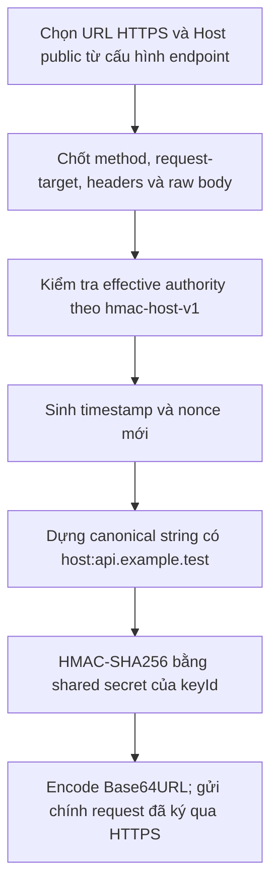
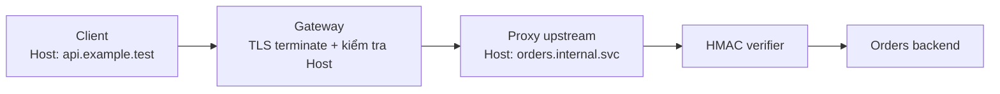

# Host header trong Header Canonicalization cho HMAC Request Authentication

## Mục tiêu học tập

Sau bài này, bạn có thể:

- Giải thích **`Host`** trong HTTP/1.1 và **`:authority`** trong HTTP/2/HTTP/3 giúp định danh authority đích như thế nào; phân biệt với path, query, scheme và TLS SNI.
- Mô tả vì sao một API dùng HMAC nên **ràng buộc host/authority công khai** vào canonical request khi host ảnh hưởng tới routing, service hoặc tenant.
- Xây dựng **hợp đồng canonicalization có phiên bản** cho host: quy tắc chữ hoa/thường, dấu chấm cuối, port mặc định, hostname quốc tế, IPv6 và chính sách từ chối giá trị nhập nhằng.
- Kiểm soát việc chọn **Host hoặc `:authority`**, header trùng, giá trị `Host` không hợp lệ và các header `Forwarded`/`X-Forwarded-Host` do client tự gửi.
- Viết Java/JCA tính, kiểm tra HMAC-SHA256 trên canonical request có dòng `host:...` và diễn giải đúng giới hạn của ví dụ.
- Thiết kế kiểm thử client → CDN/gateway → verifier → backend, bao gồm rewrite Host, virtual host, replay, key rotation và **authentication khác authorization**.

**Ngữ cảnh:** Bài thuộc chương **Header canonicalization** của module `SECURITY_AUTHENTICATION_HMAC_REQUEST_AUTHENTICATION`. Module hướng dẫn xác thực HTTP request bằng **shared secret**, ký một **canonical request** gồm method, URI, header/body theo hợp đồng, xác minh chữ ký, chống replay bằng timestamp/nonce, xoay vòng khóa và kiểm thử hạ tầng proxy/gateway. Chủ đề trực tiếp ở đây là **Host header**: một thành phần thường nhìn đơn giản nhưng dễ trở thành nguồn sai khác giữa client, proxy và server.

> Các tên header `X-*` và hợp đồng `hmac-host-v1` trong bài là **ví dụ tự định nghĩa** để học cách thiết kế giao thức. Chúng không phải format HMAC chung mà client có thể mặc nhiên dùng với dịch vụ khác.

## 1. Host header là gì?

HTTP có thể phục vụ nhiều website/API trên cùng một IP hoặc cổng. **Authority** cho biết tên host đích, và có thể chứa cổng, giúp hạ tầng lựa chọn virtual host và định tuyến request.

Một request HTTP/1.1 điển hình:

```http
POST /v1/orders HTTP/1.1
Host: api.example.test
Content-Type: application/json

{"orderId":"O-42"}
```

- `POST` là **method**.
- `/v1/orders` là **request-target** dạng origin-form (path, có thể có query).
- `Host: api.example.test` xác định **host đích** trên phương diện HTTP.
- Body là bytes được gửi, không nằm trong giá trị `Host`.

Nếu API yêu cầu HMAC trên method, request-target, host và body digest, những giá trị này phải được lấy và chuẩn hóa theo **một hợp đồng chung**. Nếu chỉ ký body mà không ký host, attacker có thể thử chuyển chính request đã ký đến một authority khác, đặc biệt nguy hiểm khi các authority chia sẻ credential, route hoặc backend.

### HTTP/1.1 `Host` so với HTTP/2/HTTP/3 `:authority`

HTTP/1.1 dùng trường `Host`. Trong HTTP/2 và HTTP/3, request thường biểu thị authority bằng pseudo-header `:authority`; việc xử lý `Host` xuất hiện cùng `:authority` phải được quy định và kiểm tra nhất quán.

```text
HTTP/1.1:
    POST /v1/orders HTTP/1.1
    Host: api.example.test

HTTP/2 (minh họa các pseudo-header):
    :method = POST
    :scheme = https
    :authority = api.example.test
    :path = /v1/orders
```

`:authority` không phải tên header thông thường bắt đầu bằng dấu `:` do client HTTP/1.1 có thể chèn tùy ý. HTTP gateway thường chuyển đổi giữa phiên bản giao thức: verifier phải có cách lấy **effective authority được parser/gateway tin cậy xác lập**, không chỉ gọi một API đọc `Host` và hy vọng các protocol giống nhau.

### Host, authority, scheme, URL và SNI khác nhau thế nào?

| Thuật ngữ | Ví dụ | Vai trò |
|---|---|---|
| Hostname | `api.example.test` | Tên host; một thành phần của authority |
| Authority | `api.example.test:8443` | Host và port tùy chọn (trường hợp không có userinfo theo profile API) |
| Scheme | `https` | Giao thức URI; không phải nội dung của `Host` |
| Path + query | `/v1/orders?region=vn` | Định vị tài nguyên/tham số request |
| URL đầy đủ | `https://api.example.test/v1/orders` | Scheme + authority + path/query |
| HTTP/1.1 Host | `Host: api.example.test` | Trường authority đích trong request |
| HTTP/2 `:authority` | `api.example.test` | Pseudo-header authority cho request |
| TLS SNI | `api.example.test` | Tên được client đưa trong quá trình bắt tay TLS để hỗ trợ chọn cấu hình/certificate; **không phải HTTP Host** |

SNI, tên trong certificate và HTTP authority có mối liên hệ vận hành nhưng **không mặc nhiên đồng nhất**. Việc TLS handshake thành công **không chứng minh** giá trị `Host` bất kỳ do client gửi là đáng tin. API có thể quy định và enforce SNI/Host consistency, nhưng đó là **chính sách tại edge** bên cạnh việc xác minh HMAC.

## 2. Vì sao Host cần được xét trong chữ ký HMAC?

Giả sử một hệ thống có các authority:

```text
api.example.test      -> Public Orders API
admin.example.test    -> Administrative API
partner.example.test  -> Partner API
```

Nếu các API dùng chung một phần hạ tầng, client key hoặc route `/v1/orders`, việc không ràng buộc **đích yêu cầu** có thể khiến chữ ký HMAC của cùng method/path/body được chấp nhận ở một service không dự kiến. Một attacker không cần biết secret nếu có thể **phát lại** request đã ký sang một host khác mà verifier chỉ kiểm tra phần dữ liệu không chứa host.

Trong hợp đồng bảo vệ host:

```text
signatureBytes = HMAC-SHA256(
    secretKeyBytes,
    UTF8(method + "\n" + requestTarget + "\n" + "host:" + canonicalHost + ...)
)
```

Thay `host:api.example.test` bằng `host:admin.example.test` làm **canonical bytes đổi**, nên chữ ký cũ không thể dùng lại, giả sử verifier bắt buộc lấy host từ nguồn chính xác và tự tính HMAC.

### Ba thuộc tính cần phân biệt

1. **Integrity của authority đã ký:** attacker không thể sửa host được ký mà vẫn dùng tag cũ khi không có secret.
2. **Chọn route/service an toàn:** gateway và backend phải thực thi **đúng authority đã được xác minh**; nếu backend route theo host khác, HMAC đúng vẫn có thể bảo vệ sai đích.
3. **Authorization theo resource/tenant:** dù client tự ký hợp lệ một request tới host được phép, nó vẫn cần quyền với hành động và tài nguyên cụ thể.

**Ký Host không biến Host thành danh tính người dùng.** Danh tính client đến từ bản ghi khóa được xác minh; Host thể hiện đích của request.

## 3. Canonical Host: những quyết định phải được ghi thành hợp đồng

Không có một phép normalize Host duy nhất phù hợp mọi API. Trước khi ký, cần quy định rõ **dạng được phép trên wire** và **dạng đưa vào chuỗi canonical**.

### 3.1. Chữ hoa/thường của DNS host

DNS hostname thường được so khớp không phân biệt hoa/thường; vì thế trong một profile cho phép nhiều cách viết, có thể quy định **lowercase ASCII DNS host** khi ký.

```text
Host: API.EXAMPLE.TEST
Host: api.example.test

canonical host (nếu contract cho phép case folding): api.example.test
```

Nhưng điều này **không cho phép** lower-case toàn bộ authority tùy tiện: userinfo, scheme lẫn host, hoặc các chuỗi không phải DNS có quy tắc khác. Một API có thể chọn profile **chỉ chấp nhận lowercase** để loại bớt tính nhập nhằng; bài thực hành bên dưới chọn cách đó.

### 3.2. Port mặc định và port không mặc định

```text
Host: api.example.test
Host: api.example.test:443
Host: api.example.test:8443
```

Đừng tự kết luận ba chuỗi có cùng giá trị ký. Nếu API HTTPS chạy trên port mặc định, một hợp đồng có thể quy định `:443` và không có port được canonical hóa như nhau. Một hợp đồng khác có thể **từ chối port tường minh** để có duy nhất một biểu diễn. Port `8443` là authority khác; không nên tự bỏ.

Đối với ví dụ `hmac-host-v1` ở phần sau, yêu cầu **chính xác `api.example.test`, không kèm port**. Đây là profile hẹp, giúp kiểm tra byte-for-byte và phát hiện mọi rewrite bất ngờ. Khi mở rộng nhiều cổng, phải nâng cấp chính sách và test song song.

### 3.3. Dấu chấm cuối, IDN, IPv6 và ký tự đặc biệt

| Biến thể | Điểm cần giải quyết | Khuyến nghị cho profile ví dụ |
|---|---|---|
| `api.example.test.` | Tên DNS có trailing dot; có thể tương đương ở DNS nhưng khác chuỗi HTTP | Reject thay vì tự bỏ dấu chấm |
| `API.EXAMPLE.TEST` | Chữ hoa/thường của host | Reject trong profile chỉ nhận lowercase |
| Tên miền Unicode | Cần thống nhất IDNA và biểu diễn ASCII/Punycode | Reject; nếu cần thì định nghĩa IDNA profile riêng |
| `[2001:db8::1]` | IPv6 literal dùng ngoặc vuông trong authority | Reject vì profile chỉ nhận DNS name cố định |
| `[2001:db8::1]:8443` | IPv6 literal + port, không thể split theo dấu `:` đầu tiên | Nếu hỗ trợ, phải dùng parser authority đúng chuẩn |
| `api.example.test:443` | Port mặc định nhưng có biểu diễn khác | Reject trong profile hẹp |
| `api.example.test,other.test` | Giá trị bị gộp như nhiều header hoặc có dấu phẩy | Reject |
| `user@api.example.test` | Userinfo không phù hợp profile Host của API | Reject |
| Ký tự điều khiển, CR/LF | Có thể tạo HTTP header injection hoặc parser differential | Reject ở HTTP parser và ingress |
| Whitespace bên trong host | Không thuộc hostname cho phép | Reject |

**Lưu ý:** Các host khác biệt vẫn có thể trỏ về cùng IP. Điều đó **không** có nghĩa HMAC nên canonical chúng thành cùng một chuỗi. Việc ký authority nhằm ràng buộc **đích logic của request**, không phải địa chỉ IP mà DNS phân giải lúc đó.

## 4. Chính sách `hmac-host-v1`: một canonical authority rõ ràng

Giả sử Orders API có:

- Public authority duy nhất: `api.example.test`.
- HTTPS được terminate tại gateway được ủy quyền.
- Method endpoint mẫu: `POST`.
- Request-target: `/v1/orders`, **không có query** trong profile này.
- Content type: `application/json`.
- Body được ký thông qua digest SHA-256 của raw body bytes.
- Client/Key ID, timestamp và nonce là các trường được ký.
- Signature là HMAC-SHA256 32 byte, encode Base64URL **không padding** (43 ký tự).

**Quy tắc Host:**

1. Với request HTTP/1.1 tại điểm nhận tin cậy: yêu cầu **đúng một** `Host` hợp lệ, có giá trị đúng `api.example.test`. Từ chối Host thiếu, nhiều giá trị, có port, khác case, trailing dot, whitespace bất thường và header không hợp lệ.
2. Với HTTP/2/HTTP/3: xác định authority hiệu lực từ `:authority` theo HTTP parser hợp lệ; nếu có thêm `Host` và nó **mâu thuẫn** với `:authority`, từ chối. Profile yêu cầu effective authority đúng `api.example.test`.
3. Không tin `X-Forwarded-Host`, `Forwarded` hoặc `X-Original-Host` từ Internet làm nguồn host được ký. Nếu nhận sau proxy rewrite, dùng metadata gốc do **gateway tin cậy tạo và bảo vệ**, đồng thời chống giả mạo từ client.
4. Verifier ký giá trị canonical `api.example.test` **sau khi đã kiểm tra request thực sự nhằm authority được phép**; không chỉ hard-code host rồi bỏ qua authority client đã gửi.
5. Server phải ánh xạ authority đã xác minh tới đúng Orders API; không cho host alias không được công bố dùng chung tag HMAC.

Đây là profile **cố ý nghiêm ngặt**; một API đa domain cần định nghĩa tập authority, cách canonical hóa, chọn khóa theo service/audience và chính sách route tương ứng. Không cố gộp toàn bộ những trường hợp này vào một hàm `toLowerCase().trim()`.

### Giá trị Host có thể đi kèm port không?

Trong giao thức HTTP nói chung, authority có thể bao gồm port. Việc profile `hmac-host-v1` từ chối `:443` là **quy tắc sản phẩm**, không phải khẳng định “HTTP cấm port trong Host”. Mục tiêu là buộc client và verifier dùng một biểu diễn duy nhất. Khi đổi quyết định này, phải sửa hợp đồng ký và chạy lại test qua CDN/load balancer.

## 5. Tạo canonical request chứa Host

Request minh họa:

```http
POST /v1/orders HTTP/1.1
Host: api.example.test
Content-Type: application/json
X-Client-Id: partner-17
X-Key-Id: k2
X-Timestamp: <unix-seconds-hien-tai>
X-Nonce: <base64url-nonce-128-bit>
X-Signature: <base64url-hmac-tag>

{"orderId":"O-42","amount":120000}
```

Các giá trị trong `<...>` là **placeholder**; khi chạy thật phải thay bằng dữ liệu hợp lệ. Body được giả định là **đúng UTF-8 bytes** của JSON đang hiển thị, không có newline cuối.

Canonical string theo `hmac-host-v1`:

```text
POST
/v1/orders
host:api.example.test
content-type:application/json
x-client-id:partner-17
x-key-id:k2
x-timestamp:<unix-seconds-hien-tai>
x-nonce:<base64url-nonce-128-bit>
body-sha256:<base64url-sha256-of-exact-raw-body>
```

**Hợp đồng byte-level:**

- Thứ tự dòng là **cố định**: method → request-target → host → content-type → client ID → key ID → timestamp → nonce → body digest.
- Mỗi dòng được ngăn bằng **LF** (byte `0x0A`), **không có LF cuối**.
- Canonical string được mã hóa bằng **UTF-8**.
- Host có tên dòng `host:` viết thường và giá trị `api.example.test`; không chèn whitespace tự động sau dấu `:`.
- Query bị cấm trong profile; nếu API có query thực tế, phải ký raw query theo một hợp đồng canonicalization được chốt trước, không bỏ đi.
- Body digest là `Base64URL_NoPadding(SHA256(rawBodyBytes))`, trong đó **raw body bytes** được ghi nhận trước khi parse/serialize JSON.
- Chữ ký = `Base64URL_NoPadding(HMAC-SHA256(secret, canonicalBytes))`. Không đưa chính header `X-Signature` vào canonical request.
- HTTP header do client điều khiển mà ảnh hưởng nghiệp vụ (ví dụ `Idempotency-Key`, `If-Match`, tenant/audience) phải được ký theo hợp đồng nếu dùng, hoặc được ràng buộc bởi context đáng tin khác.

**Một chú ý về body hash:** SHA-256 của body chỉ là digest không dùng khóa; giá trị này được bảo vệ vì nó là **một dòng nằm trong thông điệp HMAC**. Đưa riêng `X-Body-Hash` mà không HMAC trên nó không chứng minh nguồn gốc request.

## 6. Hai luồng: client ký Host và server xác minh authority

### 6.1. Phía client



Client nên lấy authority từ **endpoint đã được cấu hình và kiểm tra**, không lấy một tên host tùy ý từ input nghiệp vụ. Sau khi ký, HTTP library không được âm thầm đổi scheme, host, port hoặc đường dẫn làm sai canonical bytes. Nếu có redirect sang host khác, **không tự chuyển tiếp signature/key metadata cũ**; cần xác định lại đích tin cậy và ký lại theo chính sách.

**Khi client đi qua proxy:** proxy HTTP hoặc TLS layer có thể thêm, thay hoặc giữ authority theo hợp đồng. Hệ thống phải chọn một nơi xác minh sao cho **authority được HMAC kiểm tra là authority mà backend thực thi theo route bảo mật**.

### 6.2. Phía server

```mermaid
sequenceDiagram
    autonumber
    participant C as Client
    participant G as CDN / Gateway
    participant V as HMAC verifier
    participant K as Secret store
    participant N as Shared nonce store
    participant B as Backend
    C->>C: Chọn host public, dựng canonical bytes, ký HMAC
    C->>G: HTTPS POST với Host / :authority, signature
    G->>G: Parse HTTP, giới hạn header, reject Host nhập nhằng
    G->>G: Ghi nhận authority public đã được kiểm tra
    G->>V: Request + authority metadata qua hop được bảo vệ
    V->>V: Validate method, target, effective authority, signed header format
    V->>K: Lookup(environment, clientId, keyId)
    K-->>V: Key/owner/state thuộc Orders API
    V->>V: Rebuild canonical với authority tin cậy; tính HMAC
    alt Signature sai, Host khác hoặc key bị thu hồi
        V-->>G: Reject authentication / invalid request
        G-->>C: Reject
    else HMAC hợp lệ
        V->>N: Atomic insert-if-absent(clientId, nonce)
        alt Nonce trùng hoặc store lỗi
            V-->>G: Reject replay / fail closed
            G-->>C: Reject
        else Nonce mới
            N-->>V: Inserted
            V->>B: Principal đã xác thực + routing context bảo vệ
            B->>B: Authorization theo tenant/resource/action
            B-->>G: Business response
            G-->>C: HTTPS response
        end
    end
```

Dữ liệu `Host`/`:authority` ban đầu là **client-controlled input**. Chỉ sau bước parser và kiểm tra ingress, verifier mới được dùng **authority đã chọn và được bảo đảm nguồn gốc** để dựng canonical string. Tuy nhiên, việc authority hợp lệ **không xác thực danh tính client**; client identity chỉ được thiết lập khi HMAC khớp và key còn được phép verify.

**Không để backend tự đọc một `X-Authenticated-Client` do client gửi để bỏ qua bước HMAC.** Gateway phải loại bỏ/ghi đè header định danh nội bộ, bảo vệ đường truyền backend và ngăn request trực tiếp đi vòng verifier.

## 7. Java/JCA: ký HMAC-SHA256 có ràng buộc Host

Ví dụ Java 17+ dưới đây cố định `hmac-host-v1` cho public authority `api.example.test`. Nó được thiết kế sao cho **giá trị Host khác không thể được silently canonicalize thành host cố định**: trước khi HMAC, `canonical()` phải xác nhận effective authority đúng profile.

```java
import java.nio.charset.StandardCharsets;
import java.security.GeneralSecurityException;
import java.security.MessageDigest;
import java.security.SecureRandom;
import java.time.Instant;
import java.util.Base64;
import java.util.regex.Pattern;
import javax.crypto.Mac;
import javax.crypto.spec.SecretKeySpec;

public final class HostBoundHmacV1 {
    private static final String HOST = "api.example.test";
    private static final String TARGET = "/v1/orders";
    private static final String ALGORITHM = "HmacSHA256";
    private static final Pattern ID =
            Pattern.compile("[A-Za-z0-9][A-Za-z0-9._-]{0,63}");
    private static final Pattern TIMESTAMP =
            Pattern.compile("(?:0|[1-9][0-9]{0,11})");
    private static final Pattern NONCE =
            Pattern.compile("[A-Za-z0-9_-]{22}");
    private static final Pattern SIGNATURE =
            Pattern.compile("[A-Za-z0-9_-]{43}");
    private static final Base64.Encoder B64 =
            Base64.getUrlEncoder().withoutPadding();

    private HostBoundHmacV1() {}

    // effectiveAuthority phải được lấy từ HTTP parser/ingress đáng tin.
    public record Parts(
            String method, String rawTarget, String effectiveAuthority,
            String contentType, String clientId, String keyId,
            String timestamp, String nonce, byte[] rawBody) {}

    private static boolean validNonce(String value) {
        if (value == null || !NONCE.matcher(value).matches()) {
            return false;
        }
        try {
            byte[] decoded = Base64.getUrlDecoder().decode(value);
            return decoded.length == 16 &&
                    B64.encodeToString(decoded).equals(value);
        } catch (IllegalArgumentException malformed) {
            return false;
        }
    }

    public static String canonical(Parts p)
            throws GeneralSecurityException {

        if (p == null ||
                !"POST".equals(p.method()) ||
                !TARGET.equals(p.rawTarget()) ||
                !HOST.equals(p.effectiveAuthority()) ||
                !"application/json".equals(p.contentType()) ||
                p.clientId() == null ||
                !ID.matcher(p.clientId()).matches() ||
                p.keyId() == null ||
                !ID.matcher(p.keyId()).matches() ||
                p.timestamp() == null ||
                !TIMESTAMP.matcher(p.timestamp()).matches() ||
                !validNonce(p.nonce()) ||
                p.rawBody() == null) {
            throw new IllegalArgumentException("Invalid signed request fields");
        }

        // Digest tính trên chính raw body bytes mà API đã nhận.
        byte[] bodyDigest = MessageDigest.getInstance("SHA-256")
                .digest(p.rawBody());

        return String.join("\n",
                "POST",
                TARGET,
                "host:" + p.effectiveAuthority(),
                "content-type:" + p.contentType(),
                "x-client-id:" + p.clientId(),
                "x-key-id:" + p.keyId(),
                "x-timestamp:" + p.timestamp(),
                "x-nonce:" + p.nonce(),
                "body-sha256:" + B64.encodeToString(bodyDigest));
    }

    private static byte[] mac(byte[] secret, Parts p)
            throws GeneralSecurityException {
        Mac instance = Mac.getInstance(ALGORITHM);
        instance.init(new SecretKeySpec(secret, ALGORITHM));
        return instance.doFinal(
                canonical(p).getBytes(StandardCharsets.UTF_8));
    }

    public static String sign(byte[] secret, Parts p)
            throws GeneralSecurityException {
        return B64.encodeToString(mac(secret, p));
    }

    public static boolean verify(
            byte[] secret, Parts received, String signature)
            throws GeneralSecurityException {

        if (signature == null ||
                !SIGNATURE.matcher(signature).matches()) {
            return false;
        }

        final byte[] supplied;
        try {
            supplied = Base64.getUrlDecoder().decode(signature);
        } catch (IllegalArgumentException invalid) {
            return false;
        }

        // Bắt buộc HMAC-SHA256 đầy đủ, encoding canonical.
        if (supplied.length != 32 ||
                !B64.encodeToString(supplied).equals(signature)) {
            return false;
        }

        final byte[] expected;
        try {
            expected = mac(secret, received);
        } catch (IllegalArgumentException invalidRequest) {
            return false; // Request ngoài hmac-host-v1.
        }

        return MessageDigest.isEqual(expected, supplied);
    }

    public static void main(String[] args)
            throws GeneralSecurityException {
        // Mô phỏng key provisioning; production không sinh key
        // mới tại verifier cho mỗi request.
        byte[] secret = new byte[32];
        new SecureRandom().nextBytes(secret);
        byte[] nonceBytes = new byte[16];
        new SecureRandom().nextBytes(nonceBytes);

        Parts original = new Parts(
                "POST", TARGET, HOST, "application/json",
                "partner-17", "k2",
                Long.toString(Instant.now().getEpochSecond()),
                B64.encodeToString(nonceBytes),
                "{\"orderId\":\"O-42\",\"amount\":120000}"
                        .getBytes(StandardCharsets.UTF_8));

        String signature = sign(secret, original);
        if (!verify(secret, original, signature)) {
            throw new AssertionError("Valid request rejected");
        }

        // Chỉ thay authority, giữ nguyên method/URI/body/tag.
        Parts changedHost = new Parts(
                original.method(), original.rawTarget(),
                "admin.example.test", original.contentType(),
                original.clientId(), original.keyId(),
                original.timestamp(), original.nonce(), original.rawBody());

        if (verify(secret, changedHost, signature)) {
            throw new AssertionError("Host tampering accepted");
        }

        Parts explicitPort = new Parts(
                original.method(), original.rawTarget(),
                "api.example.test:443", original.contentType(),
                original.clientId(), original.keyId(),
                original.timestamp(), original.nonce(), original.rawBody());

        if (verify(secret, explicitPort, signature)) {
            throw new AssertionError("Unspecified port accepted");
        }

        System.out.println("Host-bound HMAC checks: PASS");
    }
}
```

### Giới hạn bảo mật của mã

Code trên **chỉ** xử lý canonical bytes và HMAC. HTTP layer phải làm những việc sau **trước khi gọi** `verify()`:

1. Phân biệt HTTP/1.1 `Host` và HTTP/2/HTTP/3 `:authority`; kiểm tra cardinality, các giá trị xung đột và cú pháp.
2. Ràng buộc `effectiveAuthority` với **đích đã được edge router chấp nhận**, không lấy từ một header tùy ý.
3. Chặn input vượt giới hạn, header trùng, request-target sai, body quá lớn; đảm bảo handler dùng đúng body/authority đã verify.
4. Tra secret theo **`(environment, clientId, keyId)`** và bảo đảm key thuộc service/audience được phép; không thử mọi key hoặc dùng key của client khác.
5. Kiểm tra timestamp trên đồng hồ server, nonce đã ký bằng kho dùng chung/nguyên tử; từ chối replay.
6. Tạo principal từ **bản ghi khóa đã verify**, chuyển context an toàn và thực hiện authorization riêng.

Dòng `HOST.equals(p.effectiveAuthority())` là **một chính sách allowlist hẹp**, không phải bằng chứng input đã đến từ host tin cậy. Nếu HTTP adapter đơn giản điền hằng `api.example.test` mà không kiểm tra host người gọi đã gửi, một request tới `admin.example.test` có thể được xác minh như request tới `api.example.test`. Sự liên hệ giữa authority ngoài mạng và context nội bộ **phải được chứng minh tại ingress/router**, không chỉ bằng hàm `canonical()`.

### Cần thay đổi gì khi API có nhiều hostname?

Một hệ thống đa authority nên có allowlist chính xác như `api.example.test`, `eu.api.example.test`, hoặc `orders.example.test:8443` với từng rule riêng. Việc chọn khóa, scope tenant, service/audience và canonical string phải **ràng buộc vào effective authority đã được xác minh**. Đừng tự dùng `String.toLowerCase()` và xóa `:443` mà không công bố chính sách tương thích và kiểm thử.

## 8. Reverse proxy: Host công khai có thể khác Host nội bộ

Một kiến trúc thường gặp:



Nếu client ký:

```text
host:api.example.test
```

nhưng verifier dùng `Host` của kết nối nội bộ:

```text
host:orders.internal.svc
```

hai phía sẽ tính **HMAC khác nhau**. Cách sửa sai phổ biến nhưng nguy hiểm là “cứ lấy `X-Forwarded-Host` để ký” mà không kiểm soát nguồn. Attacker có thể tự gửi `X-Forwarded-Host` hoặc `Forwarded` nhằm ảnh hưởng đến canonical request, định tuyến, generated URL hoặc quyết định quyền.

### Hai lựa chọn kiến trúc đáng cân nhắc

**A. Verify tại edge trước rewrite:** edge dùng authority công khai mà chính nó đã parse và route, xác minh HMAC tại đó. Sau xác minh, edge chuyển principal/resource/context đã xác thực tới backend trên kênh nội bộ bảo vệ; backend không nhận request trực tiếp không qua edge.

**B. Verify tại service sau rewrite:** gateway được ủy quyền phải chuyển một **original authority có nguồn tin cậy** tới verifier, ví dụ qua metadata kênh nội bộ/mTLS hoặc header chỉ gateway được phép tạo. Gateway xóa hoặc ghi đè header forwarding do client gửi, kiểm soát đường đi nội bộ và bảo đảm **host được xác minh gắn với route thực sự** mà backend phục vụ.

Trong cả hai lựa chọn, verifier phải từ chối khi authority gốc không xác định được hoặc mâu thuẫn với route được phép. Không dùng raw `X-Forwarded-Host` từ public Internet hay một header `X-Original-Host` không có kiểm soát quyền để vượt qua bước xác minh.

### Các bất biến phải kiểm chứng

```text
Public authority do client ký
          ==
Public authority mà ingress đã kiểm tra/route
          ==
Authority mà verifier dùng trong canonical request
          ==
Service/audience mà backend thực sự xử lý
```

Dấu `==` ở đây có nghĩa **cùng đích logic theo quy tắc hợp đồng**, không nhất thiết cùng chuỗi Host trên hop nội bộ sau khi proxy thay thành DNS nội bộ.

## 9. Những tấn công thường liên quan tới Host header

| Tình huống | Sai lầm thiết kế | Hậu quả có thể xảy ra | Cách phòng vệ |
|---|---|---|---|
| **Host header injection** | Tin host từ client để tạo URL tuyệt đối, redirect hoặc liên kết email | Phishing, password-reset poisoning, cache confusion | Host allowlist, cấu hình public origin, encode và chính sách URL an toàn |
| Duplicate Host | Nhận hai `Host` có giá trị khác nhau | Proxy và backend chọn Host khác nhau | Reject thiếu/trùng/invalid Host ở ingress |
| HTTP/2 authority mismatch | `:authority` khác `Host` nhưng các tầng dùng giá trị khác | Cross-host routing hoặc signature confusion | Quy định ưu tiên và reject mâu thuẫn theo profile |
| TLS SNI khác HTTP authority | Coi TLS handshake thành công là đủ để tin bất kỳ Host | Truy cập nhầm virtual host/service | Kiểm soát SNI/Host theo chính sách edge, không tự suy ra quyền |
| Default-port normalization | Client ký không port, verifier tự bỏ hoặc thêm `:443` | Chữ ký sai hoặc đồng nhất authority không dự kiến | Phiên bản hóa rule, test cả hai biến thể |
| Host lowercase/trailing dot | Hai parser canonical khác nhau | Chữ ký sai, cache/routing khác nghĩa | Chọn profile cụ thể; reject unknown form |
| Rewrite Host qua proxy | Verifier ký internal Host trong khi client ký public Host | HMAC mismatch | Truyền public authority đáng tin hoặc verify trước rewrite |
| Tin `X-Forwarded-Host` tự khai | Client giả mạo host gốc | Bypass routing hoặc phá tính ràng buộc đích | Gateway strip/overwrite, mTLS/hop bảo vệ |
| Key dùng chung nhiều service | Không ký authority/audience | Cross-service replay nếu các trường khác cũng trùng | Ký host/audience, tách key theo purpose và endpoint |
| Canonical host cố định nhưng không validate request | Mọi request được xem như gửi đến host chuẩn | Có thể nhận tag ở virtual host khác | Đối chiếu authority ở ingress trước khi canonical |
| Không xác minh key scope | Lookup chỉ theo key ID, bỏ client/service/env | Key confusion, cross-tenant | Scope lookup và xác minh key owner/state |
| Không authorization | HMAC đúng trên host đúng được coi là toàn quyền | Sửa dữ liệu tenant khác | Principal từ key đã verify + authz theo resource |

Một lớp kiểm tra Host không thể tự giải quyết tất cả các rủi ro trên; cần thiết kế đồng nhất giữa **TLS edge, parser HTTP, routing, verifier và backend**.

## 10. Host header, replay protection và key rotation

### Timestamp và nonce

Ký Host chỉ bảo vệ **đích đã ký**. Attacker vẫn có thể phát lại **nguyên request cùng Host, body, timestamp, nonce và signature** nếu không có replay policy. Với HMAC request authentication:

- Ký `x-timestamp` và `x-nonce` vào canonical request.
- Verifier từ chối timestamp ngoài cửa sổ server quy định (ví dụ ±300 giây).
- Sau khi tag HMAC khớp, ghi `(clientId, nonce)` vào kho **dùng chung** cho tất cả replica bằng thao tác **insert-if-absent nguyên tử**.
- TTL phải bao phủ đến khi timestamp của request không thể còn hợp lệ, kể cả các request đến sớm nhất trong cửa sổ.
- Khi kho nonce lỗi, với endpoint nhạy cảm nên **fail closed**.

Nếu client retry thao tác với nonce mới và chữ ký mới, cơ chế replay không tự ngăn nghiệp vụ thực hiện lặp. Các endpoint như tạo đơn/thanh toán cần cơ chế **idempotency** phù hợp, và nếu `Idempotency-Key` đến từ client, cần ràng buộc trường ấy trong hợp đồng ký.

### Key ID và rotation

`X-Key-Id: k2` chỉ chọn phiên bản secret, **không phải secret**. Verifier tra `(environment, clientId, keyId)` và nên kiểm tra thêm **service/audience**. Trong giai đoạn rotation, verifier có thể tạm nhận `k1` và `k2` theo chính sách; sau khi `k1` bị thu hồi thì mọi replica phải từ chối ngay khi chính sách có hiệu lực.

Nếu secret bị lộ, attacker có thể ký **request mới đến host khác** nếu hệ thống cho phép và thiếu scope, hoặc ký request mới đến đúng host với nonce mới. Nonce không ngăn giả mạo bằng secret bị lộ; cần thu hồi khóa, cô lập tenant/môi trường và rà soát audit.

### Authentication không phải authorization

Một client có chữ ký hợp lệ cho `api.example.test` có thể gửi:

```http
POST /v1/orders HTTP/1.1
Host: api.example.test
X-Client-Id: partner-17
X-Key-Id: k2
X-Signature: <valid-hmac-of-signed-request>
```

Verifier có thể xác thực được **partner-17**. Backend vẫn phải kiểm tra liệu đối tác này có quyền tạo đơn cho tenant/resource mà request đề cập hay không. **Host đúng + HMAC đúng không cấp quyền tự động.** Không lấy Host làm chỉ dấu quyền admin, tenant owner hay role.

## 11. Ma trận kiểm thử Host canonicalization

| Tình huống | Thao tác | Kết quả mong đợi theo `hmac-host-v1` |
|---|---|---|
| Happy path HTTP/1.1 | Một `Host: api.example.test`, request được ký đúng | HMAC pass; tiếp tục replay/authz |
| Happy path HTTP/2 | `:authority=api.example.test`, request không xung đột | HMAC pass sau khi ánh xạ authority đúng |
| Thay Host sau ký | `api.example.test` → `admin.example.test` | HMAC fail hoặc reject Host ngay tại ingress |
| Host thiếu HTTP/1.1 | Không có `Host` | Reject trước verify |
| Host trùng | Hai `Host`, kể cả tên khác case | Reject |
| Host gộp | `api.example.test, admin.example.test` | Reject |
| Thêm port | `api.example.test:443` | Reject vì ngoài profile hẹp |
| Port khác | `api.example.test:8443` | Reject |
| Host chữ hoa | `API.EXAMPLE.TEST` | Reject theo profile chỉ cho lowercase |
| Host có dấu chấm cuối | `api.example.test.` | Reject |
| IPv6 literal | `[2001:db8::1]` | Reject vì ngoài profile |
| Unicode / hostname khác | Domain không thuộc allowlist | Reject |
| HTTP/2 conflict | `:authority=api.example.test`, `Host=evil.example.test` | Reject mâu thuẫn |
| SNI/authority policy | SNI khác đích HTTP công khai được phép | Xử lý theo chính sách ingress; không mặc định hợp lệ |
| Host bị rewrite | Client ký public Host, upstream là `orders.internal.svc` | Dùng public authority đáng tin; không ký nhầm internal Host |
| Forwarded-Host giả | Client gửi `X-Forwarded-Host: api.example.test` khi Host là evil | Không dùng header giả để vượt kiểm tra |
| Method/URI đổi | Ký `POST /v1/orders` rồi đổi method/path | HMAC mismatch hoặc reject |
| Body đổi | Sửa JSON sau ký | HMAC mismatch do body hash |
| Key cũ | HMAC bằng key `k1` đã revoke | Reject theo key lifecycle |
| Replay | Gửi lại nguyên Host + signature/nonce qua replica khác | Tối đa một request được xử lý |
| Signature đúng, sai tenant | Client hợp lệ thao tác resource khác tenant | Authentication có thể pass, authorization deny |
| Backend bypass | Gọi thẳng service với `X-Authenticated-Client` giả | Không được bỏ qua verifier/authz |

**Quan trọng:** test chức năng **phải chạy qua CDN, load balancer, gateway, HTTP/1.1 và HTTP/2 adapter** khi thực tế dùng những hop đó. Unit test `HostBoundHmacV1` tự thân chưa chứng minh HTTP edge đã loại duplicate Host hoặc không tin forwarding header giả.

### Quan sát và log

Có thể ghi **authority đã canonical hóa** (sau khi giới hạn và lọc dữ liệu không hợp lệ), route, version hợp đồng ký, client ID/key ID được phép ghi, mã lỗi tổng quát và metric `invalid_host`, `host_mismatch`, `signature_mismatch`, `replay_detected`. **Không log raw secret**, và hạn chế log raw header/body chưa được lọc vì có thể chứa dữ liệu nhạy cảm hoặc ký tự điều khiển. Việc quan sát không được biến dữ liệu Host tự khai thành chuỗi log không kiểm soát.

## 12. Bài tập thực hành: xây dựng host-bound HMAC ở gateway

Một công ty có ba public authorities:

```text
api.example.test           -> Orders API
billing.example.test       -> Billing API
sandbox-api.example.test   -> Sandbox Orders
```

Gateway nhận HTTPS (HTTP/1.1 và HTTP/2), chuyển tiếp request vào service nội bộ; các verifier có nhiều replica và có shared nonce store. Client được cấp secret theo client/môi trường/audience, rotation `k1 → k2`.

Hãy thực hiện:

1. **Đề xuất canonicalization policy** cho Host/authority: có nhận chữ hoa, dấu chấm cuối, port `:443`, IDN, IPv6 và nhiều alias không? Nếu cho phép, mô tả cách đưa về một biểu diễn duy nhất; nếu không, mô tả điều kiện reject.
2. **Mô tả HTTP adapter:** với HTTP/1.1 kiểm tra đúng một `Host`, với HTTP/2/HTTP/3 xử lý `:authority` và reject khi có `Host` mâu thuẫn; không dùng `X-Forwarded-Host` từ client.
3. **Định nghĩa canonical request** có method, request-target, authority public đáng tin, content-type, client ID, key ID, timestamp, nonce và SHA-256 digest của raw body.
4. **Viết Java verifier:** lấy authority từ context ingress đã xác lập, tra đúng key theo client/môi trường/service, tính lại HMAC-SHA256 và so tag bytes an toàn.
5. **Kiểm soát route:** chứng minh request đã ký cho `api.example.test` không thể bị thực thi thành thao tác của `billing.example.test` hoặc sandbox bằng cách đổi Host sau khi ký.
6. **Chống replay và rotation:** lưu nonce bằng atomic insert-if-absent qua nhiều replica, xoay vòng key và thử thu hồi key cũ trong lúc cache verifier chưa đồng nhất.
7. **Authorization:** với chữ ký đúng ở host đúng, thử gọi resource của tenant khác; phải bị từ chối ở backend.
8. **Kiểm thử qua gateway thật:** duplicate Host, Host/`:authority` mismatch, default port, SNI mismatch theo chính sách, Host rewrite, header forwarding giả, HTTP/1.1→HTTP/2 conversion và request đi trực tiếp backend.

**Tiêu chí hoàn thành:** Có bằng chứng ba giá trị **public authority client ký – authority verifier xác minh – service backend thực thi** được ràng buộc nhất quán. Không có trường hợp HMAC pass ở authority A nhưng handler thực thi ở authority B. Đồng thời, Host đúng không được bỏ qua **replay check** hay **authorization**.

---

## Ghi nhớ

Trong `SECURITY_AUTHENTICATION_HMAC_REQUEST_AUTHENTICATION`, **Host header** (hoặc HTTP/2/HTTP/3 `:authority`) là thông tin đích HTTP cần được xử lý bằng **một quy tắc canonicalization rõ ràng**. Nếu host ảnh hưởng routing hoặc audience, hãy ký **authority công khai đã được ingress kiểm tra** cùng method, URI, header/body và metadata bằng HMAC. Đừng tin `X-Forwarded-Host` tự khai, đừng xem Host nội bộ sau proxy là Host công khai của client, và đừng xem HMAC hợp lệ là quyền truy cập mọi tenant. Xác minh authority phải đi cùng **timestamp/nonce chống replay**, **key rotation**, **kiểm thử proxy/gateway** và **authorization**.
