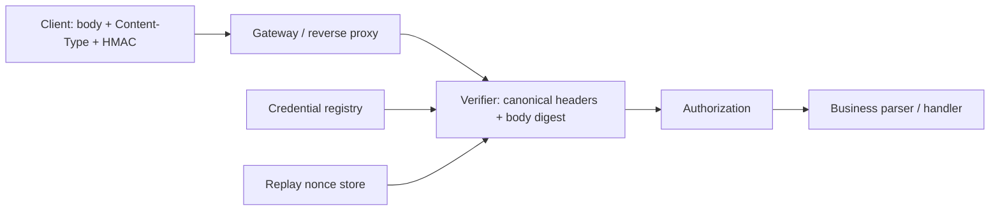

# Content-Type header trong canonical request: bảo vệ cách diễn giải HTTP body bằng HMAC

> **Chương:** Header canonicalization  
> **Bài học:** Content-Type header  
> **Bối cảnh:** Xác thực HTTP request bằng HMAC với shared secret. Client và server xây canonical request từ method, URI, signed headers và/hoặc body theo hợp đồng ký, sau đó kiểm signature, chống replay bằng timestamp/nonce, quản lý key rotation và phân quyền. Bài này tập trung vào **cách chọn, chuẩn hóa và ký trường `Content-Type`** để verifier và ứng dụng thực thi cùng một nội dung đã được xác thực.

## 1. Content-Type là gì và vì sao liên quan đến chữ ký?

`Content-Type` là **HTTP field mô tả media type của nội dung biểu diễn** được gửi trong message. Nó thường cho server biết body nên được diễn giải như JSON, plain text, form-urlencoded, multipart hay dữ liệu nhị phân.

Ví dụ:

```http
POST /v1/orders HTTP/1.1
Host: api.example.test
Content-Type: application/json

{"orderId":"ORD-42","amount":100000}
```

Nếu API đổi header thành `Content-Type: application/x-www-form-urlencoded` mà giữ nguyên body, backend có thể chọn **parser khác**, từ đó tạo ra hành vi khác hoặc từ chối request. Cùng một byte sequence không bảo đảm cùng một **ngữ nghĩa ứng dụng** dưới hai Content-Type khác nhau.

Trong HMAC request authentication, chúng ta muốn chữ ký ràng buộc **đúng những byte và metadata quyết định cách xử lý request**:

```text
bodyDigest = SHA256(rawBodyBytes)

canonicalRequest = METHOD
                || canonical URI
                || canonical signed headers (có content-type)
                || bodyDigest
                || metadata được ký theo hợp đồng

tag = HMAC-SHA256(sharedSecret, bytesToSign(canonicalRequest))
```

Trong hệ thống xử lý POST/PUT/PATCH với body, `Content-Type` thường là một trong những header đáng đưa vào tập **signed headers**, bên cạnh method, URI, body digest, timestamp và nonce.

**Điểm cốt lõi:** Ký body mà **không ký cách backend diễn giải body** có thể để lại một lỗ hổng. Ký Content-Type nhưng **không ký body** cũng không bảo vệ nội dung payload. Hai phần cần được xét cùng nhau.

## 2. Cấu trúc của Content-Type

Theo HTTP Semantics, giá trị `Content-Type` có thể là một **media type** và các **parameter**:

```text
Content-Type: type/subtype; parameter=value; parameter2=value2
```

Ví dụ:

| Content-Type | Ý nghĩa thường gặp | Điều cần nhớ khi ký |
| --- | --- | --- |
| `application/json` | Nội dung JSON. | `application/json` không định nghĩa tham số `charset` trong đăng ký của JSON (RFC 8259); nhiều môi trường vẫn nhận dạng `charset=UTF-8`, nhưng hợp đồng ký không nên tự đoán cách xử lý. |
| `text/plain; charset=utf-8` | Văn bản thuần với charset xác định. | Charset có thể ảnh hưởng cách chuyển body bytes thành text. |
| `application/x-www-form-urlencoded` | Nội dung form. | Form parser có thể biến `+` thành space và xử lý duplicate key theo quy tắc riêng. |
| `multipart/form-data; boundary=ABC123` | Body nhiều phần, phân tách bằng boundary. | `boundary` phải khớp với body và có **giá trị phân biệt hoa/thường**. |
| `application/octet-stream` | Nội dung byte tùy ý. | Không ép byte nhị phân thành text trước khi tính body hash. |
| `application/problem+json` | Biểu diễn JSON cho problem details. | Dấu `+json` nằm trong subtype; media type cụ thể phải được API cho phép. |

### Tên field và giá trị field là hai chuyện khác nhau

- **Tên header** là case-insensitive theo HTTP: `Content-Type`, `content-type` và `CONTENT-TYPE` chỉ cùng một field name.
- **Media type type/subtype** được so sánh không phân biệt hoa/thường theo quy tắc media type, chẳng hạn `Application/JSON` và `application/json` có cùng type/subtype ở tầng media type.
- **Tên parameter** cũng thường không phân biệt hoa/thường theo cú pháp media type.
- **Giá trị parameter** **không được tùy tiện lower-case**. Một số giá trị và cú pháp như multipart `boundary` mang ý nghĩa phân biệt hoa/thường; giá trị có dấu nháy, dấu chấm phẩy hoặc escape cần parser đúng chuẩn.
- Khoảng trắng quanh dấu `;` và `=`, dấu nháy bao quanh parameter, thứ tự parameter có thể tạo **nhiều biểu diễn khác nhau** mà parser media type đánh giá tương đương, nhưng không có nghĩa ứng dụng được tùy tiện rewrite trước khi ký.

Ví dụ:

```http
Content-Type: multipart/form-data; boundary=AaB03x
```

Nếu một canonicalizer thực hiện `value.toLowerCase(Locale.ROOT)`, nó biến `AaB03x` thành `aab03x`. Khi body dùng boundary gốc, thông tin đã bị thay đổi. Đây không phải một phép canonicalization an toàn.

**Không dùng `String.toLowerCase()` trên toàn bộ giá trị Content-Type.** Chuẩn hóa type/subtype hoặc parameter names chỉ được làm **sau khi đã parse cú pháp phù hợp** và khi hợp đồng chứng minh không làm đổi ý nghĩa.

## 3. Canonicalize một HTTP header nghĩa là gì?

Trong HMAC signing contract, **canonical header** là một biểu diễn có quy tắc của các field được đưa vào dữ liệu ký. Ví dụ một hợp đồng tự định nghĩa:

```text
Tên header:           content-type
Giá trị đã canonical: application/json
Dòng được ký:         content-type:application/json
```

Có ba mức cần phân biệt:

1. **HTTP normalization:** xử lý tên field không phân biệt hoa/thường, những khoảng trắng ngoài field value theo ngữ nghĩa HTTP và cách các phiên bản HTTP biểu diễn headers.
2. **Media-type normalization:** diễn giải type/subtype và parameter theo cú pháp chuẩn, nếu hợp đồng chọn cách ký **ngữ nghĩa media type** thay vì nguyên biểu diễn đã validate.
3. **Signing serialization:** quy định chính xác thứ tự field, dấu `:`, `\n`, ký tự cuối dòng, encoding và cách nối với method/URI/body digest.

Một lỗi phổ biến là cố gắng làm cả ba bằng:

```java
String canonical = rawHeader.trim().toLowerCase();
```

Cách này không giải quyết duplicate headers, không hiểu parameter syntax, có thể phá `boundary`, và phụ thuộc ngầm vào thông tin raw đã bị gateway/framework biến đổi.

### Hai chiến lược hợp lệ về mặt thiết kế

| Chiến lược | Phương pháp | Ưu điểm | Yêu cầu / đánh đổi |
| --- | --- | --- | --- |
| **Strict canonical form** | Chỉ nhận đúng một số chuỗi Content-Type đã quy định, ví dụ chính xác `application/json`. | Dễ kiểm toán, ít parser ambiguity, tạo signing bytes ổn định. | Client phải dùng chính xác dạng cho phép; các biến thể hợp lệ khác có thể bị từ chối. |
| **Grammar-aware semantic normalization** | Parse media type và parameters bằng parser đúng chuẩn; chuẩn hóa **chỉ những thành phần có quy tắc tương đương** rồi serialize một dạng duy nhất. | Hỗ trợ nhiều biểu diễn từ các client/framework. | Phải kiểm soát quoted strings, escape, parameter trùng, charset, boundary và đối chiếu parser backend. |

**Không có một canonical Content-Type duy nhất áp dụng cho mọi API.** Với một API nội bộ chỉ nhận JSON, chọn **strict canonical form** thường đơn giản và ít rủi ro hơn. Với upload multipart hoặc nhiều media type, cần thiết kế sâu hơn, không dùng một hàm lower-case toàn bộ.

## 4. Trường nào thực sự được ký?

Giả sử một client gửi:

```http
POST /v1/orders?currency=VND HTTP/1.1
Host: api.example.test
Content-Type: application/json
X-Key-Id: merchant-42-k2
X-Timestamp: 1795800000
X-Nonce: 7d6ab4099e6f4f80b19d0c152c56a4af
X-Signature: v1=<BASE64URL_HMAC_TAG>

{"orderId":"ORD-42","amount":100000}
```

Đây là ví dụ **giao thức HMAC tùy biến**. Timestamp, nonce và chữ ký là dữ liệu minh họa, không dùng lại trong production.

Một hợp đồng ký có thể yêu cầu:

| Thành phần | Cách bảo vệ | Lý do |
| --- | --- | --- |
| `POST` | Ký method đúng theo allowlist. | Không cho dùng tag của một method cho method khác. |
| `api.example.test` | Ký authority khi nó ảnh hưởng service/tenant. | Ngăn đổi virtual host hoặc đích xử lý không được bảo vệ. |
| `/v1/orders` và `currency=VND` | Canonicalize và ký path/query. | Ràng buộc endpoint, tài nguyên và tham số. |
| `content-type:application/json` | **Ký đúng dạng canonical.** | Ràng buộc **parser/representation type** với request. |
| `x-key-id:merchant-42-k2` | Ký metadata key ID và tra registry. | Ngăn đổi key ID mà không làm thay đổi signing input. |
| `x-timestamp:...`, `x-nonce:...` | Ký metadata chống replay. | Không cho sửa thông tin freshness/replay. |
| `SHA256(rawBodyBytes)` | Đưa digest vào canonical request rồi HMAC bảo vệ. | Phát hiện byte body bị sửa. |
| `X-Signature` | **Không đưa vào chính signing input** của custom scheme này. | Signature là đầu ra HMAC, tránh phụ thuộc vòng. |

**Một signature đúng trên Content-Type không xác thực bản thân caller nếu không dùng shared secret phù hợp.** Server phải chọn key theo key ID từ registry đáng tin, kiểm trạng thái credential, dựng lại signing input và so sánh tag.

### Ví dụ canonical request

Hợp đồng minh họa `HMAC-SHA256/v1` có dạng:

```text
canonicalRequest =
    METHOD + "\n"
    + AUTHORITY + "\n"
    + CANONICAL_PATH + "\n"
    + CANONICAL_QUERY + "\n"
    + CANONICAL_SIGNED_HEADERS + "\n"
    + SIGNED_HEADER_NAMES + "\n"
    + LOWERCASE_HEX_SHA256_RAW_BODY

bytesToSign = UTF8("HMAC-SHA256/v1\n" + canonicalRequest)

tagBytes = HMAC-SHA256(secretBytes, bytesToSign)
```

Với request mẫu, chuỗi canonical có hình thức:

```text
POST
api.example.test
/v1/orders
currency=VND
content-type:application/json
x-key-id:merchant-42-k2
x-nonce:7d6ab4099e6f4f80b19d0c152c56a4af
x-timestamp:1795800000
content-type;x-key-id;x-nonce;x-timestamp
<SHA256_HEX_OF_EXACT_BODY_BYTES>
```

`<SHA256_HEX_OF_EXACT_BODY_BYTES>` là placeholder, không phải digest thật. Khi ký phải thay bằng SHA-256 dạng 64 ký tự hex chữ thường của **đúng byte body** sẽ được gửi và xác minh.

Các dòng nối bằng **LF** (`\n`), không có LF cuối chuỗi; tên header canonical là chữ thường; thứ tự dòng và tên header **được hợp đồng quy định**. Không tự copy hình thức này để nhận mọi dạng URI hoặc mọi media type mà chưa chỉ rõ quy tắc percent-encoding, duplicate query, field whitespace và giá trị được hỗ trợ.

## 5. Những lỗi nguy hiểm khi canonicalize Content-Type

### 5.1. Không ký Content-Type trong khi body được ký

Giả sử signer chỉ tính:

```text
HMAC(secret, method + path + SHA256(rawBodyBytes))
```

nhưng bỏ qua Content-Type. Nếu cùng body bytes được API giải mã theo **nhiều parser** khác nhau tùy Content-Type, attacker có thể sửa header **mà không phá HMAC**.

Điều này có thể gây thay đổi cách ánh xạ field, validation, default value hoặc xử lý nội dung. Không phải mọi body đều được cả hai parser chấp nhận; rủi ro thực tế phụ thuộc API. Nhưng trong một request auth contract đúng, dữ liệu **quyết định cách thực thi nội dung** không nên được phép thay tùy ý ngoài chữ ký.

### 5.2. Ký Content-Type nhưng không ký body

```text
HMAC(secret, "POST" + "/v1/orders" + "application/json")
```

Chữ ký này không ràng buộc `{"amount":100000}`. Attacker có thể thay body (nếu không có bảo vệ khác) mà tag vẫn đúng. **Content-Type và body digest là hai lớp ràng buộc khác nhau.**

### 5.3. Lower-case toàn bộ value

```java
String unsafe = contentType.toLowerCase();
```

Lỗi đặc biệt nghiêm trọng với:

```text
multipart/form-data; boundary=Boundary-XYZ
```

`Boundary-XYZ` phân biệt chữ hoa/thường và phải khớp delimiter bên trong raw multipart body. Lower-case làm mất thông tin. Ngoài boundary, những parameter khác có thể có giá trị phân biệt chữ hoa/thường theo đăng ký media type.

### 5.4. Split theo dấu `;` hoặc `,` bằng chuỗi đơn giản

Ví dụ có parameter quoted string:

```http
Content-Type: application/example; profile="part;one"
```

`profile` ở đây là parameter minh họa; không phải lời khẳng định media type này được ứng dụng hỗ trợ. Một dấu `;` **bên trong quoted value** không phải dấu phân tách parameter mới. Tương tự, dấu `,` bên trong quoted string không cho phép một bộ parser ngây thơ chia Content-Type thành danh sách nhiều media type.

Parser đúng phải hiểu cú pháp token, quoted-string, escaping và ngữ nghĩa parameter. Với hệ thống chỉ nhận JSON, **không cần viết parser tổng quát**; giới hạn cú pháp được hỗ trợ sẽ an toàn hơn.

### 5.5. Nhận header trùng tên hoặc gộp header mơ hồ

```http
Content-Type: application/json
content-type: application/x-www-form-urlencoded
```

Đây là **hai field có cùng tên xét theo HTTP**, không phải hai tên khác nhau. Một số tầng có thể lấy giá trị đầu, một số lấy cuối hoặc gộp giá trị bằng dấu phẩy.

`Content-Type` không phải field được thiết kế như một danh sách nhiều media type. Với HMAC request auth, nên **từ chối khi có nhiều lần xuất hiện hoặc nhiều giá trị mơ hồ**, thay vì chọn một giá trị tại verifier nhưng để backend dùng giá trị khác.

**Chú ý:** `request.getHeader("Content-Type")` hoặc `getFirst(...)` thường không đủ để phát hiện duplicate. Phải dùng cách truy cập headers của HTTP adapter cho phép kiểm **toàn bộ lần xuất hiện** hoặc từ chối duplicate tại ingress trước khi dữ liệu bị gộp.

### 5.6. Thêm default Content-Type sau khi ký

Một HTTP client library có thể tự gắn `Content-Type: application/json`, thêm `charset` hoặc đổi `application/json` sang một biến thể khác khi serialize request. Nếu client tính HMAC **trước khi** thư viện hoàn thiện request headers, server sẽ thấy signing input khác.

Nguyên tắc: **đóng băng method, URI, signed headers và body bytes trước khi ký**; sau ký không được chỉnh những trường đó. Nếu thư viện có middleware/interceptor tự sửa headers, đặt signer ở đúng vị trí và có integration test trên request thực tế.

### 5.7. Suy luận Content-Type từ body khi thiếu header

Một POST có body **không bắt buộc** luôn có Content-Type theo mọi trường hợp HTTP. Tuy nhiên, một API có thể **bắt buộc** Content-Type để xác thực an toàn.

Nếu hợp đồng yêu cầu `Content-Type: application/json` mà header thiếu, verifier **phải từ chối**, không tự mặc định JSON rồi ký, trong khi backend dùng rule khác. Nếu API cho phép không có Content-Type, cần quy định rõ một **marker cho trạng thái vắng mặt** và bảo đảm backend hiểu đúng cùng cách.

## 6. Parameter, charset và multipart boundary

### 6.1. `charset` có thể thay đổi cách giải mã text

Ví dụ:

```http
Content-Type: text/plain; charset=utf-8
```

và:

```http
Content-Type: text/plain; charset=iso-8859-1
```

có thể dẫn tới cách chuyển **cùng một byte sequence** thành text khác nhau. Với một API dùng HMAC, nếu backend hỗ trợ nhiều charset, **charset phải được ràng buộc vào dữ liệu ký theo quy tắc chính xác**.

Với API chỉ nhận UTF-8, cách đơn giản là định nghĩa **một dạng chuẩn**:

```text
text/plain; charset=utf-8
```

và từ chối biến thể ngoài hợp đồng, hoặc parse thành media type + charset rồi serialize theo một quy tắc được hai phía thống nhất.

**Với JSON:** RFC 8259 không định nghĩa tham số `charset` cho `application/json` và yêu cầu JSON được trao đổi giữa các hệ thống mở dùng UTF-8. Dù một framework có thể chấp nhận `application/json; charset=UTF-8`, hợp đồng ký tùy biến nên quy định có nhận hay từ chối, **không tự coi mọi biến thể là một**.

### 6.2. `boundary` của multipart không phải metadata tùy ý

Với upload file:

```http
POST /v1/files HTTP/1.1
Content-Type: multipart/form-data; boundary=AbC_123

--AbC_123
Content-Disposition: form-data; name="file"; filename="a.txt"
Content-Type: text/plain

hello
--AbC_123--
```

Ví dụ này giản lược cách hiển thị; multipart hợp lệ trên wire cần CRLF đúng theo định dạng MIME. Ý quan trọng là **boundary trong header phải khớp boundary trong body**. Cả chữ hoa/thường và dấu phân tách đều có thể quyết định parse thành công.

Khi ứng dụng ký request multipart:

- Không lower-case `boundary`.
- Không tự viết lại boundary sau khi đã hash body.
- Không parse multipart thành danh sách object rồi serialize lại để tính body hash nếu hợp đồng ký **raw body bytes**.
- Kiểm charset/nội dung của từng part nếu nghiệp vụ dựa trên chúng; part headers nằm **trong multipart body** nên được body digest bảo vệ về mặt byte.
- Quy định chính xác Content-Type là giá trị header thực được ký hay là kết quả canonicalization từ parser media type đã được kiểm chứng.

Trong sản phẩm thật, các HTTP multipart client thường **tự sinh boundary**. Vì vậy phải tạo xong body và Content-Type tương ứng **trước khi tính HMAC**, không ký mẫu header với boundary giả rồi để thư viện thay bằng boundary khác.

### 6.3. Parameter trùng và giá trị có dấu nháy

Ví dụ:

```http
Content-Type: text/plain; charset=utf-8; charset=iso-8859-1
```

Đây là media type có parameter trùng tên, tạo khả năng diễn giải khác nhau giữa các tầng. Với HMAC, nên **từ chối parameter trùng** theo media type grammar, đặc biệt khi chúng làm thay đổi parser.

Các biến thể:

```text
text/plain; charset=utf-8
text/plain;charset=UTF-8
text/plain; charset="utf-8"
```

có thể được một số parser coi tương đương. Nếu hợp đồng ký dùng strict canonical form, chỉ **một dạng** được phép. Nếu hỗ trợ semantic normalization, phải xây parser chính xác và kiểm server/backend áp dụng cùng ngữ nghĩa. Không chỉ xóa dấu nháy hoặc khoảng trắng bằng `replaceAll`.

## 7. Thiết kế hợp đồng `CONTENT-TYPE-V1` nghiêm ngặt

Để tập trung vào nội dung bài, ta định nghĩa một contract **minh họa** cho API nội bộ. Nó **nghiêm ngặt hơn HTTP nói chung** và không phù hợp nguyên xi với hệ thống cần nhiều media type.

Quy tắc:

1. Endpoint được minh họa là `POST /v1/documents` và **bắt buộc có đúng một Content-Type field**.
2. Tại HTTP ingress, field name được so sánh không phân biệt hoa/thường. **Từ chối mọi lần xuất hiện trùng**; kể cả `Content-Type` và `content-type`.
3. Không nhận giá trị có dấu phẩy gộp, CR/LF/control character, giá trị rỗng hoặc dài quá giới hạn; không tự chọn phần tử đầu.
4. Chỉ nhận **ba chuỗi chính xác**:
   - `application/json`,
   - `application/octet-stream`,
   - `text/plain; charset=utf-8`.
5. Không tự viết lại media type, không lower-case/trim tùy tiện: HTTP adapter phải xác định field value sau khi xử lý cú pháp HTTP phù hợp; ứng dụng so sánh với **canonical allowlist** trên giá trị đó. Biến thể hợp lệ ngoài allowlist bị từ chối.
6. Dòng canonical có dạng `content-type:<canonical-value>`, không có dấu cách quanh dấu `:`.
7. Tên `content-type` xuất hiện trong `SIGNED_HEADER_NAMES` với đúng một lần và theo thứ tự mà hợp đồng chỉ định.
8. Hợp đồng còn ký method, authority, path/query, key ID, timestamp, nonce và SHA-256 của raw body bytes.
9. `X-Signature` là đầu ra và **không nằm trong chính canonical input**. Signature version được ràng buộc trong `stringToSign`.
10. Nếu sau này cần `multipart/form-data`, thêm một **hợp đồng có parser và test riêng** thay vì chấp nhận tùy tiện `boundary` trong code hiện tại.

| Input HTTP value | `CONTENT-TYPE-V1` | Lý do |
| --- | --- | --- |
| `application/json` | **Chấp nhận** | Đúng dạng canonical đã công bố. |
| `APPLICATION/JSON` | Từ chối | Dù media type so sánh không phân biệt case, contract yêu cầu một dạng wire canonical. |
| `application/json; charset=UTF-8` | Từ chối | Contract không cho parameter này; tránh client/backend hiểu khác. |
| `text/plain; charset=utf-8` | **Chấp nhận** | Dạng chuẩn duy nhất của text/UTF-8. |
| `text/plain;charset=utf-8` | Từ chối | Không đúng chuỗi canonical (thiếu dấu cách theo contract). |
| `text/plain; charset="utf-8"` | Từ chối | Biểu diễn quoted nằm ngoài strict allowlist. |
| `application/octet-stream` | **Chấp nhận** | Cho phép body nhị phân. |
| `multipart/form-data; boundary=ABC123` | Từ chối | Contract chưa hỗ trợ multipart; phải thiết kế riêng. |
| `application/json, text/plain` | Từ chối | Content-Type là field đơn trị trong contract. |
| Header thiếu hoặc lặp hai lần | Từ chối | Không có một giá trị xác định duy nhất để ký và parse. |

**Vì sao không dùng `trim()` cho mọi giá trị?** Tầng HTTP có thể đã xử lý OWS (optional whitespace) quanh field value theo semantics của HTTP. Contract cần quy định **chính xác lớp nào làm việc đó**. Sau khi nhận một giá trị field đã được adapter chuẩn hóa đúng, code minh họa **không tự sửa thêm**. Tránh tình trạng client ký một chuỗi, verifier tự trim một cách khác, rồi backend parse kiểu khác.

**Vì sao hợp đồng này không tự “cải thiện” mọi Content-Type?** Ưu điểm của strict contract là tính dự đoán. Nó không phải tuyên bố các media type/biểu diễn bị từ chối là không hợp lệ theo HTTP.

## 8. Java 17+: ký và xác minh Content-Type theo strict contract

Ví dụ có thể biên dịch trên **Java 17+**, không dùng thư viện ngoài JDK. Nó kiểm:

- Chỉ đúng **một Content-Type field value**.
- Field value phải thuộc allowlist `CONTENT-TYPE-V1`.
- Canonical request đưa `content-type:<value>` vào signed headers cùng metadata bắt buộc.
- HMAC-SHA256 ký body digest và header; đổi Content-Type dù **giữ nguyên body bytes** làm tag khác.
- Duplicate hoặc unsupported Content-Type bị từ chối.

```java
import java.nio.charset.StandardCharsets;
import java.security.GeneralSecurityException;
import java.security.MessageDigest;
import java.security.SecureRandom;
import java.util.HexFormat;
import java.util.List;
import java.util.Set;
import javax.crypto.Mac;
import javax.crypto.spec.SecretKeySpec;

public final class SignedContentTypeDemo {
    private static final Set<String> ALLOWED = Set.of(
            "application/json",
            "application/octet-stream",
            "text/plain; charset=utf-8");

    private static final HexFormat HEX = HexFormat.of();

    private SignedContentTypeDemo() {}

    // values: TẤT CẢ lần xuất hiện của Content-Type được adapter HTTP
    // gom theo tên case-insensitive, trước khi chọn giá trị đầu/cuối.
    // Adapter/ingress phải reject duplicate ngay nếu parser đã gộp
    // và không còn giữ được số lần xuất hiện gốc.
    public static String canonicalContentType(List<String> values) {
        if (values == null || values.size() != 1) {
            throw new IllegalArgumentException(
                    "Require exactly one Content-Type field");
        }

        String value = values.get(0);
        if (value == null || value.length() > 80
                || !ALLOWED.contains(value)) {
            throw new IllegalArgumentException(
                    "Unsupported or noncanonical Content-Type");
        }
        return value;
    }

    public static String canonicalRequest(
            List<String> contentTypeValues,
            String keyId,
            String timestamp,
            String nonce,
            byte[] rawBody) throws GeneralSecurityException {

        String contentType = canonicalContentType(contentTypeValues);
        // Mô phỏng POST tới route cố định; các giá trị keyId/time/nonce
        // ở đây là fixture kiểm thử. Production cần validate grammar,
        // kích thước, path/query và duplicate header ở HTTP boundary.
        String bodyHash = HEX.formatHex(
                MessageDigest.getInstance("SHA-256").digest(rawBody));

        return String.join("\n",
                "POST",
                "api.example.test",
                "/v1/documents",
                "",  // Canonical query rỗng, giữ dòng rỗng theo contract.
                "content-type:" + contentType,
                "x-key-id:" + keyId,
                "x-nonce:" + nonce,
                "x-timestamp:" + timestamp,
                "content-type;x-key-id;x-nonce;x-timestamp",
                bodyHash);
    }

    public static byte[] sign(
            byte[] secret, String canonical)
            throws GeneralSecurityException {

        String stringToSign = "HMAC-SHA256/v1\n" + canonical;
        Mac mac = Mac.getInstance("HmacSHA256");
        mac.init(new SecretKeySpec(secret, "HmacSHA256"));
        return mac.doFinal(stringToSign.getBytes(StandardCharsets.UTF_8));
    }

    private static void expectRejected(List<String> values) {
        try {
            canonicalContentType(values);
            throw new AssertionError("Must reject: " + values);
        } catch (IllegalArgumentException expected) {
            // Expected for intentionally invalid test cases.
        }
    }

    public static void main(String[] args) throws Exception {
        byte[] secret = new byte[32];
        new SecureRandom().nextBytes(secret); // Demo key, not production.

        byte[] body = "{\"amount\":100000}"
                .getBytes(StandardCharsets.UTF_8);
        String keyId = "merchant-42-k2";
        String timestamp = "1795800000"; // Test fixture only.
        String nonce = "7d6ab4099e6f4f80b19d0c152c56a4af";

        String jsonCanonical = canonicalRequest(
                List.of("application/json"),
                keyId, timestamp, nonce, body);
        byte[] validTag = sign(secret, jsonCanonical);

        // Server thử dựng lại trên cùng các byte đã xác minh.
        byte[] expectedTag = sign(secret, canonicalRequest(
                List.of("application/json"),
                keyId, timestamp, nonce, body));
        if (!MessageDigest.isEqual(validTag, expectedTag)) {
            throw new AssertionError("Valid signature did not match");
        }

        // Body giữ nguyên, nhưng Content-Type đổi -> tag phải khác.
        byte[] changedTypeTag = sign(secret, canonicalRequest(
                List.of("text/plain; charset=utf-8"),
                keyId, timestamp, nonce, body));
        if (MessageDigest.isEqual(validTag, changedTypeTag)) {
            throw new AssertionError("Changed Content-Type was accepted");
        }

        // Header trùng hoặc dạng không canonical bị reject.
        expectRejected(List.of("application/json",
                               "text/plain; charset=utf-8"));
        expectRejected(List.of("APPLICATION/JSON"));
        expectRejected(List.of("application/json; charset=UTF-8"));
        expectRejected(List.of("application/json, text/plain"));
        expectRejected(List.of());

        System.out.println("PASS: signed Content-Type canonicalization");
        System.out.println("HMAC tag length: " + validTag.length);
    }
}
```

### Giới hạn của ví dụ

**Đây là một thành phần của signing pipeline, không phải HTTP security filter production.** Nó **không** trực tiếp đọc HTTP headers hoặc đảm bảo một framework đã giữ nguyên các header trùng tên. HTTP adapter phải:

- Nhận đúng **toàn bộ Content-Type field occurrences**, không chọn `getFirst` khi chưa kiểm trùng.
- So tên header không phân biệt chữ hoa/thường, không tạo đường bypass bằng `CONTENT-TYPE` khác case.
- Reject field có CR/LF, giá trị bị gộp, không hợp lệ ở tầng HTTP trước khi đưa vào ví dụ.
- Đưa **cùng Content-Type đã xác minh** tới parser nghiệp vụ; không đổi parser sau khi signature đã khớp.
- Xác minh method/path/query và metadata được ký với cùng hợp đồng.
- Bảo đảm `rawBody` đúng byte tại điểm xác minh, không phải kết quả serialize lại JSON.
- Xác minh key ID/timestamp/nonce, credential status, anti-replay và authorization bên ngoài demo.

Mã sinh **secret ngẫu nhiên chỉ để test**. Khi xác minh request thật, không được tạo secret mới cho từng request; server phải lấy đúng secret hoặc key handle từ credential registry theo key ID đã kiểm soát.

### Vì sao code không tự lowercase tên parameter?

Vì `CONTENT-TYPE-V1` cố tình hỗ trợ **ba giá trị literal chính xác**, không triển khai parser media type tổng quát. Nó bảo đảm tính dự đoán trên tập request được phép. Nếu API mở rộng `multipart/form-data` hoặc nhận nhiều biểu diễn tương đương, phải có parser/serializer an toàn và test liên kết với backend, thay vì thêm `toLowerCase` vào code.

## 9. Content-Type và body bytes qua proxy/gateway

Một request HMAC có thể qua nhiều hop:



Một số biến đổi của gateway/framework:

| Thay đổi | HMAC có thể gặp gì? | Quyết định an toàn |
| --- | --- | --- |
| Header name `Content-Type` thành `content-type` | **Không nên** làm đổi canonical value. | So sánh field name case-insens, ký tên lower-case theo contract. |
| `application/json` thành `application/json; charset=utf-8` | Strict contract coi là giá trị khác; tag không khớp hoặc reject. | Giữ nguyên signed header hoặc thống nhất semantic normalization có kiểm thử. |
| Header bị xóa / proxy thêm default | Signing input thay đổi. | Reject khi thiếu hoặc ký tại điểm sau biến đổi được tin cậy theo hợp đồng. |
| Gateway gộp duplicate Content-Type | Có thể che giấu field mà backend chọn. | Reject duplicate trước khi bị gộp hoặc tại ingress có raw field list. |
| Proxy đổi `Content-Encoding: gzip` hoặc tự giải nén | Body bytes tại verifier có thể khác byte client hash. | Quy định điểm hash, raw content encoding, ký metadata cần thiết và test end-to-end. |
| Gateway parse/re-serialize JSON | Khoảng trắng/thứ tự JSON có thể đổi. | Tránh rewrite trước verify nếu hợp đồng ký raw body; không tự coi JSON logic là đủ. |
| HTTP/1.1 sang HTTP/2 | Khác biểu diễn header trên wire. | Ký semantic fields canonical, không ký raw wire framing. |
| Middleware gắn Content-Type muộn sau signer | Client gửi khác dữ liệu đã ký. | Ký khi request đã được hoàn thiện. |
| Upload multipart được tạo lại boundary | Header và body đồng thời đổi. | Ký sau khi multipart body/boundary đã được finalize. |

**Đặt verifier ở đâu?**

- **Tại gateway trước khi thay đổi Content-Type/body:** gateway nhìn được dữ liệu cần ký, có thể xác minh rồi chuyển principal qua kênh nội bộ đã xác thực. Gateway phải **xóa header principal do client tự khai** trước khi gắn identity tin cậy và backend không được bị bypass.
- **Tại service sau gateway:** gateway phải bảo toàn signing input hoặc truyền dữ liệu gốc **qua nguồn tin cậy được xác thực** theo contract. Không dựa vào header `X-Original-Content-Type`/`X-Forwarded-*` do client có thể tự gửi nếu chưa được gateway lọc và bảo vệ.

**Nguyên tắc hệ thống:** verifier ký một Content-Type nhưng backend dùng một Content-Type khác là một dạng **parser differential**. HMAC chỉ bảo vệ đúng những byte được đưa vào HMAC; nó không tự bảo đảm các tầng diễn giải giống nhau.

## 10. Content-Type, Content-Encoding, Accept và body digest: đừng nhầm

| Field | Câu hỏi nó trả lời | Liên hệ chữ ký |
| --- | --- | --- |
| `Content-Type` | Nội dung có media type gì, cần parse theo loại nào? | Nên ký nếu ảnh hưởng cách xử lý body. |
| `Content-Encoding` | Nội dung đã áp dụng content coding như gzip hay chưa? | Nên ràng buộc nếu ảnh hưởng byte hashing/parsing; quy định hash trước/sau decoding. |
| `Accept` | Client muốn nhận response media type gì? | Tùy hợp đồng; ký nếu nó ảnh hưởng bảo mật/ngữ nghĩa kết quả được trả. |
| `Content-Length` | Thông tin framing/độ dài ở một số phiên bản HTTP. | Không tự coi là body digest; intermediary có thể đổi framing. |
| `Transfer-Encoding` | Cách truyền message qua HTTP/1.1 (ví dụ chunked). | Không trộn byte chunk framing vào hash nội dung ứng dụng nếu contract ký message content. |
| `Content-Disposition` | Metadata disposition; thường gặp trong multipart part headers. | Nếu nằm trong raw multipart body được ký, byte của part headers được bảo vệ qua body digest. |

### Body hash tính trước hay sau giải nén?

Không có một đáp án phù hợp cho mọi hệ thống. Hợp đồng phải quy định **representation bytes tại điểm xác minh**:

```text
HTTP transfer framing
     -> message content bytes (có thể vẫn gzip-encoded)
     -> content decoding (nếu ứng dụng thực hiện)
     -> parsed object (JSON, form, multipart,...)
```

Nếu client ký **gzip-encoded bytes**, server cũng phải hash đúng **gzip-encoded bytes** trước khi giải nén; nếu client ký **decoded content bytes**, server phải dùng đúng các byte sau decoding và bảo đảm Content-Encoding cũng được ràng buộc, tránh tầng xử lý không nhất quán.

Với JSON, không nên parse thành object rồi `toString()`/serialize lại để tính SHA-256 khi hợp đồng là **raw body bytes**. Hai JSON có cùng giá trị logic có thể khác whitespace, field order, Unicode escaping và do đó khác digest.

### Body rỗng và Content-Type vắng mặt

`SHA256(empty byte array)` vẫn có digest hợp lệ:

```text
e3b0c44298fc1c149afbf4c8996fb92427ae41e4649b934ca495991b7852b855
```

Không tự thay bằng chuỗi rỗng nếu contract quy định một dòng SHA-256 digest. Ngược lại, không nên tự chèn Content-Type `application/json` cho body rỗng nếu request không có header mà hợp đồng cho phép vắng mặt. Trong `CONTENT-TYPE-V1` đang học, endpoint yêu cầu **đúng một Content-Type**, kể cả body rỗng; đó là **chính sách API**, không phải quy tắc HTTP phổ quát.

## 11. Bảo vệ trước replay, key rotation và phân quyền

Ký Content-Type là **một phần của authentication**, không phải toàn bộ hệ thống HMAC request auth.

### 11.1. Timestamp và nonce

Một request có Content-Type, body hash và HMAC tag hợp lệ vẫn có thể bị **phát lại nguyên vẹn**. HMAC là phép tính xác định, không lưu lịch sử sử dụng.

Quy trình server điển hình:

1. Kiểm cú pháp HTTP, Content-Type và các signed headers bắt buộc; từ chối duplicate và kích thước bất hợp lý.
2. Tra `X-Key-Id` trong registry để tìm **đúng credential**, principal, secret/key handle, trạng thái, version và môi trường.
3. Kiểm timestamp đã ký nằm trong cửa sổ cho phép, ví dụ `abs(nowSeconds - timestampSeconds) <= 300`.
4. Dựng canonical request bằng **Content-Type thực đã được validate**, method, URI, signed headers và body digest đúng điểm xác minh.
5. Dùng `Mac.init(selectedKey)` tính tag, decode/kiểm định dạng tag nhận, so sánh bằng `MessageDigest.isEqual` sau khi kiểm độ dài.
6. **Chỉ sau chữ ký hợp lệ**, claim `(keyId, nonce)` bằng thao tác **atomic insert-if-absent** trên kho replay chung mọi instance; nonce trùng phải bị từ chối.
7. Gán principal từ credential registry và kiểm **authorization** cho endpoint, tenant, resource và operation.
8. Business service parse body bằng **đúng media type đã được bảo vệ**, không tự chuyển parser khác.

**TTL của nonce** phải bao phủ toàn bộ thời gian request có timestamp ấy còn được chấp nhận. Với cửa sổ đối xứng ±300 giây, request có timestamp tương lai có thể tồn tại hợp lệ gần 600 giây từ lần nhận sớm nhất; TTL chỉ 300 giây kể từ khi claim có thể hết quá sớm.

### 11.2. Key rotation và chính sách Content-Type

Khi client thay từ `merchant-42-k2` sang `merchant-42-k3`:

- Server tra đúng key ID, kiểm credential còn hiệu lực và dùng secret tương ứng.
- Key cũ bị `REVOKED` hoặc `EXPIRED` phải bị từ chối dù HMAC vẫn tính đúng nếu dùng secret cũ.
- Hợp đồng `CONTENT-TYPE-V1` có thể tiếp tục áp dụng khi chỉ đổi secret; **key version** và **signing contract version** là hai khái niệm khác nhau.
- Java `Mac.reset()` **không đổi key**; đổi secret phải `init(newKey)` hoặc tạo đối tượng `Mac` mới.
- Nếu một phiên bản API cho phép thêm media type mới, cần đánh giá thay đổi hợp đồng ký/parser, rollout có kiểm soát, không tự nới rộng giá trị hợp lệ chỉ vì provider HMAC có thể ký bất kỳ byte.

### 11.3. Authentication khác authorization

Ví dụ merchant A ký hợp lệ:

```http
POST /v1/merchants/B/orders HTTP/1.1
Content-Type: application/json
X-Key-Id: merchant-A-k3

{"amount":100000}
```

HMAC khớp giúp xác thực credential của A đối với các byte đã ký. Điều đó **không có nghĩa** A được tạo đơn hàng cho B. Authorization phải quyết định principal đã xác thực có quyền với tenant/tài nguyên và hành động không.

Content-Type canonicalization không cấp quyền, không giải quyết credential bị lộ và không thay cơ chế kiểm soát replay.

## 12. Bộ kiểm thử cho Content-Type trong HMAC request auth

Nên kiểm thử cả **client HTTP library**, **gateway**, **verifier** và **business parser** trên đường ingress thật. Dùng secret/fixture kiểm thử; không log secret production, full signature hoặc body nhạy cảm.

| # | Ca kiểm thử | Kết quả mong đợi |
| --- | --- | --- |
| 1 | `Content-Type: application/json`, body JSON và tag HMAC đúng. | Canonical header `content-type:application/json`, xác thực thành công nếu các điều kiện khác đúng. |
| 2 | Đổi tên header thành `content-type` nhưng value không đổi. | Tên canonical giống nhau; không làm tag đổi. |
| 3 | Đổi Content-Type từ JSON sang `text/plain; charset=utf-8` nhưng giữ tag cũ. | Signature mismatch nếu giá trị khác nhưng vẫn thuộc allowlist. |
| 4 | Đổi sang `application/x-www-form-urlencoded`. | Bị từ chối bởi strict allowlist. |
| 5 | Đổi thành `APPLICATION/JSON`. | Bị từ chối theo strict contract dù media type có quy tắc case-insensitive. |
| 6 | Thêm `; charset=UTF-8` sau `application/json`. | Từ chối vì contract không cho parameter đó. |
| 7 | `text/plain; charset=utf-8`. | Chấp nhận dạng chuẩn. |
| 8 | `text/plain;charset=utf-8` hoặc quoted charset. | Reject noncanonical representation theo contract. |
| 9 | Hai `Content-Type` cùng giá trị. | Từ chối duplicate, không chọn giá trị đầu. |
| 10 | Hai `Content-Type` khác giá trị hoặc khác case tên field. | Từ chối duplicate / parser ambiguity. |
| 11 | `Content-Type: application/json, text/plain`. | Từ chối giá trị gộp không phải media type đơn hợp lệ. |
| 12 | Không gửi Content-Type cho endpoint bắt buộc. | Từ chối theo contract, không tự đoán từ body. |
| 13 | Thay một byte trong JSON body, giữ Content-Type và tag. | Body digest đổi, HMAC không khớp. |
| 14 | Serialize lại JSON theo thứ tự field khác sau ký. | Raw body bytes khác; HMAC mismatch nếu ký raw bytes. |
| 15 | Gửi body rỗng với `application/json` và hash empty đúng. | Digest là SHA-256(empty bytes), không bỏ dòng digest. |
| 16 | HTTP library tự gắn Content-Type sau bước signer. | Test phát hiện mismatch; signer phải chạy sau khi request đã finalize. |
| 17 | Gateway đổi header thành `application/json; charset=utf-8`. | Strict contract reject/mismatch; không tự chấp nhận fallback. |
| 18 | Gateway parse lại/giải nén body trước verifier. | Không bỏ kiểm body; xác định điểm hash nhất quán hoặc fail closed. |
| 19 | Multipart boundary khác case giữa header và body. | Parser/contract phải phát hiện không khớp; không lowercase boundary. |
| 20 | Multipart header có duplicate `boundary` parameter. | Từ chối theo contract multipart nếu được triển khai. |
| 21 | Parameter quoted string chứa `;`. | Parser tổng quát không được split ngây thơ; strict contract hiện tại reject unsupported type. |
| 22 | Chuyển HTTP/1.1 sang HTTP/2 với header name lower-case. | Cùng signing bytes nếu data semantic không đổi và contract hợp lệ. |
| 23 | Thay method/path/query nhưng giữ Content-Type và tag. | HMAC không khớp khi các trường đó đã được ký. |
| 24 | Thay timestamp/nonce nhưng giữ tag. | HMAC mismatch; metadata phải được ký. |
| 25 | Phát lại nguyên request với cùng nonce. | Nonce store atomic từ chối replay dù tag đúng. |
| 26 | Ký bằng secret B nhưng gửi key ID A. | Authentication thất bại; không gán principal A. |
| 27 | Dùng credential đã revoke trong giai đoạn key rotation. | Từ chối dù tag toán học có thể đúng với khóa cũ. |
| 28 | Principal A ký POST hợp lệ đến tài nguyên chỉ B được phép. | Authentication có thể đúng; authorization từ chối. |
| 29 | Backend có đường bypass HMAC gateway hoặc tin `X-Authenticated-Client` từ client. | Bị chặn bằng ranh giới mạng/nội bộ; gateway phải gỡ header giả. |
| 30 | Nonce store không khả dụng cho POST nhạy cảm. | Fail closed theo chính sách, không bỏ qua replay prevention. |

### Khi thấy `invalid_signature`, kiểm gì trước?

Sử dụng **fixture không chứa dữ liệu nhạy cảm**, so sánh từng lớp:

```text
1. Contract/version và credential được chọn
2. Method, authority, canonical path và canonical query
3. Tất cả lần xuất hiện của Content-Type (kể cả tên khác case)
4. Field value thực tế do client library gửi
5. Field value sau gateway và tại verifier
6. Media type/parameter được business parser sử dụng
7. Các signed headers còn lại, timestamp và nonce
8. Raw body bytes, Content-Encoding và SHA-256 digest
9. Thứ tự canonical header lines, LF và signed-header names
10. UTF-8 string-to-sign bytes
11. HMAC tag thô, Base64URL/hex vận chuyển
12. Credential status, nonce store, authorization
```

Nếu HMAC provider tính đúng test vectors nhưng signature HTTP khác, nguyên nhân thường là **signing input, key, header representation hoặc body bytes**, không phải “SHA-256 sai”. Không sửa lỗi bằng cách **bỏ Content-Type/body khỏi phần được ký** nếu chúng quyết định cách thực thi request.

## 13. Câu hỏi tự kiểm tra

**Câu 1.** Vì sao `Content-Type` thường cần đưa vào signed headers khi ký POST có body?

*Đáp án:* Vì Content-Type có thể quyết định parser và ý nghĩa body. Ký body bytes mà không ký cách diễn giải có thể để attacker thay metadata parser mà HMAC không đổi.

**Câu 2.** `Content-Type` và `content-type` có phải hai header độc lập không?

*Đáp án:* Không. Tên HTTP field là case-insensitive. Nếu cả hai cùng xuất hiện, đó là duplicate của cùng field name; contract minh họa phải từ chối.

**Câu 3.** Có nên thực hiện `contentType.toLowerCase()` để canonicalize mọi giá trị không?

*Đáp án:* Không. `multipart/form-data` có parameter `boundary` phân biệt hoa/thường; lower-case toàn bộ có thể đổi nội dung. Chỉ chuẩn hóa các thành phần đã parse và biết chắc quy tắc tương đương.

**Câu 4.** `application/json` và `APPLICATION/JSON` có cùng media type không? Vì sao strict contract vẫn từ chối dạng thứ hai?

*Đáp án:* Type/subtype của media type so sánh không phân biệt hoa/thường. Tuy nhiên, một custom signing contract có quyền yêu cầu **đúng một biểu diễn canonical** để tránh ambiguity; đây là hạn chế của API, không phải luật HTTP chung.

**Câu 5.** Body đã được băm SHA-256, vậy có cần ký `Content-Type` không?

*Đáp án:* Nếu Content-Type ảnh hưởng cách backend xử lý thì có. Body digest chỉ bảo vệ byte nội dung khi được HMAC bao phủ; nó không ràng buộc parser metadata bị bỏ qua.

**Câu 6.** Vì sao không nên đơn giản `split(";")` để parse Content-Type?

*Đáp án:* Dấu chấm phẩy có thể nằm trong quoted parameter value. Parser đúng cần hiểu token/quoted-string/escape hoặc hợp đồng nên giới hạn nghiêm ngặt các giá trị được phép.

**Câu 7.** Content-Type bị thư viện HTTP tự gắn sau khi client ký HMAC thì xử lý thế nào?

*Đáp án:* Phải sửa pipeline để hoàn thiện Content-Type và body trước khi ký; không tự bỏ header khỏi signing input để chữa lỗi.

**Câu 8.** Một request HMAC hợp lệ có tự chống replay không?

*Đáp án:* Không. Request cũ giữ tag đúng. Cần signed timestamp/nonce, freshness check, atomic nonce store và TTL đủ bao phủ thời gian hợp lệ.

**Câu 9.** Key rotation từ k2 sang k3 có bắt buộc thay đổi `CONTENT-TYPE-V1` không?

*Đáp án:* Không nếu chỉ thay secret/credential. Contract version và key version khác nhau; server phải tra đúng credential còn hiệu lực và `Mac.init` bằng key tương ứng.

**Câu 10.** Nếu merchant A ký request Content-Type/body hợp lệ nhắm vào tài nguyên merchant B thì có được phép thực thi không?

*Đáp án:* Không mặc định. HMAC authentication có thể thành công, nhưng authorization phải từ chối nếu A không có quyền trên tài nguyên B.

---

## Tài liệu tham khảo

- [RFC 9110 – HTTP Semantics](https://www.rfc-editor.org/rfc/rfc9110): `Content-Type`, media type và HTTP field semantics.
- [RFC 6838 – Media Type Specifications and Registration Procedures](https://www.rfc-editor.org/rfc/rfc6838): mô hình media type và parameter.
- [RFC 8259 – The JavaScript Object Notation (JSON) Data Interchange Format](https://www.rfc-editor.org/rfc/rfc8259): media type `application/json` và quy tắc encoding.
- [RFC 7578 – Returning Values from Forms: multipart/form-data](https://www.rfc-editor.org/rfc/rfc7578): multipart boundary và ngữ nghĩa form-data.
- [RFC 9421 – HTTP Message Signatures](https://www.rfc-editor.org/rfc/rfc9421): chữ ký các thành phần HTTP theo chuẩn, khác hợp đồng custom ở ví dụ.
- [RFC 9530 – Digest Fields](https://www.rfc-editor.org/rfc/rfc9530): tiêu chuẩn các trường digest của nội dung HTTP.
- [Oracle Java SE 17 – `javax.crypto.Mac`](https://docs.oracle.com/en/java/javase/17/docs/api/java.base/javax/crypto/Mac.html): tính HMAC với JCA/JCE.
- [Oracle Java SE 17 – `MessageDigest`](https://docs.oracle.com/en/java/javase/17/docs/api/java.base/java/security/MessageDigest.html): SHA-256 của body và so sánh tag byte.

**Ghi nhớ:** `Content-Type` không chỉ là một nhãn header: nó có thể quyết định **cách backend hiểu và xử lý body**. Trong HMAC request authentication, cần ràng buộc `Content-Type` vào canonical signed headers khi nó ảnh hưởng nghiệp vụ, bảo vệ **raw body digest**, từ chối duplicate/giá trị mơ hồ và bảo đảm proxy/gateway không làm verifier và business parser dùng hai media type khác nhau. **Không lower-case toàn bộ Content-Type**, đặc biệt với multipart `boundary`. Xác thực chữ ký vẫn phải đi kèm timestamp/nonce chống replay, quản lý shared secret/key rotation và **authorization** độc lập.
