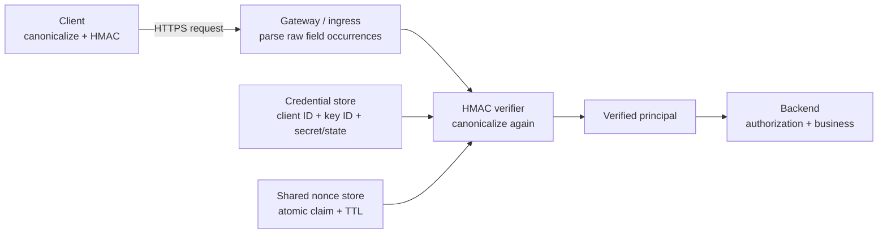
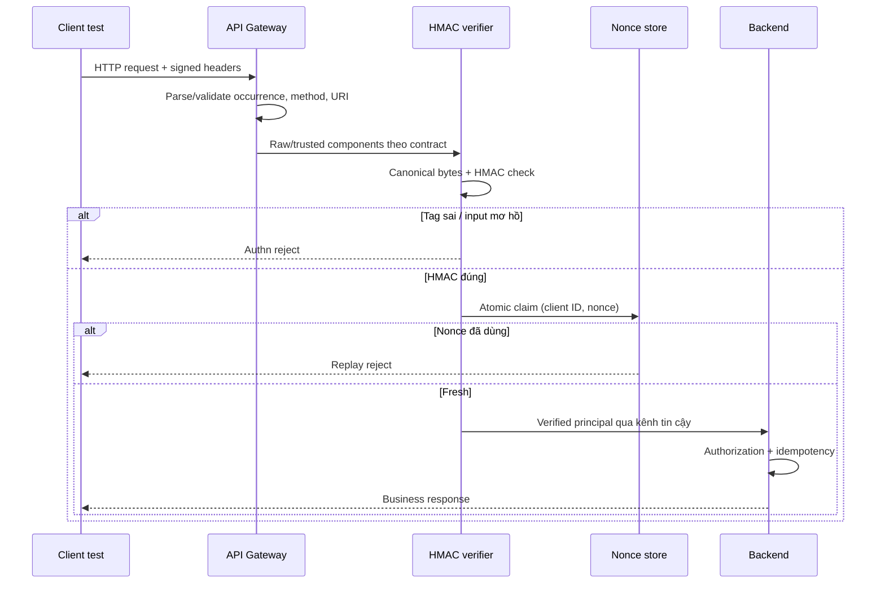

# Kiểm thử canonical headers

## 1. Vì sao canonical headers cần bộ kiểm thử riêng?

Trong xác thực HTTP request bằng HMAC, client tính tag từ **shared secret** và **canonical request**; server tái tạo chính xác input này trước khi xác minh. Nếu một header quan trọng không được đưa vào dữ liệu ký, hoặc hai bên chuẩn hóa tên, giá trị và thứ tự khác nhau, HMAC-SHA256 vẫn có thể chạy đúng nhưng không bảo vệ được hành động thực tế.

Đối với module `SECURITY_AUTHENTICATION_HMAC_REQUEST_AUTHENTICATION`, bài **Kiểm thử canonical headers** thuộc chương *Header canonicalization*. Mục tiêu là xây dựng **bằng chứng kiểm thử** cho hợp đồng ký HTTP: method, URI, signed headers, body digest và metadata chống replay đều được kiểm tra ở đúng ranh giới client–gateway–service.

Câu hỏi xuyên suốt:

> Khi thay đổi HTTP header trên đường truyền, hệ thống có biết chắc lúc nào **canonical bytes phải giữ nguyên**, lúc nào **phải thay đổi**, và lúc nào **phải từ chối request trước khi tính HMAC**?

Có ba loại hành vi cần phân biệt:

1. **Tương đương theo hợp đồng:** đổi `Content-Type` thành `content-type`, đảo thứ tự header trên wire hoặc thêm OWS được phép ở rìa. Canonical bytes **phải giống nhau**.
2. **Thay đổi dữ liệu đã ký:** sửa `X-Client-Id`, key ID, timestamp, nonce hay content type. Canonical bytes **phải khác**; chữ ký cũ không được còn hợp lệ.
3. **Input không hợp lệ:** duplicate signed header, giá trị chứa CR/LF, obs-fold, thiếu header bắt buộc, encoding mơ hồ. Hệ thống **phải từ chối**, không “chuẩn hóa để cho qua”.

Ba kiểu kiểm thử này bổ sung cho nhau. Chỉ chạy `sign(request)` rồi `verify(request, signature)` bằng cùng một implementation là **không đủ**: cả hai có thể cùng mắc lỗi chuẩn hóa mà test vẫn pass.

### Kết quả cần đạt

- Định nghĩa một **canonical-header contract có version**, ràng buộc chính xác tên, giá trị, thứ tự, whitespace, header trùng và danh sách tên được ký.
- Viết **golden test vector** có canonical text/bytes, body hash và HMAC tag dự kiến; so với implementation độc lập.
- Viết unit tests, metamorphic tests, integration tests qua gateway/proxy và negative tests chống header spoofing.
- Đo được hành vi liên quan timestamp/nonce, key rotation, authorization và lỗi hạ tầng mà không nhầm chúng với lỗi header normalization.
- Biết yêu cầu nào cần kiểm chứng ở **HTTP parser/ingress** thay vì chỉ bằng một Java map đã làm mất dữ liệu gốc.

## 2. Xác định ranh giới và tài sản cần bảo vệ

Một hệ thống API điển hình:



Các điểm kiểm thử quan trọng:

| Ranh giới | Dữ liệu tồn tại | Điều phải xác minh |
| --- | --- | --- |
| Client → HTTP library | Header input trước khi serialize | Tên/value và encoding được tạo đúng hợp đồng; signature tính trên input sẽ gửi |
| Network → ingress | HTTP field occurrences sau parser tin cậy | Header lặp, tên sai, obs-fold và control characters bị phát hiện/trả lỗi |
| Ingress → verifier | Header được chọn và representation chuẩn hóa | Không mất duplicate, không chọn value khác handler |
| Verifier → credential store | `clientId` và `keyId` chưa xác thực | Chỉ tra credential đúng owner/algorithm/state, chưa cấp principal |
| Verifier → service | Principal đã xác thực | Không tin `X-Verified-Client` từ bên ngoài; không thể bypass gateway |
| Service → nghiệp vụ | Scope, resource, action | Authorization hoạt động độc lập với HMAC |

**Mối đe dọa thực tế:** HTTP parser, gateway và backend có thể chọn khác nhau khi có nhiều trường cùng tên, whitespace kỳ lạ, Host bị rewrite hoặc khi HTTP/1.1 chuyển sang HTTP/2. Một test chỉ gọi hàm chuẩn hóa trên `Map<String,String>` sẽ bỏ qua đúng phần dữ liệu dễ bị lợi dụng nhất: **một tên header có nhiều occurrence**.

Vì vậy cần cả **unit tests trên danh sách occurrence** và **integration tests với HTTP stack/gateway thật**. Những test âm tính phải chứng minh request không đi đến nghiệp vụ, không đơn thuần kiểm tra một hàm Java ném exception.

## 3. Chốt một hợp đồng ký để có expected output rõ ràng

Để kiểm thử có thể lặp lại, bài học định nghĩa hợp đồng ví dụ **`HTTP-HMAC-HEADERTEST-V1`**. Đây là định dạng riêng cho lab, **không phải chuẩn canonical HTTP chung của mọi API**.

### 3.1. Tập signed headers

Sáu header bắt buộc theo thứ tự **ASCII lowercase tăng dần**:

```text
content-type
x-client-id
x-idempotency-key
x-key-id
x-nonce
x-timestamp
```

Quy tắc của V1:

1. Tên field là **HTTP token ASCII hợp lệ** và được chuyển sang lowercase bằng quy tắc ASCII, không dùng locale. `X-Client-Id` và `x-client-id` được coi là cùng tên.
2. Mỗi signed field phải có **chính xác một occurrence**. Header thiếu, trùng tên khác case hoặc trùng y hệt đều bị từ chối.
3. Value dài không quá 1.024 ký tự và chỉ chứa ASCII hiển thị `0x20–0x7E` cùng HTAB `0x09` ở vị trí phù hợp. **Từ chối CR, LF, các control khác, DEL, non-ASCII** trước khi trim.
4. Trim **SP và HTAB ở hai đầu** value. Giữ nguyên SP nội bộ; **từ chối HTAB nội bộ** để giảm sự khác biệt giữa parser.
5. Sau trim kiểm tra schema: `content-type` chính xác `application/json`; các ID là token được cấp phép; nonce gồm 16–64 ký tự Base64url; timestamp là Unix seconds thập phân không có dấu hoặc zero-padding.
6. Sắp xếp header **theo tập tên cố định**; thứ tự occurrence trên wire không quyết định canonical order.
7. Danh sách tên được ký là dòng cố định: `content-type;x-client-id;x-idempotency-key;x-key-id;x-nonce;x-timestamp`. Client không thể giảm danh sách để bỏ ký một field nhạy cảm.
8. Header `X-Signature` mang HMAC tag, **không tự xuất hiện trong signature input**. Tuy nhiên adapter phải kiểm tra signature header xuất hiện đúng một lần, đúng dạng Base64url không padding.
9. Header **ngoài tập ký** có thể bị bỏ qua trong canonicalization nhưng **không được phép thay đổi quyết định danh tính, quyền hoặc nghiệp vụ**. Nếu một field như `X-Target-Account` có ảnh hưởng hành vi, phải bổ sung vào version hợp đồng hoặc bảo vệ bằng cơ chế tương đương.
10. Authority/`Host` được xử lý **riêng** với các field header thường; không lấy `X-Forwarded-Host` chưa được ingress xác minh để chọn tenant.

**Cảnh báo về phạm vi:** Bộ quy tắc này cố ý chặt hơn HTTP nói chung. HTTP cho phép một số field có giá trị phức tạp, obs-text hoặc nhiều occurrence trong các ngữ cảnh khác. Một API cần hỗ trợ các trường ấy phải viết **hợp đồng riêng**; không áp dụng phép gộp bằng dấu phẩy cho mọi field rồi xem là an toàn.

### 3.2. Canonical request 13 dòng

Fixture cơ bản dùng body **rỗng** để có một SHA-256 chuẩn xác định. Đây là **fixture mật mã**, không khẳng định endpoint tạo đơn hàng thực tế nên chấp nhận POST thiếu body.

Request logic:

```http
POST /v1/orders?status=draft HTTP/1.1
Host: api.example.test
Content-Type: application/json
X-Client-Id: merchant-42
X-Idempotency-Key: order-101
X-Key-Id: key-2026-11
X-Nonce: A1b2C3d4E5f6G7h8
X-Timestamp: 1790000000
X-Signature: <tag-from-test-vector>
```

**Canonical text chính xác** có 13 dòng, ngăn cách bằng LF (`0x0A`), mã hóa UTF-8, **không có LF ở cuối**:

```text
HTTP-HMAC-HEADERTEST-V1
POST
/v1/orders
status=draft
api.example.test
content-type:application/json
x-client-id:merchant-42
x-idempotency-key:order-101
x-key-id:key-2026-11
x-nonce:A1b2C3d4E5f6G7h8
x-timestamp:1790000000
content-type;x-client-id;x-idempotency-key;x-key-id;x-nonce;x-timestamp
e3b0c44298fc1c149afbf4c8996fb92427ae41e4649b934ca495991b7852b855
```

| Vị trí | Vai trò |
| --- | --- |
| Dòng 1 | Version/domain separation của hợp đồng |
| Dòng 2–4 | HTTP method, raw path, raw query tại điểm xác minh |
| Dòng 5 | Canonical external authority |
| Dòng 6–11 | Sáu canonical signed-header lines |
| Dòng 12 | Danh sách sáu tên header được ký, thứ tự cố định |
| Dòng 13 | SHA-256 hex chữ thường của exact body bytes |

Body rỗng có SHA-256 là `e3b0c44298fc1c149afbf4c8996fb92427ae41e4649b934ca495991b7852b855`. Body có nội dung phải tính lại digest từ **chính xác byte nhận được sau khi bỏ HTTP transfer framing, trước khi middleware tự biến đổi**.

### 3.3. Golden vector độc lập

Sử dụng **khóa test công khai**, không dùng secret production:

```text
HMAC algorithm: HmacSHA256
Test key bytes: 00 01 02 03 ... 1e 1f
Key hex:        000102030405060708090a0b0c0d0e0f101112131415161718191a1b1c1d1e1f
Input encoding: UTF-8
Line delimiter: LF only (0x0A)
Trailing LF:    none
Canonical lines: 13
Canonical byte length: 357
HMAC tag hex:   e403e7090ec34e6896c584f5c7565dd291434addec29dbef7b1a8a07a16aa0e4
HMAC Base64url: 5APnCQ7DTmiWxYT1x1Zd0pFDSt3sKdvvexqKB6FqoOQ
Padding:        none
```

Giá trị digest và HMAC đã được tính độc lập bằng primitive HMAC-SHA256 từ một implementation khác. Với fixture này, **test phải so chính xác 357 byte UTF-8 và tag dự kiến**, không chỉ so một giá trị được tạo lại từ cùng class đang kiểm thử.

Timestamp `1790000000` và nonce ở trên là **dữ liệu fixture**; test golden chỉ kiểm tra canonicalization và HMAC, **không** kiểm tra freshness. Một request thật muốn qua authentication còn phải dùng timestamp trong cửa sổ server chấp nhận, nonce chưa dùng và credential `ACTIVE`.

## 4. Phân loại test: giữ nguyên, thay đổi hoặc từ chối

### 4.1. Metamorphic tests: thay đổi biểu diễn nhưng giữ nguyên canonical bytes

*Metamorphic testing* kiểm tra quan hệ giữa các input thay vì chỉ kiểm tra một output. Với canonical headers, quan hệ quan trọng là:

```text
normalize(headers) == normalize(transform(headers))
```

**chỉ khi** `transform` thuộc tập biến đổi hợp đồng xem là tương đương.

Ví dụ biến đổi phải giữ output:

- `X-CLIENT-ID` → `x-client-id` → `X-Client-Id`.
- Đảo thứ tự xuất hiện của sáu signed headers.
- Thêm SP/HTAB ở đầu hoặc cuối value trong giới hạn parser cho phép.
- Thay value `" \tapplication/json\t "` bằng `"application/json"`.
- Thêm một header không được ký, **chỉ khi** header đó không ảnh hưởng hành vi nhạy cảm và chính sách adapter cho phép.
- Chuyển HTTP/1.1 sang HTTP/2, miễn adapter đưa ra cùng các thành phần có ý nghĩa theo hợp đồng.

Lưu ý: một số HTTP/2/3 implementation **không cho phép** giá trị header có OWS ở rìa. Unit test của hàm normalizer vẫn có thể định nghĩa cách xử lý nếu dữ liệu đến tay hàm, nhưng integration test **không được ép giao thức phải chấp nhận thứ mà protocol/parser đã từ chối**.

### 4.2. Tampering tests: thay đổi giá trị được ký

Khi thay byte có ý nghĩa bảo mật, canonical text phải khác và chữ ký HMAC ban đầu bị từ chối:

```text
x-client-id:merchant-42  -> x-client-id:merchant-73
x-key-id:key-2026-11     -> x-key-id:key-2027-01
x-nonce:A1b2C3d4E5f6G7h8 -> x-nonce:B1b2C3d4E5f6G7h8
x-timestamp:1790000000  -> x-timestamp:1790000001
content-type:application/json -> content-type:text/plain
```

Trường hợp Content-Type khác `application/json` còn bị **policy/schema từ chối**; không nhất thiết hệ thống phải tính HMAC để phát hiện. Khi viết assertion, hãy tách **reject do validation** với **signature mismatch**.

### 4.3. Rejection tests: input mơ hồ phải fail-closed

Không nên cố “sửa” input:

```http
X-Client-Id: merchant-42
x-client-id: admin
```

Trường hợp trên cần bị từ chối vì **duplicate sau khi chuẩn hóa tên**. Tương tự:

```text
value = "\r\nmerchant-42"
value = "merchant-42\r\nX-Role: admin"
value = "merchant\t42"       (HTAB ở giữa, v1 không hỗ trợ)
value = "merchant-42\u00A0"  (NBSP ngoài ASCII)
```

*Validation phải xảy ra trước khi trim.* Nếu dùng `String.trim()` rồi chấp nhận `"\r\nmerchant-42"` thành `"merchant-42"`, test có thể pass với dữ liệu đã được “làm sạch” nhưng che mất CRLF injection. Hợp đồng v1 chỉ trim đúng **SP/HTAB hai đầu** sau khi đã loại các control khác.

## 5. Java 17: implementation tham chiếu có thể kiểm thử

Đoạn mã dưới đây cài đặt phần chính của hợp đồng `HTTP-HMAC-HEADERTEST-V1` bằng Java 17. Một HTTP adapter thực tế phải cung cấp `List<Field>` giữ nguyên **từng occurrence** của field tại điểm xác minh. Nếu proxy/framework đã gộp duplicate vào một `Map<String,String>`, không thể dùng helper này để chứng minh request trên wire không có header trùng.

```java
import java.nio.charset.StandardCharsets;
import java.security.GeneralSecurityException;
import java.security.MessageDigest;
import java.util.ArrayList;
import java.util.Base64;
import java.util.HashMap;
import java.util.HexFormat;
import java.util.List;
import java.util.Map;
import javax.crypto.Mac;
import javax.crypto.spec.SecretKeySpec;

public final class CanonicalHeaderTestV1 {
    private static final String VERSION = "HTTP-HMAC-HEADERTEST-V1";
    private static final String MAC_ALGORITHM = "HmacSHA256";

    private static final List<String> SIGNED = List.of(
        "content-type",
        "x-client-id",
        "x-idempotency-key",
        "x-key-id",
        "x-nonce",
        "x-timestamp"
    );

    public record Field(String name, String value) {}

    public record Request(
        String method,
        String rawPath,
        String rawQuery,
        String authority,
        List<Field> fields,
        byte[] body
    ) {}

    private CanonicalHeaderTestV1() {}

    private static String asciiLowercaseName(String name) {
        if (name == null || name.isEmpty() || name.length() > 128) {
            throw new IllegalArgumentException("Invalid header name length");
        }
        StringBuilder result = new StringBuilder();
        String tokenSymbols = "!#$%&'*+-.^_`|~";
        for (int i = 0; i < name.length(); i++) {
            char c = name.charAt(i);
            boolean upper = c >= 'A' && c <= 'Z';
            boolean lower = c >= 'a' && c <= 'z';
            boolean digit = c >= '0' && c <= '9';
            if (!upper && !lower && !digit
                    && tokenSymbols.indexOf(c) < 0) {
                throw new IllegalArgumentException("Invalid header name");
            }
            result.append(upper ? (char) (c + ('a' - 'A')) : c);
        }
        return result.toString();
    }

    // Cấm controls, CR/LF, DEL, non-ASCII trước khi trim OWS.
    private static String normalizeValue(String value) {
        if (value == null || value.length() > 1024) {
            throw new IllegalArgumentException("Invalid header value length");
        }
        for (int i = 0; i < value.length(); i++) {
            char c = value.charAt(i);
            boolean asciiVisible = c >= 0x20 && c <= 0x7E;
            if (!asciiVisible && c != '\t') {
                throw new IllegalArgumentException(
                    "Control or non-ASCII header value");
            }
        }
        int start = 0;
        int end = value.length();
        while (start < end && isOws(value.charAt(start))) start++;
        while (end > start && isOws(value.charAt(end - 1))) end--;
        for (int i = start; i < end; i++) {
            if (value.charAt(i) == '\t') {
                throw new IllegalArgumentException("Internal HTAB forbidden");
            }
        }
        return value.substring(start, end);
    }

    private static boolean isOws(char c) {
        return c == ' ' || c == '\t';
    }

    public static String canonicalHeaderBlock(List<Field> occurrences) {
        if (occurrences == null || occurrences.size() > 100) {
            throw new IllegalArgumentException("Invalid header list");
        }
        Map<String, String> values = new HashMap<>();
        for (Field field : occurrences) {
            if (field == null) {
                throw new IllegalArgumentException("Null field");
            }
            String name = asciiLowercaseName(field.name());
            if (!SIGNED.contains(name)) continue;
            String value = normalizeValue(field.value());
            if (values.putIfAbsent(name, value) != null) {
                throw new IllegalArgumentException(
                    "Duplicate signed header: " + name);
            }
        }

        for (String name : SIGNED) {
            if (!values.containsKey(name)) {
                throw new IllegalArgumentException(
                    "Missing signed header: " + name);
            }
        }

        if (!"application/json".equals(values.get("content-type"))) {
            throw new IllegalArgumentException("Unsupported Content-Type");
        }
        for (String name : List.of(
                "x-client-id", "x-key-id", "x-idempotency-key")) {
            if (!values.get(name).matches("[A-Za-z0-9._-]{1,64}")) {
                throw new IllegalArgumentException("Invalid identifier");
            }
        }
        if (!values.get("x-nonce").matches("[A-Za-z0-9_-]{16,64}")) {
            throw new IllegalArgumentException("Invalid nonce");
        }

        String timestamp = values.get("x-timestamp");
        if (!timestamp.matches("[1-9][0-9]{0,18}")) {
            throw new IllegalArgumentException("Invalid timestamp");
        }
        try {
            Long.parseLong(timestamp);
        } catch (NumberFormatException ex) {
            throw new IllegalArgumentException(
                    "Timestamp outside long range", ex);
        }

        List<String> lines = new ArrayList<>();
        for (String name : SIGNED) {
            lines.add(name + ":" + values.get(name));
        }
        return String.join("\n", lines);
    }

    public static byte[] canonicalBytes(Request r)
            throws GeneralSecurityException {
        if (r == null || r.body() == null
                || r.method() == null || r.rawPath() == null
                || r.authority() == null) {
            throw new IllegalArgumentException("Missing request fields");
        }

        // Lab: method/route/authority cố định để tập trung vào headers.
        // Adapter production phải kiểm soát request-target đầy đủ.
        if (!"POST".equals(r.method())
                || !"/v1/orders".equals(r.rawPath())
                || !"status=draft".equals(r.rawQuery())
                || !"api.example.test".equals(r.authority())) {
            throw new IllegalArgumentException(
                    "Unexpected method/target/authority");
        }

        String headerBlock = canonicalHeaderBlock(r.fields());
        String bodySha256 = HexFormat.of().formatHex(
            MessageDigest.getInstance("SHA-256").digest(r.body())
        );

        String canonical = String.join("\n",
            VERSION,
            r.method(),
            r.rawPath(),
            r.rawQuery(),
            r.authority(),
            headerBlock,
            String.join(";", SIGNED),
            bodySha256
        );
        return canonical.getBytes(StandardCharsets.UTF_8);
    }

    public static byte[] mac(byte[] secret, byte[] input)
            throws GeneralSecurityException {
        if (secret == null || secret.length < 32) {
            throw new IllegalArgumentException("Invalid test HMAC key");
        }
        Mac mac = Mac.getInstance(MAC_ALGORITHM);
        mac.init(new SecretKeySpec(secret, MAC_ALGORITHM));
        return mac.doFinal(input);
    }

    public static String sign(Request r, byte[] secret)
            throws GeneralSecurityException {
        return Base64.getUrlEncoder().withoutPadding()
                .encodeToString(mac(secret, canonicalBytes(r)));
    }

    public static boolean verify(
            Request r, byte[] secret, String signature)
            throws GeneralSecurityException {
        // HMAC-SHA256: 32 bytes => Base64url không padding dài 43 chars.
        if (signature == null
                || !signature.matches("[A-Za-z0-9_-]{43}")) {
            return false;
        }
        final byte[] supplied;
        try {
            supplied = Base64.getUrlDecoder().decode(signature);
        } catch (IllegalArgumentException malformed) {
            return false;
        }
        if (supplied.length != 32) return false;
        String canonicalEncoding = Base64.getUrlEncoder().withoutPadding()
                .encodeToString(supplied);
        if (!canonicalEncoding.equals(signature)) return false;
        byte[] expected = mac(secret, canonicalBytes(r));
        return MessageDigest.isEqual(expected, supplied);
    }
}
```

### 5.1. Những quyết định đã được code hóa

- **Tên header:** từ `Content-Type`, `CONTENT-TYPE` và `content-type` đều thành `content-type`; không phụ thuộc ngôn ngữ/locale.
- **Giá trị:** reject control characters **trước** khi trim OWS; không collapse SP nội bộ. Header định danh sau trim phải match schema chính xác.
- **Duplicate:** `putIfAbsent` từ chối duplicate kể cả hai value giống nhau và header name khác case.
- **Sắp xếp:** `SIGNED` cố định thứ tự; không dùng iteration order của `HashMap`.
- **Full canonical request:** chứa version, method, path, query, authority, sáu header lines, danh sách tên được ký và body digest — đúng 13 dòng của fixture.
- **HMAC:** `Mac.getInstance("HmacSHA256")` với key 32 byte; sử dụng `MessageDigest.isEqual` khi so tag. Mỗi request tạo instance `Mac` riêng để không chia sẻ state giữa các thread.
- **Giới hạn:** chỉ một route/authority test, không xử lý key lookup, timestamp freshness, nonce store, authorization, header framing hay key rotation. Những lớp này phải được test riêng.

Trong môi trường production, provider HMAC không tồn tại (`NoSuchAlgorithmException`) hoặc key không khởi tạo được (`InvalidKeyException`) là **sự cố xác minh**: phải fail-closed, không bỏ kiểm tra HMAC hay tự đổi sang thuật toán khác.

## 6. Java 17: golden test và metamorphic assertions không cần framework

Bộ kiểm thử bên dưới dùng Java 17 thuần để người học thấy rõ dạng assertion. Nó không cần JUnit/Gradle; phần gọi `main` chỉ là ví dụ **mã để chạy trong môi trường lab**, không phải kết quả test đã chạy trong tài liệu này.

```java
import java.nio.charset.StandardCharsets;
import java.security.GeneralSecurityException;
import java.util.ArrayList;
import java.util.Collections;
import java.util.List;

public final class CanonicalHeaderTestV1Checks {
    private static final String GOLDEN_TAG =
        "5APnCQ7DTmiWxYT1x1Zd0pFDSt3sKdvvexqKB6FqoOQ";
    private static final String EXPECTED_BLOCK = String.join("\n",
        "content-type:application/json",
        "x-client-id:merchant-42",
        "x-idempotency-key:order-101",
        "x-key-id:key-2026-11",
        "x-nonce:A1b2C3d4E5f6G7h8",
        "x-timestamp:1790000000"
    );

    private static byte[] testKey() {
        byte[] key = new byte[32];
        for (int i = 0; i < key.length; i++) key[i] = (byte) i;
        return key;
    }

    private static List<CanonicalHeaderTestV1.Field> basicHeaders() {
        return List.of(
            new CanonicalHeaderTestV1.Field(
                "X-Timestamp", "1790000000"),
            new CanonicalHeaderTestV1.Field(
                "X-Nonce", "A1b2C3d4E5f6G7h8"),
            new CanonicalHeaderTestV1.Field(
                "X-Idempotency-Key", "order-101"),
            new CanonicalHeaderTestV1.Field(
                "X-Key-Id", "key-2026-11"),
            new CanonicalHeaderTestV1.Field(
                "X-Client-Id", "merchant-42"),
            new CanonicalHeaderTestV1.Field(
                "Content-Type", "application/json")
        );
    }

    private static CanonicalHeaderTestV1.Request request(
            List<CanonicalHeaderTestV1.Field> fields) {
        return new CanonicalHeaderTestV1.Request(
            "POST",
            "/v1/orders",
            "status=draft",
            "api.example.test",
            fields,
            new byte[0]
        );
    }

    private static void equal(String expected, String actual) {
        if (!expected.equals(actual)) {
            throw new AssertionError(
                "Expected:\n" + expected + "\nActual:\n" + actual);
        }
    }

    private static void reject(List<CanonicalHeaderTestV1.Field> fields) {
        try {
            CanonicalHeaderTestV1.canonicalHeaderBlock(fields);
            throw new AssertionError("Expected rejection");
        } catch (IllegalArgumentException expected) {
            // Không có canonical output cho input mơ hồ.
        }
    }

    public static void main(String[] args)
            throws GeneralSecurityException {
        List<CanonicalHeaderTestV1.Field> base = basicHeaders();

        // Golden block: so nội dung từng dòng, không phụ thuộc HMAC.
        equal(EXPECTED_BLOCK,
            CanonicalHeaderTestV1.canonicalHeaderBlock(base));

        CanonicalHeaderTestV1.Request r = request(base);
        byte[] canonical = CanonicalHeaderTestV1.canonicalBytes(r);
        if (canonical.length != 357) {
            throw new AssertionError("Canonical byte length mismatch");
        }
        equal(GOLDEN_TAG, CanonicalHeaderTestV1.sign(r, testKey()));
        if (!CanonicalHeaderTestV1.verify(r, testKey(), GOLDEN_TAG)) {
            throw new AssertionError("Golden tag must verify");
        }

        // Đảo thứ tự header không đổi canonicalization.
        List<CanonicalHeaderTestV1.Field> reversed =
            new ArrayList<>(base);
        Collections.reverse(reversed);
        equal(EXPECTED_BLOCK,
            CanonicalHeaderTestV1.canonicalHeaderBlock(reversed));
        equal(GOLDEN_TAG,
            CanonicalHeaderTestV1.sign(request(reversed), testKey()));

        // Thay tên bằng uppercase và thêm OWS hợp lệ ở rìa.
        List<CanonicalHeaderTestV1.Field> equivalent =
            new ArrayList<>();
        for (CanonicalHeaderTestV1.Field f : base) {
            equivalent.add(new CanonicalHeaderTestV1.Field(
                f.name().toUpperCase(java.util.Locale.ROOT),
                " \t" + f.value() + "\t "
            ));
        }
        equal(EXPECTED_BLOCK,
            CanonicalHeaderTestV1.canonicalHeaderBlock(equivalent));

        // Thiếu header, duplicate khác case, CR/LF không được sửa để pass.
        reject(base.subList(0, 5));

        List<CanonicalHeaderTestV1.Field> duplicated =
            new ArrayList<>(base);
        duplicated.add(new CanonicalHeaderTestV1.Field(
            "x-client-id", "admin"));
        reject(duplicated);

        List<CanonicalHeaderTestV1.Field> injected =
            new ArrayList<>(base);
        injected.set(4, new CanonicalHeaderTestV1.Field(
            "X-Client-Id", "\r\nmerchant-42"));
        reject(injected);

        // Thay một giá trị có ý nghĩa và giữ tag cũ.
        List<CanonicalHeaderTestV1.Field> changed =
            new ArrayList<>(base);
        changed.set(4, new CanonicalHeaderTestV1.Field(
            "X-Client-Id", "merchant-73"));
        if (CanonicalHeaderTestV1.verify(
                request(changed), testKey(), GOLDEN_TAG)) {
            throw new AssertionError("Tampered client ID must fail");
        }

        System.out.println("Canonical header checks completed");
    }
}
```

### 6.1. Golden test có thể thất bại như thế nào?

- **Canonical length không bằng 357:** thường do thiếu/thừa LF, thêm CR, bỏ dòng danh sách tên, thay encoding hoặc thay content của fixture.
- **Header block đúng nhưng HMAC sai:** kiểm tra key bytes `00..1f`, algorithm `HmacSHA256`, Base64url padding và full canonical request, không chỉ riêng header block.
- **Đảo thứ tự làm HMAC thay đổi:** có thể implementation đang duyệt header theo thứ tự wire hoặc `HashMap` thay vì tập tên cố định.
- **Đổi case tên làm HMAC thay đổi:** canonicalizer chưa áp dụng ASCII lowercase.
- **Header có CR/LF vẫn được chấp nhận:** code có thể trim trước khi validate hoặc HTTP adapter đã che dấu ký tự nguy hiểm.
- **Chỉ một bên client/server pass:** cần in **hex canonical bytes trong môi trường test an toàn**, so ở byte đầu khác nhau; không ghi secret production hoặc full request nhạy cảm vào log.

Giá trị `1790000000` trong fixture chỉ phục vụ golden test. Nếu sử dụng ở API thật, thời gian trên server có thể khiến request bị từ chối do quá hạn — **đó không phải thất bại của thuật toán canonical headers**.

## 7. Thiết kế ma trận unit tests theo từng quy tắc

Các test nên được nhóm theo một nguyên nhân rõ ràng, thay **một thuộc tính mỗi lần**. Khi test thất bại, báo đúng loại: normalization, validation, cryptographic comparison hoặc HTTP integration.

### 7.1. Tên header và thứ tự

| Test | Biến đổi | Kỳ vọng |
| --- | --- | --- |
| U01 | `Content-Type` → `content-type` | Canonical block không đổi |
| U02 | `X-CLIENT-ID` → `x-client-id` | Canonical block không đổi |
| U03 | Trộn ba kiểu chữ hoa/thường khác nhau | Output tên luôn ASCII lowercase |
| U04 | Hoán vị sáu signed headers | Output theo đúng thứ tự cố định |
| U05 | Lặp cùng field khác case | Từ chối duplicate |
| U06 | Lặp cùng field, giá trị trùng | Vẫn từ chối duplicate |
| U07 | Thiếu một trong sáu signed fields | Từ chối, không tự điền mặc định |
| U08 | Header name chứa SP, dấu `:` hoặc newline | HTTP parser/validator từ chối |
| U09 | Header name không thuộc signed list | Không làm đổi tag, nhưng policy phải chặn nếu ảnh hưởng nghiệp vụ |
| U10 | Client tự gửi danh sách signed headers thiếu `x-client-id` | Không chấp nhận; danh sách cố định theo contract |

### 7.2. Whitespace, ký tự điều khiển và định dạng value

| Test | Biến đổi value | Kỳ vọng |
| --- | --- | --- |
| U11 | Thêm ASCII SP ở đầu | Canonical value không đổi |
| U12 | Thêm ASCII SP ở cuối | Canonical value không đổi |
| U13 | Thêm HTAB ở rìa | Canonical value không đổi khi parser chấp nhận |
| U14 | Trộn SP/HTAB ở cả hai rìa | Canonical value không đổi |
| U15 | `"merchant-42"` → `"merchant  -42"` | Validation ID từ chối; không collapse |
| U16 | HTAB nằm **giữa** giá trị | Từ chối trong V1 |
| U17 | CR/LF ở đầu hoặc cuối | Từ chối **trước trim** |
| U18 | `"merchant-42\r\nX-Role: admin"` | Từ chối; không cho header injection |
| U19 | NUL/DEL hoặc obs-fold | Từ chối tại parser/normalizer |
| U20 | NBSP U+00A0 hoặc Unicode whitespace | Từ chối theo ASCII-only V1 |
| U21 | Value toàn OWS | Sau trim thành rỗng; validation field bắt buộc từ chối |
| U22 | Value dài 1.025 ký tự | Từ chối do giới hạn, trước HMAC |
| U23 | `application/json` → `text/plain` | Từ chối do Content-Type policy |
| U24 | `1790000000` → `01790000000` | Từ chối do timestamp không canonical |
| U25 | Timestamp vượt `long` | Từ chối không overflow hoặc ngầm làm tròn |
| U26 | Nonce quá ngắn hoặc có ký tự ngoài alphabet | Từ chối theo nonce schema |

**Đặc biệt với duplicate:** Unit test chỉ có ý nghĩa nếu input còn **từng header occurrence**. Nếu framework đã gộp field trước khi gọi helper, cần bổ sung integration test ở gateway/parser; không cố chứng minh duplicate rejection bằng một map chỉ chứa một value.

## 8. Kiểm thử HMAC và thao tác thay đổi request

### 8.1. Những thuộc tính cần cố định

Với một contract đã chốt:

```text
signedBytes = UTF8(CanonicalRequest(method, URI, headers, bodyDigest))
tag        = HMAC_SHA256(secret, signedBytes)
```

Một phép thử nên kiểm tra **cả hai**: canonical bytes trước và kết quả HMAC sau. Khi chỉ so `signature == signature`, không biết lỗi đến từ parser, canonicalizer hay key.

### 8.2. Ma trận thay đổi trường được ký

| Test | Tình huống | Kỳ vọng |
| --- | --- | --- |
| S01 | Signature của golden fixture | HMAC khớp expected tag đã cố định |
| S02 | Giữ signature, đổi `X-Client-Id` | Reject hoặc HMAC mismatch, không cấp principal |
| S03 | Giữ signature, đổi `X-Key-Id` | Reject credential hoặc HMAC mismatch |
| S04 | Giữ signature, đổi `X-Idempotency-Key` | HMAC mismatch, không thay ý định nghiệp vụ |
| S05 | Giữ signature, đổi `X-Timestamp` | HMAC mismatch |
| S06 | Giữ signature, đổi `X-Nonce` | HMAC mismatch |
| S07 | Giữ signature, đổi `Content-Type` | Reject schema hoặc mismatch |
| S08 | Giữ signature, đổi HTTP method `POST` | Reject route/method; không thực thi request |
| S09 | Giữ signature, đổi raw path hoặc query | Reject route/input hoặc HMAC mismatch |
| S10 | Giữ signature, đổi external authority | Reject allowlist hoặc HMAC mismatch |
| S11 | Giữ signature, đổi một byte trong body | Body SHA-256/HMAC thay đổi |
| S12 | Base64url signature thiếu ký tự | Reject encoding/length |
| S13 | Base64url thêm padding `=` | Reject do V1 yêu cầu không padding |
| S14 | Signature chứa ký tự ngoài Base64url | Reject định dạng |
| S15 | Chữ ký được tạo bằng secret client khác | Reject, không gán sai danh tính |
| S16 | Key bị đánh dấu `REVOKED` dù tag được tính đúng | Reject trước khi cấp principal |
| S17 | Provider `HmacSHA256` không khả dụng | Fail-closed, alert; không bỏ xác thực |

**Không cần buộc mọi ca “tampered” phải chạy đến phép so HMAC.** Nếu request sai policy và bị chặn sớm, đó có thể là kết quả đúng. Điều bắt buộc là **không thực thi nghiệp vụ**, không cấp danh tính giả và phân loại nguyên nhân nội bộ chính xác.

## 9. Property-based, fuzzing và test tính bất biến

Thay vì chỉ viết vài input thủ công, có thể kiểm thử các thuộc tính của canonicalizer:

### 9.1. Bất biến khi hoán vị

Với sáu signed headers duy nhất, có `6! = 720` thứ tự. Sinh mọi hoán vị hoặc một tập ngẫu nhiên có seed cố định; mọi trường hợp phải có **cùng canonical bytes**.

Một vòng kiểm thử không cần thư viện đặc biệt:

```java
// Pseudocode cho property test:
String golden = canonicalHeaderBlock(basicHeaders());

for (List<Field> order : allPermutations(basicHeaders())) {
    assertEquals(golden, canonicalHeaderBlock(order));
}
```

Trong code thật, dùng bộ sinh hoán vị có giới hạn rõ, hoặc JUnit property-based library nếu dự án đã có. Không cần lập thêm 720 test cases bằng tay.

### 9.2. Bất biến theo cách viết tên

Sinh ngẫu nhiên các biến thể uppercase/lowercase **chỉ của tên field**. Khi tên vẫn là cùng HTTP token, canonical output không đổi. Không áp dụng quan hệ này cho **giá trị** vì `merchant-A` và `merchant-a` có thể là hai client khác nhau.

### 9.3. Bất biến theo OWS hợp lệ

Thêm từ 0 đến N ký tự SP/HTAB ở **hai đầu** value, rồi so golden canonical output. Đồng thời sinh HTAB **ở giữa** hoặc control char bất kỳ và yêu cầu rejection.

### 9.4. Không va chạm do ghép dòng

Sinh các input chứa `\r`, `\n`, dấu hai chấm, Unicode whitespace và ký tự điều khiển ở từng signed field. Với V1, ID/schema hoặc normalizer phải từ chối. Điều này ngăn attacker chèn thêm một canonical header line thông qua value.

Không được khẳng định HMAC có “collision” chỉ vì một hàm ghép chuỗi tạo cùng text từ hai cấu trúc đầu vào. Đó là **canonicalization collision / ambiguous serialization** và cần bị phát hiện ở **trước primitive mật mã**.

### 9.5. Determinism và idempotence

Với input hợp lệ và cùng contract, canonicalization phải **xác định**:

```text
canonicalize(request) == canonicalize(request)
```

mỗi lần chạy, trên mọi JVM/provider/locale. Không được dựa vào `HashMap` iteration order, default charset hoặc thời gian hiện tại **bên trong quá trình canonicalize**. Timestamp/nonce đã là dữ liệu request; canonicalizer không tự điền bằng clock hay random mới.

Khái niệm *idempotence* ở đây cần dùng cẩn thận: helper của bài nhận **HTTP header occurrences**, không nhận canonical text làm đầu vào. Vì thế không có ý nghĩa yêu cầu `canonicalize(canonicalize(headers))` nếu kiểu đầu vào khác nhau. Hãy kiểm thử determinism, preservation của các phép biến đổi hợp lệ và absence của ambiguous inputs thay vì viết một phép thử sai kiểu.

## 10. Integration tests qua gateway, proxy và nhiều HTTP version

Unit test không mô phỏng chính xác tất cả cách một HTTP server parse request. Cần thêm test với hệ thống thực: HTTP client → gateway → verifier → backend, trên image/runtime được triển khai.



### 10.1. Ma trận test qua các hop

| Test | Biến đổi giữa các tầng | Điều cần assert |
| --- | --- | --- |
| I01 | HTTP/1.1 tên header hỗn hợp case | Verifier tạo lowercase canonical names |
| I02 | HTTP/2 chuyển tất cả field names thành lowercase | Canonical bytes tương đương khi các trường ngữ nghĩa giống nhau |
| I03 | Gateway đảo thứ tự các headers | Signature không đổi với hợp đồng cố định |
| I04 | Gateway trim OWS hợp lệ ở rìa | Giữ canonical value tương đương nếu wire request hợp lệ |
| I05 | Gateway **gộp duplicate** trước verifier | Chặn tại gateway/parser; không để request đi qua chỉ vì backend thấy một field |
| I06 | Duplicate `X-Key-Id` khác case | Reject ở ingress |
| I07 | Obs-fold/CRLF theo kiểu HTTP/1.1 cũ | Parser/gateway reject; không tự unfold rồi tin |
| I08 | Gateway sửa `Host` thành host nội bộ | Verify tại ingress trước rewrite hoặc dùng trusted original authority |
| I09 | Proxy rewrite path/query | Canonical input phải theo điểm ký đã thỏa thuận; không thử nhiều cách |
| I10 | Thay `Content-Type` trước khi verify | Signature mismatch hoặc policy reject |
| I11 | Proxy decompress/re-serialize body | Body digest thay đổi; sửa vị trí verify hoặc hợp đồng representation |
| I12 | Client chèn `X-Verified-Client: admin` | Gateway loại header bên ngoài; backend không cấp quyền admin |
| I13 | Caller tự khai `X-Forwarded-Host` | Không ảnh hưởng canonical authority đáng tin |
| I14 | Backend gọi trực tiếp không qua gateway | Không được bypass authentication boundary |
| I15 | Gateway và service cùng claim nonce | Thiết kế tránh double claim; request hợp lệ không bị chặn giả |
| I16 | Two replicas nhận cùng nonce đồng thời | Tối đa một atomic claim thành công |
| I17 | Key `REVOKED` trong cache một replica còn `ACTIVE` | Test bắt lỗi stale cache; request revoked bị từ chối trên mọi replica |
| I18 | JDK/provider khác giữa các deployment | HMAC output theo cùng input/key phải khớp; readiness nếu primitive thiếu |
| I19 | Header có OWS mà HTTP/2 stack cấm | Parser từ chối theo protocol; không đổ lỗi cho canonicalizer |
| I20 | Client tự gửi header signature hai lần | Reject trước khi chọn một tag |

**Quan sát quan trọng:** không phải mọi request raw được tạo bằng socket đều được bộ parser cho vào ứng dụng. Điều này **không phải test fail** nếu parser đang từ chối đúng theo giao thức. Test phải xác nhận trạng thái và điểm chặn, không ép backend phải nhận input nguy hiểm mới được xem là coverage.

### 10.2. Lấy raw data ở đâu để tái tạo canonical headers?

Một framework có thể đưa ra `getHeader(name)` chỉ trả một giá trị và làm mất duplicate, hoặc `getHeaders(name)` trả danh sách nhưng dữ liệu đã được intermediary xử lý trước đó. Test cần trả lời:

- Adapter nhìn thấy **tất cả occurrence** ở ranh giới trust nào?
- Dữ liệu signed header được đọc **trước hay sau** proxy rewrite?
- Backend có dùng **cùng giá trị đã được xác minh** để quyết định route, tenant, quyền và nghiệp vụ?
- Header identity từ client có bị xóa trước khi gateway gửi metadata đáng tin cho backend?
- Có đường gọi backend trực tiếp hoặc hop nội bộ không được xác thực nguồn không?

Nếu dữ liệu raw đã mất, không thể “khôi phục” duplicate bằng việc parse lại chuỗi từ map. Cần điều chỉnh **vị trí verifier** hoặc **chính sách gateway**.

## 11. Replay, rotation, authorization: test liên quan nhưng không thay thế header QA

Canonical headers chỉ xác định byte để ký. Một request có canonical headers đúng và tag HMAC hợp lệ vẫn có thể bị **phát lại**, **được ký bằng key đã bị thu hồi**, hoặc **không có quyền** thực thi nghiệp vụ.

### 11.1. Timestamp và nonce

Một chuỗi kiểm thử chuẩn:

1. Gửi request có HMAC đúng, timestamp trong cửa sổ (ví dụ ±300 giây) và nonce mới.
2. Xác nhận verifier đã **xác minh HMAC trước khi claim nonce**.
3. Gửi lại nguyên request đến instance khác; HMAC vẫn đúng nhưng lần thứ hai phải bị từ chối do nonce đã dùng.
4. Gửi request có cùng client ID/nonce đồng thời qua hai instance; tối đa một lời gọi có thể claim thành công.
5. Gửi HMAC đúng nhưng timestamp quá hạn; bị từ chối ngay cả khi nonce chưa dùng.
6. Giả lập nonce store không khả dụng; endpoint nhạy cảm phải **fail-closed**, không bỏ qua kiểm tra replay.

Nonce phải được gắn với client/credential theo policy và có TTL đủ bao phủ cửa sổ chấp nhận, kể cả clock skew. Không claim nonce **trước khi** kiểm tra tag: attacker không có secret có thể gửi request giả chiếm nonce của client.

### 11.2. Key rotation và revocation

`X-Key-Id` đã được đưa vào signed headers, nhưng đó chỉ là định danh. Test phải kiểm tra verifier tra đúng `(clientId,keyId)`, scheme `HmacSHA256`, môi trường, trạng thái `ACTIVE/REVOKED` và secret tương ứng.

- Rotation định kỳ: key mới được kích hoạt; key cũ có thể được chấp nhận trong thời hạn chuyển tiếp **đã phê duyệt**, không dựa trên việc “thử nhiều secret cho tới khi khớp”.
- Key nghi bị lộ: ngay khi `REVOKED`, mọi verifier phải từ chối dù chữ ký HMAC bằng secret cũ vẫn tính ra đúng tag.
- Cache trạng thái chậm cập nhật: integration test phải phát hiện khi một replica vẫn chấp nhận key bị thu hồi.
- Shared secret lộ cho attacker: họ có thể ký **request mới với timestamp/nonce mới**. Replay store không chặn được loại giả mạo này; cần thu hồi credential và điều tra phạm vi ảnh hưởng.

### 11.3. Authentication không phải authorization

`X-Client-Id: merchant-42` có thể được HMAC chứng minh là credential của `merchant-42`, nhưng vẫn phải kiểm tra quyền với tài nguyên:

```text
Authentication:
  signed headers hợp lệ + HMAC đúng + key active + fresh nonce
  -> VerifiedPrincipal(merchant-42)

Authorization:
  POST /v1/orders, owner=merchant-73
  -> principal có permission và quyền đối với owner này không?
  -> 403 nếu không được phép
```

Không lấy `X-Role: admin`, `X-Owner` hoặc header khác do caller tự khai làm nguồn quyền. Một field ngoài signed list **không được** âm thầm quyết định quyền. Nếu một header mới có ý nghĩa bảo mật, cập nhật hợp đồng ký và test vector, hoặc sử dụng một trust boundary bảo vệ tương đương.

## 12. Hệ thống test và CI nên đánh giá điều gì?

Để tiết kiệm thời gian debug, có thể tổ chức kiểm thử theo bốn tầng:

| Tầng | Trọng tâm | Chạy khi nào |
| --- | --- | --- |
| **Unit tests** | Hàm normalize name/value, sort, duplicate, validation schema | Mỗi thay đổi source |
| **Golden/interoperability tests** | Canonical UTF-8 bytes + HMAC tag **cố định**, chạy từ client/server implementation độc lập | Mỗi thay đổi hợp đồng/SDK |
| **Property-based/fuzz tests** | Hoán vị, case random, OWS, control chars, duplicate, length limits | CI định kỳ và khi sửa parser |
| **Integration/security tests** | Gateway/proxy, HTTP version, tenant trust, replay store, revocation, authorization | Trước release và khi nâng cấp hạ tầng |

### 12.1. Những điều cần ghi lại khi test thất bại

Tại môi trường test có dữ liệu giả, log nên chứa:

- Protocol version và tên test, correlation ID, HTTP method, điểm xác minh.
- Tên các signed headers sau lowercase, số occurrence trước coalesce, **không tự lộ secret hoặc value nhạy cảm**.
- Độ dài canonical bytes và vị trí byte đầu tiên khác expected.
- SHA-256 của canonical bytes hoặc một fingerprint test không phải secret; không in toàn bộ request production.
- Loại lỗi: `INVALID_HEADER_SYNTAX`, `DUPLICATE_SIGNED_HEADER`, `CANONICAL_MISMATCH`, `INVALID_SIGNATURE`, `REPLAY_DETECTED`, `KEY_REVOKED`, `AUTHORIZATION_DENIED` hoặc `CRYPTO_UNAVAILABLE`.

Không trả stack trace, chi tiết provider, shared secret hay exact canonical request có dữ liệu bí mật cho client ngoài. Việc log toàn bộ request/tag thật còn làm tăng rủi ro replay nếu log bị đọc bởi bên không được phép.

### 12.2. Tiêu chí chấp nhận một phiên bản hợp đồng

Trước khi triển khai một version canonicalization mới:

1. Có tài liệu ký **byte-level** và test vector chuẩn với expected output **độc lập**.
2. Client SDK và verifier tạo cùng canonical bytes cho mọi fixture hợp lệ.
3. Các phép biến đổi tương đương được test, và các thay đổi bảo mật làm HMAC cũ thất bại.
4. Duplicate, CRLF, obs-fold, malformed field names/values bị từ chối đúng ở tầng parser/ingress.
5. Gateway và backend hiểu **cùng giá trị được xác minh**; không có method/URI/authority/header rewrite sau verifier làm thay đổi ý nghĩa bảo mật.
6. Timestamp/nonce, key rotation, revocation và authorization đều có integration tests riêng.
7. Khi nâng cấp proxy, framework, JDK/provider hoặc đổi routing, chạy lại regression suite và so sánh golden vectors.

Không nên giải quyết một test mismatch bằng cách cho verifier thử nhiều cách trim, nhiều thứ tự header hoặc nhiều thuật toán. Một request khi đó có thể có nhiều diễn giải được chấp nhận, tăng rủi ro *signature confusion*.

## 13. Tình huống thực hành có đáp án

### A. Đổi case tên header, signature bỗng sai

Client ký `Content-Type: application/json` nhưng gateway chuyển field name thành `content-type`. Server dựng canonical input từ raw header name nên HMAC khác.

**Phân tích:** Hợp đồng test yêu cầu ASCII lowercase tên field trước khi ký. Unit test U01, U02 và integration test I02 phải chỉ ra sai lệch. Sửa canonicalizer để không phụ thuộc case trên wire; không cố ép gateway giữ case cũ.

### B. Hai `X-Client-Id` nhưng helper Java chỉ thấy một

Request từ bên ngoài chứa `X-Client-Id: merchant-42` và `x-client-id: admin`. Gateway đã gộp/loại một giá trị rồi mới gọi verifier. Test unit với một `Map<String,String>` vẫn pass.

**Phân tích:** Unit test trên map không đủ visibility. Cần tích hợp test ở **điểm trước khi mất occurrence**, kiểm tra duplicate case-insensitive và yêu cầu gateway reject. Backend chỉ tin principal được verifier xác minh, không tự đọc client ID từ request gốc.

### C. `String.trim()` làm sạch CRLF thành danh tính hợp lệ

Một signed value nhận `"\r\nmerchant-42"`; code `trim()` trước rồi match regex. Client hoặc gateway vẫn có thể tạo tag cho `merchant-42`.

**Phân tích:** Sai thứ tự validation. CR/LF phải bị từ chối trước khi trim, vì chúng không thuộc OWS được phép và có thể gây header injection. Test U17–U19 kiểm tra rejection, không chấp nhận “sửa dữ liệu để signature khớp”.

### D. Golden HMAC đúng nhưng request vẫn bị 401

Fixture dùng timestamp cố định `1790000000` và nonce cố định. Test tính HMAC đúng expected tag nhưng khi gửi qua API thật lại trả 401.

**Phân tích:** Golden test chỉ kiểm chứng **canonicalization và primitive HMAC**. API còn yêu cầu timestamp còn hạn, nonce mới và key active. Cần phân biệt crypto test cố định với end-to-end authn test dùng timestamp/nonce cập nhật, ký trên chính giá trị mới và nonce store thật.

### E. Header mới không được ký nhưng ảnh hưởng nghiệp vụ

Team thêm `X-Billing-Account` để chọn tài khoản thanh toán. HMAC contract vẫn chỉ ký sáu header cũ. Attacker giữ nguyên signature nhưng đổi `X-Billing-Account`.

**Phân tích:** Đây là **thiếu trường được bảo vệ**, không phải lỗi HMAC algorithm. Phải ràng buộc header quyết định hành vi vào protocol version mới hoặc chuyển nó thành dữ liệu đã ký, kèm test tampering. Authorization vẫn kiểm tra verified principal được sử dụng tài khoản đó.

### F. Một replica chấp nhận key đã thu hồi

Tất cả test canonical headers đều pass. Client `merchant-42` dùng key cũ `key-2026-11` sau khi revocation: gateway A từ chối nhưng gateway B chấp nhận.

**Phân tích:** Vấn đề thuộc **credential state/cache**, không phải canonicalization. Integration test I17 và test rotation phải kiểm tra đồng bộ trạng thái REVOKED tới mọi verifier; secret bị lộ thì không cho phép grace period chỉ để giữ tương thích.

## 14. Checklist cuối bài

- [ ] Tập header bắt buộc và thứ tự canonical đã được chốt theo protocol version; có **dòng danh sách signed names** cố định.
- [ ] Test tên header **case-insensitive** và header order invariance, không dựa vào wire order/`HashMap` iteration.
- [ ] Test OWS ở hai đầu theo byte; không gộp SP nội bộ và không chấp nhận HTAB nội bộ nếu contract không hỗ trợ.
- [ ] Validate **CR/LF/control/non-ASCII trước khi trim**; từ chối obs-fold và header injection.
- [ ] Detect duplicate case-insensitive **trước khi HTTP framework/proxy coalesce**, kể cả duplicate cùng value.
- [ ] Có kiểm tra riêng cho header thiếu, empty after trim, sai schema, header name sai và limit size.
- [ ] Golden vector chứa exact UTF-8 canonical bytes, body digest, khóa test và HMAC Base64url được tính độc lập.
- [ ] Đặt assertion khác nhau cho **equivalence**, **tampering** và **rejection**; không trộn tất cả thành “signature invalid”.
- [ ] Bộ property/fuzz test có phép hoán vị, casing, OWS, controls và input mơ hồ, với giới hạn và seed tái tạo được.
- [ ] Test qua HTTP/1.1–HTTP/2/3, Host/authority, proxy rewrite, Content-Type/body transform và spoofed identity headers.
- [ ] Credential store ràng buộc client ID, key ID, thuật toán, môi trường, trạng thái và secret; có test rotation/revocation ở mọi replica.
- [ ] Timestamp/nonce nằm trong dữ liệu ký; chỉ claim nonce nguyên tử sau HMAC hợp lệ và fail-closed khi nonce store hỏng.
- [ ] Sau xác thực thành công phải kiểm tra **authorization theo principal, action và resource**; idempotency được kiểm tra riêng cho nghiệp vụ.
- [ ] Không log secret, body nhạy cảm hoặc full signed request; phân loại lỗi đủ chính xác để debug nội bộ.
- [ ] Khi đổi canonical contract, nâng version và chạy lại golden/interoperability/integration tests; **không fallback thử nhiều canonical forms**.

**Kết luận:** Kiểm thử *canonical headers* hiệu quả không dừng ở việc so HMAC thành công. Cần chứng minh ở mức byte rằng **những biến đổi được phép không làm đổi signature input, những thay đổi có ý nghĩa làm chữ ký cũ vô hiệu, còn input mơ hồ bị từ chối trước khi cấp principal**. Khi đi kèm kiểm thử gateway/proxy, timestamp/nonce, key rotation và authorization, hệ thống mới có thể tin rằng HMAC đang bảo vệ đúng HTTP request được thực thi.

