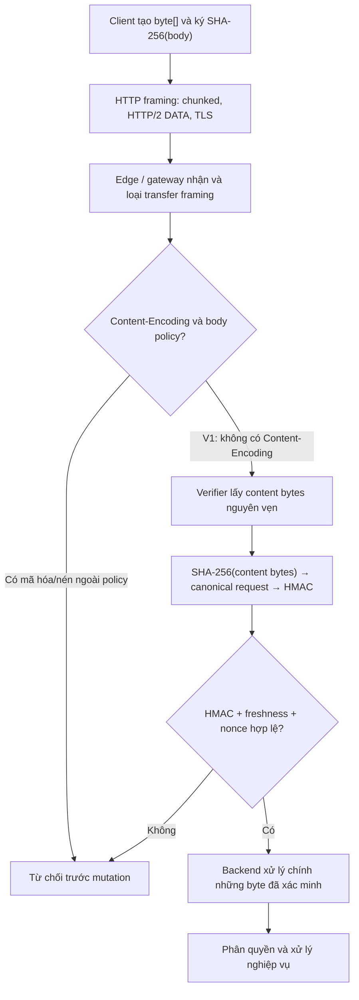

# Body bytes: Xác định đúng byte HTTP body trước khi ký HMAC

Trong xác thực HTTP request bằng HMAC, **body bytes** là những byte nội dung request được chọn làm đầu vào của hợp đồng ký. Một thay đổi tưởng như vô hại — thêm ký tự xuống dòng, thay thứ tự key JSON, đổi mã hóa UTF-8, giải nén body hoặc parse rồi serialize lại — đều có thể thay đổi byte và khiến chữ ký HMAC không khớp. Nghiêm trọng hơn, nếu bộ xác minh ký một chuỗi byte nhưng backend xử lý nội dung **khác**, chữ ký có thể không còn ràng buộc đúng hành động nghiệp vụ.

Bài **Body bytes** thuộc chương **Body canonicalization** của module `SECURITY_AUTHENTICATION_HMAC_REQUEST_AUTHENTICATION`. Mục tiêu module là thiết kế xác thực HTTP request bằng **shared secret**, canonical request kết hợp phương thức, URI, header hoặc body theo hợp đồng ký; thực hành xác minh chữ ký, chống replay bằng timestamp/nonce, key rotation, kiểm thử proxy/gateway và phân biệt **authentication** với **authorization**. Trọng tâm ở đây là câu hỏi thực tế: **“Chính xác byte nào của body được ký, được xác minh và được xử lý?”**

## 1. Mục tiêu học tập

Sau bài học, bạn có thể:

1. Phân biệt **HTTP content bytes**, transfer framing, content coding, Java `String`, JSON object và giá trị digest trong canonical request.
2. Giải thích vì sao HMAC nên dùng **raw content bytes theo hợp đồng rõ ràng**, thay vì vô tình ký JSON đã được serialize lại hoặc body do proxy sửa.
3. Thiết kế một phiên bản giao thức HMAC-SHA256 bao gồm SHA-256 của raw body bytes và các header liên quan, với quy tắc cho body rỗng, `Content-Type` và `Content-Encoding`.
4. Viết code Java 17 dùng `MessageDigest`, `Mac`, `byte[]` và `MessageDigest.isEqual`; đọc body qua HTTP adapter mà không biến đổi ngầm.
5. Chẩn đoán mismatch qua gzip, chunked transfer, charset, newline, BOM, whitespace và middleware đọc body nhiều lần.
6. Kiểm thử end-to-end qua gateway, kết hợp replay prevention, key rotation và authorization.

## 2. “Body bytes” là bytes ở tầng nào?

Nhìn vào HTTP/1.1:

```http
POST /v1/orders HTTP/1.1
Host: api.example.test
Content-Type: application/json

{"sku":"BK-42","quantity":2}
```

Thứ client muốn ký trong ví dụ là dãy byte biểu diễn nội dung JSON:

```text
7b 22 73 6b 75 22 3a 22 42 4b 2d 34 32 22 2c 22
71 75 61 6e 74 69 74 79 22 3a 32 7d
```

Đây là 28 byte UTF-8/ASCII của chuỗi `{"sku":"BK-42","quantity":2}`, **không có CRLF ở cuối body**. Trong một ví dụ HTTP hiển thị bằng code block, khoảng cách sau phần header và cách editor thêm newline **không phải bằng chứng chắc chắn** về byte thực sự đã gửi. Khi ký thật, phải băm `byte[]` mà HTTP client thực sự truyền.

### Những đối tượng dễ bị gọi chung là “body”

| Khái niệm | Ví dụ | Có phải đầu vào ký V1? |
| --- | --- | --- |
| **Wire bytes** | TCP/QUIC frames, kích thước chunk, CRLF ngăn chunk. | **Không**, đây còn gồm framing giao thức; thay đổi giữa các phiên bản HTTP. |
| **HTTP content bytes** | Các byte sau khi HTTP stack giải mã framing/transfer coding. | **Có**, là đầu vào V1 khi `Content-Encoding` không hiện diện. |
| **Content-coded bytes** | Dữ liệu gzip còn nén khi có `Content-Encoding: gzip`. | **V1 từ chối** vì không hỗ trợ content coding; giao thức khác phải định nghĩa rõ thời điểm băm. |
| **Decoded/decompressed body** | Byte được tạo sau khi giải nén gzip. | Không phải nguồn của V1; nếu dùng cho phiên bản khác phải ký metadata và xử lý nhất quán. |
| **Java `String` của body** | `new String(body, UTF_8)`. | Không dùng làm nguồn ký, vì decode/encode có thể thay byte hoặc xử lý lỗi khác nhau. |
| **JSON object sau parse** | `Map<String,Object>`. | Không dùng làm nguồn ký V1; object không giữ nguyên whitespace/order/representation. |
| **SHA-256 digest của body** | 32 byte digest hoặc 64 ký tự hex. | Digest được đưa vào canonical request; bản thân digest **không phải HMAC**. |

**Định nghĩa chính xác của bài:** `bodyBytes` là các **HTTP content octets sau khi HTTP transport đã loại framing/transfer coding, trước mọi giải nén content coding, charset decoding, normalization và parsing**. Tuy nhiên, để dễ kiểm soát, **HMAC-SHA256-V1 trong bài chỉ chấp nhận request không có `Content-Encoding`**; vì vậy content bytes cũng chính là raw body JSON dùng để parser xử lý.

Điều này có nghĩa `Transfer-Encoding: chunked` của HTTP/1.1, nếu HTTP stack hỗ trợ và parse an toàn, **không được coi các kích thước chunk hoặc CRLF framing là một phần của body đã ký**. HTTP/2/HTTP/3 có framing khác, nhưng hai request có **cùng content octets** vẫn phải tạo cùng body digest. Mặt khác, proxy tự chuyển đổi content coding hoặc serialize lại JSON làm thay đổi content bytes thì không được âm thầm cho qua.

## 3. Bước nào có thể làm body bytes thay đổi?

Một request thường đi qua nhiều lớp:



Những thao tác dưới đây khác nhau về bản chất:

| Thao tác | Có thay body octets dùng cho V1 không? | Chú ý |
| --- | --- | --- |
| Chuyển HTTP/1.1 chunked sang HTTP/2 DATA frames, **không sửa content** | Không | Framing có thể khác, content bytes giữ nguyên. |
| Thêm khoảng trắng trước dấu `:` của JSON | **Có** | JSON có thể cùng nghĩa nhưng byte đã thay. |
| Đổi thứ tự property JSON | **Có** | Không dựa vào semantic equality của object. |
| Đổi `\n` thành `\r\n` bên trong body | **Có** | Một hoặc hai byte khác nhau. |
| Thêm newline cuối body | **Có** | SHA-256 và HMAC thay đổi. |
| Chuyển escaped string `"\u0061"` thành `"a"` | **Có** | Cùng giá trị JSON sau parse nhưng chuỗi byte khác. |
| Chuẩn hóa Unicode NFC/NFD | **Có thể** | Ký tự trông giống nhau nhưng byte UTF-8 khác. |
| Thêm hoặc bỏ UTF-8 BOM | **Có** | Parser có thể xử lý khác nhau; contract cần quy định. |
| Giải nén `Content-Encoding: gzip` | Có | Không chấp nhận trong V1; phiên bản khác phải chọn một phía của phép giải nén. |
| Parser chuyển JSON thành object rồi serialize lại | **Thông thường có** | Key order, spacing, số, escape và encoding có thể thay. |
| Reverse proxy rewrite URI nhưng giữ nguyên body | Không đổi body | Nhưng **canonical request** vẫn thay nếu raw URI được ký. |
| Thêm hoặc đổi `Content-Length` mà body bytes không đổi | Không đổi body | Vấn đề framing phải được xử lý an toàn; V1 không ký `Content-Length`. |

Tách bạch: **các byte sau HTTP framing** là dữ liệu ký, nhưng **trước khi được phép xử lý nghiệp vụ** phải bảo đảm framework/backend thực sự nhận và xử lý chính nội dung đó. Nếu gateway verify trên body A rồi forward body B, việc HMAC đúng ở gateway không chứng minh body B an toàn.

## 4. JSON tương đương về nghĩa không đồng nghĩa cùng byte

Hai request body:

```json
{"sku":"BK-42","quantity":2}
```

```json
{
  "quantity": 2,
  "sku": "BK-42"
}
```

có thể tạo ra cùng một đối tượng ứng dụng sau khi JSON parser đọc, nhưng khác hoàn toàn về byte:

- Thứ tự `sku` và `quantity` khác nhau.
- Whitespace và newline khác nhau.
- Số lượng byte tổng cộng khác nhau.
- SHA-256(raw bytes) khác nhau; HMAC trên canonical request chứa digest đó cũng khác nhau.

Thậm chí một chuỗi JSON cũng có nhiều biểu diễn byte:

```text
{"name":"Café"}
{"name":"Caf\u00e9"}
{"name":"Cafe\u0301"}
```

Trong ví dụ, hai dòng đầu có thể tạo cùng chuỗi Unicode sau JSON parse, trong khi dòng thứ ba có thể là ký tự tổ hợp khác ở dạng Unicode. Tuy nhiên, **ngay cả khi logic nghiệp vụ xem chúng tương đương**, V1 vẫn ký **byte UTF-8 thực tế được gửi**, không chuẩn hóa JSON text.

### Cẩn trọng với object mapping

Các cách xây body sau đây dễ tạo sai khác:

- Client ký `jsonObject.toString()` nhưng HTTP library lại serialize JSON object riêng khi gửi.
- Client tính SHA-256 trên Java `String` bằng **charset mặc định**, trong khi HTTP gửi UTF-8.
- Server dùng `request.getReader()` để đọc text rồi `getBytes(UTF_8)` trước khi tính chữ ký.
- Framework lọc một số field rồi tái tạo JSON để chuyển cho backend.
- Middleware tự parse và serialize theo một bộ thư viện khác, thay khoảng trắng hoặc thứ tự key.

**Quy tắc:** Nếu hợp đồng là *raw bytes*, chỉ serialize **một lần** để tạo `byte[]`, dùng **chính mảng byte đó** cho SHA-256 và cho HTTP body publisher. Bên nhận đọc bytes từ HTTP stack ở điểm xác minh, băm trực tiếp, rồi chuyển nguyên nội dung đã xác minh cho parser/handler.

## 5. Body rỗng, JSON `null` và object rỗng là ba thứ khác nhau

Đây là bẫy thường gặp khi client hoặc server đánh đồng “không có nội dung” với “nội dung rỗng”.

| Body truyền đi | Byte theo UTF-8 | SHA-256 |
| --- | --- | --- |
| **0 byte** | Dãy byte rỗng | `e3b0c44298fc1c149afbf4c8996fb92427ae41e4649b934ca495991b7852b855` |
| `null` | `6e 75 6c 6c` | Khác digest của 0 byte. |
| `{}` | `7b 7d` | Khác cả hai trường hợp trên. |
| `[]` | `5b 5d` | Khác `{}`. |
| Một ký tự LF cuối | `0a` | Khác 0 byte. |

**Body rỗng vẫn có SHA-256 hợp lệ**; không được “bỏ dòng body hash” khi body có 0 byte nếu hợp đồng quy định luôn có dòng đó. Tuy nhiên, một endpoint JSON có thể **không cho phép body rỗng** theo business validation: đây là kiểm tra khác với thuật toán hash. V1 cho phép lớp mật mã băm 0 byte, còn endpoint `POST /v1/orders` yêu cầu JSON hợp lệ nên có thể từ chối ở lớp validation nghiệp vụ.

Một kiểm thử độc lập hữu ích là:

```text
SHA-256("") =
e3b0c44298fc1c149afbf4c8996fb92427ae41e4649b934ca495991b7852b855

SHA-256("abc") =
ba7816bf8f01cfea414140de5dae2223b00361a396177a9cb410ff61f20015ad
```

Dấu ngoặc kép ở đây chỉ mô tả chuỗi byte ASCII; chúng **không** thuộc dữ liệu băm.

### Body của `GET` và `DELETE`

Không nên suy ra mọi phương thức HTTP có body rỗng hoặc một body tùy ý đều có cùng ngữ nghĩa. Với những endpoint không hỗ trợ request content cho `GET`, `DELETE`, hợp đồng nên **từ chối body không mong đợi**, đồng thời quy định digest cho body 0 byte. Ký chính xác body giúp phát hiện việc sửa byte, nhưng **không tự quyết định** API có cho phép body đó hay không.

## 6. Chính sách V1: ký raw body bytes, không tự canonicalize JSON

Hợp đồng ví dụ cho API đặt hàng `orders-api-prod`:

| Hạng mục | Quy tắc HMAC-SHA256-V1 |
| --- | --- |
| Credential | `X-Key-Id` chọn **một** shared secret ACTIVE, đúng audience và môi trường. |
| Thuật toán | `HmacSHA256` của JCA, sử dụng **full 32-byte tag**. |
| Method | Chính xác `POST` (chữ hoa), không tự sửa thành dạng khác. |
| Request target | Chính xác `/v1/orders` theo origin-form cho endpoint minh họa. |
| Content-Type | Header duy nhất, giá trị đúng `application/json`; body được hiểu là UTF-8 JSON ở lớp parser. |
| Content-Encoding | **Không được hiện diện**; V1 không hỗ trợ nén hoặc content coding. |
| Body | Byte nội dung sau transfer framing, **trước parsing hoặc charset transform**; giới hạn tối đa 64 KiB. |
| Body digest | SHA-256 của **đúng body byte[]**, viết thành hex chữ thường 64 ký tự. |
| Timestamp | `X-Timestamp` UTC đúng định dạng và được ký; cửa sổ ±300 giây, xét theo đồng hồ server. |
| Nonce | `X-Nonce` 128 bit ngẫu nhiên, Base64URL không padding; ký và dùng một lần. |
| Canonical format | UTF-8, nối các dòng bằng LF (`\n`), không thêm LF cuối. |
| Signature header | `X-Signature: v1=<Base64 chuẩn có padding của full HMAC-SHA256>`. |
| Audience | Dòng cố định `orders-api-prod` trong chuỗi ký; gateway kiểm tra đúng service/route. |

**Tại sao cấm Content-Encoding trong V1?** Vì câu trả lời “băm compressed bytes hay decompressed bytes?” trở nên đơn nghĩa: request chứa content-coded bytes bị từ chối. Điều này còn giúp giới hạn độ phức tạp và nguy cơ giải nén vượt kích thước (*decompression bomb*) ở endpoint JSON nhỏ. Nếu hệ thống cần gzip, hãy thiết kế **phiên bản riêng** quy định chính xác bước hash, ký `Content-Encoding`, giới hạn kích thước compressed/decompressed và bảo toàn dữ liệu qua gateway.

### Ví dụ HTTP request

```http
POST /v1/orders HTTP/1.1
Host: api.example.test
Content-Type: application/json
X-Key-Id: partner-a-202611
X-Timestamp: 2026-11-28T02:00:00Z
X-Nonce: Zq8DxKtUokcwPGNj3d_yvQ
X-Signature: v1=<BASE64_FULL_HMAC_SHA256>

{"sku":"BK-42","quantity":2}
```

Canonical request:

```text
HMAC-SHA256-V1
orders-api-prod
POST
/v1/orders
content-type:application/json
x-key-id:partner-a-202611
x-timestamp:2026-11-28T02:00:00Z
x-nonce:Zq8DxKtUokcwPGNj3d_yvQ
sha256:<LOWERCASE_HEX_OF_SHA256_BODY_BYTES>
```

Các đoạn `<...>` là **placeholder**. Client tính digest từ raw bytes, thay dòng cuối, rồi ký:

\[
\begin{aligned}
d &= \operatorname{SHA256}(\mathrm{bodyBytes}),\\
C &= \operatorname{UTF8}(\mathrm{canonicalRequest\ containing\ hex}(d)),\\
t &= \operatorname{HMAC}_{\mathrm{SHA256}}(K,C),\\
\mathrm{signature} &= \texttt{v1=} \Vert \operatorname{Base64}(t).
\end{aligned}
\]

**Phân biệt hai phép hash:** `SHA-256(body)` là **hash không có khóa**, không chứng minh client sở hữu secret. `HMAC-SHA256(secret, canonicalBytes)` là MAC có khóa bảo vệ **body digest cùng các thành phần khác của request**. Khi header signature là HMAC của canonical request chứa body digest, việc thay body bytes mà giữ tag cũ sẽ bị phát hiện với giả định mật mã và credential còn an toàn.

Nếu API bỏ body digest khỏi canonical request, việc ký method/URI/header **không tự bảo vệ body**, dù HMAC dài 256 bit. Ngược lại, chỉ ký body mà bỏ method/URI cũng không bảo đảm hành động và resource không bị sửa. Hợp đồng cần bao quát những thành phần ảnh hưởng quyết định nghiệp vụ.

## 7. Java 17: ký và xác minh đúng `byte[]`

Ví dụ độc lập dưới đây sử dụng `java.security.MessageDigest` để băm body và `javax.crypto.Mac` để ký canonical request. Lưu ý:

- Input `rawBody` là **byte[]** đã được HTTP adapter xác định là content bytes hợp lệ, **không** phải một `String` được tái mã hóa sau parser.
- Hợp đồng yêu cầu **`Content-Encoding` vắng mặt**; không tự nhận dạng hoặc giải nén.
- Signature dùng Base64 chuẩn có padding, và full tag HMAC-SHA256 dài **32 byte**.
- Ví dụ bảo vệ `byte[]` khỏi bị sửa bên ngoài sau khi xây request bằng defensive copy.
- Chương trình có các bài test độc lập: body đúng, body thêm newline, body đổi thứ tự JSON, target thay đổi và hash của body 0 byte.

```java
import java.nio.charset.StandardCharsets;
import java.security.GeneralSecurityException;
import java.security.MessageDigest;
import java.time.Instant;
import java.time.format.DateTimeParseException;
import java.util.Arrays;
import java.util.Base64;
import java.util.HexFormat;
import javax.crypto.Mac;
import javax.crypto.spec.SecretKeySpec;

public final class BodyBytesHmacV1 {
    private static final String HMAC_ALGO = "HmacSHA256";
    private static final String AUDIENCE = "orders-api-prod";
    private static final String SIGNATURE_PREFIX = "v1=";
    private static final String TYPE = "application/json";
    private static final int MAX_BODY = 64 * 1024;

    private BodyBytesHmacV1() {}

    public record SignedRequest(
            String method,
            String rawTarget,
            String contentType,
            String contentEncoding, // V1 phải null: header vắng mặt.
            String keyId,
            String timestamp,
            String nonce,
            byte[] rawBody) {

        public SignedRequest {
            if (rawBody != null) {
                rawBody = rawBody.clone(); // Snapshot byte được ký.
            }
        }

        @Override
        public byte[] rawBody() {
            return rawBody == null ? null : rawBody.clone();
        }
    }

    private static void validate(SignedRequest r) {
        if (r == null || !"POST".equals(r.method())
                || !"/v1/orders".equals(r.rawTarget())
                || !TYPE.equals(r.contentType())
                || r.contentEncoding() != null
                || r.keyId() == null
                || !r.keyId().matches("[A-Za-z0-9_-]{1,80}")
                || r.timestamp() == null
                || !r.timestamp().matches(
                    "[0-9]{4}-[0-9]{2}-[0-9]{2}T"
                    + "[0-9]{2}:[0-9]{2}:[0-9]{2}Z")
                || r.nonce() == null
                || r.rawBody() == null
                || r.rawBody().length > MAX_BODY) {
            throw new IllegalArgumentException("Invalid signed HTTP request");
        }

        try {
            Instant.parse(r.timestamp()); // Chưa kiểm tra clock skew.
        } catch (DateTimeParseException ex) {
            throw new IllegalArgumentException("Invalid UTC timestamp", ex);
        }

        // Nonce: 16 byte random, biểu diễn Base64URL không padding.
        try {
            byte[] nonce = Base64.getUrlDecoder().decode(r.nonce());
            String canonicalNonce = Base64.getUrlEncoder().withoutPadding()
                    .encodeToString(nonce);
            if (nonce.length != 16 || !canonicalNonce.equals(r.nonce())) {
                throw new IllegalArgumentException("Invalid nonce");
            }
        } catch (IllegalArgumentException ex) {
            throw new IllegalArgumentException("Invalid nonce encoding", ex);
        }
    }

    public static String sha256Hex(byte[] rawBody)
            throws GeneralSecurityException {
        if (rawBody == null) {
            throw new IllegalArgumentException("Body must not be null");
        }
        return HexFormat.of().formatHex(
                MessageDigest.getInstance("SHA-256").digest(rawBody));
    }

    public static byte[] canonicalBytes(SignedRequest r)
            throws GeneralSecurityException {
        validate(r);
        String bodyHash = sha256Hex(r.rawBody());
        String canonical = String.join("\n",
                "HMAC-SHA256-V1",
                AUDIENCE,
                r.method(),
                r.rawTarget(),
                "content-type:" + r.contentType(),
                "x-key-id:" + r.keyId(),
                "x-timestamp:" + r.timestamp(),
                "x-nonce:" + r.nonce(),
                "sha256:" + bodyHash);
        return canonical.getBytes(StandardCharsets.UTF_8);
    }

    private static byte[] hmac(byte[] secret, byte[] canonical)
            throws GeneralSecurityException {
        // Đây là yêu cầu provisioning của hệ thống ví dụ.
        if (secret == null || secret.length < 32) {
            throw new IllegalStateException("Invalid HMAC credential");
        }
        Mac mac = Mac.getInstance(HMAC_ALGO);
        mac.init(new SecretKeySpec(secret, HMAC_ALGO));
        return mac.doFinal(canonical);
    }

    public static String sign(byte[] secret, SignedRequest r)
            throws GeneralSecurityException {
        return SIGNATURE_PREFIX + Base64.getEncoder()
                .encodeToString(hmac(secret, canonicalBytes(r)));
    }

    public static boolean verify(
            byte[] activeSecret, SignedRequest received,
            String signatureHeader) throws GeneralSecurityException {
        if (signatureHeader == null
                || !signatureHeader.startsWith(SIGNATURE_PREFIX)
                || signatureHeader.length() != 47) { // "v1=" + 44 Base64 chars
            return false;
        }
        String encoded = signatureHeader.substring(SIGNATURE_PREFIX.length());
        byte[] supplied;
        try {
            supplied = Base64.getDecoder().decode(encoded);
        } catch (IllegalArgumentException ex) {
            return false;
        }
        if (supplied.length != 32
                || !Base64.getEncoder().encodeToString(supplied)
                        .equals(encoded)) {
            return false;
        }
        byte[] expected = hmac(activeSecret, canonicalBytes(received));
        return MessageDigest.isEqual(expected, supplied);
    }

    public static void main(String[] args) throws Exception {
        String emptyHash =
            "e3b0c44298fc1c149afbf4c8996fb92427ae41e4649b934ca495991b7852b855";
        String abcHash =
            "ba7816bf8f01cfea414140de5dae2223b00361a396177a9cb410ff61f20015ad";
        if (!emptyHash.equals(sha256Hex(new byte[0]))
                || !abcHash.equals(
                    sha256Hex("abc".getBytes(StandardCharsets.US_ASCII)))) {
            throw new AssertionError("SHA-256 test vector mismatch");
        }

        byte[] testSecret = new byte[32];
        Arrays.fill(testSecret, (byte) 0x5a); // Chỉ dùng trong test.
        byte[] body = "{\"sku\":\"BK-42\",\"quantity\":2}"
                .getBytes(StandardCharsets.UTF_8);
        SignedRequest original = new SignedRequest(
                "POST", "/v1/orders", TYPE, null,
                "partner-a-202611", "2026-11-28T02:00:00Z",
                "Zq8DxKtUokcwPGNj3d_yvQ", body);

        String signature = sign(testSecret, original);
        if (!verify(testSecret, original, signature)) {
            throw new AssertionError("Valid raw body was rejected");
        }

        byte[] lineBreakBody = (
                "{\"sku\":\"BK-42\",\"quantity\":2}\n")
                .getBytes(StandardCharsets.UTF_8);
        SignedRequest changedWhitespace = new SignedRequest(
                original.method(), original.rawTarget(), TYPE, null,
                original.keyId(), original.timestamp(), original.nonce(),
                lineBreakBody);
        if (verify(testSecret, changedWhitespace, signature)) {
            throw new AssertionError("Changed body bytes were accepted");
        }

        byte[] reorderedJson = "{\"quantity\":2,\"sku\":\"BK-42\"}"
                .getBytes(StandardCharsets.UTF_8);
        SignedRequest changedOrder = new SignedRequest(
                original.method(), original.rawTarget(), TYPE, null,
                original.keyId(), original.timestamp(), original.nonce(),
                reorderedJson);
        if (verify(testSecret, changedOrder, signature)) {
            throw new AssertionError("Reordered JSON was accepted");
        }

        SignedRequest changedTarget = new SignedRequest(
                "POST", "/v1/orders/42", TYPE, null,
                original.keyId(), original.timestamp(), original.nonce(), body);
        try {
            verify(testSecret, changedTarget, signature);
            throw new AssertionError("Unallowed target was accepted");
        } catch (IllegalArgumentException expected) {
            // V1 chỉ chấp nhận đúng /v1/orders.
        }

        // Defensive copy: sửa mảng byte từ bên ngoài không đổi request.
        byte[] externalCopy = original.rawBody();
        externalCopy[0] = 0;
        if (!verify(testSecret, original, signature)) {
            throw new AssertionError("Body mutation changed the signed snapshot");
        }
        System.out.println("Body-bytes HMAC checks passed.");
    }
}
```

### Đọc đúng ví dụ

- `rawBody` luôn là mảng byte; không gọi `new String(rawBody)` rồi lấy bytes lại để hash.
- `sha256Hex` trả digest dưới dạng **64 ký tự hex lowercase**, còn `Mac.doFinal` trả **32 raw MAC bytes**. Hai giá trị khác mục đích.
- `SignedRequest` snapshot body trong record và trả defensive copy, tránh caller thay byte sau khi tính chữ ký. Với dữ liệu nhạy cảm và khối lượng lớn, thiết kế bộ đệm/stream có thể khác, nhưng phải bảo đảm **tính bất biến của bytes được xác thực** đến khi xử lý.
- `verify` trả `false` khi header signature không hợp lệ hoặc MAC khác; nếu secret/provider lỗi, exception được truyền lên lớp dịch vụ để phân loại **lỗi credential/hạ tầng** thay vì tự khẳng định client ký sai.
- Client và server ký cùng **một chuỗi canonical**, nhưng ngoài thực tế bên nhận phải dựng các trường đó từ **request do HTTP stack cung cấp**, không được tin một canonical string mà client gửi sẵn.

**Giới hạn:** Code tập trung vào cách ký body bytes. Nó **chưa thực hiện** credential registry, timestamp window, nonce store, authorization, parser JSON, chống header duplicate, HTTP framing, chống request smuggling hoặc kiểm soát proxy rewrite. Các lớp bổ sung bắt buộc có trong hệ thống production.

## 8. Java HTTP client: ký đúng bytes mình sẽ gửi

Ở Java 17, nguyên tắc tốt là tạo JSON **một lần** thành `byte[]`, dùng mảng đó để ký và sử dụng `BodyPublishers.ofByteArray` để gửi. Nếu client lại đưa object cho một JSON serializer khác khi gửi, chữ ký có thể không còn khớp.

```java
// Mảnh tích hợp client; uri, timestamp, nonce và credential đã được chuẩn bị.
byte[] rawBody = jsonSerializer.writeValueAsBytes(orderData);
// rawBody là byte[] cố định cho request này.
BodyBytesHmacV1.SignedRequest toSign = new BodyBytesHmacV1.SignedRequest(
        "POST", "/v1/orders", "application/json", null,
        keyId, timestamp, nonce, rawBody);
String signature = BodyBytesHmacV1.sign(secret, toSign);

java.net.http.HttpRequest request =
        java.net.http.HttpRequest.newBuilder(uri)
        .header("Content-Type", "application/json")
        .header("X-Key-Id", keyId)
        .header("X-Timestamp", timestamp)
        .header("X-Nonce", nonce)
        .header("X-Signature", signature)
        .POST(java.net.http.HttpRequest.BodyPublishers.ofByteArray(rawBody))
        .build();
```

Đoạn này là **mảnh tích hợp**, không phải class có thể compile độc lập: `jsonSerializer`, `orderData`, `uri`, `keyId`, `timestamp`, `nonce`, `secret` là biến do ứng dụng cung cấp. Trong test tích hợp, xác nhận URI thực gửi vẫn là `/v1/orders` và HTTP client không thêm content coding. Đừng ký một URL đã normalize khác với URL được gửi.

### Client ký text body

Nếu body vốn là text, chuyển thành UTF-8 bytes **một lần**:

```java
byte[] body = "{\"sku\":\"BK-42\",\"quantity\":2}"
        .getBytes(java.nio.charset.StandardCharsets.UTF_8);
```

Sau đó dùng chính `body` cho hash và HTTP publisher. Tránh `String.getBytes()` không chỉ rõ charset, đặc biệt ở ứng dụng chạy trên các runtime/language có default charset khác nhau.

## 9. Server Java: đọc HTTP body đúng thời điểm

Với servlet, nguồn dữ liệu để băm thường là `HttpServletRequest.getInputStream()`, **trước khi các lớp khác parse hoặc biến đổi body**. Tuy nhiên, container, ingress proxy hoặc middleware có thể đã tác động trước filter này; phải kiểm thử deployment thật.

Ví dụ hàm đọc có giới hạn cho một endpoint JSON nhỏ:

```java
// Mảnh Java độc lập về thuật toán đọc InputStream; cần import java.io.*.
static byte[] readBounded(java.io.InputStream input, int maxBytes)
        throws java.io.IOException {
    if (input == null || maxBytes < 0) {
        throw new IllegalArgumentException("Invalid body input/limit");
    }
    java.io.ByteArrayOutputStream buffer =
            new java.io.ByteArrayOutputStream();
    byte[] chunk = new byte[8192];
    int read;
    while ((read = input.read(chunk)) != -1) {
        if (read > maxBytes - buffer.size()) {
            throw new IllegalArgumentException("Body exceeds limit");
        }
        buffer.write(chunk, 0, read);
    }
    return buffer.toByteArray();
}

// Trong filter/adapter đã kiểm tra Content-Encoding vắng mặt:
// byte[] rawBody = readBounded(request.getInputStream(), 64 * 1024);
// RequestToVerify nhận bản sao rawBody để tính HMAC.
// Bộ lọc phải có wrapper/cache body nếu handler cũng cần đọc nội dung.
```

**Một InputStream không tự đọc được hai lần.** Nếu security filter đọc hết body để xác minh, handler tiếp theo sẽ không thể đọc lại từ cùng stream nếu không có cơ chế **cached-body request wrapper** hoặc truyền dữ liệu đã đọc theo giao diện tin cậy. Cần bảo vệ wrapper khỏi memory DoS và tránh trường hợp **bộ xác minh đọc bản A nhưng handler nhận bản B**.

Các kiểm soát tối thiểu ở ingress và adapter:

- Giới hạn kích thước khi **đang đọc**, không chỉ sau khi toàn bộ body đã nằm trong RAM; có chính sách trả `413 Content Too Large` khi vượt giới hạn.
- Kiểm tra `Content-Type` chính xác và `Content-Encoding` không xuất hiện theo V1; phát hiện duplicate header quan trọng trước khi framework gộp.
- HTTP parser phải xử lý framing chuẩn, từ chối `Content-Length` mâu thuẫn, cấu hình `Transfer-Encoding` không hợp lệ và các trường hợp dễ gây request smuggling.
- Không dùng `getReader()` rồi encode lại String để xác minh body bytes; không để middleware JSON normalize trước khi signature filter đọc.
- Khi có gzip/deflate middleware, đảm bảo filter HMAC đặt **trước** middleware biến đổi hoặc V1 từ chối request nén ở điểm tin cậy.
- Giữ body đã xác minh bất biến đến lúc nghiệp vụ thực thi, không dựa vào một hash được tính trên buffer có thể bị sửa sau đó.

### Body lớn và streaming

Ví dụ cho body nhỏ có thể dùng `byte[]`. Với upload lớn, băm bằng streaming để tránh giữ toàn bộ trong bộ nhớ:

```java
java.security.MessageDigest digest =
        java.security.MessageDigest.getInstance("SHA-256");
byte[] buffer = new byte[8192];
long total = 0;
int n;
while ((n = input.read(buffer)) != -1) {
    total += n;
    if (total > maxAllowedBytes) {
        throw new IllegalArgumentException("Body exceeds limit");
    }
    digest.update(buffer, 0, n);
}
byte[] sha256 = digest.digest();
```

Đoạn này là **mảnh thuật toán**, giả định `input`, `maxAllowedBytes` và giới hạn streaming đã được định nghĩa. Vẫn cần phương án **spool dữ liệu an toàn** (bộ đệm/tệp tạm được bảo vệ) hoặc kiến trúc xử lý không side effect **cho tới khi chữ ký được xác minh**. Không truyền ngay chunk chưa xác minh vào handler gây thay đổi DB hoặc gọi hệ thống ngoài.

Sau khi hoàn tất digest, đưa **hex của 32 digest bytes** vào canonical request, rồi tính HMAC trên canonical bytes. Không cần đưa toàn bộ file lớn trực tiếp vào `Mac.update` trong hợp đồng V1 vì message HMAC chứa digest của body, nhưng phải bảo đảm SHA-256 được tính từ **toàn bộ content bytes** đúng định nghĩa.

## 10. Content-Encoding, Transfer-Encoding và proxy/gateway

Đây là nguồn lỗi phổ biến nhất khi các môi trường khác nhau tính HMAC không khớp.

### Transfer framing không phải body content

HTTP/1.1 có thể truyền nội dung bằng `Transfer-Encoding: chunked`:

```http
POST /v1/orders HTTP/1.1
Host: api.example.test
Transfer-Encoding: chunked
Content-Type: application/json

2
{}
0

```

Framing minh họa gồm chunk size `2` và chunk cuối `0`. **Hai byte nội dung** là `7b 7d` (`{}`), không gồm chữ số `2`, `0` hoặc CRLF framing. HTTP parser phải loại framing trước khi trả content bytes cho verifier. Với HTTP/2 và HTTP/3, framing khác nhưng content bytes cùng `{}` thì **body digest phải giống nhau**.

Không tự “dechunk” chuỗi request bằng cách tách theo newline. Chỉ sử dụng parser HTTP chuẩn có cơ chế chặn các dạng framing mơ hồ; đặc biệt các request có `Content-Length`/`Transfer-Encoding` mâu thuẫn phải bị xử lý theo các quy tắc HTTP an toàn, không được chạy hai parser với cách chia request khác nhau.

### Content coding là vấn đề khác

Nếu request có `Content-Encoding: gzip`, content bytes thường là **dữ liệu gzip đã nén** trước khi decode representation. Body sau giải nén và body trước giải nén **khác bytes**. Nếu client hash compressed bytes còn server hash JSON đã giải nén, signature mismatch là điều bình thường.

Trong **V1**, mọi `Content-Encoding` đều không được phép, kể cả khai `identity`; client chỉ gửi body JSON không content coding. Chúng ta không tự chọn băm “cách nào dễ hơn”. Nếu cần phiên bản hỗ trợ gzip, phải quy định rõ:

1. Hash **content-coded bytes hay decoded bytes**; không cho mỗi client tự chọn.
2. Header `Content-Encoding` phải được ký, cùng `Content-Type` và các trường ảnh hưởng interpretation.
3. Cách xử lý gzip metadata, recompression, proxy auto-decompression và equality của raw bytes.
4. Giới hạn compressed/decompressed bytes để chống **decompression bomb**.
5. Cách chuyển body đã xác minh đến backend mà không đổi ngữ nghĩa.
6. Test vector cụ thể bằng byte input, digest và MAC ở cả client lẫn gateway.

### Proxy thay Content-Length nhưng giữ body

`Content-Length` có thể thay đổi hoặc biến mất khi một hop chuyển HTTP/1.1 chunked sang HTTP/2, dù content bytes không đổi. V1 **không ký Content-Length** vì đó không phải nguồn định danh dữ liệu body; kích thước và framing được HTTP parser/ingress kiểm soát riêng. Không coi việc bỏ `Content-Length` là sửa body. Nhưng nếu framing khiến verifier đọc 100 byte còn backend đọc 120 byte, đây là **lỗi ranh giới HTTP nguy hiểm** cần chặn từ parser, không phải vấn đề thêm `Content-Length` vào canonical string để chữa.

## 11. Multipart, form, binary và content type khác

Hợp đồng body bytes không phụ thuộc JSON về mặt toán học: SHA-256 có thể băm **mọi chuỗi byte**. Tuy nhiên, **ý nghĩa và phương pháp parse** body phụ thuộc `Content-Type`.

| Body type | Những byte dễ thay đổi | Quy tắc cần có nếu ký |
| --- | --- | --- |
| `application/json` | Whitespace, order, escape, Unicode, BOM. | Ký raw UTF-8 bytes; parser dùng đúng byte đã xác minh. |
| `application/x-www-form-urlencoded` | `+` so với `%20`, thứ tự field, duplicate field, charset. | Ký raw bytes và thống nhất cách parser xử lý key trùng. |
| `multipart/form-data` | Boundary, header mỗi part, CRLF, filename, thứ tự part. | Ký **toàn bộ body bytes**, bảo toàn boundary và part metadata; không tái đóng gói multipart trước khi verify. |
| `application/octet-stream` | Byte nhị phân tùy ý, null byte, streaming. | Không đi qua `String`; băm trực tiếp content bytes, giới hạn kích thước. |
| `text/plain` | UTF-8/charset khác, CRLF/LF, BOM. | Chọn charset/canonicalization rõ ràng; raw bytes mặc định không normalize. |
| Body không có/0 byte | Không có byte dữ liệu. | Dùng SHA-256 của dãy rỗng nếu hợp đồng có body digest. |

V1 minh họa chỉ nhận `application/json` với content coding vắng mặt. Nếu muốn mở rộng sang multipart upload hoặc webhook binary, cần **phiên bản/phạm vi endpoint và media type policy riêng**, test byte-level qua các SDK. Đừng âm thầm sử dụng JSON stringify làm tiêu chuẩn chung cho mọi content type.

## 12. Body integrity chưa đủ: replay, key rotation và authorization

Ngay cả khi HMAC của body hoàn toàn đúng, hệ thống vẫn cần các lớp bảo mật khác.

### Timestamp và nonce phải được ký

Một attacker có thể sao chép một request HMAC hợp lệ và gửi lại **y nguyên**; HMAC vẫn đúng vì dữ liệu không đổi. Vì vậy canonical request V1 có:

- `x-timestamp` được ký, ở định dạng UTC xác định; server từ chối timestamp ngoài cửa sổ (ví dụ ±300 giây).
- `x-nonce` được ký, do client sinh bằng **CSPRNG**, ví dụ 16 byte ngẫu nhiên biểu diễn Base64URL không padding.
- Server claim `(keyId, nonce)` **nguyên tử** trong kho dùng chung **sau khi MAC đúng nhưng trước khi nghiệp vụ có side effect**.
- Nếu nonce store lỗi, endpoint bắt buộc chống replay **fail closed**.
- TTL nonce kéo dài tới khi timestamp không còn hợp lệ. Với cửa sổ ±5 phút, nonce của request có timestamp ở tương lai 5 phút có thể phải tồn tại đến khoảng **10 phút** sau lần nhận sớm nhất, cộng biên an toàn.

Khi client retry tạo đơn, cần timestamp/nonce mới và ký lại body bytes. Để tránh tạo đơn trùng, lớp nghiệp vụ nên có **idempotency key** gắn với client, URI và fingerprint nội dung; nếu `Idempotency-Key` ảnh hưởng xử lý thì phải **ký header đó** trong một phiên bản hợp đồng phù hợp.

### Key rotation không cho phép đổi cách hash body

| Key ID | Secret | Trạng thái | Cách xác minh |
| --- | --- | --- | --- |
| `partner-a-202611` | Secret A | ACTIVE trong overlap | HMAC với **secret A**, SHA-256 body theo V1. |
| `partner-a-202702` | Secret B độc lập | ACTIVE mới | HMAC với **secret B**, SHA-256 body theo V1. |
| `partner-a-202608` | Secret đã thu hồi | REVOKED | Từ chối trước khi chấp nhận request. |

Server chọn **đúng một secret theo key ID**, không thử secret khác khi chữ ký sai. Key rotation đổi credential, **không được ngầm đổi** quy tắc encoding/body canonicalization của V1. Nếu đổi cách ký body, tạo **signature version mới** với test vector và ngày chuyển đổi rõ ràng.

### Authentication không phải authorization

HMAC đúng chứng minh request đã được ký bởi bên có shared secret tương ứng, và các thành phần ký (bao gồm body digest) không bị thay đổi trái phép. Nó **không** cấp quyền sửa mọi trường trong body hay truy cập mọi tài nguyên.

Ví dụ client `partner-a` ký đúng:

```json
{"orderId":42,"totalAmount":0}
```

Nếu client chỉ có quyền tạo đơn với giá do backend tính, server phải **từ chối hoặc bỏ qua thao tác không hợp lệ theo hợp đồng rõ ràng**, không vì body có MAC mà cho phép ghi `totalAmount`. Với PATCH JSON Patch, cần kiểm tra từng `path`/`from`; với tạo đơn, ngăn **mass assignment** và kiểm soát tenant/resource. Phân quyền thực hiện **sau authentication** trên principal đã xác minh; business validation áp dụng tiếp theo.

## 13. Bảng chẩn đoán chữ ký sai vì body

| Triệu chứng | Nguyên nhân có thể | Cách phân tích |
| --- | --- | --- |
| Client và server cùng secret nhưng MAC khác. | Body bytes khác; method, URI hoặc signed header cũng có thể khác. | So sánh **digest của test payload không nhạy cảm** và canonical test vector byte-for-byte. |
| Java client ký được nhưng cURL/Postman không khớp. | cURL gửi newline, Postman chọn charset hoặc chỉnh body. | Quan sát raw bytes ở client test và HTTP ingress; không chỉ nhìn JSON render. |
| Signature chỉ sai khi đi qua proxy. | Proxy decompress/recompress, body parser/rewrite hoặc content coding. | Test từng hop; với V1 từ chối `Content-Encoding`. |
| Signature sai khi body là JSON Unicode. | UTF-8/charset, escape hoặc Unicode normalization khác. | So raw hex bytes và dùng UTF-8 nhất quán; không decode/reencode để verify. |
| Signature sai với `Transfer-Encoding: chunked`. | Verifier nhầm chunk framing là content. | Dùng HTTP parser trả content octets; test chunked và Content-Length cùng content. |
| Signature sai khi body rỗng. | Một bên bỏ body-digest line hoặc hash chuỗi `"null"`. | Dùng SHA-256 của **0 byte** theo hợp đồng; phân biệt empty body và `null`. |
| Server thấy body rỗng sau filter. | Filter đã tiêu thụ InputStream, không cache. | Dùng request wrapper/stream buffering an toàn, truyền cùng byte đã verify cho handler. |
| HMAC đúng nhưng backend xử lý giá trị khác. | Parser ở gateway/backend khác nghĩa, duplicate JSON keys, content coding hoặc normalize. | Thống nhất parser/validation, từ chối dữ liệu nhập nhằng, bảo toàn nội dung đã xác minh. |
| Body nhỏ pass, body lớn thất bại. | Buffer limit, đọc thiếu stream, timeout, truncation. | Đọc đầy đủ có giới hạn, stream hash/spool an toàn; không verify trên prefix. |
| MAC đúng nhưng nonce đã sử dụng. | Request bị replay. | Từ chối theo nonce store; không đổ lỗi cho body hashing. |
| MAC đúng nhưng client không có quyền sửa trường. | Thiếu authorization. | Từ chối theo principal/scope/resource, không phải lỗi mật mã. |

### Không log bí mật để debug

Không ghi full shared secret, raw body chứa dữ liệu nhạy cảm, signature production đầy đủ hoặc canonical request chứa thông tin riêng tư vào log. Có thể ghi **request ID**, `keyId` đã lọc, trạng thái credential, mã nguyên nhân nội bộ, kích thước body, media type và **digest dùng cho test payload không nhạy cảm**. Với production, ngay cả digest body có thể tiết lộ hoặc hỗ trợ liên kết dữ liệu; cần áp chính sách bảo vệ metadata trước khi logging.

## 14. Ma trận kiểm thử body bytes và HMAC

| Test case | Kết quả mong đợi |
| --- | --- |
| Body `{"sku":"BK-42","quantity":2}` với key ACTIVE, timestamp/nonce mới. | SHA-256 body đúng, HMAC đúng, request qua bước xác thực. |
| Chỉ thêm LF cuối body, giữ nguyên signature. | MAC khác, từ chối. |
| Đổi thứ tự property nhưng giá trị JSON không đổi. | MAC khác nếu raw bytes khác. |
| Đổi whitespace, escape hoặc UTF-8 encoding, giữ tag cũ. | MAC khác hoặc request không hợp lệ theo policy. |
| Gửi body 0 byte với digest đúng. | Hash bằng digest của empty bytes; endpoint có thể từ chối vì JSON không hợp lệ. |
| Gửi `null` hoặc `{}` thay body rỗng. | Digest khác; không xem tương đương. |
| Thay `POST` thành `PUT` hoặc raw target khác. | Từ chối theo policy/HMAC. |
| Sửa `Content-Type` thành `application/octet-stream`. | Từ chối theo media type policy/HMAC. |
| Thêm `Content-Encoding: gzip` hoặc `identity`. | V1 từ chối, dù có thể giải nén ra JSON. |
| Cùng JSON content qua HTTP/1.1 Content-Length và chunked. | Digest của **content octets** phải giống nhau sau parse framing an toàn. |
| Client HTTP/2 gửi cùng content octets. | Digest và canonical HMAC giống nếu method/URI/header vẫn đúng. |
| Proxy parse JSON rồi serialize lại. | Integration test phát hiện body bytes thay đổi, MAC mismatch hoặc contract violation. |
| Header Content-Length/Transfer-Encoding mâu thuẫn. | HTTP ingress/parser từ chối request mơ hồ, không cho 2 tầng hiểu khác body. |
| Body lớn hơn 64 KiB. | Từ chối khi đọc có giới hạn, không giữ toàn bộ body trước limit. |
| Body binary có byte 0x00 hoặc UTF-8 không hợp lệ. | Với V1 JSON, validation/parser từ chối; hashing vẫn dựa trên bytes thật. |
| Filter đọc body trước rồi handler thấy stream rỗng. | Test phát hiện; dùng wrapper/cache bảo toàn đúng dữ liệu đã xác minh. |
| Hai gateway nhận lại cùng nonce với signature hợp lệ. | Chỉ tối đa một nonce claim thành công nhờ store nguyên tử. |
| Key ID REVOKED hoặc key của môi trường khác. | Từ chối; không thử hàng loạt secret. |
| MAC đúng nhưng trường `totalAmount` không được phép. | Authentication có thể pass; authorization/business validation từ chối. |

Để kiểm thử liên ngôn ngữ, hãy xây **test vector** với dữ liệu không nhạy cảm gồm byte secret, HTTP method, raw URI, signed headers, raw body bytes dạng hex/Base64, SHA-256 body hex, canonical UTF-8 bytes, HMAC raw hex và wire signature Base64. Không chỉ so sánh “JSON object giống nhau” vì đó không phải đối tượng đang được ký.

## 15. Bài tập thực hành

### Bài tập 1 — Cùng JSON, khác chữ ký

Client gửi `{"a":1,"b":2}`, nhưng backend dựng lại JSON thành `{"b":2,"a":1}` rồi băm. Hai phía dùng cùng secret, method và URI. Vì sao chữ ký khác?

**Gợi ý:** SHA-256(raw body bytes) khác vì thứ tự property khác. V1 không canonicalize JSON object; server phải băm byte thực nhận, không phải chuỗi JSON do parser serialize lại.

### Bài tập 2 — Hash cái gì khi request dùng chunked?

Client gửi hai chunk có nội dung `{` và `}`, HTTP parser ghép thành `{}`. Có nên đưa các dòng chunk size và CRLF framing vào SHA-256 body không?

**Gợi ý:** Không. V1 băm **HTTP content octets sau transfer framing**; chunk sizes và dấu CRLF framing không phải content. Nếu bytes `{}` giống nhau, digest phải giống trường hợp Content-Length tương đương.

### Bài tập 3 — Gzip và nén lại

Client gzip body JSON, ký compressed bytes; gateway giải nén và chuyển JSON thô cho backend, nhưng `Content-Encoding` không được ký. Có vấn đề gì?

**Gợi ý:** Có. Body bytes trước và sau gzip khác nhau; verifier có thể chọn sai bytes hoặc backend xử lý dữ liệu khác dữ liệu đã xác minh. V1 của bài từ chối mọi `Content-Encoding`. Nếu muốn hỗ trợ gzip, phải thiết kế chính sách riêng cho content coding, header và byte được băm.

### Bài tập 4 — Body rỗng không phải null

Một client không gửi byte body nào; server thay bằng chuỗi `null` để hash vì framework parse ra giá trị null. Điều gì sai?

**Gợi ý:** SHA-256 của 0 byte khác SHA-256 của 4 byte `null`. V1 phải hash đúng body octets; parser có thể từ chối body 0 byte cho JSON endpoint, nhưng không được thay input của chữ ký.

### Bài tập 5 — Chữ ký đúng, đơn hàng sai giá

Client đã được xác thực và ký đúng body chứa `{"totalAmount":0}`. Có được ghi giá 0 lên đơn hàng không?

**Gợi ý:** Không mặc nhiên. HMAC bảo vệ tính toàn vẹn payload và credential; backend vẫn cần authorization/validation và không tin những field phải do server tính.

### Bài tập 6 — Nonce TTL

Một request có timestamp đi trước giờ server 5 phút vẫn được chấp nhận ngay; nonce store xóa entry sau 5 phút từ lần nhận. Có thể xảy ra replay không?

**Gợi ý:** Có thể. Với cửa sổ ±5 phút, request vẫn hợp lệ tới khoảng 10 phút từ lần nhận sớm nhất; nonce phải được giữ đến khi timestamp hết hiệu lực, cộng biên an toàn.

## 16. Checklist triển khai và tổng kết

Trước khi triển khai body authentication bằng HMAC vào production, kiểm tra:

- [ ] Hợp đồng xác định **body bytes ở tầng HTTP nào**: sau transfer framing, trước content coding/charset/JSON parsing; các content coding được phép có quy tắc rõ.
- [ ] Tại endpoint V1, `Content-Type` đúng và `Content-Encoding` vắng mặt; các header liên quan được validate, không có duplicate gây nhập nhằng.
- [ ] Client tạo `byte[]` **một lần**, dùng cùng bytes cho digest và HTTP request body.
- [ ] Server băm đúng **nội dung đã nhận**, không phải JSON object đã tái serialize, String đã chuyển charset hoặc bản body đã bị proxy sửa.
- [ ] Body digest của **0 byte** được định nghĩa; không bỏ dòng canonical khi body rỗng.
- [ ] HMAC ký cả **method, raw target, signed headers, timestamp, nonce, audience và body digest** theo một version bất biến.
- [ ] Full MAC tag được xác minh an toàn và key ID chọn đúng secret đang ACTIVE; không log shared secret.
- [ ] HTTP parser xử lý chunked/framing an toàn; chặn request smuggling và content length nhập nhằng.
- [ ] Có giới hạn kích thước **trong khi đọc**, bảo đảm không verify trên partial stream và không làm side effect trước xác thực.
- [ ] Body sau khi xác minh được chuyển **nguyên vẹn** cho parser/backend qua luồng tin cậy; không bị filter tiêu thụ mà mất nội dung.
- [ ] Đã kiểm thử UTF-8/Unicode, BOM, whitespace, newline, chunked, proxy/gateway, HTTP/2 và body lớn.
- [ ] Timestamp/nonce được ký, kiểm tra freshness/claim nonce nguyên tử; key rotation và revoke được triển khai.
- [ ] Sau authentication vẫn thực hiện **authorization theo principal, resource và các field**, cùng business validation.

**Kết luận:** *Body bytes* không phải “JSON giống nhau”, cũng không phải toàn bộ wire framing. Trong hợp đồng HMAC của bài, đó là **chuỗi HTTP content octets được nhận an toàn, sau transfer framing và trước mọi biến đổi có ý nghĩa**, với `Content-Encoding` không được phép. Client và server phải tính SHA-256 trên **cùng byte nội dung**, sau đó ký digest ấy trong một canonical request gồm các thành phần quan trọng khác. Chỉ khi body được xác minh và body được thực thi là **cùng dữ liệu**, HMAC mới thực sự bảo vệ request trước sửa đổi, bên cạnh các kiểm soát replay, vòng đời khóa và phân quyền.
