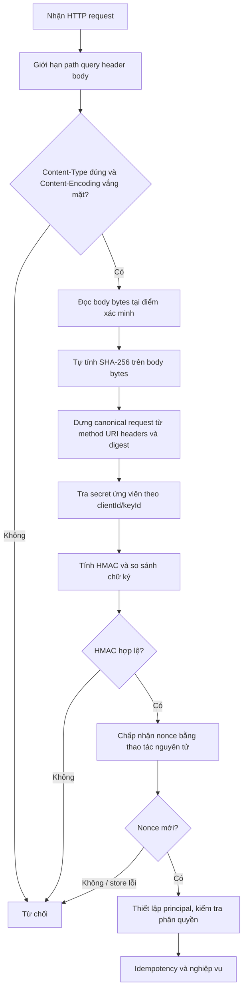

# Content hash

## 1. Content hash là gì trong HMAC request authentication?

**Content hash** là giá trị băm mật mã của phần nội dung (*body/content*) của một HTTP request. Thay vì đưa toàn bộ body dài hàng kilobyte hoặc megabyte vào chuỗi canonical request, một giao thức có thể tính **SHA-256 trên đúng các byte body**, rồi đưa chuỗi biểu diễn digest ấy vào thông điệp được ký HMAC.

```text
HTTP body bytes
      |
      v
 SHA-256(bodyBytes)
      |
      v
 Content hash (32 bytes)
      |
  Lowercase hex
      |
      v
Canonical request = method + URI + signed headers + contentHash
      |
      v
 HMAC-SHA-256(sharedSecret, canonicalRequest)
      |
      v
Signature gửi trong HTTP header
```

Điểm quan trọng nhất là **content hash tự nó không xác thực người gửi**. Ai có body đều có thể tính SHA-256 của body. Trong thiết kế ở bài này, digest trở thành một phần của **canonical request được HMAC bảo vệ bằng shared secret**. Server phải **tự tính lại hash trên body thực nhận** trước khi xác minh chữ ký.

Bài thuộc chương **Body canonicalization**, mô-đun **`SECURITY_AUTHENTICATION_HMAC_REQUEST_AUTHENTICATION`**. Phạm vi mô-đun là xác thực HTTP request bằng HMAC với shared secret, canonical request bao gồm method, URI, headers hoặc body theo hợp đồng ký; người học thực hành xác minh chữ ký, chống replay bằng timestamp/nonce, key rotation, kiểm thử proxy/gateway và phân biệt **authentication** với **authorization**. Chủ đề **Content hash** tập trung vào lớp ràng buộc body vào chữ ký một cách chính xác, không đồng nhất digest với MAC hoặc với JSON object sau parse.

Sau bài này, bạn cần có thể:

- Xác định **đúng byte body** được dùng làm input cho SHA-256.
- Phân biệt **raw digest bytes**, hex, Base64 và kích thước tương ứng.
- Dựng và kiểm thử canonical request có content hash, kể cả **body rỗng**.
- Triển khai Java 17 với `MessageDigest` và `Mac` theo đúng phạm vi mỗi request.
- Xử lý streaming, content coding, proxy/gateway, client retry, key rotation và các lỗi thường gặp.
- Thiết kế test vector độc lập để phát hiện lệch body bytes giữa sender và verifier.

## 2. Phân biệt content hash, checksum và HMAC signature

| Giá trị | Cách tạo | Cần secret? | Chứng minh được gì? |
| --- | --- | --- | --- |
| **Checksum thông thường** | CRC32 hoặc thuật toán kiểm lỗi truyền tải | Không | Phát hiện một số lỗi ngẫu nhiên, không phù hợp làm bằng chứng chống sửa đổi có chủ ý |
| **Content hash SHA-256** | `SHA-256(bodyBytes)` | Không | Định danh digest mật mã của byte body với khả năng chống va chạm mạnh theo giả định thuật toán |
| **HMAC signature** | `HMAC-SHA-256(secret, canonicalBytes)` | **Có** | Bên tạo tag biết secret; bảo vệ toàn vẹn **những byte nằm trong canonical request** |
| **Chữ ký số bất đối xứng** | Ký bằng private key, xác minh bằng public key | Private key | Mô hình tin cậy khác HMAC; không được đồng nhất với shared-secret MAC |

SHA-256 trả về **32 byte (256 bit)**. HMAC-SHA-256 đầy đủ cũng trả **32 byte**, nhưng hai thuật toán thực hiện nhiệm vụ khác nhau; **chúng không thể thay thế nhau** chỉ vì kích thước đầu ra giống nhau.

Một sơ đồ sai thường gặp:

```text
Client: X-Body-Hash = SHA-256(body)
Server: so sánh X-Body-Hash với SHA-256(body)
        -> kết luận request đã được xác thực      // SAI
```

Kẻ tấn công có thể thay body rồi tính lại cả header hash. Một sơ đồ đúng cho HMAC request authentication:

```text
Client:
  contentHash = SHA-256(bodyBytes)
  canonical   = method + URI + headers + hex(contentHash)
  signature   = HMAC(secret, canonical)

Server:
  contentHash = SHA-256(bodyBytes thực nhận)
  canonical   = tự dựng từ request thật + hex(contentHash)
  expected    = HMAC(secret ứng với client/keyId, canonical)
  kiểm tra expected với signature client gửi
```

Server tuyệt đối không dùng **duy nhất** một hash do client khai báo để dựng canonical string nếu chưa đối chiếu với **body thực nhận**.

### 2.1. Vì sao SHA-256 phù hợp để ràng buộc body?

SHA-256 là một hàm băm mật mã được thiết kế với tính chất khó tìm hai thông điệp khác nhau cho cùng digest. Với những hệ thống sử dụng **HMAC-SHA-256 trên canonical request**, dùng SHA-256 cho body hash là một lựa chọn phổ biến, dễ kiểm thử và có trong JDK.

Tuy nhiên, bảo mật toàn bộ cơ chế còn phụ thuộc **bí mật của key HMAC**, quy tắc canonicalization, phân biệt các trường và cách server xử lý request. Digest mạnh không bảo vệ một trường bị bỏ khỏi hợp đồng ký. Hơn nữa, nếu secret bị lộ, đối thủ có thể tính cả content hash **và chữ ký HMAC mới** cho request tùy ý; phải thu hồi/xoay key.

## 3. Content hash ký chính xác những byte nào?

Không nên định nghĩa một cách mơ hồ: “hash JSON body” hoặc “hash object body”. Cần định nghĩa **byte input** tại một điểm trên đường truyền.

Giả sử client gửi:

```http
POST /v1/payments?merchantId=m-42 HTTP/1.1
Host: api.example.test
Content-Type: application/json
X-Client-Id: client-42
X-Key-Id: key-demo-01
X-Timestamp: 1795856400
X-Nonce: AAAAAAAAAAAAAAAAAAAAAA
X-Signature: <base64-hmac-sha256>

{"orderId":"O-42","amount":250000,"currency":"VND"}
```

Với hợp đồng minh họa của bài:

1. Client serialize JSON thành **`byte[]` UTF-8 đúng một lần**.
2. Body được gửi **không nén**; `Content-Encoding` phải vắng mặt.
3. Content hash là **`SHA-256` của 51 byte body** trong ví dụ, **không có LF cuối**.
4. HTTP stack có thể thay framing vận chuyển, nhưng không được thay byte nội dung giữa sender và verifier.
5. Verifier tính hash trên **byte body nhận được sau xử lý HTTP framing, trước JSON parsing, charset conversion hoặc serialization lại**.
6. Phần body hash xuất hiện dưới dạng **64 ký tự hex lowercase** trong canonical request; không lấy từ một object JSON đã parse.

Nếu framework đọc request vào `PaymentDto` rồi serialize lại để hash, byte có thể đổi vì thứ tự key, khoảng trắng, numeric representation hoặc các field chưa biết. Đó là **một hợp đồng khác** với ký raw body bytes.

### 3.1. Cùng ý nghĩa JSON nhưng khác content hash

Hai chuỗi sau có thể mang thông tin nghiệp vụ tương đương:

```json
{"amount":250000,"currency":"VND"}
```

```json
{ "currency": "VND", "amount": 250000 }
```

Tuy nhiên, SHA-256 tính từ hai dãy byte khác nhau thường sẽ khác. Ngay cả cùng một JSON object, những thay đổi nhỏ cũng quan trọng:

- Có hoặc không có dấu xuống dòng cuối.
- Khoảng trắng sau dấu phẩy hoặc dấu hai chấm.
- Thứ tự property trong JSON.
- Chuỗi Unicode được ghi trực tiếp hay dưới dạng `\uXXXX`.
- Số được ghi thành `1`, `1.0` hoặc `1e0`.
- Một bên dùng UTF-8, bên kia chuyển mã sang UTF-16.
- Chuỗi chứa hai dạng Unicode có hình ảnh tương tự nhưng code point khác nhau.

Với hợp đồng **raw-body hash**, không được coi những cách biểu diễn trên là cùng byte. Nếu API muốn signature **bất biến theo cách serialize JSON**, cần một **hợp đồng canonical JSON riêng** (ví dụ một scheme canonical JSON được hai phía thực thi đúng), quản lý parser và duplicate object members. **Không tự “thử thêm” bước parse/serialize khi hash raw bytes không khớp**, vì có thể tạo sự mâu thuẫn giữa dữ liệu xác thực và dữ liệu nghiệp vụ.

## 4. Độ dài content hash và cách biểu diễn

Đầu ra của `MessageDigest.getInstance("SHA-256").digest(bodyBytes)` là **mảng 32 byte**. Để đưa vào canonical string hoặc header, phải chọn encoding cố định theo **phiên bản hợp đồng**.

| Cách biểu diễn SHA-256 | Độ dài | Ý nghĩa |
| --- | --- | --- |
| Raw digest | **32 byte** | Kết quả mật mã của SHA-256 |
| Hex lowercase | **64 ký tự ASCII** | Hai ký tự hex cho mỗi byte, ví dụ `e3b0...` |
| Base64 chuẩn có padding | **44 ký tự ASCII** | Mã hóa 32 byte bằng alphabet Base64 và dấu `=` cuối |
| Base64URL không padding | **43 ký tự ASCII** | Dùng `-`, `_` thay cho `+`, `/`; bỏ padding |
| Hex uppercase | **64 ký tự ASCII** | Vẫn cùng 32 byte nhưng canonical text **khác** hex lowercase |

**Không ký số ký tự theo cảm giác.** Content hash dài 64 ký tự hex không có nghĩa là SHA-256 có đầu ra 64 byte. Nếu client ký lowercase hex mà server dùng uppercase hex, canonical request **khác byte**, dù digest thô giống nhau.

Ví dụ chuyển digest thành hex trong Java 17:

```java
import java.security.MessageDigest;
import java.util.HexFormat;

byte[] digest =
        MessageDigest.getInstance("SHA-256").digest(bodyBytes);
String lowercaseHex = HexFormat.of().formatHex(digest);
```

Hợp đồng mẫu dùng **hex lowercase** và luôn tạo giá trị đó bằng cách encode **raw 32-byte digest**. Không dùng `byte[].toString()`, không đưa `Arrays.toString(digest)` vào canonical string, không ép digest thành UTF-8 text.

### 4.1. Có nên nhận nhiều encoding cho cùng content hash?

Thường **không** nếu hợp đồng chỉ quy định một cách biểu diễn. Tự chấp nhận cả hex uppercase/lowercase, Base64/hex hoặc prefix thuật toán không rõ ràng làm tăng biến thể cần kiểm thử. Mỗi phiên bản cần nói rõ:

- Thuật toán băm (`SHA-256`).
- Input bytes.
- Encoding chính xác (`hex lowercase`).
- Vị trí content hash trong canonical request.
- Xử lý body rỗng.
- Giới hạn size, content coding và thứ tự các trường được ký.

Nếu hệ thống có nhu cầu nâng thuật toán hoặc thay định dạng digest, nên **version** hợp đồng, không đoán algorithm từ chuỗi do client gửi.

## 5. Test vector cơ bản: body 51 byte và body rỗng

### 5.1. Body JSON cố định

Body test là **đúng 51 byte ASCII/UTF-8**, không có byte xuống dòng cuối:

```json
{"orderId":"O-42","amount":250000,"currency":"VND"}
```

SHA-256 tương ứng ở dạng **hex lowercase**:

```text
ea646bb8b1903a83256034142a633e90ffad35b3a40bb4c5f0e8f1eb4f4f27f9
```

Một cách thử sai có chủ đích là thêm `LF` sau `}`: body mới dài **52 byte** và có content hash khác. Mọi đơn vị trong pipeline phải biết rằng dấu LF ở phần trình bày Markdown **không thuộc body test**; trong code, nên tạo byte từ literal `String` không có `\n` cuối.

### 5.2. SHA-256 của body rỗng

Nếu request thực sự không có body (0 byte), input là **mảng rỗng**, không phải text `""` có dấu ngoặc kép, không phải `{}`, không phải `null` và không phải newline:

```text
SHA-256(empty byte[]) =
e3b0c44298fc1c149afbf4c8996fb92427ae41e4649b934ca495991b7852b855
```

**Body không có và body dài 0 byte** có thể được một hợp đồng ký ứng dụng xem như cùng byte content, nhưng điều đó không tự làm hai request tương đương về mọi header hoặc HTTP semantics. Nếu ứng dụng cần phân biệt chúng, phải đưa sự phân biệt ấy vào hợp đồng ký dưới dạng một trường khác.

### 5.3. Trường hợp một byte cũng rất quan trọng

```text
body = UTF8("{\"amount\":250000}")       -> SHA-256(body)
body = UTF8("{\"amount\":250001}")       -> SHA-256(body khác)
body = UTF8("{\"amount\":250000}\n")    -> SHA-256(body có LF cuối)
```

Cả ba đều là chuỗi JSON hoặc JSON kèm whitespace hợp lệ, nhưng **không có cùng content hash**. Test phải so đúng byte, thay vì chỉ parse JSON rồi so object.

## 6. Đưa content hash vào canonical request và HMAC

Một content hash đứng riêng không chống sửa đổi có chủ ý. Ta cần **đưa content hash vào thông điệp được ký HMAC**, đồng thời ràng buộc các trường HTTP xác định ý nghĩa request.

Hợp đồng minh họa **`HMAC-SHA256-V1`**:

| Thành phần | Quy tắc |
| --- | --- |
| Version | Dòng chữ `HMAC-SHA256-V1` |
| Method | `POST` |
| Raw public path | `/v1/payments` |
| Raw public query | `merchantId=m-42`, không gồm dấu `?` |
| Content-Type | `content-type:application/json` |
| Client ID | `x-client-id:client-42` |
| Key ID | `x-key-id:key-demo-01` |
| Timestamp | `x-timestamp:1795856400` (Unix seconds; test only) |
| Nonce | `x-nonce:AAAAAAAAAAAAAAAAAAAAAA` (test only) |
| Content hash | SHA-256 trên đúng 51 byte body, biểu diễn hex lowercase |
| Cấu trúc | **10 dòng**, nối bởi **LF (`\n`)**, **không có LF cuối** |
| HMAC | `HmacSHA256` đầy đủ 32 byte |
| Signature output | Base64 chuẩn có padding của raw HMAC tag |

Canonical request:

```text
HMAC-SHA256-V1
POST
/v1/payments
merchantId=m-42
content-type:application/json
x-client-id:client-42
x-key-id:key-demo-01
x-timestamp:1795856400
x-nonce:AAAAAAAAAAAAAAAAAAAAAA
ea646bb8b1903a83256034142a633e90ffad35b3a40bb4c5f0e8f1eb4f4f27f9
```

Với **secret test công khai**, gồm 32 byte ASCII:

```text
0123456789abcdef0123456789abcdef
```

HMAC-SHA-256(Base64) của canonical request ở trên:

```text
GMGNFyHLvQHRH53KE9+jTILR1qc0HauQJiX06bXm1n0=
```

Hãy dùng vector này để kiểm tra **đầu ra của hai implementation độc lập**. Nếu body hash không đúng trước, **đừng** điều tra `Mac` ngay; cần xem lại body bytes, dấu LF, charset, compression và pipeline HTTP.

**Các giá trị khóa, nonce và timestamp ở đây không an toàn để dùng production**. Trong ứng dụng thật, sender phải có secret ngẫu nhiên đủ entropy, timestamp hiện tại và nonce mới từ CSPRNG cho từng request.

### 6.1. Những byte nào **không** tự được bảo vệ?

Ví dụ chỉ ký các trường nêu ở bảng. Những header khác có thể ảnh hưởng nghiệp vụ như `Idempotency-Key`, `X-Tenant-Id`, `Content-Encoding` hoặc `Host` nếu được dùng để route/diễn giải dữ liệu thì **phải được ký hoặc bảo vệ bằng ranh giới tin cậy khác**. Đặc biệt, ở V1 này `Content-Encoding` không được phép xuất hiện nên server phải **từ chối** request nén, chứ không mặc định chấp nhận.

Không đưa chính `X-Signature` vào canonical request khiến chữ ký phụ thuộc vòng vào chính nó. Algorithm, tag length, version và cách tạo content hash phải được quyết định theo **cấu hình hợp đồng đáng tin cậy**, không để một trường không ký của client tự hạ mức xác minh.

## 7. Java 17: tạo digest và HMAC từ đúng body bytes

Ví dụ dưới đây trình bày một utility có **`MessageDigest` và `Mac` local theo mỗi lần gọi**. Phần canonical request cố định endpoint thanh toán mẫu để tập trung vào content hash; production cần validate toàn bộ method, URI, signed headers và những ranh giới gateway trước khi dùng chung cho nhiều endpoint.

```java
import java.nio.charset.StandardCharsets;
import java.security.GeneralSecurityException;
import java.security.MessageDigest;
import java.util.Base64;
import java.util.HexFormat;
import java.util.Objects;
import javax.crypto.Mac;
import javax.crypto.spec.SecretKeySpec;

public final class ContentHashHmacV1 {
    private static final String MAC_ALGORITHM = "HmacSHA256";
    private static final int MAC_BYTES = 32;
    private static final int BASE64_CHARS = 44;

    private ContentHashHmacV1() {}

    public static byte[] sha256(byte[] bodyBytes)
            throws GeneralSecurityException {
        Objects.requireNonNull(bodyBytes, "bodyBytes");
        return MessageDigest.getInstance("SHA-256")
                .digest(bodyBytes);
    }

    public static String contentHashHex(byte[] bodyBytes)
            throws GeneralSecurityException {
        return HexFormat.of().formatHex(sha256(bodyBytes));
    }

    public static String canonicalRequest(byte[] bodyBytes,
                                          String clientId,
                                          String keyId,
                                          String timestampSeconds,
                                          String nonce)
            throws GeneralSecurityException {
        requireId(clientId);
        requireId(keyId);
        if (timestampSeconds == null
                || !timestampSeconds.matches("[0-9]{1,20}")
                || nonce == null
                || !nonce.matches("[A-Za-z0-9_-]{22}")) {
            throw new IllegalArgumentException(
                    "Invalid timestamp/nonce syntax");
        }

        return String.join("\n",
                "HMAC-SHA256-V1",
                "POST",
                "/v1/payments",
                "merchantId=m-42",
                "content-type:application/json",
                "x-client-id:" + clientId,
                "x-key-id:" + keyId,
                "x-timestamp:" + timestampSeconds,
                "x-nonce:" + nonce,
                contentHashHex(bodyBytes));
    }

    public static byte[] rawSignature(byte[] secret,
                                       String canonical)
            throws GeneralSecurityException {
        Objects.requireNonNull(secret, "secret");
        Objects.requireNonNull(canonical, "canonical");
        if (secret.length == 0) {
            throw new IllegalArgumentException("Empty shared secret");
        }

        Mac mac = Mac.getInstance(MAC_ALGORITHM);
        mac.init(new SecretKeySpec(secret, MAC_ALGORITHM));
        return mac.doFinal(canonical.getBytes(StandardCharsets.UTF_8));
    }

    public static String signatureBase64(byte[] secret,
                                          String canonical)
            throws GeneralSecurityException {
        return Base64.getEncoder().encodeToString(
                rawSignature(secret, canonical));
    }

    public static boolean verifySignature(byte[] secret,
                                           String canonical,
                                           String suppliedBase64)
            throws GeneralSecurityException {
        if (suppliedBase64 == null
                || suppliedBase64.length() != BASE64_CHARS) {
            return false;
        }

        final byte[] suppliedTag;
        try {
            suppliedTag = Base64.getDecoder().decode(suppliedBase64);
        } catch (IllegalArgumentException invalidEncoding) {
            return false;
        }

        if (suppliedTag.length != MAC_BYTES) {
            return false;
        }

        // Hợp đồng buộc Base64 chuẩn có padding, biểu diễn chính tắc.
        if (!Base64.getEncoder().encodeToString(suppliedTag)
                .equals(suppliedBase64)) {
            return false;
        }

        byte[] expectedTag = rawSignature(secret, canonical);
        return MessageDigest.isEqual(expectedTag, suppliedTag);
    }

    private static void requireId(String value) {
        if (value == null
                || !value.matches("[A-Za-z0-9._-]{1,80}")) {
            throw new IllegalArgumentException(
                    "Invalid client/key ID");
        }
    }
}
```

**Giới hạn bảo mật của ví dụ:**

1. `canonicalRequest` cố định `POST /v1/payments?merchantId=m-42` và `Content-Type`; không được dùng nó để kiểm tra những request có path/query/body semantics khác. Ứng dụng thật phải tự dựng từ **HTTP request thực nhận** tại ranh giới đúng.
2. `verifySignature` chỉ xác minh **byte HMAC** cho canonical string mà caller cung cấp. Nó **không tự** kiểm tra timestamp, nonce replay, key rotation hoặc authorization.
3. Server phải dùng **body bytes thực nhận** để gọi `canonicalRequest`, không nhận một digest do client tự khai báo và coi đó là nội dung đã được kiểm tra.
4. `MessageDigest.isEqual` được dùng để so sánh byte tag theo cách phù hợp hơn vòng lặp tự viết dừng sớm; đầu vào sai cú pháp và sai độ dài được từ chối trước bước này.
5. Secret dùng cho HMAC phải được bảo vệ; không hard-code trong source, không log, không dùng giá trị test ở mục 6.

### 7.1. Đối chiếu test vector bằng Java

```java
import java.nio.charset.StandardCharsets;

byte[] bodyBytes = (
        "{\"orderId\":\"O-42\",\"amount\":250000,\"currency\":\"VND\"}"
).getBytes(StandardCharsets.UTF_8);

String digest = ContentHashHmacV1.contentHashHex(bodyBytes);
if (!digest.equals(
        "ea646bb8b1903a83256034142a633e90ffad35b3a40bb4c5f0e8f1eb4f4f27f9")) {
    throw new AssertionError("Incorrect content hash");
}

String canonical = ContentHashHmacV1.canonicalRequest(
        bodyBytes, "client-42", "key-demo-01",
        "1795856400", "AAAAAAAAAAAAAAAAAAAAAA");

byte[] testSecret = (
        "0123456789abcdef0123456789abcdef"
).getBytes(StandardCharsets.US_ASCII);

String actualTag = ContentHashHmacV1.signatureBase64(
        testSecret, canonical);

if (!actualTag.equals(
        "GMGNFyHLvQHRH53KE9+jTILR1qc0HauQJiX06bXm1n0=")) {
    throw new AssertionError("Incorrect canonical HMAC");
}
```

Đây là **mã minh họa test logic**, không phải một chương trình `main` hoàn chỉnh. Khi tích hợp với JUnit, nên dùng assertion thay vì `throw new AssertionError` thủ công. Bộ fixture cũng nên lưu **canonical bytes thật** (hoặc hex dump) để phát hiện lỗi newline/encoding nếu digest và HMAC khác.

## 8. Gửi HTTP request: hash đúng byte sẽ được phát

Một lỗi rất phổ biến là:

```text
1. Serialize object thành JSON A.
2. Tính SHA-256(JSON A), ký HMAC.
3. HTTP client lại serialize object thành JSON B khi gửi.
4. Server tính SHA-256(JSON B) và từ chối vì khác digest.
```

Ngay cả khi A và B đại diện cùng dữ liệu nghiệp vụ, chúng không nhất thiết có cùng byte. Với Java `HttpClient`, một cách đơn giản là dùng **một byte array cố định** cho cả hash và body publisher:

```java
import java.net.URI;
import java.net.http.HttpRequest;
import java.nio.charset.StandardCharsets;
import java.security.SecureRandom;
import java.time.Instant;
import java.util.Base64;

byte[] bodyBytes = (
        "{\"orderId\":\"O-42\",\"amount\":250000,\"currency\":\"VND\"}"
).getBytes(StandardCharsets.UTF_8);

// secretBytes tra từ secret manager, tương ứng keyId đã chọn.
String clientId = "client-42";
String keyId = "key-demo-01";
String timestamp = Long.toString(Instant.now().getEpochSecond());

byte[] nonceBytes = new byte[16];
new SecureRandom().nextBytes(nonceBytes);
String nonce = Base64.getUrlEncoder().withoutPadding()
        .encodeToString(nonceBytes);

String canonical = ContentHashHmacV1.canonicalRequest(
        bodyBytes, clientId, keyId, timestamp, nonce);
String signature = ContentHashHmacV1.signatureBase64(
        secretBytes, canonical);

HttpRequest request = HttpRequest.newBuilder(
        URI.create("https://api.example.test/v1/payments?merchantId=m-42"))
        .header("Content-Type", "application/json")
        .header("X-Client-Id", clientId)
        .header("X-Key-Id", keyId)
        .header("X-Timestamp", timestamp)
        .header("X-Nonce", nonce)
        .header("X-Signature", signature)
        .POST(HttpRequest.BodyPublishers.ofByteArray(bodyBytes))
        .build();
```

Bước quan trọng là `BodyPublishers.ofByteArray(bodyBytes)` sử dụng **chính mảng byte đã hash**. Từ lúc tính signature đến lúc gửi, không sửa nội dung mảng này; nếu có retry cần ký lại với timestamp/nonce mới theo chính sách. Ví dụ giữ riêng `secretBytes` vì quản lý khóa là trách nhiệm của tầng secret management.

Không để HTTP middleware **thay JSON, thêm newline, nén body hoặc đổi charset** sau khi ký mà không định nghĩa rõ những biến đổi đó trong hợp đồng.

## 9. Server phải tự tính content hash từ body thực nhận

Một verifier an toàn nên tách các bước: kiểm tra cấu trúc request, giới hạn kích thước, lấy body bytes, hash, canonicalize, xác minh HMAC, kiểm replay rồi phân quyền.



**Không làm thế này** khi hợp đồng ký hash của raw body:

```java
// SAI: ký bản JSON do server tạo lại, có thể khác payload gốc.
PaymentDto payment = objectMapper.readValue(bodyBytes, PaymentDto.class);
byte[] reconstructed = objectMapper.writeValueAsBytes(payment);
String hash = ContentHashHmacV1.contentHashHex(reconstructed);
```

Tầng xác thực phải hash `bodyBytes` mà HTTP server nhận. Sau khi xác minh chữ ký, downstream parse **chính payload đã được kiểm tra**, và validate schema/kiểu dữ liệu/ràng buộc nghiệp vụ như bình thường.

### 9.1. Header content hash do client gửi có được tin không?

Một API đôi khi có header custom:

```http
X-Content-SHA256: ea646bb8b1903a83256034142a633e90ffad35b3a40bb4c5f0e8f1eb4f4f27f9
```

Header giúp debug hoặc tương thích một giao thức đã định, nhưng server phải:

1. Tự tính digest trên body thực nhận.
2. Kiểm tra giá trị header, nếu được hợp đồng sử dụng, theo **đúng format và độ dài**; so với digest do server tính.
3. Dựng canonical request bằng digest **đã được xác minh**, không mặc định tin header.
4. Nếu header có tác động độc lập đến xử lý nghiệp vụ, phải đưa nó vào hợp đồng ký hoặc ràng buộc vào content hash đã ký.

Không nên tạo hai “nguồn sự thật” khác nhau: ví dụ verifier dùng `X-Content-SHA256` nhưng downstream xử lý body mới, hoặc server tin header `Content-Length` do client khai báo như bằng chứng body đã được bảo vệ. **Digest phải gắn với body bytes thực nhận**, không chỉ với metadata.

## 10. Content hash và việc truyền body lớn bằng streaming

Với file hàng trăm megabyte, tải toàn bộ body vào RAM chỉ để tạo SHA-256 có thể không phù hợp. `MessageDigest` trong JCA hỗ trợ **incremental hashing** qua `update(...)`.

```java
import java.io.IOException;
import java.io.InputStream;
import java.security.GeneralSecurityException;
import java.security.MessageDigest;
import java.util.HexFormat;
import java.util.Objects;

public final class StreamingContentHash {
    private StreamingContentHash() {}

    public static String sha256HexBounded(
            InputStream input, long maxBytes)
            throws IOException, GeneralSecurityException {
        Objects.requireNonNull(input, "input");
        if (maxBytes < 0) {
            throw new IllegalArgumentException("Negative maxBytes");
        }

        MessageDigest sha = MessageDigest.getInstance("SHA-256");
        byte[] buffer = new byte[8192];
        long total = 0;
        int n;

        // InputStream do caller sở hữu; hàm này không close input.
        while ((n = input.read(buffer)) != -1) {
            if (n == 0) {
                continue;
            }
            if (n > maxBytes - total) {
                throw new IOException("Body exceeds configured limit");
            }
            sha.update(buffer, 0, n);
            total += n;
        }
        return HexFormat.of().formatHex(sha.digest());
    }
}
```

Điểm kỹ thuật:

- `MessageDigest` được tạo **local**; state của một request không bị lẫn với request khác.
- `maxBytes` giới hạn dữ liệu đã đọc **trước khi chuyển hết vào bộ nhớ**; HTTP gateway/server cũng phải áp dụng giới hạn riêng.
- Mỗi chunk được hash **theo thứ tự nhận**, không hash riêng từng chunk rồi ghép các digest.
- `InputStream` đã bị tiêu thụ sau khi hash. Server cần thiết kế cách cho business layer nhận **chính dữ liệu đã xác minh**: có thể spool vào vùng lưu trữ tạm có kiểm soát hoặc xử lý trong một pipeline được ràng buộc đúng.
- Trên client, nếu phải đưa content hash vào **signature header trước khi gửi request**, thường cần hash file trước **một lượt**, rồi gửi lại **cùng snapshot byte không đổi**. Nếu file bị thay giữa hai lượt, chữ ký sẽ thất bại.
- Ví dụ chỉ tính digest; HTTP framing, content coding, ghi nonce và quản lý secret nằm ngoài hàm.

### 10.1. Vì sao SHA-256 của từng chunk rồi nối lại không đúng?

```text
Đúng:
  SHA-256(chunk1 || chunk2 || chunk3)

Sai (không tương đương):
  SHA-256(chunk1) || SHA-256(chunk2) || SHA-256(chunk3)
  SHA-256(SHA-256(chunk1) || SHA-256(chunk2))
```

Nếu hợp đồng sử dụng hash của toàn bộ body, phải cập nhật **cùng một `MessageDigest`** bằng các byte liên tiếp, rồi gọi `digest()` **một lần** khi đã nhận đủ body. Kỹ thuật content-addressable hoặc Merkle tree có thể hữu ích cho hệ thống khác nhưng cần giao thức riêng, không tự thay được SHA-256(body).

## 11. Content coding, transfer framing và proxy/gateway

Content hash chỉ có ý nghĩa nếu cả hai phía nhất quán về **điểm lấy byte**. Đừng nhầm **HTTP transfer framing** với **content coding**:

- Với HTTP/1.1 `Transfer-Encoding: chunked`, marker kích thước chunk là phần **framing vận chuyển**, không phải JSON body bytes ứng dụng. Đổi cách chia chunk mà giữ nguyên content bytes **không** nên làm thay SHA-256(content bytes).
- Với `Content-Encoding: gzip`, byte của message content có thể là **dữ liệu nén**. Nếu client hash byte nén nhưng gateway giải nén trước khi verifier đọc body, digest sẽ khác.
- `Content-Type`/`charset` xác định ý nghĩa body khi parser diễn giải. Nếu một middleware đổi encoding hoặc serialize lại body, content hash thay đổi nếu hash đúng raw bytes.

Hợp đồng `HMAC-SHA256-V1` trong bài chọn **không cho phép `Content-Encoding`**, xác minh raw content bytes trước khi JSON parse. API có nhu cầu gzip phải **định nghĩa phiên bản ký khác** nêu rõ body hash được tính trước hay sau content decoding, cách xử lý content-encoding header và mọi proxy có thể biến đổi payload.

| Tình huống | Body hash trong V1 | Hướng xử lý |
| --- | --- | --- |
| HTTP/1.1 chunked → HTTP/2 framing, content giữ nguyên | **Không đổi** | Tính trên content bytes sau HTTP framing |
| Gateway thêm một newline vào JSON | **Đổi** | Không để gateway sửa body đã ký |
| Gateway format lại JSON | **Đổi** | Xác minh trước rewrite hoặc bảo toàn byte |
| Proxy giải nén gzip | V1 **từ chối request nén** | Muốn hỗ trợ nén cần hợp đồng mới |
| HTTP client tự dùng charset khác | **Đổi** | Serialize và gửi đúng UTF-8 byte đã hash |
| Proxy sửa `Content-Type` đã ký | Canonical request khác | Thống nhất và bảo toàn header được ký |
| Body bị cắt bớt | **Đổi** nếu hash trên body thực nhận | Giới hạn/kiểm tra framing, từ chối request không đầy đủ |
| Gateway đổi public URI nhưng body giữ nguyên | Body hash không đổi, **HMAC có thể đổi** | Kiểm tra method/URI canonical ở ranh giới đúng |

### 11.1. Chọn điểm xác minh

Có hai cách kiến trúc thường gặp:

**Xác minh tại gateway trước khi có biến đổi:** gateway nhìn thấy public method/URI, headers và body bytes theo hợp đồng; tính hash, xác minh HMAC rồi chuyển principal đã xác thực sang backend qua kênh tin cậy. Backend không được tin một header nhận diện client do Internet tự đặt.

**Xác minh tại backend:** gateway phải bảo toàn body bytes và những thành phần canonical khác hoặc truyền metadata đáng tin cậy có bảo vệ; backend cần biết chính xác byte nào client đã ký. Không sử dụng `X-Original-Body-Hash` hoặc `X-Original-URI` do client tự khai báo như bằng chứng về payload gốc.

**Yêu cầu xuyên tầng:** downstream phải xử lý **cùng nội dung đã được xác minh**. Nếu verifier hash một bản, rồi gateway/filter thay body trước business logic, chữ ký hợp lệ cũng không chứng minh nội dung thực thi là nội dung đã ký.

## 12. Content hash với loại body khác JSON

Không chỉ JSON mới có content hash. Cùng nguyên tắc áp dụng cho dữ liệu nhị phân, multipart, form-data, protobuf và file upload.

| Loại body | Đầu vào SHA-256 theo hợp đồng raw-body | Rủi ro |
| --- | --- | --- |
| `application/json` | Chính byte JSON UTF-8 phát đi | Serializer/whitespace/property order |
| `text/plain` | Chính byte text theo charset đã thống nhất | LF vs CRLF, Unicode, charset |
| `application/octet-stream` | Byte nhị phân | Không đọc như text hay sửa newline |
| `multipart/form-data` | Toàn bộ multipart content bytes, bao gồm boundary và part headers | Client library tự sinh boundary hoặc thứ tự part |
| `application/x-www-form-urlencoded` | Byte form-encoded, không phải `Map` đã parse | `+`/`%20`, thứ tự và duplicate keys |
| Protobuf hoặc CBOR | Chính byte serialization | Thứ tự/trình bày không canonical nếu schema/encoder thay đổi |

### 12.1. Multipart boundary và upload

Hai request multipart chứa cùng file có thể có boundary khác nhau:

```text
Content-Type: multipart/form-data; boundary=----BOUNDARY_A
... multipart body bytes using BOUNDARY_A ...

Content-Type: multipart/form-data; boundary=----BOUNDARY_B
... multipart body bytes using BOUNDARY_B ...
```

Nếu hợp đồng ký **raw multipart bytes**, boundary và bytes các part **đều nằm trong content hash**. Client phải chốt boundary và thứ tự nội dung trước khi ký; server hash chính bytes đã nhận. Không parse multipart thành `Map` rồi dựng lại một body mới để hash, trừ khi có một **hợp đồng canonical multipart khác**.

### 12.2. Body rỗng của GET/DELETE

Một số endpoint GET không có body, nhưng không nên mặc định mọi `DELETE` hoặc `OPTIONS` đều có body rỗng. Hợp đồng phải nêu request body có được phép không, nếu có thì hash ra sao. Nếu policy cấm body, hãy **từ chối body không được phép** trước khi xác minh theo nội dung không đúng hợp đồng.

Với request thực sự dùng **0 byte**, SHA-256(empty) là vector ở mục 5; không được thay bằng hash của JSON `{}` hoặc chuỗi `null`.

## 13. Replay, key rotation, authorization và idempotency

### 13.1. Content hash không chống phát lại

Một request có body hash đúng và HMAC hợp lệ vẫn có thể bị **phát lại nguyên vẹn**. Kẻ tấn công không cần sửa body, nên tất cả digest và signature vẫn khớp.

Cơ chế bảo vệ cần:

1. **Timestamp và nonce phải được ký** trong canonical request.
2. Server kiểm tra timestamp trong cửa sổ chấp nhận.
3. Server xác minh HMAC trên content hash do mình tính lại.
4. **Chỉ sau khi chữ ký hợp lệ**, server ghi nonce theo principal bằng thao tác **atomic insert-if-absent** ở kho dùng chung; nonce đã sử dụng bị từ chối.
5. Retry có chủ đích cần timestamp/nonce/chữ ký mới. Với thanh toán, **idempotency key** giữ ổn định cho cùng ý định nghiệp vụ và cần được bảo vệ theo hợp đồng ký.

Body giống nhau **không đồng nghĩa request là replay**: hai thao tác độc lập có thể gửi đúng cùng JSON. Nonce phân biệt **lần gửi**, còn idempotency key phân biệt **ý định nghiệp vụ**.

### 13.2. Xoay khóa ảnh hưởng signature nhưng không ảnh hưởng digest

Giả sử cùng một dãy 51 byte body:

```text
SHA-256(bodyBytes) -> contentHash giống nhau

HMAC(secret_A, canonicalRequest_A) -> signature_A
HMAC(secret_B, canonicalRequest_B) -> signature_B
```

Khi chuyển từ `keyId A` sang `keyId B`, body hash **không đổi** nếu byte không đổi. Signature HMAC thay đổi do secret và key ID được ràng buộc vào canonical request. Server phải chọn secret **đúng client/keyId**, kiểm tra thời hạn hiệu lực và thu hồi; không giữ một `Mac` mutable đã `init` với khóa cũ để dùng nhầm cho request mới.

Nếu secret bị lộ, người tấn công có thể tạo body mới, digest mới và HMAC mới. Chỉ đổi body hash algorithm không thay thế **thu hồi/xoay secret**.

### 13.3. Phân quyền là bước riêng

HMAC hợp lệ chứng minh bên gửi có secret tương ứng và những byte đã ký còn nguyên vẹn. Nó **không chứng minh client có quyền** tạo giao dịch cho `merchantId=m-99` hay xem dữ liệu tenant khác. Sau xác thực, server phải kiểm tra quyền từ principal, scope và tài nguyên thực tế; body cũng cần schema/business validation (`amount > 0`, currency hợp lệ, idempotency key…).

## 14. Ma trận kiểm thử content hash

Bộ kiểm thử nên có **expected digest từ vector độc lập**, và nên so sánh **canonical bytes** chứ không chỉ để signer tự gọi verifier của chính nó.

| Ca kiểm thử | Input/biến đổi | Kỳ vọng |
| --- | --- | --- |
| Vector body 51 byte | JSON chính xác ở mục 5 | Digest hex đúng vector |
| Body rỗng | Input 0 byte | SHA-256 bằng `e3b0...b855` |
| Body `{}` | Hai byte `{` và `}` | Digest **khác** body rỗng |
| Thêm LF cuối | Thêm byte `0x0A` | Hash và HMAC thay đổi |
| CRLF vs LF | Đổi line ending trong text | Hash thay đổi |
| Đổi một chữ số | `250000` → `250001` | Hash/HMAC thay đổi |
| JSON thêm whitespace | Không đổi object semantics | Hash thay đổi trong raw-body contract |
| Đảo JSON fields | Cùng dữ liệu nghiệp vụ | Hash khác nếu byte khác |
| Unicode escape | `é` vs `\u00e9` trong JSON | Hash khác nếu byte khác |
| UTF-8 vs UTF-16 | Re-encode cùng text | Hash khác hoặc bị policy từ chối |
| Binary body | Byte `0x00`, `0xFF` và dữ liệu bất kỳ | Hash đúng byte, không convert thành String |
| Header digest giả | Client thay `X-Content-SHA256` nhưng giữ body | Server tự tính và từ chối header không khớp |
| Body bị sửa sau khi ký | Thay body giữ signature | HMAC không khớp |
| Content-Encoding gzip | Header/body dùng gzip trong V1 | Từ chối vì contract cấm coding |
| Gateway JSON rewrite | Proxy serialize lại JSON | Test phát hiện khác byte |
| Thay transfer framing | Chunked → HTTP/2 nhưng content giữ nguyên | Hash giữ nguyên |
| Streaming vs one-shot | `MessageDigest.update` theo chunk vs `digest(all)` | Digest giống hệt |
| Stream đọc thiếu | Dừng trước byte cuối | Hash khác; kiểm soát framing và lỗi transport |
| Body vượt giới hạn | Tải vượt `maxBytes` | Từ chối trước khi dùng nhiều tài nguyên |
| Test vector HMAC | 10 dòng canonical + secret test | Signature đúng giá trị `GMGN...` |
| Sửa method/URI/header | Body hash giữ nguyên | HMAC phải từ chối khi trường đã ký thay đổi |
| Timestamp ngoài cửa sổ | HMAC hợp lệ của request quá hạn | Từ chối theo policy |
| Replay nonce | Gửi lại request hợp lệ đã dùng nonce | Replay store từ chối |
| Key rotation | Secret mới + key ID mới | Body digest giữ nguyên, HMAC khác |
| Thiếu quyền | HMAC đúng, merchant không thuộc client | Authorization từ chối |
| Concurrency | Nhiều request với body/key khác nhau | Không lẫn `MessageDigest`/`Mac` state |
| Multipart boundary | Cùng file nhưng boundary khác | Raw-body hash khác |

### 14.1. Một số assertion Java thiết yếu

```java
import static org.junit.jupiter.api.Assertions.*;
import java.nio.charset.StandardCharsets;
import java.security.MessageDigest;
import org.junit.jupiter.api.Test;

class ContentHashHmacV1Test {
    @Test
    void emptyBodyHasKnownDigest() throws Exception {
        assertEquals(
                "e3b0c44298fc1c149afbf4c8996fb92427ae41e4649b934ca495991b7852b855",
                ContentHashHmacV1.contentHashHex(new byte[0]));
    }

    @Test
    void oneExtraNewlineChangesDigest() throws Exception {
        byte[] withoutLf = "{}".getBytes(StandardCharsets.UTF_8);
        byte[] withLf = "{}\n".getBytes(StandardCharsets.UTF_8);

        assertNotEquals(
                ContentHashHmacV1.contentHashHex(withoutLf),
                ContentHashHmacV1.contentHashHex(withLf));
    }

    @Test
    void incrementalAndOneShotHashAgree() throws Exception {
        byte[] all = "abc123".getBytes(StandardCharsets.UTF_8);
        MessageDigest digest = MessageDigest.getInstance("SHA-256");

        digest.update(all, 0, 2);
        digest.update(all, 2, all.length - 2);
        byte[] incremental = digest.digest();

        assertArrayEquals(ContentHashHmacV1.sha256(all), incremental);
    }
}
```

Các test dùng **JUnit 5** và chỉ minh họa; dự án cần có dependency JUnit tương ứng. Để xác minh toàn tuyến, hãy kiểm thử thêm raw HTTP request được phát thật, xử lý proxy, body buffering ở Spring/Servlet và các tình huống thất bại của replay store.

### 14.2. Kiểm thử tích hợp theo đường đi

```text
Java sender
  -> HTTP client/interceptors
  -> TLS / API gateway
  -> reverse proxy / HTTP server
  -> body capture + SHA-256
  -> canonical request + HMAC verifier
  -> JSON parser
  -> authorization + business handler
```

Với mỗi điểm có thể biến đổi body, cần **test fixture** chứng minh byte mà verifier hash **là cùng byte mà sender đã ký**. Khi debug trong môi trường an toàn, có thể so `SHA-256` từng chặng và byte fixture. Production không nên log body nhạy cảm hoặc chữ ký HMAC nguyên vẹn vì có nguy cơ rò rỉ thông tin hoặc hỗ trợ replay trong cửa sổ hiệu lực.

## 15. Bài tập thực hành

Một API thanh toán nhận JSON qua HTTPS, xác thực bằng HMAC-SHA-256 và canonical request gồm method, public URI, `Content-Type`, client ID, key ID, timestamp, nonce và **SHA-256(raw body bytes)**. API gateway có thể nén/giải nén dữ liệu, còn backend Java sử dụng Jackson để đọc JSON.

Hãy phân tích:

1. Nếu client tính SHA-256 trên JSON A nhưng Java HTTP client gửi JSON B do serializer chạy lại, tại sao chữ ký có thể sai?
2. Với raw-body contract, hai JSON có nội dung tương đương nhưng khác whitespace có cùng content hash không?
3. Body rỗng chính xác cần digest nào? Digest đó có bằng SHA-256 của `{}` không?
4. Một header `X-Content-SHA256` có đủ để xác thực client không? Server phải tự làm bước nào?
5. Nếu gateway giải nén body trước khi verifier kiểm HMAC, hai phía phải thống nhất điều gì? Với V1 của bài nên xử lý ra sao?
6. Vì sao `SHA-256(chunk1) || SHA-256(chunk2)` không tương đương `SHA-256(chunk1 || chunk2)`?
7. Khi upload file lớn, làm sao tính digest mà không tải toàn bộ file vào heap? Làm sao bảo đảm file không đổi giữa lúc hash và lúc gửi?
8. Thay chữ ký HMAC bằng body hash do client gửi có còn chứng minh possession of secret không?
9. Vì sao timestamp và nonce phải nằm trong canonical request? Content hash có tự chống replay không?
10. Cùng body bytes nhưng đổi sang key ID/secret mới, phần nào giữ nguyên và phần nào thay đổi?
11. HMAC đúng nhưng client muốn tạo giao dịch cho merchant không thuộc quyền; server phải quyết định ở lớp nào?
12. Trong debugging, nếu client/server có SHA-256(body) khác nhau, nên kiểm tra gì trước khi nghi ngờ thư viện HMAC?

**Gợi ý trả lời:** (1) Vì A/B khác byte; (2) không; (3) `e3b0...b855`, khác `{}`; (4) không, server tự hash raw bytes và xác minh HMAC; (5) thống nhất ranh giới content coding, V1 từ chối gzip; (6) cấu trúc phép băm khác nhau; (7) dùng incremental `MessageDigest.update` và snapshot không đổi; (8) không; (9) ngăn sửa timestamp/nonce và cần kho nonce nguyên tử, hash không chống replay; (10) body digest giống, HMAC thay theo secret/keyId; (11) authorization; (12) raw body bytes, newline, charset, middleware, nén/giải nén, gateway, Content-Type rồi canonical headers.

## 16. Tổng kết

**Content hash là cách ràng buộc chính xác byte nội dung HTTP vào canonical request được HMAC bảo vệ.** Với hợp đồng mẫu, client và server đều tính **SHA-256 trên raw body bytes**, biểu diễn **hex lowercase 64 ký tự** rồi đưa giá trị đó vào chuỗi canonical theo thứ tự đã định. HMAC dùng secret để ký **toàn bộ canonical request**, không chỉ digest.

Độ an toàn thực tế phụ thuộc ranh giới byte: sender phải **hash đúng dữ liệu sẽ gửi**, verifier phải **hash đúng dữ liệu thực nhận**, và proxy/gateway không được làm lệch body hoặc các trường đã ký. SHA-256 không thay thế HMAC; HMAC không thay thế timestamp/nonce chống replay, key rotation, phân quyền, validation nghiệp vụ và idempotency. Một bộ **golden test vector + kiểm thử streaming + e2e qua gateway** là nền tảng để phát hiện sớm các lỗi này trước khi triển khai production.

