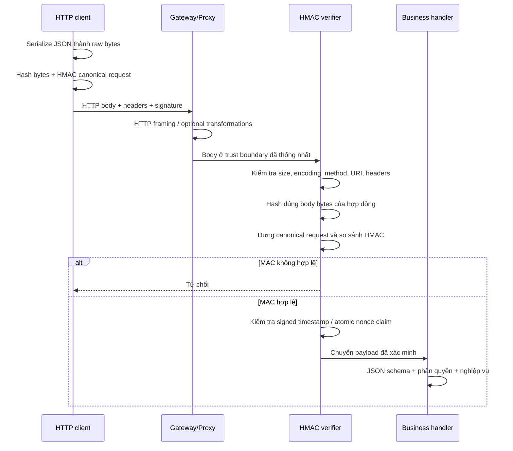
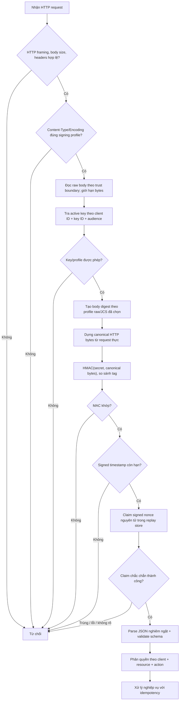

# JSON body trong Body canonicalization

> **Chương:** Body canonicalization  
> **Bài học:** JSON body — chọn và kiểm tra biểu diễn body được dùng trong chữ ký HMAC của HTTP request.  
> **Bối cảnh:** Thiết kế xác thực HTTP request bằng shared secret và canonical request gồm method, URI, signed headers và body theo hợp đồng. Nội dung gắn với Java 17, timestamp/nonce chống replay, key rotation, proxy/gateway và phân biệt xác thực với phân quyền.

## 1. Vì sao JSON body là vấn đề của HMAC?

Một HTTP client gửi lệnh tạo đơn hàng:

```http
POST /v1/orders?mode=commit HTTP/1.1
Host: orders.example.test
Content-Type: application/json
X-Client-Id: partner-01
X-Key-Id: partner-2026-11
X-Timestamp: 1795800000
X-Nonce: Bph1bgR7mMYnUnkY_UY6NA
X-Signature: <base64url-hmac-sha256>

{"orderId":"ORD-1024","amount":100000,"currency":"VND"}
```

Giả sử bên gửi và bên nhận có cùng shared secret và thống nhất ký các thành phần HTTP quan trọng. Khi đó, server phải biết **body nào được đưa vào phép tính HMAC**.

JSON là định dạng dữ liệu có cấu trúc, còn HMAC hoạt động trên **bytes**. Hai văn bản JSON có thể chứa cùng thông tin nghiệp vụ nhưng khác bytes:

```json
{"orderId":"ORD-1024","amount":100000,"currency":"VND"}
```

```json
{
  "currency": "VND",
  "amount": 100000,
  "orderId": "ORD-1024"
}
```

Ở cấp object JSON thông thường, các cặp tên/giá trị này có thể được xem là cùng dữ liệu. Nhưng chúng khác thứ tự key, khoảng trắng và newline, vì vậy:

```text
SHA256(rawJsonA) != SHA256(rawJsonB)   (trong thực hành)
HMAC(secret, bytesA) != HMAC(secret, bytesB)
```

Câu hỏi không phải “làm thế nào để HMAC hiểu JSON?”, mà là **hợp đồng ký quyết định biểu diễn bytes nào của JSON cần được bảo vệ**.

Có hai hướng thiết kế lớn:

1. **Ký raw body bytes:** Hash bytes body thực gửi/nhận và đưa digest vào canonical request. Cách này đơn giản, bảo vệ biểu diễn chính xác và thường dễ kiểm toán hơn.
2. **Ký canonical JSON bytes:** Parse JSON theo quy tắc chặt, serialize lại theo một thuật toán canonical JSON đã được đặc tả và ký bytes canonical. Cách này có thể cho phép nhiều biểu diễn JSON tương đương tạo cùng chữ ký, nhưng dễ sai nếu parser, số, Unicode và duplicate keys không nhất quán.

**Lựa chọn phải được ghi vào signing profile**. Không được để client ký raw body còn server tự serialize lại JSON, cũng không được âm thầm thử cả raw và canonical cho đến khi một MAC khớp.

## 2. Body canonicalization không đồng nghĩa với JSON serialization

Ba bước thường bị nhầm:

| Bước | Đầu vào | Đầu ra | Vai trò |
| --- | --- | --- | --- |
| HTTP body framing | Bytes của thông điệp HTTP sau xử lý framing theo giao thức | Nội dung body được HTTP stack giao cho ứng dụng | Xác định request body thực sự là gì |
| JSON parsing | Bytes body theo charset/encoding được phép | Object/array/number/string/boolean/null | Kiểm tra cú pháp, diễn giải dữ liệu |
| JSON canonicalization | Mô hình JSON đã parse hợp lệ | Một chuỗi bytes JSON xác định theo thuật toán | Chỉ dùng nếu signing profile yêu cầu ký canonical JSON |
| Cryptographic digest | Một chuỗi bytes đã chọn | Digest SHA-256 32 bytes | Ràng buộc nội dung body vào canonical request |
| HMAC | Shared secret + canonical HTTP request bytes | MAC/tag | Xác thực toàn vẹn phần dữ liệu đã ký |

**Serialize thông thường không nhất thiết là canonicalize.** Một serializer có thể thay thứ tự property theo thư viện, đổi biểu diễn số, escape ký tự Unicode, thêm khoảng trắng hoặc newline cuối. Hai bản Java/JavaScript/Go khác nhau có thể sinh bytes khác nhau dù object JSON tương đương ở tầng nghiệp vụ.

### 2.1 JSON object và array có tính chất khác nhau

Ví dụ:

```json
{"a":1,"b":2}
```

và:

```json
{"b":2,"a":1}
```

thường được xem là cùng tập property nếu object có tên key duy nhất và ứng dụng không phụ thuộc thứ tự property.

Nhưng:

```json
["a","b"]
```

và:

```json
["b","a"]
```

**không tương đương** vì thứ tự phần tử trong array có ý nghĩa. Một thuật toán “sort toàn bộ JSON” kể cả array sẽ làm thay đổi dữ liệu nghiệp vụ. Nếu dùng canonical JSON, chỉ thực hiện các phép biến đổi **đúng theo thuật toán đã chọn**, không tự sắp xếp array hoặc nội dung string.

### 2.2 “Cùng nghĩa” phụ thuộc cả ứng dụng

Ngay cả khi hai tài liệu JSON được coi là tương đương ở mô hình dữ liệu, **backend vẫn phải nhất quán** về cách parse và sử dụng chúng. Nếu verifier parse theo một thư viện còn business handler parse theo thư viện khác, hai bên có thể xử lý duplicate property, số rất lớn hay escape theo cách khác nhau.

Bảo mật yêu cầu: **dữ liệu được xác minh phải là dữ liệu được thực thi**. Việc ràng buộc một biểu diễn canonical với HMAC không bù được lỗi khi API đọc một biểu diễn khác để tính tiền, chọn tenant hoặc quyết định quyền.

## 3. Chiến lược A: ký raw JSON body bytes

Đây là điểm khởi đầu khuyến nghị cho nhiều API HMAC. Thay vì canonicalize nội bộ JSON, hợp đồng ký **digest các bytes body được định nghĩa tại trust boundary**:

```text
bodyDigestHex = lowercase_hex(SHA256(rawBodyBytes))
canonicalRequest = version + LF + audience + LF
                 + method + LF + rawTarget + LF
                 + signedHeaders + LF + bodyDigestHex
tag = HMAC_SHA256(sharedSecret, UTF8(canonicalRequest))
```

Server **không cần** đổi thứ tự key hay xóa whitespace JSON để xác minh chữ ký. Client ký đúng bytes mà client gửi, server kiểm tra đúng bytes mà server nhận theo hợp đồng.

### 3.1 Ưu điểm của raw-byte signing

- Dễ định nghĩa: “hash chính xác dãy bytes”, không phụ thuộc cách serializer sắp xếp property.
- Phát hiện mọi thay đổi byte trong body, kể cả đổi khoảng trắng, newline, escape, biểu diễn số hoặc thứ tự key.
- Áp dụng được với nhiều loại payload, không chỉ JSON, nếu giao thức định nghĩa đúng Content-Type/Content-Encoding.
- Dễ tạo golden test vectors: raw bytes, SHA-256 digest và HMAC tag.
- Giảm rủi ro parser differential **trong bước tính MAC** vì HMAC không cần hiểu JSON.

### 3.2 Hạn chế phải chấp nhận

- Hai tài liệu JSON tương đương về nghiệp vụ nhưng khác bytes tạo MAC khác nhau.
- Proxy không được tự format, “làm đẹp”, sửa newline, thay encoding hay sửa body sau điểm ký mà không có một hợp đồng ký lại tương ứng.
- Nếu client ký JSON được serialize tại một thời điểm nhưng HTTP library gửi lại phiên bản serialize khác, chữ ký sai.
- Streaming, body compression và body buffering cần thiết kế để verifier hash **đúng bytes mà handler sử dụng**.

Vì vậy, đối với raw-byte signing, nên **serialize JSON một lần**, lấy bytes đó để tính digest/HMAC và gửi **cùng mảng bytes hoặc stream bất biến** qua HTTP. Tránh chu trình “serialize để ký rồi serialize lại để gửi”.

### 3.3 Body digest khác HMAC

Một cấu trúc thường gặp:

```text
rawBodyBytes = UTF8('{"amount":100000}')
bodyHash = SHA256(rawBodyBytes)
messageToSign = canonicalHttpFields + LF + hex(bodyHash)
hmacTag = HMAC_SHA256(secret, UTF8(messageToSign))
```

SHA-256 body digest **không có key**; bất kỳ bên nào cũng tính lại được. Nó giúp đại diện body một cách cố định trong canonical request. **MAC HMAC ở lớp ngoài** mới ràng buộc digest cùng method, URI, headers và client/key context với shared secret.

Nếu chỉ gửi `X-Body-SHA256` do client tự khai rồi xác minh HMAC trên header đó, server vẫn phải **tính lại digest từ body thật** và đối chiếu. Không được tin digest client đưa mà không ràng buộc nó với body được xử lý.

## 4. Chiến lược B: ký canonical JSON bytes

Nếu giao thức có yêu cầu cụ thể rằng JSON khác whitespace hoặc thứ tự property vẫn tạo cùng chữ ký, cần định nghĩa **JSON canonicalization** chính thức.

Một ví dụ tiêu biểu là **JSON Canonicalization Scheme (JCS, RFC 8785)**: nó định nghĩa cách biểu diễn JSON xác định, trong đó property object được sắp xếp theo quy tắc của JCS, number và string được serialize theo ràng buộc kỹ thuật rõ. JCS **không** đơn giản là “sort key alphabet rồi loại whitespace”.

Nếu chọn JCS, client và server cần thống nhất:

- Phiên bản/đặc tả của thuật toán (ví dụ JCS RFC 8785), không chỉ nhãn mơ hồ “canonical JSON”.
- Yêu cầu input JSON hợp lệ, xử lý duplicate object keys và dữ liệu ngoài phạm vi cho phép.
- Cách sắp xếp **property names theo UTF-16 code units** trong JCS, thay vì collation locale hoặc byte UTF-8 tùy ý.
- Quy tắc biểu diễn number kiểu ECMAScript/JCS: số mũ, dấu chấm thập phân, số âm không, độ chính xác; đặc biệt cẩn trọng khi giao dịch chứa **số tiền**.
- Quy tắc escape string và bảo toàn nội dung Unicode; không tự áp dụng Unicode NFC/NFD nếu thuật toán không yêu cầu.
- Cách xử lý JSON arrays: giữ nguyên thứ tự các phần tử.
- Cách chuyển kết quả thành bytes UTF-8 trước khi hash/HMAC.
- Bộ test vector độc lập giữa các ngôn ngữ triển khai.

**JCS thường giả định mô hình dữ liệu JSON phù hợp với I-JSON**, bao gồm các ràng buộc nhằm tránh tính nhập nhằng giữa implementation. Nếu dữ liệu tài chính chứa decimal chính xác hoặc integer lớn không thể biểu diễn an toàn trong mô hình số mà thuật toán yêu cầu, cần thiết kế schema như **chuỗi decimal có grammar riêng** hoặc chọn hợp đồng raw-byte signing. Không âm thầm làm tròn số tiền rồi ký.

### 4.1 Ví dụ “minify + sort key” chưa phải JCS

Các thao tác sau **không tự tạo ra một thuật toán canonical JSON đủ chặt**:

```text
json.replaceAll("\\s+", "")
serializeObjectWithAlphabeticKeys()
JSON.stringify(parseJson(input))
```

Vì:

- Xóa whitespace bằng regex có thể xóa **whitespace bên trong JSON string**, làm biến đổi giá trị.
- Sort key theo locale/UTF-8/Unicode code point có thể khác comparator của thuật toán đã chọn.
- Một serializer có thể viết số `1.0`, `1`, `1e0` hoặc xử lý `-0` theo một quy tắc khác.
- Escape string có thể khác (`"/"`, `"\/"`, `"\u0061"`, UTF-8 trực tiếp).
- Duplicate properties có thể bị parser giữ đầu, giữ cuối hoặc báo lỗi.
- Một số trường hợp Unicode không hợp lệ (ví dụ surrogate lẻ) cần được từ chối, không tự sửa trong khi ký.

### 4.2 Nếu cần canonical JSON, đừng tự chế bằng regex

Tốt nhất sử dụng thư viện hỗ trợ **đúng một đặc tả canonical JSON** và đã được kiểm thử, đồng thời cấu hình parser từ chối duplicate properties và các giá trị không hợp lệ trước canonicalization. Cần ghi rõ tên thuật toán, phiên bản và mapping số theo schema ở cả client/server.

Mã giả:

```text
rawBody = receiveExactlyOnceAtTrustedBoundary()
validateContentTypeAndContentEncoding()
json = strictParseUtf8Json(rawBody)
rejectDuplicateKeys(json)
validateSchemaAndNumberSemantics(json)
canonicalJsonBytes = canonicalizePerChosenSpecification(json)
bodyDigest = SHA256(canonicalJsonBytes)
canonicalHttpBytes = buildFromActualHttpRequest(..., bodyDigest)
expectedTag = HMAC(secretForClientAndKeyId, canonicalHttpBytes)
compareTagBytes(expectedTag, receivedTag)
```

Nếu backend thực hiện nghiệp vụ dựa trên JSON, hãy dùng **cùng object đã parse và xác minh**, hoặc cùng bytes đã được xác minh theo cùng một parser; không parse lại bằng cấu hình khác. Tránh TOCTOU (*time-of-check to time-of-use*): có thể xác minh một object rồi handler đọc lại stream/raw body đã bị biến đổi.

## 5. Những khác biệt JSON phải đưa vào threat model

| Trường hợp | Hai biểu diễn | Tác động với raw-byte signing | Điều cần quyết định nếu canonicalize JSON |
| --- | --- | --- | --- |
| Whitespace | `{"a":1}` và `{ "a": 1 }` | Digest khác | Whitespace ngoài string thường có thể bị loại theo đặc tả |
| Thứ tự property | `{"a":1,"b":2}` và `{"b":2,"a":1}` | Digest khác | Sort property object theo quy tắc đã công bố |
| Array order | `[1,2]` và `[2,1]` | Digest khác | **Không được** tự sắp xếp array |
| Number lexical form | `1`, `1.0`, `1e0` | Raw bytes khác | Phải theo quy tắc serialize number đã chọn |
| Negative zero | `-0` và `0` | Raw bytes khác | Phải theo đặc tả; đánh giá ý nghĩa nghiệp vụ |
| String escapes | `"a"` và `"\u0061"` | Raw bytes khác | Parse/escape nhất quán |
| Unicode normalization | `"\u00E9"` và `"e\u0301"` | Raw bytes khác | Không tự coi tương đương nếu không có quy tắc rõ |
| Duplicate object key | `{"role":"user","role":"admin"}` | Raw digest bảo vệ bytes nhưng không quyết định parser lấy giá trị nào | **Từ chối** để tránh parser differential |
| Large integers | `9007199254740993` | Raw digest vẫn xác định | Tránh mất chính xác ở implementation dùng IEEE 754 double |
| Decimal tiền tệ | `0.1`, `0.10` | Raw bytes khác | Dùng schema decimal phù hợp, không tự làm tròn |
| null vs absent | `{"x":null}` và `{}` | Raw digest khác | Không tự gộp nếu backend có ngữ nghĩa khác |
| UTF-8 BOM | Có/không có BOM ở đầu body | Raw digest khác | Hợp đồng nên chọn cấm BOM hoặc xử lý rõ |
| Newline cuối | Có/không có LF sau JSON | Raw digest khác | Raw bytes được bảo vệ đúng như gửi |
| Invalid UTF-8 | Byte sequence không decode được | Digest vẫn tính được nếu chỉ nhìn bytes | Parser phải từ chối; không thay bằng U+FFFD |
| JSON comments/trailing comma | `{"a":1,}` hoặc comment | Raw bytes khác | JSON nghiêm ngặt phải từ chối nếu không có profile riêng |

### 5.1 Duplicate keys: nguy hiểm dù HMAC khớp

Giả sử request body:

```json
{"amount":100,"amount":100000}
```

Một parser có thể chọn giá trị đầu, parser khác chọn giá trị cuối, hoặc từ chối. Nếu hệ thống xác minh HMAC trên raw bytes thì tag vẫn có thể hoàn toàn đúng, nhưng verifier và backend **vẫn có thể hiểu số tiền khác nhau**.

Do đó, với API giao dịch:

1. Dùng strict JSON parser và cấu hình **reject duplicate object keys**.
2. Tránh parse một lần ở gateway và lần nữa ở backend bằng quy tắc khác.
3. Không dùng một parser cho authorization còn parser khác cho nghiệp vụ.
4. Xác thực schema, range và kiểu dữ liệu **sau** kiểm tra HMAC, trước khi thực hiện giao dịch; có thể validate format sớm để giới hạn tài nguyên nhưng không tin client trước khi xác thực.
5. Nếu hệ thống chỉ cần JSON schema cố định, thà từ chối dữ liệu nhập nhằng còn hơn tự “sửa” nó.

**HMAC chứng thực bytes, không tự chứng thực một cách diễn giải JSON duy nhất.**

### 5.2 Giá trị số và tiền

Với số tiền, rủi ro rất thực tế là một phía dùng decimal chính xác còn phía khác dùng floating-point. Ví dụ các giá trị lớn hơn ngưỡng integer an toàn của JavaScript có thể bị thay đổi khi parse/serialize lại.

Chọn schema có ý nghĩa rõ:

```json
{"amountMinorUnits":100000,"currency":"VND"}
```

hoặc:

```json
{"amount":"1000.00","currency":"USD"}
```

Nếu dùng chuỗi decimal, cần grammar về dấu, phần thập phân, số 0 đầu/cuối và range; không coi hai biểu diễn là một trừ khi hợp đồng định nghĩa. Khi ký raw bytes, số vẫn cần được validate bởi business schema, nhưng digest không phụ thuộc round-trip serializer.

### 5.3 Unicode và JSON string

Unicode có hai lớp cần phân biệt:

- **Biểu diễn JSON source bytes**: ví dụ UTF-8 trực tiếp so với escape `\uXXXX`.
- **Giá trị chuỗi sau JSON parsing**: một chuỗi Unicode có thể được biểu diễn qua nhiều escape, nhưng không phải mọi chuỗi nhìn giống nhau đều có cùng code point.

Nếu hợp đồng chỉ ký raw bytes, giữ nguyên dãy bytes. Nếu dùng canonical JSON, phải làm đúng quy tắc của đặc tả, tránh thay đổi Unicode normalization khi server kiểm tra tài nguyên, tenant, tên người dùng hoặc object key.

## 6. Nội dung HTTP thực sự được hash ở đâu?

Một lỗi dễ gặp là client tính SHA-256 ở một lớp, nhưng server xác minh ở **một lớp khác sau khi body đã bị biến đổi**.



### 6.1 Transfer framing không đồng nghĩa body content

Trong HTTP/1.1, Transfer-Encoding có thể chia một body thành các chunk khi truyền. Những byte điều khiển framing **không mặc nhiên là một phần JSON payload** mà ứng dụng nhận sau HTTP parsing.

Hợp đồng raw-byte signing nên định nghĩa body là **payload bytes do HTTP stack giao cho verifier sau khi xử lý message framing**, ở đúng trust boundary. Không tự ký cả dấu kích thước chunk, ranh giới HTTP/2 DATA frames hay raw TCP stream nếu giao thức ứng dụng không yêu cầu.

Nếu có HTTP trailers, chúng cũng cần chính sách rõ và không được nhầm với signed headers ở phần đầu request.

### 6.2 Content-Encoding và giải nén

Ví dụ client gửi JSON nén:

```http
Content-Type: application/json
Content-Encoding: gzip
```

Có ít nhất hai lựa chọn khác nhau:

- **Ký bytes nén**: server hash compressed payload bytes sau transfer framing, trước decompression. Body mà nghiệp vụ dùng sau giải nén phải được liên kết đúng với bytes đã xác minh; Content-Encoding cần được ràng buộc.
- **Ký bytes đã giải nén**: server/cổng xác minh phải có quy tắc giải nén xác định và giới hạn resource; client phải ký đúng bytes sau giải nén theo hợp đồng.

**Không trộn hai lựa chọn.** Nếu gateway giải nén rồi backend kiểm tra digest của body gốc dạng nén, MAC sẽ khác. Nếu gateway chuyển `Content-Encoding` mà không ràng buộc nó trong chữ ký, backend có thể diễn giải payload theo một cách khác.

Đối với bài thực hành, đơn giản nhất là **chỉ chấp nhận Content-Encoding vắng mặt hoặc identity theo policy**, body JSON UTF-8 không nén và Content-Type chính xác `application/json`. Cần đặt giới hạn kích thước cả **trước và sau giải nén** nếu production hỗ trợ compressed bodies để phòng decompression bomb.

### 6.3 Content-Length, Transfer-Encoding và request smuggling

Header framing nhập nhằng, nhiều `Content-Length` khác nhau hoặc parser front/back không thống nhất có thể khiến verifier ký một payload nhưng backend xử lý payload khác. Đây là vấn đề **HTTP message parsing/trust boundary**, không phải lỗi nguyên thủy HMAC.

Gateway phải tuân thủ HTTP framing, từ chối request nhập nhằng và bảo đảm chỉ chuyển downstream payload đã xác minh. Không dùng header `X-Body-Hash` do client tự khai làm nguồn sự thật thay cho body bytes thật.

### 6.4 Không đọc body hai lần với kết quả khác nhau

Trong Java web framework, request body thường là stream một lần. Nếu verifier đọc stream để tính digest rồi controller tiếp tục đọc một stream khác hoặc body đã được deserialize/re-serialize, có thể xảy ra:

- Backend không nhận body do stream đã tiêu thụ.
- Backend xử lý bytes khác bản đã xác minh.
- Bộ nhớ tăng cao vì buffer không giới hạn.
- Sai thứ tự middleware khiến HMAC kiểm tra payload sau một bước biến đổi không được quy định.

Cần một adapter có giới hạn kích thước, capture body ở điểm tin cậy, tính digest, xác minh signature và **truyền chính bytes bất biến/parsed object đã xác minh** cho các lớp sau. Với payload lớn, có thể streaming digest nhưng vẫn phải giải quyết cách không xử lý side effect trước khi xác minh hoàn tất.

## 7. Hợp đồng canonical request cho JSON raw bytes

Để thực hành, chọn signing profile `hmac-json-raw-v1`:

| Thành phần | Giá trị minh họa | Quy tắc |
| --- | --- | --- |
| Version | `hmac-json-raw-v1` | Cố định và được ký |
| Audience | `orders-api-prod` | Server cấu hình, không lấy tự do từ client |
| Method | `POST` | Method thực ở trust boundary |
| Target | `/v1/orders?mode=commit` | Raw target tại điểm xác minh đã thống nhất |
| Content-Type | `application/json` | Chỉ UTF-8 JSON, không parameter tùy ý trong ví dụ |
| Client ID | `partner-01` | Key resolver phía server kiểm tra |
| Key ID | `partner-2026-11` | Gắn với secret còn hiệu lực |
| Timestamp | Unix epoch seconds | Được ký; server kiểm tra time window |
| Nonce | Base64URL không padding, 16 bytes | Được ký; server claim nguyên tử |
| Body digest | SHA-256 hex chữ thường | Hash chính xác raw JSON body bytes |

Ghép các dòng bằng một byte LF `0x0A`, UTF-8, **không có LF cuối**:

```text
hmac-json-raw-v1
orders-api-prod
POST
/v1/orders?mode=commit
application/json
partner-01
partner-2026-11
<unix-timestamp>
<random-nonce>
<sha256-hex-of-raw-json-bytes>
```

Client ký:

```text
rawBody = exactlyBytesSentOverConfiguredHttpPayloadBoundary
digest = lowercase_hex(SHA256(rawBody))
canonicalBytes = UTF8(joinFieldsWithLF(version, audience, method,
              rawTarget, contentType, clientId, keyId,
              timestamp, nonce, digest))
signature = BASE64URL_NO_PADDING(
              HMAC_SHA256(sharedSecret, canonicalBytes))
```

Server dựng lại **cùng dãy bytes** từ request nhận được. Không đưa signature header vào chính dữ liệu ký; không lấy “canonical JSON” do client gửi trong header làm sự thật. Nếu ứng dụng dựa vào Host/authority, tenant, Content-Encoding hoặc signed headers khác, phải bổ sung chúng vào profile hoặc ràng buộc đáng tin ở gateway.

Một khi đã chọn `hmac-json-raw-v1`, **không được tự động thử thêm JSON canonicalization** nếu kiểm tra raw MAC thất bại. Việc fallback làm mơ hồ hợp đồng và có thể chấp nhận những body mà backend xử lý khác đi.

## 8. Java 17: ký và xác minh raw JSON body

Ví dụ dưới đây có thể biên dịch trực tiếp trên JDK 17, không cần thư viện ngoài. Nó minh họa **đúng điểm khác biệt giữa raw-byte signing và JSON semantic equivalence**.

Chương trình:

1. Sinh shared secret thử nghiệm bằng `SecureRandom`.
2. Tạo timestamp và nonce ngẫu nhiên cho request.
3. Hash raw JSON bytes bằng `MessageDigest SHA-256`.
4. Dựng canonical HTTP request với body digest.
5. Tính tag bằng `Mac.getInstance("HmacSHA256")` và `Mac.init`.
6. Xác minh tag Base64URL với kiểm tra định dạng và `MessageDigest.isEqual`.
7. Thử body JSON thay thứ tự property/khoảng trắng và body bị sửa amount.

**Giới hạn:** JDK 17 không có JSON parser chuẩn nằm trong Java SE; đoạn mã chỉ minh họa body hashing và HMAC, **không tuyên bố body đã được parse/validate là JSON hợp lệ**. Production phải dùng strict JSON parser/schema phù hợp và từ chối duplicate keys theo chính sách.

```java
import java.nio.ByteBuffer;
import java.nio.charset.CharacterCodingException;
import java.nio.charset.CodingErrorAction;
import java.nio.charset.StandardCharsets;
import java.security.GeneralSecurityException;
import java.security.MessageDigest;
import java.security.SecureRandom;
import java.time.Instant;
import java.util.Base64;
import java.util.HexFormat;

import javax.crypto.Mac;
import javax.crypto.spec.SecretKeySpec;

public final class RawJsonBodyHmacDemo {
    private static final String MAC_ALGORITHM = "HmacSHA256";
    private static final String AUDIENCE = "orders-api-prod";
    private static final int MAX_BODY_BYTES = 1_048_576;

    private RawJsonBodyHmacDemo() {}

    // Chỉ kiểm tra UTF-8 và BOM; KHÔNG phải JSON parser.
    private static boolean validUtf8Body(byte[] rawBody) {
        if (rawBody == null || rawBody.length == 0
                || rawBody.length > MAX_BODY_BYTES) {
            return false;
        }
        if (rawBody.length >= 3
                && (rawBody[0] & 0xff) == 0xef
                && (rawBody[1] & 0xff) == 0xbb
                && (rawBody[2] & 0xff) == 0xbf) {
            return false; // Profile demo từ chối UTF-8 BOM.
        }

        try {
            StandardCharsets.UTF_8.newDecoder()
                    .onMalformedInput(CodingErrorAction.REPORT)
                    .onUnmappableCharacter(CodingErrorAction.REPORT)
                    .decode(ByteBuffer.wrap(rawBody));
            return true;
        } catch (CharacterCodingException invalidUtf8) {
            return false;
        }
    }

    private static boolean validNonce(String nonce) {
        if (nonce == null
                || !nonce.matches("[A-Za-z0-9_-]{22}")) {
            return false;
        }
        try {
            byte[] decoded = Base64.getUrlDecoder().decode(nonce);
            return decoded.length == 16
                    && Base64.getUrlEncoder()
                            .withoutPadding()
                            .encodeToString(decoded).equals(nonce);
        } catch (IllegalArgumentException malformed) {
            return false;
        }
    }

    static byte[] canonicalRequestBytes(
            String method,
            String rawTarget,
            String contentType,
            String clientId,
            String keyId,
            String timestamp,
            String nonce,
            byte[] rawBody) throws GeneralSecurityException {

        if (!"POST".equals(method)
                || !"/v1/orders?mode=commit".equals(rawTarget)
                || !"application/json".equals(contentType)
                || clientId == null
                || !clientId.matches("[A-Za-z0-9._-]{1,64}")
                || keyId == null
                || !keyId.matches("[A-Za-z0-9._-]{1,64}")
                || timestamp == null
                || !timestamp.matches("[1-9][0-9]{9,11}")
                || !validNonce(nonce)
                || !validUtf8Body(rawBody)) {
            throw new IllegalArgumentException(
                    "Request outside signing contract");
        }

        byte[] bodyDigest =
                MessageDigest.getInstance("SHA-256").digest(rawBody);
        String bodyDigestHex =
                HexFormat.of().formatHex(bodyDigest);

        String canonical = String.join("\n",
                "hmac-json-raw-v1",
                AUDIENCE,
                method,
                rawTarget,
                contentType,
                clientId,
                keyId,
                timestamp,
                nonce,
                bodyDigestHex);

        return canonical.getBytes(StandardCharsets.UTF_8);
    }

    private static byte[] macBytes(byte[] secret, byte[] message)
            throws GeneralSecurityException {
        Mac mac = Mac.getInstance(MAC_ALGORITHM);
        mac.init(new SecretKeySpec(secret, MAC_ALGORITHM));
        return mac.doFinal(message);
    }

    static String sign(byte[] secret, byte[] canonical)
            throws GeneralSecurityException {
        byte[] tag = macBytes(secret, canonical);
        return Base64.getUrlEncoder()
                .withoutPadding()
                .encodeToString(tag);
    }

    static boolean verify(
            byte[] secret, byte[] canonical, String signature)
            throws GeneralSecurityException {
        if (secret == null || secret.length < 32
                || signature == null
                || !signature.matches("[A-Za-z0-9_-]{43}")) {
            return false;
        }

        final byte[] supplied;
        try {
            supplied = Base64.getUrlDecoder().decode(signature);
        } catch (IllegalArgumentException malformed) {
            return false;
        }

        if (supplied.length != 32
                || !Base64.getUrlEncoder()
                        .withoutPadding()
                        .encodeToString(supplied).equals(signature)) {
            return false;
        }

        byte[] expected = macBytes(secret, canonical);
        return MessageDigest.isEqual(expected, supplied);
    }

    public static void main(String[] args)
            throws GeneralSecurityException {
        SecureRandom rng = new SecureRandom();
        byte[] secret = new byte[32];
        rng.nextBytes(secret);

        byte[] nonceBytes = new byte[16];
        rng.nextBytes(nonceBytes);
        String nonce = Base64.getUrlEncoder()
                .withoutPadding()
                .encodeToString(nonceBytes);
        String timestamp =
                Long.toString(Instant.now().getEpochSecond());

        // Hai JSON object có cùng tên/giá trị property, khác
        // thứ tự và whitespace trong phần body thực gửi.
        byte[] bodyA = (
                "{\"orderId\":\"ORD-1024\","
                + "\"amount\":100000,\"currency\":\"VND\"}"
        ).getBytes(StandardCharsets.UTF_8);

        byte[] bodyB = (
                "{ \"currency\": \"VND\","
                + " \"amount\": 100000,"
                + " \"orderId\": \"ORD-1024\" }"
        ).getBytes(StandardCharsets.UTF_8);

        byte[] tampered = (
                "{\"orderId\":\"ORD-1024\","
                + "\"amount\":900000,\"currency\":\"VND\"}"
        ).getBytes(StandardCharsets.UTF_8);

        byte[] canonicalA = canonicalRequestBytes(
                "POST", "/v1/orders?mode=commit",
                "application/json", "partner-01",
                "partner-2026-11", timestamp, nonce, bodyA);

        byte[] canonicalB = canonicalRequestBytes(
                "POST", "/v1/orders?mode=commit",
                "application/json", "partner-01",
                "partner-2026-11", timestamp, nonce, bodyB);

        byte[] canonicalTampered = canonicalRequestBytes(
                "POST", "/v1/orders?mode=commit",
                "application/json", "partner-01",
                "partner-2026-11", timestamp, nonce, tampered);

        String signature = sign(secret, canonicalA);

        System.out.println("Raw bodies equal: "
                + MessageDigest.isEqual(bodyA, bodyB));
        System.out.println("Canonical bytes equal: "
                + MessageDigest.isEqual(canonicalA, canonicalB));
        System.out.println("Original valid: "
                + verify(secret, canonicalA, signature));
        System.out.println("Reordered JSON valid: "
                + verify(secret, canonicalB, signature));
        System.out.println("Modified amount valid: "
                + verify(secret, canonicalTampered, signature));
        System.out.println("Exact replay MAC valid: "
                + verify(secret, canonicalA, signature));
    }
}
```

Biên dịch/chạy:

```bash
javac RawJsonBodyHmacDemo.java
java RawJsonBodyHmacDemo
```

Kết quả kỳ vọng:

```text
Raw bodies equal: false
Canonical bytes equal: false
Original valid: true
Reordered JSON valid: false
Modified amount valid: false
Exact replay MAC valid: true
```

Diễn giải:

- **Raw bodies equal: false:** JSON có thể biểu đạt cùng các cặp property, nhưng bytes khác.
- **Canonical bytes equal: false:** Body digest nằm trong canonical HTTP request nên thay đổi bytes làm canonical request khác.
- **Original valid:** Chữ ký đúng cho raw body ban đầu.
- **Reordered JSON valid: false:** Không thể dùng tag của body A cho body B vì hợp đồng của demo là **raw-byte signing**, không phải JCS.
- **Modified amount valid: false:** Đổi số tiền cũng làm body digest và MAC không khớp.
- **Exact replay MAC valid: true:** Gửi lại nguyên request thì phép HMAC vẫn khớp; timestamp/nonce replay gate phải chặn lần dùng tiếp theo.

**Giới hạn cần đọc kỹ:** Để tập trung vào chủ đề body, hàm `verify` nhận canonical bytes đã được chuẩn bị. Trong HTTP verifier thật, **không được nhận canonical bytes từ client**; phải dựng lại từ request thực, tự hash raw body, kiểm tra key ID, timestamp, nonce và phân quyền. Ví dụ cũng không parse JSON hay kiểm tra duplicate keys; một JSON parser nghiêm ngặt là cần thiết trước nghiệp vụ.

## 9. Kiến trúc verifier hoàn chỉnh với JSON body



### 9.1 Key lookup và rotation

Một mapping điển hình:

```text
(clientId, keyId, audience, signingProfile)
    -> shared secret còn hiệu lực
```

Trong rotation, có thể cho phép key hiện hành và key trước đó trong một khoảng chuyển tiếp rõ ràng. Key cũ hết hạn hoặc bị thu hồi phải bị từ chối. Không tự thử mọi key; không để client chọn thuật toán hoặc canonical JSON strategy ngoài danh sách policy được phép.

Nếu đổi từ raw JSON body signing sang JCS, đó là **thay đổi signing profile**, không phải chỉ đổi key: cần version mới, test vectors, quy tắc chống downgrade và lộ trình chuyển đổi client. Nếu client gửi version cũ sau thời hạn sunset, từ chối trước nghiệp vụ.

### 9.2 Timestamp/nonce vẫn bắt buộc

HMAC trên raw JSON không tự chống replay. Server phải:

- Ký timestamp và nonce trong canonical request.
- Kiểm tra timestamp trong cửa sổ chấp nhận, ví dụ ±300 giây.
- Claim nonce đã ký **một lần** trong kho chung bằng thao tác insert-if-absent nguyên tử.
- Dùng TTL đủ bao phủ toàn bộ thời gian request có thể còn hợp lệ (với ±300 giây, khoảng từ lần chấp nhận sớm nhất tới hạn cuối có thể gần 600 giây; cộng margin phù hợp).
- **Fail closed** khi replay store timeout/failover/trả kết quả không chắc chắn.

Không xử lý nghiệp vụ trước khi MAC, timestamp và nonce đã qua. Không claim nonce từ request chưa xác minh HMAC để tránh attacker tiêu tốn replay store.

### 9.3 Phân quyền và idempotency

Một client có HMAC hợp lệ vẫn có thể gửi body JSON hợp lệ yêu cầu truy cập tenant hoặc resource không thuộc quyền của mình. Sau xác thực, server phải kiểm tra action/resource/tenant theo danh tính đã chứng thực. HMAC chỉ bảo vệ dữ liệu đã ký; nó không tự cấp quyền.

Với nghiệp vụ thanh toán/đơn hàng, retry bằng **nonce mới** vẫn có thể tạo request ký hợp lệ khác cho cùng một thao tác. Cần transaction ID hoặc idempotency key được ràng buộc vào thông điệp đã ký và cơ chế lưu kết quả để tránh side effect lặp. Nonce và idempotency giải quyết hai vấn đề khác nhau.

## 10. Ma trận kiểm thử JSON body canonicalization

Kiểm thử nên phân biệt **raw-body signing** và **canonical-JSON signing** vì một trường hợp có thể được raw profile từ chối nhưng được profile chuẩn hóa JSON chấp nhận.

| Ca kiểm thử | Biến đổi | Raw-byte signing | Canonical JSON profile |
| --- | --- | --- | --- |
| Baseline | Body/headers/key đúng | MAC khớp | MAC khớp nếu implementation đúng đặc tả |
| Thay whitespace ngoài string | Thêm SP/LF giữa property | MAC cũ sai | Có thể cùng canonical nếu thuật toán cho phép |
| Đổi thứ tự object properties | Thứ tự key A ↔ B | MAC cũ sai | Có thể cùng canonical nếu object hợp lệ và sort đúng |
| Đổi thứ tự array | `[1,2]` ↔ `[2,1]` | MAC cũ sai | **Phải khác**, không sort array |
| Đổi amount | `100000` ↔ `900000` | MAC cũ sai | MAC cũ sai |
| Escaped string | `"a"` ↔ `"\u0061"` | MAC cũ sai | Kết quả theo đặc tả canonical JSON |
| Number representation | `1` ↔ `1.0` | MAC cũ sai | Phải theo quy tắc serialize number của profile |
| Integer lớn | Vượt integer safe range của một số runtime | Raw digest vẫn xác định | Schema/profile phải xử lý an toàn hoặc từ chối |
| Unicode normalization | NFC ↔ NFD | Raw digest khác | Không tự normalize nếu đặc tả không yêu cầu |
| Duplicate property | `{"a":1,"a":2}` | Có thể có MAC hợp lệ trên bytes đó | **Từ chối** trước diễn giải nghiệp vụ/canonical |
| Invalid UTF-8 | Byte sequence lỗi | Hash bytes được nhưng JSON không hợp lệ | Từ chối |
| UTF-8 BOM | Có BOM đầu body | Khác digest hoặc bị cấm theo profile | Chính sách phải rõ; demo từ chối |
| Trailing comma/comments | Cú pháp không chuẩn JSON | Có thể được hash, nhưng strict parser từ chối | Từ chối |
| Content-Type thay đổi | `application/json` ↔ loại khác | MAC/policy từ chối | MAC/policy từ chối |
| Gzip body | Gateway nén/giải nén | Phải hash đúng bytes hợp đồng | Phải decode/parse đúng theo hợp đồng |
| Proxy sửa JSON | Reformat body sau khi client ký | MAC mismatch | Chỉ tương đương nếu canonical algorithm và dữ liệu hợp lệ |
| Query/URI đổi | Sửa path/mode | MAC sai nếu signed | MAC sai nếu signed |
| Duplicate HTTP header | Hai `X-Client-Id` hoặc `Content-Type` | Từ chối nhập nhằng | Từ chối nhập nhằng |
| Replay nguyên request | Giữ nguyên body/nonce/signature | HMAC đúng, nonce chặn | HMAC đúng, nonce chặn |
| Replay store không sẵn sàng | Timeout claim | Fail closed | Fail closed |
| Key rotation | Key ID đã hết hiệu lực | Từ chối | Từ chối |
| HMAC đúng nhưng sai quyền | Body tham chiếu tenant khác | Authorization từ chối | Authorization từ chối |

### 10.1 Golden vectors cho raw-byte signing

Bộ vector cần ghi rõ **exact bytes**, không chỉ object JSON sau parse:

```text
profile: hmac-json-raw-v1
algorithm: HmacSHA256
test_secret_hex: <32-byte-test-key-in-hex>
method: POST
raw_target: /v1/orders?mode=commit
content_type: application/json
client_id: partner-01
key_id: partner-2026-11
timestamp: <fixed-test-timestamp>
nonce: <fixed-base64url-test-nonce>
raw_json_body_utf8_hex: <exact-raw-body-bytes>
body_sha256_hex: <64-lowercase-hex>
canonical_http_utf8_hex: <exact-canonical-bytes>
hmac_sha256_hex: <64-lowercase-hex>
signature_base64url: <43-character-tag>
```

Các chỗ placeholder trong tài liệu là **mô tả trường**, không phải vector đã tính. Trong test thực, điền dữ liệu/giá trị được tạo bằng implementation kiểm chứng độc lập và so sánh giữa các ngôn ngữ client/server. Nếu hai phía cùng dùng một thư viện canonicalization lỗi, test “ký rồi tự xác minh” vẫn có thể cho kết quả đúng giả.

### 10.2 Golden vectors cho canonical JSON

Nếu API chọn JCS, vector cần có:

- JSON source bytes và kết quả **strict parse** mong đợi.
- Chính xác bytes canonical theo JCS, kèm hex.
- Body digest của canonical JSON bytes.
- HTTP canonical bytes và HMAC tag.
- Vector negative cho duplicate keys, invalid Unicode, out-of-range number và trường hợp parser khác nhau.
- Vector chứng minh JSON có whitespace/thứ tự property khác nhau nhưng cùng canonical output **khi đặc tả bảo đảm**, và JSON array khác thứ tự phải có output khác.

Không nên trộn kết quả của raw profile và JCS vào một bộ kiểm thử duy nhất nếu không ghi rõ version; cũng không coi `JSON.stringify` trên JavaScript là tương đương JCS cho mọi dữ liệu mà không kiểm tra đầy đủ thuật toán.

### 10.3 Quy trình tìm nguyên nhân HMAC mismatch

1. Xác định signing profile được phép: raw JSON hay canonical JSON, phiên bản và HMAC algorithm.
2. Đối chiếu client/key ID, audience, trạng thái key rotation và secret bytes đúng.
3. Đối chiếu method, raw target, signed headers, Content-Type và Content-Encoding tại trust boundary.
4. So sánh chiều dài raw body bytes, digest SHA-256 và chính xác bytes dùng hash; với JSON raw profile, **không dùng JSON đã deserialize**.
5. Nếu dùng canonical JSON, kiểm tra strict parser, duplicate keys, Unicode, number, property order, canonical output bytes.
6. So sánh canonical HTTP UTF-8 bytes (test vectors với dữ liệu thử nghiệm), newline LF và thứ tự trường.
7. Cuối cùng mới kiểm tra HMAC algorithm, encoding Base64URL/hex và so sánh tag.

Trong production, không log raw shared secret, expected MAC, JSON body nhạy cảm hoặc full canonical string có dữ liệu khách hàng. Dùng correlation ID, profile, key ID, độ dài body, error category và digest chẩn đoán đã đánh giá an toàn để gỡ lỗi.

## 11. Bài tập thực hành

**Bài 1 — Thay whitespace:** Dùng demo Java 17 ký body `{"a":1,"b":2}`, sau đó xác minh body `{ "a": 1, "b": 2 }` với tag cũ. Vì sao HMAC sai dù object có thể tương đương?

**Bài 2 — Order của property và array:** Cho hai object JSON khác thứ tự property và hai array khác thứ tự phần tử. Giải thích trường hợp nào có thể được một profile JSON canonicalization coi tương đương và vì sao array không được tự sort.

**Bài 3 — Duplicate keys:** Tạo JSON `{"amount":100,"amount":999999}`. Thử parser configured reject duplicates và parser giữ giá trị cuối. Vì sao cùng raw HMAC đúng vẫn có thể không bảo đảm cùng ngữ nghĩa? Đề xuất chính sách parse một lần và từ chối.

**Bài 4 — Unicode, numbers:** So sánh `"\u00E9"` với `"e\u0301"`; `1` với `1.0`; và integer lớn. Chọn raw signing hay canonical JSON theo từng yêu cầu và nêu quy tắc có thể kiểm thử.

**Bài 5 — Content-Encoding:** Cho client ký compressed gzip bytes nhưng gateway giải nén trước backend. Hãy xác định vị trí verifier hoặc version mới của hợp đồng để không có tình trạng ký một payload nhưng xử lý payload khác.

**Bài 6 — Key rotation và replay:** Ký request với key active, signed timestamp và nonce. Sau lần chấp nhận đầu, gửi lại nguyên request. Kiểm tra HMAC vẫn có thể đúng nhưng replay store từ chối; với key bị thu hồi, request phải bị chặn theo key policy.

**Bài 7 — Spring/Servlet integration:** Phác thảo filter đọc raw body một lần với giới hạn kích thước, tính digest và chuyển bản body đã xác minh cho controller. Xác định nơi reject duplicate HTTP headers, Content-Type sai, JSON duplicate properties, timeout replay store và kiểm tra authorization.

## 12. Câu hỏi tự kiểm tra

1. Vì sao HMAC không thể tự biết hai biểu diễn JSON khác bytes có cùng ý nghĩa?
2. Khác biệt giữa ký raw JSON body bytes và ký canonical JSON bytes là gì?
3. Khi nào nên chọn raw-byte signing để giảm rủi ro?
4. Vì sao chỉ gọi JSON serializer “minify + sort key” không đủ khẳng định đã tuân thủ JCS?
5. Nếu JSON chứa duplicate object keys, MAC hợp lệ có chứng minh backend sẽ hiểu đúng cùng một amount không?
6. Với JSON array, có được sắp xếp phần tử để canonicalize như object properties không?
7. Vì sao floating-point/large integer và Unicode cần quy tắc chặt khi ký canonical JSON?
8. Nếu client ký bytes nén gzip nhưng backend hash bytes đã giải nén, kết quả thế nào?
9. Trong Java web framework, vì sao verifier không nên hash body từ một stream rồi controller xử lý một bản body khác?
10. Body SHA-256 digest có phải chữ ký xác thực đã dùng secret không?
11. Khi đổi từ raw profile sang JCS, vì sao cần profile version mới và chống downgrade?
12. HMAC hợp lệ trên body JSON có tự chống replay và tự cấp quyền thao tác không?

**Ghi nhớ:** JSON body canonicalization là **quyết định về bytes được ký**, không phải bước trang trí JSON. Với HMAC HTTP, ký **raw body bytes** là lựa chọn đơn giản và rõ ràng khi client/server có thể truyền nguyên vẹn bytes; nếu cần các biểu diễn JSON tương đương tạo cùng chữ ký, phải dùng một canonical JSON specification được triển khai và kiểm thử chặt, tránh duplicate keys, sai số và parser differential. Dù dùng cách nào, server vẫn phải tái dựng canonical HTTP request từ dữ liệu thật, kiểm tra MAC bằng key đang hiệu lực, chống replay bằng timestamp/nonce và thực hiện phân quyền, idempotency nghiệp vụ.
