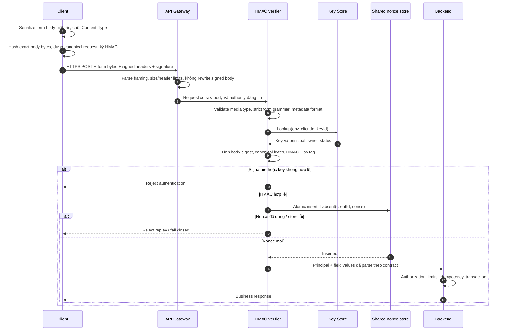

# Form body trong Body Canonicalization cho HMAC Request Authentication

## Mục tiêu học tập

Sau bài học này, bạn có thể:

- Phân biệt hai cách gửi **HTTP form body** thường gặp: `application/x-www-form-urlencoded` và `multipart/form-data`, bao gồm cách mỗi loại biểu diễn giá trị rỗng, giá trị lặp và dữ liệu nhị phân.
- Giải thích vì sao **body đã parse thành các field** không nhất thiết có cùng bytes với **body nguyên bản được gửi trên wire**; hiểu tác động của dấu `+`, percent-encoding, thứ tự field, charset, dấu xuống dòng và multipart boundary.
- Thiết kế một hợp đồng **canonical form body** có thể kiểm thử byte-for-byte, giới hạn biểu diễn nhập nhằng và đưa **SHA-256 của raw body** vào canonical request được HMAC-SHA256 ký.
- Viết Java/JCA để parse nghiêm ngặt `application/x-www-form-urlencoded`, bảo toàn field rỗng, từ chối encoding không chuẩn và tạo/xác minh HMAC tag.
- Phân biệt **truyền/đọc body**, **kiểm tra cấu trúc form**, **xác minh HMAC**, **chống replay**, **phân quyền** và **idempotency**.
- Chẩn đoán lỗi qua proxy/gateway, reverse proxy, HTTP framework, body caching wrapper và quá trình nén/giải nén hoặc ghi lại body.
- Xây dựng bộ kiểm thử đối với thay đổi field, multipart boundary, body encoding, header `Content-Type`, key rotation và replay giữa nhiều replica.

**Bối cảnh:** Chủ đề thuộc chương **Body canonicalization** của module `SECURITY_AUTHENTICATION_HMAC_REQUEST_AUTHENTICATION`. Module thiết kế xác thực HTTP request bằng **shared secret** và **canonical request** bao phủ method, URI, header hoặc body theo hợp đồng ký; các bước tiếp theo gồm kiểm tra chữ ký, timestamp/nonce chống replay, key rotation, proxy/gateway và phân biệt authentication với authorization. Bài này đi sâu vào **form body**; những khía cạnh khác chỉ được đưa vào khi có liên quan trực tiếp.

> Trong bài, hợp đồng `form-body-v1` là một **profile minh họa** do chúng ta tự định nghĩa. Nó không phải format HMAC phổ quát của mọi dịch vụ. Các quyết định về encoding, field, method và header phải được công bố và triển khai thống nhất ở cả client, verifier lẫn backend.

## 1. Form body là gì và vì sao cần canonicalization?

Một HTTP request có thể mang dữ liệu dạng form trong **request body** thay vì JSON. Hai media type phổ biến là:

1. `application/x-www-form-urlencoded`: body là chuỗi những cặp `name=value`, thường ngăn bằng `&`, với các quy tắc mã hóa ký tự như `+` biểu diễn dấu cách và `%HH` biểu diễn byte.
2. `multipart/form-data`: body gồm nhiều part, mỗi part có header riêng và được phân cách bằng một **boundary** chỉ định trong `Content-Type`. Thích hợp cho file và dữ liệu nhị phân.

Ví dụ request từ một dịch vụ đối tác gọi API chuyển tiền thử nghiệm bằng form-urlencoded:

```http
POST /v1/transfers HTTP/1.1
Host: api.example.test
Content-Type: application/x-www-form-urlencoded; charset=UTF-8

to=wallet-17&amount=12500&memo=
```

Các trường có thể được ứng dụng hiểu như sau:

| Field | Dữ liệu decoded | Ý nghĩa minh họa |
|---|---|---|
| `to` | `wallet-17` | Ví nhận tiền |
| `amount` | `12500` | Số đơn vị tiền nhỏ nhất (integer dạng chuỗi) |
| `memo` | Chuỗi rỗng `""` | Có field memo nhưng không có nội dung |

Body hiện ở dạng text ASCII, nhưng HMAC thao tác trên **byte[]**, không thao tác trên đối tượng `Map<String,String>` hay giá trị nghiệp vụ trừu tượng.

### Cùng ý nghĩa không có nghĩa cùng bytes

Ba body sau có thể tạo các tập field gần giống nhau, tùy parser và business logic:

```text
to=wallet-17&amount=12500&memo=
amount=12500&to=wallet-17&memo=
to=wallet-17&amount=12500
```

- Body 1 và 2 khác **thứ tự cặp**.
- Body 1 có `memo` present-empty; body 3 **không có field memo**.
- Một parser có thể gom dữ liệu thành map và đánh mất thứ tự; một framework khác có thể tự gán missing `memo` thành `""`.
- Vì **bytes khác nhau**, nếu ký digest của raw body thì tag HMAC khác nhau.

**Định nghĩa làm việc:** canonicalization phải xác định chính xác biểu diễn được ký và bảo đảm backend sử dụng **cùng dữ liệu** với dữ liệu verifier đã xác nhận. Không có nghĩa cứ parse rồi sắp xếp các field là an toàn.

## 2. Hai loại form body cần xử lý khác nhau

| Khía cạnh | `application/x-www-form-urlencoded` | `multipart/form-data` |
|---|---|---|
| Kết cấu | Cặp `name=value`, phân cách bằng `&` | Các part có boundary và part headers |
| Dữ liệu điển hình | Form text, field ngắn | Text, file, dữ liệu nhị phân |
| Dấu cách trong giá trị | Thường mã hóa thành `+` | Dữ liệu part theo encoding/charset đã quy định |
| Dấu `+` literal | Thường mã hóa `%2B` | Chỉ là một byte/ký tự trong part tương ứng |
| Dấu `&` trong giá trị | Thường mã hóa `%26` | Không cần `&` làm dấu phân cách field |
| Thứ tự field/part | Có thể được parser giữ hoặc làm mất | Part order có thể có ý nghĩa với giao thức |
| Tên trùng | Có thể tồn tại, parser có thể dùng first/last/all | Nhiều part có thể mang cùng tên |
| Body bytes thay đổi do serialization | Khoảng trắng, percent encoding, thứ tự | Boundary, CRLF, header từng part, file bytes |
| Cách ký thực tế dễ làm đúng | Hash **raw form body** rồi HMAC canonical request | Hash **raw multipart body** rồi HMAC; boundary/header phải được bảo vệ |
| Rủi ro lớn | `+`/space, duplicate, empty, encoding khác nhau | Rebuild multipart, boundary ngẫu nhiên, parser khác nhau, file/size lớn |

**Không lấy hàm canonicalization của form-urlencoded áp cho multipart.** Multipart có ngữ pháp MIME và part headers riêng; việc tách file rồi serialize lại thành multipart mới có thể đổi bytes dù field/file có vẻ giống nhau.

## 3. Những biểu diễn khác nhau của form-urlencoded

Trong `application/x-www-form-urlencoded`, một số quy tắc rất quan trọng:

```text
memo=hello+world      -> memo = "hello world"
memo=hello%20world    -> memo = "hello world" (có thể cùng giá trị decoded)
memo=hello%2Bworld    -> memo = "hello+world"
memo=hello%26world    -> memo = "hello&world"
memo=                 -> memo có mặt, giá trị ""
(không có memo)       -> memo vắng mặt
```

Đây là **những wire representations khác nhau**. Nếu verifier hash raw body, mỗi body cho digest khác nhau dù sau parse có những giá trị tương đương. Điều này không phải lỗi: nếu hợp đồng ký chọn bytes gốc, **client phải ký chính bytes sẽ gửi**.

### 3.1. Empty, absent, bare và duplicate

| Raw form body | Ngữ nghĩa thường gặp | Chính sách trong `form-body-v1` ở bài |
|---|---|---|
| `memo=` | `memo` present-empty | Cho phép |
| Không có cặp `memo` | `memo` absent | Cho phép, khác `memo=` |
| `memo` | Bare field, không có `=` | Từ chối |
| `=value` | Tên field rỗng | Từ chối |
| `memo=&` | Một segment trống ở cuối | Từ chối |
| `&memo=` | Một segment trống ở đầu | Từ chối |
| `memo=&&amount=1` | Segment trống giữa các cặp | Từ chối |
| `memo=&memo=a` | Duplicate name | Từ chối |
| `memo=hi+there` | Space được viết bằng `+` | Cho phép |
| `memo=hi%20there` | Space percent-encoded | Từ chối ở profile canonical hẹp (dùng `+`) |
| `memo=%2B` | Literal `+` trong giá trị | Cho phép |
| `memo=hi%2bthere` | Hex lowercase | Từ chối ở profile canonical hẹp |
| `memo=%41` | Byte `A` percent-encoded dù là unreserved | Từ chối ở profile hẹp (dùng `A`) |

Các quyết định “từ chối” trong bảng **không phải giới hạn bắt buộc của mọi form-urlencoded parser**. Chúng được lựa chọn để **chỉ cho phép một cách serialize canonical cho mỗi giá trị**. Nếu giao thức của bạn cần hỗ trợ duplicate name hoặc body không chuẩn, phải thiết kế cách parse, lựa chọn giá trị và ký phù hợp thay vì âm thầm tự sửa input.

### 3.2. Charset và decode một lần

Khi form body chứa Unicode:

```text
memo=caf%C3%A9
```

Các byte `C3 A9` percent-encoded là UTF-8 cho chữ `é`. Nếu một phía decode theo UTF-8 còn phía kia theo charset khác, hai thành phần có thể hiểu nội dung khác nhau. Nếu một phía **decode hai lần**, `%2526` có thể thành `%26` ở lượt đầu rồi thành `&` ở lượt sau, làm thay đổi cấu trúc field.

Hợp đồng cần ghi rõ:

- Charset duy nhất, ví dụ **UTF-8**.
- Percent-decoding thực hiện **đúng một lần**.
- Từ chối chuỗi byte UTF-8 **malformed** hoặc có sequence không hợp lệ; không thay ký tự hỏng bằng ký tự thay thế rồi tiếp tục xử lý.
- Không tự normalize Unicode (NFC/NFD) trừ khi hợp đồng định nghĩa rõ và cả hai phía cùng thực hiện.
- Quy tắc escape canonical nhất quán: ví dụ space dùng `+`, literal plus dùng `%2B`, hex percent uppercase.

## 4. Hai chiến lược canonicalization, không được trộn lẫn

### Chiến lược A: ký nguyên raw body bytes

```text
bodyDigest = SHA256(exactRawBodyBytes)
canonicalRequest = method + LF + target + LF + signedHeaders
                   + LF + "body-sha256:" + Base64URL(bodyDigest)
tag = HMAC-SHA256(K, UTF8(canonicalRequest))
```

Trong mô hình này:

1. Client serialize form **một lần**, lấy byte[] và giữ nguyên để gửi.
2. Client dùng chính byte[] đó để tính SHA-256.
3. Verifier nhận body ở **điểm đã thỏa thuận của HTTP pipeline**, tính lại digest trên cùng bytes.
4. Body parser có thể tạo object nghiệp vụ **sau** khi verifier đã kiểm tra input; các cách diễn giải nhập nhằng phải bị chặn theo hợp đồng.

Ưu điểm: dễ bảo đảm tính toàn vẹn byte-for-byte; không cần tự viết một thuật toán sắp xếp mọi field. Nhược điểm: cùng dữ liệu nghiệp vụ nhưng serialize khác nhau sẽ tạo chữ ký khác nhau; các proxy làm thay đổi body gây mismatch.

### Chiến lược B: parse rồi ký canonical form serialization

Theo chiến lược khác, cả client và verifier:

1. Parse form theo grammar chặt, xác định duplicate, empty, charset, `+` và percent escape.
2. Tạo một chuỗi **canonical form body mới** bằng một thuật toán đã được đặc tả đầy đủ, ví dụ sort field (hoặc giữ thứ tự), percent-encode chuẩn, tên/giá trị rỗng rõ ràng.
3. Tính digest/HMAC trên bytes của chuỗi canonical mới.

Chiến lược B có thể hợp lý cho một hệ thống cần coi hai cách biểu diễn tương đương. Nhưng nếu **handler lại đọc và dùng raw body theo parser khác**, attacker có thể lợi dụng việc dữ liệu dùng để verify khác với dữ liệu nghiệp vụ thực thi.

**Profile của bài chọn chiến lược A**, đồng thời dùng một **strict canonical-form validator** để chỉ chấp nhận dạng `application/x-www-form-urlencoded` có cách viết duy nhất. Vì vậy nội dung được ký vẫn là **raw body bytes**; parser chỉ kiểm tra body đã thuộc grammar chốt trước và xuất các trường mà backend được phép dùng.

## 5. Hợp đồng `form-body-v1` cho một endpoint `POST`

Giả sử API `POST /v1/transfers` được gọi **server-to-server** bằng HMAC-SHA256. Body là form-urlencoded, không phải HTML form chứa secret trong JavaScript trình duyệt.

### 5.1. Quy tắc body

| Thành phần | Quy định minh họa của `form-body-v1` |
|---|---|
| Media type | Chính xác `application/x-www-form-urlencoded; charset=UTF-8` |
| Body byte limit | Tối đa 8192 byte; reject body rỗng cho endpoint này |
| Tên field | ASCII `[A-Za-z][A-Za-z0-9_-]{0,31}`, chỉ `to`, `amount`, `memo` |
| Field bắt buộc | `to`, `amount`; `memo` là tùy chọn |
| Field rỗng | `memo=` được chấp nhận, khác `memo` vắng mặt |
| Duplicate field | Từ chối mọi duplicate name |
| Thứ tự | **Giữ nguyên thứ tự trên wire**, không sort |
| Phân cách | Một dấu `&` giữa các pair, mỗi pair có đúng một dấu `=` thô |
| Raw value | Chỉ ký tự ASCII unreserved, `+` hoặc percent escapes `%HH` viết hoa |
| Space và plus | Space viết `+`; literal plus viết `%2B` |
| Encoding Unicode | Các byte UTF-8 được percent-encode, decode một lần bằng UTF-8 strict |
| Canonical encoding | Decode rồi re-encode phải **trùng raw value**; ngăn `%20`, `%41`, hex lowercase |
| `Content-Encoding` | **Không chấp nhận**; body phải được truyền không nén ở profile này |
| Multipart | Không chấp nhận trong version này; có giao thức riêng nếu cần |
| Field nghiệp vụ | `to`: 1–32 ký tự ASCII phù hợp; `amount`: 1–9 chữ số dương không leading zero; `memo`: 0–64 byte/ký tự theo giới hạn đã kiểm tra |

Giới hạn `memo` nên được định nghĩa rõ bằng **bytes decoded, số Unicode code point hay số ký tự UI**; ví dụ Java bên dưới giới hạn **64 Unicode code points** và giới hạn cả body 8192 byte. Với dịch vụ tài chính thật cần kiểm tra thêm chính sách tiền tệ, chống overflow, số dư, hạn mức, recipient ownership và transaction; HMAC không thay thế các kiểm tra ấy.

### 5.2. Chữ ký HTTP và những header quan trọng

Hợp đồng ký `hmac-form-v1`:

| Dòng | Giá trị canonical |
|---|---|
| 1 | `POST` |
| 2 | `/v1/transfers` |
| 3 | `host:api.example.test` |
| 4 | `content-type:application/x-www-form-urlencoded; charset=UTF-8` |
| 5 | `x-client-id:<client-id>` |
| 6 | `x-key-id:<key-id>` |
| 7 | `x-timestamp:<unix-seconds>` |
| 8 | `x-nonce:<nonce-base64url>` |
| 9 | `body-sha256:<base64url-of-sha256-of-raw-body>` |

Các dòng được nối bằng LF (`\n`), **không thêm LF cuối**, encode thành UTF-8. Sau đó:

```text
bodyHash     = SHA256(rawFormBodyBytes)
canonical    = UTF8(joinSignedLinesWithLF(..., Base64URL(bodyHash)))
signatureRaw = HMAC-SHA256(secretKeyBytes, canonical)
signature    = Base64URL_NoPadding(signatureRaw)    // 43 ký tự ASCII
```

- `X-Signature` được gửi cùng request, **không ký đệ quy chính header này**.
- `X-Client-Id` và `X-Key-Id` được ký và dùng để tra đúng key theo client/môi trường. Chúng chưa đáng tin trước khi HMAC khớp.
- Timestamp và nonce được ký, nhưng chỉ có chữ ký hợp lệ **chưa đủ chống replay**.
- HTTP parser/ingress phải kiểm soát **đúng một giá trị** cho từng signed header, đúng media type, body size và cách chọn host/authority.
- Đối với `Content-Encoding`, profile này **cấm gửi header** và cấm middleware tự giải nén/biến đổi form. `Transfer-Encoding` của HTTP/1.1 là framing của message; body hash tính từ **bytes body sau khi HTTP parser loại framing**, không bao gồm các byte kích thước chunk. Ingress phải xử lý framing/`Content-Length` nhất quán để tránh request smuggling; không tự thêm vào HMAC những byte framing vốn không phải representation body.
- Nếu API bổ sung `Idempotency-Key`, `X-Tenant-Id` hoặc header thay đổi cách thực thi nghiệp vụ, hãy **nâng phiên bản hợp đồng ký hoặc ràng buộc bằng một context đáng tin**. Không để backend dùng một header ngoài chữ ký do client tự sửa.

### 5.3. Request mẫu

```http
POST /v1/transfers HTTP/1.1
Host: api.example.test
Content-Type: application/x-www-form-urlencoded; charset=UTF-8
X-Client-Id: partner-17
X-Key-Id: k2
X-Timestamp: <unix-seconds-hien-tai>
X-Nonce: <nonce-ngau-nhien-128-bit>
X-Signature: <hmac-sha256-base64url>

to=wallet-17&amount=12500&memo=
```

Các giá trị trong `<...>` chỉ là **placeholder**. Body được giả định có đúng các byte ASCII hiển thị ở dòng cuối, **không có newline cuối**. Canonical string tương ứng:

```text
POST
/v1/transfers
host:api.example.test
content-type:application/x-www-form-urlencoded; charset=UTF-8
x-client-id:partner-17
x-key-id:k2
x-timestamp:<unix-seconds-hien-tai>
x-nonce:<nonce-ngau-nhien-128-bit>
body-sha256:<base64url-sha256-cua-dung-raw-form-body>
```

Thay `memo=` thành **không có memo**, thêm `&` cuối, đảo thứ tự field hoặc thay `amount` sau khi ký đều làm SHA-256 raw body thay đổi; do đó HMAC của canonical request cũng thay đổi.

## 6. Java 17+: parser canonical form, ký và xác minh HMAC-SHA256

Ví dụ Java sau triển khai **một profile minh họa đầy đủ ở tầng byte**. Nó kiểm tra encoding của form-urlencoded, parse field theo thứ tự, không bỏ field empty và dùng `javax.crypto.Mac` để tính HMAC. Không yêu cầu thư viện ngoài JDK.

```java
import java.io.ByteArrayOutputStream;
import java.nio.ByteBuffer;
import java.nio.charset.CharacterCodingException;
import java.nio.charset.CodingErrorAction;
import java.nio.charset.StandardCharsets;
import java.security.GeneralSecurityException;
import java.security.MessageDigest;
import java.security.SecureRandom;
import java.time.Instant;
import java.util.Base64;
import java.util.Collections;
import java.util.LinkedHashMap;
import java.util.Map;
import java.util.regex.Pattern;
import javax.crypto.Mac;
import javax.crypto.spec.SecretKeySpec;

public final class SignedFormBodyV1 {
    private static final String HOST = "api.example.test";
    private static final String TARGET = "/v1/transfers";
    private static final String CONTENT_TYPE =
            "application/x-www-form-urlencoded; charset=UTF-8";
    private static final int MAX_BODY_BYTES = 8192;

    private static final Pattern FIELD_NAME =
            Pattern.compile("[A-Za-z][A-Za-z0-9_-]{0,31}");
    private static final Pattern CLIENT_OR_KEY_ID =
            Pattern.compile("[A-Za-z0-9][A-Za-z0-9_-]{0,63}");
    private static final Pattern TIMESTAMP =
            Pattern.compile("[1-9][0-9]{0,11}");
    private static final Pattern NONCE =
            Pattern.compile("[A-Za-z0-9_-]{22}");
    private static final Pattern SIGNATURE =
            Pattern.compile("[A-Za-z0-9_-]{43}");
    private static final Base64.Encoder B64 =
            Base64.getUrlEncoder().withoutPadding();
    private static final char[] HEX = "0123456789ABCDEF".toCharArray();

    private SignedFormBodyV1() {}

    public record RequestParts(
            String method, String rawTarget, String publicHost,
            String contentType, String clientId, String keyId,
            String timestamp, String nonce, byte[] rawBody) {}

    private static boolean unreserved(int b) {
        return (b >= 'A' && b <= 'Z') ||
               (b >= 'a' && b <= 'z') ||
               (b >= '0' && b <= '9') ||
               b == '-' || b == '_' || b == '.' || b == '~';
    }

    private static int upperHex(char c) {
        if (c >= '0' && c <= '9') return c - '0';
        if (c >= 'A' && c <= 'F') return c - 'A' + 10;
        return -1;
    }

    // Chỉ nhận một cách serialize canonical cho mỗi decoded value.
    private static String encodeFormValue(String value) {
        StringBuilder encoded = new StringBuilder();
        for (byte b : value.getBytes(StandardCharsets.UTF_8)) {
            int v = b & 0xff;
            if (unreserved(v)) {
                encoded.append((char) v);
            } else if (v == ' ') {
                encoded.append('+');
            } else {
                encoded.append('%')
                       .append(HEX[v >>> 4])
                       .append(HEX[v & 15]);
            }
        }
        return encoded.toString();
    }

    private static String decodeFormValueStrict(String raw) {
        ByteArrayOutputStream bytes = new ByteArrayOutputStream();
        for (int i = 0; i < raw.length(); i++) {
            char c = raw.charAt(i);
            if (c == '+') {
                bytes.write(' ');
            } else if (c == '%') {
                if (i + 2 >= raw.length()) {
                    throw new IllegalArgumentException("Bad percent escape");
                }
                int hi = upperHex(raw.charAt(++i));
                int lo = upperHex(raw.charAt(++i));
                if (hi < 0 || lo < 0) {
                    throw new IllegalArgumentException("Bad percent escape");
                }
                bytes.write((hi << 4) | lo);
            } else if (c < 128 && unreserved(c)) {
                bytes.write(c);
            } else {
                // Reject raw '&', '=', space, non-ASCII, CR/LF, ...
                throw new IllegalArgumentException("Invalid raw form value");
            }
        }

        final String decoded;
        try {
            decoded = StandardCharsets.UTF_8.newDecoder()
                    .onMalformedInput(CodingErrorAction.REPORT)
                    .onUnmappableCharacter(CodingErrorAction.REPORT)
                    .decode(ByteBuffer.wrap(bytes.toByteArray()))
                    .toString();
        } catch (CharacterCodingException invalidUtf8) {
            throw new IllegalArgumentException("Invalid UTF-8", invalidUtf8);
        }

        // Reject %20 thay '+', %41 thay 'A', lower-case %hh, ...
        if (!encodeFormValue(decoded).equals(raw)) {
            throw new IllegalArgumentException("Noncanonical form encoding");
        }
        return decoded;
    }

    /** Parse strict form body, bảo toàn present-empty và thứ tự field. */
    public static Map<String, String> parseBody(byte[] rawBody) {
        if (rawBody == null || rawBody.length == 0 ||
                rawBody.length > MAX_BODY_BYTES) {
            throw new IllegalArgumentException("Invalid body length");
        }
        // Form canonical trên wire chỉ chứa ASCII; Unicode phải được
        // percent-encode thành những byte UTF-8.
        for (byte b : rawBody) {
            if ((b & 0xff) >= 128) {
                throw new IllegalArgumentException("Non-ASCII wire byte");
            }
        }

        String wire = new String(rawBody, StandardCharsets.US_ASCII);
        String[] pairs = wire.split("&", -1);
        if (pairs.length > 16) {
            throw new IllegalArgumentException("Too many form fields");
        }
        Map<String, String> result = new LinkedHashMap<>();
        for (String pair : pairs) {
            int eq = pair.indexOf('=');
            if (pair.isEmpty() || eq <= 0 ||
                    pair.indexOf('=', eq + 1) >= 0) {
                throw new IllegalArgumentException("Invalid field syntax");
            }
            String name = pair.substring(0, eq);
            String encodedValue = pair.substring(eq + 1);
            if (!FIELD_NAME.matcher(name).matches()) {
                throw new IllegalArgumentException("Invalid field name");
            }
            if (result.containsKey(name)) {
                throw new IllegalArgumentException("Duplicate field");
            }
            result.put(name, decodeFormValueStrict(encodedValue));
        }

        // Business schema cho endpoint minh họa.
        for (String name : result.keySet()) {
            if (!"to".equals(name) && !"amount".equals(name) &&
                    !"memo".equals(name)) {
                throw new IllegalArgumentException("Unknown field");
            }
        }
        String to = result.get("to");
        String amount = result.get("amount");
        if (to == null || !to.matches("[A-Za-z0-9_-]{1,32}") ||
                amount == null ||
                !amount.matches("[1-9][0-9]{0,8}")) {
            throw new IllegalArgumentException("Invalid transfer fields");
        }
        String memo = result.get("memo");
        if (memo != null && memo.codePointCount(0, memo.length()) > 64) {
            throw new IllegalArgumentException("Memo too long");
        }
        return Collections.unmodifiableMap(result);
    }

    private static boolean validNonce(String value) {
        if (value == null || !NONCE.matcher(value).matches()) {
            return false;
        }
        try {
            byte[] bytes = Base64.getUrlDecoder().decode(value);
            return bytes.length == 16 &&
                    B64.encodeToString(bytes).equals(value);
        } catch (IllegalArgumentException badEncoding) {
            return false;
        }
    }

    public static String canonical(RequestParts p)
            throws GeneralSecurityException {

        if (p == null || !"POST".equals(p.method()) ||
                !TARGET.equals(p.rawTarget()) ||
                !HOST.equals(p.publicHost()) ||
                !CONTENT_TYPE.equals(p.contentType()) ||
                p.clientId() == null ||
                !CLIENT_OR_KEY_ID.matcher(p.clientId()).matches() ||
                p.keyId() == null ||
                !CLIENT_OR_KEY_ID.matcher(p.keyId()).matches() ||
                p.timestamp() == null ||
                !TIMESTAMP.matcher(p.timestamp()).matches() ||
                !validNonce(p.nonce())) {
            throw new IllegalArgumentException("Invalid signed request");
        }

        parseBody(p.rawBody()); // Không tự serialize lại form.
        byte[] digest = MessageDigest.getInstance("SHA-256")
                .digest(p.rawBody());

        return String.join("\n",
                "POST",
                TARGET,
                "host:" + HOST,
                "content-type:" + CONTENT_TYPE,
                "x-client-id:" + p.clientId(),
                "x-key-id:" + p.keyId(),
                "x-timestamp:" + p.timestamp(),
                "x-nonce:" + p.nonce(),
                "body-sha256:" + B64.encodeToString(digest));
    }

    private static byte[] tag(byte[] secret, RequestParts p)
            throws GeneralSecurityException {
        Mac mac = Mac.getInstance("HmacSHA256");
        mac.init(new SecretKeySpec(secret, "HmacSHA256"));
        return mac.doFinal(
                canonical(p).getBytes(StandardCharsets.UTF_8));
    }

    public static String sign(byte[] secret, RequestParts p)
            throws GeneralSecurityException {
        return B64.encodeToString(tag(secret, p));
    }

    public static boolean verify(
            byte[] secret, RequestParts received, String signature)
            throws GeneralSecurityException {
        if (signature == null ||
                !SIGNATURE.matcher(signature).matches()) {
            return false;
        }
        final byte[] supplied;
        try {
            supplied = Base64.getUrlDecoder().decode(signature);
        } catch (IllegalArgumentException malformed) {
            return false;
        }
        if (supplied.length != 32 ||
                !B64.encodeToString(supplied).equals(signature)) {
            return false;
        }
        try {
            return MessageDigest.isEqual(tag(secret, received), supplied);
        } catch (IllegalArgumentException invalidRequest) {
            return false;
        }
    }

    public static void main(String[] args)
            throws GeneralSecurityException {
        // Chỉ mô phỏng provisioning; không dùng lại key in ra/log
        // hoặc sinh key mới tại verifier cho mỗi HTTP request.
        byte[] secret = new byte[32];
        new SecureRandom().nextBytes(secret);
        byte[] nonceBytes = new byte[16];
        new SecureRandom().nextBytes(nonceBytes);

        RequestParts original = new RequestParts(
                "POST", TARGET, HOST, CONTENT_TYPE,
                "partner-17", "k2",
                Long.toString(Instant.now().getEpochSecond()),
                B64.encodeToString(nonceBytes),
                "to=wallet-17&amount=12500&memo="
                        .getBytes(StandardCharsets.US_ASCII));

        String signature = sign(secret, original);
        if (!verify(secret, original, signature)) {
            throw new AssertionError("Valid form rejected");
        }
        Map<String, String> fields = parseBody(original.rawBody());
        if (!fields.containsKey("memo") ||
                !fields.get("memo").isEmpty()) {
            throw new AssertionError("Empty memo was lost");
        }

        RequestParts withoutMemo = new RequestParts(
                original.method(), original.rawTarget(),
                original.publicHost(), original.contentType(),
                original.clientId(), original.keyId(),
                original.timestamp(), original.nonce(),
                "to=wallet-17&amount=12500"
                        .getBytes(StandardCharsets.US_ASCII));
        if (verify(secret, withoutMemo, signature)) {
            throw new AssertionError("Modified body accepted");
        }

        try {
            parseBody("to=wallet-17&amount=12500&memo=%20"
                    .getBytes(StandardCharsets.US_ASCII));
            throw new AssertionError("Noncanonical space accepted");
        } catch (IllegalArgumentException expected) {
            // PASS: space canonical theo profile phải dùng '+'.
        }
        System.out.println("Form-body HMAC checks: PASS");
    }
}
```

### Những điểm mã đã bảo vệ

1. `parseBody()` chỉ nhận **body ASCII trên wire**, giới hạn kích thước, không cho bare/empty field name/duplicate/segment rỗng và không tự xóa `memo=`.
2. `decodeFormValueStrict()` decode percent escape **một lần**, yêu cầu valid UTF-8 và **encode lại phải bằng chuỗi gốc**, chặn các encoding không canonical.
3. `memo=` hợp lệ, `memo` vắng mặt cũng hợp lệ nhưng tạo raw body khác; body hash luôn giữ được khác biệt ấy.
4. `canonical()` ký **raw body SHA-256** và các trường method, request-target, Host, Content-Type, client ID, key ID, timestamp, nonce theo đúng thứ tự.
5. `verify()` kiểm tra Base64URL chữ ký HMAC-SHA256 có 43 ký tự, decode thành 32 byte, re-encode canonical và so tag bằng `MessageDigest.isEqual`.
6. `main()` minh họa rằng chỉ bỏ empty `memo=` sau khi ký cũng khiến chữ ký không khớp.

### Những việc mã chưa làm

Class là ví dụ về **strict form parser + canonical bytes + HMAC**, **không phải HTTP middleware hoàn chỉnh**. HTTP adapter phải:

- Đọc **exact body bytes đã thỏa thuận**, không lấy object form từ `getParameterMap()` rồi serialize lại.
- Kiểm tra HTTP framing, header trùng, `Content-Type`, `Content-Encoding`, giới hạn bộ nhớ, kích thước body và authority qua proxy.
- Tra secret theo **`(environment, clientId, keyId)`**, kiểm tra trạng thái và audience; không truyền arbitrary secret do caller tự cung cấp ở production.
- Kiểm tra timestamp theo đồng hồ server, nonce trong shared store nguyên tử và key rotation.
- Chuyển principal đã xác thực qua kênh tin cậy rồi kiểm tra quyền trên tài nguyên, recipient và hạn mức; bảo đảm handler sử dụng **chính những field đã parse và verify**.

**Một chi tiết cần thận trọng:** ví dụ sử dụng `Collections.unmodifiableMap(result)` để không sửa map sau parse. Nó không đồng nghĩa đã có một hệ thống chống thay đổi dữ liệu bất biến end-to-end; cần giữ body/parsed fields gắn với request context đã xác thực và không cho middleware khác ghi đè sau xác minh.

## 7. Multipart/form-data: tại sao không nên tự serialize lại trước khi ký?

Multipart thường xuất hiện khi gửi file hoặc nhiều part. Ví dụ minh họa có boundary `formBoundary7`:

```http
POST /v1/documents HTTP/1.1
Host: api.example.test
Content-Type: multipart/form-data; boundary=formBoundary7

--formBoundary7
Content-Disposition: form-data; name="documentName"

report.pdf
--formBoundary7
Content-Disposition: form-data; name="upload"; filename="report.pdf"
Content-Type: application/pdf

<raw-file-bytes>
--formBoundary7--
```

Đây chỉ là **sơ đồ văn bản**, không phải bản dump byte-perfect: multipart thật cần **CRLF** đúng vị trí, và `<raw-file-bytes>` có thể chứa bất kỳ byte nhị phân. Tránh tự copy ví dụ text vào test như một binary multipart hợp lệ.

### Những thứ làm raw multipart bytes khác nhau

- **Boundary** được client chọn (thường ngẫu nhiên) và phải trùng giá trị trong `Content-Type` với delimiter trong body.
- **Thứ tự part**, vị trí CRLF, dấu `--` kết thúc và newline cuối.
- `Content-Disposition` và filename, charset, escaping, tên field, part headers và thứ tự của chúng.
- Nội dung file thật; ngay cả cùng file, serializer có thể chọn boundary và part headers khác nhau.
- Một số framework buffering/streaming có thể biến đổi representation hoặc tự chọn boundary mới.

Nếu client hash raw multipart **sau khi serialize**, rồi HTTP library **serialize lại lần nữa** với boundary khác, chữ ký sẽ sai dù file giống hệt. Do đó **client phải chốt multipart body bytes một lần trước khi ký** hoặc có cơ chế streaming ký chính bytes được truyền.

### Thiết kế an toàn cho multipart

1. **Đặc tả media type/boundary** và ký `Content-Type` với giá trị boundary của request thật.
2. Tính SHA-256 từ **raw multipart representation bytes**, bao gồm delimiter, part headers và part payload theo hợp đồng.
3. Không parse rồi tự tạo body mới ở verifier để tính HMAC; nếu phải chuẩn hóa theo cấu trúc part, cần một **giao thức canonical multipart riêng** với semantics rất chặt.
4. Giới hạn tổng size, số part, header từng part, kích thước file, thời gian đọc/streaming; không cho parser vượt ngưỡng trước khi signature được xác minh.
5. Kiểm tra duplicate field, filename độc hại, path traversal, MIME sniffing và quyền upload **độc lập với HMAC**.

Multipart **không được hỗ trợ** bởi `form-body-v1` ở phần 5. Nếu cần, hãy định nghĩa `multipart-v1` riêng thay vì cho cùng một verifier nhận cả hai media type rồi “đoán” body canonicalization.

### Streaming body hash không buộc phải giữ hết file trong RAM

Với form/file lớn, có thể cập nhật digest theo chunk **theo đúng thứ tự bytes**:

```java
import java.security.MessageDigest;
import java.io.InputStream;

// Pseudocode trong một method có xử lý ngoại lệ và giới hạn size:
MessageDigest sha256 = MessageDigest.getInstance("SHA-256");
byte[] buffer = new byte[8192];
int read;
while ((read = input.read(buffer)) != -1) {
    sha256.update(buffer, 0, read);
}
byte[] bodyHash = sha256.digest();
```

**Lưu ý:** snippet là **pseudocode**: cần có `InputStream input`, giới hạn số byte và thời gian, xử lý lỗi giữa chừng, cơ chế replay body nếu handler cần đọc lại, và đảm bảo dữ liệu verifier hash **chính là dữ liệu handler sử dụng**. Tránh thực thi side effect trước khi body và signature đã được kiểm chứng đầy đủ.

## 8. Luồng xác minh form body trong hệ thống nhiều lớp



Từ sơ đồ, có ba ranh giới tin cậy:

- **Wire → verifier:** body bytes phải được lấy ở đúng điểm sau khi HTTP parser xử lý transfer framing nhưng **trước khi middleware biến đổi representation** ngoài hợp đồng.
- **Verifier → backend:** các field được backend dùng phải tương ứng với **body đã ký và đã parse**, không bị framework parse lại theo quy tắc khác rồi làm thay đổi `memo=`, duplicate hoặc charset.
- **Authentication → authorization:** HMAC có thể chứng minh client sử dụng secret đúng scope, nhưng không cấp quyền gửi tiền tới mọi ví hoặc vượt hạn mức.

## 9. Proxy/gateway, framework và nguy cơ body bị biến đổi

Các lỗi thường xảy ra:

| Thành phần/tình huống | Body hoặc metadata bị đổi ra sao? | Hậu quả |
|---|---|---|
| Browser/form serializer | `"hello world"` encode `hello+world` | Ký chuỗi khác với bytes gửi nếu client tự tạo form khác |
| HTTP client tạo form từ `Map` | Reorder field hoặc bỏ field empty | Digest khác hoặc ngữ nghĩa khác |
| API gateway decode rồi encode | `%20` ↔ `+`, `%2B` ↔ `+` sai cách | HMAC mismatch hoặc parser differential |
| Servlet framework `getParameterMap()` | Đã decode/gộp field; có thể không còn raw bytes | Không dựng lại được body chính xác để verify |
| Logging middleware | Đọc hết input stream trước verifier | Verifier thấy body rỗng nếu không cache/rewind an toàn |
| JSON/form converter | Chuyển form thành JSON hoặc ngược lại | Bytes và `Content-Type` thay đổi |
| Compression middleware | Gzip/ungzip representation hoặc sửa `Content-Encoding` | Digest không còn tương ứng request client ký |
| Multipart serializer | Sinh boundary mới và part headers khác | Body hash khác dù file giống nhau |
| Proxy xử lý `Content-Length`/`Transfer-Encoding` không nhất quán | Hai hop nhìn thấy ranh giới message khác nhau | Request smuggling/parser ambiguity, không phải lỗi HMAC thuần túy |
| Gateway rewrite method/URI/Host | Signed fields thay đổi | Signature mismatch hoặc routing sai đích |
| Duplicate `Content-Type` | Proxy và backend chọn giá trị khác nhau | Cùng body có thể bị diễn giải khác |

**Không sửa lỗi mismatch bằng cách bỏ body khỏi chữ ký.** Thay vào đó, phải xác định **bytes cần bảo vệ**, điểm tính digest và quy tắc parse/serialize.

### Vị trí đặt verifier

**Verify tại edge trước transform:** edge nhìn thấy form bytes từ request public, kiểm tra HMAC rồi chuyển principal/parsed fields qua kênh nội bộ bảo vệ. Backend không được nhận request bỏ qua edge và không được tin header `X-Authenticated-Client` do caller tự gửi.

**Verify sau proxy:** ingress cần bảo đảm **representation bytes không bị biến đổi ngoài hợp đồng** trước khi verifier đọc. Metadata như public Host, original target phải đến từ proxy được ủy quyền; không dùng `X-Forwarded-*` hoặc `X-Original-URI` tự khai từ Internet.

Nếu hệ thống thực sự cần nén body hoặc chuyển đổi MIME, có thể thiết kế một **giao thức ký mới** định nghĩa chính xác ký bytes trước hay sau transform; tất cả hop phải kiểm thử tương ứng. Không tự áp dụng `decompress()` trước khi băm cho client/server khi contract chưa ghi điều đó.

### Form body trong trình duyệt khác server-to-server

Không đặt **shared secret HMAC của ứng dụng** trong HTML, JavaScript trình duyệt hoặc mobile client không thể bảo vệ key theo mô hình yêu cầu. Với browser form sử dụng session cookie, phải áp dụng mô hình xác thực người dùng và **CSRF protection** thích hợp; HMAC server-to-server không tự thay thế CSRF, TLS hoặc authorization.

## 10. Replay protection, key rotation và phân quyền

### 10.1. Timestamp và nonce

Chữ ký đúng trên form body **không tự ngăn** request cũ được gửi lại nguyên vẹn. Hệ thống cần:

1. Ký `x-timestamp` và `x-nonce` vào canonical request.
2. Kiểm tra timestamp trong cửa sổ thời gian hợp lệ, ví dụ ±300 giây với clock đã đồng bộ.
3. **Chỉ sau HMAC thành công**, ghi `(clientId, nonce)` vào kho **dùng chung cho mọi verifier replica** bằng atomic insert-if-absent.
4. Giữ nonce đủ lâu để request có timestamp đã dùng không còn được chấp nhận, kể cả trường hợp đến rất sớm trong cửa sổ.
5. Nếu store lỗi, endpoint chuyển tiền nhạy cảm phải **fail closed**; không xử lý transfer khi không thể bảo đảm replay policy.

Khi client bị timeout sau khi server đã xử lý transfer, retry với **nonce mới** là một request HMAC hợp lệ khác; cần **idempotency key** được ký và cơ chế lưu kết quả/transaction để không chuyển tiền hai lần. `form-body-v1` ở đây chưa có `Idempotency-Key`: **không được dùng trực tiếp làm giao thức chuyển tiền production** khi thiếu cơ chế đó.

### 10.2. Key ID và rotation

Verifier tra secret theo `(environment, clientId, keyId)`, kiểm tra trạng thái, thời hạn và service/audience. Trong khoảng chuyển tiếp, có thể cho phép `k1` và `k2`; sau khi thu hồi `k1`, mọi replica phải từ chối tag tính bằng secret đó ngay theo chính sách. `keyId` được đưa vào phần ký để ràng buộc phiên bản.

Nếu secret bị lộ, attacker có thể tự tạo body form **mới** và chữ ký mới, timestamp/nonce mới. Replay protection không giải quyết việc key đã lộ; phải thu hồi, luân chuyển, kiểm tra log/audit và giới hạn quyền của key.

### 10.3. Authentication không phải authorization

Một client có HMAC hợp lệ cho body:

```text
to=wallet-99&amount=999999999&memo=
```

vẫn có thể **không có quyền** chuyển tới `wallet-99`, không đủ số dư hoặc vượt hạn mức. Backend phải dùng **principal lấy từ key record đã verify** để quyết định quyền với recipient, tenant và số tiền; đồng thời kiểm tra validation/transaction. Chữ ký chỉ cho thấy một key hợp lệ đã được sử dụng để ký những bytes cụ thể, không có nghĩa mọi nghiệp vụ trong bytes ấy được phép.

## 11. Ma trận kiểm thử form-body canonicalization

| Ca kiểm thử | Body hoặc thao tác | Kết quả kỳ vọng với `form-body-v1` |
|---|---|---|
| Happy path | `to=wallet-17&amount=12500&memo=` | Parse hợp lệ, HMAC khớp với key đúng |
| Không có memo | `to=wallet-17&amount=12500` | Parse hợp lệ; **HMAC khác** body có `memo=` |
| Memo rỗng | `memo=` | Present-empty, giữ field trong parsed map |
| Bare memo | `memo` | Reject grammar |
| Empty name | `=abc` | Reject grammar |
| Dấu `&` cuối | `to=wallet-17&amount=12500&` | Reject segment rỗng |
| Duplicate name | `amount=12500&amount=1` | Reject |
| Space canonical | `memo=hello+world` | Parse thành `"hello world"`; chấp nhận |
| Space percent | `memo=hello%20world` | Reject noncanonical encoding |
| Literal plus | `memo=A%2BB` | Parse thành `"A+B"`; chấp nhận |
| Raw plus với nghĩa literal | `memo=A+B` | Parse thành `"A B"`; **không** phải literal plus |
| Percent hex lowercase | `memo=%2b` | Reject |
| Unreserved escape | `memo=%41` | Reject; canonical là `memo=A` |
| UTF-8 valid | `memo=caf%C3%A9` | Chấp nhận, decode thành `café` |
| UTF-8 invalid | `memo=%C3%28` | Reject, không thay bằng replacement character |
| Double encoding | `memo=%252B` | Decode một lần thành `"%2B"`; handler không được decode lần hai |
| Không đủ field | Thiếu `to` hoặc `amount` | Reject theo business schema |
| Amount rỗng/leading zero | `amount=` hoặc `amount=0125` | Reject |
| Sửa body sau ký | Đổi `amount` hoặc xóa `memo=` mà giữ tag | HMAC mismatch |
| Đảo thứ tự field | Serialize lại `amount` trước `to` | Raw bytes khác; phải ký lại |
| Content-Type sai | JSON, multipart hoặc thiếu charset theo profile | Reject trước verify |
| Content-Encoding không cho phép | Gzip body hoặc header compression representation | Reject theo hợp đồng |
| Multipart boundary đổi | Ký body multipart rồi thư viện serialize lại boundary | HMAC mismatch trong protocol multipart tương ứng |
| HTTP parser framing sai | `Content-Length`/`Transfer-Encoding` nhập nhằng | Reject tại ingress theo HTTP framing policy |
| Key bị thu hồi | Chữ ký đúng nhưng key DISABLED | Reject |
| Replay trên hai replica | Hai request cùng nonce/tag | Nhiều nhất một request qua replay gate |
| HMAC hợp lệ nhưng vượt quyền | Recipient/tenant không được phép | Authentication pass, authorization deny |
| Gateway transform | `+`/`%20` đổi, body hoặc header bị rewrite | Reject hoặc mismatch theo contract, không âm thầm nhận |

### Các bất biến cần assert

- **Byte-level:** `SHA256(clientSentRawBody) == SHA256(verifierReceivedRawBody)` ở điểm được định nghĩa.
- **Parser-level:** `memo=` phải cho `containsKey("memo") == true` và `get("memo").equals("")`; absent memo phải cho `containsKey("memo") == false`.
- **Execution-level:** handler sử dụng đúng `to`, `amount` và `memo` được parse từ body đã HMAC verify; không có một parser thứ hai làm đổi cách diễn giải.
- **Security-level:** chữ ký khớp không bỏ qua nonce, key lifecycle, quyền recipient hoặc nghiệp vụ idempotent.
- **Network-level:** test các bất biến trên qua **client HTTP thật, gateway, verifier và backend**, không chỉ từ hàm Java.

## 12. Những lỗi thiết kế thường gặp

1. **Hash `Map.toString()` thay vì body bytes:** thứ tự, dấu cách và format của `Map` không phải wire contract.
2. **Parse trước rồi rebuild form bằng `URLEncoder` mà không có đặc tả:** thứ tự cặp, duplicate, encoding Unicode và `+` có thể đổi.
3. **Dùng `String.trim()` trên body:** làm mất khoảng trắng có ý nghĩa, nhất là ở đầu/cuối dữ liệu.
4. **Đánh đồng field rỗng với field vắng mặt:** `memo=` và không có `memo` có thể khác business semantics.
5. **Ký raw body nhưng để middleware ghi lại body:** verifier và handler có thể xử lý hai representation khác nhau.
6. **Bỏ qua `Content-Type` hoặc multipart boundary:** cùng bytes có thể được diễn giải bằng parser khác; HMAC không còn ràng buộc đúng ngữ nghĩa.
7. **Đọc body stream hai lần mà không có cơ chế buffering/replay:** lần đọc sau có thể rỗng, gây mismatch hoặc xử lý sai.
8. **Giải nén body trước khi băm mà client ký body nén:** hai phía không còn ký cùng bytes; cần thống nhất tầng representation.
9. **Thử mọi key khi key ID sai:** nguy cơ cross-tenant key confusion; luôn lookup theo owner/environment/service.
10. **Chỉ kiểm tra timestamp mà không lưu nonce:** attacker phát lại nguyên form body và tag trong cửa sổ thời gian.
11. **Để form body được xem là “hợp lệ” sau HMAC mà bỏ qua quyền/transaction:** signed transfer không phải transfer được cấp phép.
12. **Nhét shared secret vào mã JavaScript của HTML form:** secret không còn bí mật trong mô hình browser; cần giao thức auth phù hợp.

## 13. Bài tập thực hành: ký form body qua API gateway

Hệ thống `partner-payments` có endpoint `POST /v1/transfers` nhận form-urlencoded, chạy sau reverse proxy, có ba replica verifier và secret manager. Đối tác có `clientId=partner-17`, đang chuyển từ `keyId=k1` sang `k2`.

**Yêu cầu thực hiện:**

1. Đặc tả chính xác field `to`, `amount`, `memo`; phân biệt absent và present-empty, giới hạn độ dài, duplicate và các trường ngoài schema.
2. Chọn policy `application/x-www-form-urlencoded; charset=UTF-8`; quy định `+`, `%20`, `%2B`, hex uppercase, UTF-8 invalid, Unicode và decode một lần.
3. Viết client Java serialize **body bytes một lần**, tạo timestamp/nonce, ký method/URI/Host/Content-Type/client/key ID và body SHA-256 bằng HMAC-SHA256.
4. Viết verifier giữ raw body bytes ở điểm tin cậy, parse strict grammar, lookup đúng key, tính lại HMAC và so tag bytes bằng `MessageDigest.isEqual`.
5. Đảm bảo backend nhận **principal đã xác thực + form fields đã verify**, không tự decode một lần nữa hoặc tin header `X-Authenticated-Client` do caller tự đặt.
6. Tạo test `memo=` so với memo absent, `memo=hello+world` so với `memo=hello%20world`, duplicate `amount`, invalid UTF-8 và body bị gateway biến đổi.
7. Thử signature đúng nhưng timestamp quá cũ, nonce được replay tới hai replica, key `k1` bị thu hồi và principal vượt quyền recipient.
8. Mở rộng sang `multipart/form-data` với một part file: thiết kế quy tắc boundary, CRLF, part headers và raw body hash. Chứng minh client không thay boundary sau khi ký và có giới hạn upload.
9. Đề xuất `Idempotency-Key` được ký, transaction và quy trình retry khi server đã xử lý transfer nhưng client mất response.

**Tiêu chí hoàn thành:** Có thể chứng minh **exact bytes client ký = bytes verifier hash = representation backend sử dụng** theo hợp đồng. Không làm mất field rỗng, không nhận encoding nhập nhằng, không tự biến multipart thành form-urlencoded, và không bỏ qua **replay protection, key rotation, idempotency hay authorization**.

---

## Ghi nhớ

Trong module `SECURITY_AUTHENTICATION_HMAC_REQUEST_AUTHENTICATION`, **form body** là dữ liệu có thể được serialize theo nhiều cách dù cùng giá trị nghiệp vụ. Để xác thực đúng, hãy chốt **raw form bytes và Content-Type trước khi ký**, quy định rõ cách xử lý `+`/space, percent-encoding, Unicode, thứ tự, duplicate và giá trị rỗng; sau đó đưa digest của **exact raw body** vào canonical request được HMAC-SHA256 bảo vệ. Với multipart, boundary, CRLF, part headers và file bytes cũng là một phần của representation phải xử lý nhất quán. HMAC đúng vẫn phải đi cùng **timestamp/nonce chống replay**, **key rotation**, kiểm thử proxy/gateway và **authorization độc lập**.
