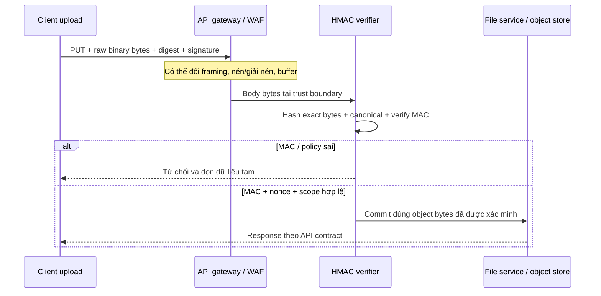
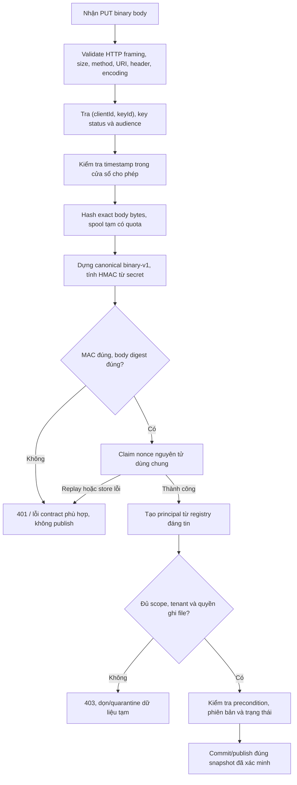

# Binary body trong HMAC request authentication

## Mục tiêu học tập

Trong chương **Body canonicalization**, *binary body* là phần nội dung HTTP request được xử lý như **một dãy byte** thay vì văn bản JSON, XML hoặc chuỗi ký tự. Ví dụ: client tải lên ảnh PNG, tệp PDF, dữ liệu ZIP, video hoặc một blob `application/octet-stream`. Để xác thực HTTP request bằng HMAC, server phải bảo vệ **chính xác byte body mà hợp đồng ký quy định**. Chỉ một byte bị đổi, thêm, mất hoặc giải mã lại cũng có thể khiến chữ ký không khớp.

Bài học nằm trong module `SECURITY_AUTHENTICATION_HMAC_REQUEST_AUTHENTICATION`, tập trung vào thiết kế HMAC request authentication bằng **shared secret**, **canonical request** có method, URI, header hoặc body; xác minh chữ ký, chống replay bằng timestamp/nonce, key rotation, kiểm thử qua proxy/gateway và tách biệt **authentication** với **authorization**.

Sau bài này, bạn có thể:

- Giải thích body nhị phân là gì, phân biệt **raw payload bytes**, HTTP transfer framing, `Content-Encoding`, `Content-Type` và dữ liệu sau xử lý.
- Lựa chọn hợp đồng ký dựa trên **SHA-256 của chính xác body bytes** và tính HMAC-SHA256 trên canonical request.
- Tránh lỗi chuyển body nhị phân qua `String`/UTF-8, parser, serializer, Base64 không cần thiết hoặc middleware thay đổi byte.
- Xây dựng ví dụ Java 17 tự chứa có byte `0x00`, `0x80`, `0xFF`, minh họa MAC hợp lệ và MAC thất bại khi body thay đổi.
- Thiết kế xác minh body lớn theo hướng **streaming**, giới hạn kích thước, không thực thi nghiệp vụ trước khi xác thực xong.
- Kiểm thử nén, chunked transfer, multipart, proxy/gateway, replay, key rotation và authorization trên tài nguyên.

## 1. Binary body là gì?

HTTP request có thể mang một chuỗi byte tùy ý ở phần **content** (thường gọi là request body). Byte trong payload **không bắt buộc là ký tự Unicode hợp lệ** và có thể chứa byte bằng không `0x00` hoặc những byte không hợp lệ trong UTF-8.

Ví dụ client upload:

```http
PUT /v1/files/file-123/content?tenant=merchant-42 HTTP/1.1
Host: media.example.test
Content-Type: application/octet-stream
X-Client-Id: uploader-service-prod
X-Key-Id: key-2026-11
X-Timestamp: <epoch-seconds>
X-Nonce: <nonce>
X-Content-SHA256: <base64url-sha256-of-body>
X-Signature: <base64url-hmac-sha256>

<binary payload bytes>
```

Body có thể có những byte sau (dạng hex):

```text
00 01 7F 80 FF 0D 0A 00 2A
```

Dãy hex chỉ là **cách hiển thị các byte** trong tài liệu; dữ liệu gửi trên HTTP không tự chứa ký tự `"0"`, `"0"`, dấu cách hoặc một chuỗi hex. Tương tự, `Content-Type: application/octet-stream` mô tả loại nội dung, nhưng **không biến byte thành chuỗi văn bản**.

### 1.1. Không chuyển binary body thành `String` rồi ký

Cách làm sai:

```java
String text = new String(rawBody, java.nio.charset.StandardCharsets.UTF_8);
byte[] reconstructed =
        text.getBytes(java.nio.charset.StandardCharsets.UTF_8);
```

Với binary body có byte `0xFF` hoặc một sequence không hợp lệ của UTF-8, Java decoder mặc định có thể thay byte không hợp lệ bằng **replacement character**. Khi encode lại, dãy byte không còn giống ban đầu. Với HMAC, điều này có nghĩa:

```text
SHA-256(originalBytes) != SHA-256(reconstructedBytes)  (thường gặp)
HMAC(canonicalOriginal) != HMAC(canonicalReconstructed)
```

Không cần biết file là ảnh, PDF, ZIP hay dữ liệu mã hóa: **hash trực tiếp `byte[]` hoặc stream byte**. Chỉ dùng text decoding nếu hợp đồng *thật sự* chọn ký dạng văn bản đã chuẩn hóa; đó là một bài toán khác.

### 1.2. Những biểu diễn dễ bị nhầm

| Dữ liệu | Ví dụ | Có phải byte body được ký không? |
| --- | --- | --- |
| Payload gốc | `00 01 FF 80` | **Có**, nếu hợp đồng chọn ký exact payload bytes. |
| Chuỗi hex hiển thị | `"0001ff80"` | **Không**, trừ khi HTTP body thật là chuỗi ASCII đó. |
| Chuỗi Base64 | `"AAH/gA=="` | **Không**, nếu HTTP body thực gửi là 4 byte gốc. |
| UTF-8 decode từ binary | `new String(body, UTF_8)` | Không bảo toàn byte tùy ý. |
| JSON biểu diễn file | `{"data":"AAH/gA=="}` | Là body JSON khác; phải hash **chính byte JSON** nếu đó là payload HTTP thực. |
| SHA-256 body digest | 32 byte băm | Là **đại diện mật mã** cho body, không phải raw body. |
| HMAC request signature | 32 byte MAC với HMAC-SHA256 | Bảo vệ canonical request, bao gồm digest body đã chọn. |

**Base64 không phải mã hóa bảo mật**. Nó chỉ biểu diễn byte thành ký tự. Việc body được gửi dạng raw hay Base64 trong JSON phải là quyết định của giao thức, không thể thay thế tùy ý rồi mong chữ ký không đổi.

## 2. Xác định lớp byte nào sẽ được ký

Trên đường đi từ client đến server, một HTTP body có thể trải qua nhiều tầng. Hợp đồng phải xác định **chính xác ranh giới lấy byte**:

```text
File bytes từ ứng dụng client
            |
            v
[HTTP content bytes cần ký]  <-- điểm ký của binary-v1
            |
            v
[HTTP transfer framing: Content-Length/chunked/HTTP2 DATA frames]
            |
            v
[TLS + network + gateway]
            |
            v
[HTTP parser loại transfer framing]
            |
            v
[Content bytes thực nhận]   <-- điểm hash/verify của binary-v1
            |
            v
[Content decoding/decompression nếu hợp đồng cho phép]
            |
            v
[Parser/virus scan/storage/business processing]
```

Trong hợp đồng ví dụ của bài, body để hash là **HTTP content bytes sau khi tầng HTTP đã xử lý transfer framing**, nhưng **trước khi middleware chuyển đổi nội dung**. Để giữ quy tắc đơn giản, API ví dụ chỉ nhận `Content-Encoding` vắng mặt hoặc `identity`. Hợp đồng khác có thể ký compressed bytes hoặc decompressed bytes, nhưng phải chỉ rõ cả client và server sử dụng **cùng byte**.

### 2.1. HTTP transfer framing không phải payload

HTTP/1.1 có thể truyền dữ liệu với `Content-Length` hoặc `Transfer-Encoding: chunked`. Khi chunked, kích thước chunk, ký tự CRLF phân cách chunk và marker kết thúc là **framing**; những byte đó không nằm trong body payload mà ứng dụng HTTP thông thường nhận sau khi decode transfer framing.

Ví dụ body hữu ích là đúng 5 byte:

```text
48 45 4C 4C 4F       # "HELLO" (5 bytes)
```

HTTP/1.1 có thể chuyển qua chunked:

```http
5
HELLO
0

```

Các ký tự biểu diễn chunk length và ranh giới chunk **không được đưa vào SHA-256 payload** của hợp đồng này. Hai request có chunk boundaries khác nhau nhưng **cùng 5 byte content** phải có body digest như nhau. Không lấy raw TCP bytes, TLS records hoặc `Content-Length` làm thay thế cho body bytes.

**Bảo mật framing:** Request có `Content-Length` và `Transfer-Encoding` mâu thuẫn, header trùng hoặc cú pháp chunk không hợp lệ có thể tạo tình huống frontend/backend phân tích request không thống nhất. Edge và HTTP server phải tuân thủ quy tắc parsing an toàn, từ chối ambiguity; HMAC ứng dụng **không sửa được request smuggling ở lớp HTTP**.

### 2.2. `Content-Encoding` là biến đổi nội dung, không phải transfer framing

`Content-Encoding: gzip` mô tả nội dung đã được nén ở mức representation. Nếu client ký **compressed bytes** nhưng gateway tự giải nén trước khi verifier hash, SHA-256 sẽ khác.

| Tình huống | Byte body mà verifier thấy | Hệ quả |
| --- | --- | --- |
| Không `Content-Encoding` | Byte payload như client ký | Có thể xác minh bình thường nếu không có biến đổi khác. |
| `Content-Encoding: identity` | Byte payload không biến đổi | Được hợp đồng ví dụ cho phép. |
| `Content-Encoding: gzip`, verifier nhận compressed bytes | Có thể ký compressed bytes nếu hợp đồng hỗ trợ kiểu này | **Không được hợp đồng binary-v1 hiện tại chấp nhận**. |
| Gateway giải nén gzip trước verify | Byte khác compressed bytes client ký | MAC mismatch nếu ký compressed bytes. |
| Middleware chuyển ảnh/metadata hoặc normalize data | Byte khác | MAC mismatch hoặc nguy cơ thực thi dữ liệu chưa được bảo vệ. |

Đối với API thật cần upload nội dung đã nén, có thể chọn *một* hợp đồng khác: hoặc ký compressed bytes và chỉ giải nén sau xác minh, hoặc ký decompressed bytes và quy định việc giải nén, giới hạn kích thước giải nén, thứ tự xử lý và phạm vi chữ ký rõ ràng. Cần có test vector.

### 2.3. `Content-Type` mô tả định dạng; không tự chuẩn hóa byte

Các media type như `application/octet-stream`, `application/pdf`, `image/png` hoặc `application/zip` nói cho ứng dụng biết cách **diễn giải** payload. Chúng không bắt buộc file sẽ được chuyển đổi trước khi hash.

Ví dụ cùng dãy byte nhưng hai Content-Type khác nhau có thể dẫn tới hai handler/validator khác nhau. Vì vậy nếu Content-Type ảnh hưởng cách parse/store dữ liệu, nên ký **giá trị đã được chuẩn hóa theo hợp đồng** hoặc chỉ chấp nhận một Content-Type rõ ràng.

Trong hợp đồng thực hành, `Content-Type` phải **chính xác** `application/octet-stream` (sau khi parser HTTP đã loại bỏ OWS theo chính sách). Client không tự thêm `charset=UTF-8`; server không đổi Content-Type sau verify. Không dùng Content-Type như bằng chứng file an toàn: server vẫn cần kiểm tra format/content, malware scanning và policy lưu trữ ở tầng nghiệp vụ khi cần.

### 2.4. Body vắng mặt và body dài 0 byte

Với các API, cần phân biệt **semantics** “không cung cấp nội dung” và “nội dung rỗng” khi business contract yêu cầu. Về hash byte:

```text
SHA256(byte[0]) =
e3b0c44298fc1c149afbf4c8996fb92427ae41e4649b934ca495991b7852b855

Base64URL_NoPadding(SHA256(byte[0])) =
47DEQpj8HBSa-_TImW-5JCeuQeRkm5NMpJWZG3hSuFU
```

Hợp đồng binary-v1 quy định body **có thể rỗng** và khi đó dùng đúng hash trên; ứng dụng phải kiểm tra có cho phép upload rỗng không. Nếu API cần phân biệt “không có body” với “có body rỗng” như hai trạng thái nghiệp vụ, hợp đồng phải có **trường biểu thị sự hiện diện** ngoài body hash; một digest của 0 byte không thể tự phân biệt hai trường hợp.

## 3. Mục tiêu bảo mật của body canonicalization

### 3.1. Tính xác định theo byte (*byte-for-byte*)

Client và server cùng nhận **một byte sequence**, cùng hash algorithm và cùng format digest thì phải cho kết quả giống nhau trên mọi JDK/provider tuân thủ chuẩn. Không được để default charset, line ending hoặc serializer quyết định byte để ký.

Ví dụ:

```text
A = 00 FF 0D 0A 7F
B = 00 FF 0A    7F
```

Hai mảng này khác nhau ở byte CR, nên digest phải khác với xác suất áp đảo. Không có chuyện “CRLF và LF tương đương” khi ký binary body trừ khi hợp đồng **cố ý** định nghĩa một bước chuẩn hóa như vậy — điều thường không phù hợp với file tùy ý.

### 3.2. Tính toàn vẹn của body gắn với request

Nếu chỉ gửi `X-Content-SHA256` mà không ký header đó cùng method/URI/audience, kẻ tấn công có thể sửa body và **tính lại hash**. Digest không dùng khóa, vì vậy **không chứng minh bên gửi sở hữu shared secret**.

Mô hình an toàn của ví dụ:

```text
bodyDigest = SHA256(exactBodyBytes)
canonical  = join(LF, algorithm, version, audience, clientId, keyId,
                  method, rawTarget, contentType,
                  Base64URL_NoPadding(bodyDigest), timestamp, nonce)
mac        = HMAC_SHA256(sharedSecretBytes, UTF8(canonical))
signature  = Base64URL_NoPadding(mac)
```

Server phải **tự tính bodyDigest từ byte thực nhận**, không tin mù quáng `X-Content-SHA256` do client gửi. Sau đó dựng canonical request từ trường HTTP thực nhận và byte digest, tính HMAC bằng key server giữ, rồi so sánh MAC. Khi cả body hash và HMAC hợp lệ, dữ liệu body đã được ràng buộc vào chữ ký theo giả định an toàn của SHA-256/HMAC-SHA256.

### 3.3. Tính nhất quán giữa xác minh và thực thi

Không được **xác minh byte A nhưng lưu trữ hoặc xử lý byte B** do gateway/middleware âm thầm biến đổi. Nếu một phép transform được cho phép, cần thiết kế rõ: xác minh byte tại điểm nào, liệu byte sau transform còn được ràng buộc với principal hay không và business handler dùng byte nào.

Với file upload, việc **quét virus, decode ảnh, chuyển format, rút metadata hoặc lưu cloud object** có thể là xử lý hợp lệ **sau xác minh**. Cần bảo đảm file được ký và file nhận xử lý có quan hệ đáng tin cậy; nếu file được thay đổi có chủ đích, metadata/output phải phản ánh đúng, không tuyên bố chữ ký client bảo vệ trực tiếp mọi byte output sau transform.

### 3.4. Tính an toàn tài nguyên (*resource safety*)

Hash/HMAC có thể tốn CPU, RAM, disk hoặc băng thông nếu client gửi body khổng lồ. Hợp đồng nên có:

- Giới hạn kích thước request tổng, body nhị phân và deadline đọc.
- Streaming hash hoặc spool sang nơi lưu tạm có quota thay vì `readAllBytes()` vô hạn.
- Kiểm soát concurrency, cancellation, timeout và backpressure.
- **Không có side effect nghiệp vụ không thể đảo ngược trước khi MAC, freshness, nonce và authorization hợp lệ**.
- Xử lý thiếu byte, body bị cắt, body dư và framing mâu thuẫn như lỗi, không cố khôi phục để chữ ký khớp.

## 4. Hợp đồng ký HMAC `binary-v1`

Không tồn tại một dạng canonical request chung cho mọi HTTP API. Đây là **hợp đồng giáo dục cụ thể** cho upload nhị phân vào một tài nguyên:

```http
PUT /v1/files/file-123/content?tenant=merchant-42 HTTP/1.1
Host: media.example.test
Content-Type: application/octet-stream
X-Client-Id: uploader-service-prod
X-Key-Id: key-2026-11
X-Timestamp: 1795800000
X-Nonce: ZNtbmRw-5vR3NDGWFafXLg
X-Content-SHA256: <base64url-sha256-binary-body>
X-Signature: <base64url-hmac-sha256>

<exact binary bytes, not text>
```

**Các chuỗi trong dấu `<...>` là placeholder.** Timestamp cố định dùng trong tài liệu chỉ minh họa; request thực phải gửi timestamp hiện tại và nonce mới. Không đưa raw shared secret vào HTTP header.

### 4.1. Canonical request 11 dòng

Chuỗi canonical là **11 trường** UTF-8, ngăn bằng đúng LF (`\n`), **không có LF cuối**:

```text
HMAC-SHA256
binary-v1
media-api-prod
uploader-service-prod
key-2026-11
PUT
/v1/files/file-123/content?tenant=merchant-42
application/octet-stream
<base64url-sha256-binary-body>
1795800000
ZNtbmRw-5vR3NDGWFafXLg
```

| Dòng | Trường | Quy tắc |
| --- | --- | --- |
| 1 | `HMAC-SHA256` | Nhãn hợp đồng; Java JCA dùng tên `HmacSHA256`. |
| 2 | `binary-v1` | Phiên bản khóa chặt quy tắc body và raw target. |
| 3 | `media-api-prod` | Audience từ cấu hình đáng tin, phải phù hợp credential. |
| 4 | `X-Client-Id` | ID được ký, server chỉ tin sau khi MAC và chính sách hợp lệ. |
| 5 | `X-Key-Id` | Chọn đúng secret theo cặp client/key; dùng cho key rotation. |
| 6 | `PUT` | Method exact, không tự method override. |
| 7 | Raw path + query | Đúng target ở ranh giới xác minh, ví dụ một file ID và tenant cố định. |
| 8 | `application/octet-stream` | Content-Type exact được hợp đồng cho phép. |
| 9 | Base64URL(SHA-256(raw body bytes)) | 32 byte digest, biểu diễn 43 ký tự không padding. |
| 10 | Unix epoch seconds | Timestamp dạng số ASCII, được MAC bảo vệ. |
| 11 | Nonce | 16 byte CSPRNG, Base64URL không padding, được MAC bảo vệ. |

Quy tắc bắt buộc:

1. **Method:** chỉ `PUT` cho endpoint mẫu. Upload một tài nguyên xác định phù hợp với semantics PUT; việc ghi đè/versioning vẫn cần chính sách ở backend.
2. **Raw request-target:** đúng dạng `/v1/files/{fileId}/content?tenant={tenantId}` với cả hai ID thuộc `[A-Za-z0-9_-]{1,64}`. Không cho query parameter lạ/trùng, dot segment, encoding phức tạp hoặc route rewrite ngoài hợp đồng. Đây là ví dụ grammar chặt, không phải quy tắc mọi API.
3. **Content-Type:** chỉ một giá trị `application/octet-stream`. Header ký phải không trùng/mơ hồ; không có CR/LF điều khiển.
4. **Content-Encoding:** chỉ vắng mặt hoặc `identity`, không tự giải nén body trước khi hash. Mọi byte content do HTTP parser cung cấp phải được giữ nguyên cho bước xác minh.
5. **Body digest:** SHA-256 của **chính xác byte payload** tại trust boundary. `X-Content-SHA256` nếu có phải khớp với digest server tự tính. Không hash UTF-8 String, Base64 textual representation hoặc JSON object thay cho bytes.
6. **Size:** hạn chế body tối đa theo chính sách, ví dụ **16 MiB** trong bài thực hành; xử lý kích thước và timeout trước khi nhận toàn bộ data.
7. **Credential:** secret sinh bằng CSPRNG, ví dụ 32 byte; giữ trong secret manager. `clientId`, `keyId` và audience phải được HMAC bảo vệ và đối chiếu registry.
8. **Timestamp/nonce:** ký cả timestamp và nonce; server kiểm tra timestamp còn trong cửa sổ và claim nonce nguyên tử sau MAC.
9. **Định dạng chữ ký:** HMAC-SHA256 trả 32 byte; mã hóa Base64URL **không padding** dài 43 ký tự. `X-Signature` không nằm trong canonical.
10. **Dấu phân cách:** cấm CR/LF trong trường text canonical; chỉ nối bằng LF, không dùng `System.lineSeparator()` hoặc charset mặc định.

### 4.2. Có cần ký `Content-Length` không?

**Không bắt buộc** đưa `Content-Length` vào canonical request; HTTP/2/3 và proxy có thể thay cách biểu diễn framing, `Content-Length` có thể vắng mặt trong một số luồng gửi. Độ dài body thực tế được giám sát bởi giới hạn request và được ràng buộc **gián tiếp** qua SHA-256 của toàn bộ byte.

Nếu API cần chống nhầm **độ dài được mong đợi** (ví dụ upload chunk, resume hoặc hợp đồng nghiệp vụ có kích thước file), nên thêm trường **explicit signed expected length** trong một phiên bản hợp đồng riêng, rồi đối chiếu với **số byte thực đọc**. Không lấy `Content-Length` tự khai làm sự thật và không mặc định các HTTP framing khác nhau phải cho cùng header length.

## 5. Java 17: ký HMAC trên body nhị phân

Chương trình sau tự chứa và chạy bằng JDK 17+. Nó mô phỏng **client và server cùng được cấp một shared secret**; dùng mảng byte có `0x00`, `0x80`, `0xFF` và CR/LF. Hệ thống HTTP thực tế phải tự lấy bytes từ parser tại trust boundary, validate header framing và tra secret bằng client/key ID từ registry.

### 5.1. Mã nguồn đầy đủ

```java
import java.nio.charset.StandardCharsets;
import java.security.GeneralSecurityException;
import java.security.MessageDigest;
import java.security.SecureRandom;
import java.time.Instant;
import java.util.Arrays;
import java.util.Base64;
import java.util.Objects;
import java.util.regex.Pattern;
import javax.crypto.Mac;
import javax.crypto.spec.SecretKeySpec;

public final class BinaryBodyHmacDemo {
    private static final String AUDIENCE = "media-api-prod";
    private static final Pattern TARGET = Pattern.compile(
            "/v1/files/[A-Za-z0-9_-]{1,64}/content\\?tenant=[A-Za-z0-9_-]{1,64}");
    private static final Pattern IDENTIFIER =
            Pattern.compile("[A-Za-z0-9_-]{1,64}");
    private static final Base64.Encoder B64 =
            Base64.getUrlEncoder().withoutPadding();
    private static final Base64.Decoder B64_DECODER =
            Base64.getUrlDecoder();

    private BinaryBodyHmacDemo() {}

    record Upload(
            String method, String rawTarget, String contentType,
            byte[] body, String clientId, String keyId,
            String timestamp, String nonce) {
        Upload {
            body = Objects.requireNonNull(body, "body").clone();
        }
        @Override public byte[] body() {
            return body.clone(); // Tách mảng mutable khỏi caller.
        }
    }

    record SignedHeaders(String bodySha256, String signature) {}

    static void validate(Upload request) {
        if (!"PUT".equals(request.method())
                || !"application/octet-stream".equals(request.contentType())) {
            throw new IllegalArgumentException("Unexpected method/content-type");
        }
        if (request.rawTarget() == null
                || !TARGET.matcher(request.rawTarget()).matches()) {
            throw new IllegalArgumentException("Invalid raw target");
        }
        if (request.body().length > 16 * 1024 * 1024) {
            throw new IllegalArgumentException("Binary body too large");
        }
        if (request.clientId() == null
                || !IDENTIFIER.matcher(request.clientId()).matches()
                || request.keyId() == null
                || !IDENTIFIER.matcher(request.keyId()).matches()) {
            throw new IllegalArgumentException("Invalid client/key ID");
        }
        if (request.timestamp() == null
                || !request.timestamp().matches("[1-9][0-9]{0,18}")) {
            throw new IllegalArgumentException("Invalid timestamp syntax");
        }
        String nonce = request.nonce();
        if (nonce == null || !nonce.matches("[A-Za-z0-9_-]{22}")) {
            throw new IllegalArgumentException("Invalid nonce syntax");
        }
        byte[] nonceBytes = B64_DECODER.decode(nonce);
        if (nonceBytes.length != 16
                || !B64.encodeToString(nonceBytes).equals(nonce)) {
            throw new IllegalArgumentException("Invalid nonce encoding");
        }
    }

    static String hashBody(byte[] exactBytes) throws GeneralSecurityException {
        byte[] digest = MessageDigest.getInstance("SHA-256")
                .digest(exactBytes);
        return B64.encodeToString(digest);
    }

    static String canonical(Upload r, String hash) {
        validate(r);
        // Không chèn binary body trực tiếp vào chuỗi canonical.
        return String.join("\n",
                "HMAC-SHA256", "binary-v1", AUDIENCE,
                r.clientId(), r.keyId(), r.method(), r.rawTarget(),
                r.contentType(), hash, r.timestamp(), r.nonce());
    }

    static byte[] hmac(byte[] rawSecret, String canonical)
            throws GeneralSecurityException {
        Mac engine = Mac.getInstance("HmacSHA256");
        engine.init(new SecretKeySpec(rawSecret, "HmacSHA256"));
        return engine.doFinal(canonical.getBytes(StandardCharsets.UTF_8));
    }

    static SignedHeaders sign(Upload r, byte[] secret)
            throws GeneralSecurityException {
        String digest = hashBody(r.body());
        String signature = B64.encodeToString(
                hmac(secret, canonical(r, digest)));
        return new SignedHeaders(digest, signature);
    }

    static boolean verifyMac(Upload r, SignedHeaders h, byte[] secret)
            throws GeneralSecurityException {
        if (h == null || h.bodySha256() == null || h.signature() == null) {
            return false;
        }
        try {
            String actualBodyHash = hashBody(r.body());
            if (!actualBodyHash.equals(h.bodySha256())) {
                return false;
            }
            String encoded = h.signature();
            if (!encoded.matches("[A-Za-z0-9_-]{43}")) {
                return false;
            }
            byte[] supplied = B64_DECODER.decode(encoded);
            if (supplied.length != 32
                    || !B64.encodeToString(supplied).equals(encoded)) {
                return false;
            }
            byte[] expected = hmac(secret, canonical(r, actualBodyHash));
            return MessageDigest.isEqual(expected, supplied);
        } catch (IllegalArgumentException ex) {
            return false;
        }
    }

    static Upload withBody(Upload request, byte[] newBody) {
        return new Upload(
                request.method(), request.rawTarget(), request.contentType(),
                newBody, request.clientId(), request.keyId(),
                request.timestamp(), request.nonce());
    }

    public static void main(String[] args)
            throws GeneralSecurityException {
        SecureRandom random = new SecureRandom();
        byte[] secret = new byte[32];  // Chỉ mô phỏng cấp phát secret.
        random.nextBytes(secret);
        byte[] nonceBytes = new byte[16];
        random.nextBytes(nonceBytes);

        byte[] binaryBody = {
                0x00, 0x01, 0x7F, (byte) 0x80, (byte) 0xFF,
                0x0D, 0x0A, 0x00, 0x2A
        };
        Upload original = new Upload(
                "PUT", "/v1/files/file-123/content?tenant=merchant-42",
                "application/octet-stream", binaryBody,
                "uploader-service-prod", "key-2026-11",
                Long.toString(Instant.now().getEpochSecond()),
                B64.encodeToString(nonceBytes));

        SignedHeaders signed = sign(original, secret);
        System.out.println("Original binary body valid: "
                + verifyMac(original, signed, secret));

        byte[] modified = original.body();
        modified[4] ^= 0x01; // Sửa một bit của byte 0xFF.
        System.out.println("Modified body accepted: "
                + verifyMac(withBody(original, modified), signed, secret));

        byte[] textRoundTrip = new String(original.body(),
                StandardCharsets.UTF_8).getBytes(StandardCharsets.UTF_8);
        System.out.println("UTF-8 round-trip changed bytes: "
                + !Arrays.equals(original.body(), textRoundTrip));
        System.out.println("Round-tripped body accepted: "
                + verifyMac(withBody(original, textRoundTrip), signed, secret));

        Upload emptyBody = withBody(original, new byte[0]);
        SignedHeaders emptySigned = sign(emptyBody, secret);
        System.out.println("Empty body digest: " + emptySigned.bodySha256());
        System.out.println("Empty body signature valid: "
                + verifyMac(emptyBody, emptySigned, secret));

        Arrays.fill(secret, (byte) 0);
        Arrays.fill(binaryBody, (byte) 0);
        Arrays.fill(modified, (byte) 0);
        Arrays.fill(textRoundTrip, (byte) 0);
    }
}
```

Kết quả kỳ vọng:

```text
Original binary body valid: true
Modified body accepted: false
UTF-8 round-trip changed bytes: true
Round-tripped body accepted: false
Empty body digest: 47DEQpj8HBSa-_TImW-5JCeuQeRkm5NMpJWZG3hSuFU
Empty body signature valid: true
```

**Điểm quan trọng của ví dụ:**

- `MessageDigest.getInstance("SHA-256")` nhận **mảng byte gốc**; `Mac.getInstance("HmacSHA256")` thực hiện HMAC với shared secret do `SecretKeySpec` biểu diễn.
- `canonical(...)` không chuyển binary body thành text; nó chỉ chứa **digest Base64URL** của body và các trường HTTP còn lại.
- `Upload` sao chép body lúc nhận và trả bản sao để hạn chế lỗi mutable buffer bị sửa sau khi ký. Trong production, còn cần snapshot/spooling để tránh body thay đổi giữa lúc hash và lúc xử lý.
- Demo so sánh signature bằng byte MAC qua `MessageDigest.isEqual`, không dùng so sánh chuỗi ký tự để quyết định MAC hợp lệ.
- Demo **chưa** kiểm tra timestamp thực tế, nonce store, trạng thái key/registry, Content-Encoding, header trùng, gateway hoặc authorization. Đó là trách nhiệm của adapter HTTP và ứng dụng.
- `Arrays.fill` chỉ cố gắng dọn các mảng đang giữ trong code; JVM/provider có thể giữ các bản sao khác. Không coi việc xóa mảng là bảo đảm đã xóa secret khỏi mọi bộ nhớ.

## 6. Binary body lớn: hash streaming mà không tải tất cả vào RAM

Một file 500 MiB không nên bị ép thành một `byte[]` chỉ để tính SHA-256. `MessageDigest` hỗ trợ `update(...)` trên từng khối byte:

```java
import java.io.IOException;
import java.io.InputStream;
import java.security.GeneralSecurityException;
import java.security.MessageDigest;
import java.util.Base64;

static String hashStream(InputStream input, long maxBytes)
        throws IOException, GeneralSecurityException {
    MessageDigest sha256 = MessageDigest.getInstance("SHA-256");
    byte[] buffer = new byte[64 * 1024];
    long total = 0;
    int n;
    while ((n = input.read(buffer)) != -1) {
        if (total > maxBytes - n) {
            throw new IOException("Body size limit exceeded");
        }
        sha256.update(buffer, 0, n);
        total += n;
    }
    byte[] digest = sha256.digest();
    return Base64.getUrlEncoder().withoutPadding()
            .encodeToString(digest);
}
```

Hàm này minh họa cách tạo SHA-256 trên một stream mà không giữ toàn bộ payload trong RAM; có thể dùng `DigestInputStream` tương đương. **Phải hash đến hết stream**, không chỉ đọc prefix hoặc đoạn mà parser tình cờ tiêu thụ. Nếu network bị ngắt giữa chừng hoặc byte count không đúng framing thì request phải thất bại.

### 6.1. Không xử lý file trước khi xác thực hoàn tất

Một anti-pattern nguy hiểm:

```text
stream -> ghi đè file chính thức / gọi scanner / phát event
         -> sau cùng mới kiểm tra HMAC
```

Nếu HMAC sai, ứng dụng đã tạo side effect trước khi từ chối request.

Mô hình an toàn hơn:

```text
stream HTTP đã được kiểm soát framing/size
        |
        v
[hash SHA-256 streaming + spool tạm có quota, cô lập]
        |
        v
[kiểm tra đủ byte, body hash, HMAC, key, timestamp, nonce]
        |
        v
[authorization theo tenant/file ID và điều kiện ghi đè]
        |
        v
[publish/move atomic hoặc commit nội dung + metadata]
        |
        v
[scan/transform nếu nghiệp vụ yêu cầu và gắn đúng metadata]
```

Nếu file lớn được lưu trực tiếp vào object storage theo kiểu multipart upload, các phần chưa xác thực cần nằm trong **vùng tạm/quarantine** mà không ai được đọc như dữ liệu đã được cấp quyền; hệ thống chỉ *commit/publish* sau xác minh và phân quyền. Luôn có chính sách dọn file tạm khi lỗi/timeout, hạn chế quota và vòng đời object chưa commit.

### 6.2. Khi nào hash trực tiếp stream bằng `Mac.update(...)`?

HMAC có thể xử lý dữ liệu theo từng khối với `Mac.update(...)`, nhưng **hợp đồng binary-v1 không ký trực tiếp byte body trong canonical string**; nó ký **digest SHA-256** của toàn bộ body. Vì vậy, trình tự chính xác là:

1. Đọc stream body và cập nhật `MessageDigest` theo từng khối.
2. Hoàn tất SHA-256, mã hóa digest đúng Base64URL không padding.
3. Xây canonical request chứa **digest đó**.
4. Khởi tạo `Mac` bằng shared secret và tính HMAC trên **byte UTF-8 của canonical request**.

Nếu quyết định xây giao thức khác dùng `Mac.update(headerBytes)` rồi `Mac.update(bodyChunk)`, đó là **hợp đồng ký khác**: phải định nghĩa delimiter, length-prefix, byte order, body framing, version và test vector. Không nhầm nó với hợp đồng ký `SHA-256(body)` hiện tại.

### 6.3. Snapshot và TOCTOU

Khi upload từ tệp local, file có thể bị **thay đổi trong lúc hoặc sau khi ký**. Nếu SDK hash file trước, rồi mở file lần thứ hai để upload, byte gửi có thể đã khác byte ký. Tương tự, backend hash một phiên bản file tạm nhưng sau đó publish một phiên bản đã bị ghi đè bởi worker khác.

Cần bảo đảm **một snapshot bất biến của byte được ký và gửi/commit**:

- Client có thể mở file theo cơ chế snapshot/lock phù hợp, hoặc spool nội dung đã hash rồi gửi chính nội dung đó.
- Server gắn digest với object tạm có ID/handle bất biến, giới hạn quyền ghi và commit chính object đã xác minh.
- Tránh tình huống path tạm có thể bị thay thế giữa bước kiểm tra và bước lưu vào tài nguyên chính thức.

**Phần kết nối với HTTP:** Thao tác ghi file phụ thuộc trực tiếp vào **authorization**: client có quyền ghi `file-123` trong `merchant-42` hay không, có được overwrite/append hay không và content type/size có được phép không. MAC hợp lệ không tự cấp những quyền đó.

## 7. Multipart, upload theo chunk và partial content

### 7.1. `multipart/form-data` là binary body nhưng có cấu trúc

Một request upload có thể chứa nhiều phần: tệp, metadata, trường form và các header của từng part. Ví dụ rút gọn:

```http
POST /v1/uploads HTTP/1.1
Content-Type: multipart/form-data; boundary=Boundary-X

--Boundary-X
Content-Disposition: form-data; name="description"

Hồ sơ minh họa
--Boundary-X
Content-Disposition: form-data; name="file"; filename="photo.png"
Content-Type: image/png

<PNG bytes>
--Boundary-X--
```

Đây là **một HTTP content byte sequence**. Trong đó có boundary, header mỗi part, dấu xuống dòng và byte tệp. Nếu ký **SHA-256 của toàn bộ HTTP body**, phải hash chính xác chuỗi byte multipart được phát, **không chỉ byte tệp**. Hai multipart body chứa cùng file nhưng khác boundary hoặc thứ tự part thường có SHA-256 khác nhau.

Các lỗi phổ biến:

- Client dựng multipart body để ký, nhưng HTTP library tự sinh **boundary mới** khi gửi.
- Gateway hoặc framework parse multipart rồi serialize lại, thay thứ tự part, header, filename, CRLF hoặc boundary.
- Verifier hash **chỉ file bytes** trong khi client ký **toàn multipart bytes**, hoặc ngược lại.
- Verifier bỏ metadata không được ký, nhưng business handler dùng nó để chọn tenant hoặc file destination.
- Bộ parser multipart chấp nhận hai part cùng tên `file` hoặc `tenant` trong khi verifier lấy một giá trị khác handler.

**Giải pháp:** Hợp đồng multipart phải ghi rõ ký **toàn raw multipart content**, hay ký **digest file bytes + metadata có cấu trúc** theo một canonicalization riêng; khi chọn phương án thứ hai, phải định nghĩa thứ tự part, trường được phép, duplicate name, Content-Disposition/filename, format và không bỏ qua thông tin có tác động bảo mật.

Hợp đồng `binary-v1` của bài này **chỉ chấp nhận `application/octet-stream`**, do đó **không** áp dụng thẳng cho `multipart/form-data`. Muốn hỗ trợ multipart cần một hợp đồng/phiên bản phù hợp, không đổi Content-Type mà giữ nguyên cách ký một cách tùy tiện.

### 7.2. Upload theo chunk và resume

Với file lớn, API có thể cho upload từng mảnh. Có ít nhất hai kiểu thiết kế:

1. **Mỗi chunk là một HTTP request có HMAC riêng:** mỗi request phải ký đúng byte chunk, chunk index hoặc byte offset, upload/session ID, file/object ID, tenant và expected total size/digest nếu chúng ảnh hưởng đến việc ghép. Timestamp và nonce **mới** cho mỗi HTTP request.
2. **Một request gửi trọn stream:** digest được tính đến khi đọc hết body; chỉ xác minh và publish sau khi đủ byte và đủ điều kiện.

Rủi ro nếu hợp đồng chỉ ký byte chunk nhưng **không ký vị trí và upload session**: chunk hợp lệ có thể bị đặt vào **vị trí khác** hoặc gắn vào file khác nếu authorization/routing không ràng buộc các metadata đó.

`Content-Range` hoặc các trường offset tùy chỉnh chỉ được sử dụng khi API đã định nghĩa semantics. Nếu handler dùng chúng, cần bảo vệ chúng bằng HMAC hoặc bằng một nguồn dữ liệu đáng tin được kiểm chứng độc lập. Tương tự, **ETag**, checksum tổng file hoặc upload ID không phải bằng chứng phân quyền.

### 7.3. Digest của chunk và digest của file hoàn chỉnh

```text
chunk0Hash = SHA256(chunk0Bytes)
chunk1Hash = SHA256(chunk1Bytes)

fullHash   = SHA256(concat(chunk0Bytes, chunk1Bytes))
```

**Không được mặc định** rằng `fullHash = SHA256(concat(chunk0Hash, chunk1Hash))`. Đó là phép tính khác, không cho SHA-256 của file đầy đủ. Nếu thiết kế Merkle tree hoặc sơ đồ ghép checksum, phải công bố một giao thức riêng và kiểm thử chặt.

Khi hoàn tất upload theo chunk, server cần kiểm tra **đủ chunk, đúng vị trí, không trùng/thiếu, đúng kích thước và digest toàn file** trước khi publish. Một chữ ký hợp lệ của từng chunk chưa chứng minh file sau ghép chính xác nếu thứ tự hoặc metadata ghép chưa được ràng buộc.

## 8. Proxy/gateway có thể làm binary body thay đổi như thế nào?

Đường đi thực tế:



| Biến đổi trung gian | Ảnh hưởng đến body digest | Kiểm soát cần có |
| --- | --- | --- |
| HTTP/1.1 chunked → HTTP/2 DATA frames | Không đổi digest nếu **content bytes** giữ nguyên. | Ký content bytes sau transfer framing, không ký wire framing. |
| Gateway đổi `Content-Length` hoặc dùng streaming | Không đổi digest nếu payload bytes giữ nguyên. | Giới hạn body/timeout độc lập với framing. |
| Gateway tự decompress gzip | **Đổi digest** nếu client ký compressed bytes. | Cấm gzip ở hợp đồng `binary-v1` hoặc verify trước transform. |
| Gateway thực hiện image optimization/transcoding | **Đổi byte body**. | Không transform trước verify, hoặc thiết kế ký representation khác. |
| Middleware đọc `InputStream` rồi chỉ forward phần còn lại | Body bị cắt, digest khác. | Buffer/spool có giới hạn, bảo toàn toàn bộ stream. |
| Proxy thêm/thay Content-Type | Canonical header khác; có thể đổi parser. | Ký Content-Type đã quy định, từ chối thay đổi ngoài hợp đồng. |
| Gateway rewrite URI hoặc method | Canonical đổi dù body không đổi. | Verify tại đúng trust boundary và ràng buộc operation backend. |
| Gateway ghép hai upload hoặc re-chunk dữ liệu | Nếu byte content nối sai, digest khác. | Ràng buộc request ID/session và byte sequence. |

### 8.1. Verify tại edge hay backend?

**Verify tại gateway trước transform:** gateway tính SHA-256 trực tiếp từ body bytes gốc theo hợp đồng, xác minh HMAC/replay rồi gắn authenticated client principal. Backend phải **chỉ tin** principal đó qua một kênh nội bộ có danh tính/toàn vẹn được bảo vệ; gateway cần xóa header nội bộ do internet gửi. Nếu gateway được phép biến đổi file **sau** xác minh, backend phải biết chính xác byte nào đã được ký và byte nào là output được tạo mới.

**Verify tại backend:** gateway phải bảo toàn byte payload và header/URI được ký, hoặc cung cấp metadata tin cậy qua cơ chế được thiết kế kỹ. Không xem `X-Original-Content-Type`/`X-Original-URI` từ internet là nguồn tin cậy nếu chúng chưa được gateway xóa và thiết lập lại.

Nếu gateway đổi body trước verifier, backend không thể “tái tạo” lại toàn bộ byte gốc chỉ từ file đã được chuyển đổi. Không giải quyết sự cố bằng cách bỏ body hash khỏi canonical request.

### 8.2. Phân biệt HMAC error với framing error

Nếu HTTP parser phát hiện body bị cắt, `Content-Length` không hợp lệ, chunk malformed hoặc stream lỗi, request nên bị từ chối **ngay tại lớp giao thức**, không phải tiếp tục hash một prefix rồi cho phép một MAC mới khớp. Lớp HMAC chỉ nhận **một body byte sequence đã được parse an toàn và hoàn chỉnh**.

Nếu body vượt quota, có thể từ chối trước khi hash hết, nhưng **không** ghi tài nguyên cuối cùng rồi chỉ sau đó mới phản hồi lỗi. Khi debug, lưu correlation ID, số byte thực nhận, digest đã được tính (nếu phù hợp) và mã nguyên nhân; không log raw secret hoặc toàn bộ payload nhạy cảm.

## 9. Chống replay, quản lý secret và authorization cho upload nhị phân

Hợp đồng `binary-v1` chỉ nêu **cách tạo MAC**. Server còn phải kiểm tra credential, sự mới của request, quyền trên file và thao tác nghiệp vụ.

### 9.1. Luồng xác minh hoàn chỉnh



Ở bước registry, `X-Client-Id` và `X-Key-Id` chỉ là **chỉ dẫn tra cứu chưa xác thực**. Server cần bảo đảm secret thuộc đúng client, key còn thời hạn và được phép với audience `media-api-prod`, thuật toán `HmacSHA256` và contract `binary-v1`.

**Timestamp:** ví dụ chấp nhận chênh lệch trong khoảng **±300 giây** so với đồng hồ server. Timestamp phải nằm trong MAC; kiểm tra sớm có thể giúp giảm tài nguyên nhưng chưa làm request trở nên đáng tin.

**Nonce:** tạo bằng CSPRNG (ví dụ 16 byte/128 bit), ký cùng canonical request, chỉ **claim sau khi MAC đúng** bằng thao tác ghi-if-absent nguyên tử trong kho chia sẻ giữa các node. Nếu timestamp tương lai có thể lệch tới 300 giây và request còn có thể replay gần 600 giây sau lần đầu được nhận, TTL nonce **khoảng 610 giây từ khi claim** là một chính sách minh họa có biên. Trùng nonce hoặc không thể bảo đảm uniqueness phải bị từ chối theo chính sách bảo mật.

### 9.2. PUT idempotent nhưng replay vẫn cần chặn

PUT là idempotent theo HTTP semantics: nhiều PUT giống nhau có **tác động dự định** giống một PUT. Tuy vậy:

- HMAC vẫn có thể hợp lệ khi kẻ tấn công gửi lại **nguyên request** trong thời gian chữ ký còn hiệu lực.
- Audit, event, storage versioning, billing hoặc workflow có thể phát sinh side effect khi xử lý lặp; không mặc định mọi response giống nhau.
- Một upload mới với **nonce mới và MAC mới** không phải replay của request cũ, nhưng có thể tạo bản ghi/chi phí lặp nếu ứng dụng không có **idempotency key** hoặc precondition thích hợp.

Nếu cần hỗ trợ retry an toàn sau timeout, thiết kế idempotency key gắn với principal, file ID, digest, operation và trạng thái commit; nếu idempotency key nằm trong HTTP request, phải **được bảo vệ bởi HMAC** hoặc ràng buộc qua cơ chế tin cậy khác.

### 9.3. Key rotation không được làm thay body contract

| Trường hợp | Kết quả cần có |
| --- | --- |
| Client có `keyId=key-2026-11` còn hoạt động, MAC đúng | Qua bước xác thực nếu các điều kiện freshness khác đạt. |
| Client chuyển sang `keyId=key-2027-01` với secret mới | Server xác minh bằng key mới và contract cũ nếu được phép. |
| Key cũ `RETIRING` trong thời gian overlap hữu hạn | Có thể tạm được xác minh theo chính sách rotation. |
| Key cũ bị `REVOKED` | Từ chối dù HMAC tính bằng secret cũ vẫn đúng về mặt toán học. |
| Client thay Content-Encoding hoặc cách biểu diễn file | Phải tuân hợp đồng đã công bố; đổi key **không** làm body bytes tương thích. |

Secret mới cần được sinh **độc lập** bằng CSPRNG, giữ trong secret manager hoặc provider an toàn. `keyId` chỉ là metadata chọn credential, không phải key material. Không gửi raw secret trong header và không lưu key vào nguồn mã, log hoặc bản ghi upload công khai.

### 9.4. Authentication khác authorization

MAC hợp lệ chứng minh request dùng **secret của credential đã đăng ký** trong giả định mật mã phù hợp. Nó **không chứng minh** client được ghi `file-999` của tenant `merchant-99`.

Ví dụ:

| Request | MAC/replay | Quyền | Kết quả |
| --- | --- | --- | --- |
| PUT file-123 của merchant-42 | MAC đúng, nonce mới | Có `files:write` và tenant phù hợp | Có thể cho phép nếu policy/size/content đạt. |
| PUT file-999 của merchant-99 | MAC đúng, nonce mới | Không được tenant đó | Authentication đạt nhưng **authorization từ chối**, ví dụ 403. |
| PUT file-123 nhưng body bị sửa | HMAC/body hash sai | Chưa xét quyền | Từ chối xác thực/contract. |
| PUT file-123 dùng key bị thu hồi | Credential không hợp lệ | Chưa xét quyền | Từ chối ở tầng xác thực. |

Ngay cả với payload PDF hoặc ảnh được ký đúng, ứng dụng vẫn cần kiểm tra malware/content-type/file format, quyền lưu/overwrite, quota và business policy. **Chữ ký không chứng minh file lành tính**.

## 10. Ma trận kiểm thử binary body và HMAC

| Trường hợp kiểm thử | Biến thể | Kết quả mong đợi |
| --- | --- | --- |
| Body hợp lệ | Byte `00 01 7F 80 FF 0D 0A 00 2A` | Digest và MAC khớp; request có thể đi tiếp nếu credential/quyền hợp lệ. |
| Một bit bị đổi | `FF` → `FE` | SHA-256 khác; MAC cũ không được chấp nhận. |
| Body có byte NUL | `00` ở đầu/cuối/giữa | Không bị cắt tại NUL như C-string. |
| UTF-8 round trip | Decode binary thành String rồi encode lại | Byte khác; hash/MAC cũ bị từ chối. |
| Đổi line ending | `0D 0A` → `0A` | Body digest khác; không tự normalize. |
| Body rỗng | `byte[0]` | Hash là `47DEQpj8HBSa-_TImW-5JCeuQeRkm5NMpJWZG3hSuFU`; nghiệp vụ quyết định có chấp nhận hay không. |
| Truncated stream | Chỉ đọc 99/100 byte | Request thất bại; không publish file thiếu. |
| Thêm byte cuối | Nối `00` ngoài payload đã ký | Body digest khác; từ chối. |
| Chunked framing | Cùng 100 byte content, chunk boundaries khác | Digest **không thay đổi** theo hợp đồng ký content bytes. |
| HTTP/1.1 ↔ HTTP/2 | Cùng method, raw target, content bytes | MAC giống nhau nếu các trường canonical còn lại giống. |
| Content-Encoding gzip | Client gửi gzip hoặc proxy giải nén | Hợp đồng `binary-v1` từ chối gzip; không auto-normalize. |
| MIME type thay | `application/octet-stream` → `image/png` | Không đúng contract; từ chối. |
| Multipart boundary khác | Cùng file nhưng multipart wire bytes khác | Hash whole multipart khác; contract khác cần định nghĩa rõ. |
| Body size > quota | Ví dụ vượt giới hạn 16 MiB | Từ chối trước commit, không đọc vô hạn vào RAM. |
| URI đổi sau ký | `file-123` → `file-999` | MAC sai; không ghi file khác. |
| Audience đổi | Production sang staging | MAC/policy không khớp. |
| Nonce gửi lại | Replay đúng cùng request đã ký | Chỉ lần đầu claim nonce có thể thành công. |
| Nonce trùng trên hai node | Hai request đồng thời | Tối đa một instance claim nonce thành công. |
| Timestamp quá hạn | Ngoài cửa sổ ±300 giây mẫu | Từ chối. |
| Key bị thu hồi | Dùng secret cũ có MAC đúng | Từ chối theo credential policy. |
| Thiếu scope/tenant | MAC đúng nhưng không được ghi file | Authorization từ chối, không publish. |
| Proxy transform | Thay byte body giữa client và verifier | Test phát hiện mismatch hoặc chuyển điểm verify đúng trust boundary. |
| Storage race | File tạm bị thay sau lúc hash | Không commit object khác snapshot đã xác minh. |
| Upload hai chunk | Chữ ký chunk đúng nhưng thứ tự ghép sai | Ngăn commit qua session/offset/full digest có bảo vệ. |

### 10.1. Test vector liên ngôn ngữ

Với Java, Go, Node.js, Python SDK, nên công bố một **test vector bằng dữ liệu giả** gồm:

- Test secret dạng hex/Base64URL được đánh dấu chỉ dùng thử; client ID, key ID, audience và algorithm.
- Raw method/target, Content-Type, Content-Encoding policy, timestamp và nonce.
- Exact binary body bytes ở dạng hex hoặc tệp fixture binary; byte count.
- SHA-256 body raw digest và dạng Base64URL không padding.
- Canonical request **11 dòng** UTF-8/LF không LF cuối, có thể kèm canonical bytes dạng hex.
- HMAC-SHA256 raw MAC bytes, Base64URL signature và kết quả expected verify.
- Test vector bị từ chối cho body đã biến đổi, Content-Encoding không được phép, header trùng, gateway rewrite, replay và key revoked.

Test vector có **chữ ký cố định** là cách phân biệt lỗi byte payload với lỗi secret, encode digest, canonical request và MAC. Không đưa secret production hoặc file nhạy cảm vào fixture/test report.

## 11. Những sai lầm triển khai dễ gặp

| Sai lầm | Hậu quả | Thay bằng cách nào? |
| --- | --- | --- |
| `new String(binary, UTF_8)` rồi hash | Mất byte không hợp lệ, newline khác, MAC mismatch. | Hash trực tiếp byte[] hoặc InputStream. |
| Hash chuỗi hex/Base64 thay vì raw file | Hai bên ký hai representation khác nhau. | Phân biệt payload thật và biểu diễn chẩn đoán. |
| Tin `X-Content-SHA256` mà không tự hash body | Attacker có thể sửa body và header hash nếu không có HMAC bảo vệ. | Tự SHA-256 exact body rồi so khớp, ký digest trong canonical. |
| Hash chỉ prefix stream | Phần file còn lại không nằm trong chữ ký. | Đọc hết stream và xử lý lỗi thiếu byte/timeout. |
| `readAllBytes()` không quota | Cạn RAM khi upload lớn. | Streaming digest + spool có giới hạn. |
| Lưu file chính thức trước verify | Side effect trước khi xác thực. | Cách ly file tạm rồi commit sau MAC/nonce/quyền. |
| Ký chunk framing thay vì content bytes | Chữ ký sai khi proxy re-chunk. | Hash bytes sau khi HTTP xử lý framing. |
| Bỏ qua Content-Encoding | Gateway giải nén làm hash khác hoặc có rủi ro zip bomb. | Pin encoding hoặc công bố contract riêng. |
| Parse/serialize multipart rồi hash | Boundary/part header/thứ tự thay đổi. | Ký whole raw multipart hoặc schema part canonical được định nghĩa rõ. |
| Không bảo vệ offset/session cho chunk upload | Chunk có thể bị ghép vào sai vị trí/file. | Ký session ID/offset/expected digest theo hợp đồng. |
| Dùng `Content-Type` như xác nhận file lành tính | Payload độc hại vẫn có MAC đúng. | Validation/scanning và policy riêng sau xác thực. |
| Không kiểm tra nonce/key status | Replay hoặc dùng credential bị thu hồi. | Timestamp, atomic nonce store và key registry. |
| Xem MAC hợp lệ là có quyền mọi file | Ghi đè tài nguyên ngoài scope/tenant. | Authorization theo file ID, tenant và action. |
| Xóa temp file quá sớm hoặc cho worker khác ghi đè | TOCTOU, commit dữ liệu khác byte đã hash. | Snapshot bất biến/handle riêng và atomic commit. |

## 12. Bài thực hành: upload tệp nhị phân có chữ ký

Thiết kế một client Java và server thử nghiệm cho `PUT /v1/files/{fileId}/content?tenant={tenantId}`:

1. **Cấp shared secret:** tạo 32 byte bằng `SecureRandom`; đăng ký `clientId`, `keyId`, audience `media-api-prod`, tenant/scope và trạng thái key trong kho server. Không ghi secret vào source/log.
2. **Tạo binary fixtures:** một mảng có `0x00`/`0x80`/`0xFF`, một file nhỏ thực tế, body rỗng, một file lớn hơn giới hạn quota. Không chuyển binary thành String.
3. **Chốt hợp đồng `binary-v1`:** method PUT, raw target grammar, `application/octet-stream`, Content-Encoding identity, SHA-256 body Base64URL, timestamp/nonce và HMAC-SHA256 trên canonical 11 dòng.
4. **Viết client signer:** mở đúng byte file sẽ gửi, SHA-256 streaming hoặc byte[], tạo canonical và chữ ký Base64URL. Đảm bảo byte được ký là byte được HTTP client gửi.
5. **Viết verifier:** validate framing/header/size, lấy bytes từ HTTP parser tại trust boundary, hash raw body, so body hash header, tính lại MAC từ secret tra theo client/key và so sánh byte.
6. **Chống replay:** dùng timestamp ±300 giây và nonce 16 byte được ký, claim nguyên tử trong kho chia sẻ; thử gửi lại cùng request và thử đồng thời qua hai instance.
7. **Ủy quyền upload:** xác thực client xong mới kiểm tra `files:write`, file ID, tenant, quota và quyền overwrite. Không dùng payload hoặc header tự khai làm bằng chứng quyền.
8. **File lớn:** stream byte vào vùng tạm có quota, hash khi đọc, từ chối stream bị cắt, commit đúng snapshot sau MAC/nonce/quyền. Thử kill kết nối và kiểm tra không có file chính thức bị thay đổi.
9. **Gateway:** đổi HTTP framing nhưng giữ payload, rồi bật biến đổi body/Content-Encoding để thấy MAC mismatch. Đặt điểm xác minh trước transform hoặc cấm transform ngoài hợp đồng.
10. **Multipart/chunk:** mô tả hợp đồng version mới nếu muốn gửi theo nhiều part/chunk. Nêu byte nào được hash, thứ tự, session/offset, total digest và idempotency.
11. **Rotation:** cấp key ID mới với secret mới, dùng overlap hữu hạn rồi revoke key cũ. Kiểm tra MAC toán học đúng với key revoked vẫn không được chấp nhận.
12. **Kiểm thử khác biệt giữa xác thực và phân quyền:** dùng secret hợp lệ ký PUT cho file ngoài tenant, xác nhận xác thực có thể thành công nhưng authorization trả **403**.

**Câu hỏi tự đánh giá:**

- Tại sao `new String(bytes, UTF_8)` không phải phép chuyển đổi an toàn để ký file PNG/PDF tùy ý?
- SHA-256 body bytes khác HMAC-SHA256 canonical request ở điểm nào?
- Vì sao HTTP chunk size không nằm trong digest của hợp đồng ký content bytes?
- Khi gateway tự giải nén gzip, ký ở đâu để không xác minh dữ liệu khác dữ liệu được xử lý?
- Nếu ký chỉ byte file trong multipart, những metadata nào cần bảo vệ và vì sao?
- Vì sao HMAC hợp lệ và PUT idempotent vẫn cần nonce và idempotency nghiệp vụ?
- Một client biết shared secret ký file cho tenant khác; hệ thống phải phản hồi ở tầng nào?
- Khi dùng streaming upload, làm gì để tránh xử lý/publish file trước khi xác minh và tránh TOCTOU?

## 13. Tài liệu tham khảo

- **RFC 9110 — HTTP Semantics:** định nghĩa HTTP content, Content-Type, Content-Encoding, PUT, điều kiện và semantics của request.
- **RFC 9112, RFC 9113 và RFC 9114:** HTTP/1.1, HTTP/2, HTTP/3; cách truyền HTTP content qua framing ở các phiên bản.
- **RFC 2104 — HMAC: Keyed-Hashing for Message Authentication:** HMAC với shared secret.
- **RFC 4648 — Base Encodings:** Base64URL không padding của digest/chữ ký.
- **RFC 7578 — Returning Values from Forms: multipart/form-data:** định dạng multipart, boundary và các part.
- **Java SE API — `MessageDigest`, `DigestInputStream`, `Mac`, `SecretKeySpec`:** SHA-256, streaming hash và HMAC-SHA256 trong Java.

**Kết luận:** Canonicalization của **binary body** không phải việc đổi file thành văn bản, mà là **cam kết chính xác dãy byte HTTP content được ký và được xác minh**. HMAC phải ràng buộc body digest với method, URI, header và credential; server cần chống replay, kiểm tra quyền, xác định trust boundary qua gateway và chỉ commit dữ liệu đã xác minh. Đây là điều kiện để chữ ký có ý nghĩa khi xử lý file nhị phân trong thực tế.


